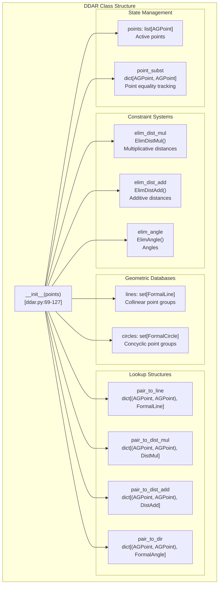
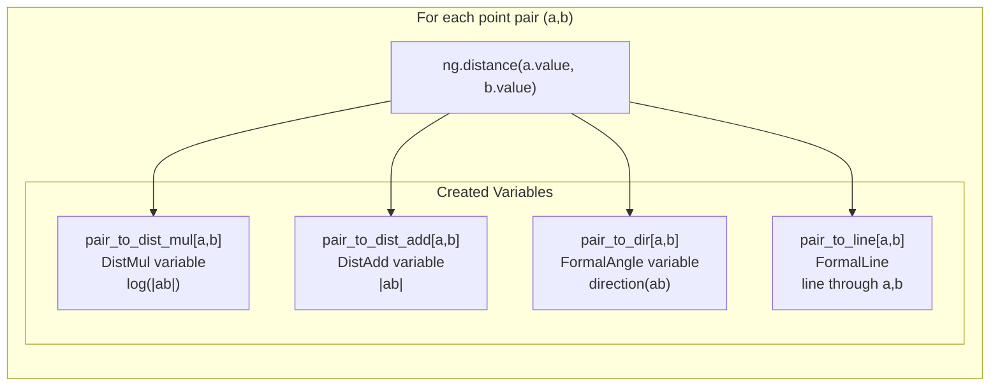
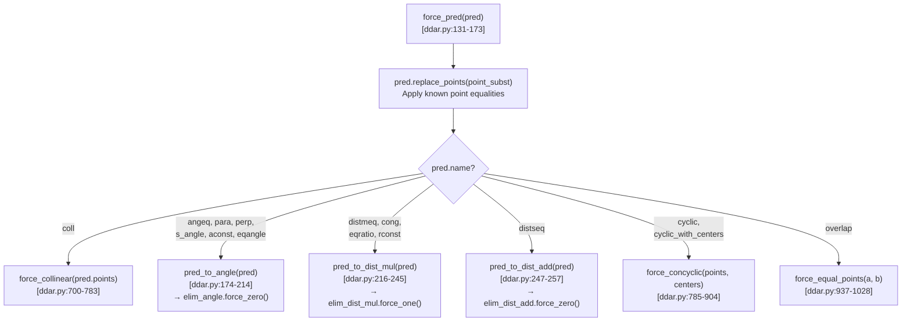
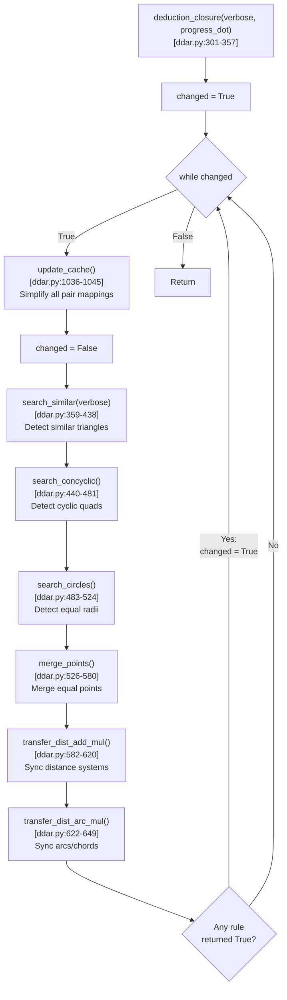
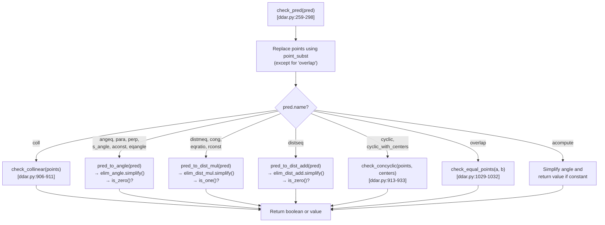
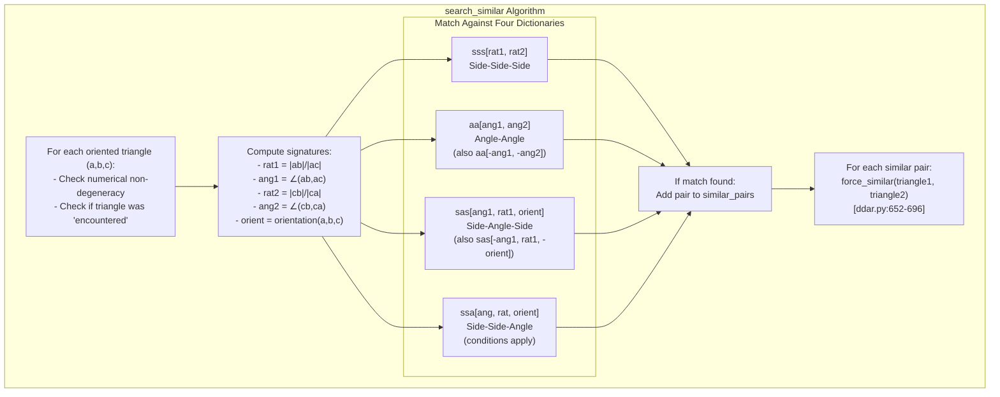
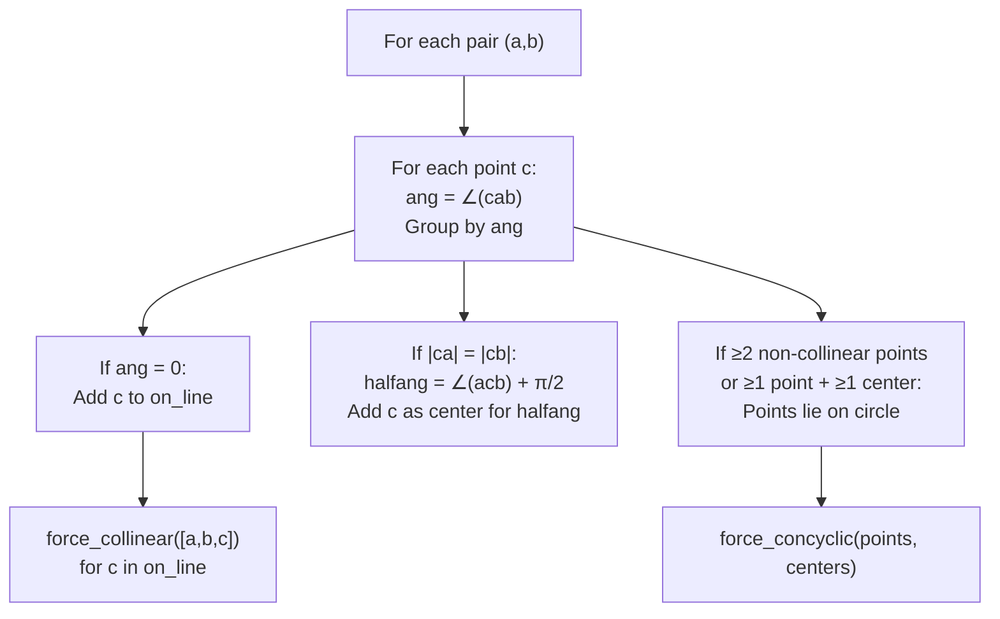
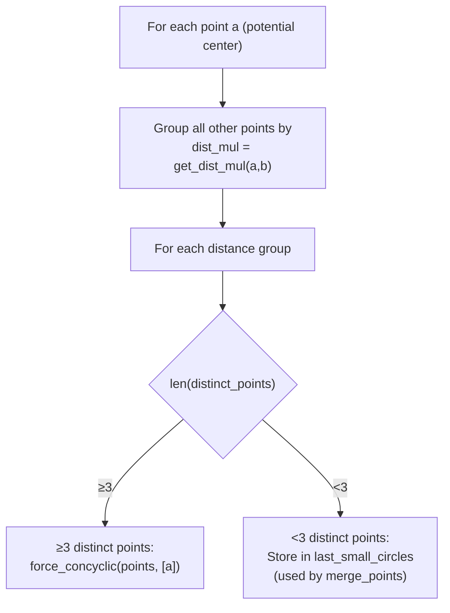
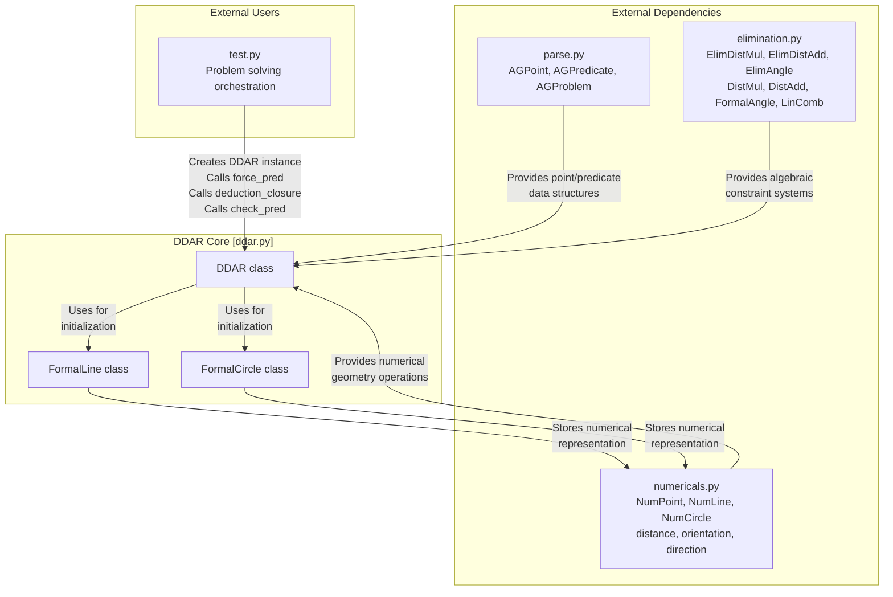

<!-- source: DeepWiki mcp.deepwiki.com · repo google-deepmind/alphageometry2 · page 4 DDAR Logical Engine · fetched 2026-10-26 -->

# DDAR Logical Engine

Relevant source files

The following files were used as context for generating this wiki page:

- [ddar.py](ddar.py)
- [elimination.py](elimination.py)
- [numericals.py](numericals.py)

## Purpose and Scope

The DDAR (Deductive Database for Automated Reasoning) logical engine is the core geometric reasoning system of AlphaGeometry2. This page documents the `DDAR` class in [ddar.py](), which serves as the central orchestrator for symbolic geometric reasoning. It maintains a database of geometric facts, translates predicates into algebraic constraints, performs iterative deductive inference, and verifies proof goals.

For information about the symbolic elimination systems that DDAR uses internally, see [Symbolic Elimination System](#5). For details about the numerical geometry primitives that support DDAR's calculations, see [Numerical Geometry Module](#6). For understanding how problems are parsed before being passed to DDAR, see [Problem Parsing and Data Structures](#7).

**Sources:** [ddar.py:1-87]()

## DDAR Class Overview

The `DDAR` class (defined at [ddar.py:66-1087]()) is initialized with a set of `AGPoint` objects and maintains three parallel representations of geometric knowledge:

1. **Symbolic constraint systems**: Three elimination systems for different algebraic domains
2. **Geometric object databases**: Collections of lines and circles with known relationships
3. **Lookup dictionaries**: Fast access structures mapping point pairs to geometric properties

**Sources:** [ddar.py:66-127]()

## Core Data Structures

### Formal Geometric Objects

DDAR maintains two types of formal geometric objects that represent proven structural relationships:

| Class | Purpose | Key Attributes | Source |
|-------|---------|----------------|--------|
| `FormalLine` | Groups of collinear points | `points`, `main_pair`, `direction`, `value` | [ddar.py:33-48]() |
| `FormalCircle` | Groups of concyclic points | `defining_points`, `points`, `centers`, `value` | [ddar.py:50-64]() |

These objects are immutable and are replaced when new facts are discovered that extend them.

**Sources:** [ddar.py:33-64]()

### Point Pair Mappings

DDAR creates bidirectional mappings for every pair of numerically distinct points during initialization:

These mappings are symmetric: `pair_to_dist_mul[a,b]` and `pair_to_dist_mul[b,a]` reference the same variable.

**Sources:** [ddar.py:83-118]()

## Primary Operations

The DDAR class exposes three primary operations that external code uses:

### 1. Predicate Assertion: `force_pred`

Translates a geometric predicate into algebraic constraints and adds them to the database.

**Sources:** [ddar.py:131-173](), [ddar.py:174-257]()

### 2. Deduction Closure: `deduction_closure`

Iteratively applies geometric inference rules until no new facts can be derived.

Each inference rule returns `True` if it discovered new facts, causing the loop to continue.

**Sources:** [ddar.py:301-357]()

### 3. Predicate Verification: `check_pred`

Queries the database to determine if a predicate is provably satisfied.

**Sources:** [ddar.py:259-298]()

## Predicate Translation System

DDAR translates geometric predicates into three algebraic domains:

### Angle Predicates

The `pred_to_angle` method ([ddar.py:174-214]()) handles six predicate types:

| Predicate | Translation | Example |
|-----------|-------------|---------|
| `angeq` | Linear combination of angles equals constant | `angeq(A,B,C,D; coef1,coef2,const)` → `coef1·∠(AB) + coef2·∠(CD) = const·π` |
| `eqangle` | Angle equality | `eqangle(A,B,C,D,E,F,G,H)` → `∠(AB,CD) = ∠(EF,GH)` |
| `para` | Parallel lines | `para(A,B,C,D)` → `dir(AB) = dir(CD)` |
| `perp` | Perpendicular lines | `perp(A,B,C,D)` → `dir(AB) - dir(CD) = π/2` |
| `s_angle` | Signed angle | `s_angle(A,B,C,D; ang)` → `dir(AB) - dir(CD) = ang` |
| `aconst` | Angle constant | Same as `s_angle` |

**Sources:** [ddar.py:174-214]()

### Distance Ratio Predicates

The `pred_to_dist_mul` method ([ddar.py:216-245]()) handles multiplicative distance relationships:

| Predicate | Translation | Example |
|-----------|-------------|---------|
| `distmeq` | Product of distances | `distmeq(A,B,C,D; coef1,coef2,const)` → `\|AB\|^coef1 · \|CD\|^coef2 = const` |
| `cong` | Congruent segments | `cong(A,B,C,D)` → `\|AB\| = \|CD\|` |
| `rconst` | Ratio constant | `rconst(A,B,C,D; r)` → `\|AB\| / \|CD\| = r` |
| `eqratio` | Equal ratios | `eqratio(A,B,C,D,E,F,G,H)` → `\|AB\|/\|CD\| = \|EF\|/\|GH\|` |

These are converted to logarithmic form for linear algebra: `log(|AB|) + log(|CD|) = log(const)`.

**Sources:** [ddar.py:216-245]()

### Distance Sum Predicates

The `pred_to_dist_add` method ([ddar.py:247-257]()) handles additive distance relationships:

| Predicate | Translation |
|-----------|-------------|
| `distseq` | Linear combination of distances equals zero |

**Sources:** [ddar.py:247-257]()

## Geometric Inference Rules

DDAR implements four main categories of geometric inference that execute during deduction closure:

### Similar Triangle Detection

The `search_similar` method ([ddar.py:359-438]()) identifies similar triangles using four congruence criteria:

The `force_similar` method asserts four equality constraints per triangle pair:
1. Corresponding angles are equal (with sign depending on orientation)
2. Corresponding side ratios are equal

**Sources:** [ddar.py:359-438](), [ddar.py:652-696]()

### Cyclic Quadrilateral Detection

The `search_concyclic` method ([ddar.py:440-481]()) finds concyclic points by:

1. For each pair of points `(a,b)`, group all other points `c` by their inscribed angle `∠(cab)`
2. Points with equal inscribed angles lie on the same circle
3. Points with `|ca| = |cb|` can serve as circle centers (inscribed angle = half of arc)

**Sources:** [ddar.py:440-481]()

### Circle Detection from Equal Distances

The `search_circles` method ([ddar.py:483-524]()) detects circles by finding points equidistant from a center:

**Sources:** [ddar.py:483-524]()

### Point Merging

The `merge_points` method ([ddar.py:526-580]()) identifies points that must be equal based on geometric constraints:

1. Find pairs of points `(a,b)` that are numerically identical: `num_identical(a,b)`
2. Find geometric objects (lines, circles) passing through both `a` and `b`
3. If two such objects intersect at `(a,b)` non-tangentially, then `a = b`
4. Execute `force_equal_points(a,b)` to merge them

**Sources:** [ddar.py:526-580]()

## Knowledge Transfer Operations

DDAR maintains consistency between different algebraic representations through transfer operations:

### Additive/Multiplicative Distance Synchronization

The `transfer_dist_add_mul` method ([ddar.py:582-620]()) ensures that:
- If `|AB|` in additive form equals `|CD|` in additive form
- Then `|AB|` in multiplicative form equals `|CD|` in multiplicative form (and vice versa)

This is implemented by normalizing both representations and cross-linking them.

**Sources:** [ddar.py:582-620]()

### Arc-Chord Synchronization

The `transfer_dist_arc_mul` method ([ddar.py:622-649]()) enforces that on circles:
- Equal chord lengths imply equal arc lengths (angles)
- Equal arc lengths imply equal chord lengths

This creates bidirectional constraints between the angle elimination system and distance elimination system.

**Sources:** [ddar.py:622-649]()

## Utility Methods

DDAR provides several helper methods for retrieving simplified values:

| Method | Purpose | Returns | Source |
|--------|---------|---------|--------|
| `get_dist_mul(a,b)` | Simplified multiplicative distance | `DistMul` | [ddar.py:1053-1055]() |
| `get_dist_add(a,b)` | Simplified additive distance | `DistAdd` | [ddar.py:1057-1059]() |
| `get_point_dir(a,b)` | Simplified direction angle | `FormalAngle` | [ddar.py:1061-1062]() |
| `get_dist_ratio(a,b,c,d)` | Ratio `\|cd\|/\|ab\|` | `DistMul` | [ddar.py:1047-1048]() |
| `get_point_angle(a,b,c,d)` | Angle `dir(cd) - dir(ab)` | `FormalAngle` | [ddar.py:1050-1051]() |
| `get_arc(circle,a,b)` | Arc angle on circle from `a` to `b` | `FormalAngle, AGPoint` | [ddar.py:1064-1071]() |
| `num_identical(a,b)` | Check if points numerically equal | `bool` | [ddar.py:128-129]() |
| `update_cache()` | Refresh cached simplified values | `None` | [ddar.py:1036-1045]() |

**Sources:** [ddar.py:1034-1071]()

## Relationship to Other Modules

**Sources:** [ddar.py:1-31]()

## Design Patterns

### Dual Representation Strategy

DDAR maintains both symbolic (exact algebraic) and numerical (approximate floating-point) representations:

- **Symbolic**: `FormalAngle`, `DistMul`, `DistAdd` for exact reasoning via Gaussian elimination
- **Numerical**: `NumLine`, `NumCircle`, `NumPoint` for validation and heuristic search

All constraints are verified numerically before being asserted symbolically, preventing inconsistent assertions.

### Iterative Closure Pattern

The `deduction_closure` method uses a fixed-point iteration:
1. Apply all inference rules
2. If any rule discovered new facts, repeat from step 1
3. Otherwise, terminate

This guarantees that all derivable facts within the rule set are discovered.

### Immutable Object Replacement

`FormalLine` and `FormalCircle` objects are immutable. When new points are discovered on a line or circle, DDAR creates a new object and replaces all references to the old object in its lookup dictionaries.

**Sources:** [ddar.py:66-1087]()

---

