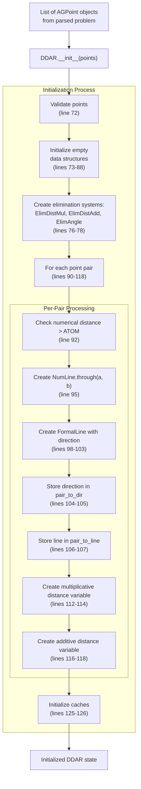
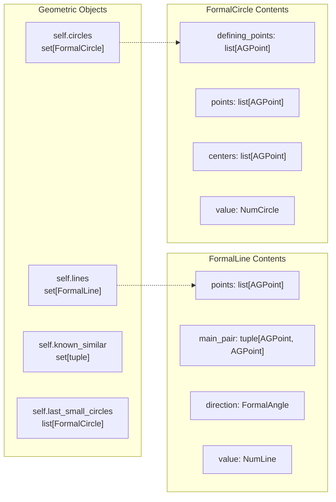
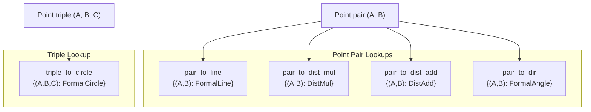
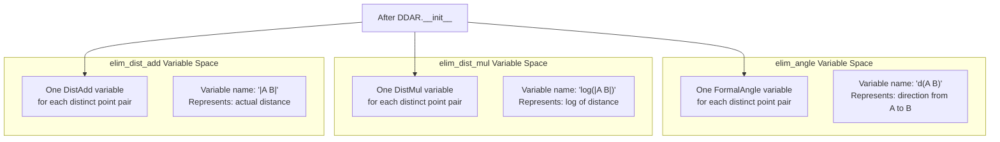

<!-- source: DeepWiki mcp.deepwiki.com · repo google-deepmind/alphageometry2 · page 4.1 DDAR Initialization and State · fetched 2026-10-26 -->

# DDAR Initialization and State

<details>
<summary>Relevant source files</summary>

The following files were used as context for generating this wiki page:

- [ddar.py](ddar.py)
- [parse.py](parse.py)

</details>


## Purpose and Scope

This page documents the initialization process of the `DDAR` class and the internal data structures it maintains throughout its lifetime. The `DDAR` class, defined in [ddar.py:66-1087](), is the main logical reasoning engine for AlphaGeometry2.

This page covers:
- How `DDAR.__init__` constructs the initial state from a list of points
- The complete set of internal data structures and their purposes
- The initialization algorithm that creates formal geometric objects for each point pair

For information about how DDAR processes predicates after initialization, see [Predicate System](#4.2). For the deductive reasoning loop, see [Deduction Closure Process](#4.3).

## Initialization Overview

The `DDAR` class is initialized with a list of `AGPoint` objects from the parsed problem. The initialization process creates a complete relational database of geometric objects and constraint variables for all point pairs.



**Sources:** [ddar.py:69-127]()

## Core Data Structures

The `DDAR` class maintains several categories of internal state:

### Point Management

| Field | Type | Purpose | Initialized At |
|-------|------|---------|----------------|
| `self.points` | `list[AGPoint]` | List of all points in the problem | [ddar.py:71]() |
| `self.point_subst` | `dict[AGPoint, AGPoint]` | Maps each point to its canonical representative (for merged points) | [ddar.py:80]() |

Initially, `point_subst` is an identity mapping where each point maps to itself. When points are proven equal via `force_equal_points()`, this dictionary is updated to map merged points to their canonical representative.

### Geometric Object Storage

| Field | Type | Purpose | Initialized At |
|-------|------|---------|----------------|
| `self.lines` | `set[FormalLine]` | Set of all known collinear point sets | [ddar.py:73]() |
| `self.circles` | `set[FormalCircle]` | Set of all known concyclic point sets | [ddar.py:74]() |
| `self.known_similar` | `set[tuple]` | Set of pairs of similar triangles | [ddar.py:120]() |
| `self.last_small_circles` | `list[FormalCircle]` | Circles with fewer than 3 points (temporary storage) | [ddar.py:124]() |



**Sources:** [ddar.py:33-64](), [ddar.py:73-74](), [ddar.py:120-124]()

### Elimination Systems

Three elimination systems handle different types of algebraic constraints:

| Field | Type | Purpose | Initialized At |
|-------|------|---------|----------------|
| `self.elim_dist_mul` | `ElimDistMul` | Manages multiplicative distance constraints (ratios) via logarithms | [ddar.py:76]() |
| `self.elim_dist_add` | `ElimDistAdd` | Manages additive distance constraints (sums) | [ddar.py:77]() |
| `self.elim_angle` | `ElimAngle` | Manages angle constraints and parallel/perpendicular relationships | [ddar.py:78]() |

Each elimination system maintains its own variable space and performs Gaussian elimination to simplify constraint equations. See [Symbolic Elimination System](#5) for detailed documentation.

**Sources:** [ddar.py:76-78]()

### Lookup Dictionaries

These dictionaries provide O(1) lookup of geometric relationships between point pairs:

| Field | Type | Key | Value | Purpose |
|-------|------|-----|-------|---------|
| `self.pair_to_line` | `dict` | `(AGPoint, AGPoint)` | `FormalLine` | Maps point pairs to the line containing them | [ddar.py:81]() |
| `self.pair_to_dist_mul` | `dict` | `(AGPoint, AGPoint)` | `DistMul` (LinComb) | Maps point pairs to multiplicative distance variable | [ddar.py:86]() |
| `self.pair_to_dist_add` | `dict` | `(AGPoint, AGPoint)` | `DistAdd` (LinComb) | Maps point pairs to additive distance variable | [ddar.py:87]() |
| `self.pair_to_dir` | `dict` | `(AGPoint, AGPoint)` | `FormalAngle` (LinComb) | Maps point pairs to direction angle | [ddar.py:88]() |
| `self.triple_to_circle` | `dict` | `(AGPoint, AGPoint, AGPoint)` | `FormalCircle` | Maps point triples to the circle containing them | [ddar.py:121-123]() |

**Important:** All pair-based dictionaries store entries for both `(a, b)` and `(b, a)` with the same value, enabling bidirectional lookup.



**Sources:** [ddar.py:81](), [ddar.py:86-88](), [ddar.py:121-123]()

### Caches

Two caches store simplified expressions to avoid redundant elimination operations:

| Field | Type | Purpose | Initialized At |
|-------|------|---------|----------------|
| `self.dist_mul_cache` | `dict` | Cached simplified multiplicative distances | [ddar.py:125]() |
| `self.direction_cache` | `dict` | Cached simplified direction angles | [ddar.py:126]() |

These caches are populated by `update_cache()` [ddar.py:1036-1045]() during the deduction closure loop. They are initialized as shallow copies of the corresponding `pair_to_*` dictionaries.

**Sources:** [ddar.py:125-126](), [ddar.py:1036-1045]()

## Initialization Algorithm

The initialization algorithm processes each pair of distinct points to create formal geometric objects and constraint variables:

```mermaid
flowchart TD
    Start["Start: DDAR.__init__(points)"]
    SetPoints["self.points = list(points)<br/>(line 71)"]
    Validate["Assert all are AGPoint instances<br/>(line 72)"]
    InitSets["Initialize empty sets:<br/>self.lines, self.circles<br/>(lines 73-74)"]
    InitElim["Create elimination systems:<br/>ElimDistMul(), ElimDistAdd(), ElimAngle()<br/>(lines 76-78)"]
    InitDicts["Initialize empty dicts:<br/>point_subst, pair_to_*, etc.<br/>(lines 80-88)"]
    
    LoopStart{"For each pair (a, b)<br/>in combinations(points, 2)<br/>(line 90)"}
    CheckDist{"distance(a, b) >= ATOM?<br/>(line 92)"}
    
    CreateNumLine["num_line = NumLine.through(a.value, b.value)<br/>(line 95)"]
    GetDirection["num_direction = num_line.direction()<br/>(line 96)"]
    CreateDirVar["direction = elim_angle.new_var(num_direction)<br/>(line 97)"]
    
    CreateFormalLine["Create FormalLine:<br/>points=[a,b], main_pair=(a,b),<br/>direction=direction, value=num_line<br/>(lines 98-103)"]
    
    StoreDirBoth["pair_to_dir[(a,b)] = direction<br/>pair_to_dir[(b,a)] = direction<br/>(lines 104-105)"]
    StoreLineBoth["pair_to_line[(a,b)] = line<br/>pair_to_line[(b,a)] = line<br/>(lines 106-107)"]
    AddLineToSet["lines.add(line)<br/>(line 108)"]
    
    CalcDist["dist = distance(a.value, b.value)<br/>(line 110)"]
    CreateDistMulVar["dist_mul = elim_dist_mul.new_var(dist)<br/>(line 112)"]
    StoreDistMulBoth["pair_to_dist_mul[(a,b)] = dist_mul<br/>pair_to_dist_mul[(b,a)] = dist_mul<br/>(lines 113-114)"]
    
    CreateDistAddVar["dist_add = elim_dist_add.new_var(dist)<br/>(line 116)"]
    StoreDistAddBoth["pair_to_dist_add[(a,b)] = dist_add<br/>pair_to_dist_add[(b,a)] = dist_add<br/>(lines 117-118)"]
    
    LoopNext["Next pair"]
    
    InitCaches["Initialize caches:<br/>dist_mul_cache = dict(pair_to_dist_mul)<br/>direction_cache = dict(pair_to_dir)<br/>(lines 125-126)"]
    
    End["Initialization complete"]
    
    Start --> SetPoints
    SetPoints --> Validate
    Validate --> InitSets
    InitSets --> InitElim
    InitElim --> InitDicts
    InitDicts --> LoopStart
    
    LoopStart -->|More pairs| CheckDist
    CheckDist -->|No, skip pair| LoopNext
    CheckDist -->|Yes| CreateNumLine
    
    CreateNumLine --> GetDirection
    GetDirection --> CreateDirVar
    CreateDirVar --> CreateFormalLine
    CreateFormalLine --> StoreDirBoth
    StoreDirBoth --> StoreLineBoth
    StoreLineBoth --> AddLineToSet
    AddLineToSet --> CalcDist
    CalcDist --> CreateDistMulVar
    CreateDistMulVar --> StoreDistMulBoth
    StoreDistMulBoth --> CreateDistAddVar
    CreateDistAddVar --> StoreDistAddBoth
    StoreDistAddBoth --> LoopNext
    
    LoopNext --> LoopStart
    LoopStart -->|No more pairs| InitCaches
    InitCaches --> End
```



**Sources:** [ddar.py:69-127]()

### Step-by-Step Process

**Step 1: Point Validation** [ddar.py:71-72]()
- Store the input points list
- Assert all elements are `AGPoint` instances

**Step 2: Data Structure Initialization** [ddar.py:73-88]()
- Create empty sets for `lines` and `circles`
- Instantiate three elimination systems
- Initialize `point_subst` as identity mapping `{x: x for x in points}`
- Create empty dictionaries for pair-based lookups

**Step 3: Pair Processing Loop** [ddar.py:90-118]()

For each pair `(a, b)` in `itertools.combinations(self.points, 2)`:

1. **Distance Check** [ddar.py:92-93](): Skip if `distance(a.value, b.value) < ATOM` (points are numerically identical)

2. **Line Creation** [ddar.py:95-103]():
   - Create `NumLine.through(a.value, b.value)` for numerical representation
   - Get the line's direction as a numerical angle
   - Create a `FormalAngle` variable in `elim_angle` representing this direction
   - Package into a `FormalLine` object with both symbolic (`direction`) and numerical (`value`) representations

3. **Bidirectional Storage** [ddar.py:104-108]():
   - Store direction in both `pair_to_dir[a, b]` and `pair_to_dir[b, a]`
   - Store line in both `pair_to_line[a, b]` and `pair_to_line[b, a]`
   - Add line to `self.lines` set

4. **Distance Variable Creation** [ddar.py:110-118]():
   - Calculate numerical distance between points
   - Create multiplicative distance variable `log(|a b|)` in `elim_dist_mul`
   - Store in both `pair_to_dist_mul[a, b]` and `pair_to_dist_mul[b, a]`
   - Create additive distance variable `|a b|` in `elim_dist_add`
   - Store in both `pair_to_dist_add[a, b]` and `pair_to_dist_add[b, a]`

**Step 4: Cache Initialization** [ddar.py:125-126]()
- Initialize `dist_mul_cache` as a copy of `pair_to_dist_mul`
- Initialize `direction_cache` as a copy of `pair_to_dir`

## Initial State Properties

After initialization, the DDAR state has the following properties:

### Structural Invariants

1. **Bidirectional Symmetry**: For any distinct points `a` and `b`:
   - `pair_to_line[a, b] == pair_to_line[b, a]`
   - `pair_to_dist_mul[a, b] == pair_to_dist_mul[b, a]`
   - `pair_to_dist_add[a, b] == pair_to_dist_add[b, a]`
   - `pair_to_dir[a, b] == pair_to_dir[b, a]`

2. **Line Coverage**: Every non-identical point pair `(a, b)` has exactly one entry in `pair_to_line`

3. **Initial Lines**: `len(self.lines) ≤ C(n, 2)` where `n = len(points)`, with equality when no points are numerically identical

4. **Empty Circles**: `self.circles` is initially empty; circles are only created during deduction

5. **Empty Similarity**: `self.known_similar` is initially empty; similar triangles are discovered during deduction

**Sources:** [ddar.py:90-118]()

### Variable Space Properties

After initialization, each elimination system contains:



**Sources:** [ddar.py:97](), [ddar.py:112](), [ddar.py:116]()

## Helper Method: num_identical()

The `num_identical(a, b)` method [ddar.py:128-129]() checks if two points are numerically identical:

```python
def num_identical(self, a, b):
    return (a, b) not in self.pair_to_dist_mul
```

This method returns `True` if the point pair was skipped during initialization due to having distance less than `ATOM`. It's used throughout DDAR to avoid processing degenerate geometric configurations.

**Sources:** [ddar.py:128-129]()

## State Evolution During Execution

While this page documents the initial state after construction, the DDAR state evolves during execution:

- **`force_pred()`** [ddar.py:131-172]() adds constraints to elimination systems and may create new circles
- **`deduction_closure()`** [ddar.py:301-357]() discovers new geometric relationships, creating circles and merging lines
- **`force_equal_points()`** [ddar.py:937-1027]() merges points, updating `point_subst` and consolidating geometric objects
- **`update_cache()`** [ddar.py:1036-1045]() refreshes cached simplified expressions

For details on these state-modifying operations, see [Predicate System](#4.2), [Deduction Closure Process](#4.3), and [Geometric Inference Rules](#4.4).

**Sources:** [ddar.py:131-172](), [ddar.py:301-357](), [ddar.py:937-1027](), [ddar.py:1036-1045]()

---

