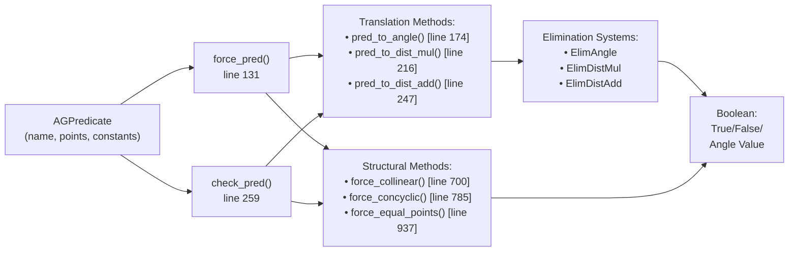
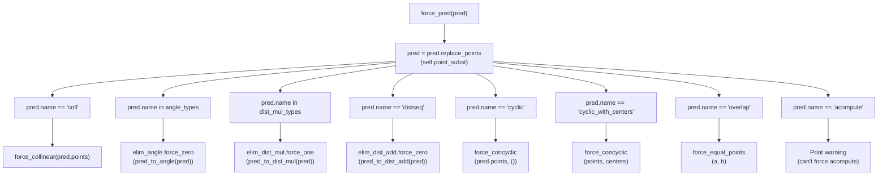
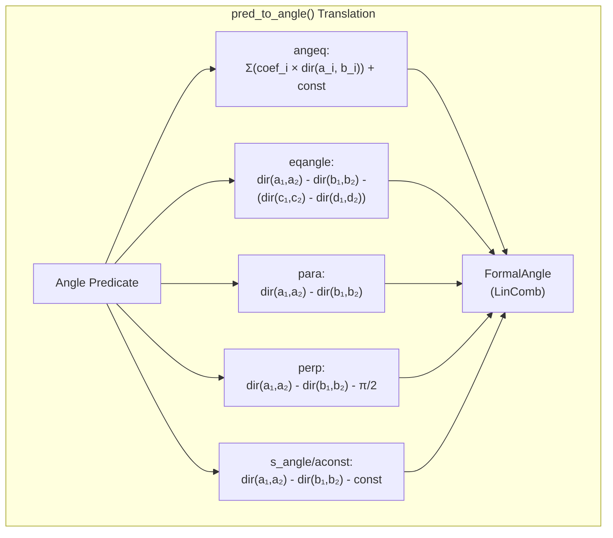
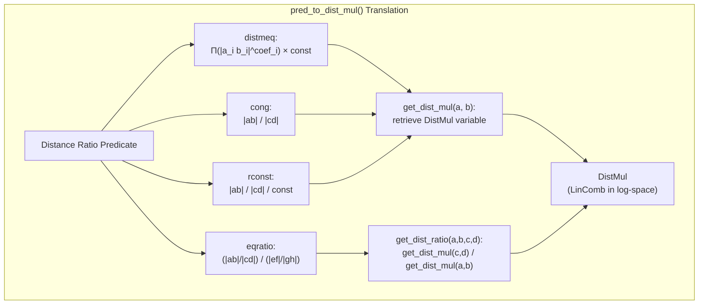
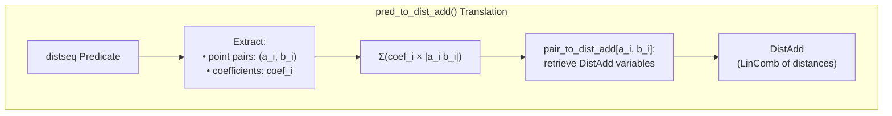
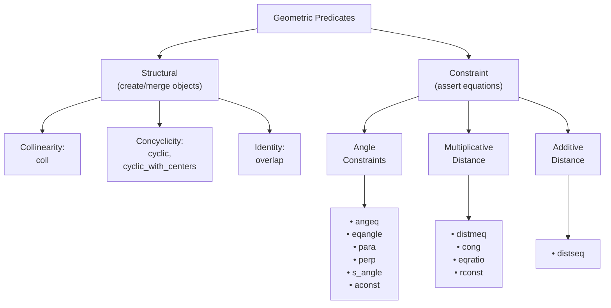
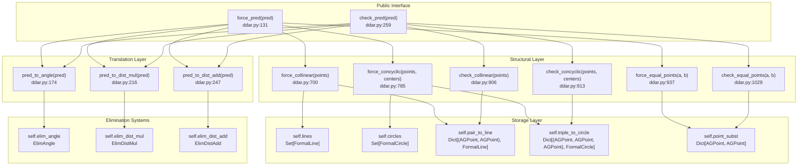

<!-- source: DeepWiki mcp.deepwiki.com · repo google-deepmind/alphageometry2 · page 4.2 Predicate System · fetched 2026-10-26 -->

# Predicate System

<details>
<summary>Relevant source files</summary>

The following files were used as context for generating this wiki page:

- [ddar.py](ddar.py)
- [parse.py](parse.py)

</details>


This page documents the complete predicate system in DDAR, which serves as the interface between geometric statements and the underlying constraint solving machinery. Predicates are structured representations of geometric facts (e.g., "points A, B, C are collinear") that DDAR can assert as assumptions or verify as conclusions.

For information about how predicates are parsed from strings, see [Problem String Format](#7.1). For details on the elimination systems that predicates are translated into, see [Symbolic Elimination System](#5).

**Sources:** [ddar.py:131-299]()

---

## Predicate Categories

DDAR supports 16 distinct predicate types, organized into five categories based on the geometric property they express:

### Collinearity Predicates

| Predicate | Points | Constants | Meaning |
|-----------|--------|-----------|---------|
| `coll` | n ≥ 2 | none | Points lie on a common line |

### Angle Predicates

| Predicate | Points | Constants | Meaning |
|-----------|--------|-----------|---------|
| `angeq` | 2k | k coefficients + 1 constant | Linear combination of directed angles equals constant |
| `eqangle` | 8 | none | Angle(a₁a₂, b₁b₂) = Angle(c₁c₂, d₁d₂) |
| `para` | 4 | none | Lines a₁a₂ and b₁b₂ are parallel |
| `perp` | 4 | none | Lines a₁a₂ and b₁b₂ are perpendicular |
| `s_angle` | 4 | 1 angle value | Signed angle between lines equals constant |
| `aconst` | 4 | 1 angle value | Alias for `s_angle` |
| `acompute` | 4 | none | Query angle value (check only, not forceable) |

### Distance Predicates (Multiplicative)

| Predicate | Points | Constants | Meaning |
|-----------|--------|-----------|---------|
| `distmeq` | 2k | k coefficients + 1 constant | Product of powered distances equals constant |
| `cong` | 4 | none | \|ab\| = \|cd\| (congruent segments) |
| `eqratio` | 8 | none | \|ab\|/\|cd\| = \|ef\|/\|gh\| |
| `rconst` | 4 | 1 ratio value | \|ab\|/\|cd\| = constant |

### Distance Predicates (Additive)

| Predicate | Points | Constants | Meaning |
|-----------|--------|-----------|---------|
| `distseq` | 2k | k coefficients | Linear combination of distances equals zero |

### Concyclicity Predicates

| Predicate | Points | Constants | Meaning |
|-----------|--------|-----------|---------|
| `cyclic` | n ≥ 3 | none | Points lie on a common circle |
| `cyclic_with_centers` | n + m | 1 (number of centers) | Points lie on circle with specified center(s) |

### Point Identity Predicates

| Predicate | Points | Constants | Meaning |
|-----------|--------|-----------|---------|
| `overlap` | 2 | none | Two points are identical |

**Sources:** [ddar.py:131-172](), [ddar.py:259-298]()

---

## Predicate Processing Pipeline

DDAR provides two primary operations on predicates: **forcing** (asserting as an assumption) and **checking** (verifying as a conclusion).



**Sources:** [ddar.py:131-173](), [ddar.py:259-298]()

---

## Predicate Assertion: `force_pred()`

The `force_pred()` method adds a predicate as an assumption to the DDAR database. It first substitutes points using `self.point_subst` (to handle merged points), then dispatches based on predicate type.

### Dispatch Logic



**Implementation Details:**

**Angle types:** `angeq`, `para`, `perp`, `s_angle`, `aconst`, `eqangle`  
**Distance multiplicative types:** `distmeq`, `cong`, `eqratio`, `rconst`

For `cyclic_with_centers`, the method extracts centers from the first `num_centers` points, then checks if at least 3 distinct points exist. If fewer than 3 distinct points, it forces equal distances to all centers instead of creating a full circle.

**Sources:** [ddar.py:131-172]()

---

## Predicate Verification: `check_pred()`

The `check_pred()` method queries whether a predicate is satisfied in the current DDAR database. Unlike `force_pred()`, it returns a boolean result (or an angle value for `acompute`).

### Verification Strategy by Type

| Predicate Category | Verification Method |
|-------------------|---------------------|
| Collinearity | Check if points belong to same `FormalLine` |
| Angle predicates | Translate to `FormalAngle`, simplify, check if zero |
| Distance multiplicative | Translate to `DistMul`, simplify, check if one |
| Distance additive | Translate to `DistAdd`, simplify, check if zero |
| Concyclicity | Check if points belong to same `FormalCircle` |
| Point identity | Check `point_subst` mapping |
| Angle computation | Simplify angle, extract constant coefficient |

**Key Difference from `force_pred()`:** The `check_pred()` method does NOT substitute points for `overlap` predicates [ddar.py:262-263](), allowing it to verify point identity before substitution is applied.

**Sources:** [ddar.py:259-298]()

---

## Translation Methods

Three translation methods convert predicates into algebraic constraints over the elimination systems.

### Angle Translation: `pred_to_angle()`

Converts angle predicates into `FormalAngle` expressions that equal zero.



**Implementation notes:**
- Directions are retrieved from `self.pair_to_dir[a, b]` which maps point pairs to `FormalAngle` variables
- Constants are converted to fractions (dividing degrees by 180 to normalize)
- `perp` uses `elim_angle.const(1, 2)` to represent π/2 (90 degrees)

**Sources:** [ddar.py:174-214]()

### Distance Multiplicative Translation: `pred_to_dist_mul()`

Converts distance ratio predicates into `DistMul` expressions that equal one (representing log-space equations).



**Key insight:** DDAR works in logarithmic space for distances, so:
- Products become sums: `log(|ab| × |cd|) = log|ab| + log|cd|`
- Ratios become differences: `log(|ab|/|cd|) = log|ab| - log|cd|`
- The target value is 1 (log(1) = 0 in the underlying representation)

**Sources:** [ddar.py:216-245]()

### Distance Additive Translation: `pred_to_dist_add()`

Converts additive distance predicates into `DistAdd` expressions that equal zero.



**Example:** `distseq a b c d 1 -1` represents `|ab| - |cd| = 0`, i.e., segments are equal length.

**Sources:** [ddar.py:247-257]()

---

## Structural Predicate Handling

Three predicate types receive special structural handling rather than simple constraint translation:

### Collinearity: `force_collinear()`

The `force_collinear()` method merges multiple `FormalLine` objects and establishes additive distance relationships along the line.

**Algorithm:**
1. Find the two points with maximum separation to define the main line
2. Collect all `FormalLine` objects containing any of the input points
3. Merge points and lines into a single unified `FormalLine`
4. Sort points by position along the line
5. Assert additive constraints: for points a, b, c on line, `|ab| + |bc| = |ac|`

**Sources:** [ddar.py:700-783]()

### Concyclicity: `force_concyclic()`

The `force_concyclic()` method merges `FormalCircle` objects and establishes angle-arc relationships.

**Algorithm:**
1. Collect all `FormalCircle` objects containing any input points
2. Construct numerical circle (using first 3 distinct points or specified center)
3. Merge circles into unified `FormalCircle`
4. For each pair of points on circle, relate inscribed angle to arc length
5. If centers specified, force equal distances from center to all points

**Arc-angle relationship:** For points x, y on circle with defining point c:
```
angle(x, c) - angle(x, y) = arc(y, c)
```

**Sources:** [ddar.py:785-904]()

### Point Identity: `force_equal_points()`

The `force_equal_points()` method merges two points throughout the entire DDAR database.

**Operations:**
1. Add merged point to all `FormalLine` and `FormalCircle` objects containing either original point
2. Update `pair_to_line` and `triple_to_circle` lookups to reference merged objects
3. Force equal distances from merged point to all other points
4. Update `point_subst` mapping to redirect references
5. Remove one point from `self.points` list

**Sources:** [ddar.py:937-1032]()

---

## Predicate Type Taxonomy



**Sources:** [ddar.py:131-172]()

---

## Code Entity Reference

This diagram maps natural language predicate descriptions to their concrete implementations in the codebase:



**Sources:** [ddar.py:66-127]()

---

## Special Cases and Edge Conditions

### Degenerate Cyclic Predicates

When `cyclic_with_centers` receives fewer than 3 distinct points [ddar.py:149-164](), the system cannot define a unique circle. Instead, it forces equal distances from all specified centers to all points:

```python
# For each (point, center) pair
for a in points:
    for c in centers:
        d = self.get_dist_mul(a, c)
        self.elim_dist_mul.force_one(d0 / d)  # d = d0
```

### Acompute Predicate

The `acompute` predicate is special: it can only be checked, not forced [ddar.py:169-170](). When checked, it returns:
- A `Fraction` representing the angle value (in fractions of 180°) if the angle is a constant
- `None` if the angle depends on non-constant variables

**Sources:** [ddar.py:289-296]()

### Point Substitution in `check_pred()`

All predicates undergo point substitution when checked EXCEPT `overlap` [ddar.py:262-263](). This allows `overlap` verification to work correctly: it checks whether two points SHOULD be merged before the substitution has occurred.

**Sources:** [ddar.py:259-263]()

---

## Example Predicate Processing Flows

### Example 1: Forcing Parallel Lines

**Input predicate:** `para A B C D`  
**Meaning:** Line AB is parallel to line CD

**Processing:**
1. `force_pred()` recognizes `para` as an angle predicate
2. Calls `pred_to_angle()` which computes: `dir(A,B) - dir(C,D)`
3. Retrieves direction variables: `self.pair_to_dir[A,B]` and `self.pair_to_dir[C,D]`
4. Forms difference: `angle = direction1 - direction2`
5. Calls `self.elim_angle.force_zero(angle)`
6. The elimination system records that these directions must be equal

**Sources:** [ddar.py:136-138](), [ddar.py:191-194]()

### Example 2: Checking Congruence

**Input predicate:** `cong A B C D`  
**Meaning:** Segment AB is congruent to segment CD

**Processing:**
1. `check_pred()` recognizes `cong` as a distance multiplicative predicate
2. Calls `pred_to_dist_mul()` which computes: `|AB| / |CD|`
3. Retrieves: `d1 = self.get_dist_mul(A, B)` and `d2 = self.get_dist_mul(C, D)`
4. Forms ratio: `ratio = d1 / d2`
5. Calls `self.elim_dist_mul.simplify(ratio)`
6. Returns `ratio.is_one()` - true if the elimination system knows they're equal

**Sources:** [ddar.py:271-274](), [ddar.py:228-232]()

### Example 3: Forcing Collinearity

**Input predicate:** `coll A B C D`  
**Meaning:** Points A, B, C, D are collinear

**Processing:**
1. `force_pred()` calls `force_collinear([A, B, C, D])`
2. Finds main pair: points with maximum distance (say B, D)
3. Retrieves `line_BD = self.pair_to_line[B, D]`
4. Collects all lines containing any of {A, B, C, D}
5. Merges into single `FormalLine` with sorted points: [B, A, C, D]
6. Asserts additive constraints:
   - `|BA| + |AC| = |BC|`
   - `|BA| + |AD| = |BD|`
   - `|AC| + |CD| = |AD|`
7. Unifies all direction variables for the merged lines

**Sources:** [ddar.py:135-136](), [ddar.py:700-783]()

---

## Performance Considerations

### Predicate Caching

DDAR maintains two caches that accelerate predicate checking:
- `self.dist_mul_cache`: Caches simplified `DistMul` values for point pairs
- `self.direction_cache`: Caches simplified `FormalAngle` values for point pairs

These caches are updated via `update_cache()` [ddar.py:1036-1045]() after any structural changes that might affect distances or angles.

### Lookup Data Structures

The system uses hash-based lookups for O(1) predicate verification:
- `self.pair_to_line`: Maps point pairs to their containing line
- `self.triple_to_circle`: Maps point triples to their containing circle
- `self.point_subst`: Maps original points to their merged representatives

**Sources:** [ddar.py:80-127](), [ddar.py:1036-1045]()

---

