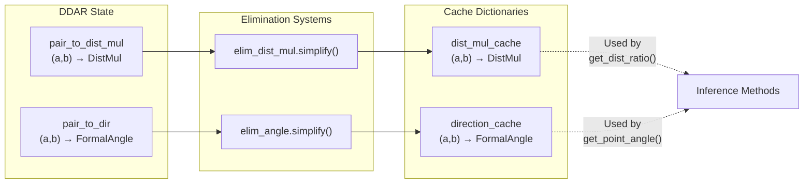
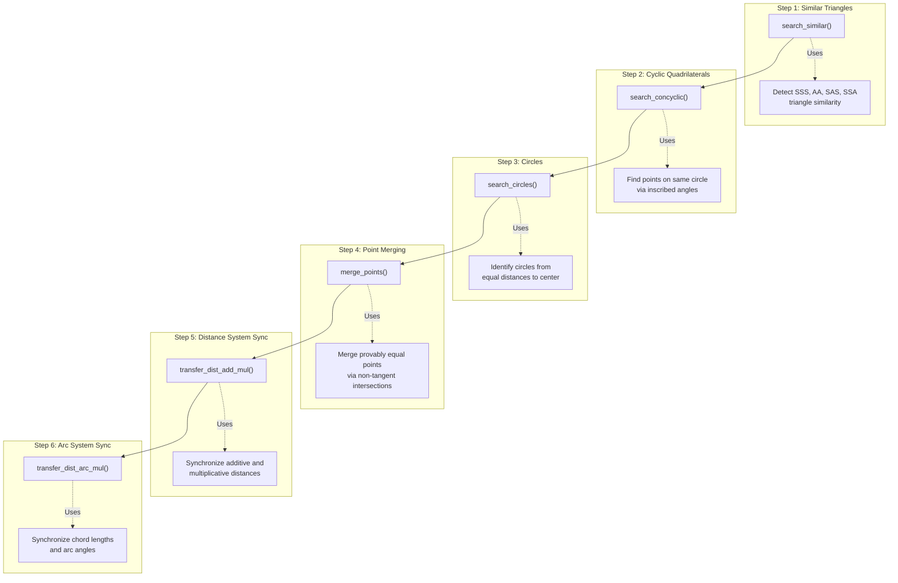
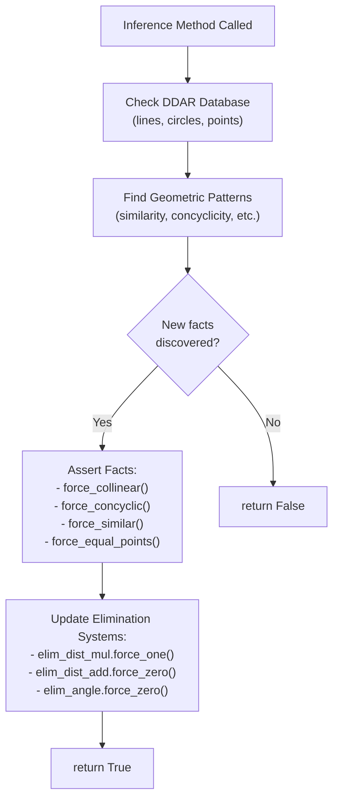
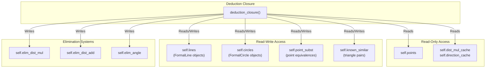

<!-- source: DeepWiki mcp.deepwiki.com · repo google-deepmind/alphageometry2 · page 4.3 Deduction Closure Process · fetched 2026-10-26 -->

# Deduction Closure Process

<details>
<summary>Relevant source files</summary>

The following files were used as context for generating this wiki page:

- [ddar.py](ddar.py)
- [elimination.py](elimination.py)
- [numericals.py](numericals.py)

</details>


## Purpose and Scope

This page documents the `deduction_closure` method in the DDAR class, which implements the iterative inference loop at the core of AlphaGeometry2's geometric reasoning. This method repeatedly applies geometric inference rules until no new facts can be deduced, achieving a "closed" state where all derivable conclusions have been reached.

For details on the individual inference algorithms applied during closure (similar triangles, cyclic quadrilaterals, circles, point merging), see [Geometric Inference Rules](#4.4). For information on how predicates are initially asserted before closure begins, see [Predicate System](#4.2).

## Overview

The deduction closure process is a fixed-point computation that iteratively applies six categories of inference rules until convergence. Each iteration attempts to discover new geometric facts by analyzing relationships between points, lines, and circles in the DDAR database. The process terminates when an entire iteration produces no new facts.

**Control Flow Diagram: Deduction Closure Loop**

```mermaid
flowchart TD
    Start["deduction_closure()"]
    InitChanged["changed = True"]
    WhileLoop{"changed?"}
    UpdateCache1["update_cache()"]
    ResetChanged["changed = False"]
    
    Similar["search_similar()"]
    SimilarUpdate["update_cache()"]
    SimilarChanged{"changed_last?"}
    
    Concyclic["search_concyclic()"]
    ConcyclicUpdate["update_cache()"]
    ConcyclicChanged{"changed_last?"}
    
    Circles["search_circles()"]
    CirclesChanged{"changed_last?"}
    
    Merge["merge_points()"]
    MergeChanged{"changed_last?"}
    MergeUpdate["update_cache()"]
    
    TransferDistAddMul["transfer_dist_add_mul()"]
    TransferDistChanged{"changed_last?"}
    
    TransferDistArcMul["transfer_dist_arc_mul()"]
    TransferArcChanged{"changed_last?"}
    
    End["Return"]
    
    Start --> InitChanged
    InitChanged --> WhileLoop
    WhileLoop -->|False| End
    WhileLoop -->|True| UpdateCache1
    UpdateCache1 --> ResetChanged
    
    ResetChanged --> Similar
    Similar --> SimilarChanged
    SimilarChanged -->|True| SimilarUpdate
    SimilarChanged -->|False| Concyclic
    SimilarUpdate --> Concyclic
    
    Concyclic --> ConcyclicChanged
    ConcyclicChanged -->|True| ConcyclicUpdate
    ConcyclicChanged -->|False| Circles
    ConcyclicUpdate --> Circles
    
    Circles --> CirclesChanged
    CirclesChanged --> Merge
    
    Merge --> MergeChanged
    MergeChanged -->|True| MergeUpdate
    MergeChanged -->|False| TransferDistAddMul
    MergeUpdate --> TransferDistAddMul
    
    TransferDistAddMul --> TransferDistChanged
    TransferDistChanged --> TransferDistArcMul
    
    TransferDistArcMul --> TransferArcChanged
    TransferArcChanged --> WhileLoop
```



Sources: [ddar.py:301-358]()

## Iteration Control Mechanism

The deduction closure loop uses a simple changed-flag mechanism to control iteration and termination. The loop continues as long as any inference step modifies the DDAR state.

### Main Loop Structure

```
while changed:
    update_cache()
    changed = False
    
    # Apply each inference rule
    changed |= search_similar()
    changed |= search_concyclic()
    changed |= search_circles()
    changed |= merge_points()
    changed |= transfer_dist_add_mul()
    changed |= transfer_dist_arc_mul()
```

Each inference method returns a boolean indicating whether it added new facts to the database. The `changed` flag accumulates these results and determines whether another iteration is needed.

**Iteration State Tracking**

| Variable | Type | Purpose |
|----------|------|---------|
| `changed` | `bool` | Tracks if any changes occurred in current iteration |
| `changed_last` | `bool` | Tracks if the most recent inference step changed state |
| `progress_dot` | `bool` | Controls printing of progress indicators |
| `verbose` | `bool` | Controls detailed logging of inference steps |

Sources: [ddar.py:301-358]()

## Cache Update Process

The `update_cache` method maintains simplified representations of distance and angle relationships for fast access during inference. This cache synchronization is critical for performance, as it avoids redundant calls to the elimination system's simplification routines.

**Cache Update Architecture**



Sources: [ddar.py:1036-1046](), [ddar.py:1047-1052]()

### Cache Population

The `update_cache` method iterates over all pairs of distinct points and populates two cache dictionaries:

```python
def update_cache(self):
    for a, b in itertools.combinations(self.points, 2):
        if self.num_identical(a, b):
            continue
        dist = self.get_dist_mul(a, b)
        self.dist_mul_cache[a, b] = dist
        self.dist_mul_cache[b, a] = dist
        direction = self.elim_angle.simplify(self.pair_to_dir[a, b])
        self.direction_cache[a, b] = direction
        self.direction_cache[b, a] = direction
```

The cache stores simplified values for:
- **`dist_mul_cache`**: Multiplicative distances between point pairs, simplified by the elimination system
- **`direction_cache`**: Line directions between point pairs, simplified by the angle elimination system

These cached values are used by the helper methods `get_dist_ratio` and `get_point_angle`, which are called extensively during triangle similarity detection.

**When Cache Updates Occur**

| Location | Trigger | Reason |
|----------|---------|--------|
| Start of iteration | Always | Prepare for next round of inference |
| After `search_similar()` | If changed | New angle/distance equalities |
| After `search_concyclic()` | If changed | New angle constraints from circles |
| After `merge_points()` | If changed | Point identifications change geometry |

Sources: [ddar.py:301-358](), [ddar.py:1036-1046]()

## The Six Inference Steps

The deduction closure process applies six types of geometric inference in a fixed order during each iteration. This ordering is designed to maximize the discovery of new facts while maintaining consistency.

**Inference Step Execution Sequence**



Sources: [ddar.py:301-358]()

### Step 1: Similar Triangles (`search_similar`)

Searches for similar triangles using four similarity criteria: SSS (Side-Side-Side), AA (Angle-Angle), SAS (Side-Angle-Side), and SSA (Side-Side-Angle). When similar triangles are found, their angle and ratio equalities are asserted into the elimination systems.

**Behavior:**
- Iterates over all ordered triples of non-collinear points
- Builds hash tables indexed by angle and ratio signatures
- Returns `True` if any new similarity relationships were discovered
- Triggers cache update if changed

**Method signature:** [ddar.py:359-438]()

### Step 2: Cyclic Quadrilaterals (`search_concyclic`)

Detects concyclic points using the inscribed angle theorem: points on the same circle subtend equal angles at the circumference. Also identifies circle centers using the property that the angle from a center is twice the inscribed angle.

**Behavior:**
- For each pair of points (a, b), groups other points by their inscribed angle
- Points with the same inscribed angle are concyclic
- Points equidistant from a and b are on the perpendicular bisector (collinear case)
- Returns `True` if any new concyclic relationships were discovered
- Triggers cache update if changed

**Method signature:** [ddar.py:440-481]()

### Step 3: Circles (`search_circles`)

Identifies circles by finding sets of points equidistant from a potential center. This step complements `search_concyclic` by using distance equality rather than angle equality.

**Behavior:**
- For each point a, groups other points by their distance from a
- If 3+ points have the same distance, they lie on a circle centered at a
- Circles with <3 points are stored in `last_small_circles` for later use by point merging
- Returns `True` if any new circles were discovered

**Method signature:** [ddar.py:483-524]()

### Step 4: Point Merging (`merge_points`)

Identifies points that must be equal by analyzing the intersection behavior of geometric objects passing through them. If two objects (lines or circles) pass through the same pair of points but are not tangent, the points must be identical.

**Behavior:**
- Finds all pairs of numerically identical points
- For each pair, collects lines and circles passing through both
- If two objects intersect non-tangentially, the points are merged
- Point merging updates `point_subst` and removes the merged point from `points`
- Returns `True` if any points were merged
- Triggers cache update if changed

**Method signature:** [ddar.py:526-580]()

### Step 5: Distance System Synchronization (`transfer_dist_add_mul`)

Synchronizes the additive distance elimination system (`elim_dist_add`) with the multiplicative distance system (`elim_dist_mul`). These two systems track the same geometric quantities but in different forms (linear vs. logarithmic).

**Behavior:**
- For each pair of points (a, b), normalizes both distance representations
- Maintains two dictionaries mapping normalized values between systems
- When the same normalized value appears twice, asserts equality in the opposite system
- Returns `True` if any new constraints were added

**Method signature:** [ddar.py:582-620]()

### Step 6: Arc-Distance Synchronization (`transfer_dist_arc_mul`)

Synchronizes chord lengths on circles with their corresponding arc angles. On a circle, equal chord lengths correspond to equal arc angles, and vice versa.

**Behavior:**
- For each circle with 4+ points, examines all chord pairs
- Maintains dictionaries mapping arc angles to chord distances
- When matching values are found, asserts equality in the complementary system
- Returns `True` if any new constraints were added

**Method signature:** [ddar.py:622-649]()

## Inference Method Return Values and State Changes

Each inference method follows a consistent pattern for indicating state changes:

**State Change Protocol**



Sources: [ddar.py:359-649]()

### Cumulative Change Tracking

The main loop tracks changes cumulatively using the `changed` flag:

```python
changed = False

changed_last = self.search_similar(verbose=verbose)
changed = changed or changed_last

changed_last = self.search_concyclic()
changed = changed or changed_last

# ... and so on
```

This ensures that if any inference step discovers new facts, the entire iteration is considered productive and another iteration will be scheduled.

**Change Propagation Table**

| Inference Method | Updates DDAR State | Updates Elimination Systems | Triggers Cache Update |
|-----------------|-------------------|----------------------------|----------------------|
| `search_similar()` | Yes (via `force_similar`) | Yes (angles, ratios) | Yes |
| `search_concyclic()` | Yes (via `force_concyclic`) | Yes (angles, distances) | Yes |
| `search_circles()` | Yes (via `force_concyclic`) | Yes (distances) | No |
| `merge_points()` | Yes (direct manipulation) | Yes (distances) | Yes |
| `transfer_dist_add_mul()` | No | Yes (both distance systems) | No |
| `transfer_dist_arc_mul()` | No | Yes (angles, distances) | No |

Sources: [ddar.py:301-358](), [ddar.py:359-649]()

## Termination and Convergence

The deduction closure loop terminates when a complete iteration produces no changes. This guarantees that a fixed point has been reached: no further geometric facts can be derived using the available inference rules.

### Convergence Guarantee

The deduction closure process is guaranteed to terminate because:

1. **Finite Search Space**: The number of possible geometric relationships is bounded by the number of points
2. **Monotonic Progress**: Each iteration only adds facts, never removes them
3. **Idempotent Rules**: Applying the same rule twice to the same configuration produces no additional changes
4. **Conservative Detection**: Each inference rule only fires when numerical evidence strongly supports the geometric relationship (using `ng.ATOM` threshold)

### Termination Conditions

**Normal Termination:**
- Occurs when `changed == False` after a complete iteration
- Indicates all derivable facts have been discovered
- The DDAR database is now "closed" with respect to the implemented inference rules

**Abnormal Termination:**
- Can occur if a predicate assertion fails numerical validation
- Raises `ValueError` with diagnostic information
- Indicates either an inconsistent problem or numerical instability

### Progress Indication

The method provides two levels of progress feedback:

```python
def deduction_closure(self, verbose=False, progress_dot=True):
```

**Progress Dot Mode** (`progress_dot=True`, `verbose=False`):
- Prints a single `.` per iteration
- Minimal output for batch processing

**Verbose Mode** (`verbose=True`):
- Prints detailed progress for each inference step
- Shows which steps discovered new facts
- Example output:
  ```
  Similar triangles...
  ... similar triangles       Updated
  Cyclic quadrilaterals...   Updated
  Circles...                 ----
  Merging points...          ----
  Sync add / mul dist...     ----
  Sync segments / arcs...    ----
  ```

Sources: [ddar.py:301-358]()

## Interaction with DDAR State

The deduction closure process reads from and writes to multiple components of DDAR state:

**DDAR State Access Patterns**



Sources: [ddar.py:66-127](), [ddar.py:301-358]()

### State Modifications

The deduction closure process modifies DDAR state through several mechanisms:

1. **Direct State Updates:**
   - `self.lines`: Updated by `force_collinear`
   - `self.circles`: Updated by `force_concyclic`
   - `self.points`: Updated by `merge_points`
   - `self.point_subst`: Updated by `force_equal_points`
   - `self.known_similar`: Updated by `force_similar`

2. **Elimination System Updates:**
   - `elim_dist_mul.force_one()`: Asserts distance ratio equalities
   - `elim_dist_add.force_zero()`: Asserts distance sum constraints
   - `elim_angle.force_zero()`: Asserts angle equalities

3. **Cache Synchronization:**
   - `update_cache()`: Rebuilds cached simplified values after state changes

Sources: [ddar.py:301-358](), [ddar.py:652-696](), [ddar.py:700-783](), [ddar.py:785-904](), [ddar.py:937-1027]()

## Example Execution Trace

Consider a simple triangle ABC where we've asserted that AB = AC (isosceles triangle). The deduction closure might proceed as follows:

**Iteration 1:**
1. `update_cache()`: Prepares distance and angle caches
2. `search_similar()`: Detects triangle ABC is isosceles (SSS criterion), asserts angle equalities
3. `search_concyclic()`: No new concyclic points found
4. `search_circles()`: No new circles found
5. `merge_points()`: No mergeable points
6. `transfer_dist_add_mul()`: Synchronizes the distance equality AB = AC between systems
7. `transfer_dist_arc_mul()`: No circles to process
8. Result: `changed = True` (due to steps 2 and 6)

**Iteration 2:**
1. `update_cache()`: Updates caches with new angle equalities
2. `search_similar()`: No new similarities (already known)
3. `search_concyclic()`: No new concyclic points
4. `search_circles()`: No new circles
5. `merge_points()`: No mergeable points
6. `transfer_dist_add_mul()`: No new synchronizations needed
7. `transfer_dist_arc_mul()`: No circles to process
8. Result: `changed = False` → **Termination**

The closure achieved fixed point in 2 iterations, having derived all consequences of the isosceles triangle property.

Sources: [ddar.py:301-358]()

---

