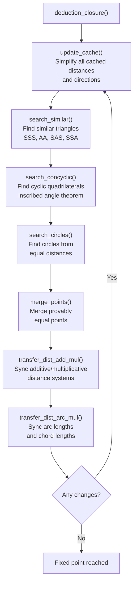
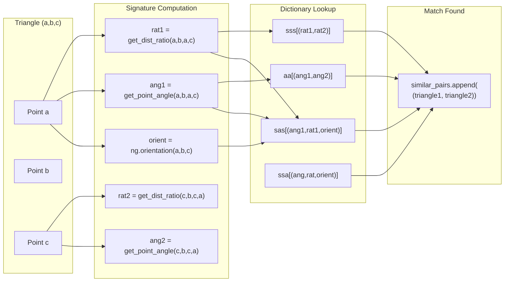

<!-- source: DeepWiki mcp.deepwiki.com · repo google-deepmind/alphageometry2 · page 4.4 Geometric Inference Rules · fetched 2026-10-26 -->

# Geometric Inference Rules

<details>
<summary>Relevant source files</summary>

The following files were used as context for generating this wiki page:

- [ddar.py](ddar.py)
- [numericals.py](numericals.py)

</details>


This page documents the specific geometric inference algorithms executed during the DDAR deduction closure process. These rules detect patterns in the constraint database and infer new geometric facts. For information about the overall deduction closure loop, see [Deduction Closure Process](#4.3). For information about how predicates are initially asserted, see [Predicate System](#4.2).

## Overview

The DDAR engine uses six specialized inference algorithms that run iteratively until no new facts can be deduced:

| Algorithm | Method | Purpose |
|-----------|--------|---------|
| Similar Triangles | `search_similar` | Detects similar triangles using SSS, AA, SAS, SSA criteria |
| Cyclic Quadrilaterals | `search_concyclic` | Identifies concyclic points using inscribed angle theorem |
| Circle Detection | `search_circles` | Finds circles from equal distances to a point |
| Point Merging | `merge_points` | Identifies and merges provably equal points |
| Distance System Sync | `transfer_dist_add_mul` | Synchronizes additive and multiplicative distance representations |
| Arc-Chord Sync | `transfer_dist_arc_mul` | Relates arc lengths to chord lengths on circles |

These algorithms are called sequentially in the `deduction_closure` loop [ddar.py:301-357]() until a fixed point is reached.



**Sources:** [ddar.py:301-357]()

## Similar Triangle Detection

The `search_similar` method [ddar.py:359-438]() identifies similar triangles by building signature dictionaries for four congruence criteria:

### Triangle Congruence Criteria

For each triangle (a, b, c), the algorithm computes:

| Criterion | Signature Components | Dictionary Key |
|-----------|---------------------|----------------|
| **SSS** (Side-Side-Side) | `rat1 = dist(a,b)/dist(a,c)`<br/>`rat2 = dist(c,b)/dist(c,a)` | `(rat1, rat2)` |
| **AA** (Angle-Angle) | `ang1 = ∠(ab, ac)`<br/>`ang2 = ∠(cb, ca)` | `(ang1, ang2)` |
| **SAS** (Side-Angle-Side) | `ang1 = ∠(ab, ac)`<br/>`rat1 = dist(a,b)/dist(a,c)`<br/>`orient = orientation(a,b,c)` | `(ang1, rat1, orient)` |
| **SSA** (Side-Side-Angle) | `ang = angle at vertex`<br/>`rat = distance ratio`<br/>`orient = orientation`<br/>*Only when longer side is opposite angle* | `(ang, rat, orient)` |



**Sources:** [ddar.py:359-438]()

### Similarity Inference

When similar triangles are detected, `force_similar` [ddar.py:652-696]() infers angle and ratio equalities:

**For triangles (a, b, c) and (x, y, z) with the same orientation:**
- `∠(ab, ac) = ∠(xy, xz)` (angle equality)
- `∠(ab, bc) = ∠(xy, yz)` (angle equality)
- `dist(a,b)/dist(a,c) = dist(x,y)/dist(x,z)` (ratio equality)
- `dist(a,b)/dist(b,c) = dist(x,y)/dist(y,z)` (ratio equality)

**For opposite orientation:** Angles are negated before asserting equality.

The method also records all 12 permutations of the similarity relationship in `known_similar` [ddar.py:657-669]() to avoid redundant work.

**Sources:** [ddar.py:652-696]()

## Cyclic Quadrilateral Detection

The `search_concyclic` method [ddar.py:440-481]() uses the inscribed angle theorem: points on a circle subtending equal angles to a chord are concyclic.

### Algorithm

For each pair of points (a, b), the algorithm:

1. **Groups points by inscribed angle:** For each point c, compute the angle ∠(ca, cb). Points with the same angle are concyclic with a and b.

2. **Detects collinearity:** If the angle is zero, c is collinear with a and b [ddar.py:454-457]().

3. **Finds centers:** If `dist(c,a)/dist(c,b) = 1`, then c is equidistant from a and b. The algorithm checks if c is a center by testing if `∠(ac, ab) = ∠(ca, cb)/2` [ddar.py:466-472]().

```mermaid
graph TB
    subgraph "Input: Points a, b"
        LoopC["For each point c"]
    end
    
    subgraph "Compute Inscribed Angle"
        Angle["ang = get_point_angle(c,a,c,b)<br/>= ∠(ca, cb)"]
        CheckZero{ang.is_zero()?}
        Collinear["force_collinear([a,b,c])"]
    end
    
    subgraph "Group by Angle"
        NotCollinear{Not collinear?}
        AddToGroup["ang_to_points_centers[ang]<br/>.points.append(c)"]
    end
    
    subgraph "Check for Center"
        CheckDist["dist_ratio = get_dist_ratio(c,a,c,b)"]
        IsOne{dist_ratio.is_one()?}
        HalfAngle["halfang = get_point_angle(a,c,a,b)<br/>+ pi/2"]
        AddCenter["ang_to_points_centers[halfang]<br/>.centers.append(c)"]
    end
    
    subgraph "Infer Concyclicity"
        GroupCheck{len(points) >= 2<br/>or<br/>(centers and points)?}
        ForceConcyclic["force_concyclic(<br/>[a,b] + points,<br/>centers)"]
    end
    
    LoopC --> Angle
    Angle --> CheckZero
    CheckZero -->|Yes| Collinear
    CheckZero -->|No| NotCollinear
    NotCollinear -->|Yes| AddToGroup
    NotCollinear --> CheckDist
    CheckDist --> IsOne
    IsOne -->|Yes| HalfAngle
    HalfAngle --> AddCenter
    
    AddToGroup --> GroupCheck
    AddCenter --> GroupCheck
    GroupCheck -->|Yes| ForceConcyclic
```

**Sources:** [ddar.py:440-481]()

### Concyclicity Assertion

When concyclic points are found, `force_concyclic` [ddar.py:785-904]():

1. Constructs a `NumCircle` numerically from three defining points [ddar.py:819-839]()
2. Merges with existing circles sharing points [ddar.py:789-817]()
3. Infers angle equalities based on inscribed angles [ddar.py:865-880]()
4. Asserts equal distances from centers to all points [ddar.py:883-888]()
5. Updates the `triple_to_circle` dictionary [ddar.py:893-902]()

**Sources:** [ddar.py:785-904]()

## Circle Detection

The `search_circles` method [ddar.py:483-524]() identifies circles by finding points equidistant from a center.

### Algorithm

```mermaid
graph TB
    LoopA["For each point a<br/>(potential center)"]
    LoopB["For each point b"]
    
    GetDist["dist = get_dist_mul(a, b)"]
    Group["dist_to_points[dist]<br/>.append((b, dist))"]
    
    CheckGroup{len(points) >= 3?}
    Distinct["Filter to distinct points<br/>(not numerically identical)"]
    CheckDistinct{len(distinct) >= 3?}
    
    ForceConcyclic["force_concyclic(<br/>points,<br/>centers=(a,))"]
    
    SmallCircle["last_small_circles.append(<br/>FormalCircle(points, centers=(a,)))"]
    
    LoopA --> LoopB
    LoopB --> GetDist
    GetDist --> Group
    Group --> CheckGroup
    CheckGroup -->|Yes| Distinct
    Distinct --> CheckDistinct
    CheckDistinct -->|Yes| ForceConcyclic
    CheckDistinct -->|No| SmallCircle
```

**Key Points:**
- Points are grouped by their `DistMul` (multiplicative distance) from a potential center [ddar.py:489-497]()
- At least 3 numerically distinct points are needed to define a circle [ddar.py:502-510]()
- Circles with fewer than 3 points are stored in `last_small_circles` for later point merging [ddar.py:512-522]()

**Sources:** [ddar.py:483-524]()

## Point Merging

The `merge_points` method [ddar.py:526-580]() identifies points that are provably equal and merges them into a single point.

### Merging Criterion

Two points a and b are merged if they are **numerically identical** (within tolerance `ATOM`) [ddar.py:531-535]() AND they lie on **two non-tangent geometric objects** (lines or circles).

```mermaid
graph TB
    Find["Find all pairs (a,b)<br/>where num_identical(a,b)"]
    
    subgraph "For each pair (a,b)"
        FindObjects["Find all FormalLine and FormalCircle<br/>containing both a and b"]
        
        CheckCount{len(objects) > 1?}
        
        ComputeDirs["Compute intersection directions:<br/>- For circles: direction(a - center) + 0.5<br/>- For lines: line.value.direction()"]
        
        CheckTangent{All directions<br/>the same?}
        
        Tangent["Objects are tangent<br/>Don't merge"]
        NonTangent["Objects intersect non-tangentially<br/>Points must be equal"]
        
        Merge["force_equal_points(a, b)"]
    end
    
    Find --> FindObjects
    FindObjects --> CheckCount
    CheckCount -->|No| Tangent
    CheckCount -->|Yes| ComputeDirs
    ComputeDirs --> CheckTangent
    CheckTangent -->|Yes| Tangent
    CheckTangent -->|No| NonTangent
    NonTangent --> Merge
```

**Sources:** [ddar.py:526-580]()

### Point Equality Enforcement

The `force_equal_points` method [ddar.py:937-1032]() performs the merge by:

1. **Updating lines:** Adds merged point to all lines containing either original point [ddar.py:944-976]()
2. **Updating circles:** Adds merged point to all circles containing either original point [ddar.py:978-1010]()
3. **Equalizing distances:** For all other points x, asserts `dist(x,a) = dist(x,b)` [ddar.py:1012-1019]()
4. **Removing merged point:** Updates `point_subst` to map the merged point to the canonical point [ddar.py:1023-1027]()

**Sources:** [ddar.py:937-1032]()

## System Synchronization Rules

### Additive-Multiplicative Distance Transfer

The `transfer_dist_add_mul` method [ddar.py:582-620]() ensures consistency between the two distance representations:

- **ElimDistMul:** Represents distances logarithmically (multiplicative structure)
- **ElimDistAdd:** Represents distances linearly (additive structure)

**Algorithm:**

For each pair of distinct points (a, b):
1. Get both distance representations: `mul = get_dist_mul(a,b)` and `add = get_dist_add(a,b)` [ddar.py:593-594]()
2. Normalize each: `mul_n = mul / mul_coef`, `add_n = add / add_coef` [ddar.py:595-596]()
3. Cross-represent: Express `add_n` in multiplicative form and `mul_n` in additive form [ddar.py:599-600]()
4. Build dictionaries mapping normalized values across systems [ddar.py:609-618]()
5. When the same normalized value appears twice, assert equality [ddar.py:611, 616]()

**Sources:** [ddar.py:582-620]()

### Arc-Chord Distance Transfer

The `transfer_dist_arc_mul` method [ddar.py:622-649]() relates arc lengths (angles) to chord lengths (distances) on circles.

**Geometric Principle:** On a circle with fixed radius, equal arcs correspond to equal chords.

```mermaid
graph TB
    subgraph "For each FormalCircle"
        LoopPoints["For each pair of points (a,b)<br/>on the circle"]
    end
    
    subgraph "Compute Arc and Chord"
        CheckOrient{orientation(a,b,center) == 1?}
        GetArc["arc, _ = get_arc(circle, a, b)<br/>arc = ∠(bc, ac) for third point c"]
        GetDist["dist = pair_to_dist_mul[a, b]"]
        Simplify["arc_val = elim_angle.simplify(arc)<br/>dist_val = elim_dist_mul.simplify(dist)"]
    end
    
    subgraph "Dictionary Lookup"
        ArcDict["arc_to_src[arc_val]"]
        DistDict["dist_to_src[dist_val]"]
        
        ArcExists{arc_val in<br/>arc_to_src?}
        DistExists{dist_val in<br/>dist_to_src?}
        
        ForceArc["force_one(dist / dist2)"]
        ForceDist["force_zero(arc - arc2)"]
    end
    
    LoopPoints --> CheckOrient
    CheckOrient -->|Yes| GetArc
    GetArc --> GetDist
    GetDist --> Simplify
    Simplify --> ArcDict
    Simplify --> DistDict
    
    ArcDict --> ArcExists
    ArcExists -->|Yes| ForceArc
    ArcExists -->|No| DistDict
    
    DistDict --> DistExists
    DistExists -->|Yes| ForceDist
```

**Key Implementation Details:**
- Only considers points in counterclockwise order around the center [ddar.py:632-633]()
- Arc is computed using a third point c on the circle: `arc = ∠(bc, ac)` [ddar.py:634-635]()
- Maps simplified arc values to distance values bidirectionally [ddar.py:636-647]()

**Sources:** [ddar.py:622-649]()

## Inference Rule Integration

All inference rules are orchestrated by the main deduction closure loop:

| Iteration Step | Method Call | Cache Update |
|----------------|-------------|--------------|
| 1 | `update_cache()` | Simplifies all cached distances and directions |
| 2 | `search_similar()` | Updates cache if changes made |
| 3 | `search_concyclic()` | Updates cache if changes made |
| 4 | `search_circles()` | No immediate cache update |
| 5 | `merge_points()` | No immediate cache update |
| 6 | `transfer_dist_add_mul()` | No immediate cache update |
| 7 | `transfer_dist_arc_mul()` | No immediate cache update |

The loop continues until no inference rule makes any changes [ddar.py:304-305]().

**Sources:** [ddar.py:301-357]()

---

