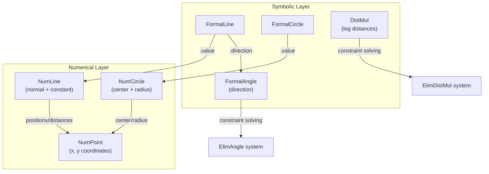
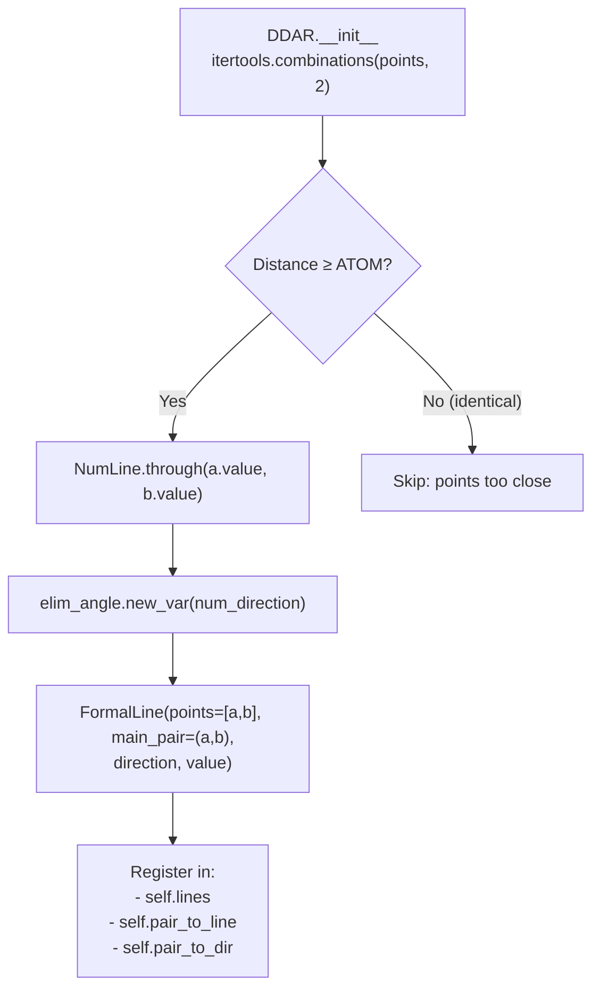
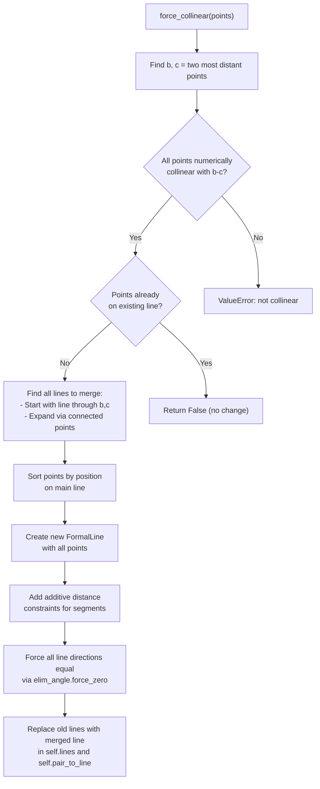
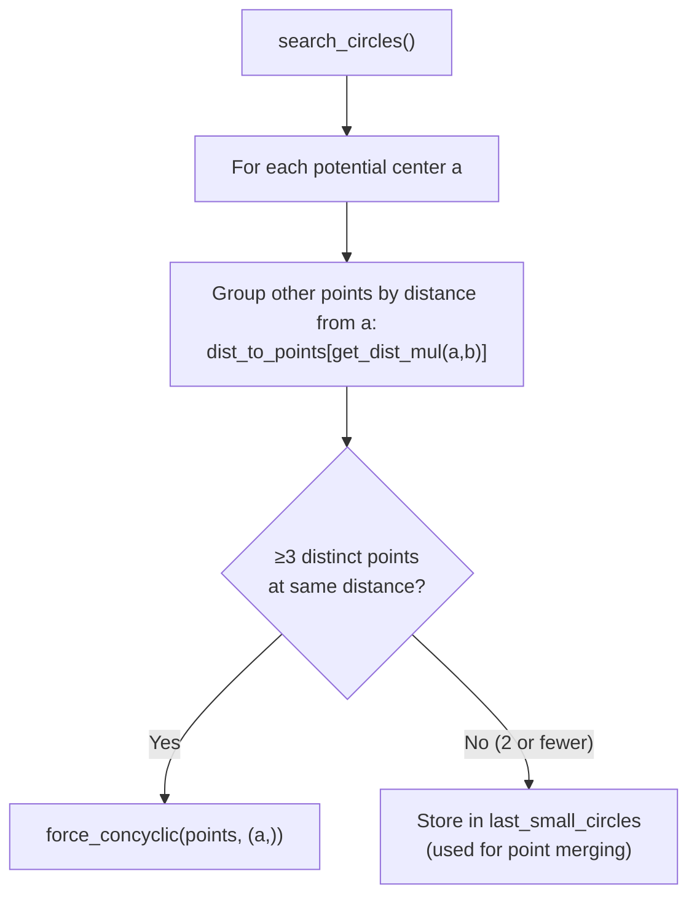
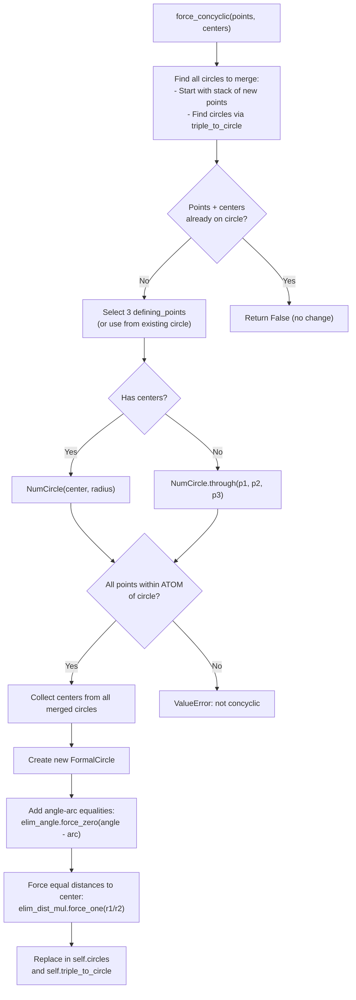
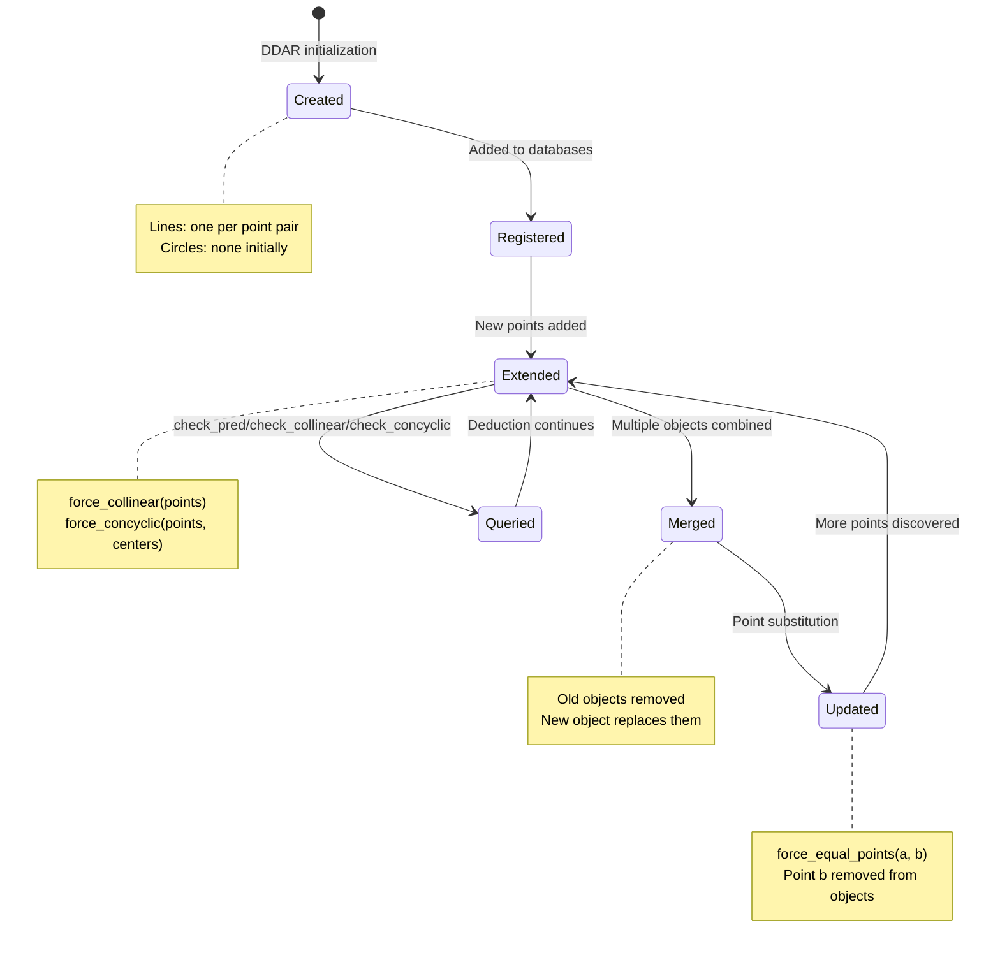
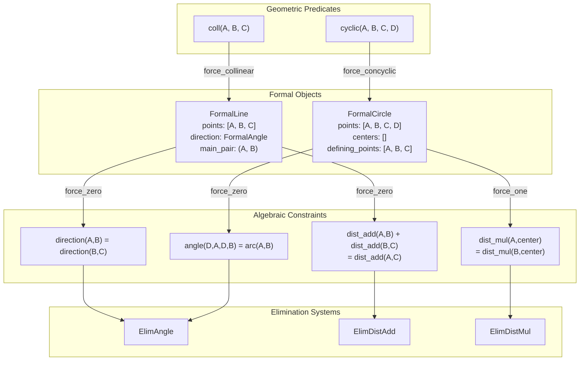
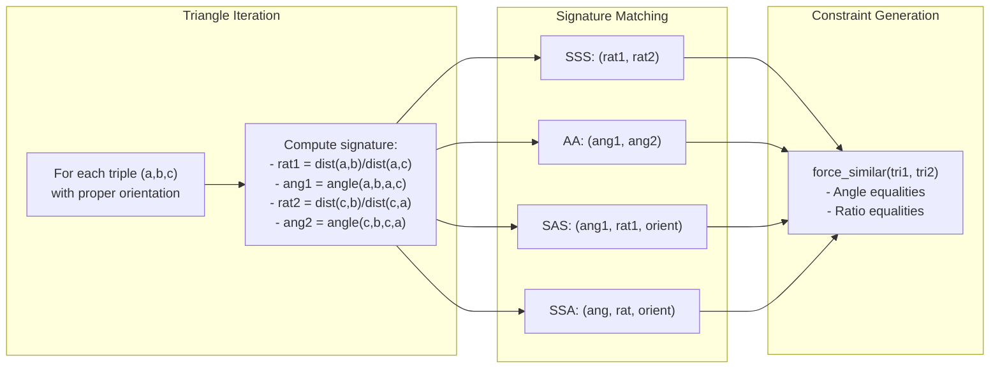
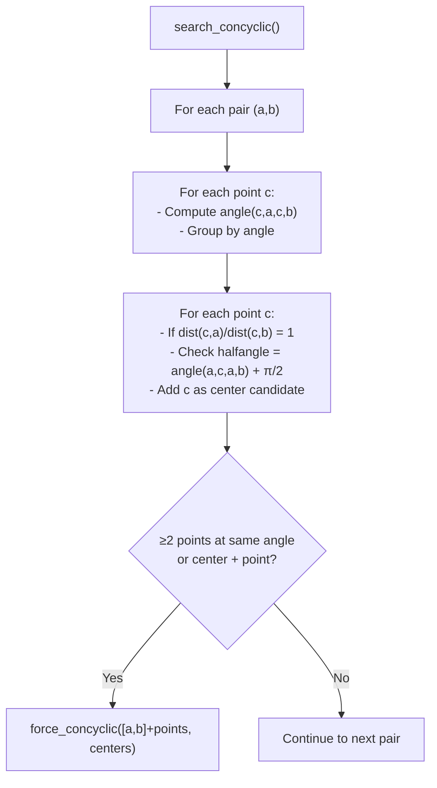

<!-- source: DeepWiki mcp.deepwiki.com · repo google-deepmind/alphageometry2 · page 4.5 Formal Geometric Objects · fetched 2026-10-26 -->

# Formal Geometric Objects

<details>
<summary>Relevant source files</summary>

The following files were used as context for generating this wiki page:

- [ddar.py](ddar.py)
- [numericals.py](numericals.py)

</details>


## Purpose and Scope

This page documents the `FormalLine` and `FormalCircle` classes that serve as the core data structures for tracking collinear points and concyclic points within the DDAR logical engine. These objects maintain both symbolic algebraic representations (for constraint solving) and numerical geometric representations (for verification).

For information about the DDAR class that manages these objects, see [DDAR Logical Engine](#4). For details on the numerical geometry primitives (`NumLine`, `NumCircle`), see [Circle Representations and Operations](#6.3) and [Line Representations and Operations](#6.2). For the symbolic elimination systems that work with formal angles and distances, see [Symbolic Elimination System](#5).

---

## Dual Representation Architecture

Formal geometric objects implement a dual representation strategy: each object contains both symbolic algebraic variables (for exact reasoning) and numerical values (for floating-point verification and intersection calculations).



**Sources:** [ddar.py:33-63](), [numericals.py:61-123]()

---

## FormalLine Structure

The `FormalLine` class represents a set of points known to be collinear. It is immutable once created and maintains consistency between symbolic and numerical representations.

### Class Definition

[ddar.py:33-48]()

```python
class FormalLine:
  """Points known to be collinear (immutable)."""
  
  def __init__(
      self,
      points: list[AGPoint],
      main_pair: tuple[AGPoint, AGPoint],
      direction: el.FormalAngle,
      value: NumLine,
  ):
```

### Attributes

| Attribute | Type | Purpose |
|-----------|------|---------|
| `points` | `list[AGPoint]` | All points known to be collinear on this line (sorted by position) |
| `main_pair` | `tuple[AGPoint, AGPoint]` | Two distinct points that originally defined the line |
| `direction` | `el.FormalAngle` | Symbolic variable representing the line's direction (angle modulo π) |
| `value` | `NumLine` | Numerical representation for distance/position calculations |

### Initial Creation

Lines are created during DDAR initialization for each pair of distinct points:

[ddar.py:90-108]()



**Sources:** [ddar.py:90-108]()

### Line Merging

When collinearity predicates are forced, multiple lines may be merged into a single `FormalLine`:

[ddar.py:700-783]()



**Sources:** [ddar.py:700-783]()

---

## FormalCircle Structure

The `FormalCircle` class represents a set of points known to be concyclic (lying on the same circle), potentially with known center(s).

### Class Definition

[ddar.py:50-63]()

```python
class FormalCircle:
  """Points known to be concyclic, possibly with a center (immutable)."""
  
  def __init__(
      self,
      defining_points: list[AGPoint],
      points: list[AGPoint],
      centers: list[AGPoint],
      value: NumCircle,
  ):
```

### Attributes

| Attribute | Type | Purpose |
|-----------|------|---------|
| `defining_points` | `list[AGPoint]` | Three points used to numerically construct the circle |
| `points` | `list[AGPoint]` | All points known to lie on this circle |
| `centers` | `list[AGPoint]` | All points known to be centers of this circle (typically 0 or 1) |
| `value` | `NumCircle` | Numerical representation (center coordinates + radius) |

### Initial Creation via Search

Circles are created during the `search_circles` phase when equal distances from a center are detected:

[ddar.py:483-524]()



**Sources:** [ddar.py:483-524]()

### Circle Merging

When concyclic predicates are forced or additional points are found on existing circles, circles are merged:

[ddar.py:785-904]()



**Sources:** [ddar.py:785-904]()

---

## Object Lifecycle and Management

Formal geometric objects follow a specific lifecycle within the DDAR engine:



**Sources:** [ddar.py:69-127](), [ddar.py:700-904](), [ddar.py:937-1032]()

### Storage and Lookup Structures

DDAR maintains multiple dictionaries for efficient lookup:

| Structure | Type | Purpose |
|-----------|------|---------|
| `self.lines` | `set[FormalLine]` | All known lines |
| `self.circles` | `set[FormalCircle]` | All known circles (≥3 points) |
| `self.pair_to_line` | `dict[(AGPoint, AGPoint), FormalLine]` | Lookup line by point pair |
| `self.triple_to_circle` | `dict[(AGPoint, AGPoint, AGPoint), FormalCircle]` | Lookup circle by point triple |
| `self.last_small_circles` | `list[FormalCircle]` | Temporary: circles with <3 points (for merging) |

[ddar.py:73-124]()

---

## Integration with Elimination Systems

Formal objects serve as the bridge between geometric facts and algebraic constraints:



**Sources:** [ddar.py:700-783](), [ddar.py:785-904]()

### Example: Collinearity Constraints

When `force_collinear([A, B, C])` is called:

1. **Direction equality**: All line segments share the same direction
   - `elim_angle.force_zero(direction(A,B) - direction(B,C))` [ddar.py:773]()

2. **Additive segments**: Positions along the line satisfy additive constraints
   - For points sorted as A, B, C: `dist_add(A,B) + dist_add(B,C) = dist_add(A,C)` [ddar.py:754-768]()

### Example: Concyclicity Constraints

When `force_concyclic([A, B, C, D], centers)` is called:

1. **Angle-arc equality**: Inscribed angles equal corresponding arcs
   - For each point X not in defining_points: `angle(X,Y1,X,Y2) = arc(Y1,Y2)` [ddar.py:865-880]()

2. **Equal radii**: All points equidistant from center
   - If centers exist: `dist_mul(A,center) / dist_mul(B,center) = 1` [ddar.py:883-888]()

**Sources:** [ddar.py:754-773](), [ddar.py:865-888]()

---

## Usage in Inference Rules

Formal objects are queried and updated during deduction closure:

### Similar Triangle Detection

[ddar.py:359-438]()



**Note:** Angles and distances come from `pair_to_dir[a,b]` and `pair_to_dist_mul[a,b]`, which are associated with the `FormalLine` objects connecting the points.

### Cyclic Quadrilateral Detection

[ddar.py:440-481]()



### Point Merging via Object Intersection

[ddar.py:526-580]()

When two points are suspected to be equal, formal objects help confirm:

1. Find all lines/circles passing through both points [ddar.py:539-548]()
2. If two such objects intersect non-tangentially, points must be equal [ddar.py:559-576]()
3. Merge the points and update all objects [ddar.py:572]()

**Sources:** [ddar.py:359-438](), [ddar.py:440-481](), [ddar.py:526-580]()

---

## Object Verification

Both `FormalLine` and `FormalCircle` include numerical validation to ensure geometric consistency:

### Line Validation

[ddar.py:712-715]()
```python
if not all(line1.value.distance(point.value) < ng.ATOM for point in points):
  raise ValueError('Points not numerically collinear: ' + ' '.join(map(str, points)))
```

### Circle Validation

[ddar.py:841-850]()
```python
if not all(circle_value.distance(x.value) ** 2 < ng.ATOM for x in points):
  raise ValueError('Points not numerically concyclic: ' + points_str + centers_str)
```

The tolerance `ng.ATOM = 1e-12` ensures that rounding errors don't cause false rejections while maintaining geometric precision.

**Sources:** [ddar.py:712-715](), [ddar.py:841-850](), [numericals.py:20]()

---

## Summary Table

| Aspect | FormalLine | FormalCircle |
|--------|-----------|--------------|
| **Purpose** | Track collinear points | Track concyclic points |
| **Initial count** | One per distinct point pair | Zero (created during search) |
| **Key operation** | `force_collinear(points)` | `force_concyclic(points, centers)` |
| **Symbolic data** | `direction: FormalAngle` | Arc angles computed on-demand |
| **Numerical data** | `value: NumLine` | `value: NumCircle` |
| **Lookup structure** | `pair_to_line[a,b]` | `triple_to_circle[a,b,c]` |
| **Constraints added** | Direction equality + additive segments | Angle-arc equality + equal radii |
| **Mutability** | Immutable (replaced on merge) | Immutable (replaced on merge) |

**Sources:** [ddar.py:33-63](), [ddar.py:69-127](), [ddar.py:700-904]()

---

