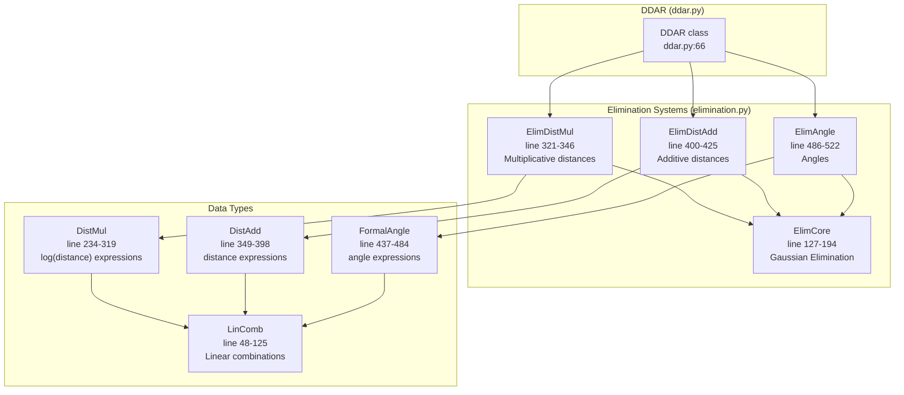
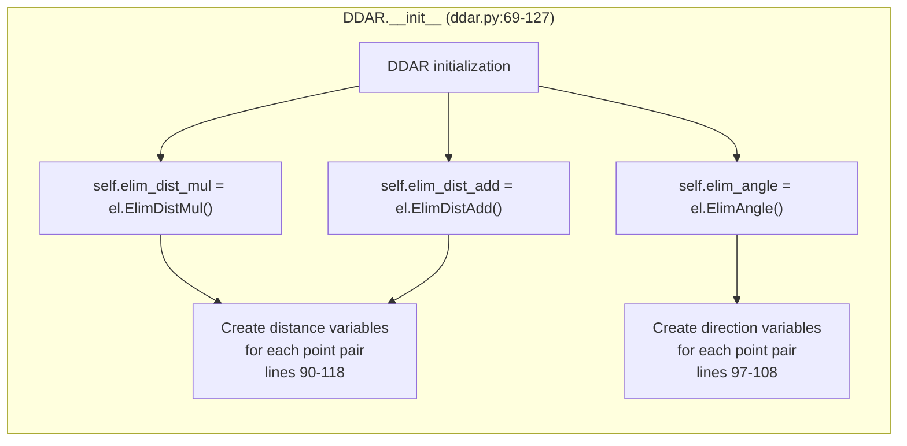
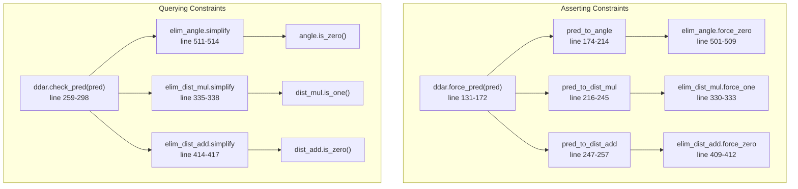
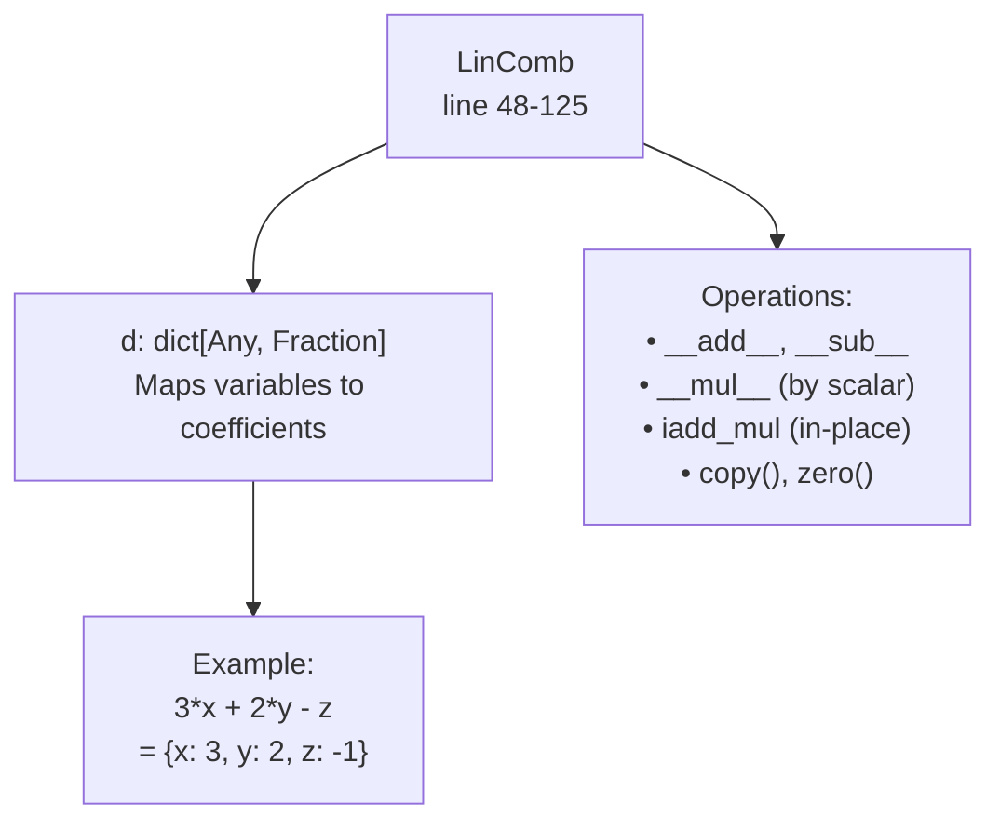
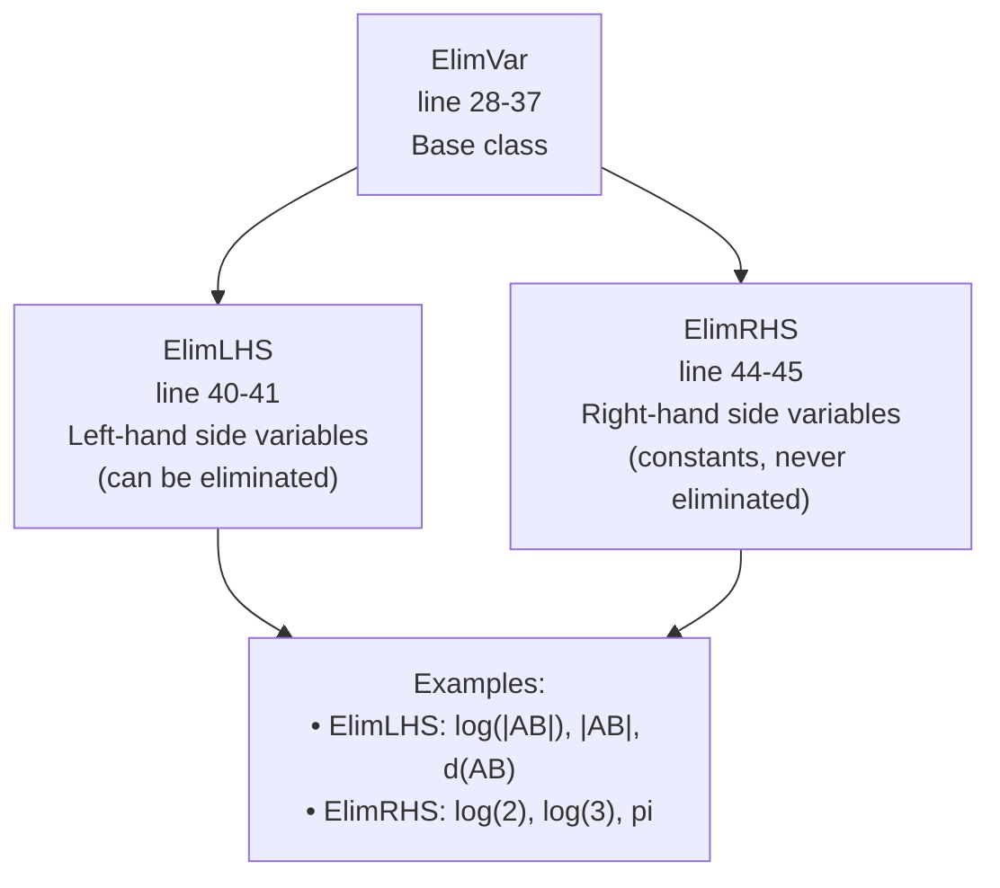
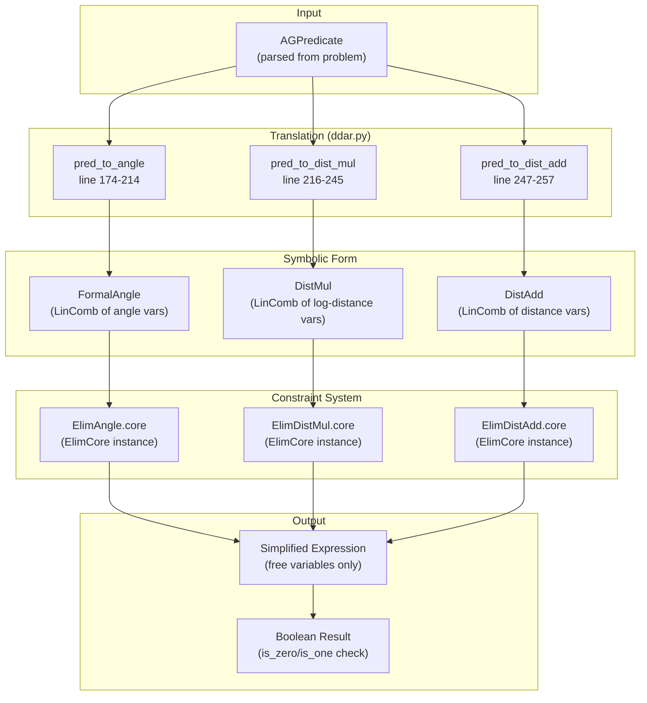

<!-- source: DeepWiki mcp.deepwiki.com · repo google-deepmind/alphageometry2 · page 5 Symbolic Elimination System · fetched 2026-10-26 -->

# Symbolic Elimination System

Relevant source files

The following files were used as context for generating this wiki page:

- [ddar.py](ddar.py)
- [elimination.py](elimination.py)

## Purpose and Scope

The Symbolic Elimination System is the algebraic constraint solver underlying DDAR's geometric reasoning capabilities. It maintains symbolic relationships between geometric quantities (distances, angles, ratios) and uses Gaussian elimination to deduce whether constraints are satisfied. This page provides an architectural overview of the elimination system and its integration with DDAR.

For detailed information about specific components:
- Linear combination arithmetic and Gaussian elimination internals: see [ElimCore and Linear Combinations](#5.1)
- Variable categorization and the LHS/RHS distinction: see [Elimination Variable Types](#5.2)
- Multiplicative and additive distance constraint systems: see [Distance Elimination Systems](#5.3)
- Angle constraint system and modular arithmetic: see [Angle Elimination System](#5.4)

Sources: [elimination.py:1-523](), [ddar.py:76-78]()

---

## System Architecture

The elimination system consists of three independent constraint solvers that maintain different types of geometric relationships. Each solver operates on its own variable space and uses a shared Gaussian elimination core.

**Diagram: Elimination System Architecture and Code Organization**

Sources: [elimination.py:48-125](), [elimination.py:127-194](), [elimination.py:321-522](), [ddar.py:66-78]()

---

## DDAR Integration

DDAR creates one instance of each elimination system during initialization and uses them throughout the deduction process.

### Initialization in DDAR

**Diagram: DDAR Initialization of Elimination Systems**

| Elimination System | Purpose | Variable Example | Created At |
|-------------------|---------|------------------|------------|
| `elim_dist_mul` | Log-space distance ratios | `log(\|AB\|)` | [ddar.py:76]() |
| `elim_dist_add` | Linear distance sums | `\|AB\|` | [ddar.py:77]() |
| `elim_angle` | Angle equalities | `d(AB)` (direction) | [ddar.py:78]() |

Sources: [ddar.py:69-127](), [ddar.py:76-78](), [ddar.py:90-118]()

### Constraint Assertion and Query Flow

DDAR uses the elimination systems through two primary operations: asserting constraints and querying whether constraints are satisfied.

**Diagram: Constraint Assertion and Query Operations**

Sources: [ddar.py:131-172](), [ddar.py:174-257](), [ddar.py:259-298](), [elimination.py:330-333](), [elimination.py:409-412](), [elimination.py:501-509]()

---

## Core Concepts

### Linear Combinations

The `LinComb` class represents linear combinations of variables with rational coefficients. All constraint expressions are represented as `LinComb` instances.

**Diagram: LinComb Structure and Operations**

| Method | Purpose | Line |
|--------|---------|------|
| `iadd_mul(other, coef)` | In-place add `other * coef` | [48-66]() |
| `__add__(other)` | Add two combinations | [76-79]() |
| `__mul__(coef)` | Multiply by scalar | [86-93]() |
| `singleton(v, coef)` | Create single-variable combination | [115-120]() |

Sources: [elimination.py:48-125]()

### Variable Types

Variables in the elimination system are categorized into three types:

**Diagram: Variable Type Hierarchy**

The distinction between LHS and RHS variables determines which variables can be eliminated during Gaussian elimination. LHS variables represent unknown geometric quantities, while RHS variables represent known constants.

Sources: [elimination.py:28-45]()

### Gaussian Elimination Core

The `ElimCore` class implements Gaussian elimination to simplify constraint systems. It maintains a matrix where each row represents an eliminated variable expressed in terms of free variables.

**ElimCore State:**

| Field | Type | Purpose |
|-------|------|---------|
| `instantiated` | `dict[ElimVar, LinComb]` | Maps eliminated variables to their expressions |
| `free_to_usage` | `defaultdict[ElimVar, set[ElimVar]]` | Tracks which equations use each free variable |

**Core Operations:**

- `simplify(comb)` - Substitute eliminated variables with their definitions [elimination.py:134-143]()
- `add_constraint(comb)` - Add new constraint, performing elimination if possible [elimination.py:145-169]()
- `was_encountered(comb)` - Check if a variable has been seen [elimination.py:186-193]()

Sources: [elimination.py:127-194]()

---

## Three Elimination Systems

### ElimDistMul: Multiplicative Distance System

Represents distances in logarithmic space, allowing ratios to be expressed as differences. Variables represent `log(|AB|)` values.

**Key Operations:**
- `new_var(value, name)` - Create new distance variable [elimination.py:327-328]()
- `force_one(dist_mul)` - Assert that `dist_mul == 1` (i.e., `log(dist_mul) == 0`) [elimination.py:330-333]()
- `simplify(dist_mul)` - Reduce expression using known constraints [elimination.py:335-338]()

**Constraint Type Examples:**
- `|AB| / |CD| = k` → `log(|AB|) - log(|CD|) = log(k)`
- `|AB| * |CD| = |EF| * |GH|` → `log(|AB|) + log(|CD|) = log(|EF|) + log(|GH|)`

Sources: [elimination.py:321-346]()

### ElimDistAdd: Additive Distance System

Represents distances linearly, allowing segment addition on lines. Variables represent `|AB|` values directly.

**Key Operations:**
- `new_var(value, name)` - Create new distance variable [elimination.py:406-407]()
- `force_zero(dist_add)` - Assert that `dist_add == 0` [elimination.py:409-412]()
- `simplify(dist_add)` - Reduce expression using known constraints [elimination.py:414-417]()

**Constraint Type Examples:**
- `|AB| + |BC| = |AC|` (collinear points)
- `|AB| = |CD|` → `|AB| - |CD| = 0`

Sources: [elimination.py:400-425]()

### ElimAngle: Angle System

Represents angles modulo π (180°), treating angles as directions. Variables represent angles in units of π.

**Key Operations:**
- `new_var(value, name)` - Create new angle variable [elimination.py:498-499]()
- `const(num, denom)` - Create constant angle `num/denom * π` [elimination.py:492-493]()
- `force_zero(angle)` - Assert that angle equals `k*π` for some integer k [elimination.py:501-509]()
- `simplify(angle)` - Reduce expression using known constraints [elimination.py:511-514]()

**Special Constant:**
- `angle_unit` - Represents π, the unit angle [elimination.py:428-434]()

**Constraint Type Examples:**
- Parallel lines: `d(AB) - d(CD) = 0`
- Perpendicular lines: `d(AB) - d(CD) = π/2`
- Equal angles: `∠ABC - ∠DEF = 0`

Sources: [elimination.py:486-522](), [elimination.py:428-434]()

---

## Data Flow Through Elimination Systems

The following diagram shows how geometric predicates flow through the elimination system:

**Diagram: End-to-End Data Flow Through Elimination Systems**

Sources: [ddar.py:174-257](), [elimination.py:134-143](), [elimination.py:330-338](), [elimination.py:409-417](), [elimination.py:501-514]()

---

## Why Three Separate Systems?

The elimination system maintains three independent constraint solvers because different geometric relationships require different algebraic representations:

| System | Representation | Best For | Example Constraint |
|--------|---------------|----------|-------------------|
| **ElimDistMul** | Logarithmic | Ratios, products, congruence | `|AB|/|CD| = |EF|/|GH|` |
| **ElimDistAdd** | Linear | Sums, collinear segments | `|AB| + |BC| = |AC|` |
| **ElimAngle** | Modular (mod π) | Directions, angle equality | `∠ABC = ∠DEF` |

During deduction, DDAR transfers information between systems when possible:
- `transfer_dist_add_mul()` - Synchronizes additive and multiplicative distances [ddar.py:582-620]()
- `transfer_dist_arc_mul()` - Relates arc lengths to chord lengths on circles [ddar.py:622-649]()

This multi-system architecture allows DDAR to represent complex geometric relationships precisely while maintaining computational efficiency through specialized constraint solvers.

Sources: [ddar.py:582-649](), [elimination.py:321-522]()

---

