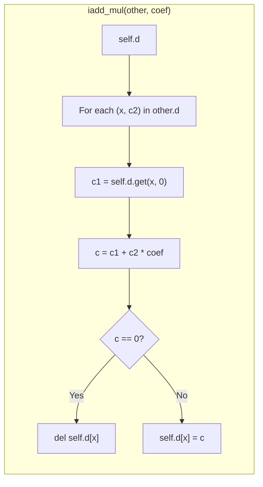
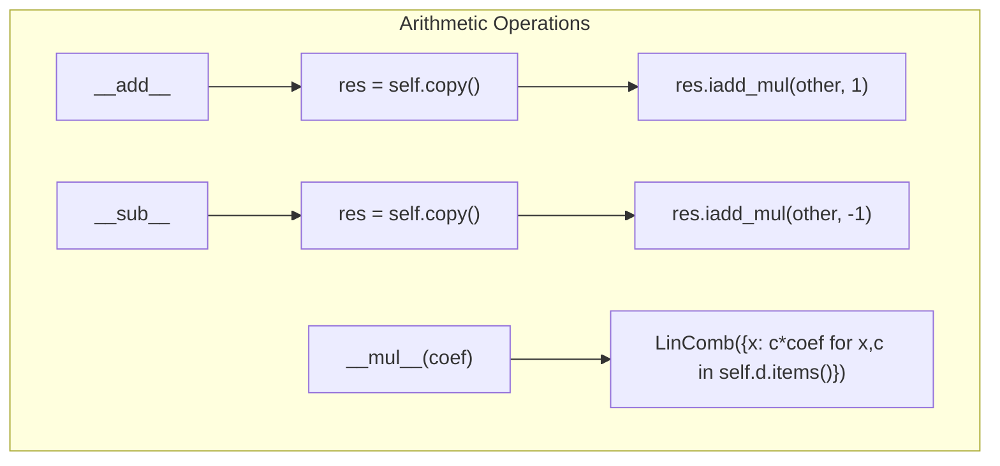
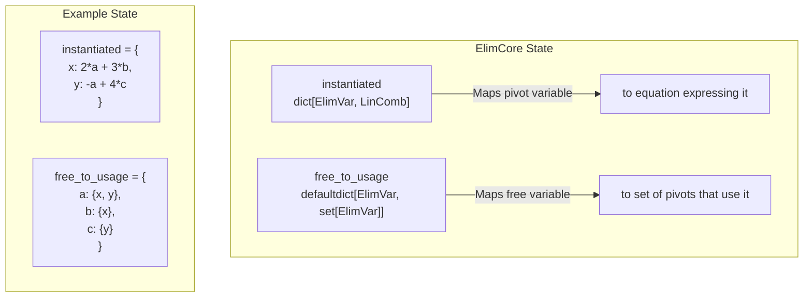
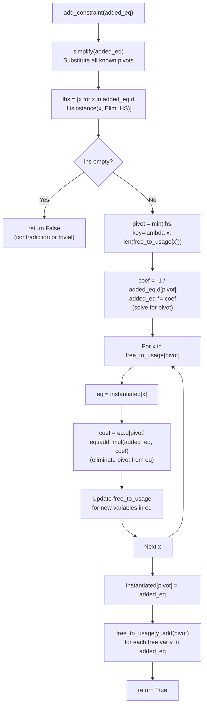
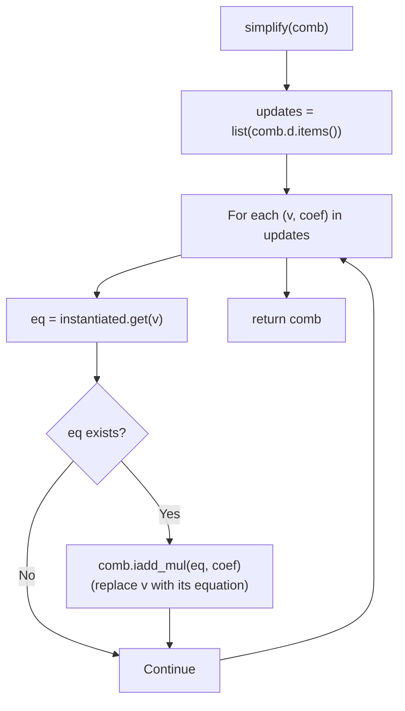
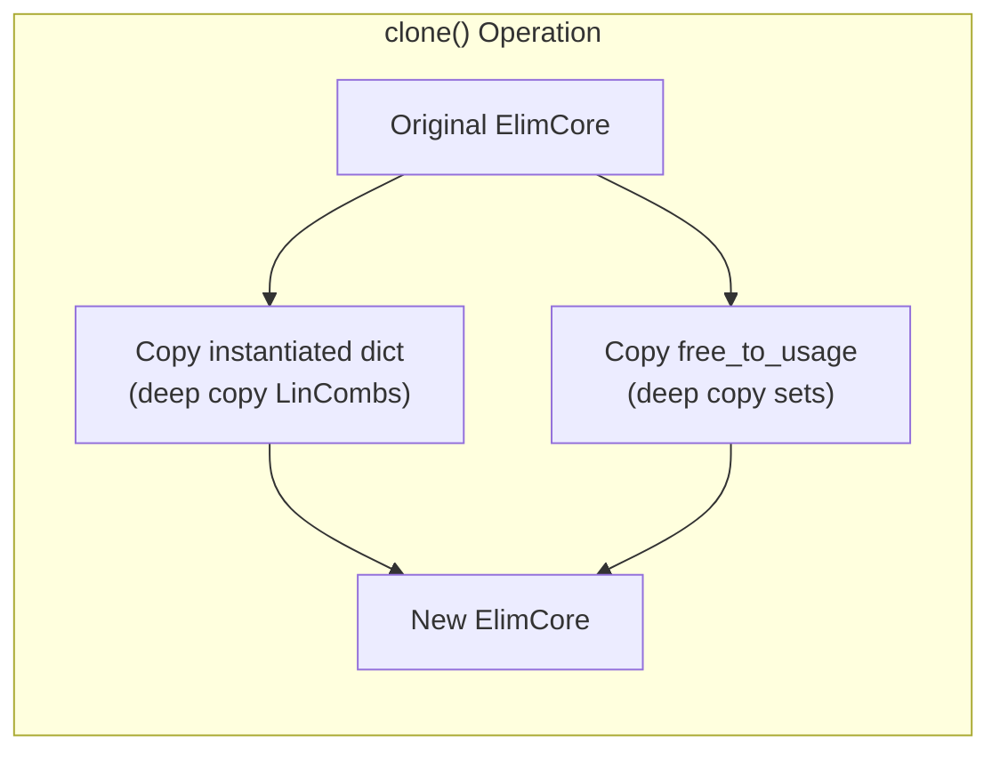
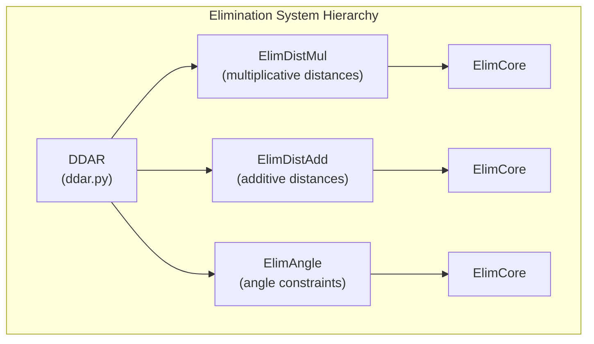

<!-- source: DeepWiki mcp.deepwiki.com · repo google-deepmind/alphageometry2 · page 5.1 ElimCore and Linear Combinations · fetched 2026-10-26 -->

# ElimCore and Linear Combinations

<details>
<summary>Relevant source files</summary>

The following files were used as context for generating this wiki page:

- [elimination.py](elimination.py)

</details>


## Purpose and Scope

This page documents the core Gaussian elimination mechanism in the symbolic elimination system. It covers two fundamental classes:

- **`LinComb`** - represents linear combinations of variables as sparse dictionaries with exact rational coefficients
- **`ElimCore`** - implements Gaussian elimination to solve systems of linear equations

These classes form the foundation for all elimination systems in AlphaGeometry2. For information about the variable types that participate in linear combinations, see [Elimination Variable Types](#5.2). For information about the specialized elimination systems built on top of `ElimCore`, see [Distance Elimination Systems](#5.3) and [Angle Elimination System](#5.4).

**Sources:** [elimination.py:1-194]()

---

## Linear Combination Representation

The `LinComb` class [elimination.py:48-125]() represents linear combinations as sparse dictionaries mapping variables to their coefficients. All coefficients are stored as exact `fractions.Fraction` values to avoid floating-point errors in symbolic reasoning.

### Data Structure

```
LinComb.d: dict[Any, fractions.Fraction]
  - Keys: ElimVar objects (variables)
  - Values: Exact rational coefficients
  - Empty dict represents zero
```

A linear combination such as `3*x + (1/2)*y - 2*z` is represented as:

```python
LinComb({
  x: Fraction(3, 1),
  y: Fraction(1, 2),
  z: Fraction(-2, 1)
})
```

**Sources:** [elimination.py:48-52]()

---

## LinComb Arithmetic Operations

The `LinComb` class provides a complete set of arithmetic operations for manipulating linear combinations. All operations maintain exact rational arithmetic.

### Core Operations Table

| Operation | Method | Description | Example |
|-----------|--------|-------------|---------|
| In-place add | `iadd_mul(other, coef)` | Add `other * coef` to self | `a.iadd_mul(b, 3)` → `a += 3*b` |
| Addition | `__add__(other)` | Return `self + other` | `a + b` |
| Subtraction | `__sub__(other)` | Return `self - other` | `a - b` |
| Scalar multiply | `__mul__(coef)` | Return `self * coef` | `a * 5` |
| Singleton | `singleton(v, coef)` | Create `coef * v` | `LinComb.singleton(x, 3)` → `3*x` |
| Zero | `zero()` | Create empty combination | `LinComb.zero()` → `0` |

**Sources:** [elimination.py:54-125]()

### In-Place Addition with Multiplier

The `iadd_mul` method [elimination.py:54-66]() is the fundamental operation that efficiently adds a scaled linear combination:



The method maintains sparsity by removing variables with zero coefficients, which is critical for performance in large elimination systems.

**Sources:** [elimination.py:54-66]()

### Arithmetic Operation Implementation

The higher-level arithmetic operations are implemented in terms of `iadd_mul`:



**Sources:** [elimination.py:68-93]()

---

## ElimCore Data Structures

The `ElimCore` class [elimination.py:127-194]() maintains two primary data structures that track the state of the Gaussian elimination system:

### Core State Diagram



**Sources:** [elimination.py:130-132]()

### Data Structure Semantics

**`instantiated: dict[ElimVar, LinComb]`**
- Maps each **pivot variable** (a variable that has been "solved for") to its defining equation
- The pivot variable itself does NOT appear in the right-hand side `LinComb`
- Example: `x: 2*a + 3*b` means "x = 2*a + 3*b" where x is instantiated in terms of free variables a and b

**`free_to_usage: defaultdict[ElimVar, set[ElimVar]]`**
- Maps each **free variable** (a variable appearing on the right-hand side) to the set of pivot variables whose equations contain it
- Used for efficient updates when adding new constraints
- Example: `a: {x, y}` means variable a appears in the equations for both x and y

**Sources:** [elimination.py:130-132]()

---

## Gaussian Elimination Algorithm

The `add_constraint` method [elimination.py:145-169]() implements the core Gaussian elimination algorithm. It takes a linear combination representing an equation and incorporates it into the system.

### Algorithm Flow Diagram



**Sources:** [elimination.py:145-169]()

### Pivot Selection Strategy

The algorithm selects the pivot variable that appears in the **fewest existing equations** [elimination.py:151]():

```python
pivot = min(lhs, key=lambda x: len(self.free_to_usage[x]))
```

This heuristic minimizes the number of equations that need to be updated when adding the new constraint, improving performance.

**Sources:** [elimination.py:151]()

### Elimination Step Details

For each equation that contains the chosen pivot variable, the algorithm eliminates it:

1. Retrieve the equation: `eq = self.instantiated[x]` [elimination.py:157]()
2. Get the coefficient of the pivot in that equation: `coef = eq.d[pivot]` [elimination.py:158]()
3. Add the new constraint (scaled) to eliminate the pivot: `eq.iadd_mul(added_eq, coef)` [elimination.py:159]()
4. Update the `free_to_usage` tracking for all new variables [elimination.py:160-164]()

**Sources:** [elimination.py:157-164]()

---

## Constraint Simplification

The `simplify` method [elimination.py:134-143]() substitutes all known pivot variables in a linear combination with their defining equations.

### Simplification Algorithm



**Sources:** [elimination.py:134-143]()

### Example Simplification

Given system state:
```
instantiated = {
  x: 2*a + b,
  y: -a + 3*c
}
```

Simplifying `3*x + 2*y`:
1. Substitute x: `3*x` → `3*(2*a + b)` = `6*a + 3*b`
2. Substitute y: `2*y` → `2*(-a + 3*c)` = `-2*a + 6*c`
3. Result: `6*a + 3*b - 2*a + 6*c` = `4*a + 3*b + 6*c`

**Sources:** [elimination.py:134-143]()

---

## System Operations

### Cloning an Elimination System

The `clone` method [elimination.py:178-184]() creates a deep copy of the elimination system state:



This is used when DDAR needs to create backup states during deduction closure.

**Sources:** [elimination.py:178-184]()

### Checking Variable Encounters

The `was_encountered` method [elimination.py:186-193]() checks if a variable has appeared in the system:

```python
def was_encountered(self, comb: LinComb) -> bool:
    assert len(comb.d) == 1
    [(v, _)] = comb.d.items()
    if v in self.instantiated:
        return True
    if v in self.free_to_usage:
        return True
    return False
```

A variable is considered "encountered" if it appears either as a pivot (in `instantiated`) or as a free variable (in `free_to_usage`).

**Sources:** [elimination.py:186-193]()

---

## Integration with Higher-Level Systems

The `ElimCore` class is not used directly by DDAR. Instead, it is wrapped by specialized elimination systems that handle different types of geometric constraints:



Each specialized elimination system:
1. Creates variables appropriate to its domain (DistMul, DistAdd, FormalAngle)
2. Converts domain-specific constraints to linear combinations
3. Delegates to `ElimCore` for the actual elimination
4. Converts results back to domain-specific representations

**Sources:** [elimination.py:321-523]()

---

## Example: Adding Two Constraints

Consider adding two geometric constraints to an empty system:

**Constraint 1:** `AB = 2*CD` (where AB, CD are distance variables)

1. Create linear combination: `AB - 2*CD = 0`
2. Simplify (no-op for empty system)
3. Select pivot: `AB` (appears in 0 equations)
4. Normalize: `AB = 2*CD`
5. Store: `instantiated[AB] = 2*CD`, `free_to_usage[CD] = {AB}`

**Constraint 2:** `AB + EF = 3*CD`

1. Create linear combination: `AB + EF - 3*CD = 0`
2. Simplify: substitute AB → `2*CD + EF - 3*CD = EF - CD = 0`
3. Select pivot: `EF` (appears in 0 equations)
4. Normalize: `EF = CD`
5. Update existing equations: none (AB's equation doesn't contain EF)
6. Store: `instantiated[EF] = CD`, `free_to_usage[CD] = {AB, EF}`

**Final state:**
```
instantiated = {
  AB: 2*CD,
  EF: CD
}
free_to_usage = {
  CD: {AB, EF}
}
```

**Sources:** [elimination.py:145-169]()

---

## Performance Characteristics

The `ElimCore` implementation uses several techniques for efficiency:

| Technique | Implementation | Benefit |
|-----------|---------------|---------|
| Sparse representation | Dict-based LinComb | Only non-zero coefficients stored |
| Zero cleanup | Remove entries with coef=0 in iadd_mul | Keeps combinations small |
| Minimal pivot updates | Select pivot with min usage | Fewer equations to update |
| Efficient tracking | free_to_usage index | O(1) lookup of equations to update |
| Exact arithmetic | fractions.Fraction | No floating-point drift |

**Sources:** [elimination.py:48-194]()

---

