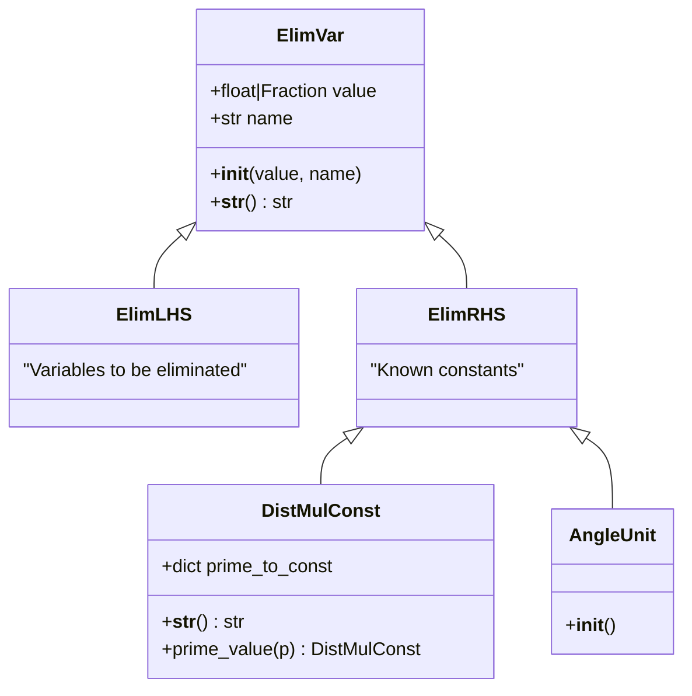
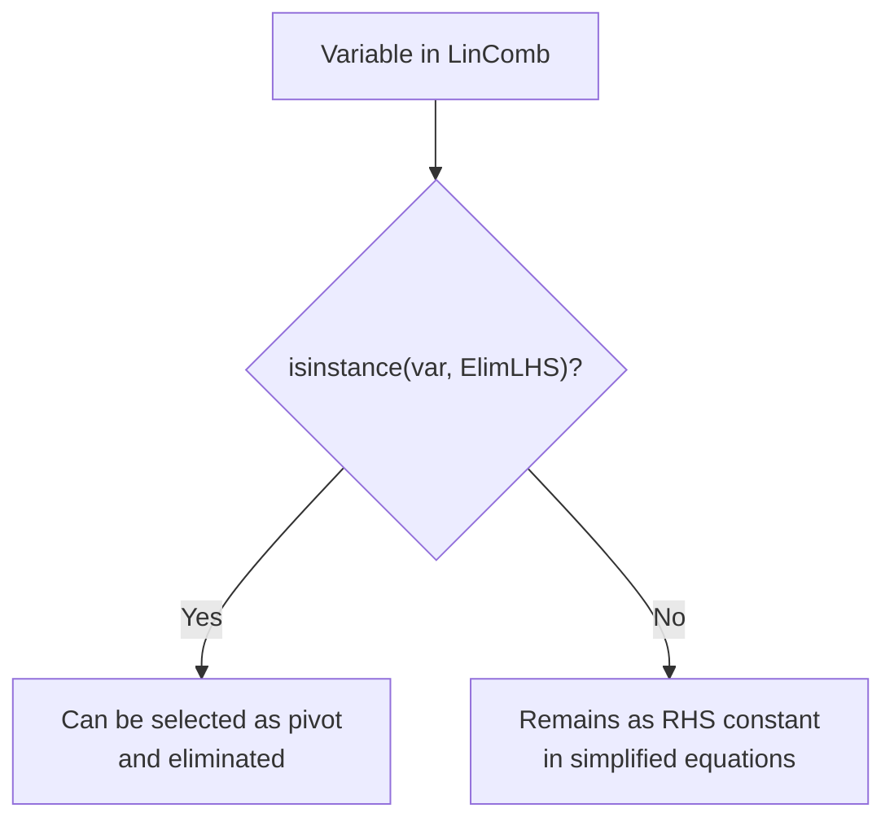
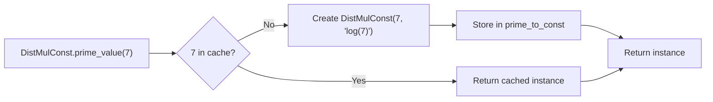
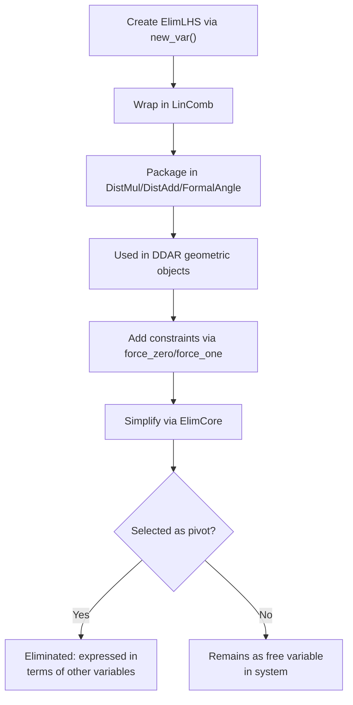

<!-- source: DeepWiki mcp.deepwiki.com · repo google-deepmind/alphageometry2 · page 5.2 Elimination Variable Types · fetched 2026-10-26 -->

# Elimination Variable Types

<details>
<summary>Relevant source files</summary>

The following files were used as context for generating this wiki page:

- [elimination.py](elimination.py)

</details>


## Purpose and Scope

This page documents the variable type hierarchy used in the symbolic elimination system. These classes represent the symbolic variables and constants that appear in linear combinations and constraint equations. Understanding the distinction between left-hand side variables (`ElimLHS`) and right-hand side constants (`ElimRHS`) is fundamental to understanding how the Gaussian elimination process works.

For details on how these variables are used in linear combinations and constraint solving, see [ElimCore and Linear Combinations](#5.1). For details on specific elimination systems that use these variables, see [Distance Elimination Systems](#5.3) and [Angle Elimination System](#5.4).

## Variable Type Hierarchy

The elimination system uses a two-level type hierarchy to distinguish between variables that should be eliminated and constants that represent known values:



**Sources:** [elimination.py:28-45](), [elimination.py:196-207](), [elimination.py:428-434]()

## Base Class: ElimVar

The `ElimVar` class is the abstract base for all variables in the elimination system. It stores both the numerical value (used for numerical verification) and a symbolic name (used for debugging and display).

| Attribute | Type | Purpose |
|-----------|------|---------|
| `value` | `int \| float \| Fraction` | Numerical value for verification |
| `name` | `str` | Human-readable symbolic name |

The `__str__` method returns the variable's name, making it suitable for displaying in constraint equations.

**Sources:** [elimination.py:28-38]()

## ElimLHS: Variables to be Eliminated

`ElimLHS` (Left-Hand Side) represents variables that are **unknown** and should be **eliminated** through Gaussian elimination. These variables appear on the left-hand side of equations in the elimination process.

### Creation and Usage

Each elimination system creates `ElimLHS` variables through its `new_var` method:

| System | Method | Returns |
|--------|--------|---------|
| `ElimDistMul` | `new_var(value, name)` | `DistMul` containing an `ElimLHS` variable |
| `ElimDistAdd` | `new_var(value, name)` | `DistAdd` containing an `ElimLHS` variable |
| `ElimAngle` | `new_var(value, name)` | `FormalAngle` containing an `ElimLHS` variable |

For example, when DDAR creates a formal distance between two points, it calls:
```python
dist_mul = elim_dist_mul.new_var(numerical_distance, "AB")
```

This creates a `DistMul` object whose internal `LinComb` contains a single `ElimLHS` variable representing the unknown distance AB.

### Role in Elimination

The `ElimCore.add_constraint` method identifies which variables in a linear combination are `ElimLHS` instances [elimination.py:148]() and selects one as the pivot for elimination. Variables that are `ElimLHS` can be eliminated by expressing them in terms of other variables (both `ElimLHS` and `ElimRHS`).

**Sources:** [elimination.py:40-41](), [elimination.py:327-328](), [elimination.py:406-407](), [elimination.py:498-499]()

## ElimRHS: Known Constants

`ElimRHS` (Right-Hand Side) represents **known constants** that appear in constraint equations. These values are treated as parameters that cannot be eliminated. They remain on the right-hand side of equations throughout the elimination process.

### Distinction from ElimLHS

The key distinction is checked during constraint simplification:



This check occurs in [elimination.py:148]() where only `ElimLHS` variables are considered as potential pivot candidates.

**Sources:** [elimination.py:44-45](), [elimination.py:148-151]()

## Specialized RHS Constants

The elimination system defines two specialized `ElimRHS` subclasses for specific mathematical constants:

### DistMulConst: Prime Logarithms

`DistMulConst` represents the logarithm of a prime number. This is used in the multiplicative distance system to represent rational constants as linear combinations of prime logarithms.

| Attribute | Type | Purpose |
|-----------|------|---------|
| `prime_to_const` | `dict[int, DistMulConst]` | Singleton cache of prime logarithm constants |
| `value` | `int` | The prime number (not its logarithm) |

The class method `prime_value(p)` returns a singleton `DistMulConst` for prime `p`:



The `__str__` method returns `"log({value})"` to clearly indicate this represents a logarithm [elimination.py:199-200]().

**Example:** To represent the rational constant 6/5, the system creates:
- `log(2) + log(3) - log(5)` using three `DistMulConst` instances

**Sources:** [elimination.py:196-207](), [elimination.py:251-259]()

### AngleUnit: The Constant π

`AngleUnit` is a singleton `ElimRHS` that represents the mathematical constant π. All angles in the system are expressed as linear combinations of variables and multiples of π.

The global singleton `angle_unit` is created at module initialization [elimination.py:434]() and used throughout the angle elimination system. It has:
- `value = 1` (representing π in units of π)
- `name = "pi"`

**Example:** An angle of π/3 radians is represented as:
```python
FormalAngle(LinComb({angle_unit: Fraction(1, 3)}))
```

**Sources:** [elimination.py:428-434](), [elimination.py:492-496]()

## Variable Usage in Elimination Systems

The following table shows how each elimination system uses these variable types:

| System | Creates ElimLHS Via | Uses ElimRHS |
|--------|---------------------|--------------|
| `ElimDistMul` | `new_var(value, name)` → `DistMul` | `DistMulConst` for rational constants |
| `ElimDistAdd` | `new_var(value, name)` → `DistAdd` | None (all RHS values are numeric) |
| `ElimAngle` | `new_var(value, name)` → `FormalAngle` | `angle_unit` for multiples of π |

### Variable Lifecycle



**Sources:** [elimination.py:327-333](), [elimination.py:406-412](), [elimination.py:498-509]()

## Numerical Value Verification

All `ElimVar` instances store a `value` attribute used for numerical verification. When constraints are added to the system, the numerical values are checked to ensure consistency:

| System | Constraint Method | Verification |
|--------|-------------------|--------------|
| `ElimDistMul` | `force_one(dist_mul)` | Asserts `abs(dist_mul.value - 1.0)² < ATOM` |
| `ElimDistAdd` | `force_zero(dist_add)` | Asserts `abs(dist_add.value)² < ATOM` |
| `ElimAngle` | `force_zero(angle)` | Asserts `abs((angle.value + 0.5) % 1 - 0.5)² < ATOM` |

These assertions [elimination.py:331](), [elimination.py:410](), [elimination.py:502-504]() ensure that symbolic operations remain consistent with numerical geometry calculations, providing an important sanity check on the elimination process.

**Sources:** [elimination.py:30-34](), [elimination.py:331](), [elimination.py:410](), [elimination.py:502-504]()

---

