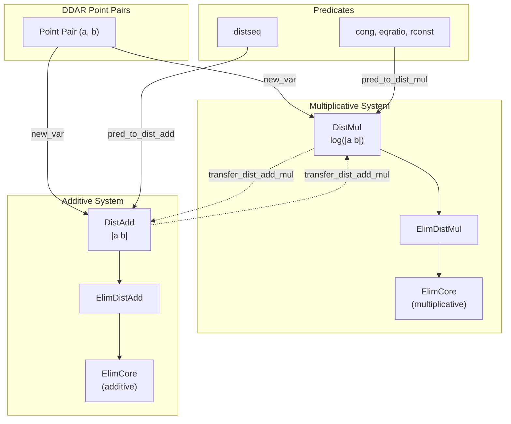
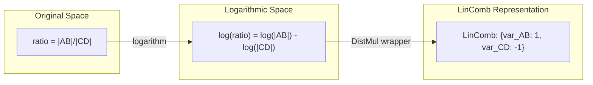
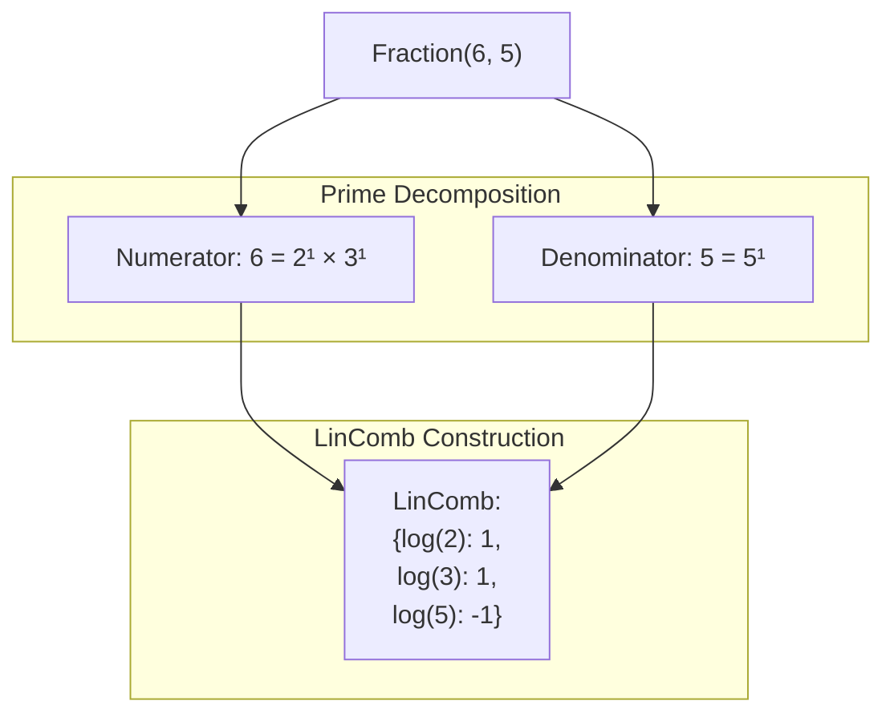
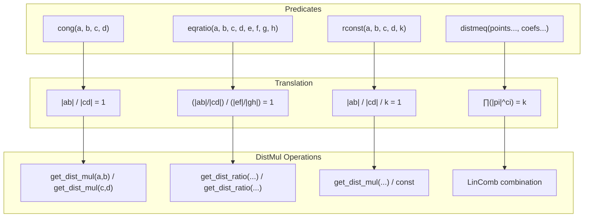
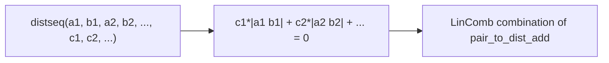
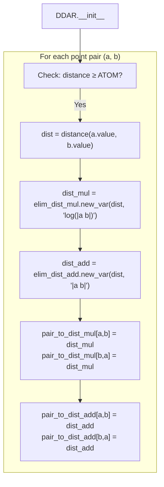
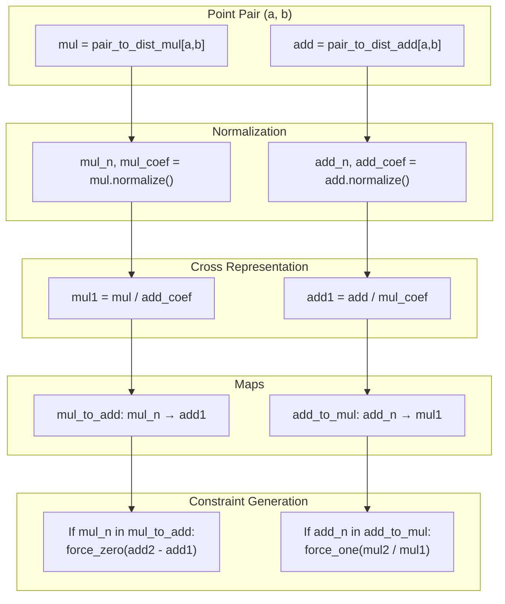
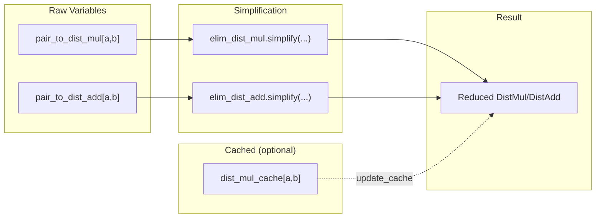

<!-- source: DeepWiki mcp.deepwiki.com · repo google-deepmind/alphageometry2 · page 5.3 Distance Elimination Systems · fetched 2026-10-26 -->

# Distance Elimination Systems

Relevant source files

The following files were used as context for generating this wiki page:

- [ddar.py](ddar.py)
- [elimination.py](elimination.py)

This page documents the two distance constraint systems in AlphaGeometry2: multiplicative distances (`ElimDistMul`) and additive distances (`ElimDistAdd`). These systems handle constraints involving ratios and sums of distances respectively, enabling the DDAR engine to reason about geometric relationships involving lengths.

For information about the underlying elimination mechanism, see [ElimCore and Linear Combinations](#5.1). For angle constraints, see [Angle Elimination System](#5.4).

## Overview

The system maintains two parallel representations for each pair of distinct points:

| System | Variable Type | Representation | Use Case |
|--------|--------------|----------------|----------|
| `ElimDistMul` | `DistMul` | Logarithmic space | Ratios, products, and congruence |
| `ElimDistAdd` | `DistAdd` | Linear space | Sums and collinear segments |

Both systems share the same underlying `ElimCore` Gaussian elimination mechanism but operate in different algebraic domains. The DDAR engine creates variables in both systems for each point pair and synchronizes facts between them during deduction closure.

**Sources:** [elimination.py:321-426](), [ddar.py:76-119]()

## System Architecture

**Sources:** [ddar.py:76-119](), [elimination.py:321-426]()

## Multiplicative Distance System

### DistMul Representation

The `DistMul` class represents distances in logarithmic space, allowing multiplication and division to be expressed as addition and subtraction of linear combinations. A `DistMul` is essentially a `LinComb` where coefficients represent exponents in the original space.

**Key Operations:**

| Operation | Code | Description |
|-----------|------|-------------|
| Multiplication | `dist1 * dist2` | Addition of `LinComb` objects |
| Division | `dist1 / dist2` | Subtraction of `LinComb` objects |
| Constant multiplication | `dist * Fraction(3, 2)` | Uses prime decomposition |
| Normalization | `dist.normalize()` | Separates numeric and symbolic parts |
| Check equality to 1 | `dist.is_one()` | Tests if `LinComb` is empty |

**Sources:** [elimination.py:234-319]()

### DistMulConst and Prime Decomposition

Constants in the multiplicative system are represented using prime decomposition. Each prime has a singleton `DistMulConst` representing its logarithm.

The `prime_decomposition` function [elimination.py:209-232]() factorizes integers, and `DistMul.frac_value` [elimination.py:244-259]() converts fractions to logarithmic combinations:

**Sources:** [elimination.py:196-259]()

### ElimDistMul Class

The `ElimDistMul` class manages the multiplicative distance constraint system.

| Method | Parameters | Returns | Description |
|--------|-----------|---------|-------------|
| `new_var` | `value: float, name: str` | `DistMul` | Creates a new distance variable |
| `force_one` | `dist_mul: DistMul` | `bool` | Asserts a ratio equals 1 |
| `simplify` | `dist_mul: DistMul` | `DistMul` | Reduces using known constraints |
| `was_encountered` | `dist_mul: DistMul` | `bool` | Checks if variable was used |

The `force_one` method [elimination.py:330-333]() asserts that a `DistMul` equals 1 (i.e., its logarithm equals 0), which corresponds to asserting equal distances or equal ratios.

**Sources:** [elimination.py:321-347]()

### Integration with DDAR Predicates

The multiplicative system handles the following predicates through `pred_to_dist_mul` [ddar.py:216-245]():

**Sources:** [ddar.py:216-245](), [ddar.py:1047-1055]()

## Additive Distance System

### DistAdd Representation

The `DistAdd` class represents distances in linear space, where distances can be added and subtracted directly. This is essential for reasoning about collinear points and segment addition.

| Operation | Code | Description |
|-----------|------|-------------|
| Addition | `dist1 + dist2` | Addition of `LinComb` objects |
| Subtraction | `dist1 - dist2` | Subtraction of `LinComb` objects |
| Scalar multiplication | `dist * k` | Multiplication of `LinComb` by scalar |
| Normalization | `dist.normalize()` | Extracts GCD of coefficients |
| Check equality to 0 | `dist.is_zero()` | Tests if `LinComb` is empty |

**Sources:** [elimination.py:349-398]()

### ElimDistAdd Class

The `ElimDistAdd` class manages the additive distance constraint system.

| Method | Parameters | Returns | Description |
|--------|-----------|---------|-------------|
| `new_var` | `value: float, name: str` | `DistAdd` | Creates a new distance variable |
| `force_zero` | `dist_add: DistAdd` | `bool` | Asserts a sum equals 0 |
| `simplify` | `dist_add: DistAdd` | `DistAdd` | Reduces using known constraints |
| `was_encountered` | `dist_add: DistAdd` | `bool` | Checks if variable was used |

The `force_zero` method [elimination.py:409-412]() asserts that a `DistAdd` equals 0, which corresponds to asserting equal sums of distances.

**Sources:** [elimination.py:400-426]()

### Integration with DDAR Predicates

The additive system handles the `distseq` predicate through `pred_to_dist_add` [ddar.py:247-257]():

**Collinear Segment Constraints:**

When points are collinear, the additive system enforces segment addition relationships [ddar.py:752-768]():

For collinear points `[a, ..., b, ..., c, ..., d]`:
- `pos_b + |bc| = pos_c` where positions are measured from point `a`

**Sources:** [ddar.py:247-257](), [ddar.py:752-768]()

## Distance Variable Creation

For each pair of distinct points `(a, b)`, DDAR creates both multiplicative and additive distance variables during initialization:

**Key Data Structures:**

| Dictionary | Type | Purpose |
|------------|------|---------|
| `pair_to_dist_mul` | `dict[(AGPoint, AGPoint), DistMul]` | Maps point pairs to multiplicative variables |
| `pair_to_dist_add` | `dict[(AGPoint, AGPoint), DistAdd]` | Maps point pairs to additive variables |
| `dist_mul_cache` | `dict[(AGPoint, AGPoint), DistMul]` | Cached simplified multiplicative distances |

**Sources:** [ddar.py:86-119](), [ddar.py:125-126]()

## Transfer Between Distance Systems

The `transfer_dist_add_mul` method [ddar.py:582-620]() synchronizes facts between the multiplicative and additive systems during deduction closure.

### Normalization Strategy

For each point pair `(a, b)`:

1. **Normalize multiplicative distance**: `mul_n, mul_coef = mul.normalize()`
   - `mul = mul_coef * mul_n` where `mul_n` has no constant terms

2. **Normalize additive distance**: `add_n, add_coef = add.normalize()`
   - `add = add_coef * add_n` where `add_n` has minimal coefficients

3. **Cross-represent**:
   - `mul1 = mul / add_coef` (represents `add_n` in multiplicative space)
   - `add1 = add / mul_coef` (represents `mul_n` in additive space)

4. **Build bidirectional maps**:
   - If `mul_n` seen before with different additive representation, add constraint
   - If `add_n` seen before with different multiplicative representation, add constraint

**Example:**

If we know `|AB| = 2*|CD|` (additive) and independently derive `|AB| = |CD|` (multiplicative), the transfer detects this contradiction or derives new facts.

**Sources:** [ddar.py:582-620]()

## Distance Access Methods

DDAR provides convenience methods for accessing distances:

| Method | Returns | Description |
|--------|---------|-------------|
| `get_dist_mul(a, b)` | `DistMul` | Simplified multiplicative distance |
| `get_dist_add(a, b)` | `DistAdd` | Simplified additive distance |
| `get_dist_ratio(a, b, c, d)` | `DistMul` | Ratio `|cd| / |ab|` |

The `get_dist_mul` and `get_dist_add` methods [ddar.py:1053-1059]() call `simplify` on the raw variables, returning the reduced form based on current constraints.

**Sources:** [ddar.py:1036-1059]()

## Numerical Validation

Both distance systems validate constraints numerically before adding them:

| System | Validation | Code Location |
|--------|-----------|---------------|
| `ElimDistMul` | `abs(dist_mul.value - 1.0)² < ATOM` | [elimination.py:331]() |
| `ElimDistAdd` | `abs(dist_add.value)² < ATOM` | [elimination.py:410]() |

The `value` property on both `DistMul` and `DistAdd` computes the numerical value by evaluating the `LinComb` with the stored numerical values of variables.

**Sources:** [elimination.py:300-309](), [elimination.py:382-388](), [elimination.py:331](), [elimination.py:410]()

---

