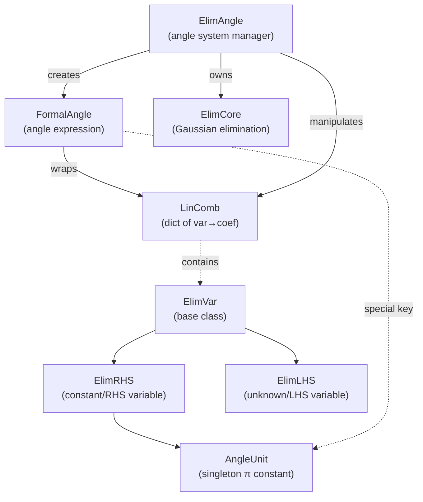
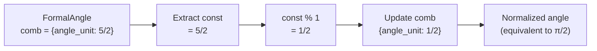
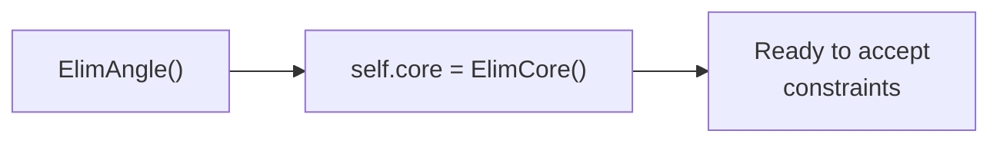
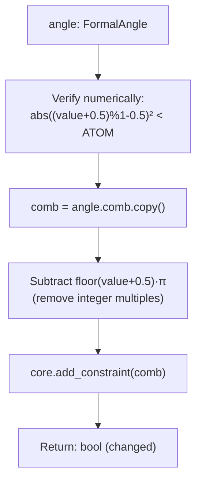
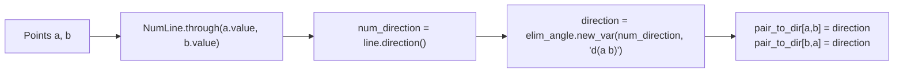
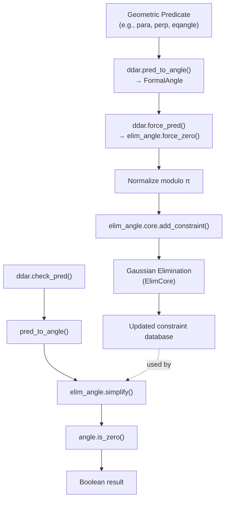

<!-- source: DeepWiki mcp.deepwiki.com · repo google-deepmind/alphageometry2 · page 5.4 Angle Elimination System · fetched 2026-10-26 -->

# Angle Elimination System

<details>
<summary>Relevant source files</summary>

The following files were used as context for generating this wiki page:

- [ddar.py](ddar.py)
- [elimination.py](elimination.py)

</details>


## Purpose and Scope

This page documents the angle elimination system, which solves systems of linear equations over angle variables. The system represents angles as linear combinations of symbolic variables and performs Gaussian elimination to determine which angle relationships are derivable from given constraints. This is one of three specialized elimination systems in the codebase, alongside multiplicative distance elimination ([5.3](#5.3)) and additive distance elimination ([5.3](#5.3)).

For the underlying Gaussian elimination mechanism, see [ElimCore](#5.1). For variable type definitions, see [Elimination Variable Types](#5.2).

**Sources:** [elimination.py:486-522](), [elimination.py:437-484]()

---

## Core Components Overview

The angle elimination system consists of three primary classes:

| Class | Purpose | Key Characteristic |
|-------|---------|-------------------|
| `AngleUnit` | Represents the constant π (180°) | Singleton `ElimRHS` variable |
| `FormalAngle` | Represents an angle expression | Linear combination with modulo arithmetic |
| `ElimAngle` | Elimination system manager | Maintains constraint database via `ElimCore` |

**Sources:** [elimination.py:428-434](), [elimination.py:437-484](), [elimination.py:486-522]()

---

## Class Hierarchy and Relationships



**Sources:** [elimination.py:28-45](), [elimination.py:428-434](), [elimination.py:437-484](), [elimination.py:486-522]()

---

## Angle Representation with Modulo Arithmetic

Angles are represented as linear combinations of variables, but with a critical distinction: angles are subject to **modulo π arithmetic**. An angle of 2π is equivalent to 0, so the system normalizes angle constants to the range [0, π).

### The Angle Unit

The singleton `angle_unit` represents π (180° or 1.0 in normalized units):

```python
angle_unit = AngleUnit()  # value = 1.0, name = "pi"
```

This constant appears in the `LinComb` dictionary of any `FormalAngle` that contains a constant term.

**Sources:** [elimination.py:428-434]()

### FormalAngle Constructor Normalization

When a `FormalAngle` is constructed, it automatically normalizes the coefficient of `angle_unit` modulo 1:



The normalization logic removes integer multiples of π, keeping only the fractional part:

**Sources:** [elimination.py:440-448]()

---

## FormalAngle Class

The `FormalAngle` class represents an angle as a linear combination of variables. Each instance wraps a `LinComb` object.

### Structure

| Attribute | Type | Purpose |
|-----------|------|---------|
| `comb` | `LinComb` | Dictionary mapping variables to coefficients |
| `_value` | `float` (cached) | Numerical value of the angle |
| `_hash` | `int` (cached) | Hash code for dictionary lookups |

**Sources:** [elimination.py:437-452]()

### Arithmetic Operations

`FormalAngle` supports standard arithmetic operations:

| Operation | Method | Return Type | Description |
|-----------|--------|-------------|-------------|
| `-angle` | `__neg__` | `FormalAngle` | Negation (multiply by -1) |
| `angle1 + angle2` | `__add__` | `FormalAngle` | Addition |
| `angle1 - angle2` | `__sub__` | `FormalAngle` | Subtraction |
| `angle * int` | `__mul__` | `FormalAngle` | Scalar multiplication |

All operations create new `FormalAngle` instances with appropriately combined `LinComb` objects.

**Sources:** [elimination.py:463-474]()

### Value Computation

The `value` property computes the numerical angle by summing variable values weighted by coefficients:

$$\text{value} = \sum_{v \in \text{comb}} c_v \cdot v.\text{value}$$

This is used for numerical verification that constraints are satisfied.

**Sources:** [elimination.py:453-457]()

### Zero Test

The `is_zero()` method checks if the linear combination is empty (all coefficients eliminated):

**Sources:** [elimination.py:459-460]()

---

## ElimAngle Class

The `ElimAngle` class manages the angle constraint system. It maintains an `ElimCore` instance that performs Gaussian elimination on angle equations.

### Initialization



**Sources:** [elimination.py:486-490]()

### Creating Constants

The class provides two methods for creating constant angles:

| Method | Parameters | Returns | Use Case |
|--------|-----------|---------|----------|
| `const(numerator, denominator)` | Two integers | `FormalAngle` | Create rational multiple of π |
| `const_frac(frac_value)` | `Fraction` | `FormalAngle` | Create from existing `Fraction` |

Both methods create a `FormalAngle` containing only `angle_unit` with the specified coefficient:

**Sources:** [elimination.py:492-496]()

### Creating Variables

The `new_var(value, name)` method creates a new angle variable:

- **`value`**: Numerical angle value (for verification)
- **`name`**: String identifier (e.g., `"d(A B)"`)
- **Returns**: `FormalAngle` wrapping an `ElimLHS` variable

**Sources:** [elimination.py:498-499]()

### Forcing Constraints

The `force_zero(angle)` method adds a constraint that an angle expression equals zero (modulo π):



The normalization step removes integer multiples of π before adding to the system:

**Sources:** [elimination.py:501-509]()

### Simplification

The `simplify(angle)` method reduces an angle expression using known constraints:

1. Copy the input angle's `LinComb`
2. Call `core.simplify(comb)` to substitute known variables
3. Return a new `FormalAngle` with the simplified combination

**Sources:** [elimination.py:511-514]()

---

## Integration with DDAR

The DDAR engine uses the angle elimination system extensively for geometric reasoning.

### Angle System Initialization

During DDAR initialization, an `ElimAngle` instance is created:

**Sources:** [ddar.py:78]()

### Direction Variables

For each pair of distinct points `(a, b)`, DDAR creates a direction variable representing the angle of line `AB`:



**Sources:** [ddar.py:95-105]()

### Predicate to Angle Translation

DDAR translates geometric predicates into angle equations via the `pred_to_angle()` method:

| Predicate | Translation | Variables Used |
|-----------|-------------|----------------|
| `angeq` | General linear angle equation | Multiple `pair_to_dir` variables |
| `eqangle` | Two angle differences equal | Four direction variables |
| `para` | Two lines parallel | Two direction differences = 0 |
| `perp` | Two lines perpendicular | Two direction differences = π/2 |
| `s_angle` | Signed angle equals constant | Two directions and a constant |
| `aconst` | Angle equals constant | Synonym for `s_angle` |

**Sources:** [ddar.py:174-214]()

### Example: Parallel Lines

For a `para` predicate with points `a1, a2, b1, b2`:

```python
ang = self.pair_to_dir[a1, a2] - self.pair_to_dir[b1, b2]
```

This creates a `FormalAngle` representing the angle difference. When forced to zero, it constrains the lines to be parallel.

**Sources:** [ddar.py:191-194]()

### Example: Perpendicular Lines

For a `perp` predicate:

```python
ang = (self.pair_to_dir[a1, a2] 
       - self.pair_to_dir[b1, b2] 
       - self.elim_angle.const(1, 2))
```

Subtracting `const(1, 2)` (which equals π/2) creates a constraint that the angle difference is 90°.

**Sources:** [ddar.py:195-202]()

---

## Constraint Flow in DDAR

The following diagram shows how angle constraints flow through the system:



**Sources:** [ddar.py:138](), [ddar.py:267-270](), [elimination.py:501-509](), [elimination.py:511-514]()

---

## Arc Length Constraints

In addition to line directions, DDAR uses angles to represent arc lengths on circles. The `get_arc()` method computes the angle subtended by an arc:

```python
def get_arc(self, circle, a, b):
    c = next(c for c in circle.defining_points 
             if not (self.num_identical(a, c) or self.num_identical(b, c)))
    ang = self.pair_to_dir[b, c] - self.pair_to_dir[a, c]
    return ang, c
```

This computes the inscribed angle at point `c` for arc `ab`, which equals half the central angle (by the inscribed angle theorem).

**Sources:** [ddar.py:1064-1071]()

### Arc-Distance Transfer

The `transfer_dist_arc_mul()` method synchronizes arc lengths with chord distances on circles. When two arcs have equal angles, their chords must have equal lengths, and vice versa:

**Sources:** [ddar.py:622-649]()

---

## Numerical Verification

All angle constraints are numerically verified before being added to the system. The tolerance check ensures:

$$\left|\left(\text{angle.value} + 0.5\right) \bmod 1 - 0.5\right|^2 < \text{ATOM}$$

This formula computes the distance to the nearest integer multiple of π (where integer = 0 corresponds to 0°, 1 to 180°, etc.), accounting for the modulo arithmetic.

**Sources:** [elimination.py:502-504]()

---

## Example: Similar Triangle Inference

When DDAR detects similar triangles, it forces angle equalities:

```python
t1_ang1 = self.get_point_angle(a, b, a, c)  # Angle at vertex a in triangle 1
t2_ang1 = self.get_point_angle(x, y, x, z)  # Angle at vertex x in triangle 2

if same_orientation:
    self.elim_angle.force_zero(t1_ang1 - t2_ang1)
else:  # opposite orientation
    self.elim_angle.force_zero(t1_ang1 - (-t2_ang1))
```

The `get_point_angle()` helper computes the angle at a vertex using direction variables:

```python
def get_point_angle(self, a, b, c, d):
    return self.direction_cache[c, d] - self.direction_cache[a, b]
```

**Sources:** [ddar.py:691-692](), [ddar.py:1050-1051]()

---

## Summary: Key Methods by Use Case

| Use Case | Method | Class | Purpose |
|----------|--------|-------|---------|
| Create direction variable | `new_var(value, name)` | `ElimAngle` | Initialize direction for point pair |
| Create constant angle | `const(n, d)` | `ElimAngle` | Create π·(n/d) |
| Assert angle equality | `force_zero(angle)` | `ElimAngle` | Add constraint to system |
| Query angle value | `simplify(angle)` | `ElimAngle` | Reduce using known facts |
| Check if known zero | `is_zero()` | `FormalAngle` | Test if fully eliminated |
| Compute direction | `pred_to_angle(pred)` | `DDAR` | Translate predicate to angle |

**Sources:** [elimination.py:486-522](), [ddar.py:174-214]()

---

