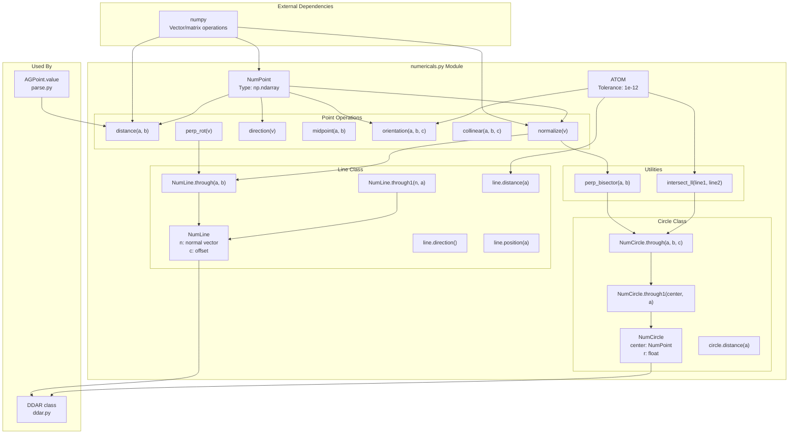
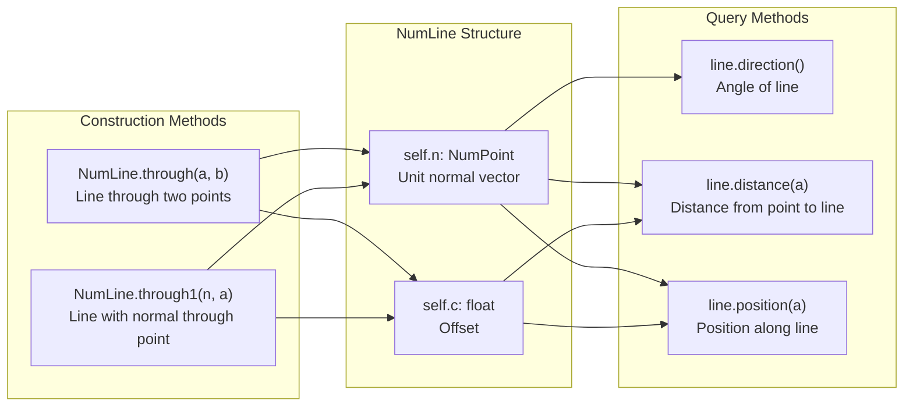
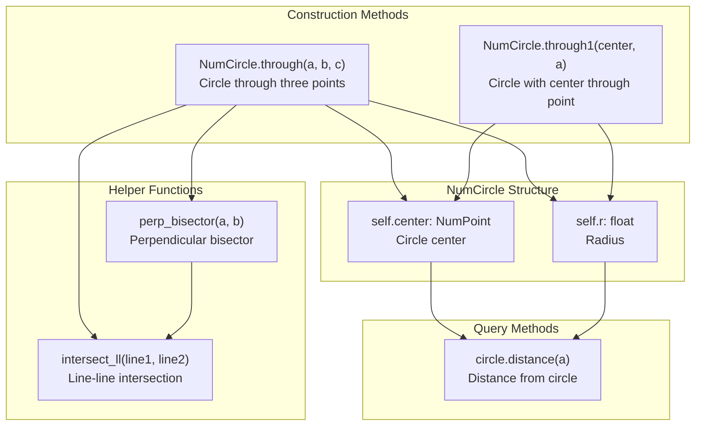
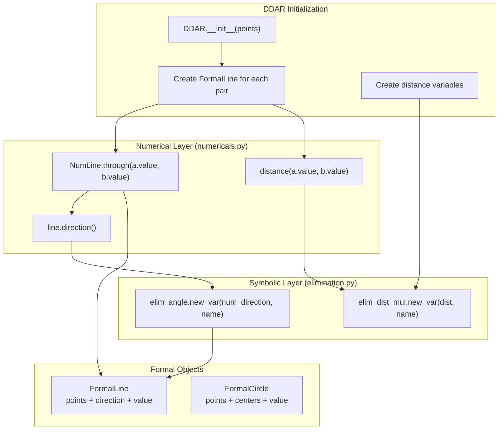
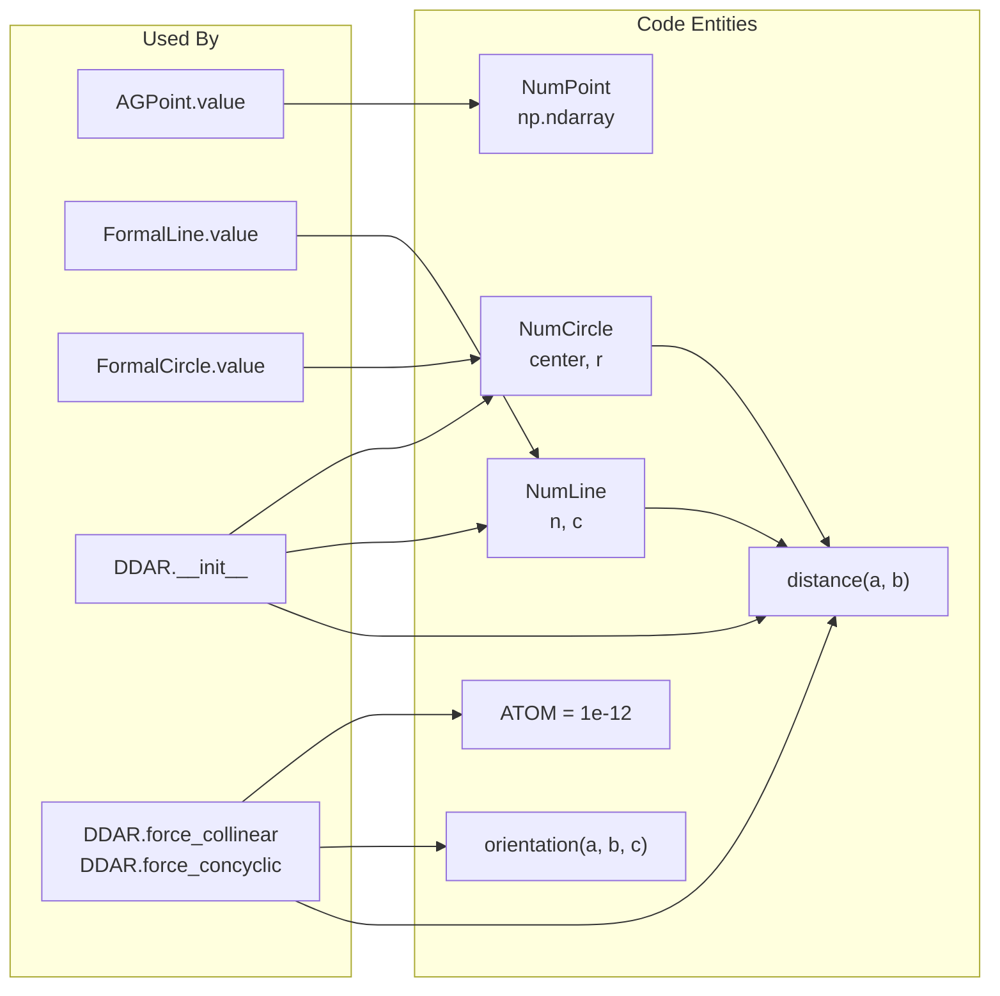

<!-- source: DeepWiki mcp.deepwiki.com · repo google-deepmind/alphageometry2 · page 6 Numerical Geometry Module · fetched 2026-10-26 -->

# Numerical Geometry Module

<details>
<summary>Relevant source files</summary>

The following files were used as context for generating this wiki page:

- [ddar.py](ddar.py)
- [numericals.py](numericals.py)

</details>


## Purpose and Scope

The Numerical Geometry Module (`numericals.py`) provides the concrete numerical implementation layer for geometric computations in AlphaGeometry2. This module performs all coordinate-based calculations including distance measurements, angle computations, line/circle intersections, and orientation tests. It uses NumPy arrays for efficient vector operations and maintains numerical precision through tolerance-based comparisons.

For symbolic geometric reasoning that uses these numerical primitives, see [DDAR Logical Engine](#4). For the formal geometric objects that wrap these numerical values, see [Formal Geometric Objects](#4.5).

**Sources:** [numericals.py:1-123]()

---

## Module Architecture



**Diagram: Numerical Geometry Module Structure** - This diagram shows the complete organization of `numericals.py`, including all classes, functions, and their dependencies. The module provides three layers: point operations (basic vector math), geometric objects (`NumLine` and `NumCircle`), and utility functions for intersections and constructions.

**Sources:** [numericals.py:1-123]()

---

## Constants and Type Definitions

### ATOM: Numerical Tolerance

```python
ATOM = 1e-12
```

The `ATOM` constant defines the tolerance threshold for all numerical comparisons in the system. Values differing by less than `ATOM` are considered equal. This tolerance is used throughout the module to handle floating-point precision issues.

**Usage locations:**
- [numericals.py:49-54]() - Orientation detection threshold
- [numericals.py:92]() - Line intersection singularity check
- [ddar.py:92]() - Point identity checking
- [ddar.py:571]() - Object tangency detection
- [ddar.py:601-608]() - Distance system synchronization

**Sources:** [numericals.py:20]()

### NumPoint Type

```python
NumPoint = np.ndarray
```

`NumPoint` is a type alias for a 2D NumPy array representing a point in Euclidean space. All geometric primitives operate on this type.

**Representation:** A point `(x, y)` is stored as `np.array([x, y])`.

**Sources:** [numericals.py:21]()

---

## Point and Vector Operations

### Basic Operations Table

| Function | Signature | Purpose | Return Type |
|----------|-----------|---------|-------------|
| `distance` | `(a: NumPoint, b: NumPoint)` | Euclidean distance between two points | `float` |
| `normalize` | `(v: NumPoint)` | Unit vector in direction of `v` | `NumPoint` |
| `perp_rot` | `(v: NumPoint)` | 90° counterclockwise rotation | `NumPoint` |
| `direction` | `(v: NumPoint)` | Angle normalized to [-1, 1] range (in units of π) | `float` |
| `midpoint` | `(a: NumPoint, b: NumPoint)` | Midpoint between two points | `NumPoint` |
| `orientation` | `(a: NumPoint, b: NumPoint, c: NumPoint)` | Orientation of triangle ABC | `int` (1, 0, -1) |
| `collinear` | `(a: NumPoint, b: NumPoint, c: NumPoint)` | Check if three points are collinear | `bool` |

**Sources:** [numericals.py:24-59]()

---

### Distance Calculation

```python
def distance(a: NumPoint, b: NumPoint) -> float:
  return np.linalg.norm(a - b)
```

Computes the Euclidean distance `||a - b||` using NumPy's norm function.

**Used by:**
- [ddar.py:92]() - Checking if points are numerically identical
- [ddar.py:110]() - Initializing distance variables
- [ddar.py:416-418]() - Triangle congruence checking in similarity search
- [ddar.py:519]() - Circle radius calculation
- [ddar.py:704-705]() - Finding distinct points for collinearity
- [ddar.py:835]() - Computing circle radius from center

**Sources:** [numericals.py:24-25]()

---

### Vector Normalization and Rotation

```python
def normalize(v: NumPoint) -> NumPoint:
  return v / np.linalg.norm(v)
```

Returns a unit vector in the direction of `v`. Used extensively for constructing normal vectors.

```python
def perp_rot(v: NumPoint) -> NumPoint:
  [x, y] = v
  return np.array([y, -x])
```

Rotates vector `v` by 90° counterclockwise. Transforms `(x, y)` to `(y, -x)`. This operation is fundamental for computing line normal vectors.

**Sources:** [numericals.py:28-34]()

---

### Direction and Angle

```python
def direction(v: NumPoint) -> float:
  [x, y] = v
  return np.arctan2(y, x) / np.pi
```

Computes the direction angle of vector `v` normalized to the range `[-1, 1]` where the value represents the angle in units of π radians. For example:
- `direction([1, 0]) = 0.0` (angle 0)
- `direction([0, 1]) = 0.5` (angle π/2)
- `direction([-1, 0]) = 1.0` or `-1.0` (angle π)

This normalization matches the angle representation used in the elimination system.

**Sources:** [numericals.py:37-39]()

---

### Orientation Test

```python
def orientation(a: NumPoint, b: NumPoint, c: NumPoint) -> int:
  matrix = np.stack((b - a, c - a))
  det = np.linalg.det(matrix)
  if det > ATOM:
    return 1
  elif det < -ATOM:
    return -1
  else:
    return 0
```

Computes the orientation of triangle `(a, b, c)` using the determinant test:

| Return Value | Meaning | Geometric Interpretation |
|--------------|---------|--------------------------|
| `1` | Counterclockwise | Point `c` is left of directed line `a→b` |
| `-1` | Clockwise | Point `c` is right of directed line `a→b` |
| `0` | Collinear | Points are on the same line |

The determinant computed is `det([b-a, c-a])`, which equals `(b-a) × (c-a)` in 2D cross product notation.

**Used by:**
- [ddar.py:382-384]() - Filtering degenerate triangles in similarity search
- [ddar.py:404-409]() - Distinguishing triangle orientations for SAS matching
- [ddar.py:680-688]() - Comparing triangle orientations for similarity
- [ddar.py:632]() - Checking arc direction for angle-distance transfer

**Sources:** [numericals.py:46-54]()

---

## NumLine: Line Representation

### Line Equation Form

The `NumLine` class represents a line using the implicit form: **n · x = c** where:
- **n** is a unit normal vector perpendicular to the line
- **c** is the signed distance offset
- A point **x** is on the line if `np.dot(x, n) == c`



**Diagram: NumLine Class Structure** - The line is defined by its normal vector and offset, with two construction methods and three query methods for geometric calculations.

**Sources:** [numericals.py:61-87]()

---

### Line Construction

#### Through Two Points

```python
@classmethod
def through(cls, a: NumPoint, b: NumPoint) -> "NumLine":
  return cls.through1(perp_rot(normalize(b - a)), a)
```

Constructs a line passing through points `a` and `b`:
1. Compute direction vector: `b - a`
2. Normalize to unit length
3. Rotate 90° to get normal vector: `perp_rot(normalize(b - a))`
4. Construct line with this normal through point `a`

**Used in:**
- [ddar.py:95]() - Creating initial lines between all point pairs during DDAR initialization

**Sources:** [numericals.py:75-76]()

---

#### With Normal Vector

```python
@classmethod
def through1(cls, n: NumPoint, a: NumPoint) -> "NumLine":
  """A line passing through `a` with a normal vector `n`."""
  return cls(n, np.dot(a, n))
```

Constructs a line with given normal vector `n` passing through point `a`. The offset `c` is computed as `n · a`.

**Used in:**
- [numericals.py:76]() - Called by `through` method
- [numericals.py:98]() - Constructing perpendicular bisectors

**Sources:** [numericals.py:70-72]()

---

### Line Query Methods

#### Direction

```python
def direction(self) -> float:
  return (direction(self.n) + 0.5) % 1
```

Returns the direction angle of the line (not the normal) in the range `[0, 1)` representing angles in units of π. Computed by taking the normal's direction, adding 0.5 (rotating 90°), and wrapping to `[0, 1)`.

**Used in:**
- [ddar.py:96]() - Computing direction angle for elimination variable creation
- [ddar.py:563-566]() - Detecting tangency between geometric objects

**Sources:** [numericals.py:78-79]()

---

#### Distance from Point

```python
def distance(self, a: NumPoint) -> float:
  return abs(self.c - np.dot(a, self.n))
```

Returns the perpendicular distance from point `a` to the line. This is the absolute value of the signed distance `c - n·a`.

**Used in:**
- [ddar.py:712-715]() - Validating that points are numerically collinear before forcing collinearity

**Sources:** [numericals.py:81-82]()

---

#### Position on Line

```python
def position(self, a: NumPoint) -> float:
  """Position of a on the line as a single number."""
  return -np.dot(perp_rot(self.n), a)
```

Returns a scalar representing the position of point `a` along the line. Points with the same position are at the same location on the line. This is computed by projecting `a` onto the line's direction vector (which is `perp_rot(n)`).

**Used in:**
- [ddar.py:742]() - Sorting points along a line in collinearity enforcement

**Sources:** [numericals.py:84-86]()

---

## NumCircle: Circle Representation

### Circle Equation Form

The `NumCircle` class represents a circle using center-radius form: **||x - center|| = r** where:
- **center** is the center point (NumPoint)
- **r** is the radius (float)
- A point **x** is on the circle if `distance(x, center) == r`



**Diagram: NumCircle Class Structure** - The circle is defined by its center and radius, with construction methods that compute the center using perpendicular bisector intersections.

**Sources:** [numericals.py:101-123]()

---

### Circle Construction

#### Through Three Points

```python
@classmethod
def through(cls, a: NumPoint, b: NumPoint, c: NumPoint) -> "NumCircle":
  center = intersect_ll(
      perp_bisector(a, b),
      perp_bisector(a, c),
  )
  return NumCircle.through1(center, a)
```

Constructs the unique circle passing through three non-collinear points `a`, `b`, `c`:
1. Compute perpendicular bisectors of segments `AB` and `AC`
2. Find their intersection (the circumcenter)
3. Construct circle with this center passing through any of the points

**Used in:**
- [ddar.py:838-839]() - Creating circles during concyclicity enforcement

**Sources:** [numericals.py:114-119]()

---

#### With Center Through Point

```python
@classmethod
def through1(cls, center: NumPoint, a: NumPoint) -> "NumCircle":
  r = distance(a, center)
  return NumCircle(center, r)
```

Constructs a circle with given center passing through point `a`. The radius is computed as the distance from center to `a`.

**Used in:**
- [numericals.py:119]() - Called by `through` method
- [ddar.py:517-520]() - Creating small circles in circle search
- [ddar.py:833-836]() - Creating circles with known centers

**Sources:** [numericals.py:109-111]()

---

### Circle Query Methods

#### Distance from Circle

```python
def distance(self, a: NumPoint) -> float:
  return abs(distance(self.center, a) - self.r)
```

Returns the perpendicular distance from point `a` to the circle boundary. This is the absolute value of `||a - center|| - r`:
- Returns 0 if point is on the circle
- Returns positive value if point is outside or inside

**Used in:**
- [ddar.py:841-850]() - Validating that points are numerically concyclic before forcing concyclicity

**Sources:** [numericals.py:121-122]()

---

## Utility Functions

### Line-Line Intersection

```python
def intersect_ll(line1: NumLine, line2: NumLine):
  matrix = np.stack((line1.n, line2.n))
  b = np.array((line1.c, line2.c))
  if abs(np.linalg.det(matrix)) < ATOM:
    return None
  return np.linalg.solve(matrix, b)
```

Finds the intersection point of two lines by solving the system:
```
line1.n · x = line1.c
line2.n · x = line2.c
```

Returns `None` if lines are parallel (determinant < ATOM), otherwise returns the intersection point.

**Used in:**
- [numericals.py:117]() - Finding circle center as intersection of perpendicular bisectors

**Sources:** [numericals.py:89-94]()

---

### Perpendicular Bisector

```python
def perp_bisector(a: NumPoint, b: NumPoint) -> NumLine:
  return NumLine.through1(normalize(b - a), midpoint(a, b))
```

Constructs the perpendicular bisector of segment `AB`:
- Normal vector: direction from `a` to `b` (normalized)
- Passes through: midpoint of `a` and `b`

The perpendicular bisector is the locus of points equidistant from `a` and `b`.

**Used in:**
- [numericals.py:116-117]() - Computing circle centers from three points

**Sources:** [numericals.py:97-98]()

---

## Integration with DDAR



**Diagram: DDAR's Use of Numerical Geometry** - During initialization, DDAR creates `FormalLine` objects that wrap `NumLine` values. The numerical values are used to create symbolic elimination variables while maintaining the connection to concrete geometry.

**Sources:** [ddar.py:90-118](), [numericals.py:75-79]()

---

### Value Storage Pattern

Every formal geometric object in DDAR stores a corresponding numerical value:

| DDAR Object | Numerical Field | Type | Purpose |
|-------------|----------------|------|---------|
| `AGPoint` | `.value` | `NumPoint` | Concrete coordinates |
| `FormalLine` | `.value` | `NumLine` | Line equation for queries |
| `FormalCircle` | `.value` | `NumCircle` | Circle equation for queries |

This dual representation allows DDAR to:
1. **Create symbolic variables** using numerical values as initialization
2. **Validate geometric constraints** by checking numerical consistency
3. **Perform geometric queries** (distance, collinearity) directly on numerical values

**Example from DDAR initialization [ddar.py:90-108]():**
```python
# Numerical computation
num_line = NumLine.through(a.value, b.value)
num_direction = num_line.direction()

# Symbolic variable creation
direction = self.elim_angle.new_var(num_direction, f'd({a} {b})')

# Formal object combining both
line = FormalLine(
    points=[a, b],
    main_pair=(a, b),
    direction=direction,      # Symbolic
    value=num_line,           # Numerical
)
```

**Sources:** [ddar.py:90-108](), [parse.py:28-37]()

---

## Numerical Validation Patterns

### Tolerance-Based Validation

Throughout DDAR, numerical geometry functions are used to validate symbolic assertions before they are forced into the elimination system. This prevents inconsistent constraints from being added.

#### Collinearity Validation [ddar.py:712-715]()

```python
if not all(line1.value.distance(point.value) < ng.ATOM for point in points):
  raise ValueError(
      'Points not numerically collinear: ' + ' '.join(map(str, points))
  )
```

Before forcing collinearity, DDAR verifies that all points are within `ATOM` distance from the line.

#### Concyclicity Validation [ddar.py:841-850]()

```python
if not all(circle_value.distance(x.value) ** 2 < ng.ATOM for x in points):
  raise ValueError(
      'Points not numerically concyclic: ' + points_str + centers_str
  )
```

Before forcing concyclicity, DDAR verifies that all points are within `ATOM` distance from the circle boundary.

#### Point Identity Check [ddar.py:92]()

```python
if ng.distance(a.value, b.value) < ng.ATOM:
  continue
```

Point pairs closer than `ATOM` are considered identical and are not assigned separate elimination variables.

**Sources:** [ddar.py:92](), [ddar.py:712-715](), [ddar.py:841-850]()

---

## Summary of Key Relationships



**Diagram: Key Module Relationships** - This shows the primary code entities in `numericals.py` and how they are consumed by the DDAR system through formal geometric objects.

**Sources:** [numericals.py:1-123](), [ddar.py:33-63](), [ddar.py:90-118]()

---

