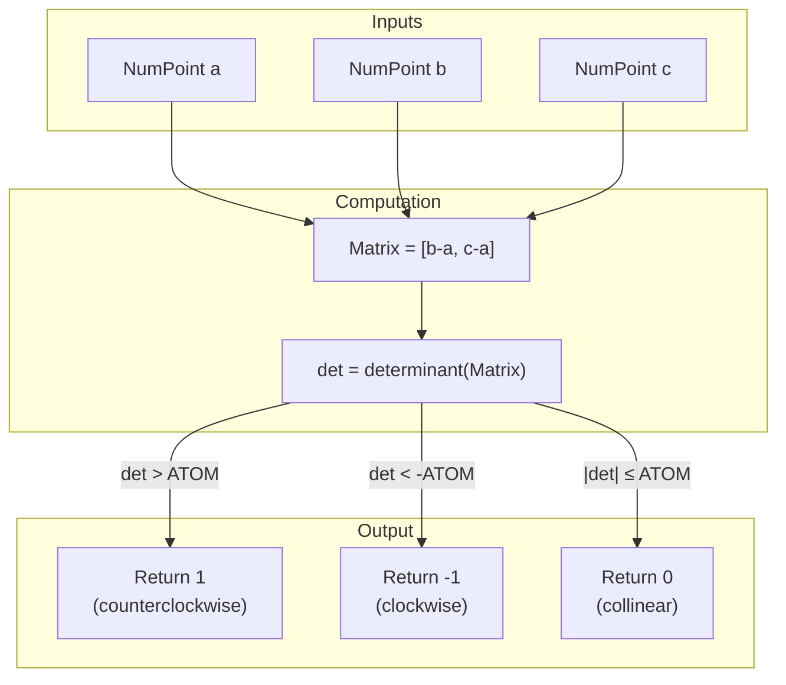
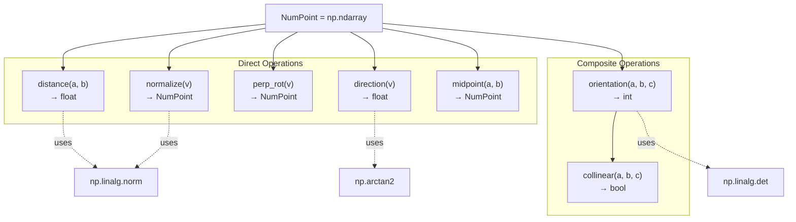
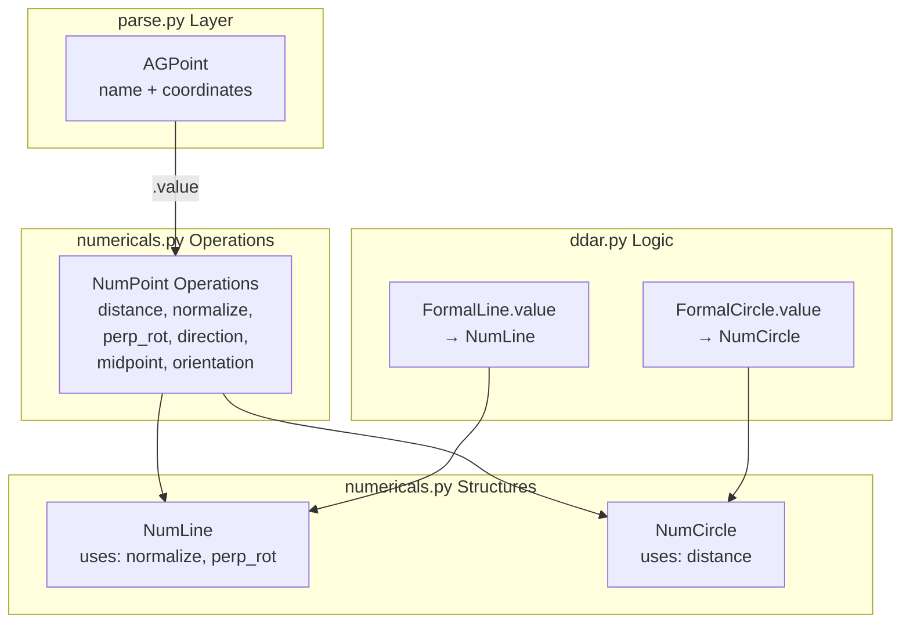

<!-- source: DeepWiki mcp.deepwiki.com · repo google-deepmind/alphageometry2 · page 6.1 Point and Vector Operations · fetched 2026-10-26 -->

# Point and Vector Operations

<details>
<summary>Relevant source files</summary>

The following files were used as context for generating this wiki page:

- [numericals.py](numericals.py)

</details>


This page documents the fundamental point and vector operations provided by `numericals.py`. These operations form the computational foundation for all numerical geometry calculations in the DDAR system, providing exact floating-point implementations of Euclidean geometry primitives.

**Scope**: This page covers the `NumPoint` type and its associated operations: distance calculations, vector normalization, rotation, direction computation, and orientation tests. For line-based operations, see [Line Representations and Operations](#6.2). For circle-based operations, see [Circle Representations and Operations](#6.3).

**Sources**: [numericals.py:1-59]()

## NumPoint Type Definition

The `NumPoint` type is a type alias for `np.ndarray`, representing a 2D point or vector as a NumPy array of shape `(2,)` containing `[x, y]` coordinates.

```python
NumPoint = np.ndarray
```

This simple type alias provides semantic clarity throughout the codebase while leveraging NumPy's efficient array operations. All geometric computations in the numerical layer use this representation.

**Key Characteristics**:
- **Shape**: Always 2-element arrays `[x, y]`
- **Type**: Floating-point values (default NumPy float64)
- **Usage**: Represents both points (positions) and vectors (displacements)
- **Operations**: Supports standard NumPy array arithmetic (`+`, `-`, `*`, `/`)

**Sources**: [numericals.py:21]()

## Numerical Precision Threshold

The constant `ATOM` defines the numerical tolerance for geometric comparisons throughout the module:

```python
ATOM = 1e-12
```

This threshold is used in predicate tests (e.g., collinearity, parallel lines) to account for floating-point rounding errors. Values within `ATOM` of zero are considered equal to zero.

**Sources**: [numericals.py:20]()

## Basic Vector Operations

### Distance Calculation

**Function: `distance`**

The `distance` function computes the Euclidean distance between two points:

[numericals.py:24-25]()

**Mathematical Definition**: For points `a = [x₁, y₁]` and `b = [x₂, y₂]`, the distance is:
```
distance(a, b) = ||a - b|| = √((x₂-x₁)² + (y₂-y₁)²)
```

**Implementation Details**:
- Uses `np.linalg.norm` for efficient computation
- Subtracts vectors before computing norm
- Returns a floating-point scalar

**Sources**: [numericals.py:24-25]()

### Vector Normalization

**Function: `normalize`**

The `normalize` function converts a vector to unit length (magnitude 1):

[numericals.py:28-29]()

**Mathematical Definition**: For vector `v`, the normalized vector is:
```
normalize(v) = v / ||v||
```

**Usage**: Commonly used to obtain direction vectors for lines and angles. The normalized vector points in the same direction as the original but has unit length.

**Sources**: [numericals.py:28-29]()

### Perpendicular Rotation

**Function: `perp_rot`**

The `perp_rot` function rotates a 2D vector 90 degrees counterclockwise:

[numericals.py:32-34]()

**Transformation**: `[x, y] → [y, -x]`

**Geometric Interpretation**:
- Rotating `[1, 0]` (east) produces `[0, -1]` (south)
- Rotating `[0, 1]` (north) produces `[1, 0]` (east)
- The result is perpendicular to the input with the same magnitude

**Common Uses**:
- Computing line normal vectors from direction vectors
- Calculating perpendicular bisectors
- Line position calculations

**Sources**: [numericals.py:32-34]()

### Direction Computation

**Function: `direction`**

The `direction` function computes the angular direction of a vector as a normalized angle:

[numericals.py:37-39]()

**Output Range**: `[-1, 1)` representing angles in units of π radians:
- `0` corresponds to 0° (east)
- `0.5` corresponds to 90° (north)
- `±1` corresponds to 180° (west)
- `-0.5` corresponds to -90° (south)

**Implementation**: Uses `np.arctan2(y, x) / np.pi` to convert Cartesian coordinates to normalized angular representation.

**Sources**: [numericals.py:37-39]()

### Midpoint Calculation

**Function: `midpoint`**

The `midpoint` function computes the point halfway between two points:

[numericals.py:42-43]()

**Mathematical Definition**: `midpoint(a, b) = (a + b) / 2`

**Usage**: Frequently used in perpendicular bisector construction and symmetry calculations.

**Sources**: [numericals.py:42-43]()

## Orientation and Collinearity Tests

### Orientation Predicate

**Function: `orientation`**

The `orientation` function determines the orientation of three points `a`, `b`, `c` using the signed area of the triangle they form:

[numericals.py:46-54]()

**Diagram: Orientation Test**



**Sources**: [numericals.py:46-54]()

**Return Values**:
- `1`: Points are ordered counterclockwise (positive orientation)
- `-1`: Points are ordered clockwise (negative orientation)
- `0`: Points are collinear (within `ATOM` tolerance)

**Mathematical Foundation**:
The determinant of the matrix `[b-a, c-a]` equals twice the signed area of triangle `abc`. The sign indicates orientation:

```
det = (b.x - a.x)(c.y - a.y) - (b.y - a.y)(c.x - a.x)
```

### Collinearity Test

**Function: `collinear`**

The `collinear` function tests whether three points lie on the same line:

[numericals.py:57-58]()

**Implementation**: Simply checks if `orientation(a, b, c) == 0`, meaning the signed area is within `ATOM` of zero.

**Usage in DDAR**: This predicate is used to verify collinearity constraints and detect degenerate geometric configurations.

**Sources**: [numericals.py:57-58]()

## Operation Relationships

**Diagram: NumPoint Function Dependencies**



**Sources**: [numericals.py:24-58]()

## Integration with DDAR System

**Diagram: NumPoint Operations in System Context**



**Sources**: [numericals.py:1-123]()

**Key Integration Points**:

1. **AGPoint to NumPoint**: Each `AGPoint` has a `.value` attribute that is a `NumPoint` representing its concrete coordinates.

2. **Line Construction**: `NumLine.through()` uses `normalize()` and `perp_rot()` to construct line representations from points [numericals.py:75-76]().

3. **Circle Construction**: `NumCircle.through1()` uses `distance()` to compute radii [numericals.py:109-111]().

4. **Orientation Tests**: The `orientation()` and `collinear()` functions are used by DDAR to verify geometric predicates and detect degenerate cases.

## Operation Reference Table

| Operation | Input Types | Output Type | Purpose | Line Reference |
|-----------|-------------|-------------|---------|----------------|
| `distance` | `(NumPoint, NumPoint)` | `float` | Euclidean distance | [24-25]() |
| `normalize` | `(NumPoint,)` | `NumPoint` | Unit vector | [28-29]() |
| `perp_rot` | `(NumPoint,)` | `NumPoint` | 90° CCW rotation | [32-34]() |
| `direction` | `(NumPoint,)` | `float` | Normalized angle | [37-39]() |
| `midpoint` | `(NumPoint, NumPoint)` | `NumPoint` | Average position | [42-43]() |
| `orientation` | `(NumPoint, NumPoint, NumPoint)` | `int` | Orientation test | [46-54]() |
| `collinear` | `(NumPoint, NumPoint, NumPoint)` | `bool` | Collinearity test | [57-58]() |

**Sources**: [numericals.py:24-58]()

## Numerical Stability Considerations

All operations in this module use NumPy's default float64 precision. The `ATOM = 1e-12` threshold provides a reasonable balance between:

- **Precision**: Sufficient to distinguish truly distinct geometric configurations
- **Robustness**: Tolerant of floating-point rounding errors in typical coordinate systems

**Critical Usage**: The `orientation()` function relies on `ATOM` to classify points as collinear when the determinant's absolute value is below the threshold. This prevents false negatives in collinearity tests due to numerical noise.

**Sources**: [numericals.py:20,46-54]()

## Performance Characteristics

These operations are designed for computational efficiency:

- **Vectorized Operations**: All functions use NumPy's vectorized operations, avoiding Python loops
- **Minimal Allocations**: Most operations return new arrays without intermediate allocations
- **Deterministic Results**: Given identical inputs, all operations produce bit-identical outputs

**Typical Use Case**: During DDAR's deduction closure process, these operations are called thousands of times to verify geometric constraints and construct auxiliary objects. The efficiency of these primitives directly impacts overall system performance.

**Sources**: [numericals.py:1-59]()

---

