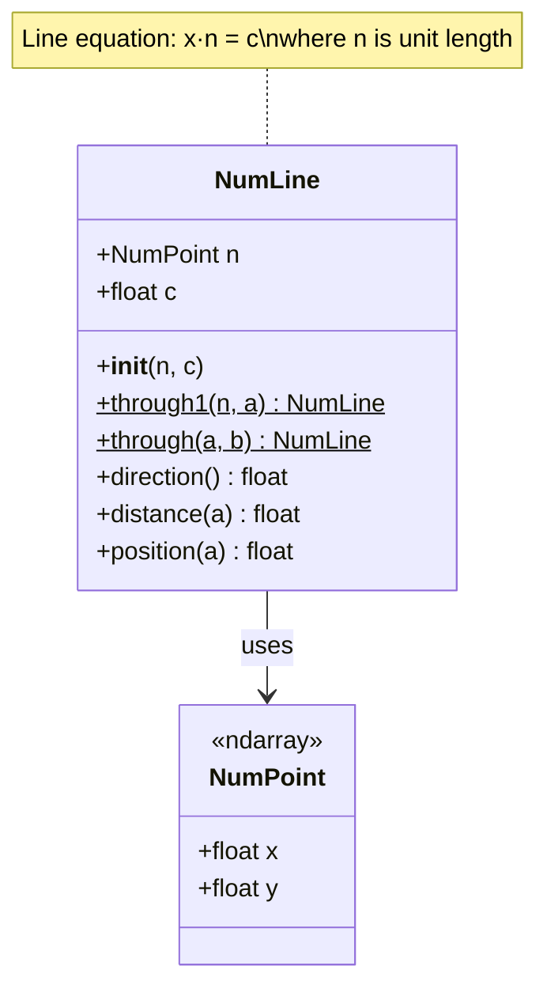
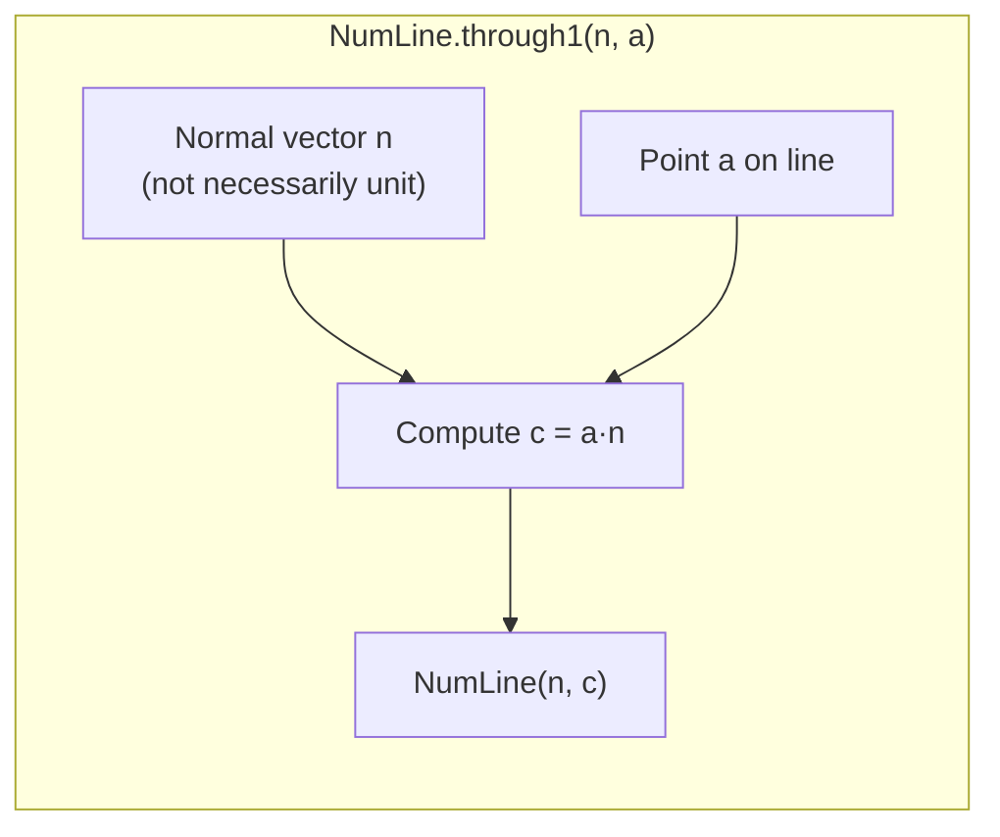
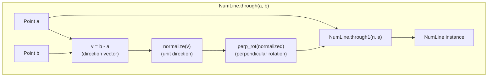
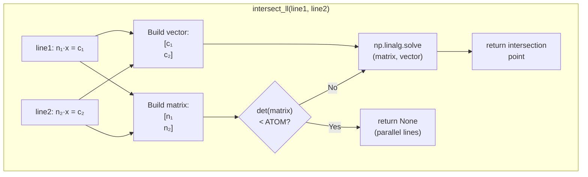
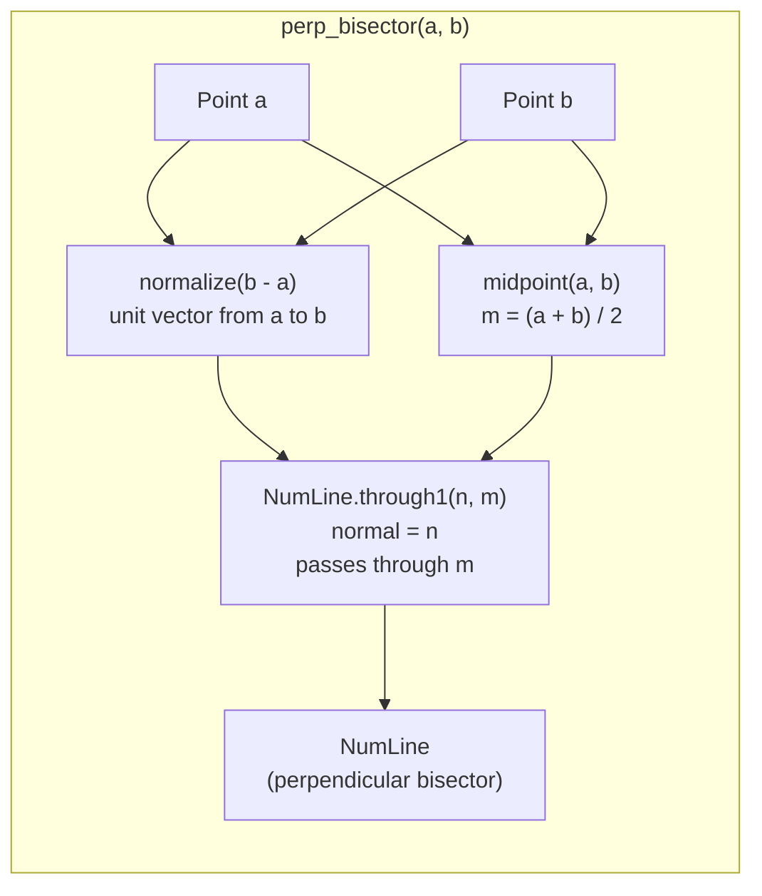
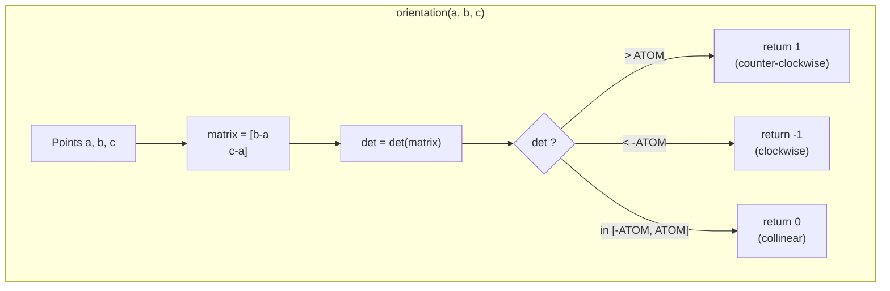
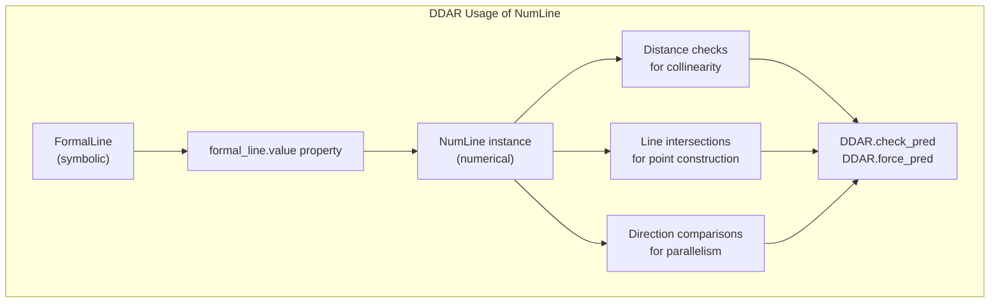
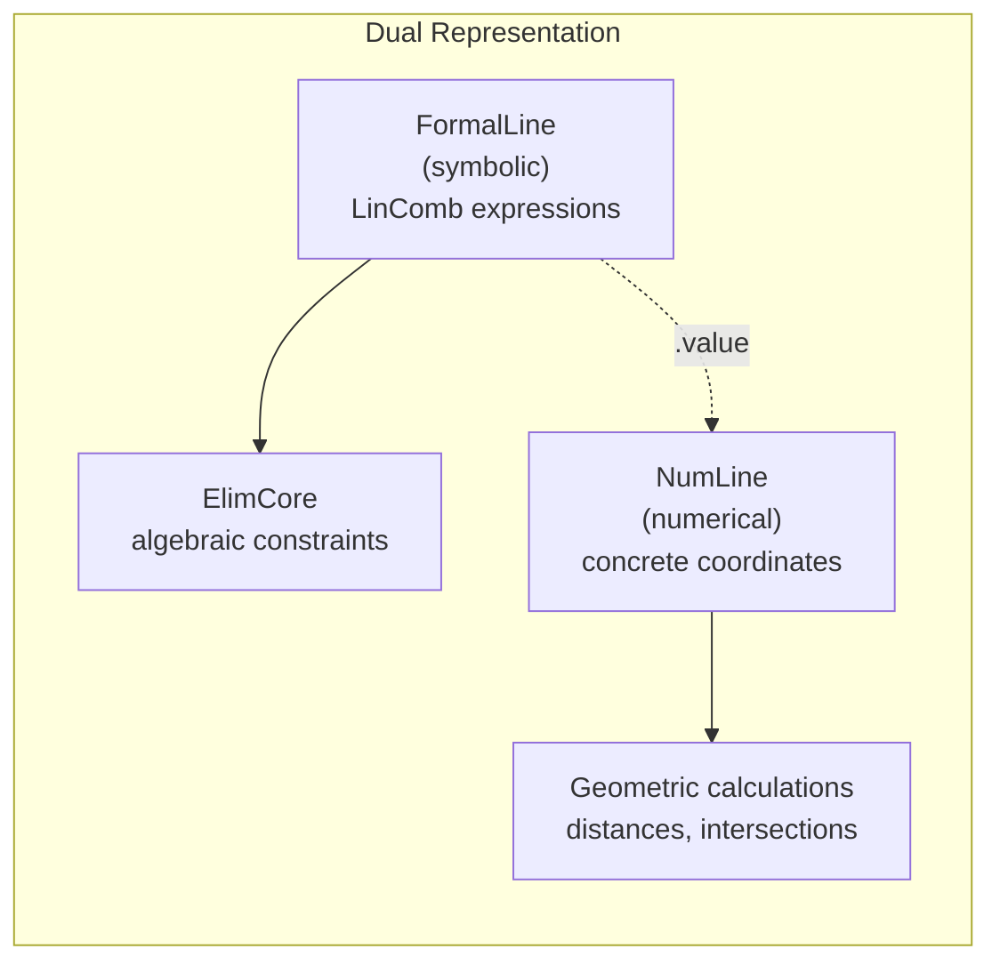

<!-- source: DeepWiki mcp.deepwiki.com · repo google-deepmind/alphageometry2 · page 6.2 Line Representations and Operations · fetched 2026-10-26 -->

# Line Representations and Operations

<details>
<summary>Relevant source files</summary>

The following files were used as context for generating this wiki page:

- [numericals.py](numericals.py)

</details>


## Purpose and Scope

This page documents the `NumLine` class and associated line operations in the numerical geometry module. These facilities provide concrete geometric calculations for line-based reasoning within the DDAR engine. For point and vector operations, see [6.1](#6.1). For circle operations, see [6.3](#6.3). For the broader context of numerical geometry, see [6](#6).

The `NumLine` class implements lines using a normal-form representation that enables efficient distance calculations and intersection tests. These operations support DDAR's geometric inference rules, particularly for collinearity detection, perpendicularity constraints, and line-based constructions.

Sources: [numericals.py:61-98]()

---

## Line Representation Model

### Mathematical Foundation

The `NumLine` class represents a line using the **implicit form** (also called normal form):

```
x · n = c
```

where:
- `n` is a **unit normal vector** perpendicular to the line
- `c` is a **scalar constant**
- A point `x` lies on the line if it satisfies the equation

This representation has key advantages:
- **Distance calculation** is trivial: `|x·n - c|` for any point `x`
- **Parallel lines** share the same normal vector
- **Line orientation** is captured by the normal direction

### Class Structure



**Diagram: NumLine class structure and its relationship to NumPoint**

The `NumLine` constructor enforces the unit-length constraint on the normal vector `n` through an assertion at [numericals.py:65](). The internal state consists of:
- `self.n`: Unit normal vector (2D NumPy array)
- `self.c`: Scalar constant (float)

Sources: [numericals.py:61-67]()

---

## Line Construction Methods

The `NumLine` class provides two factory methods for constructing lines from geometric specifications:

### Construction from Normal and Point



**Diagram: through1 factory method computation**

The `through1` class method [numericals.py:69-72]() creates a line passing through point `a` with normal vector `n`. The constant `c` is computed as the dot product `np.dot(a, n)`, ensuring that `a` satisfies the line equation `x·n = c`.

**Parameters:**
- `n`: Normal vector (must be unit length, as enforced by constructor)
- `a`: Point that must lie on the line

**Returns:** A `NumLine` instance where `a·n = c`

### Construction from Two Points



**Diagram: through factory method construction pipeline**

The `through` class method [numericals.py:74-76]() creates a line passing through two points `a` and `b`. The implementation:

1. Computes direction vector: `b - a`
2. Normalizes to unit length: `normalize(b - a)`
3. Rotates perpendicular: `perp_rot(normalized_vector)`
4. Constructs line: `through1(perpendicular_normal, a)`

The `perp_rot` function [numericals.py:32-34]() performs a 90° counter-clockwise rotation, transforming `[x, y]` to `[y, -x]`. This produces a normal vector perpendicular to the line direction.

Sources: [numericals.py:28-34, 69-76]()

---

## Line Properties and Queries

### Direction Calculation

```python
def direction(self) -> float:
    return (direction(self.n) + 0.5) % 1
```

The `direction` method [numericals.py:78-79]() returns a normalized direction value in the range `[0, 1)`. The implementation:

1. Calls the global `direction` function [numericals.py:37-39]() which computes `arctan2(y, x) / π`
2. Adds 0.5 to rotate from normal direction to line direction (90° shift)
3. Takes modulo 1 to normalize to `[0, 1)`

**Output interpretation:**
- `0.0`: Horizontal line pointing right
- `0.25`: Vertical line pointing up
- `0.5`: Horizontal line pointing left
- `0.75`: Vertical line pointing down

### Distance from Point to Line

The `distance` method [numericals.py:81-82]() computes the perpendicular distance from point `a` to the line:

```python
def distance(self, a: NumPoint) -> float:
    return abs(self.c - np.dot(a, self.n))
```

**Mathematical basis:** For line equation `x·n = c`, the signed distance from point `a` is `(a·n - c)`. The absolute value gives the unsigned distance.

**Use cases in DDAR:**
- Verifying collinearity (distance ≈ 0)
- Computing distance constraints
- Numerical validation of symbolic deductions

### Position Along Line

The `position` method [numericals.py:84-86]() assigns a scalar value to each point that represents its position along the line:

```python
def position(self, a: NumPoint) -> float:
    return -np.dot(perp_rot(self.n), a)
```

**Mathematical interpretation:** This computes the projection of point `a` onto the line's direction vector (perpendicular to the normal). Points further along the line direction have larger position values.

**Use cases:**
- Ordering points on a line
- Computing ratios and divisions
- Determining which side of a reference point another point lies

Sources: [numericals.py:78-86]()

---

## Line-Line Operations

### Intersection Computation



**Diagram: intersect_ll algorithm flow**

The `intersect_ll` function [numericals.py:89-94]() computes the intersection point of two lines by solving the linear system:

```
n₁·x = c₁
n₂·x = c₂
```

**Algorithm steps:**
1. Stack normal vectors into matrix: `np.stack((line1.n, line2.n))`
2. Create constant vector: `np.array((line1.c, line2.c))`
3. Check determinant: If `|det(matrix)| < ATOM`, lines are parallel → return `None`
4. Solve system: `np.linalg.solve(matrix, b)` returns intersection point

**Numerical stability:** The threshold `ATOM = 1e-12` [numericals.py:20]() provides tolerance for floating-point comparisons, preventing false intersections for nearly-parallel lines.

Sources: [numericals.py:20, 89-94]()

---

## Special Line Constructions

### Perpendicular Bisector



**Diagram: perp_bisector construction process**

The `perp_bisector` function [numericals.py:97-98]() constructs the perpendicular bisector of segment `ab`:

```python
def perp_bisector(a: NumPoint, b: NumPoint) -> NumLine:
    return NumLine.through1(normalize(b - a), midpoint(a, b))
```

**Geometric properties:**
- **Passes through midpoint** of segment `ab`
- **Normal is parallel** to the segment direction `b - a`
- **All points equidistant** from `a` and `b` lie on this line

**Use cases in DDAR:**
- Finding circumcenters (intersection of perpendicular bisectors)
- Detecting isosceles triangles
- Constructing reflection symmetries

Sources: [numericals.py:42-43, 97-98]()

---

## Collinearity Detection

### Orientation Test



**Diagram: orientation test algorithm**

The `orientation` function [numericals.py:46-54]() determines the orientation of three points:

**Algorithm:**
1. Build matrix from vectors: `[b-a, c-a]`
2. Compute determinant
3. Compare against threshold `ATOM`:
   - `det > ATOM`: Counter-clockwise (return 1)
   - `det < -ATOM`: Clockwise (return -1)
   - Otherwise: Collinear (return 0)

**Geometric interpretation:** The determinant measures the signed area of the parallelogram formed by vectors `b-a` and `c-a`. Zero area indicates collinearity.

### Collinearity Check

```python
def collinear(a: NumPoint, b: NumPoint, c: NumPoint) -> bool:
    return orientation(a, b, c) == 0
```

The `collinear` function [numericals.py:57-58]() provides a boolean test for collinearity by checking if the orientation is zero (within tolerance).

**Integration with DDAR:** These functions support the `coll` predicate checking in [ddar.py](), enabling DDAR to verify collinearity constraints numerically.

Sources: [numericals.py:20, 46-58]()

---

## System Integration

### Usage in DDAR



**Diagram: Integration of NumLine with DDAR's formal structures**

The `NumLine` class is used throughout DDAR for numerical verification and construction:

1. **FormalLine integration** [4.5](#4.5): Each `FormalLine` symbolic object has a `.value` property that returns a `NumLine` instance with concrete coordinates.

2. **Predicate checking** [4.2](#4.2): When DDAR checks predicates like `coll` (collinear) or `perp` (perpendicular), it uses `NumLine.distance()` and `NumLine.direction()` for numerical validation.

3. **Point construction**: The `intersect_ll` function is used to construct new points as intersections of known lines.

4. **Circle construction** [6.3](#6.3): The `perp_bisector` function is used in `NumCircle.through()` to find circumcenters.

### Relationship to Elimination System



**Diagram: Dual symbolic-numerical representation**

DDAR maintains dual representations:
- **Symbolic:** `FormalLine` objects with `LinComb` expressions [4.5](#4.5), processed by the elimination system [5](#5)
- **Numerical:** `NumLine` objects with concrete coordinates, used for geometric calculations

This dual approach enables both exact algebraic reasoning and approximate numerical validation within the same system.

Sources: [numericals.py:61-98]()

---

## Implementation Details

### Numerical Precision

| Constant | Value | Purpose |
|----------|-------|---------|
| `ATOM` | `1e-12` | Threshold for floating-point equality tests |

The `ATOM` constant [numericals.py:20]() provides tolerance for:
- Determinant checks in `intersect_ll`
- Orientation tests in `orientation`
- Implicit use in distance comparisons

**Design rationale:** The value `1e-12` balances numerical stability with geometric precision. It allows for accumulated floating-point errors while preventing false positives in geometric predicates.

### Vector Operations Dependencies

The `NumLine` class depends on several vector utility functions:

| Function | Location | Purpose in Line Operations |
|----------|----------|----------------------------|
| `normalize` | [numericals.py:28-29]() | Creates unit normal vectors |
| `perp_rot` | [numericals.py:32-34]() | Converts direction to normal |
| `direction` | [numericals.py:37-39]() | Computes line angles |
| `midpoint` | [numericals.py:42-43]() | Perpendicular bisector construction |

For detailed documentation of these operations, see [6.1](#6.1).

### Data Type Annotations

```python
NumPoint = np.ndarray  # Type alias for 2D points
```

The `NumPoint` type alias [numericals.py:21]() indicates that points are represented as NumPy arrays with shape `(2,)`. This enables efficient vectorized operations throughout the module.

Sources: [numericals.py:20-43, 61-98]()

---

## Complete API Reference

### NumLine Class

| Member | Type | Description |
|--------|------|-------------|
| `n` | `NumPoint` | Unit normal vector perpendicular to line |
| `c` | `float` | Constant in equation `x·n = c` |
| `__init__(n, c)` | Constructor | Creates line from normal and constant |
| `through1(n, a)` | Class method | Creates line through point `a` with normal `n` |
| `through(a, b)` | Class method | Creates line through points `a` and `b` |
| `direction()` | Method | Returns normalized direction in `[0, 1)` |
| `distance(a)` | Method | Returns perpendicular distance from point `a` |
| `position(a)` | Method | Returns position of point `a` along line |

### Module-Level Line Functions

| Function | Parameters | Returns | Description |
|----------|------------|---------|-------------|
| `intersect_ll` | `line1: NumLine`<br/>`line2: NumLine` | `NumPoint \| None` | Line-line intersection; `None` if parallel |
| `perp_bisector` | `a: NumPoint`<br/>`b: NumPoint` | `NumLine` | Perpendicular bisector of segment `ab` |
| `collinear` | `a, b, c: NumPoint` | `bool` | Tests if three points are collinear |
| `orientation` | `a, b, c: NumPoint` | `int` | Returns orientation: 1, -1, or 0 |

### Related Utility Functions

For complete documentation of point and vector operations used by `NumLine`, see:
- Vector normalization and rotation: [6.1](#6.1)
- Distance calculations: [6.1](#6.1)
- Direction computation: [6.1](#6.1)

Sources: [numericals.py:28-98]()

---

