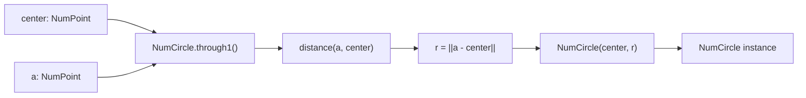
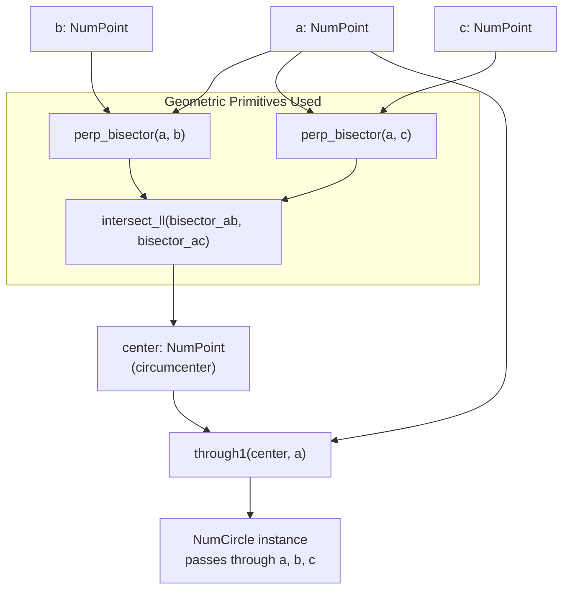
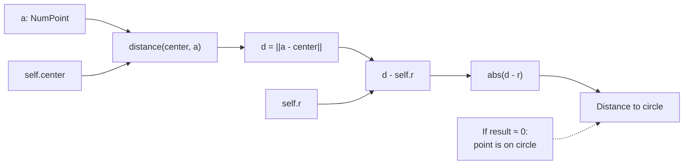
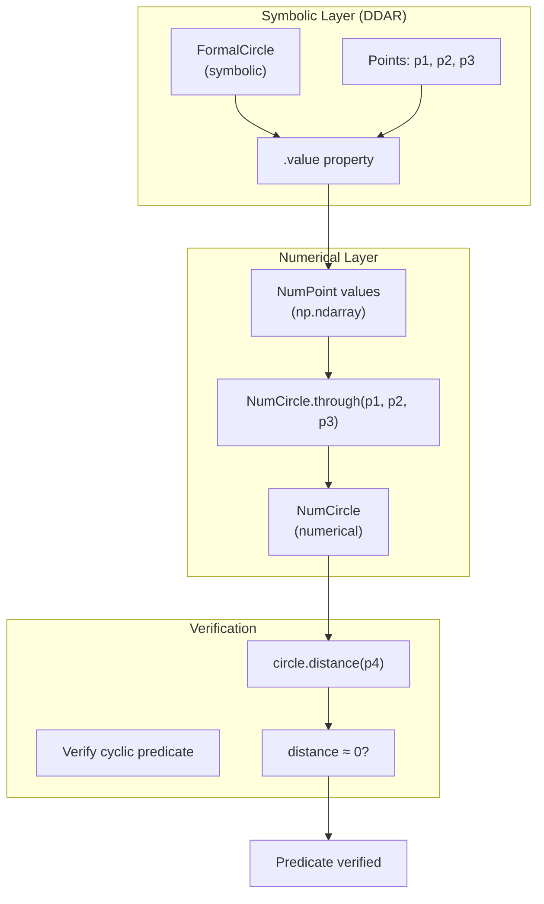
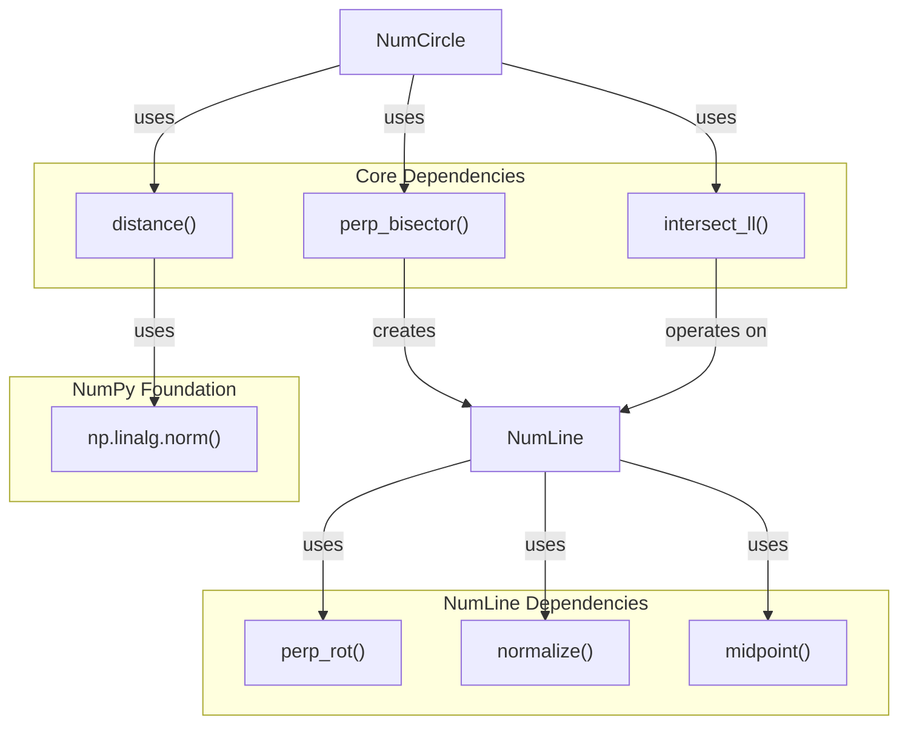

<!-- source: DeepWiki mcp.deepwiki.com · repo google-deepmind/alphageometry2 · page 6.3 Circle Representations and Operations · fetched 2026-10-26 -->

# Circle Representations and Operations

<details>
<summary>Relevant source files</summary>

The following files were used as context for generating this wiki page:

- [numericals.py](numericals.py)

</details>


## Purpose and Scope

This page documents the circle representation and operations in the numerical geometry module. It covers the `NumCircle` class, which provides concrete computational implementations for circle-based geometric calculations. This class is used by the DDAR engine for numerical verification of circle-related predicates and for computing circle properties during geometric reasoning.

For point operations and vector calculations, see [Point and Vector Operations](#6.1). For line representations, see [Line Representations and Operations](#6.2). For the broader numerical geometry context, see [Numerical Geometry Module](#6).

---

## NumCircle Class Overview

The `NumCircle` class represents a circle in Euclidean space using a center-radius parametrization. A point **x** lies on the circle if its distance from the center equals the radius **r**.

**Mathematical Definition:**
```
A point x is on a circle if ||x - center|| = r
```

**Class Structure:**

| Attribute | Type | Description |
|-----------|------|-------------|
| `center` | `NumPoint` (np.ndarray) | The center of the circle as a 2D point |
| `r` | `float` | The radius of the circle |

The class provides three ways to construct circles:
1. **Direct construction**: `NumCircle(center, r)` - when center and radius are known
2. **Through one point**: `through1(center, a)` - circle with known center passing through point a
3. **Through three points**: `through(a, b, c)` - circumcircle of three points

Sources: [numericals.py:101-123]()

---

## Circle Construction Methods

### Direct Constructor

The basic constructor `__init__(self, center: NumPoint, r: float)` creates a circle from a known center point and radius value.

```python
# Example: Circle centered at origin with radius 5
circle = NumCircle(np.array([0.0, 0.0]), 5.0)
```

**Usage Pattern:** This constructor is primarily used internally by the class methods `through1` and `through`. Direct construction is used when both the center location and radius are already computed.

Sources: [numericals.py:104-106]()

---

### through1: Circle Through One Point with Known Center

The `through1` class method constructs a circle when the center is known and the circle must pass through a specific point.

```python
@classmethod
def through1(cls, center: NumPoint, a: NumPoint) -> "NumCircle":
    r = distance(a, center)
    return NumCircle(center, r)
```

**Algorithm:**
1. Compute the distance from the center to point **a** using the `distance` function
2. Use this distance as the radius
3. Construct the circle with the given center and computed radius

**Use Cases in DDAR:**
- Creating circles when the center is already identified (e.g., from intersection points)
- Verifying that a point lies on a circle with a known center
- Computing circle properties when the center is geometrically significant



**Diagram: through1 Construction Flow**

Sources: [numericals.py:108-111](), [numericals.py:24-25]()

---

### through: Circumcircle Through Three Points

The `through` class method constructs the circumcircle of three points - the unique circle passing through all three points. This is one of the most geometrically important circle constructions.

```python
@classmethod
def through(cls, a: NumPoint, b: NumPoint, c: NumPoint) -> "NumCircle":
    center = intersect_ll(
        perp_bisector(a, b),
        perp_bisector(a, c),
    )
    return NumCircle.through1(center, a)
```

**Algorithm:**
1. Compute the perpendicular bisector of segment **ab**
2. Compute the perpendicular bisector of segment **ac**
3. Find the intersection of these two perpendicular bisectors - this is the circumcenter
4. Use `through1` to construct the circle with this center passing through point **a**

**Geometric Principle:** The perpendicular bisector of a segment contains all points equidistant from the segment's endpoints. The intersection of two such bisectors is equidistant from all three points, making it the center of the unique circle through those points.



**Diagram: Circumcircle Construction Algorithm**

**Use Cases in DDAR:**
- Detecting cyclic quadrilaterals by checking if four points lie on the same circle
- Computing the circumcircle of triangles for geometric reasoning
- Verifying circle-based predicates like `cyclic(a, b, c, d)`

Sources: [numericals.py:113-119](), [numericals.py:89-94](), [numericals.py:97-98]()

---

## Distance Calculations

The `distance` method computes the distance from a point to the circle's perimeter. This is distinct from the distance to the circle's center.

```python
def distance(self, a: NumPoint) -> float:
    return abs(distance(self.center, a) - self.r)
```

**Formula:**
```
circle_distance(a) = |distance(center, a) - r|
```

**Geometric Interpretation:**
- If the point is **on** the circle: distance = 0
- If the point is **inside** the circle: distance = r - distance(center, a) > 0
- If the point is **outside** the circle: distance = distance(center, a) - r > 0

**Use Cases:**
- Verifying that a point lies on a circle (distance ≈ 0 within `ATOM` tolerance)
- Checking cyclic predicates by verifying multiple points have zero distance
- Numerical validation of symbolic circle constraints



**Diagram: Distance to Circle Calculation**

Sources: [numericals.py:121-122](), [numericals.py:24-25]()

---

## Integration with DDAR System

The `NumCircle` class serves as the numerical representation for `FormalCircle` objects in the DDAR engine. This provides a dual representation strategy where symbolic reasoning is verified with numerical calculations.

### Circle Construction in DDAR Workflow



**Diagram: NumCircle Integration in DDAR**

### Predicate Verification Patterns

| Predicate | NumCircle Method | Verification Approach |
|-----------|------------------|----------------------|
| `cyclic(a, b, c, d)` | `through(a, b, c)` then `distance(d)` | Check if distance(d) ≈ 0 |
| `circle(o, a, b, c)` | `through(a, b, c)` then verify center | Check if center ≈ o |
| `on_circle(a, circle)` | `distance(a)` | Check if distance ≈ 0 |

Sources: [numericals.py:101-123]()

---

## Geometric Primitives Used

The `NumCircle` class depends on several geometric primitives from the `numericals` module:

| Primitive | Purpose | Line Reference |
|-----------|---------|----------------|
| `distance(a, b)` | Compute Euclidean distance between points | [numericals.py:24-25]() |
| `perp_bisector(a, b)` | Create perpendicular bisector line | [numericals.py:97-98]() |
| `intersect_ll(line1, line2)` | Find intersection of two lines | [numericals.py:89-94]() |
| `NumLine.through1(n, a)` | Create line with normal through point | [numericals.py:70-72]() |

These primitives compose to enable the three-point circumcircle construction, which is the most sophisticated circle construction method.



**Diagram: NumCircle Dependency Graph**

Sources: [numericals.py:24-25](), [numericals.py:97-98](), [numericals.py:89-94](), [numericals.py:70-72]()

---

## Code Entity Reference

### Class Definition

**Class:** `NumCircle`
- **Location:** [numericals.py:101-123]()
- **Attributes:**
  - `center: NumPoint` - Circle center as 2D numpy array
  - `r: float` - Circle radius

### Constructor Methods

| Method | Signature | Line Reference | Description |
|--------|-----------|----------------|-------------|
| `__init__` | `(self, center: NumPoint, r: float)` | [numericals.py:104-106]() | Direct construction from center and radius |
| `through1` | `(cls, center: NumPoint, a: NumPoint)` | [numericals.py:108-111]() | Circle with known center through one point |
| `through` | `(cls, a: NumPoint, b: NumPoint, c: NumPoint)` | [numericals.py:113-119]() | Circumcircle through three points |

### Instance Methods

| Method | Signature | Line Reference | Description |
|--------|-----------|----------------|-------------|
| `distance` | `(self, a: NumPoint) -> float` | [numericals.py:121-122]() | Distance from point to circle perimeter |

Sources: [numericals.py:101-123]()

---

## Numerical Precision Considerations

The `numericals` module defines a tolerance constant `ATOM = 1e-12` for numerical comparisons. When verifying circle-based predicates:

1. **Point on circle verification:** `circle.distance(point) < ATOM` indicates the point lies on the circle
2. **Circumcircle verification:** All three defining points should have `distance ≈ 0` within tolerance
3. **Center computation:** The `intersect_ll` function returns `None` if lines are parallel (det < ATOM), which would indicate degenerate input

**Edge Cases:**
- **Collinear points:** `through(a, b, c)` fails if the three points are collinear (perpendicular bisectors are parallel)
- **Coincident points:** If any two input points are identical, the perpendicular bisector is undefined
- **Numerical instability:** Very small or very large coordinate values may reduce precision

Sources: [numericals.py:20](), [numericals.py:89-94]()

---

