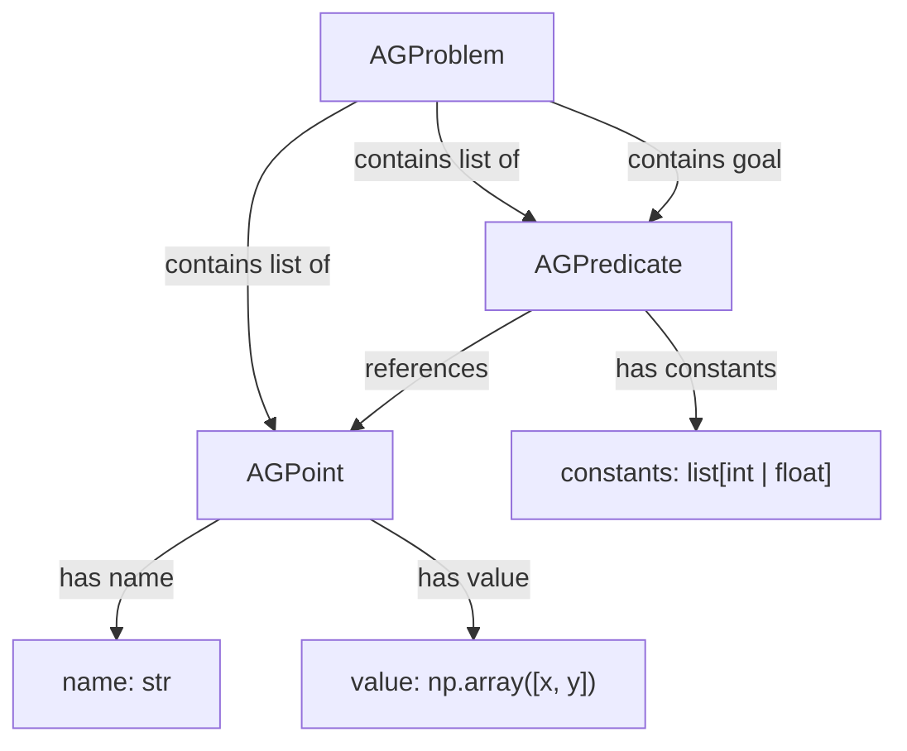
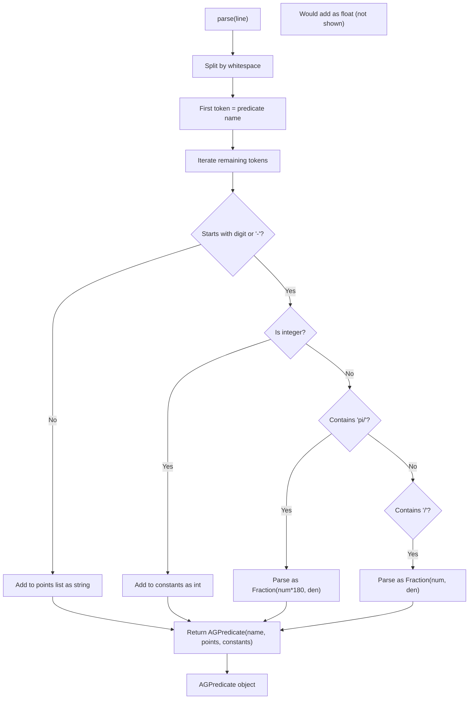
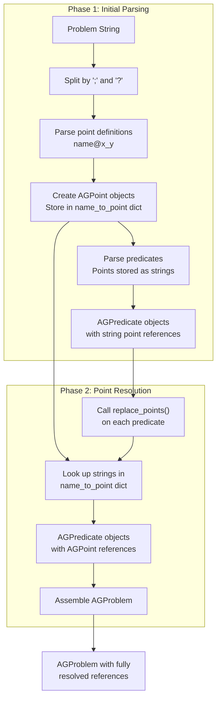
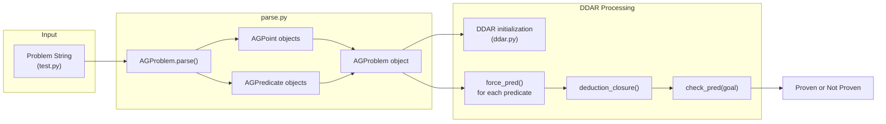
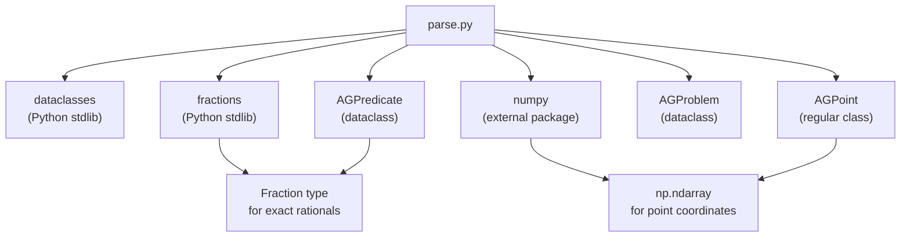

<!-- source: DeepWiki mcp.deepwiki.com · repo google-deepmind/alphageometry2 · page 7 Problem Parsing and Data Structures · fetched 2026-10-26 -->

# Problem Parsing and Data Structures

<details>
<summary>Relevant source files</summary>

The following files were used as context for generating this wiki page:

- [parse.py](parse.py)
- [test.py](test.py)

</details>


This page documents the `parse.py` module, which provides the fundamental data structures for representing geometry problems in AlphaGeometry2. The module defines three core classes: `AGPoint`, `AGPredicate`, and `AGProblem`, along with their parsing logic that transforms problem strings into structured objects.

For detailed information about the problem string format and parsing rules, see [Problem String Format](#7.1). For understanding the two-phase parsing and point reference resolution mechanism, see [Point Reference Resolution](#7.2).

**Sources:** [parse.py:1-149]()

## Module Purpose and Scope

The `parse.py` module serves as the entry point for problem ingestion, converting text-based problem definitions into structured Python objects that can be processed by the DDAR reasoning engine. It handles:

1. Parsing problem strings with embedded point coordinates
2. Creating typed geometric predicates with point references and constants
3. Assembling complete problem structures with givens and goals
4. Resolving string-based point references to concrete `AGPoint` objects

This module has no dependencies on the reasoning logic (DDAR) or mathematical infrastructure (elimination, numericals), making it a pure data modeling layer.

**Sources:** [parse.py:16](), [test.py:18-19]()

## Core Data Structures Overview

The three classes form a hierarchical structure:



**Sources:** [parse.py:26-148]()

## AGPoint: Point Representation

`AGPoint` is the simplest data structure, representing a single geometric point with both a symbolic name and numerical coordinates.

### Class Definition

The class is defined in [parse.py:26-35]():

| Attribute | Type | Description |
|-----------|------|-------------|
| `name` | `str` | The symbolic name of the point (e.g., "a", "b", "c") |
| `value` | `np.ndarray` | A 2D numpy array `[x, y]` containing float coordinates |

### Construction and String Representation

```python
# Created during parsing:
point = AGPoint(name="a", value=np.array([0.0, 0.0]))

# String representation uses the name:
str(point)  # Returns "a"
```

The `__str__` method [parse.py:33-34]() returns only the name, not the coordinates, allowing points to be printed in human-readable predicates.

**Sources:** [parse.py:26-35]()

## AGPredicate: Geometric Relations

`AGPredicate` represents a single geometric constraint or relationship. It is implemented as a dataclass with three fields and three methods.

### Class Definition

Defined in [parse.py:37-81]():

| Field | Type | Description |
|-------|------|-------------|
| `name` | `str` | Predicate type (e.g., "coll", "cong", "cyclic", "eqangle") |
| `points` | `list[str \| AGPoint]` | List of point references (strings during parsing, AGPoints after) |
| `constants` | `list[int \| float]` | Numeric parameters for the predicate |

### Methods

| Method | Purpose |
|--------|---------|
| `replace_points(ori_to_new)` | Replaces string point names with AGPoint objects |
| `__str__()` | Formats predicate as space-separated tokens |
| `parse(line)` | Static method to parse a predicate string |

### Parsing Logic

The `parse` method [parse.py:58-81]() implements type detection for arguments:



**Example parsing:**
- Input: `"coll a b c"`
- Result: `AGPredicate(name="coll", points=["a", "b", "c"], constants=[])`

- Input: `"aconst a b a c 60"`
- Result: `AGPredicate(name="aconst", points=["a", "b", "a", "c"], constants=[60])`

- Input: `"distseq a b b p a q q b 1 1 -1 -1"`
- Result: `AGPredicate(name="distseq", points=["a", "b", "b", "p", "a", "q", "q", "b"], constants=[1, 1, -1, -1])`

**Sources:** [parse.py:37-81]()

## AGProblem: Complete Problem Specification

`AGProblem` is the top-level container representing an entire geometry problem with points, given conditions, and a goal to prove.

### Class Definition

Defined in [parse.py:83-148]():

| Field | Type | Description |
|-------|------|-------------|
| `points` | `list[AGPoint]` | All points in the problem |
| `preds` | `list[AGPredicate]` | Given predicates (conditions) |
| `goal` | `AGPredicate` | The predicate to prove (can be `None`) |

### Methods

| Method | Purpose | Location |
|--------|---------|----------|
| `__str__()` | Human-readable representation | [parse.py:90-94]() |
| `replace_points(ori_to_new)` | Recursively replaces points in all predicates | [parse.py:96-101]() |
| `pstring()` | Converts back to compact problem string format | [parse.py:103-109]() |
| `parse(line)` | Static method to parse a complete problem string | [parse.py:111-148]() |

### String Representations

The class provides two string formats:

**Human-readable (`__str__`):**
```
a : [0. 0.]
b : [1. 0.]
c : [0.5 0.866]

coll a b c
cong a b b c

Goal: cyclic a b c d
```

**Compact problem string (`pstring`):**
```
a@0.0_0.0 = ; b@1.0_0.0 = ; c@0.5_0.866 = coll a b c, cong a b b c ? cyclic a b c d
```

**Sources:** [parse.py:83-148]()

## Two-Phase Parsing Architecture

The parsing process uses a two-phase approach to handle point references:



**Sources:** [parse.py:111-148]()

### Why Two Phases?

The two-phase approach allows the parser to:

1. **Defer point resolution** until all points are defined
2. **Support forward references** where predicates reference points defined later in the string
3. **Maintain clean separation** between string parsing and object construction
4. **Enable reusable predicates** that can be transformed via `replace_points`

The implementation is in [parse.py:111-148]():

```python
# Phase 1: Build name_to_point dictionary
name_to_point = {}
for step in steps.split(';'):
    # Parse point definitions...
    name_to_point[name] = AGPoint(name=name, value=value)
    # Parse predicates with string references...
    preds.append(AGPredicate.parse(constraint))

# Phase 2: Resolve all point references
preds = list(map(lambda pred: pred.replace_points(name_to_point), preds))
if goal is not None:
    goal = AGPredicate.parse(goal).replace_points(name_to_point)
```

**Sources:** [parse.py:111-148]()

## Predicate Type Examples

The system supports many predicate types. Here are common examples from the test suite:

| Predicate | Example | Points | Constants | Meaning |
|-----------|---------|--------|-----------|---------|
| `coll` | `coll a b c` | 3 | 0 | Points a, b, c are collinear |
| `cong` | `cong a b c d` | 4 | 0 | Distance ab equals distance cd |
| `cyclic` | `cyclic a b c d` | 4 | 0 | Points lie on a circle |
| `eqangle` | `eqangle a b c d e f g h` | 8 | 0 | Angle abc equals angle efg |
| `perp` | `perp a b c d` | 4 | 0 | Line ab perpendicular to line cd |
| `para` | `para a b c d` | 4 | 0 | Line ab parallel to line cd |
| `aconst` | `aconst a b a c 60` | 4 | 1 | Angle bac equals 60 degrees |
| `eqratio` | `eqratio a b c d e f g h` | 8 | 0 | Ratio ab/cd equals ef/gh |
| `distseq` | `distseq a b c d ... 1 -1` | varies | varies | Linear distance equation |

**Sources:** [test.py:22-479]()

## Data Flow Through the System



**Sources:** [test.py:491-507](), [parse.py:111-148]()

## Usage Pattern in Test Suite

The standard usage pattern from [test.py:491-507]() demonstrates the complete flow:

```python
# 1. Parse problem string into structured object
problem = AGProblem.parse(pstring)

# 2. Initialize DDAR with the parsed points
ddar = DDAR(problem.points)

# 3. Assert each given predicate
for pred in problem.preds:
    ddar.force_pred(pred)

# 4. Run deductive closure
ddar.deduction_closure()

# 5. Check if goal is proven
if ddar.check_pred(problem.goal):
    print("Proven :-)")
```

This pattern shows that `parse.py` serves purely as a data transformation layer, producing objects that are consumed by the DDAR reasoning engine.

**Sources:** [test.py:491-507]()

## Type System and Dependencies

The module has minimal external dependencies:



**Key type choices:**

- **`numpy.ndarray`** for point coordinates: Enables efficient vector operations in numericals.py
- **`fractions.Fraction`** for exact rationals: Preserves precision for angle constants (e.g., π/3 → 60°)
- **`dataclasses.dataclass`** for predicates and problems: Provides automatic `__init__`, `__repr__`, and equality
- **Union types** (`str | AGPoint`): Supports two-phase parsing where strings are later resolved to objects

**Sources:** [parse.py:1-24]()

## Immutability and Transformation Pattern

The data structures follow a functional transformation pattern rather than mutation:

```python
# Instead of mutating predicates in place:
predicate.points = [point_objects...]  # NOT done

# The code creates new objects with transformed data:
new_predicate = predicate.replace_points(name_to_point)
new_problem = problem.replace_points(name_to_point)
```

This design from [parse.py:45-50]() and [parse.py:96-101]() ensures:
- **Immutability**: Original parsed data is never modified
- **Traceability**: Can maintain both string and object representations
- **Composability**: Transformations can be chained or reversed

**Sources:** [parse.py:45-50](), [parse.py:96-101]()

---

