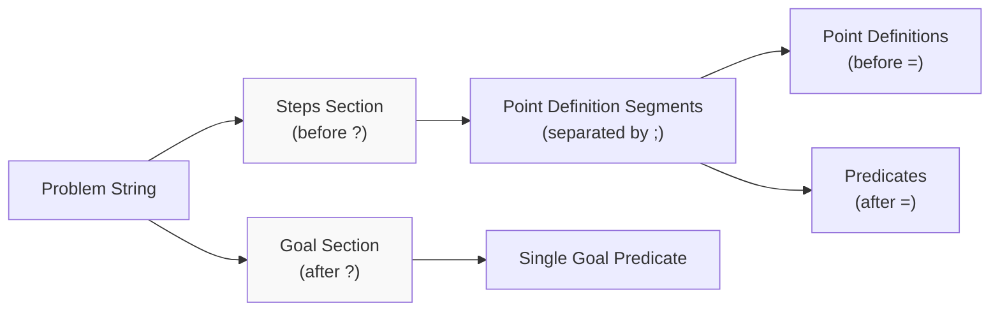
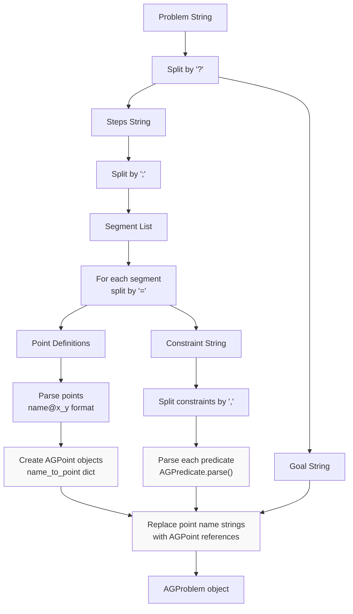
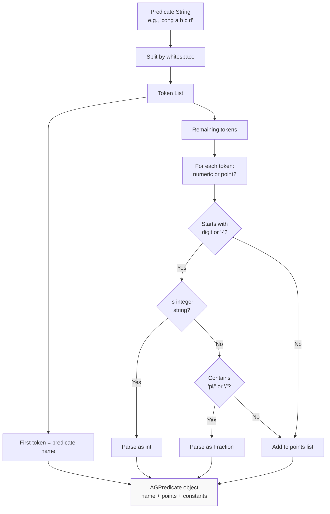
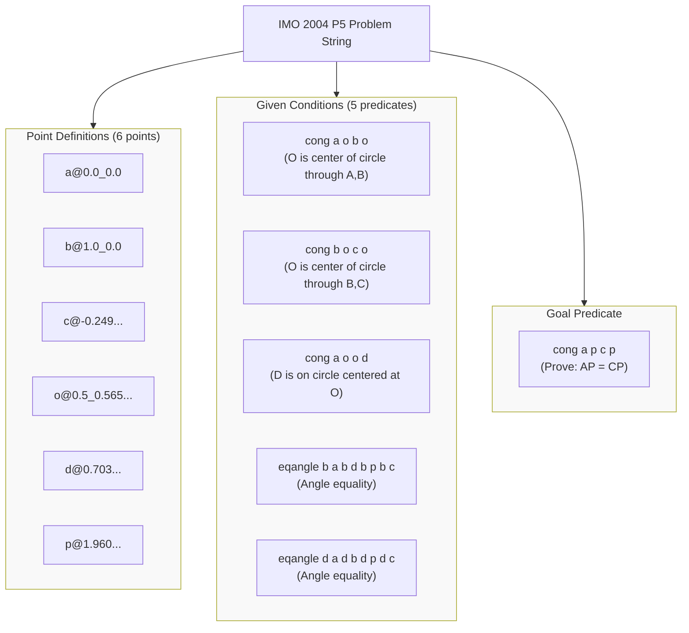

<!-- source: DeepWiki mcp.deepwiki.com · repo google-deepmind/alphageometry2 · page 7.1 Problem String Format · fetched 2026-10-26 -->

# Problem String Format

<details>
<summary>Relevant source files</summary>

The following files were used as context for generating this wiki page:

- [parse.py](parse.py)
- [test.py](test.py)

</details>


This page provides a detailed specification of the AlphaGeometry2 problem string format, which is the textual representation used to encode geometry problems for the DDAR logical engine. For information about how these strings are parsed into structured objects, see [Point Reference Resolution](#7.2). For examples of complete problems in this format, see [Problem Categories](#8.1).

## Overview

The problem string format is a compact, single-line representation that encodes:
- Point definitions with numerical coordinates
- Geometric constraints (predicates) that define given conditions
- A goal predicate to be proven

All 26 IMO problems in the test suite are encoded in this format [test.py:22-479]().

## String Structure

The basic structure follows this pattern:

```
point_definitions; more_points; ... = constraints, more_constraints ? goal_predicate
```

### High-Level Components



**Sources:** [test.py:22-479](), [parse.py:112-148]()

## Point Definition Syntax

Each point is defined using the format:

```
name@x_y
```

Where:
- `name` is the point's identifier (e.g., `a`, `b`, `c`, `x1`, `o`)
- `x` is the x-coordinate (floating-point)
- `y` is the y-coordinate (floating-point)
- `_` separates the coordinates

### Point Definition Examples

| Example | Name | X Coordinate | Y Coordinate |
|---------|------|--------------|--------------|
| `a@0.0_0.0` | `a` | `0.0` | `0.0` |
| `b@1.0_0.0` | `b` | `1.0` | `0.0` |
| `o@0.5_0.8563648602858344` | `o` | `0.5` | `0.8563648602858344` |
| `x@-0.4323646433488391_-0.0` | `x` | `-0.4323646433488391` | `-0.0` |

**Sources:** [test.py:23-32](), [parse.py:128-133]()

## Segment Structure

The problem string is divided into segments separated by semicolons (`;`). Each segment contains:

```
point1@x1_y1 point2@x2_y2 ... = predicate1, predicate2, ...
```

Multiple points can be defined in a single segment, and their associated constraints follow the `=` sign.

### Parsing Workflow



**Sources:** [parse.py:112-148]()

## Predicate Syntax

Predicates encode geometric constraints. Each predicate follows the format:

```
predicate_name point1 point2 ... [constant1 constant2 ...]
```

### Predicate Components

1. **Predicate name**: Identifies the type of geometric relationship
2. **Point arguments**: Space-separated point names
3. **Optional constants**: Numerical values (integers or fractions)

### Example Problem Segment

```
a@0.0_0.0 = ; b@1.0_0.0 = ; c@0.6476304100773809_0.5128375346260048 = ;
o@0.5_0.03392602193818622 = cong a o b o, cong b o c o
```

This defines four points (`a`, `b`, `c`, `o`) where:
- Points `a`, `b`, `c` have no immediate constraints (empty after `=`)
- Point `o` has two constraints: `cong a o b o` and `cong b o c o`

**Sources:** [test.py:108-120](), [parse.py:134-138]()

## Complete Predicate Reference

The following predicates are used in the problem format:

| Predicate | Arguments | Constants | Meaning |
|-----------|-----------|-----------|---------|
| `coll` | 3+ points | None | Points are collinear |
| `cong` | 4 points (A,B,C,D) | None | Distance AB equals distance CD |
| `perp` | 4 points (A,B,C,D) | None | Line AB perpendicular to line CD |
| `para` | 4 points (A,B,C,D) | None | Line AB parallel to line CD |
| `cyclic` | 4+ points | None | Points lie on a circle |
| `eqangle` | 8 points | None | Angle formed by first 4 points equals angle formed by last 4 points |
| `eqratio` | 8 points | None | Ratio of distances AB:CD equals EF:GH |
| `aconst` | 3 points | 1 constant | Angle ABC equals constant (in degrees) |
| `acompute` | 3 points | None | Compute angle ABC (used in goals) |
| `distseq` | 4 points | 4 integers | Distance sequence constraint |

**Sources:** [test.py:22-479]()

### Predicate Parsing Details



**Sources:** [parse.py:58-80]()

### Constant Format Variants

Constants in predicates can be specified in multiple formats:

| Format | Example | Parsed Value | Type |
|--------|---------|--------------|------|
| Integer | `60` | `60` | `int` |
| Negative integer | `-1` | `-1` | `int` |
| Fraction | `3/4` | `Fraction(3, 4)` | `fractions.Fraction` |
| Pi-based angle | `1pi/3` | `Fraction(60, 1)` | `fractions.Fraction` (converted to degrees) |

The pi-based format `npi/d` is converted to degrees as: `(n × 180) / d` [parse.py:68-72]().

**Sources:** [parse.py:64-77]()

## Goal Predicate Format

The goal predicate appears after the `?` symbol and uses the same predicate syntax as constraints:

```
... ? goal_predicate_name point1 point2 ...
```

### Examples

```
? cong e p e q
```
Goal: Prove that distance EP equals distance EQ

```
? cyclic p q r s
```
Goal: Prove that points P, Q, R, S are concyclic

```
? coll x h y
```
Goal: Prove that points X, H, Y are collinear

**Sources:** [test.py:37-38](), [parse.py:114-142]()

## Complete Example Analysis

Let's analyze a complete problem string from IMO 2004 P5:

```
a@0.0_0.0 = ; b@1.0_0.0 = ; c@-0.24938856912238253_0.6547036984730146 = ; 
o@0.5_0.5653092857516873 = ; d@0.7037641142060632_1.2919830600953754 = ; 
p@1.9602382123421425_1.1215406301036281 = cong a o b o, cong b o c o, 
cong a o o d, eqangle b a b d b p b c, eqangle d a d b d p d c ? 
cong a p c p
```

### Component Breakdown



**Sources:** [test.py:83-90]()

## String Format Constraints

### Mandatory Requirements

1. All points must have numerical coordinates defined
2. Point names are case-sensitive
3. The `?` symbol must separate constraints from goal
4. Segments are separated by `;`
5. Multiple constraints in a segment are separated by `,`

### Optional Elements

1. Goal predicate (can be omitted if `?` is not present) [parse.py:114-118]()
2. Constraints in a segment (can have empty constraints after `=`)
3. Whitespace around separators (automatically trimmed) [parse.py:135-137]()

**Sources:** [parse.py:112-148]()

## Auxiliary Points

For challenging problems that require auxiliary constructions, auxiliary points are included directly in the problem string with their coordinates. These are not automatically generated by this system:

```
x@0.21813684153819998_1.7305942803610102 = ;
x'@0.21813684153820143_1.7305942803610088 = ;
xb@0.6401728961839753_1.3207013102933183 = ;
xd@-0.06405157724976585_2.209118607896344 = ...
```

Note the use of primed notation (`x'`) for multiple related auxiliary points [test.py:259-261]().

**Sources:** [test.py:236-479]()

## Parser Implementation Reference

The parsing logic is implemented in two main functions:

| Function | Location | Responsibility |
|----------|----------|----------------|
| `AGProblem.parse()` | [parse.py:112-148]() | Top-level problem string parser |
| `AGPredicate.parse()` | [parse.py:58-80]() | Individual predicate string parser |

The parsing creates:
1. `AGPoint` objects with `name` and `value` (NumPy array) [parse.py:26-34]()
2. `AGPredicate` objects with `name`, `points`, and `constants` [parse.py:37-50]()
3. `AGProblem` object containing lists of points, predicates, and a goal [parse.py:83-101]()

**Sources:** [parse.py:1-149]()

---

