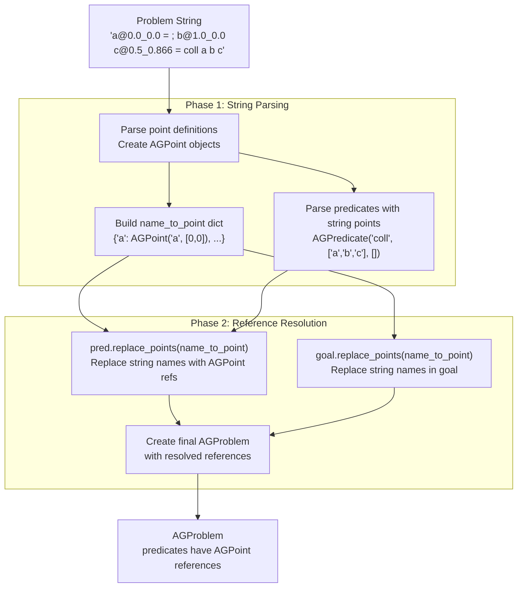
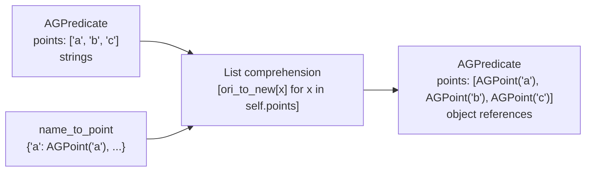
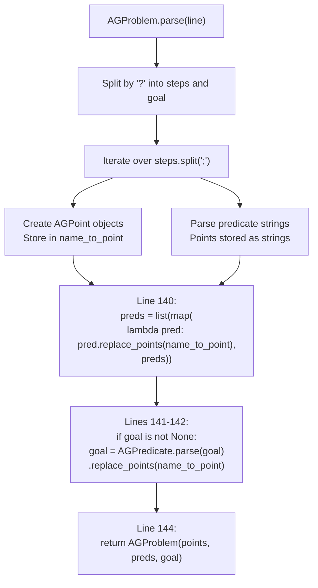
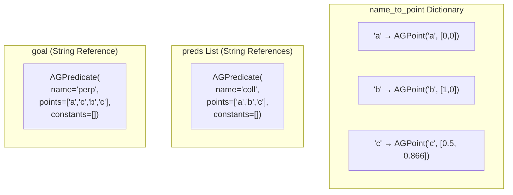
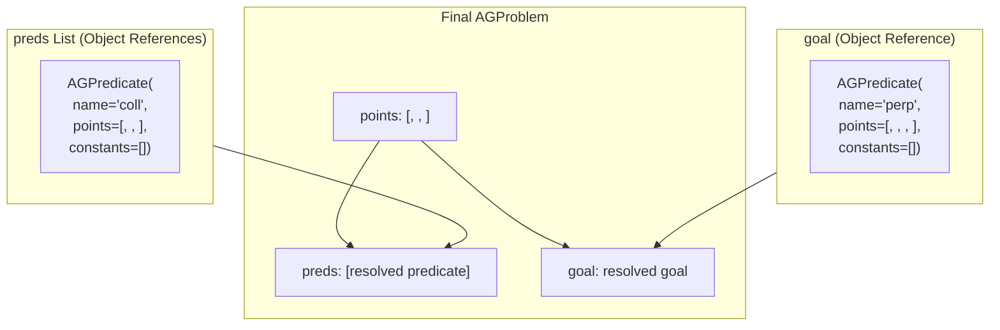
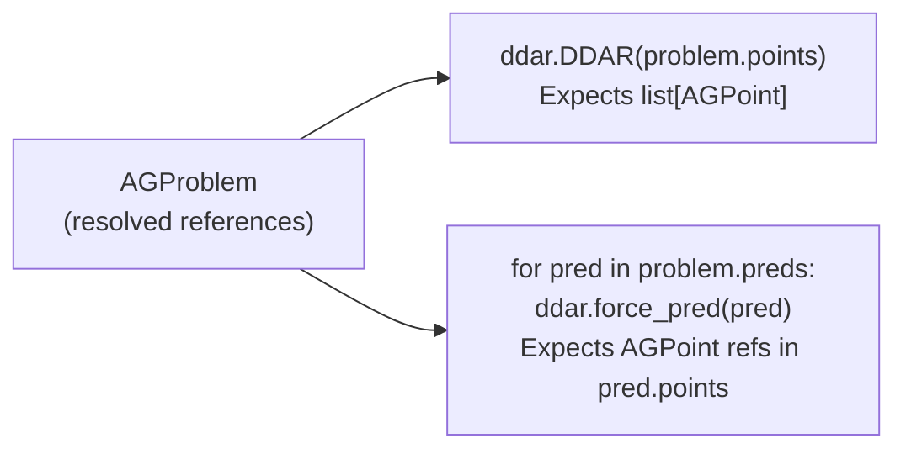

<!-- source: DeepWiki mcp.deepwiki.com · repo google-deepmind/alphageometry2 · page 7.2 Point Reference Resolution · fetched 2026-10-26 -->

# Point Reference Resolution

<details>
<summary>Relevant source files</summary>

The following files were used as context for generating this wiki page:

- [parse.py](parse.py)

</details>


## Purpose and Scope

This document describes the point reference resolution mechanism in the AlphaGeometry2 parsing system. Point reference resolution is the process of converting string-based point names in predicates into references to actual `AGPoint` objects. This two-phase parsing approach allows the system to first parse the string structure, then resolve all point references after all points have been defined.

For information about the overall problem string format, see [Problem String Format](#7.1). For the complete parsing system and data structures, see [Problem Parsing and Data Structures](#7).

**Sources:** [parse.py:1-149]()

---

## Overview: Two-Phase Parsing Process

The parsing system uses a two-phase approach to handle point references:

**Phase 1: String-Based Parsing**
- Parse the problem string to identify point definitions and predicates
- Create `AGPredicate` objects with `points` field containing string names
- Build a mapping from point names to `AGPoint` objects

**Phase 2: Reference Resolution**
- Use the `replace_points` method to convert string references to `AGPoint` object references
- Apply this transformation to all predicates and the goal
- Produce the final `AGProblem` with fully resolved references

This approach solves the forward-reference problem: predicates can reference points that are defined later in the same problem string.



**Sources:** [parse.py:112-148]()

---

## The name_to_point Mapping

During Phase 1 of parsing, the `AGProblem.parse` method constructs a `name_to_point` dictionary that maps string point names to their corresponding `AGPoint` objects.

### Construction Process

The mapping is built while parsing point definitions from the problem string:

| Line Range | Operation | Result |
|------------|-----------|--------|
| [121-122]() | Split step by `=` separator | Separates point definitions from constraints |
| [124-133]() | Parse each point definition | Creates `AGPoint` with name and coordinates |
| [133]() | Store in dictionary | Adds to `name_to_point[name]` |

### Structure

```
name_to_point: dict[str, AGPoint]
```

**Key:** Point name as a string (e.g., `'a'`, `'b'`, `'x1'`)  
**Value:** Corresponding `AGPoint` object with name and numerical coordinates

### Example

For the problem string:
```
a@0.0_0.0 b@1.0_0.0 c@0.5_0.866 = coll a b c
```

The resulting mapping is:
```python
{
  'a': AGPoint(name='a', value=np.array([0.0, 0.0])),
  'b': AGPoint(name='b', value=np.array([1.0, 0.0])),
  'c': AGPoint(name='c', value=np.array([0.5, 0.866]))
}
```

**Sources:** [parse.py:120-133]()

---

## The replace_points Method

The `replace_points` method is the core mechanism for reference resolution. It appears in two classes: `AGPredicate` and `AGProblem`.

### AGPredicate.replace_points



The method creates a new `AGPredicate` with the same name and constants, but with point strings replaced by `AGPoint` objects:

```python
def replace_points(self, ori_to_new):
    return AGPredicate(
        name=self.name,
        points=[ori_to_new[x] for x in self.points],  # Resolution happens here
        constants=self.constants,
    )
```

**Key characteristics:**
- **Immutable transformation:** Returns a new `AGPredicate` rather than modifying in place
- **Mapping lookup:** Uses dictionary lookup `ori_to_new[x]` for each point
- **Preserves metadata:** Name and constants remain unchanged

**Sources:** [parse.py:45-50]()

### AGProblem.replace_points

The `AGProblem.replace_points` method recursively applies point replacement to all components of the problem:

```python
def replace_points(self, ori_to_new):
    return AGProblem(
        points=[ori_to_new[x] for x in self.points],          # Replace in points list
        preds=[pred.replace_points(ori_to_new) for pred in self.preds],  # Replace in predicates
        goal=self.goal.replace_points(ori_to_new),            # Replace in goal
    )
```

This method is used during the parsing process to convert the entire problem structure from string-based references to object-based references.

**Sources:** [parse.py:96-101]()

---

## Resolution in the Parsing Pipeline

The reference resolution occurs at specific points in the `AGProblem.parse` method:



### Resolution Steps

1. **Lines 120-138:** Build `name_to_point` dictionary while parsing points and predicates (predicates still have string point references)

2. **Line 140:** Apply `replace_points` to all predicates in a single pass:
   ```python
   preds = list(map(lambda pred: pred.replace_points(name_to_point), preds))
   ```

3. **Lines 141-142:** Apply `replace_points` to the goal predicate:
   ```python
   if goal is not None:
       goal = AGPredicate.parse(goal).replace_points(name_to_point)
   ```

4. **Lines 144-148:** Create the final `AGProblem` with all references resolved

**Sources:** [parse.py:112-148]()

---

## Data Type Transformations

The reference resolution process transforms the type signature of the `points` field:

### Before Resolution

```python
AGPredicate(
    name='coll',
    points=['a', 'b', 'c'],  # Type: list[str]
    constants=[]
)
```

### After Resolution

```python
AGPredicate(
    name='coll',
    points=[AGPoint('a', ...), AGPoint('b', ...), AGPoint('c', ...)],  # Type: list[AGPoint]
    constants=[]
)
```

### Type Annotation

The `AGPredicate.points` field is annotated as `list[str | AGPoint]` to support both phases:

```python
@dataclasses.dataclass
class AGPredicate:
    name: str
    points: list[str | AGPoint]  # Union type allows both phases
    constants: list[int | float]
```

This union type allows the same data structure to represent:
- **Phase 1:** String-based references during initial parsing
- **Phase 2:** Object-based references after resolution

**Sources:** [parse.py:37-44]()

---

## Why Two-Phase Parsing?

The two-phase approach solves several practical problems:

### Problem 1: Forward References

Predicates can reference points that are defined in the same step:

```
a@0.0_0.0 b@1.0_0.0 = coll a b c; c@0.5_0.866 =
```

When parsing `coll a b c`, point `c` hasn't been defined yet. The two-phase approach allows all points to be collected first, then resolved.

### Problem 2: Separation of Concerns

| Phase | Responsibility | Complexity |
|-------|---------------|------------|
| Phase 1 | String tokenization and structure parsing | Simple string operations |
| Phase 2 | Reference resolution and object linking | Dictionary lookups |

This separation makes the parsing logic cleaner and easier to test.

### Problem 3: Validation

The resolution phase provides a natural point for validation:
- All point names must exist in `name_to_point`
- A missing key in the dictionary lookup indicates an undefined point reference
- This would raise a `KeyError` during the list comprehension in `replace_points`

**Sources:** [parse.py:112-148]()

---

## Complete Example

### Input String

```
a@0.0_0.0 b@1.0_0.0 = ; c@0.5_0.866 = coll a b c ? perp a c b c
```

### Phase 1: String Parsing



### Phase 2: Reference Resolution

After calling `replace_points(name_to_point)`:



### Code Flow

```python
# Line 112: Start parsing
line = "a@0.0_0.0 b@1.0_0.0 = ; c@0.5_0.866 = coll a b c ? perp a c b c"

# Line 115: Split into steps and goal
steps = "a@0.0_0.0 b@1.0_0.0 = ; c@0.5_0.866 = coll a b c "
goal = " perp a c b c"

# Lines 120-138: Build name_to_point and parse predicates
name_to_point = {
    'a': AGPoint('a', np.array([0.0, 0.0])),
    'b': AGPoint('b', np.array([1.0, 0.0])),
    'c': AGPoint('c', np.array([0.5, 0.866]))
}
preds = [AGPredicate('coll', ['a', 'b', 'c'], [])]  # String references

# Line 140: Resolve predicate references
preds = [pred.replace_points(name_to_point) for pred in preds]
# Now: [AGPredicate('coll', [AGPoint('a',...), AGPoint('b',...), AGPoint('c',...)], [])]

# Line 142: Resolve goal references
goal = AGPredicate.parse(" perp a c b c").replace_points(name_to_point)
# Now: AGPredicate('perp', [AGPoint('a',...), AGPoint('c',...), AGPoint('b',...), AGPoint('c',...)], [])

# Line 144: Create final problem
return AGProblem(points=list(name_to_point.values()), preds=preds, goal=goal)
```

**Sources:** [parse.py:112-148]()

---

## Integration with DDAR

After reference resolution, the `AGProblem` object is passed to the DDAR system. The DDAR initialization expects `AGPoint` objects, not strings:



The resolved references ensure that:
1. `problem.points` contains actual `AGPoint` objects for DDAR initialization
2. Each predicate's `points` field contains references to these same `AGPoint` objects
3. DDAR can use point identity checks (e.g., `point1 is point2`) to compare points

This object identity is important for DDAR's internal bookkeeping, where it tracks relationships between the same `AGPoint` instances across different geometric structures.

**Sources:** [parse.py:96-101](), [parse.py:45-50]()

---

## Summary

Point reference resolution is a critical parsing mechanism that:

1. **Enables forward references:** Points can be referenced before they are fully defined
2. **Separates parsing concerns:** String parsing and object linking are distinct phases
3. **Provides validation:** Missing point references are caught during resolution
4. **Enables object identity:** DDAR can rely on `AGPoint` object identity for tracking

The mechanism is implemented through:
- The `name_to_point` dictionary mapping strings to `AGPoint` objects [parse.py:120-133]()
- The `replace_points` method in `AGPredicate` and `AGProblem` [parse.py:45-50](), [parse.py:96-101]()
- The two-phase parsing process in `AGProblem.parse` [parse.py:112-148]()

---

