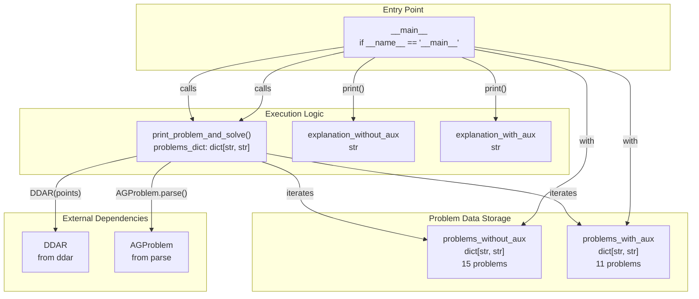
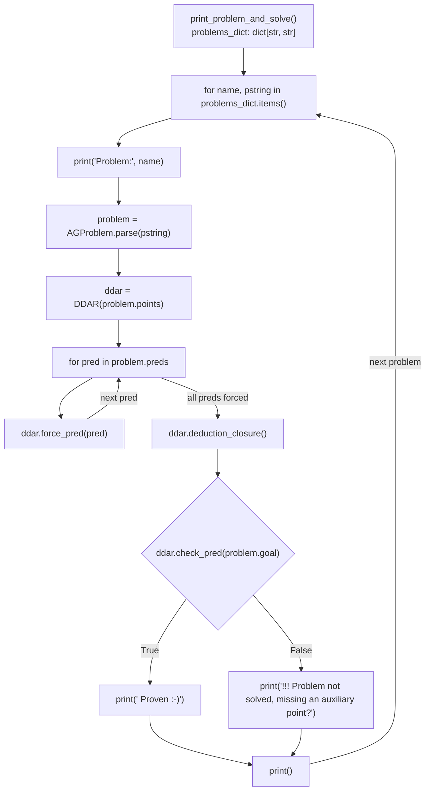
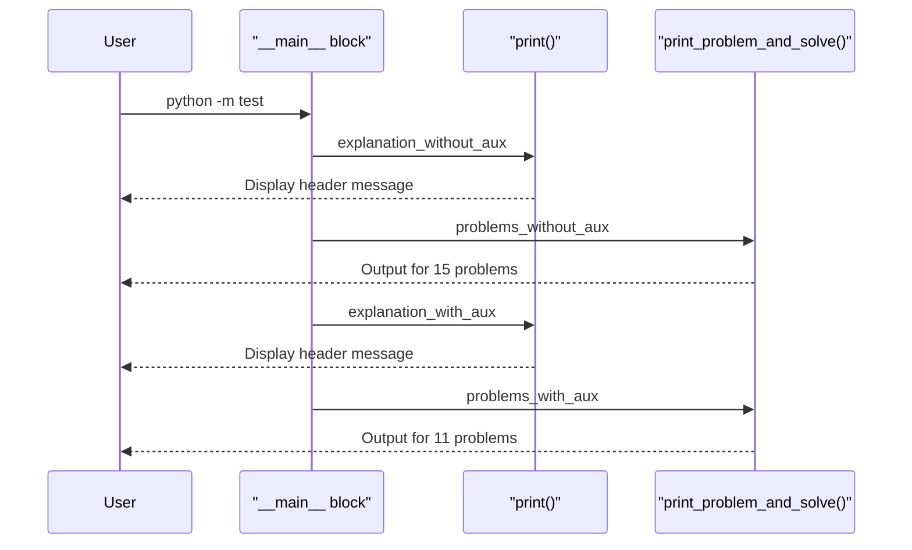

<!-- source: DeepWiki mcp.deepwiki.com · repo google-deepmind/alphageometry2 · page 8 Test Suite and Problem Sets · fetched 2026-10-26 -->

# Test Suite and Problem Sets

<details>
<summary>Relevant source files</summary>

The following files were used as context for generating this wiki page:

- [README.md](README.md)
- [test.py](test.py)

</details>


This page documents the structure and organization of the test suite in [test.py](), which serves as the primary execution interface for the AlphaGeometry2 logical core. It defines two curated problem sets totaling 26 IMO geometry problems and provides the orchestration logic for running the DDAR prover on these problems.

For information about running the test suite, see [Running the Test Suite](#2.1). For details on problem format and parsing, see [Problem Format and Structure](#2.2). For the complete problem-solving workflow, see [Problem-Solving Pipeline](#9).

**Sources:** [test.py:1-517](), [README.md:1-163]()

---

## Test Module Architecture

The [test.py]() module follows a simple three-component architecture consisting of problem data storage, execution logic, and a main entry point.



**Sources:** [test.py:18-19](), [test.py:22-234](), [test.py:236-479](), [test.py:481-488](), [test.py:491-507](), [test.py:509-516]()

---

## Problem Dictionary Structure

The test suite maintains two problem dictionaries, each mapping problem names to problem strings in the AlphaGeometry2 format.

### problems_without_aux

This dictionary contains 15 IMO problems that can be solved by the DDAR logical core without auxiliary constructions.

| Problem Name | Year | Problem Number | Lines in test.py |
|--------------|------|----------------|------------------|
| `2000_p1` | 2000 | P1 | [test.py:23-39]() |
| `2002_p2a` | 2002 | P2a | [test.py:40-53]() |
| `2002_p2b` | 2002 | P2b | [test.py:54-67]() |
| `2003_p4` | 2003 | P4 | [test.py:68-82]() |
| `2004_p5` | 2004 | P5 | [test.py:83-90]() |
| `2005_p5` | 2005 | P5 | [test.py:91-106]() |
| `2007_p4` | 2007 | P4 | [test.py:107-120]() |
| `2010_p4` | 2010 | P4 | [test.py:121-134]() |
| `2012_p1` | 2012 | P1 | [test.py:135-148]() |
| `2013_p4` | 2013 | P4 | [test.py:149-162]() |
| `2014_p4` | 2014 | P4 | [test.py:163-173]() |
| `2015_p4` | 2015 | P4 | [test.py:174-190]() |
| `2016_p1` | 2016 | P1 | [test.py:191-204]() |
| `2017_p4` | 2017 | P4 | [test.py:205-218]() |
| `2022_p4` | 2022 | P4 | [test.py:219-233]() |

**Sources:** [test.py:22-234]()

### problems_with_aux

This dictionary contains 11 IMO problems that require auxiliary points to be solved. The auxiliary points are manually provided in the problem strings.

| Problem Name | Year | Problem Number | Lines in test.py |
|--------------|------|----------------|------------------|
| `2001_p5a` | 2001 | P5a | [test.py:237-252]() |
| `2003_p4b` | 2003 | P4b | [test.py:253-267]() |
| `2005_p1` | 2005 | P1 | [test.py:268-281]() |
| `2008_p1b` | 2008 | P1b | [test.py:282-302]() |
| `2008_p6` | 2008 | P6 | [test.py:303-349]() |
| `2009_p4a` | 2009 | P4a | [test.py:350-367]() |
| `2009_p4b` | 2009 | P4b | [test.py:368-385]() |
| `2011_p6` | 2011 | P6 | [test.py:386-412]() |
| `2013_p3` | 2013 | P3 | [test.py:413-432]() |
| `2019_p2` | 2019 | P2 | [test.py:433-447]() |
| `2021_p3` | 2021 | P3 | [test.py:448-478]() |

**Sources:** [test.py:236-479]()

---

## Test Execution Function

The `print_problem_and_solve()` function orchestrates the complete problem-solving workflow for a given problem dictionary.



The function performs the following steps for each problem:

1. **Print Problem Name**: Outputs the problem identifier (e.g., `2005_p1`)
2. **Parse Problem String**: Calls `AGProblem.parse()` to convert the problem string into structured data
3. **Initialize DDAR**: Creates a `DDAR` instance with the problem's points
4. **Assert Given Predicates**: Iterates through `problem.preds` and calls `ddar.force_pred()` for each
5. **Run Deduction Closure**: Calls `ddar.deduction_closure()` to perform iterative inference
6. **Check Goal**: Calls `ddar.check_pred(problem.goal)` to verify if the goal predicate was proven
7. **Print Result**: Outputs success message or failure message with diagnostic information

**Sources:** [test.py:491-507]()

---

## Test Execution Progress Indicators

During execution, the test suite prints period characters (`.`) as progress indicators. These are generated internally by the DDAR deduction closure process and appear between the problem name and the result.

```
Problem: 2000_p1
..... Proven :-)
```

Each period represents completion of one iteration through the deduction closure loop. The number of periods indicates the number of inference cycles required to reach a fixed point.

**Sources:** [README.md:39-125]()

---

## Main Entry Point

The `__main__` block executes when the module is run directly via `python -m test`.



The execution flow:

1. Print `explanation_without_aux` message
2. Call `print_problem_and_solve(problems_without_aux)`
3. Print `explanation_with_aux` message  
4. Call `print_problem_and_solve(problems_with_aux)`

**Sources:** [test.py:509-516]()

---

## Explanation Messages

Two explanation strings provide context for the test categories:

### explanation_without_aux

```python
"""
We run the logical core DDAR on some easier IMO problems that can be solved by DDAR alone.
"""
```

Displayed before testing problems in `problems_without_aux`.

### explanation_with_aux

```python
"""
We run the logical core DDAR on some challenging IMO problems, with manually provided
auxiliary points. This is not a full AlphaGeometry system, only a test of the logical core.
"""
```

Displayed before testing problems in `problems_with_aux`. Emphasizes that auxiliary points are manually provided and this is not the complete AlphaGeometry2 system with automatic auxiliary point generation.

**Sources:** [test.py:481-488]()

---

## Expected Output Format

The test suite produces standardized output with two distinct sections:

### Section 1: Problems Without Auxiliary Points

```
We run the logical core DDAR on some easier IMO problems that can be solved by DDAR alone.

Problem: 2000_p1
..... Proven :-)

Problem: 2002_p2a
.... Proven :-)
```

Each problem outputs:
- Problem name on a new line
- Progress indicators (periods)
- Success message: `Proven :-)`

### Section 2: Problems With Auxiliary Points

```
We run the logical core DDAR on some challenging IMO problems, with manually provided
auxiliary points. This is not a full AlphaGeometry system, only a test of the logical core.

Problem: 2001_p5a
......... Proven :-)

Problem: 2003_p4b
..... Proven :-)
```

Same output format as Section 1, but preceded by a different explanation message.

### Failure Output

If a problem fails to prove (which should not occur in the provided test set), the output would be:

```
Problem: example_problem


!!! Problem not solved, missing an auxiliary point?
```

Note the absence of the success message and the presence of the diagnostic error message.

**Sources:** [README.md:39-125](), [test.py:500-505]()

---

## Test Coverage Summary

The test suite provides comprehensive coverage of the DDAR logical core's capabilities:

| Category | Count | DDAR Features Tested |
|----------|-------|----------------------|
| Problems Without Aux | 15 | Direct deduction, similarity detection, cyclic quadrilateral identification, circle detection, point merging |
| Problems With Aux | 11 | Extended deduction chains, strategic constructions, complex multi-step proofs |
| **Total** | **26** | Complete DDAR logical core validation |

All 26 problems are from official International Mathematical Olympiad (IMO) competitions spanning 2000-2022.

For detailed analysis of problem categories and characteristics, see [Problem Categories](#8.1). For a complete catalog of all problems with their geometric properties, see [IMO Problem Reference](#8.2).

**Sources:** [test.py:22-479](), [README.md:1-163]()

---

## Command-Line Interface

The test suite is invoked using Python's module execution syntax:

```bash
python -m test
```

No command-line arguments are accepted. The module automatically runs all 26 problems in both categories sequentially.

### Exit Behavior

The test suite does not return an exit code indicating pass/fail status. It prints diagnostic output for any failures but continues execution through all problems.

**Sources:** [README.md:33-37](), [test.py:509-516]()

---

## Problem String Format

Each problem in the dictionaries is stored as a single-line string containing:

1. **Point definitions**: `name@x_y = ;` format
2. **Given predicates**: Space-separated predicate clauses
3. **Goal predicate**: Follows the `?` separator

Example structure:
```
"a@0.0_0.0 = ; b@1.0_0.0 = ; c@0.5_0.866 = coll a b c, cong a b b c ? cong a c b c"
```

For complete documentation of the problem string format and parsing rules, see [Problem String Format](#7.1).

**Sources:** [test.py:23-478]()

---

## Import Dependencies

The test module has minimal dependencies, importing only the core classes needed for problem solving:

```python
from ddar import DDAR
from parse import AGProblem
```

No external libraries beyond the project's own modules are required. The `DDAR` class provides the logical reasoning engine, while `AGProblem` handles problem parsing and data structure creation.

**Sources:** [test.py:18-19]()

---

