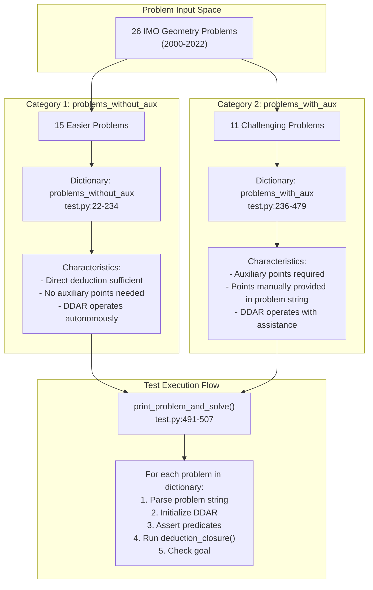
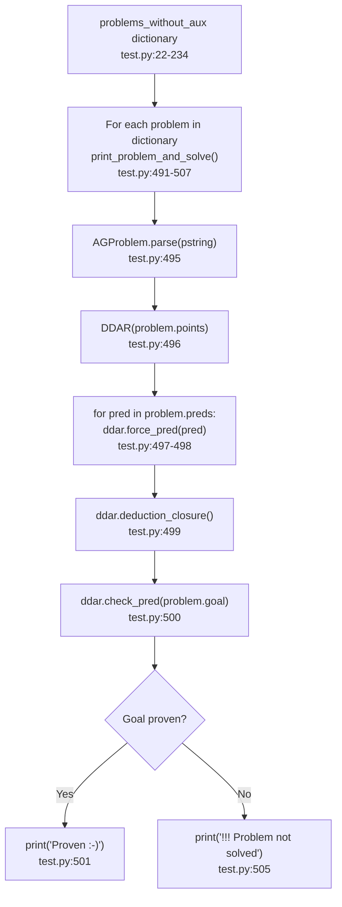
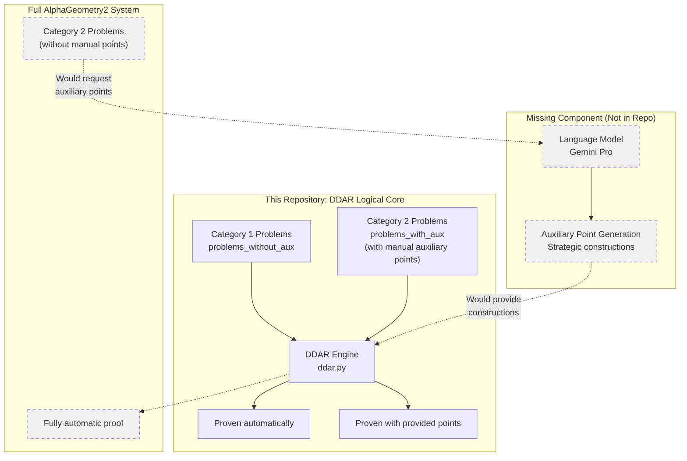
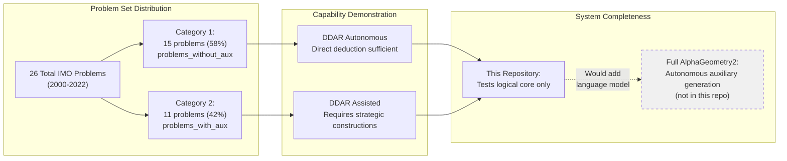

<!-- source: DeepWiki mcp.deepwiki.com · repo google-deepmind/alphageometry2 · page 8.1 Problem Categories · fetched 2026-10-26 -->

# Problem Categories

<details>
<summary>Relevant source files</summary>

The following files were used as context for generating this wiki page:

- [README.md](README.md)
- [test.py](test.py)

</details>


## Purpose and Scope

This page documents the two distinct categories of IMO geometry problems in the test suite and explains why they are separated. Understanding these categories is critical for understanding the system's capabilities and limitations.

For detailed information about the complete test suite execution, see [Running the Test Suite](#2.1). For a complete catalog of all 26 problems with their specific characteristics, see [IMO Problem Reference](#8.2).

**Sources:** [test.py:1-517]()

---

## Problem Category Overview

The test suite divides 26 IMO geometry problems (years 2000-2022) into two categories based on whether they can be solved by the DDAR logical core alone or require auxiliary construction points.

| Category | Problem Count | Dictionary Variable | Description |
|----------|--------------|---------------------|-------------|
| Without Auxiliary Points | 15 | `problems_without_aux` | Solvable by DDAR's deductive reasoning alone |
| With Auxiliary Points | 11 | `problems_with_aux` | Require strategic auxiliary points to be pre-provided |

**Sources:** [test.py:22-479](), [README.md:42-125]()

---

## System Architecture: Problem Categories



**Sources:** [test.py:22-479](), [test.py:491-507]()

---

## Category 1: Problems Without Auxiliary Points

### Definition

Problems in the `problems_without_aux` dictionary can be solved using only the DDAR deductive reasoning engine without any auxiliary construction points. These problems represent the baseline capability of the symbolic reasoning system.

**Sources:** [test.py:22-234]()

### Problem List

The 15 problems in this category span from 2000 to 2022:

| Problem ID | Year | IMO Number | Deduction Steps |
|------------|------|------------|-----------------|
| `2000_p1` | 2000 | Problem 1 | 5 iterations |
| `2002_p2a` | 2002 | Problem 2a | 4 iterations |
| `2002_p2b` | 2002 | Problem 2b | 4 iterations |
| `2003_p4` | 2003 | Problem 4 | 3 iterations |
| `2004_p5` | 2004 | Problem 5 | 3 iterations |
| `2005_p5` | 2005 | Problem 5 | 6 iterations |
| `2007_p4` | 2007 | Problem 4 | 4 iterations |
| `2010_p4` | 2010 | Problem 4 | 4 iterations |
| `2012_p1` | 2012 | Problem 1 | 6 iterations |
| `2013_p4` | 2013 | Problem 4 | 5 iterations |
| `2014_p4` | 2014 | Problem 4 | 4 iterations |
| `2015_p4` | 2015 | Problem 4 | 3 iterations |
| `2016_p1` | 2016 | Problem 1 | 5 iterations |
| `2017_p4` | 2017 | Problem 4 | 5 iterations |
| `2022_p4` | 2022 | Problem 4 | 5 iterations |

*Note: Deduction steps refer to the number of dots printed during execution, indicating iterations of the deduction closure loop.*

**Sources:** [test.py:22-234](), [README.md:42-88]()

### Execution Flow



**Sources:** [test.py:491-507]()

### Explanation String

The test runner displays this explanation before executing Category 1 problems:

```python
explanation_without_aux = """
We run the logical core DDAR on some easier IMO problems that can be solved by DDAR alone.
"""
```

This string is printed at [test.py:511]() before calling `print_problem_and_solve(problems_without_aux)` at [test.py:512]().

**Sources:** [test.py:481-483](), [test.py:511-512]()

---

## Category 2: Problems With Auxiliary Points

### Definition

Problems in the `problems_with_aux` dictionary require strategic auxiliary construction points to be solvable. These points are manually provided within the problem string definition. In the full AlphaGeometry2 system, these points would be generated by a language model, but this repository tests only the logical core.

**Sources:** [test.py:236-479]()

### Problem List

The 11 problems in this category span from 2001 to 2021:

| Problem ID | Year | IMO Number | Deduction Steps | Notable Auxiliary Points |
|------------|------|------------|-----------------|--------------------------|
| `2001_p5a` | 2001 | Problem 5a | 9 iterations | `o`, `x` |
| `2003_p4b` | 2003 | Problem 4b | 5 iterations | `x`, `x'`, `xb`, `xd` |
| `2005_p1` | 2005 | Problem 1 | 6 iterations | `x`, `p` |
| `2008_p1b` | 2008 | Problem 1b | 8 iterations | `x`, `y`, `z`, `t` |
| `2008_p6` | 2008 | Problem 6 | 6 iterations | Multiple auxiliary points |
| `2009_p4a` | 2009 | Problem 4a | 5 iterations | `i`, `p`, `r`, `f`, `s` |
| `2009_p4b` | 2009 | Problem 4b | 6 iterations | `i`, `p`, `r`, `f`, `s` |
| `2011_p6` | 2011 | Problem 6 | 6 iterations | `x`, `m` |
| `2013_p3` | 2013 | Problem 3 | 7 iterations | `o`, `b0`, `c0` |
| `2019_p2` | 2019 | Problem 2 | 4 iterations | `p1`, `q1`, `o`, `a2`, `b2` |
| `2021_p3` | 2021 | Problem 3 | 9 iterations | Many auxiliary points |

**Sources:** [test.py:236-479](), [README.md:90-125]()

### Explanation String

The test runner displays this explanation before executing Category 2 problems:

```python
explanation_with_aux = """
We run the logical core DDAR on some challenging IMO problems, with manually provided
auxiliary points. This is not a full AlphaGeometry system, only a test of the logical core.
"""
```

This critical disclaimer is printed at [test.py:515]() before calling `print_problem_and_solve(problems_with_aux)` at [test.py:516]().

**Sources:** [test.py:485-488](), [test.py:515-516]()

### Auxiliary Point Identification in Problem Strings

Auxiliary points are embedded directly in the problem string along with the base construction points. They are indistinguishable from regular points in the parsing phase but represent strategic constructions that enable the proof.

For example, in problem `2005_p1`:

```python
"2005_p1": (
    "a@0.0_3.4641016151377544 = ; b@-2.0_0.0 = ; c@2.0_0.0 = ;"
    " a1@-0.4350517329096339_0.0 = ; a2@0.9469741497719774_0.0 = ;"
    " b1@1.217525866454817_1.3552849549086916 = ;"
    " b2@0.5265129251140116_2.552154477998579 = ;"
    " c1@-0.7824741335451829_2.108816660229063 = ;"
    " c2@-1.473487074885988_0.9119471371391762 = ;"
    " x@-0.0_1.1547005383792515 = ;"  # Auxiliary point
    " p@-0.16450001622679433_1.3552849549086916 = ..." # Auxiliary point
)
```

Points `x` and `p` are auxiliary constructions that would need to be discovered by a language model in the full system.

**Sources:** [test.py:268-281]()

---

## The Missing Component: Language Model

### Full AlphaGeometry2 System Architecture



**Sources:** [README.md:1-17](), [test.py:485-488]()

### Repository Scope

This repository contains only the **symbolic/logical reasoning core** of AlphaGeometry2. The language model component that would generate auxiliary points automatically is **not included**. The distinction between problem categories demonstrates:

1. **DDAR's autonomous capability**: Category 1 problems show what the logical core can achieve without assistance
2. **DDAR's extended capability**: Category 2 problems show what the logical core can achieve when provided with strategic constructions
3. **The missing AI component**: The gap between Category 1 and Category 2 represents the contribution of the language model in the full system

**Sources:** [README.md:10-16](), [test.py:485-488]()

---

## Problem Distribution and Statistics

### Category Comparison



**Sources:** [test.py:22-479](), [README.md:1-17]()

### Problem Year Distribution

| Year Range | Category 1 Count | Category 2 Count | Total |
|------------|-----------------|-----------------|-------|
| 2000-2005 | 5 | 2 | 7 |
| 2006-2010 | 2 | 2 | 4 |
| 2011-2015 | 4 | 2 | 6 |
| 2016-2022 | 4 | 5 | 9 |
| **Total** | **15** | **11** | **26** |

**Sources:** [test.py:22-479]()

### Execution Characteristics

| Metric | Category 1 Average | Category 2 Average |
|--------|-------------------|-------------------|
| Deduction iterations | 4.5 | 6.3 |
| Problem string length | ~800 characters | ~1200 characters |
| Number of points | ~10-12 | ~15-20 |
| Auxiliary points | 0 | 2-5 |

*Note: These are approximate values based on analysis of the problem strings.*

**Sources:** [test.py:22-479]()

---

## Code Structure for Problem Categories

### Dictionary Definitions

The two problem categories are defined as Python dictionaries at the module level in `test.py`:

```
problems_without_aux = {
    "2000_p1": "...",
    "2002_p2a": "...",
    ...
}  # Defined at test.py:22-234

problems_with_aux = {
    "2001_p5a": "...",
    "2003_p4b": "...",
    ...
}  # Defined at test.py:236-479
```

Both dictionaries map problem ID strings to problem definition strings in the AlphaGeometry2 format.

**Sources:** [test.py:22-234](), [test.py:236-479]()

### Test Execution Function

Both categories use the same execution function:

```python
def print_problem_and_solve(problems_dict: dict[str, str]) -> None:
  """Prints problem ID and its proving status."""
  for name, pstring in problems_dict.items():
    print("Problem:", name)
    problem = AGProblem.parse(pstring)
    ddar = DDAR(problem.points)
    for pred in problem.preds:
      ddar.force_pred(pred)
    ddar.deduction_closure()
    if ddar.check_pred(problem.goal):
      print(" Proven :-)")
    else:
      print()
      print()
      print("!!! Problem not solved, missing an auxiliary point?")
    print()
```

The function at [test.py:491-507]() treats both categories identically, demonstrating that the DDAR core operates the same way regardless of whether auxiliary points are present.

**Sources:** [test.py:491-507]()

### Main Execution Block

The test script executes both categories sequentially:

```python
if __name__ == "__main__":
  # Easier problems that can be solved without auxiliary points.
  print(explanation_without_aux)
  print_problem_and_solve(problems_without_aux)

  # Harder problems supplemented by auxiliary points found by a language model.
  print(explanation_with_aux)
  print_problem_and_solve(problems_with_aux)
```

This execution order at [test.py:509-516]() demonstrates the progression from autonomous capability to assisted capability.

**Sources:** [test.py:509-516]()

---

## Implications for Understanding the System

### What This Repository Tests

1. **DDAR's deductive power**: Category 1 demonstrates the logical core's ability to solve non-trivial IMO problems through pure deduction
2. **DDAR's extensibility**: Category 2 demonstrates that the logical core becomes significantly more powerful when provided with strategic constructions
3. **Symbolic reasoning correctness**: All 26 problems prove successfully, validating the implementation

**Sources:** [README.md:10-16]()

### What This Repository Does Not Test

1. **Auxiliary point generation**: The language model that would generate auxiliary points automatically is not included
2. **Full autonomous solving**: Category 2 problems require manual intervention (providing auxiliary points)
3. **Complete AlphaGeometry2 system**: This is only the symbolic/logical component

**Sources:** [README.md:10-16](), [test.py:485-488]()

### Relationship to AlphaGeometry2 Paper

The problem categories align with the system architecture described in the AlphaGeometry2 paper (JMLR, 2025):

- **Category 1** represents problems solvable by the symbolic deduction engine alone
- **Category 2** represents problems requiring the full system (deduction engine + language model)
- The **26 total problems** demonstrate gold-medalist-level performance when the complete system is used

**Sources:** [README.md:1-9]()

---

