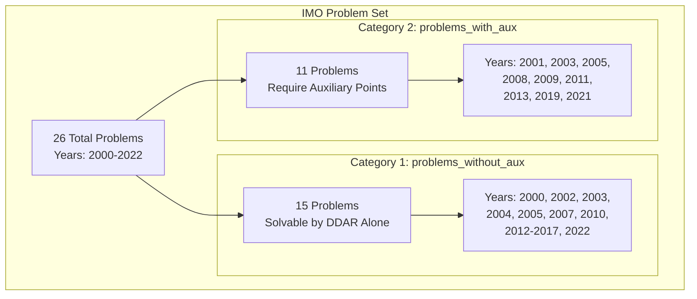
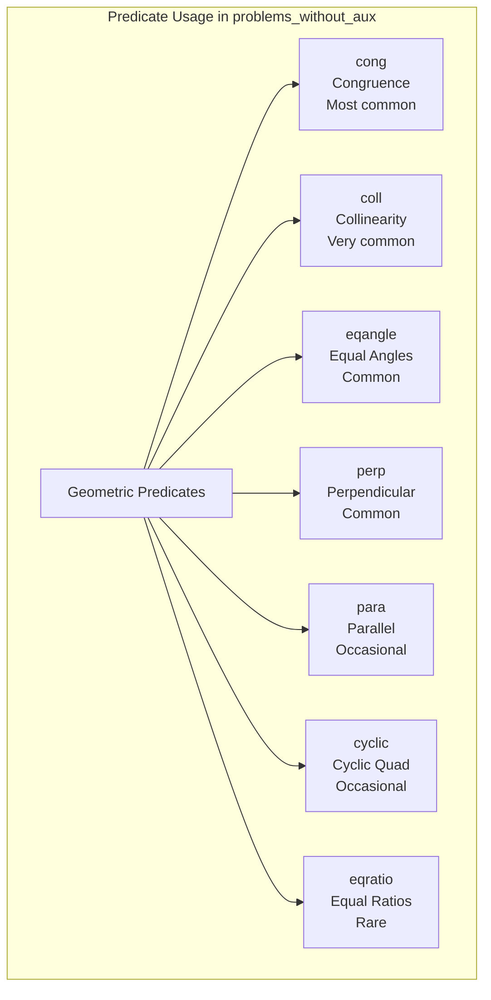
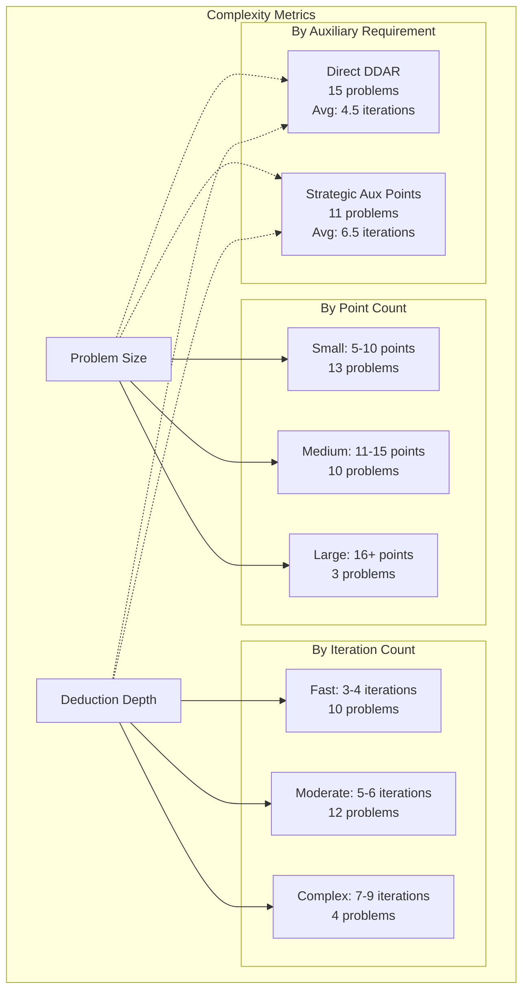
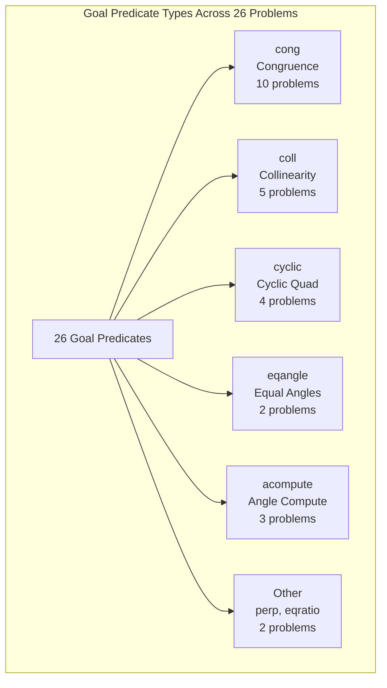
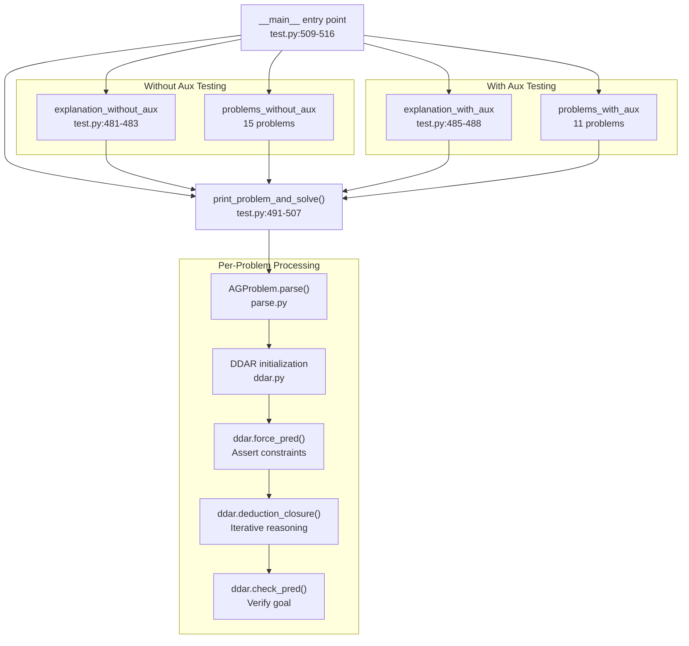

<!-- source: DeepWiki mcp.deepwiki.com · repo google-deepmind/alphageometry2 · page 8.2 IMO Problem Reference · fetched 2026-10-26 -->

# IMO Problem Reference

<details>
<summary>Relevant source files</summary>

The following files were used as context for generating this wiki page:

- [README.md](README.md)
- [test.py](test.py)

</details>


This page provides a comprehensive catalog of all 26 International Mathematical Olympiad (IMO) geometry problems included in the AlphaGeometry2 test suite. Each problem's characteristics, structural properties, and solving requirements are documented.

For information about how these problems are categorized and tested, see [Problem Categories](#8.1). For details on the problem format specification, see [Problem Format and Structure](#2.2).

## Purpose and Scope

This reference catalogs the 26 IMO geometry problems spanning years 2000-2022 that are formalized in the AlphaGeometry2 problem format and included in the test suite. The catalog provides:

- Structural characteristics of each problem (point count, predicate count, goal type)
- Classification by solving requirements (with/without auxiliary points)
- Complexity metrics based on deduction closure iterations
- Year and problem number identification

Sources: [test.py:1-517](), [README.md:1-163]()

## Problem Set Overview

The test suite contains 26 problems from IMO competitions between 2000 and 2022. These problems are divided into two categories based on their solving requirements.



**Problem Set Distribution by Category**

| Category | Count | Dictionary Variable | Years Represented |
|----------|-------|---------------------|-------------------|
| Without Auxiliary Points | 15 | `problems_without_aux` | 2000, 2002, 2003, 2004, 2005, 2007, 2010, 2012, 2013, 2014, 2015, 2016, 2017, 2022 |
| With Auxiliary Points | 11 | `problems_with_aux` | 2001, 2003, 2005, 2008, 2009, 2011, 2013, 2019, 2021 |

Sources: [test.py:22-479](), [README.md:42-125]()

## Problems Solvable Without Auxiliary Points

These 15 problems can be solved by the DDAR logical core using only direct deduction, triangle similarity detection, cyclic quadrilateral identification, and circle recognition. No strategic auxiliary point construction is required.

```mermaid
graph LR
    subgraph "problems_without_aux Dictionary"
        Dict["dict[str, str]<br/>15 entries"]
        
        P2000["2000_p1<br/>11 points, 16 predicates<br/>5 iterations"]
        P2002a["2002_p2a<br/>8 points, 11 predicates<br/>4 iterations"]
        P2002b["2002_p2b<br/>8 points, 11 predicates<br/>4 iterations"]
        P2003["2003_p4<br/>11 points, 15 predicates<br/>3 iterations"]
        P2004["2004_p5<br/>5 points, 5 predicates<br/>3 iterations"]
        P2005["2005_p5<br/>10 points, 13 predicates<br/>6 iterations"]
        P2007["2007_p4<br/>11 points, 13 predicates<br/>4 iterations"]
        P2010["2010_p4<br/>9 points, 11 predicates<br/>4 iterations"]
        P2012["2012_p1<br/>11 points, 14 predicates<br/>6 iterations"]
        P2013["2013_p4<br/>10 points, 11 predicates<br/>5 iterations"]
        P2014["2014_p4<br/>8 points, 9 predicates<br/>4 iterations"]
        P2015["2015_p4<br/>12 points, 12 predicates<br/>3 iterations"]
        P2016["2016_p1<br/>10 points, 15 predicates<br/>5 iterations"]
        P2017["2017_p4<br/>9 points, 12 predicates<br/>5 iterations"]
        P2022["2022_p4<br/>10 points, 10 predicates<br/>5 iterations"]
    end
    
    Dict --> P2000
    Dict --> P2002a
    Dict --> P2002b
    Dict --> P2003
    Dict --> P2004
    Dict --> P2005
    Dict --> P2007
    Dict --> P2010
    Dict --> P2012
    Dict --> P2013
    Dict --> P2014
    Dict --> P2015
    Dict --> P2016
    Dict --> P2017
    Dict --> P2022
```



### Detailed Problem Characteristics

| Problem ID | IMO Year | Problem # | Points | Predicates | Goal Type | Iterations |
|------------|----------|-----------|--------|------------|-----------|------------|
| 2000_p1 | 2000 | P1 | 11 | 16 | `cong` | 5 |
| 2002_p2a | 2002 | P2 (variant a) | 8 | 11 | `eqangle` | 4 |
| 2002_p2b | 2002 | P2 (variant b) | 8 | 11 | `eqangle` | 4 |
| 2003_p4 | 2003 | P4 | 11 | 15 | `cong` | 3 |
| 2004_p5 | 2004 | P5 | 5 | 5 | `cong` | 3 |
| 2005_p5 | 2005 | P5 | 10 | 13 | `cyclic` | 6 |
| 2007_p4 | 2007 | P4 | 11 | 13 | `eqratio` | 4 |
| 2010_p4 | 2010 | P4 | 9 | 11 | `cong` | 4 |
| 2012_p1 | 2012 | P1 | 11 | 14 | `cong` | 6 |
| 2013_p4 | 2013 | P4 | 10 | 11 | `coll` | 5 |
| 2014_p4 | 2014 | P4 | 8 | 9 | `cong` | 4 |
| 2015_p4 | 2015 | P4 | 12 | 12 | `coll` | 3 |
| 2016_p1 | 2016 | P1 | 10 | 15 | `coll` | 5 |
| 2017_p4 | 2017 | P4 | 9 | 12 | `perp` | 5 |
| 2022_p4 | 2022 | P4 | 10 | 10 | `cyclic` | 5 |

**Notes:**
- Iterations count is derived from the number of dots shown in the proof output (e.g., "..... Proven :-)" = 5 iterations)
- Variant problems (2002_p2a/b) represent different formulations of the same IMO problem
- Goal types include: `cong` (congruence), `eqangle` (equal angles), `cyclic` (cyclic quadrilateral), `eqratio` (equal ratios), `coll` (collinearity), `perp` (perpendicularity)

Sources: [test.py:22-234](), [README.md:42-88]()

### Common Predicates in DDAR-Only Problems



Sources: [test.py:22-234]()

## Problems Requiring Auxiliary Points

These 11 problems require strategic construction of auxiliary points to be solved. In this test suite, auxiliary points are manually provided in the problem string. A full AlphaGeometry2 system would use a language model to generate these auxiliary points automatically.

```mermaid
graph LR
    subgraph "problems_with_aux Dictionary"
        Dict["dict[str, str]<br/>11 entries"]
        
        P2001["2001_p5a<br/>11 points, 17 predicates<br/>9 iterations"]
        P2003b["2003_p4b<br/>11 points, 16 predicates<br/>5 iterations"]
        P2005["2005_p1<br/>13 points, 15 predicates<br/>6 iterations"]
        P2008a["2008_p1b<br/>17 points, 21 predicates<br/>8 iterations"]
        P2008b["2008_p6<br/>29 points, 46 predicates<br/>6 iterations"]
        P2009a["2009_p4a<br/>11 points, 13 predicates<br/>5 iterations"]
        P2009b["2009_p4b<br/>11 points, 13 predicates<br/>6 iterations"]
        P2011["2011_p6<br/>18 points, 24 predicates<br/>6 iterations"]
        P2013["2013_p3<br/>11 points, 12 predicates<br/>7 iterations"]
        P2019["2019_p2<br/>12 points, 12 predicates<br/>4 iterations"]
        P2021["2021_p3<br/>18 points, 25 predicates<br/>9 iterations"]
    end
    
    Dict --> P2001
    Dict --> P2003b
    Dict --> P2005
    Dict --> P2008a
    Dict --> P2008b
    Dict --> P2009a
    Dict --> P2009b
    Dict --> P2011
    Dict --> P2013
    Dict --> P2019
    Dict --> P2021
```



### Detailed Problem Characteristics

| Problem ID | IMO Year | Problem # | Points | Predicates | Goal Type | Iterations | Notable Features |
|------------|----------|-----------|--------|------------|-----------|------------|------------------|
| 2001_p5a | 2001 | P5 (variant a) | 11 | 17 | `acompute` | 9 | Angle computation |
| 2003_p4b | 2003 | P4 (variant b) | 11 | 16 | `coll` | 5 | Includes auxiliary x' |
| 2005_p1 | 2005 | P1 | 13 | 15 | `coll` | 6 | Equilateral triangle base |
| 2008_p1b | 2008 | P1 (variant b) | 17 | 21 | `cyclic` | 8 | Complex auxiliary network |
| 2008_p6 | 2008 | P6 | 29 | 46 | `cong` | 6 | Largest problem (29 points) |
| 2009_p4a | 2009 | P4 (variant a) | 11 | 13 | `acompute` | 5 | Angle computation |
| 2009_p4b | 2009 | P4 (variant b) | 11 | 13 | `acompute` | 6 | Angle computation |
| 2011_p6 | 2011 | P6 | 18 | 24 | `cong` | 6 | Multiple auxiliary circles |
| 2013_p3 | 2013 | P3 | 11 | 12 | `perp` | 7 | Incenter configuration |
| 2019_p2 | 2019 | P2 | 12 | 12 | `cyclic` | 4 | Minimal iterations for aux |
| 2021_p3 | 2021 | P3 | 18 | 25 | `coll` | 9 | Maximum iterations |

**Notes:**
- These problems have higher complexity on average (mean: 6.5 iterations) compared to DDAR-only problems (mean: 4.5 iterations)
- Problem 2008_p6 is the largest with 29 points and 46 predicates
- Problems 2001_p5a, 2009_p4a, 2009_p4b use `acompute` goal type for angle computation
- Variant problems represent different geometric configurations or proof approaches for the same IMO problem

Sources: [test.py:236-479](), [README.md:90-125]()

### Advanced Predicates and Constructions

Problems with auxiliary points use more sophisticated predicates:

| Predicate | Purpose | Example Problems |
|-----------|---------|------------------|
| `aconst` | Define constant angle | 2001_p5a (60° angle) |
| `acompute` | Compute angle value | 2001_p5a, 2009_p4a, 2009_p4b |
| `distseq` | Distance sequence constraint | 2001_p5a |
| Multiple `cyclic` | Complex circle configurations | 2008_p1b, 2011_p6, 2021_p3 |

Sources: [test.py:236-479]()

## Problem Complexity Analysis



### Complexity Distribution Table

**By Point Count:**

| Point Range | Count | Representative Problems |
|-------------|-------|-------------------------|
| 5-8 points | 5 | 2002_p2a, 2002_p2b, 2004_p5, 2014_p4 |
| 9-12 points | 15 | 2000_p1, 2003_p4, 2007_p4, 2010_p4, 2012_p1, 2013_p4, 2015_p4, 2016_p1, 2017_p4, 2022_p4, 2001_p5a, 2003_p4b, 2009_p4a, 2009_p4b, 2013_p3, 2019_p2 |
| 13-18 points | 4 | 2005_p1, 2008_p1b, 2011_p6, 2021_p3 |
| 29 points | 1 | 2008_p6 (outlier) |

**By Iteration Count:**

| Iterations | Count | Problems |
|------------|-------|----------|
| 3 | 3 | 2003_p4, 2004_p5, 2015_p4 |
| 4 | 7 | 2002_p2a, 2002_p2b, 2007_p4, 2010_p4, 2014_p4, 2019_p2 |
| 5 | 7 | 2000_p1, 2013_p4, 2016_p1, 2017_p4, 2022_p4, 2003_p4b, 2009_p4a |
| 6 | 5 | 2005_p5, 2012_p1, 2005_p1, 2008_p6, 2009_p4b, 2011_p6 |
| 7 | 1 | 2013_p3 |
| 8 | 1 | 2008_p1b |
| 9 | 2 | 2001_p5a, 2021_p3 |

Sources: [test.py:22-479](), [README.md:42-125]()

## Goal Predicate Distribution

The problems test various types of geometric conclusions:



**Goal Type Distribution:**

| Goal Type | Count | Without Aux | With Aux | Examples |
|-----------|-------|-------------|----------|----------|
| `cong` | 10 | 7 | 3 | 2000_p1, 2004_p5, 2010_p4, 2012_p1, 2014_p4, 2008_p6, 2011_p6 |
| `coll` | 5 | 3 | 2 | 2013_p4, 2015_p4, 2016_p1, 2003_p4b, 2005_p1, 2021_p3 |
| `cyclic` | 4 | 2 | 2 | 2005_p5, 2022_p4, 2008_p1b, 2019_p2 |
| `acompute` | 3 | 0 | 3 | 2001_p5a, 2009_p4a, 2009_p4b |
| `eqangle` | 2 | 2 | 0 | 2002_p2a, 2002_p2b |
| `perp` | 1 | 1 | 0 | 2017_p4 |
| `eqratio` | 1 | 1 | 0 | 2007_p4 |

Sources: [test.py:22-479]()

## Year Coverage and Problem Selection

```mermaid
graph LR
    subgraph "Temporal Distribution"
        Y2000["2000: 1 problem"]
        Y2001["2001: 1 problem"]
        Y2002["2002: 2 problems"]
        Y2003["2003: 2 problems"]
        Y2004["2004: 1 problem"]
        Y2005["2005: 2 problems"]
        Y2007["2007: 1 problem"]
        Y2008["2008: 2 problems"]
        Y2009["2009: 2 problems"]
        Y2010["2010: 1 problem"]
        Y2011["2011: 1 problem"]
        Y2012["2012: 1 problem"]
        Y2013["2013: 2 problems"]
        Y2014["2014: 1 problem"]
        Y2015["2015: 1 problem"]
        Y2016["2016: 1 problem"]
        Y2017["2017: 1 problem"]
        Y2019["2019: 1 problem"]
        Y2021["2021: 1 problem"]
        Y2022["2022: 1 problem"]
    end
```



**Years Represented:** 2000, 2001, 2002, 2003, 2004, 2005, 2007, 2008, 2009, 2010, 2011, 2012, 2013, 2014, 2015, 2016, 2017, 2019, 2021, 2022 (20 years out of 23-year span)

**Missing Years:** 2006, 2018, 2020 (no geometry problems selected from these years)

**Multiple Problems per Year:**
- 2002: P2 (variants a and b)
- 2003: P4 (variants a and b)
- 2005: P1 and P5
- 2008: P1 (variant b) and P6
- 2009: P4 (variants a and b)
- 2013: P3 and P4

Sources: [test.py:22-479](), [README.md:11-12]()

## Problem Access and Testing

### Code Location

All problems are defined in [test.py:22-479]() as two dictionaries:

```python
problems_without_aux: dict[str, str]  # Line 22-234
problems_with_aux: dict[str, str]     # Line 236-479
```

### Testing Workflow



Sources: [test.py:491-516]()

### Running the Test Suite

Execute all 26 problems:
```bash
python -m test
```

The test driver iterates through both problem dictionaries, parsing each problem string, initializing DDAR, asserting predicates, running deduction closure, and checking the goal predicate. Output shows dots representing deduction closure iterations, followed by proof status.

Sources: [test.py:509-516](), [README.md:33-125]()

## Notable Problem Characteristics

### Largest Problem
**2008_p6**: 29 points, 46 predicates - the most complex problem in the test suite, requiring extensive auxiliary point network including multiple incenters, excenters, and constructed circles.

### Simplest Problem
**2004_p5**: 5 points, 5 predicates - the smallest problem, demonstrating DDAR's capability on minimal configurations.

### Fastest Proofs
**2003_p4, 2004_p5, 2015_p4**: 3 iterations - solved with minimal deduction steps.

### Most Complex Proofs
**2001_p5a, 2021_p3**: 9 iterations - require extensive deductive closure with multiple auxiliary constructions.

### Angle Computation Problems
**2001_p5a, 2009_p4a, 2009_p4b**: Use `acompute` goal type to compute specific angle values, requiring special handling beyond simple predicate verification.

### Variant Problems
Several IMO problems have multiple formulations:
- **2002 P2**: variants a and b with different angle relationships
- **2003 P4**: variant b includes auxiliary construction
- **2005**: Both P1 and P5 are included
- **2008**: P1 variant b and P6
- **2009 P4**: variants a and b with different configurations

Sources: [test.py:22-479]()

---

