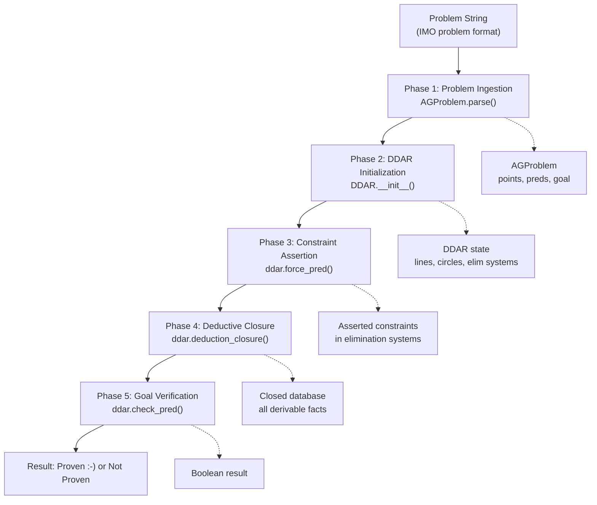
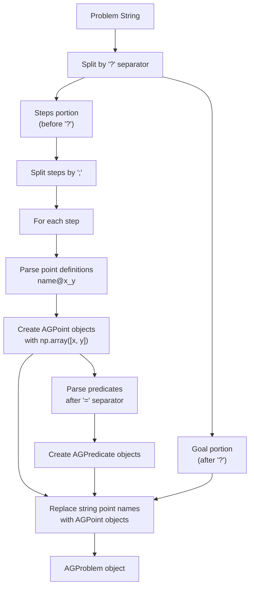
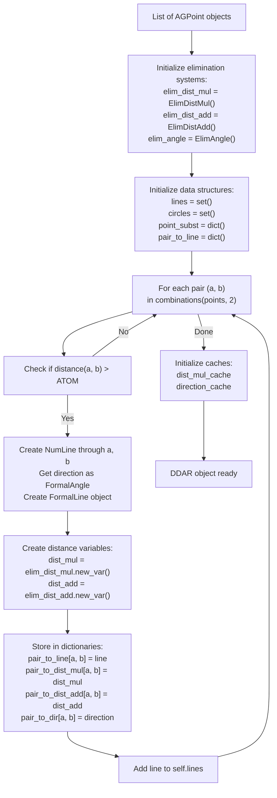
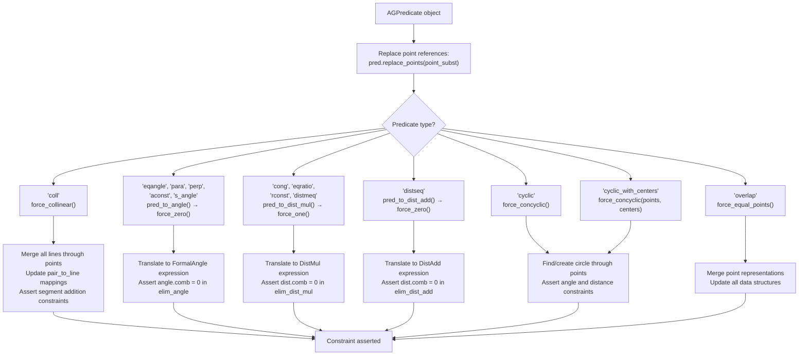
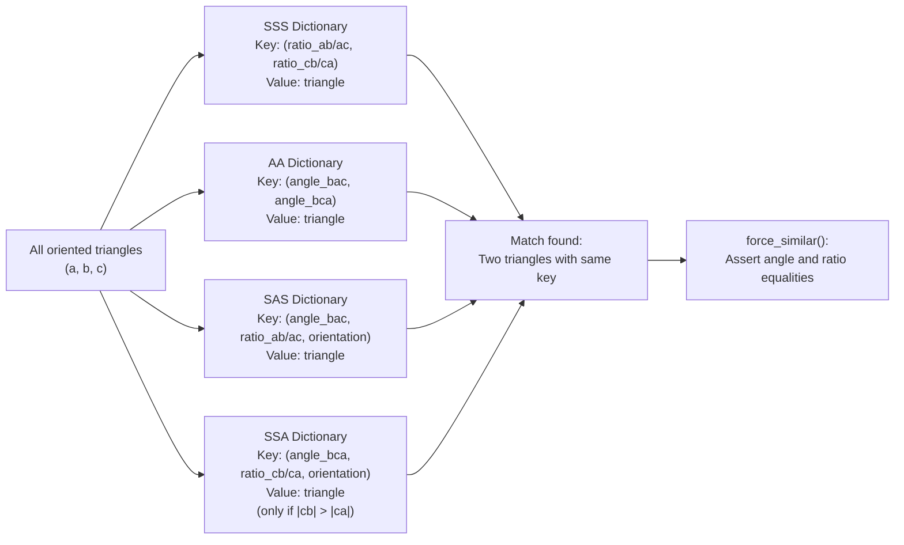
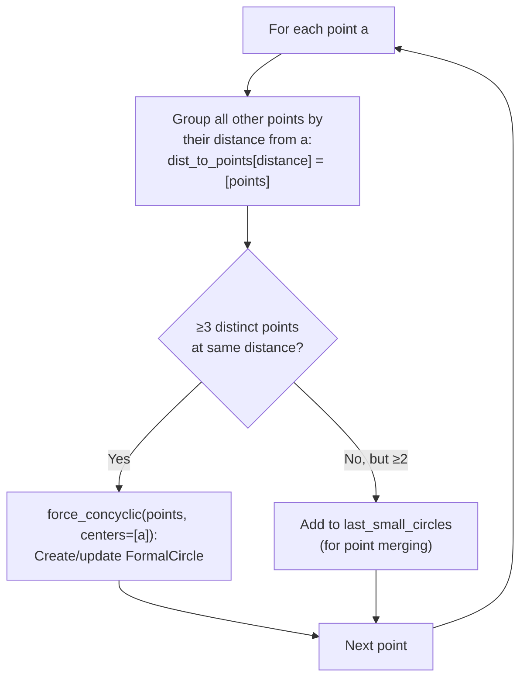
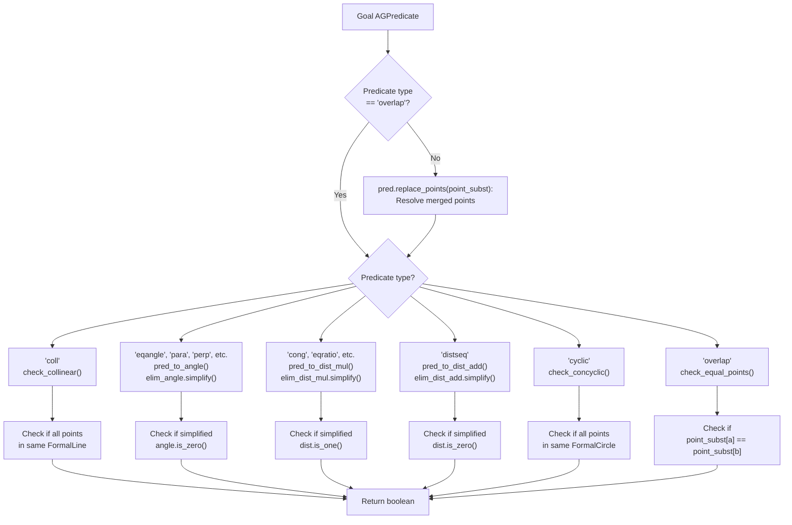

<!-- source: DeepWiki mcp.deepwiki.com · repo google-deepmind/alphageometry2 · page 9 Problem-Solving Pipeline · fetched 2026-10-26 -->

# Problem-Solving Pipeline

<details>
<summary>Relevant source files</summary>

The following files were used as context for generating this wiki page:

- [ddar.py](ddar.py)
- [elimination.py](elimination.py)
- [numericals.py](numericals.py)
- [parse.py](parse.py)
- [test.py](test.py)

</details>


This document provides an end-to-end walkthrough of how a geometry problem flows through the AlphaGeometry2 system, from problem string input to proof verification. It traces the complete execution path through the five computational phases: parsing, initialization, constraint assertion, deductive closure, and goal verification.

For detailed documentation of individual phases, see:
- Phase 1 details: [Parsing and Initialization](#9.1)
- Phase 2 details: [Constraint Assertion](#9.2)  
- Phase 3 details: [Deductive Closure](#9.3)
- Phase 4 details: [Goal Verification](#9.4)

For information about the DDAR engine's internal operations, see [DDAR Logical Engine](#4). For problem format specifications, see [Problem Format and Structure](#2.2).

## Pipeline Overview

The complete problem-solving pipeline consists of five distinct phases executed sequentially. Each phase transforms the problem representation and accumulates geometric knowledge until the goal predicate can be verified.



**Execution Entry Point**: The pipeline is invoked in [test.py:491-507](), where the `print_problem_and_solve` function orchestrates the complete flow.

Sources: [test.py:491-507](), Diagram 2 from high-level architecture

## Main Execution Flow

The central orchestration code that executes the pipeline is straightforward:

```python
# From test.py:491-507
def print_problem_and_solve(problems_dict: dict[str, str]) -> None:
  for name, pstring in problems_dict.items():
    print("Problem:", name)
    problem = AGProblem.parse(pstring)           # Phase 1
    ddar = DDAR(problem.points)                  # Phase 2
    for pred in problem.preds:                   # Phase 3
      ddar.force_pred(pred)
    ddar.deduction_closure()                     # Phase 4
    if ddar.check_pred(problem.goal):            # Phase 5
      print(" Proven :-)")
```

This code clearly shows the five-phase structure and the primary API calls involved in each phase.

Sources: [test.py:491-507]()

## Phase 1: Problem Ingestion

**Purpose**: Transform the problem string into structured data objects.

**Entry Point**: `AGProblem.parse(pstring)` at [parse.py:112-148]()

**Input**: Problem string in AlphaGeometry format (see [Problem Format and Structure](#2.2))

**Output**: `AGProblem` object containing:
- `points`: List of `AGPoint` objects with names and numerical coordinates
- `preds`: List of `AGPredicate` objects representing given conditions
- `goal`: Single `AGPredicate` object representing the goal to prove

### Parsing Process



### Key Data Structures

| Class | File | Purpose |
|-------|------|---------|
| `AGPoint` | [parse.py:26-34]() | Represents a geometric point with name and numerical coordinates |
| `AGPredicate` | [parse.py:37-80]() | Represents a geometric predicate (condition or goal) |
| `AGProblem` | [parse.py:83-148]() | Complete problem specification |

### Point Reference Resolution

The parsing process uses a two-phase approach:
1. **Phase 1**: Parse point definitions and create `AGPoint` objects stored in `name_to_point` dictionary [parse.py:120-133]()
2. **Phase 2**: Replace string point names in predicates with actual `AGPoint` object references [parse.py:140-142]()

This two-phase approach ensures that forward references in predicates are correctly resolved.

Sources: [parse.py:112-148](), [parse.py:26-34](), [parse.py:37-80](), [parse.py:83-148]()

## Phase 2: DDAR Initialization

**Purpose**: Initialize the DDAR engine with geometric points and create initial data structures.

**Entry Point**: `DDAR(problem.points)` at [ddar.py:69-127]()

**Input**: List of `AGPoint` objects from parsed problem

**Output**: Initialized `DDAR` object with:
- Elimination systems for distances and angles
- Initial lines between all point pairs
- Empty sets for circles and known facts

### Initialization Process



### Created Data Structures

The initialization phase creates these key structures:

| Structure | Type | Purpose | Location |
|-----------|------|---------|----------|
| `elim_dist_mul` | `ElimDistMul` | Multiplicative distance constraints | [ddar.py:76]() |
| `elim_dist_add` | `ElimDistAdd` | Additive distance constraints | [ddar.py:77]() |
| `elim_angle` | `ElimAngle` | Angle constraints | [ddar.py:78]() |
| `lines` | `set[FormalLine]` | All known collinear point sets | [ddar.py:73]() |
| `circles` | `set[FormalCircle]` | All known concyclic point sets | [ddar.py:74]() |
| `pair_to_line` | `dict` | Map point pairs to their line | [ddar.py:81]() |
| `pair_to_dist_mul` | `dict` | Map point pairs to distance variable | [ddar.py:86]() |
| `pair_to_dist_add` | `dict` | Map point pairs to distance variable | [ddar.py:87]() |
| `pair_to_dir` | `dict` | Map point pairs to direction angle | [ddar.py:88]() |

### Initial Variable Creation

For each pair of distinct points `(a, b)` with distance > `ATOM`, the initialization creates:

1. **Numerical line**: `NumLine.through(a.value, b.value)` at [ddar.py:95]()
2. **Direction angle**: `elim_angle.new_var(num_direction, f'd({a} {b})')` at [ddar.py:97]()
3. **FormalLine object**: Stored in `self.lines` at [ddar.py:98-108]()
4. **Multiplicative distance**: `elim_dist_mul.new_var(dist, f'log(|{a} {b}|)')` at [ddar.py:112]()
5. **Additive distance**: `elim_dist_add.new_var(dist, f'|{a} {b}|')` at [ddar.py:116]()

Sources: [ddar.py:69-127](), [ddar.py:33-48](), [ddar.py:50-63]()

## Phase 3: Constraint Assertion

**Purpose**: Translate given predicates into constraints and assert them into the elimination systems.

**Entry Point**: `ddar.force_pred(pred)` for each predicate at [ddar.py:131-172]()

**Input**: `AGPredicate` objects from `problem.preds`

**Output**: Constraints added to elimination systems, geometric facts added to DDAR state

### Predicate Processing Flow



### Predicate Translation Methods

The `force_pred` method dispatches to specialized translation methods based on predicate type:

| Predicate Category | Method | Elimination System | Line Reference |
|-------------------|--------|-------------------|----------------|
| Collinearity | `force_collinear()` | Updates `lines` set | [ddar.py:700-783]() |
| Angle equality | `pred_to_angle()` | `elim_angle` | [ddar.py:174-214]() |
| Distance ratio | `pred_to_dist_mul()` | `elim_dist_mul` | [ddar.py:216-245]() |
| Distance sum | `pred_to_dist_add()` | `elim_dist_add` | [ddar.py:247-257]() |
| Concyclicity | `force_concyclic()` | Updates `circles` set, multiple systems | [ddar.py:785-904]() |
| Point equality | `force_equal_points()` | Updates all structures | [ddar.py:937-1027]() |

### Example: Angle Predicate Translation

For an `eqangle` predicate with points `a1, a2, b1, b2, c1, c2, d1, d2`:

```python
# From ddar.py:187-190
ang1 = self.pair_to_dir[a1, a2] - self.pair_to_dir[b1, b2]
ang2 = self.pair_to_dir[c1, c2] - self.pair_to_dir[d1, d2]
return ang1 - ang2  # Force this to zero
```

The resulting `FormalAngle` expression is then asserted as zero in the angle elimination system via `elim_angle.force_zero()` at [ddar.py:138]().

### Example: Distance Ratio Translation

For a `cong` predicate with points `a, b, c, d` (asserting `|ab| = |cd|`):

```python
# From ddar.py:229-232
d1 = self.get_dist_mul(a, b)
d2 = self.get_dist_mul(c, d)
return d1 / d2  # Force this to one
```

The resulting `DistMul` expression is asserted as one (meaning the ratio equals 1) in the multiplicative distance elimination system via `elim_dist_mul.force_one()` at [ddar.py:140]().

Sources: [ddar.py:131-172](), [ddar.py:174-257](), [ddar.py:700-783](), [ddar.py:785-904]()

## Phase 4: Deductive Closure

**Purpose**: Iteratively apply geometric inference rules until no new facts can be derived.

**Entry Point**: `ddar.deduction_closure()` at [ddar.py:301-357]()

**Input**: DDAR state with asserted constraints

**Output**: Closed database containing all derivable geometric facts

### Closure Iteration Loop

```mermaid
flowchart TD
    Start["Begin deduction_closure()"]
    
    Init["changed = True"]
    
    LoopCheck{"changed?"}
    
    ResetChange["changed = False"]
    UpdateCache["update_cache():<br/>Simplify all distance/angle expressions"]
    
    Similar["search_similar():<br/>Find similar triangles"]
    SimilarCheck{"New facts?"}
    SimilarUpdate["changed = True<br/>update_cache()"]
    
    Concyclic["search_concyclic():<br/>Find cyclic quadrilaterals"]
    ConcyclicCheck{"New facts?"}
    ConcyclicUpdate["changed = True<br/>update_cache()"]
    
    Circles["search_circles():<br/>Find circles from equal distances"]
    CirclesCheck{"New facts?"}
    CirclesUpdate["changed = True"]
    
    Merge["merge_points():<br/>Merge provably equal points"]
    MergeCheck{"New facts?"}
    MergeUpdate["changed = True"]
    
    TransferDist["transfer_dist_add_mul():<br/>Sync additive/multiplicative distances"]
    TransferDistCheck{"New facts?"}
    TransferDistUpdate["changed = True"]
    
    TransferArc["transfer_dist_arc_mul():<br/>Sync arc lengths and chord distances"]
    TransferArcCheck{"New facts?"}
    TransferArcUpdate["changed = True"]
    
    Done["Deduction closure complete"]
    
    Start --> Init
    Init --> LoopCheck
    
    LoopCheck -->|Yes| ResetChange
    LoopCheck -->|No| Done
    
    ResetChange --> UpdateCache
    UpdateCache --> Similar
    
    Similar --> SimilarCheck
    SimilarCheck -->|Yes| SimilarUpdate
    SimilarCheck -->|No| Concyclic
    SimilarUpdate --> Concyclic
    
    Concyclic --> ConcyclicCheck
    ConcyclicCheck -->|Yes| ConcyclicUpdate
    ConcyclicCheck -->|No| Circles
    ConcyclicUpdate --> Circles
    
    Circles --> CirclesCheck
    CirclesCheck -->|Yes| CirclesUpdate
    CirclesCheck -->|No| Merge
    CirclesUpdate --> Merge
    
    Merge --> MergeCheck
    MergeCheck -->|Yes| MergeUpdate
    MergeCheck -->|No| TransferDist
    MergeUpdate --> TransferDist
    
    TransferDist --> TransferDistCheck
    TransferDistCheck -->|Yes| TransferDistUpdate
    TransferDistCheck -->|No| TransferArc
    TransferDistUpdate --> TransferArc
    
    TransferArc --> TransferArcCheck
    TransferArcCheck -->|Yes| TransferArcUpdate
    TransferArcCheck -->|No| LoopCheck
    TransferArcUpdate --> LoopCheck
```



### Inference Rules

The deduction closure applies six inference rules in sequence during each iteration:

| Rule | Method | Purpose | Line Reference |
|------|--------|---------|----------------|
| Similar Triangles | `search_similar()` | Detect similar triangles via SSS, AA, SAS, SSA criteria | [ddar.py:359-438]() |
| Cyclic Quadrilaterals | `search_concyclic()` | Detect concyclic points via inscribed angles | [ddar.py:440-481]() |
| Circle Detection | `search_circles()` | Detect circles from equal distances to a point | [ddar.py:483-524]() |
| Point Merging | `merge_points()` | Merge points provably equal | [ddar.py:526-580]() |
| Distance Transfer | `transfer_dist_add_mul()` | Sync additive and multiplicative distance systems | [ddar.py:582-620]() |
| Arc Transfer | `transfer_dist_arc_mul()` | Sync arc lengths with chord distances | [ddar.py:622-649]() |

### Similar Triangle Detection

The `search_similar()` method at [ddar.py:359-438]() uses four similarity criteria:



When two triangles match under any criterion, `force_similar()` at [ddar.py:652-696]() asserts:
- Two angle equalities
- Two distance ratio equalities
- Accounts for orientation (same or opposite)

### Cyclic Quadrilateral Detection

The `search_concyclic()` method at [ddar.py:440-481]() detects concyclic points via inscribed angle theorem:

**Key Insight**: Points `a, b, c, d` are concyclic if the inscribed angles `∠acb` and `∠adb` are equal (or supplementary).

For each pair `(a, b)`, the algorithm:
1. Computes inscribed angle `∠acb` for each point `c`
2. Groups points by inscribed angle
3. Points with the same inscribed angle are concyclic with `a` and `b`

Additionally, it detects centers: if `|ca| = |cb|`, then `c` is a potential center.

### Circle Detection from Equal Distances

The `search_circles()` method at [ddar.py:483-524]() detects circles by finding points equidistant from a center:



Sources: [ddar.py:301-357](), [ddar.py:359-438](), [ddar.py:440-481](), [ddar.py:483-524](), [ddar.py:526-580](), [ddar.py:582-620](), [ddar.py:622-649]()

## Phase 5: Goal Verification

**Purpose**: Check whether the goal predicate is satisfied in the closed database.

**Entry Point**: `ddar.check_pred(problem.goal)` at [ddar.py:259-298]()

**Input**: Goal `AGPredicate` object

**Output**: Boolean indicating whether goal is proven

### Verification Process



### Verification Methods by Predicate Type

The verification process queries the appropriate data structure or elimination system:

| Predicate Type | Verification Method | Checks | Line Reference |
|---------------|---------------------|--------|----------------|
| `coll` | `check_collinear()` | Points in same `FormalLine` | [ddar.py:906-911]() |
| `eqangle`, `para`, `perp`, etc. | `elim_angle.simplify()` | Simplified angle `.is_zero()` | [ddar.py:267-270]() |
| `cong`, `eqratio`, etc. | `elim_dist_mul.simplify()` | Simplified distance `.is_one()` | [ddar.py:271-274]() |
| `distseq` | `elim_dist_add.simplify()` | Simplified distance `.is_zero()` | [ddar.py:275-278]() |
| `cyclic` | `check_concyclic()` | Points in same `FormalCircle` | [ddar.py:913-933]() |
| `overlap` | `check_equal_points()` | `point_subst[a] == point_subst[b]` | [ddar.py:1029-1032]() |

### Example: Collinearity Check

```python
# From ddar.py:906-911
def check_collinear(self, points):
  for a, b in itertools.combinations(points, 2):
    line = self.pair_to_line.get((a, b))
    if line is None:
      continue
    return set(points) <= set(line.points)
```

The method checks if there exists a `FormalLine` containing all the points. If any pair `(a, b)` has a line in `pair_to_line`, it verifies that all points are in that line's point set.

### Example: Angle Equality Check

```python
# From ddar.py:267-270
res = self.pred_to_angle(pred)           # Translate to FormalAngle
res = self.elim_angle.simplify(res)      # Simplify using known constraints
return res.is_zero()                      # Check if result is zero
```

The angle is translated to a `FormalAngle` expression, simplified through the elimination system (which applies all known angle constraints via Gaussian elimination), and then checked for equality to zero.

### Example: Concyclicity Check

```python
# From ddar.py:913-933
def check_concyclic(self, points, centers=()):
  distinct_points = []
  for point in points:
    if any(self.num_identical(point, x) for x in distinct_points):
      continue
    distinct_points.append(point)
  if len(distinct_points) < 3:
    raise ValueError('Need at least three numerically distinct points')

  circle = self.triple_to_circle.get(tuple(distinct_points[:3]))

  if circle is None:
    return False
  if not set(centers) <= set(circle.centers):
    return False
  if not set(points) <= set(circle.points):
    return False

  return True
```

The method looks up any three distinct points in `triple_to_circle` to find the associated `FormalCircle`, then verifies that all requested points and centers are in that circle.

Sources: [ddar.py:259-298](), [ddar.py:906-911](), [ddar.py:913-933](), [ddar.py:1029-1032]()

## Data Flow Transformations

The following table summarizes how data is transformed through each phase:

| Phase | Input Type | Process | Output Type | Key Location |
|-------|-----------|---------|-------------|--------------|
| 1: Parsing | String | Tokenization, parsing | `AGProblem` | [parse.py:112-148]() |
| 2: Initialization | `List[AGPoint]` | Variable creation | `DDAR` state | [ddar.py:69-127]() |
| 3: Assertion | `List[AGPredicate]` | Constraint translation | Elimination system constraints | [ddar.py:131-172]() |
| 4: Closure | DDAR state | Iterative inference | Closed DDAR state | [ddar.py:301-357]() |
| 5: Verification | `AGPredicate` (goal) | Database query | Boolean | [ddar.py:259-298]() |

## Complete Example Trace

Here is a minimal example showing the complete pipeline execution:

### Input Problem String
```
a@0.0_0.0 = ; b@1.0_0.0 = ; c@0.5_0.866 = cong a b b c ? cong a c b c
```

### Phase 1: Parsing
- Creates 3 `AGPoint` objects: `a`, `b`, `c`
- Creates 1 predicate: `cong(a, b, b, c)` (given)
- Creates 1 goal: `cong(a, c, b, c)` (to prove)

### Phase 2: Initialization
- Creates 3 `FormalLine` objects for pairs `(a,b)`, `(b,c)`, `(a,c)`
- Creates 6 distance variables (2 per pair: multiplicative and additive)
- Creates 3 direction angle variables

### Phase 3: Constraint Assertion
- Processes `cong(a, b, b, c)`:
  - Translates to `dist_mul(a,b) / dist_mul(b,c) = 1`
  - Asserts this constraint in `elim_dist_mul`

### Phase 4: Deductive Closure
- Iteration 1:
  - `search_similar()`: Detects that triangle `(a,b,c)` has two equal sides
  - May find additional facts about angles
- Continues iterating until no new facts

### Phase 5: Goal Verification
- Processes goal `cong(a, c, b, c)`:
  - Translates to `dist_mul(a,c) / dist_mul(b,c) = 1`
  - Simplifies using elimination system
  - Checks if simplified result `.is_one()`
- Returns `True` (this is an equilateral triangle problem)

Sources: [test.py:491-507](), [ddar.py:69-127](), [ddar.py:131-172](), [ddar.py:301-357](), [ddar.py:259-298]()

## Performance Characteristics

The pipeline's computational complexity is dominated by Phase 4 (deductive closure):

- **Similar triangle search**: O(n³) where n = number of points [ddar.py:359-438]()
- **Cyclic quadrilateral search**: O(n³) [ddar.py:440-481]()
- **Closure iterations**: Typically 5-10 iterations for IMO problems
- **Total runtime**: Seconds to minutes for 26 IMO problems [test.py:509-516]()

The elimination systems use Gaussian elimination (O(m³) where m = number of variables), but in practice m << n³ so the geometric searches dominate.

Sources: [ddar.py:301-357](), [test.py:509-516]()

---

