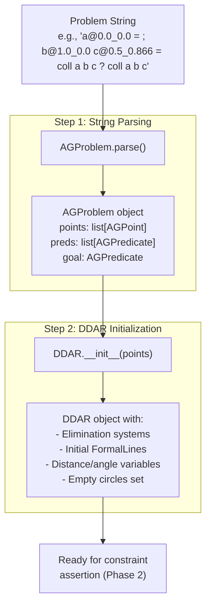
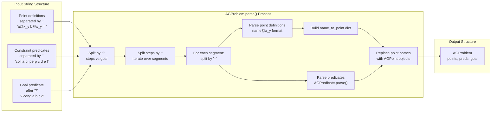
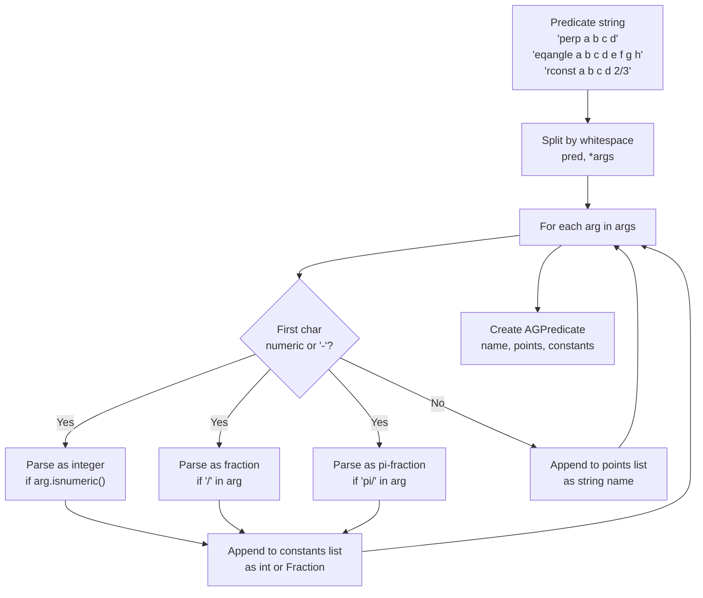
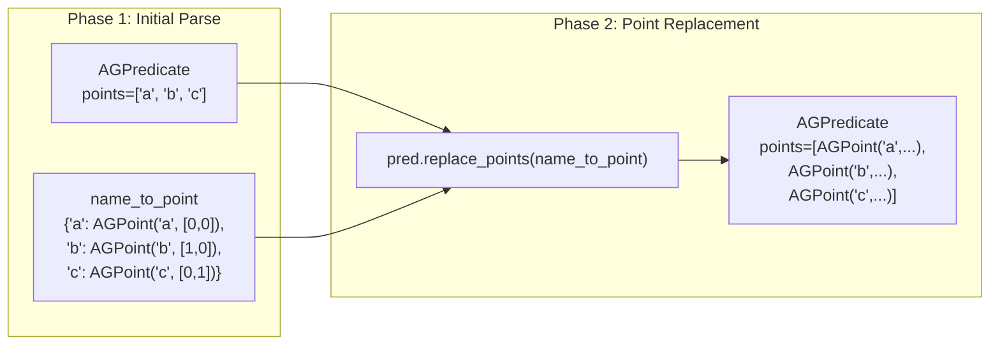
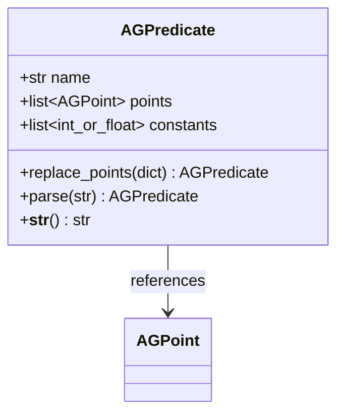
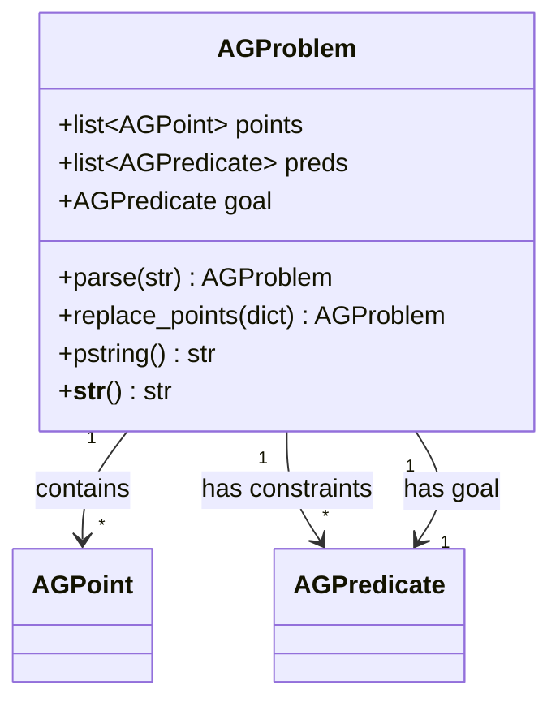
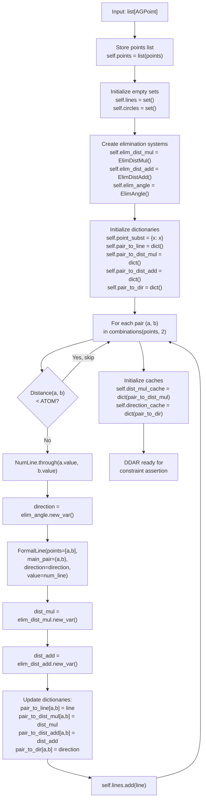
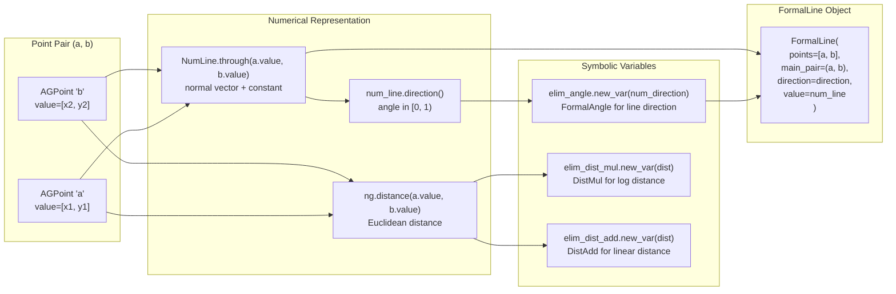
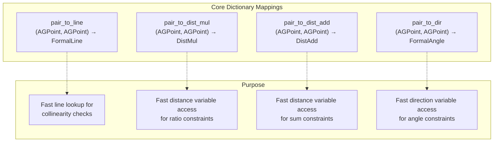
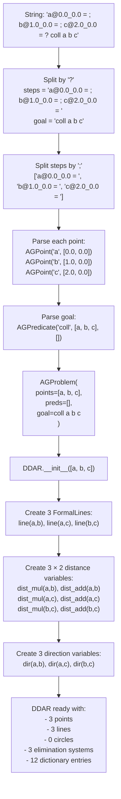

<!-- source: DeepWiki mcp.deepwiki.com · repo google-deepmind/alphageometry2 · page 9.1 Phase 1: Parsing and Initialization · fetched 2026-10-26 -->

# Phase 1: Parsing and Initialization

<details>
<summary>Relevant source files</summary>

The following files were used as context for generating this wiki page:

- [ddar.py](ddar.py)
- [parse.py](parse.py)

</details>


## Purpose and Scope

This document details the first phase of the AlphaGeometry2 problem-solving pipeline: parsing problem strings into structured data and initializing the DDAR logical engine with geometric objects. This phase transforms a compact string representation into a fully-initialized reasoning system ready to accept constraints.

For information about how constraints are asserted after initialization, see [Phase 2: Constraint Assertion](#9.2). For details about the string format itself, see [Problem String Format](#7.1).

## Overview of Phase 1

Phase 1 consists of two major steps executed sequentially:



**Sources:** [parse.py:111-148](), [ddar.py:69-126]()

## Step 1: Problem String Parsing

### Parsing Mechanics

The parsing process converts a problem string into three structured components: points, predicates, and a goal.



**Sources:** [parse.py:111-148]()

### Point Definition Parsing

Each point definition follows the format `name@x_y` where `x` and `y` are floating-point coordinates.

| Component | Example | Python Code | Result |
|-----------|---------|-------------|--------|
| Point name | `a` | `name, value = point.split('@')` | `name = 'a'` |
| Coordinates | `0.5_0.866` | `x, y = value.split('_')` | `x=0.5, y=0.866` |
| NumPy array | - | `value = np.array([x, y])` | 2D coordinate vector |
| AGPoint object | - | `AGPoint(name=name, value=value)` | Point with name and position |

**Sources:** [parse.py:124-133]()

### Predicate Parsing

Predicates are parsed by the `AGPredicate.parse()` class method, which splits tokens and classifies them as point names or numeric constants.



**Sources:** [parse.py:58-80]()

### Two-Phase Point Resolution

The parsing process uses a two-phase approach to handle point references:

**Phase 1: Initial Parse**
- Point names are stored as strings in predicates
- A `name_to_point` dictionary maps names to `AGPoint` objects

**Phase 2: Point Replacement**
- The `replace_points()` method substitutes string names with actual `AGPoint` references
- This ensures all predicates and the goal reference the same point objects



**Sources:** [parse.py:140-142](), [parse.py:45-50]()

## Data Structure Details

### AGPoint Class

The `AGPoint` class represents a geometric point with both symbolic (name) and numerical (coordinates) representations.

| Field | Type | Purpose |
|-------|------|---------|
| `name` | `str` | Symbolic identifier (e.g., 'A', 'B', 'X1') |
| `value` | `np.array` | 2D coordinates as `[x, y]` |

**Sources:** [parse.py:26-34]()

### AGPredicate Class

The `AGPredicate` class represents a geometric relationship or constraint.



**Common Predicate Types:**

| Predicate | Points | Constants | Meaning |
|-----------|--------|-----------|---------|
| `coll` | 3+ points | none | Points are collinear |
| `cyclic` | 4+ points | none | Points lie on a circle |
| `cong` | 4 points | none | Two segments are congruent |
| `perp` | 4 points | none | Two lines are perpendicular |
| `eqangle` | 8 points | none | Two angles are equal |
| `rconst` | 4 points | 1 ratio | Distance ratio is constant |

**Sources:** [parse.py:37-80]()

### AGProblem Class

The `AGProblem` class encapsulates a complete geometry problem.



**Sources:** [parse.py:83-148]()

## Step 2: DDAR Initialization

### DDAR Constructor Overview

The `DDAR.__init__()` method transforms a list of `AGPoint` objects into a fully-initialized reasoning system.



**Sources:** [ddar.py:69-126]()

### Elimination Systems Initialization

Three independent elimination systems are created to handle different types of geometric quantities:

| System | Class | Purpose | Variable Type |
|--------|-------|---------|---------------|
| Multiplicative distances | `ElimDistMul` | Log-scale distance ratios | `DistMul` |
| Additive distances | `ElimDistAdd` | Linear distance sums | `DistAdd` |
| Angles | `ElimAngle` | Angular relationships | `FormalAngle` |

**Sources:** [ddar.py:76-78]()

### Initial FormalLine Creation

For each pair of distinct points, DDAR creates a `FormalLine` object that encapsulates both symbolic and numerical representations.



**Sources:** [ddar.py:90-108]()

### Dictionary Mappings

DDAR maintains several dictionaries to provide O(1) lookup of geometric objects and variables by point pairs:



**Key properties:**
- Both `(a, b)` and `(b, a)` map to the same objects (symmetric)
- Pairs with distance < `ATOM` are excluded (numerically identical points)
- Initial size: `O(n²)` where `n` is the number of points

**Sources:** [ddar.py:81-118]()

### Initial State Summary

After initialization, the DDAR object contains:

| Component | Initial State | Count (for n points) |
|-----------|---------------|---------------------|
| `self.points` | List of all AGPoint objects | n |
| `self.lines` | Set of FormalLine objects | ~n(n-1)/2 |
| `self.circles` | Empty set | 0 |
| `self.elim_dist_mul` | ElimDistMul with ~n(n-1)/2 variables | 1 system |
| `self.elim_dist_add` | ElimDistAdd with ~n(n-1)/2 variables | 1 system |
| `self.elim_angle` | ElimAngle with ~n(n-1)/2 variables | 1 system |
| `self.pair_to_line` | Maps point pairs to FormalLine | ~n(n-1) entries |
| `self.pair_to_dist_mul` | Maps point pairs to DistMul | ~n(n-1) entries |
| `self.pair_to_dist_add` | Maps point pairs to DistAdd | ~n(n-1) entries |
| `self.pair_to_dir` | Maps point pairs to FormalAngle | ~n(n-1) entries |

**Sources:** [ddar.py:69-126]()

## Complete Example: Three-Point Problem

Consider parsing and initializing a simple three-point collinearity problem:

### Input String

```
a@0.0_0.0 = ; b@1.0_0.0 = ; c@2.0_0.0 = ? coll a b c
```

### Step-by-Step Transformation



### Resulting DDAR State

**Points:**
```python
self.points = [
    AGPoint('a', [0.0, 0.0]),
    AGPoint('b', [1.0, 0.0]),
    AGPoint('c', [2.0, 0.0])
]
```

**Lines (3 total):**
```python
self.lines = {
    FormalLine(points=[a, b], main_pair=(a, b), direction=angle_var_0, value=NumLine(...)),
    FormalLine(points=[a, c], main_pair=(a, c), direction=angle_var_1, value=NumLine(...)),
    FormalLine(points=[b, c], main_pair=(b, c), direction=angle_var_2, value=NumLine(...))
}
```

**Elimination Systems:**
- `elim_dist_mul`: 3 variables (log distances)
- `elim_dist_add`: 3 variables (linear distances)  
- `elim_angle`: 3 variables (line directions)

**Dictionary Mappings (sample):**
```python
pair_to_line[a, b] = line(a, b)
pair_to_line[b, a] = line(a, b)  # symmetric
pair_to_dist_mul[a, b] = DistMul(var_0)
pair_to_dist_add[a, b] = DistAdd(var_3)
pair_to_dir[a, b] = FormalAngle(var_6)
```

**Sources:** [parse.py:111-148](), [ddar.py:69-126]()

## Transition to Phase 2

At the end of Phase 1, the DDAR object is ready to accept constraints. The next phase will:

1. Iterate through `AGProblem.preds`
2. Call `ddar.force_pred(pred)` for each predicate
3. Translate predicates into elimination system constraints
4. Update the geometric object database

For details on constraint assertion, see [Phase 2: Constraint Assertion](#9.2).

**Sources:** [ddar.py:131-172]()

---

