<!-- source: DeepWiki mcp.deepwiki.com · repo google-deepmind/alphageometry2 · page 9.2 Phase 2: Constraint Assertion · fetched 2026-10-26 -->

# Phase 2: Constraint Assertion

Relevant source files

The following files were used as context for generating this wiki page:

- [ddar.py](ddar.py)
- [elimination.py](elimination.py)

## Purpose and Scope

This page documents how given predicates from a parsed geometry problem are translated into symbolic constraints and asserted into the DDAR system's elimination databases. After parsing creates an `AGProblem` with predicates ([Phase 1](#9.1)), each predicate must be converted from its high-level geometric meaning (e.g., "points A, B, C are collinear") into algebraic constraints in the elimination systems ([Symbolic Elimination System](#5)).

This phase occurs once per predicate during problem initialization, before the iterative deductive closure begins ([Phase 3](#9.3)). For goal verification after deduction, see [Phase 4](#9.4).

---

## Predicate Dispatch Architecture

The entry point for constraint assertion is `DDAR.force_pred()`, which dispatches each predicate type to its appropriate handler.

### Dispatch Flow

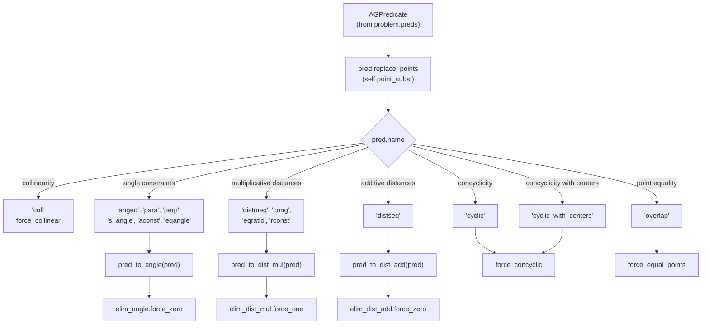

**Sources:** [ddar.py:131-172]()

### Predicate Type Categories

| Category | Predicate Names | Translation Target | Elimination System |
|----------|----------------|-------------------|-------------------|
| **Angle Constraints** | `angeq`, `para`, `perp`, `s_angle`, `aconst`, `eqangle` | `FormalAngle` | `ElimAngle` |
| **Multiplicative Distance** | `distmeq`, `cong`, `eqratio`, `rconst` | `DistMul` | `ElimDistMul` |
| **Additive Distance** | `distseq` | `DistAdd` | `ElimDistAdd` |
| **Structural** | `coll`, `cyclic`, `cyclic_with_centers`, `overlap` | Geometric objects | `FormalLine`, `FormalCircle` |

**Sources:** [ddar.py:131-172]()

---

## Translation: Predicates to Symbolic Constraints

Each predicate type has a specialized translation method that converts geometric conditions into symbolic algebraic expressions.

### Angle Predicate Translation

The `pred_to_angle()` method translates angle-based predicates into `FormalAngle` objects representing linear combinations of direction variables.

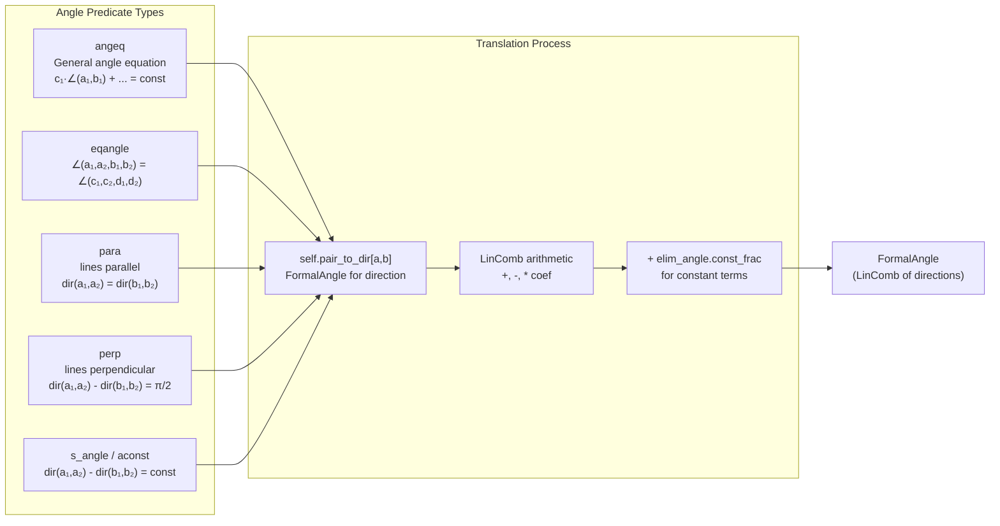

**Translation Examples:**

- **`para(A, B, C, D)`**: `pair_to_dir[A,B] - pair_to_dir[C,D]`
- **`perp(A, B, C, D)`**: `pair_to_dir[A,B] - pair_to_dir[C,D] - elim_angle.const(1, 2)`
- **`eqangle(A1, A2, B1, B2, C1, C2, D1, D2)`**: `(pair_to_dir[A1,A2] - pair_to_dir[B1,B2]) - (pair_to_dir[C1,C2] - pair_to_dir[D1,D2])`

**Sources:** [ddar.py:174-214]()

### Multiplicative Distance Translation

The `pred_to_dist_mul()` method translates distance ratio predicates into `DistMul` objects representing multiplicative relationships (logarithmic space).

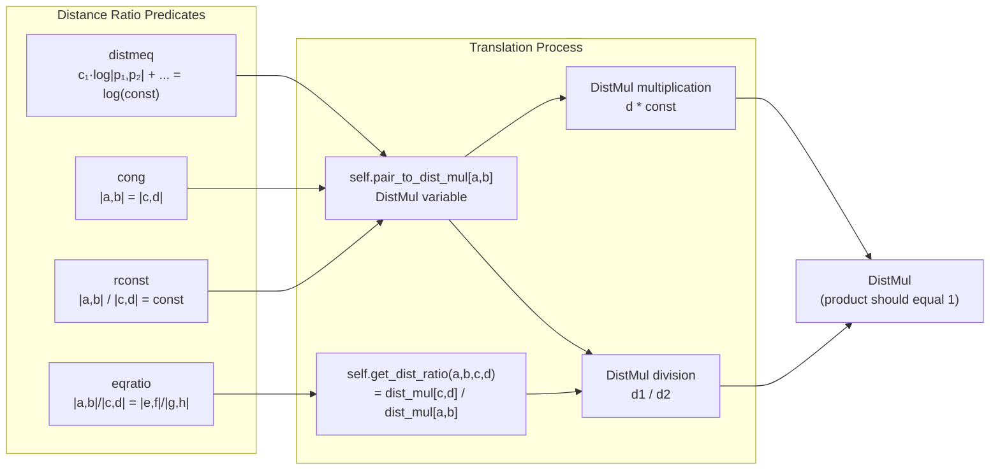

**Translation Examples:**

- **`cong(A, B, C, D)`**: `get_dist_mul(A,B) / get_dist_mul(C,D)` → should equal 1
- **`rconst(A, B, C, D, r)`**: `get_dist_mul(A,B) / get_dist_mul(C,D) / r` → should equal 1
- **`eqratio(A, B, C, D, E, F, G, H)`**: `get_dist_ratio(A,B,C,D) / get_dist_ratio(E,F,G,H)` → should equal 1

**Sources:** [ddar.py:216-245]()

### Additive Distance Translation

The `pred_to_dist_add()` method translates additive distance equations into `DistAdd` objects.

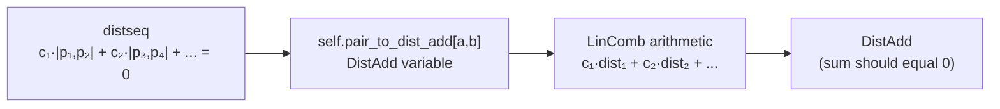

**Translation Example:**

- **`distseq(A, B, C, D, E, F, coef1, coef2, coef3)`**: `coef1·dist_add[A,B] + coef2·dist_add[C,D] + coef3·dist_add[E,F]` → should equal 0

**Sources:** [ddar.py:247-257]()

---

## Assertion into Elimination Systems

After translation, symbolic constraints are forced into their respective elimination systems using Gaussian elimination.

### Elimination System Interfaces

```mermaid
flowchart TD
    subgraph "FormalAngle Constraint"
        AngleExpr["FormalAngle<br/>(angle expression)"]
        AngleCheck["assert abs((angle.value + 0.5) % 1 - 0.5)² < ATOM"]
        AngleNormalize["angle.comb - const_term"]
        AngleCore["ElimCore.add_constraint"]
    end
    
    subgraph "DistMul Constraint"
        DistMulExpr["DistMul<br/>(ratio expression)"]
        DistMulCheck["assert abs(dist_mul.value - 1.0)² < ATOM"]
        DistMulCopy["dist_mul.comb.copy()"]
        DistMulCore["ElimCore.add_constraint"]
    end
    
    subgraph "DistAdd Constraint"
        DistAddExpr["DistAdd<br/>(sum expression)"]
        DistAddCheck["assert abs(dist_add.value)² < ATOM"]
        DistAddCopy["dist_add.comb.copy()"]
        DistAddCore["ElimCore.add_constraint"]
    end
    
    AngleExpr --> AngleCheck
    AngleCheck --> AngleNormalize
    AngleNormalize --> AngleCore
    
    DistMulExpr --> DistMulCheck
    DistMulCheck --> DistMulCopy
    DistMulCopy --> DistMulCore
    
    DistAddExpr --> DistAddCheck
    DistAddCheck --> DistAddCopy
    DistAddCopy --> DistAddCore
```

**Sources:** [elimination.py:501-509](), [elimination.py:330-333](), [elimination.py:409-412]()

### Gaussian Elimination Process

Each elimination system uses `ElimCore.add_constraint()` to perform symbolic Gaussian elimination:

1. **Simplification**: Substitute known equalities into the new constraint using `simplify()`
2. **Pivot Selection**: Choose an `ElimLHS` variable with minimal usage as pivot
3. **Normalization**: Solve for the pivot: `pivot = -(remaining terms) / coef`
4. **Propagation**: Substitute pivot expression into all equations that reference it
5. **Registration**: Store pivot equation and update usage tracking

**Sources:** [elimination.py:145-169]()

---

## Structural Constraint Assertion

Structural predicates (`coll`, `cyclic`, `overlap`) modify the geometric object database directly rather than just updating elimination systems.

### Collinearity Assertion Flow

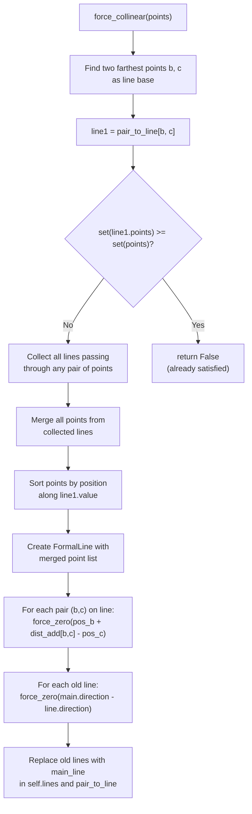

**Key Operations:**

1. **Line Merging**: Multiple `FormalLine` objects passing through collinear points are merged into a single `FormalLine`
2. **Segment Constraints**: For ordered points A < B < C on a line: `dist_add[A,B] + dist_add[B,C] = dist_add[A,C]`
3. **Direction Unification**: All merged lines must have the same direction: `force_zero(dir1 - dir2)`

**Sources:** [ddar.py:700-783]()

### Concyclicity Assertion Flow

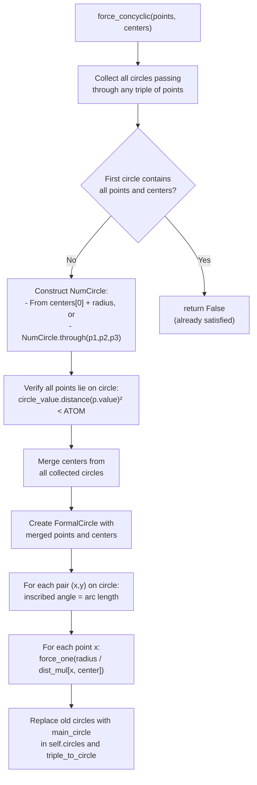

**Key Operations:**

1. **Circle Merging**: Multiple `FormalCircle` objects are merged into a single circle
2. **Inscribed Angle Theorem**: For points X, Y, Z on circle: `angle(X, Y, X, Z) = arc(Y, Z)`
3. **Equal Radii**: For all points on circle with center C: `dist_mul[P, C] = radius` (constant)

**Sources:** [ddar.py:785-904]()

### Special Case: Cyclic With Centers

The `cyclic_with_centers` predicate specifies both points on the circle and its center(s).

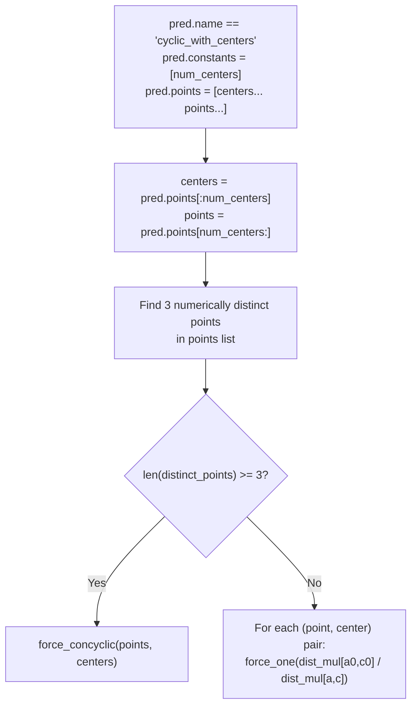

When fewer than 3 numerically distinct points exist, the system cannot determine a unique circle through points alone, so it forces all point-center distances to be equal instead.

**Sources:** [ddar.py:145-164]()

---

## Point Substitution and Merging

Before processing any predicate, points are replaced using `point_subst` to handle previously merged points.

### Point Substitution Mechanism

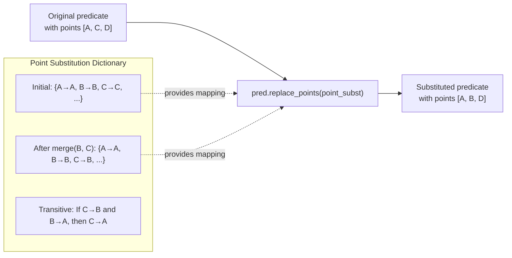

### Point Merging (`overlap` predicate)

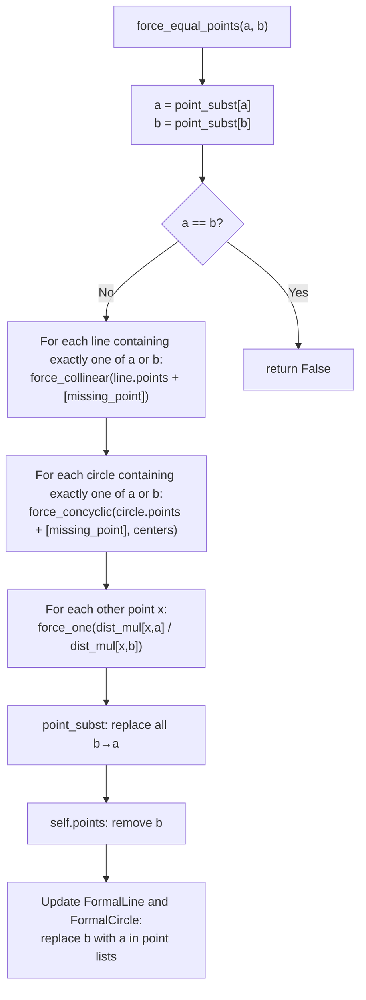

**Sources:** [ddar.py:937-1027]()

---

## Numerical Verification

All symbolic constraints are numerically verified before assertion using a small tolerance threshold `ng.ATOM`.

### Verification Requirements

| Constraint Type | Verification Check | Tolerance |
|----------------|-------------------|-----------|
| **Angle = 0** | `abs((angle.value + 0.5) % 1 - 0.5)² < ATOM` | `ng.ATOM` (1e-12) |
| **Ratio = 1** | `abs(dist_mul.value - 1.0)² < ATOM` | `ng.ATOM` (1e-12) |
| **Sum = 0** | `abs(dist_add.value)² < ATOM` | `ng.ATOM` (1e-12) |
| **Collinear** | `line.value.distance(point.value) < ATOM` | `ng.ATOM` (1e-12) |
| **Concyclic** | `circle.value.distance(point.value)² < ATOM` | `ng.ATOM` (1e-12) |

If numerical verification fails, a `ValueError` is raised with details about the constraint violation.

**Sources:** [elimination.py:501-509](), [elimination.py:330-333](), [elimination.py:409-412](), [ddar.py:712-715](), [ddar.py:841-850]()

---

## Complete Constraint Assertion Example

Consider asserting `cong(A, B, C, D)` (segment AB congruent to segment CD):

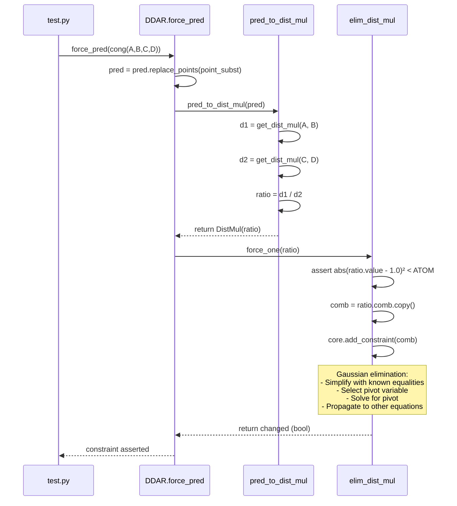

**Sources:** [ddar.py:131-172](), [ddar.py:216-245](), [elimination.py:330-333](), [elimination.py:145-169]()

---

