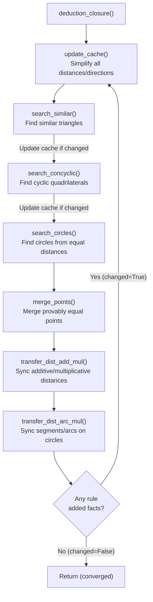
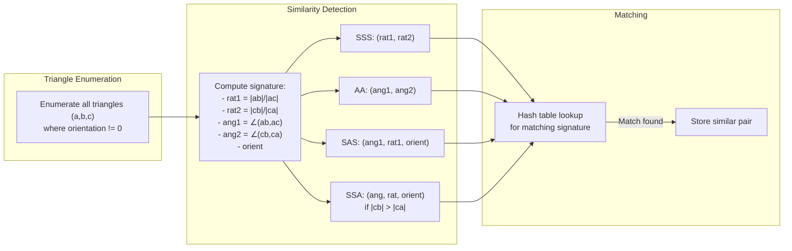
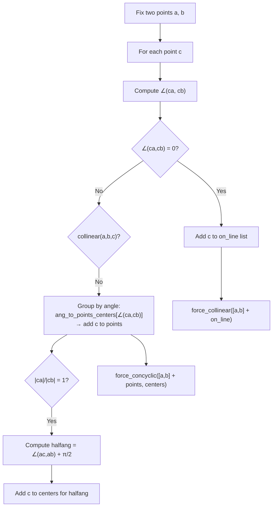
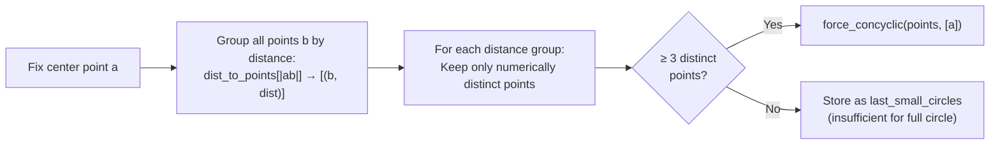
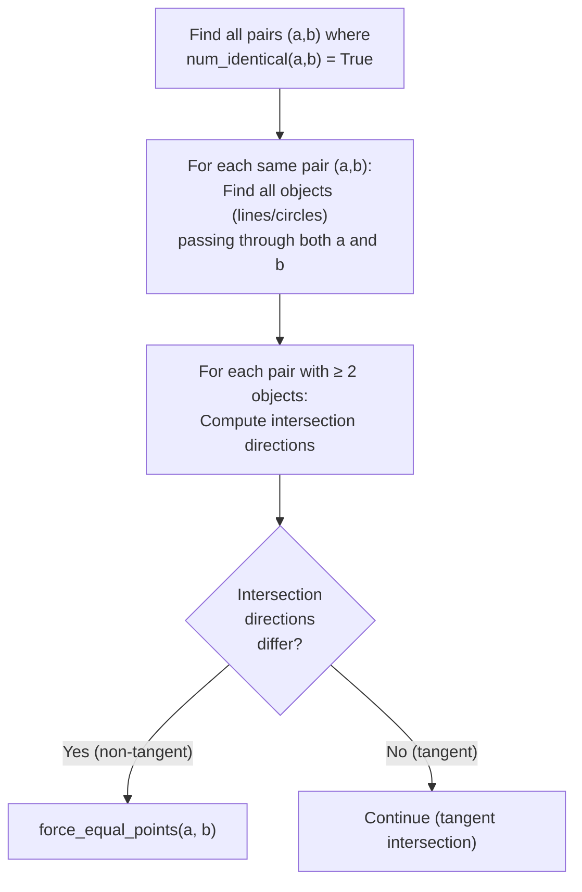
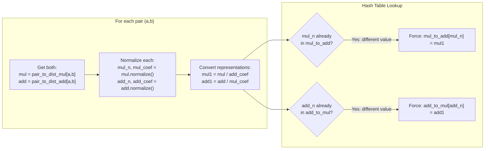
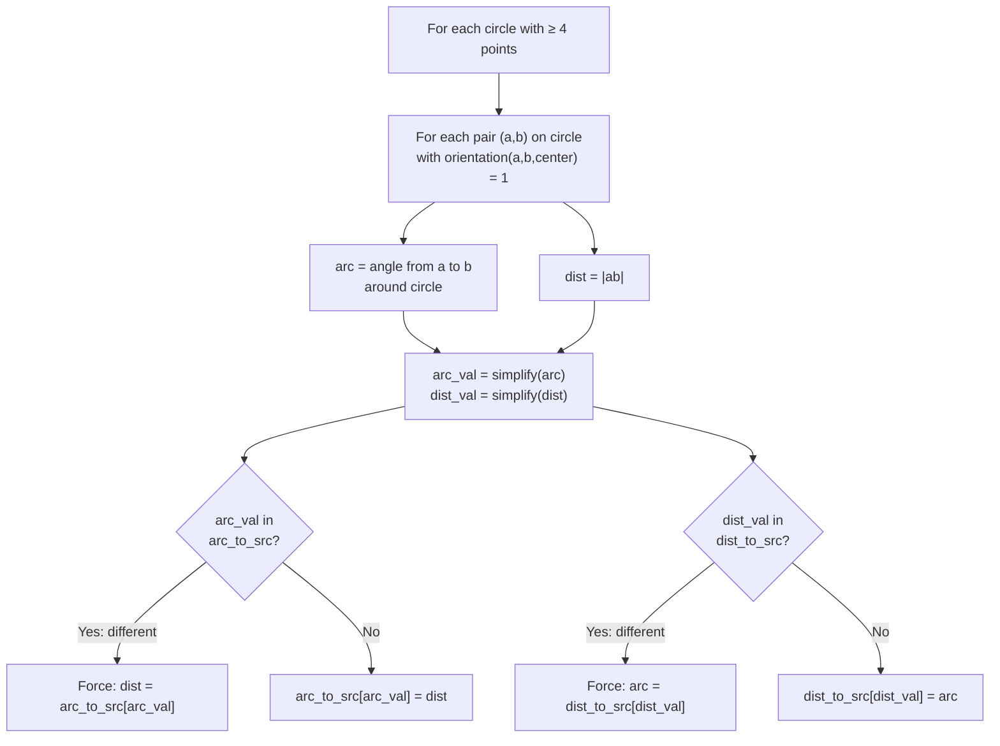
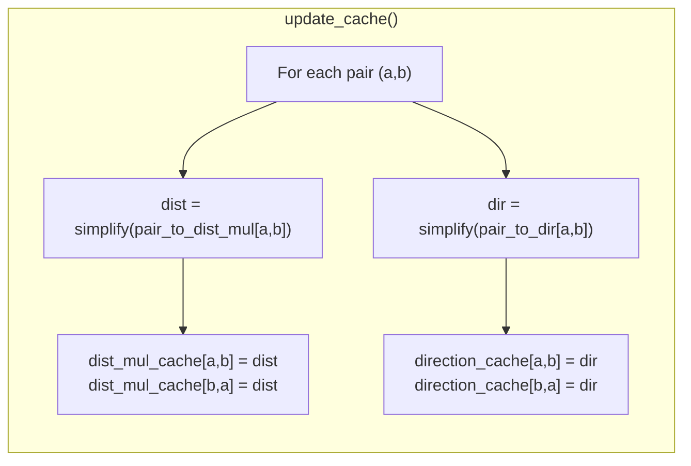
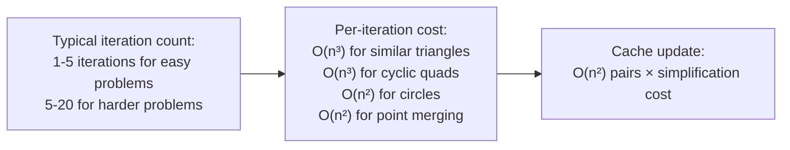

<!-- source: DeepWiki mcp.deepwiki.com · repo google-deepmind/alphageometry2 · page 9.3 Phase 3: Deductive Closure · fetched 2026-10-26 -->

# Phase 3: Deductive Closure

Relevant source files

The following files were used as context for generating this wiki page:

- [ddar.py](ddar.py)
- [elimination.py](elimination.py)
- [numericals.py](numericals.py)

## Purpose and Scope

This page documents the deductive closure process, which is the core reasoning loop of the DDAR system. After problem parsing ([9.1](#9.1)) and constraint assertion ([9.2](#9.2)), the system iteratively applies geometric inference rules to discover all facts deducible from the given predicates. This phase continues until no new facts can be derived (convergence), at which point goal verification can be performed ([9.4](#9.4)).

The deductive closure process is implemented in the `DDAR.deduction_closure` method and its supporting search algorithms. For information about how individual predicates are processed, see the Predicate System ([4.2](#4.2)). For details on the geometric inference rules themselves, see Geometric Inference Rules ([4.4](#4.4)).

---

## Main Deduction Loop

The deductive closure is an iterative fixed-point computation that repeatedly applies geometric inference rules until no new facts are discovered.

### Loop Structure

**Sources:** [ddar.py:301-358]()

### Implementation Details

The main loop maintains a `changed` flag that tracks whether any inference rule added new constraints to the elimination systems:

| Variable | Type | Purpose |
|----------|------|---------|
| `changed` | `bool` | Global flag indicating if any rule made progress this iteration |
| `changed_last` | `bool` | Per-rule flag indicating if the current rule added facts |
| `verbose` | `bool` | Whether to print detailed progress information |
| `progress_dot` | `bool` | Whether to print `.` for each iteration |

The loop executes until `changed` remains `False` after a complete iteration through all inference rules.

**Sources:** [ddar.py:301-358]()

---

## Inference Rules

Each inference rule searches for a specific geometric pattern and asserts the implied constraints when the pattern is found.

### Search Similar Triangles

The `search_similar` method identifies similar triangles using four similarity criteria: SSS (Side-Side-Side), AA (Angle-Angle), SAS (Side-Angle-Side), and SSA (Side-Side-Angle).

**Sources:** [ddar.py:359-438]()

#### Similarity Criteria

The method maintains hash tables for each similarity criterion:

| Criterion | Key | Implications |
|-----------|-----|-------------|
| **SSS** | `(rat1, rat2)` | Three side ratios equal → triangles similar |
| **AA** | `(ang1, ang2)` | Two angle pairs equal → triangles similar |
| **SAS** | `(ang1, rat1, orient)` | One angle and adjacent side ratios equal → triangles similar |
| **SSA** | `(ang, rat, orient)` | Two sides and opposite angle (with |cb| > |ca|) → triangles similar |

When similar triangles `(a,b,c)` and `(x,y,z)` are found, the `force_similar` method asserts:

- **Angle equalities:** `∠(ab,ac) = ±∠(xy,xz)` and `∠(ab,bc) = ±∠(xy,yz)`
- **Ratio equalities:** `|ab|/|ac| = |xy|/|xz|` and `|ab|/|bc| = |xy|/|yz|`

The sign depends on whether the triangles have the same or opposite orientation.

**Sources:** [ddar.py:359-438](), [ddar.py:652-696]()

---

### Search Cyclic Quadrilaterals

The `search_concyclic` method discovers sets of points lying on the same circle by finding points that subtend equal angles.

**Sources:** [ddar.py:440-481]()

#### Detection Logic

For fixed points `a` and `b`:

1. **Inscribed angle theorem:** If multiple points `c` satisfy `∠(ca, cb) = θ` (for non-collinear points), they lie on a circle through `a` and `b`
2. **Center detection:** If `|ca|/|cb| = 1`, then `c` is equidistant from `a` and `b`, making it a potential center for the perpendicular bisector circle
3. **Collinearity:** If `∠(ca, cb) = 0`, points `a`, `b`, `c` are collinear

The method groups points by their inscribed angles and asserts concyclicity when at least 2 points share the same angle (or when centers and points are found).

**Sources:** [ddar.py:440-481]()

---

### Search Circles

The `search_circles` method detects circles by finding points equidistant from a common center.

**Sources:** [ddar.py:483-524]()

#### Circle Detection Rules

| Condition | Action |
|-----------|--------|
| ≥ 3 distinct points at distance `d` from `a` | Assert concyclic constraint with center `a` |
| 1-2 distinct points at distance `d` from `a` | Store as `FormalCircle` in `last_small_circles` for point merging |

Small circles (with < 3 points) are stored for use in the `merge_points` rule, which checks if two points lie on the same line or circle in a non-tangent configuration.

**Sources:** [ddar.py:483-524](), [ddar.py:526-580]()

---

### Merge Points

The `merge_points` method identifies points that are provably equal and merges them into a single representative.

**Sources:** [ddar.py:526-580]()

#### Point Merging Logic

Two numerically identical points `a` and `b` are merged if they lie on two or more geometric objects that intersect non-tangentially:

1. **Collect objects:** Find all `FormalLine` and `FormalCircle` objects containing both `a` and `b`
2. **Compute intersection directions:**
   - For circles: direction from center to intersection point (plus 0.5 to normalize)
   - For lines: line direction
3. **Check tangency:** If any two intersection directions differ by more than `ATOM`, the objects are non-tangent
4. **Merge:** Call `force_equal_points(a, b)` to substitute `b` with `a` throughout the system

The `force_equal_points` method updates all data structures to replace `b` with `a`:
- Lines containing `b` are re-created with `a`
- Circles containing `b` are re-created with `a`
- Distance constraints between other points and `b` are equated with constraints to `a`

**Sources:** [ddar.py:526-580](), [ddar.py:937-1033]()

---

### Distance System Synchronization

Two transfer methods synchronize facts between different representation systems.

#### Transfer Dist Add/Mul

The `transfer_dist_add_mul` method synchronizes facts between the additive distance system (`ElimDistAdd`) and the multiplicative distance system (`ElimDistMul`).

**Sources:** [ddar.py:582-620]()

The method maintains two hash tables mapping normalized distances between systems:
- `mul_to_add`: Maps normalized multiplicative distances to their additive representations
- `add_to_mul`: Maps normalized additive distances to their multiplicative representations

When a normalized distance appears twice with different representations, a constraint is asserted to equate them.

#### Transfer Dist Arc Mul

The `transfer_dist_arc_mul` method synchronizes chord lengths with arc angles on circles.

**Sources:** [ddar.py:622-649]()

On a circle with radius `r`, equal chord lengths imply equal arc angles, and vice versa. This method enforces this relationship by:

1. Computing arc angle `∠(ba, bc)` where `c` is a reference point on the circle
2. Looking up simplified arc angles in `arc_to_src` and simplified distances in `dist_to_src`
3. Asserting equality when the same arc/distance appears with different representations

---

## Cache Updates

The `update_cache` method pre-computes and stores simplified distance and direction values for all point pairs.

**Sources:** [ddar.py:1036-1046]()

### Cache Usage

The cached values are used by helper methods to avoid repeated simplification:

| Method | Cache Used | Purpose |
|--------|-----------|---------|
| `get_dist_ratio(a,b,c,d)` | `dist_mul_cache` | Returns `cache[c,d] / cache[a,b]` |
| `get_point_angle(a,b,c,d)` | `direction_cache` | Returns `cache[c,d] - cache[a,b]` |

Caching is critical for performance since simplification through `ElimCore` involves traversing the constraint graph. The cache is updated:
- At the start of each deduction loop iteration
- After any inference rule that returns `changed=True`

**Sources:** [ddar.py:1036-1046](), [ddar.py:1047-1052]()

---

## Convergence and Termination

The deduction loop terminates when an entire iteration through all inference rules produces no changes (`changed=False`). This indicates a fixed point has been reached.

### Convergence Guarantee

| Property | Explanation |
|----------|-------------|
| **Monotonicity** | Each inference rule only adds constraints; it never removes information |
| **Bounded state space** | There are finitely many possible constraints between finitely many points |
| **Termination** | The system must eventually stop finding new constraints |

### Performance Characteristics

**Sources:** [ddar.py:301-358]()

The computational bottleneck is typically the similar triangle search, which enumerates all O(n³) triangles and computes signatures for each. The cache update is also significant, as it performs O(n²) simplifications through the elimination systems.

---

## Code Reference Summary

| Component | File Location | Description |
|-----------|---------------|-------------|
| Main loop | [ddar.py:301-358]() | `deduction_closure` method |
| Similar triangles | [ddar.py:359-438]() | `search_similar` method |
| Cyclic quadrilaterals | [ddar.py:440-481]() | `search_concyclic` method |
| Circle detection | [ddar.py:483-524]() | `search_circles` method |
| Point merging | [ddar.py:526-580]() | `merge_points` method |
| Distance sync | [ddar.py:582-620]() | `transfer_dist_add_mul` method |
| Arc sync | [ddar.py:622-649]() | `transfer_dist_arc_mul` method |
| Force similar | [ddar.py:652-696]() | `force_similar` method |
| Force equal points | [ddar.py:937-1033]() | `force_equal_points` method |
| Cache update | [ddar.py:1036-1046]() | `update_cache` method |
| Helper methods | [ddar.py:1047-1072]() | `get_dist_ratio`, `get_point_angle`, etc. |

**Sources:** [ddar.py:1-1087]()

---

