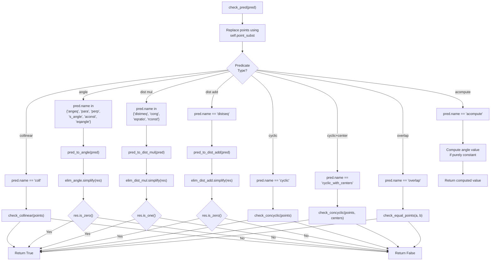
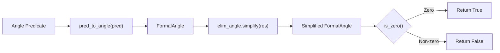
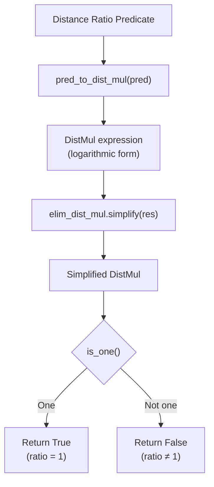
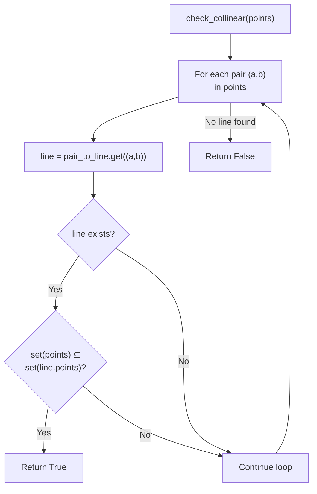
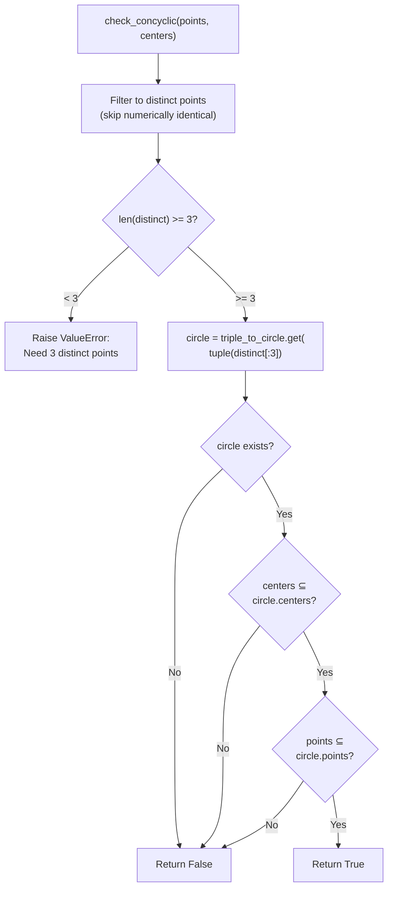
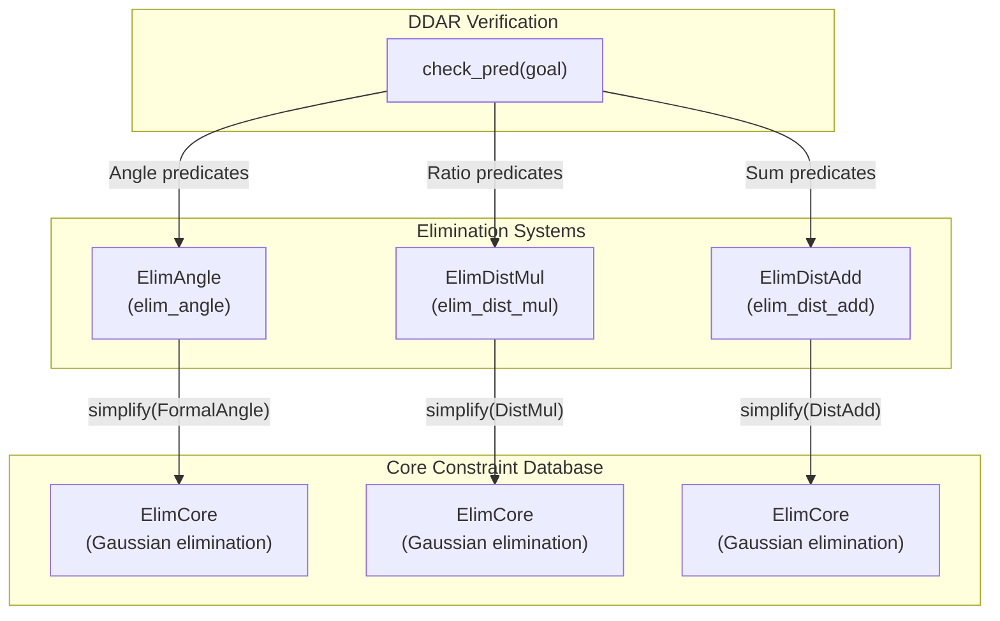
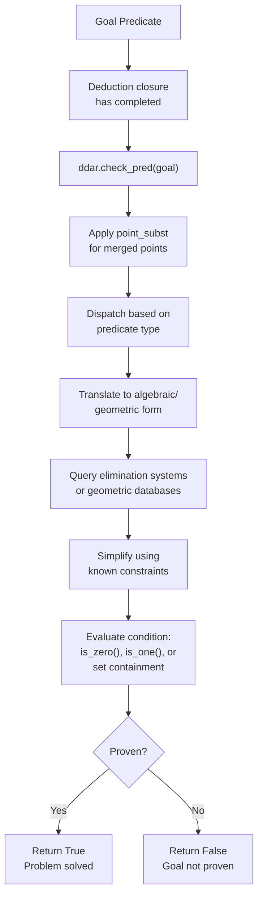

<!-- source: DeepWiki mcp.deepwiki.com · repo google-deepmind/alphageometry2 · page 9.4 Phase 4: Goal Verification · fetched 2026-10-26 -->

# Phase 4: Goal Verification

<details>
<summary>Relevant source files</summary>

The following files were used as context for generating this wiki page:

- [ddar.py](ddar.py)
- [elimination.py](elimination.py)

</details>


## Purpose and Scope

This page documents the goal verification phase, the final stage in the AlphaGeometry2 problem-solving pipeline. After the deduction closure phase has computed all derivable facts ([9.3](#9.3)), the system must verify whether the goal predicate has been proven. This phase queries the closed database of known facts to determine if the problem has been solved.

For information about how facts are derived during deduction closure, see [Phase 3: Deductive Closure](#9.3). For the overall problem-solving pipeline, see [Problem-Solving Pipeline](#9).

## Overview of Goal Verification

Goal verification is implemented by the `check_pred` method in the `DDAR` class [ddar.py:259-298]. This method takes a predicate and determines whether it is satisfied by the current state of the knowledge base. The verification process differs based on the predicate type, but follows a common pattern:

1. **Point Substitution**: Replace points with their canonical representatives (accounting for merged equal points)
2. **Translation**: Convert the predicate into an algebraic/geometric representation
3. **Simplification**: Query the elimination systems to simplify the representation using all known constraints
4. **Verification**: Check if the simplified form matches the expected result

The method returns a boolean (or in some cases a computed value) indicating whether the predicate is proven.

**Sources:** [ddar.py:259-298]

## Verification Decision Tree



**Sources:** [ddar.py:259-298]

## Point Substitution

Before verification, the system must account for points that have been proven equal during deduction closure. The `point_subst` dictionary [ddar.py:80] maps each point to its canonical representative. For most predicate types, `check_pred` performs point substitution at the start:

```python
pred = pred.replace_points(self.point_subst)
```

The exception is the `overlap` predicate, which explicitly tests point equality and therefore should not perform substitution before checking.

**Sources:** [ddar.py:263]

## Angle Predicate Verification

### Translation to FormalAngle

Angle predicates (`angeq`, `para`, `perp`, `s_angle`, `aconst`, `eqangle`) are verified by converting them to `FormalAngle` expressions and checking if they simplify to zero.



**Sources:** [ddar.py:267-270]

### Predicate-Specific Translations

The `pred_to_angle` method [ddar.py:174-214] handles different angle predicate types:

| Predicate | Translation | Description |
|-----------|-------------|-------------|
| `angeq` | Linear combination of directions plus constant | General angle equation: `c₁·dir(a₁,a₂) + c₂·dir(b₁,b₂) + ... + const = 0` |
| `eqangle` | `dir(a₁,a₂) - dir(b₁,b₂) - dir(c₁,c₂) + dir(d₁,d₂)` | Equal angles: `∠(a₁a₂,b₁b₂) = ∠(c₁c₂,d₁d₂)` |
| `para` | `dir(a₁,a₂) - dir(b₁,b₂)` | Parallel lines: `a₁a₂ ∥ b₁b₂` |
| `perp` | `dir(a₁,a₂) - dir(b₁,b₂) - π/2` | Perpendicular lines: `a₁a₂ ⊥ b₁b₂` |
| `s_angle`, `aconst` | `dir(a₁,a₂) - dir(b₁,b₂) - const` | Signed angle with constant |

The system uses `pair_to_dir` [ddar.py:88] to look up the `FormalAngle` representing the direction of each point pair, then combines these using angle arithmetic.

**Sources:** [ddar.py:174-214]

### Simplification Process

The `elim_angle.simplify` method [elimination.py:511-514] queries the `ElimAngle` system's constraint database. This system maintains equations between angle variables learned during deduction closure. Simplification applies Gaussian elimination to reduce the angle expression to a canonical form.

If the simplified expression has no variables (only the angle unit `π`), and the coefficient is zero (modulo 2π), then `is_zero()` returns true.

**Sources:** [elimination.py:511-514], [elimination.py:459-460]

## Distance Predicate Verification

### Multiplicative Distance Predicates

Predicates involving distance ratios (`distmeq`, `cong`, `eqratio`, `rconst`) are verified using the `ElimDistMul` system, which represents distances logarithmically.



**Sources:** [ddar.py:271-274]

#### Translation Examples

The `pred_to_dist_mul` method [ddar.py:216-245] converts predicates to `DistMul` (multiplicative distance) form:

| Predicate | Translation | Verification Condition |
|-----------|-------------|------------------------|
| `cong(a,b,c,d)` | `dist(a,b) / dist(c,d)` | Equals 1 |
| `rconst(a,b,c,d,k)` | `dist(a,b) / dist(c,d) / k` | Equals 1 |
| `eqratio(a,b,c,d,e,f,g,h)` | `[dist(a,b)/dist(c,d)] / [dist(e,f)/dist(g,h)]` | Equals 1 |
| `distmeq` | `d₁^c₁ · d₂^c₂ · ... · k` | Equals 1 |

The system uses `pair_to_dist_mul` [ddar.py:86] to access the logarithmic distance variable for each point pair, then applies ratio arithmetic in the logarithmic domain (subtraction).

**Sources:** [ddar.py:216-245]

### Additive Distance Predicates

The `distseq` predicate (distance sum equality) is verified using the `ElimDistAdd` system:

```python
# distseq predicate: c₁·d₁ + c₂·d₂ + ... = 0
res = self.pred_to_dist_add(pred)
res = self.elim_dist_add.simplify(res)
return res.is_zero()
```

The `pred_to_dist_add` method [ddar.py:247-257] creates a linear combination of additive distance variables using `pair_to_dist_add` [ddar.py:87], weighted by the predicate's constants.

**Sources:** [ddar.py:275-278], [ddar.py:247-257]

## Collinearity Verification

Collinearity is verified by checking if the points belong to a common `FormalLine`:



The method [ddar.py:906-911] iterates through all pairs of points, checking if they share a line. If a line is found, it verifies that all points in the predicate are members of that line's point set.

**Sources:** [ddar.py:906-911]

## Concyclicity Verification

### Basic Concyclicity

The `check_concyclic` method [ddar.py:913-933] verifies that points lie on a common circle by checking the `triple_to_circle` dictionary:



The method first filters out points that are numerically identical using `num_identical` [ddar.py:128-129]. It requires at least three distinct points. The verification looks up the first three distinct points in `triple_to_circle` and checks that all predicate points and centers are contained in the found circle.

**Sources:** [ddar.py:913-933], [ddar.py:128-129]

### Concyclicity with Centers

For predicates of type `cyclic_with_centers`, the verification includes checking that specified centers are present:

```python
[num_centers] = pred.constants
centers = pred.points[:num_centers]
points = pred.points[num_centers:]
return self.check_concyclic(points, centers)
```

This splits the point list into center and circumference points, then calls the same `check_concyclic` method.

**Sources:** [ddar.py:281-285]

## Point Equality Verification

The `check_equal_points` method [ddar.py:1029-1032] determines if two points have been proven equal by checking if they map to the same canonical point in `point_subst`:

```python
def check_equal_points(self, a, b):
    a = self.point_subst[a]
    b = self.point_subst[b]
    return a == b
```

This is used for `overlap` predicates, which explicitly test whether two points are the same.

**Sources:** [ddar.py:1029-1032], [ddar.py:287-288]

## Interaction with Elimination Systems

The verification process relies heavily on the three elimination systems maintained by `DDAR`:



**Sources:** [ddar.py:76-78], [elimination.py:127-194]

### Simplification Mechanism

Each elimination system's `simplify` method [elimination.py:134-143] works by:

1. **Copy the combination**: Create a working copy of the variable's linear combination
2. **Apply substitutions**: For each variable in the combination, if it has been eliminated (exists in `instantiated`), substitute its equation
3. **Iterate**: The substitution process recursively eliminates variables until only free variables remain
4. **Return canonical form**: The result represents the expression in terms of free variables only

The `instantiated` dictionary [elimination.py:131] maps eliminated variables to their defining equations (as `LinComb` objects). The `free_to_usage` dictionary [elimination.py:132] tracks which eliminated variables depend on which free variables, enabling efficient updates.

**Sources:** [elimination.py:134-143], [elimination.py:131-132]

## Special Case: Angle Computation

The `acompute` predicate is a special verification mode that computes the actual angle value if possible:

```python
a1, a2, b1, b2 = pred.points
ang = self.pair_to_dir[a1, a2] - self.pair_to_dir[b1, b2]
ang = self.elim_angle.simplify(ang)
if all(v == el.angle_unit for v in ang.comb.d.keys()):
    return ang.comb.d.get(el.angle_unit, Fraction(0))
else:
    return None
```

This checks if the angle simplifies to a pure constant (no free variables). If so, it returns the coefficient of the angle unit (representing the angle in multiples of π). Otherwise, it returns `None`.

**Sources:** [ddar.py:289-296]

## Success and Failure Conditions

### Successful Verification

A goal is successfully verified when:

- **Angle predicates**: The angle expression simplifies to zero (modulo 2π)
- **Distance ratios**: The ratio expression simplifies to one
- **Distance sums**: The sum expression simplifies to zero
- **Collinearity**: All points are found in a common line
- **Concyclicity**: All points are found in a common circle (with specified centers if required)
- **Point equality**: Both points map to the same canonical point

In the test driver [test.py], successful verification results in printing `':-)'` to indicate a solved problem.

### Failure Cases

Verification fails when the goal predicate's simplified form does not meet the expected condition. This indicates one of several possibilities:

1. **Insufficient deduction**: The goal is true but DDAR couldn't derive all necessary intermediate facts
2. **Requires auxiliary constructions**: The goal needs additional points that weren't introduced
3. **Goal is false**: The goal doesn't follow from the given conditions (though test problems are designed to be valid)

The test driver prints the goal predicate when verification fails, allowing users to see what couldn't be proven.

**Sources:** [ddar.py:259-298]

## Verification Flow Summary



**Sources:** [ddar.py:259-298], [ddar.py:301-358]

---

