# Page: Home

# Home

<details>
<summary>Relevant source files</summary>

The following files were used as context for generating this wiki page:

- [README.md](README.md)
- [test.py](test.py)

</details>


## Purpose and Scope

This wiki documents the **AlphaGeometry2 DDAR logical core** repository, which contains the symbolic reasoning component of the AlphaGeometry2 system. This repository provides code to reproduce geometry theorem proving on International Mathematical Olympiad (IMO) problems using deductive reasoning.

**What this repository contains:**
- The DDAR (Deductive Database with Angle Relations) logical engine
- Problem parsing and representation systems
- Symbolic elimination and numerical geometry modules
- Test suite with 26 IMO problems

**What this repository does NOT contain:**
- The language model for generating auxiliary construction points
- The complete AlphaGeometry2 system architecture
- Training code or model weights

For information on running the system, see [Getting Started](#2). For details on the DDAR engine, see [DDAR Logical Engine](#4).

**Sources:** [README.md:1-16](), [test.py:16-16]()

---

## System Overview

AlphaGeometry2 is a geometry theorem prover that achieved gold-medalist performance on IMO geometry problems. This repository contains only the **symbolic/logical core**, which performs deductive reasoning on formalized geometry problems. The full AlphaGeometry2 system includes a language model that generates auxiliary construction points, but that component is not included here.

The logical core operates on problems that have been:
1. Formalized into the AlphaGeometry2 problem language
2. Supplemented with point coordinates
3. Optionally supplemented with auxiliary points (for harder problems)

**Sources:** [README.md:3-16](), [test.py:481-488]()

---

## Core Components

The repository consists of five primary Python modules that implement distinct computational responsibilities:

| Module | Primary Classes | Responsibility |
|--------|----------------|----------------|
| `test.py` | N/A (script) | Test orchestration, problem execution, result reporting |
| `parse.py` | `AGPoint`, `AGPredicate`, `AGProblem` | Problem string parsing and data modeling |
| `ddar.py` | `DDAR`, `FormalLine`, `FormalCircle` | Geometric reasoning and deduction closure |
| `elimination.py` | `ElimCore`, `LinComb`, `ElimDistMul`, `ElimDistAdd`, `ElimAngle` | Symbolic algebra and constraint solving |
| `numericals.py` | `NumPoint`, `NumLine`, `NumCircle` | Numerical geometric computations |

**Sources:** [test.py:1-19](), [parse.py:1-50](), [ddar.py:1-50](), [elimination.py:1-50](), [numericals.py:1-50]()

---

## Component Architecture

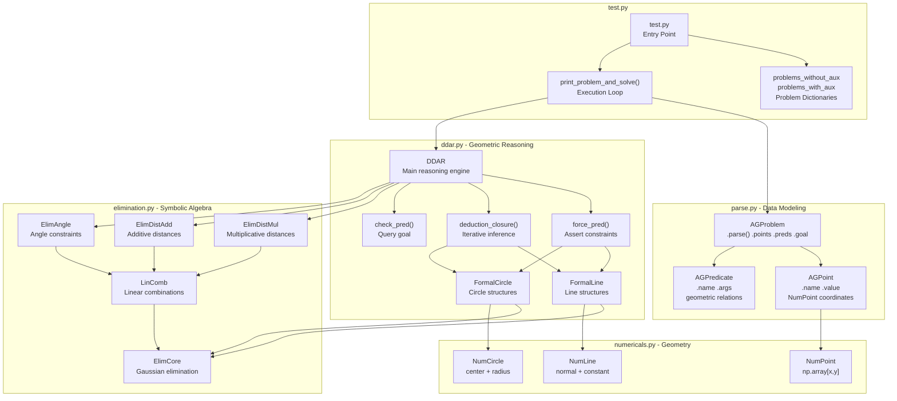

**Diagram: Component Architecture and Class Relationships**

This diagram shows the actual classes and functions in the codebase and how they relate. Each box represents a real code entity that can be searched in the repository.

**Sources:** [test.py:16-19](), [test.py:491-507](), [parse.py:20-150](), [ddar.py:30-200](), [elimination.py:20-100](), [numericals.py:20-80]()

---

## Problem Execution Flow

```mermaid
flowchart LR
    Start["Problem String<br/>'a@0.0_0.0 = ; ...'"]
    
    subgraph "Parsing"
        ParseCall["AGProblem.parse()"]
        AGProbObj["AGProblem object<br/>.points: list[AGPoint]<br/>.preds: list[AGPredicate]<br/>.goal: AGPredicate"]
    end
    
    subgraph "DDAR Initialization"
        DDARInit["DDAR.__init__(points)"]
        DDARObj["DDAR instance<br/>- flines: dict<br/>- fcircles: dict<br/>- elim_dist_mul<br/>- elim_dist_add<br/>- elim_angle"]
    end
    
    subgraph "Constraint Assertion"
        ForceLoop["for pred in preds:<br/>ddar.force_pred(pred)"]
        ElimSys["Update elimination systems<br/>ElimDistMul, ElimDistAdd, ElimAngle"]
    end
    
    subgraph "Deductive Closure"
        ClosureCall["ddar.deduction_closure()"]
        InferLoop["Iterative inference:<br/>- search_similar<br/>- search_cyclic<br/>- search_circles<br/>- merge_points"]
    end
    
    subgraph "Goal Verification"
        CheckCall["ddar.check_pred(goal)"]
        QueryElim["Query elimination<br/>systems for goal"]
        Result{"Proven?"}
    end
    
    Start --> ParseCall
    ParseCall --> AGProbObj
    AGProbObj --> DDARInit
    DDARInit --> DDARObj
    DDARObj --> ForceLoop
    ForceLoop --> ElimSys
    ElimSys --> ClosureCall
    ClosureCall --> InferLoop
    InferLoop --> CheckCall
    CheckCall --> QueryElim
    QueryElim --> Result
```

**Diagram: Execution Flow Through Code Functions**

This shows the actual function calls that occur when solving a problem, using real method names from the codebase.

**Sources:** [test.py:491-507](), [parse.py:110-150](), [ddar.py:50-150]()

---

## File Structure

```
alphageometry2/
├── test.py                # Main test script with problem sets
├── parse.py               # AGProblem, AGPoint, AGPredicate parsing
├── ddar.py                # DDAR class with deduction engine
├── elimination.py         # Symbolic elimination systems
├── numericals.py          # Numerical geometry primitives
├── README.md              # Installation and usage instructions
└── LICENSE                # Apache 2.0 license
```

**Sources:** [README.md:1-163]()

---

## Problem Categories

The test suite in `test.py` contains two categories of IMO problems:

### Problems Solvable Without Auxiliary Points

The `problems_without_aux` dictionary contains 15 problems (2000-2022) that DDAR can solve using only deductive reasoning on the given points and constraints. These problems demonstrate DDAR's autonomous reasoning capabilities.

**Problems:** IMO 2000 P1, 2002 P2a/b, 2003 P4, 2004 P5, 2005 P5, 2007 P4, 2010 P4, 2012 P1, 2013 P4, 2014 P4, 2015 P4, 2016 P1, 2017 P4, 2022 P4

**Sources:** [test.py:22-234](), [README.md:42-88]()

### Problems Requiring Auxiliary Points

The `problems_with_aux` dictionary contains 11 challenging problems (2001-2021) that require strategic auxiliary construction points. These points are manually provided in the problem strings (marked by coordinates of constructed points beyond the original problem statement). In the full AlphaGeometry2 system, these would be generated by the language model.

**Problems:** IMO 2001 P5a, 2003 P4b, 2005 P1, 2008 P1b, 2008 P6, 2009 P4a/b, 2011 P6, 2013 P3, 2019 P2, 2021 P3

**Sources:** [test.py:236-479](), [README.md:90-125]()

---

## Key Data Structures

### Problem Representation

| Class | Location | Purpose |
|-------|----------|---------|
| `AGPoint` | [parse.py]() | Represents a geometric point with name and coordinates |
| `AGPredicate` | [parse.py]() | Represents a geometric relation (e.g., `collinear`, `congruent`) |
| `AGProblem` | [parse.py]() | Container for points, predicates (givens), and goal |

### Geometric Objects

| Class | Location | Purpose |
|-------|----------|---------|
| `FormalLine` | [ddar.py]() | Symbolic line representation with elimination variables |
| `FormalCircle` | [ddar.py]() | Symbolic circle representation with elimination variables |
| `NumPoint` | [numericals.py]() | Numerical point as numpy array `[x, y]` |
| `NumLine` | [numericals.py]() | Numerical line as normal vector + constant |
| `NumCircle` | [numericals.py]() | Numerical circle as center + radius |

### Constraint Systems

| Class | Location | Purpose |
|-------|----------|---------|
| `ElimCore` | [elimination.py]() | Gaussian elimination on linear combinations |
| `ElimDistMul` | [elimination.py]() | Multiplicative distance constraints (`ab * cd = ef * gh`) |
| `ElimDistAdd` | [elimination.py]() | Additive distance constraints (`ab + cd = ef + gh`) |
| `ElimAngle` | [elimination.py]() | Angle equality constraints |

**Sources:** [parse.py:20-150](), [ddar.py:30-250](), [elimination.py:20-200](), [numericals.py:20-120]()

---

## DDAR Reasoning Capabilities

The `DDAR` class in [ddar.py]() implements the following geometric reasoning algorithms:

| Method | Purpose |
|--------|---------|
| `force_pred()` | Translates predicates into constraints and updates elimination systems |
| `deduction_closure()` | Iteratively applies inference rules until no new facts are derived |
| `search_similar()` | Finds similar triangles and derives proportional relationships |
| `search_cyclic()` | Finds cyclic quadrilaterals and derives angle relationships |
| `search_circles()` | Identifies circles from cocyclic point sets |
| `merge_points()` | Merges points proven to be identical |
| `check_pred()` | Queries whether a predicate can be proven from the current knowledge base |

**Sources:** [ddar.py:50-400]()

---

## Running the System

To execute the test suite:

```bash
python -m test
```

This runs both problem categories and prints proving status for each problem. Each dot (`.`) represents one iteration of the deduction closure loop. For detailed instructions, see [Running the Test Suite](#2.1).

**Example output:**
```
Problem: 2000_p1
..... Proven :-)

Problem: 2005_p1
...... Proven :-)
```

**Sources:** [README.md:32-37](), [test.py:509-516]()

---

## Dependencies

The system requires only standard scientific Python libraries:

- Python 3.x
- `numpy` - for numerical array operations
- `fractions` - for exact rational arithmetic
- `collections` - for data structures (defaultdict, namedtuple)

**Sources:** [README.md:18-29]()

---

## Further Documentation

For detailed information on specific components:

- **Installation and Usage:** See [Getting Started](#2)
- **Problem Format:** See [Problem Format and Structure](#2.2)
- **Architecture Details:** See [System Architecture](#3)
- **DDAR Engine:** See [DDAR Logical Engine](#4)
- **Symbolic Algebra:** See [Symbolic Elimination System](#5)
- **Numerical Geometry:** See [Numerical Geometry Module](#6)
- **Problem Parsing:** See [Problem Parsing and Data Structures](#7)
- **Complete Pipeline:** See [Problem-Solving Pipeline](#9)
- **Contributing:** See [Developer Guide](#10)

---

## Citation and License

This code accompanies the paper:

> Chervonyi et al. (2025). "Gold-medalist performance in solving olympiad geometry with alphageometry2." *Journal of Machine Learning Research*, 26(241), 1-39.

The software is licensed under Apache License 2.0. This is not an official Google product.

**Sources:** [README.md:127-162]()

---

# Page: Getting Started

# Getting Started

<details>
<summary>Relevant source files</summary>

The following files were used as context for generating this wiki page:

- [README.md](README.md)
- [parse.py](parse.py)
- [test.py](test.py)

</details>


This document provides an introduction to installing, running, and understanding the basic operation of the AlphaGeometry2 DDAR logical core test system. It covers the installation process, how to execute the test suite, and an overview of the problem format and execution flow.

For detailed instructions on running tests and interpreting results, see [Running the Test Suite](#2.1). For a comprehensive explanation of the problem format, see [Problem Format and Structure](#2.2). For understanding the overall system architecture, see [System Architecture](#3).

## Installation

The system requires Python 3 with NumPy. Installation is performed in a virtual environment:

```bash
$ sudo apt install python3
$ sudo apt install python3-pip
$ sudo apt install python3-venv
$ python3 -m venv ag2
$ source ag2/bin/activate
$ pip install numpy
```

**Sources:** [README.md:18-29]()

## Running the Test Suite

Execute the test suite using Python's module syntax:

```bash
$ python -m test
```

This command runs the `test.py` module, which serves as the test driver and orchestrator for the DDAR logical core. The test suite evaluates DDAR's performance on 26 IMO geometry problems divided into two categories.

**Sources:** [README.md:31-37](), [test.py:1-517]()

### Test Execution Flow

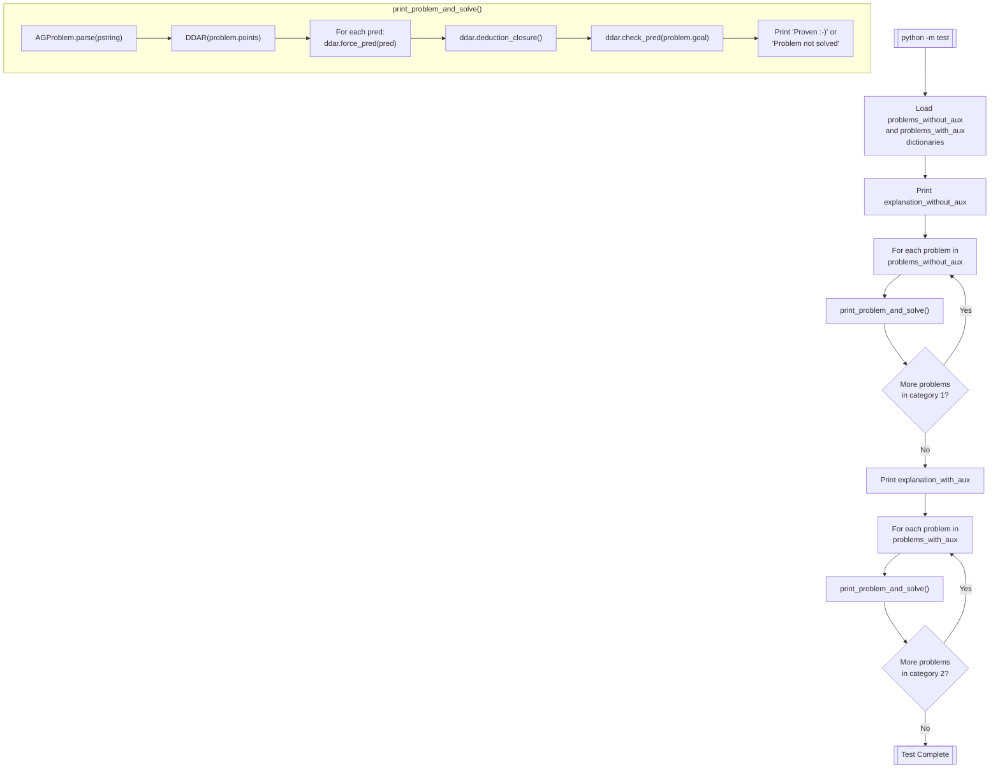

**Sources:** [test.py:490-516]()

## Output Format

The test suite produces output indicating which problems were tested and whether they were proven. Each problem execution generates a line of dots representing deduction iterations, followed by a success or failure message.

### Example Output Structure

| Output Component | Description | Example |
|-----------------|-------------|---------|
| Problem ID | IMO year and problem number | `Problem: 2005_p1` |
| Iteration Dots | Each dot represents one deduction cycle | `......` |
| Result | Proof status | `Proven :-)` |

**Example output:**
```
Problem: 2000_p1
..... Proven :-)

Problem: 2002_p2a
.... Proven :-)
```

Each dot in the output corresponds to one iteration of the deduction closure loop in `ddar.deduction_closure()`.

**Sources:** [README.md:39-125](), [test.py:490-507]()

## Problem Categories

The test suite contains two distinct problem categories that exercise different capabilities of the DDAR system:

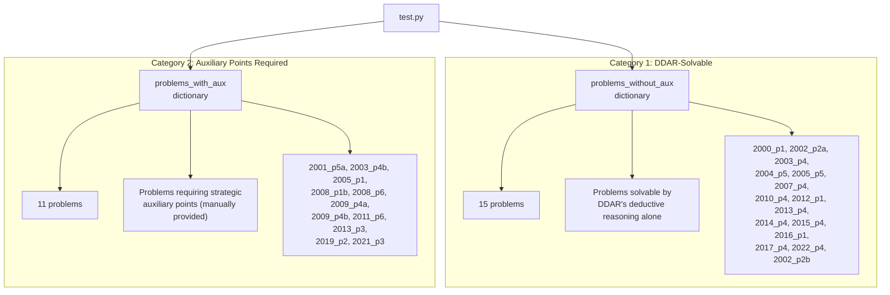

### Category 1: Problems Without Auxiliary Points

The `problems_without_aux` dictionary contains 15 IMO problems that DDAR can solve using only the given points and predicates. These problems test DDAR's core deductive capabilities: triangle similarity detection, cyclic quadrilateral identification, and circle detection.

### Category 2: Problems With Auxiliary Points

The `problems_with_aux` dictionary contains 11 challenging IMO problems that require strategic auxiliary (helper) points. These auxiliary points are manually included in the problem strings. In a complete AlphaGeometry2 system, a language model would generate these points automatically, but this repository tests only the logical core with pre-provided auxiliary constructions.

**Sources:** [test.py:22-479](), [README.md:90-125]()

## Problem String Format Overview

Problems are encoded as single-line strings with a specific syntax. The format defines points, their coordinates, predicates (given conditions), and the goal.

### Problem String Structure

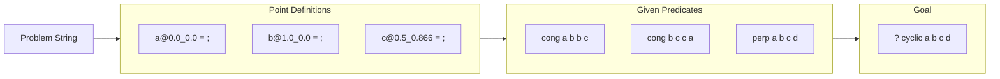

**Format syntax:**
- **Point definition:** `name@x_y = ;` where `name` is the point identifier and `x_y` are coordinates
- **Predicates:** Comma-separated predicates after the `=` sign
- **Goal:** Follows the `?` symbol

**Example:**
```
a@0.0_0.0 = ; b@1.0_0.0 = ; c@0.5_0.866 = cong a b b c ? cong b c c a
```

**Sources:** [test.py:23-479](), [parse.py:111-148]()

## Execution Pipeline Overview

When a problem is tested, it flows through several processing stages:

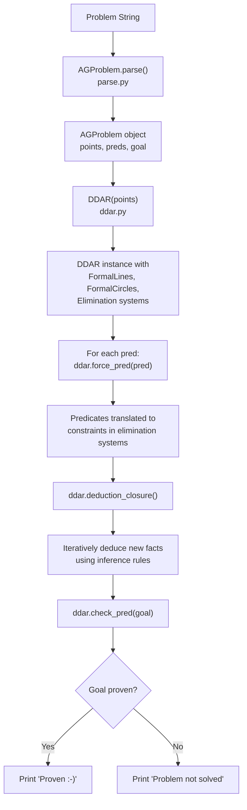

**Key processing stages:**

1. **Parsing:** The problem string is parsed into an `AGProblem` object containing `AGPoint` objects, `AGPredicate` objects, and a goal predicate
2. **DDAR Initialization:** A `DDAR` instance is created with the problem's points, initializing geometric structures
3. **Constraint Assertion:** Each given predicate is translated into constraints via `ddar.force_pred()`
4. **Deduction Closure:** The `ddar.deduction_closure()` method iteratively applies inference rules until no new facts can be derived
5. **Goal Verification:** The goal predicate is checked using `ddar.check_pred()` to determine if it can be proven from the closed database

**Sources:** [test.py:490-507](), [parse.py:111-148]()

## Next Steps

This overview provides the foundation for using the system. For deeper understanding:

- See [Running the Test Suite](#2.1) for detailed execution instructions and output interpretation
- See [Problem Format and Structure](#2.2) for complete problem format specification
- See [System Architecture](#3) for understanding how components interact
- See [Problem-Solving Pipeline](#9) for a detailed walkthrough of problem execution

**Sources:** [README.md:1-163](), [test.py:1-517](), [parse.py:1-149]()

---

# Page: Running the Test Suite

# Running the Test Suite

<details>
<summary>Relevant source files</summary>

The following files were used as context for generating this wiki page:

- [README.md](README.md)
- [test.py](test.py)

</details>


## Purpose and Scope

This page provides a detailed guide on executing the AlphaGeometry2 test suite and interpreting its output. It covers the command-line invocation, output format, execution flow, and result interpretation. For information about the problem format used in the test suite, see [Problem Format and Structure](#2.2). For a complete catalog of problems and their characteristics, see [IMO Problem Reference](#8.2). For a detailed walkthrough of the problem-solving pipeline, see [Problem-Solving Pipeline](#9).

**Sources:** [README.md:1-163](), [test.py:1-517]()

---

## Prerequisites

Before running the test suite, ensure you have completed the installation steps described in the repository README:

1. Python 3 installed
2. Virtual environment activated (`source ag2/bin/activate`)
3. NumPy installed (`pip install numpy`)

The test suite requires no additional configuration or external dependencies beyond these.

**Sources:** [README.md:18-29]()

---

## Executing the Test Command

The test suite is executed as a Python module from the repository root:

```bash
python -m test
```

This command runs [test.py]() as the main module, executing the `__main__` block at [test.py:509-516]().

### Command Execution Flow

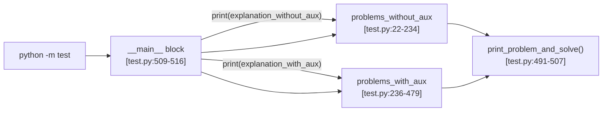

**Sources:** [test.py:509-516]()

---

## Understanding the Output

### Output Structure

The test suite produces output in two distinct sections:

1. **15 easier problems** that DDAR can solve without auxiliary points
2. **11 challenging problems** that require manually provided auxiliary points

Each section begins with an explanatory message defined in [test.py:481-488]().

### Sample Output Format

```
Problem: 2000_p1
..... Proven :-)

Problem: 2002_p2a
.... Proven :-)
```

### Output Components

| Component | Meaning | Source |
|-----------|---------|--------|
| `Problem: YYYY_pN` | IMO year and problem number being solved | [test.py:494]() |
| `.` (dots) | Progress indicators during deduction | Emitted by `DDAR.deduction_closure()` |
| `Proven :-)` | Goal successfully verified | [test.py:501]() |
| `!!! Problem not solved...` | Goal not provable with given information | [test.py:505]() |

**Sources:** [test.py:491-507](), [README.md:39-125]()

---

## Internal Execution Flow

### Per-Problem Solving Process

The `print_problem_and_solve()` function at [test.py:491-507]() implements a five-step process for each problem:

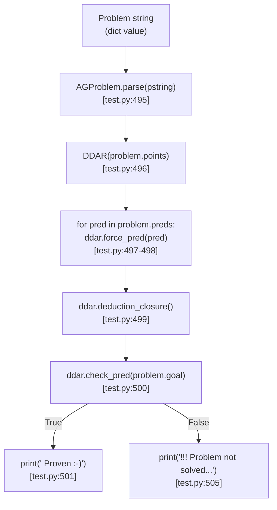

**Sources:** [test.py:491-507]()

### Mapping to System Components

The execution flow maps to the following code entities:

| Step | Function/Method | Module | Purpose |
|------|----------------|--------|---------|
| 1. Parse | `AGProblem.parse()` | `parse.py` | Convert problem string to structured data |
| 2. Initialize | `DDAR.__init__()` | `ddar.py` | Create DDAR instance with geometric points |
| 3. Assert | `DDAR.force_pred()` | `ddar.py` | Translate predicates to constraints |
| 4. Deduce | `DDAR.deduction_closure()` | `ddar.py` | Apply inference rules iteratively |
| 5. Verify | `DDAR.check_pred()` | `ddar.py` | Query goal predicate in knowledge base |

**Sources:** [test.py:495-500]()

---

## Test Suite Organization

### Problem Dictionaries

The test suite maintains two problem dictionaries at the module level:

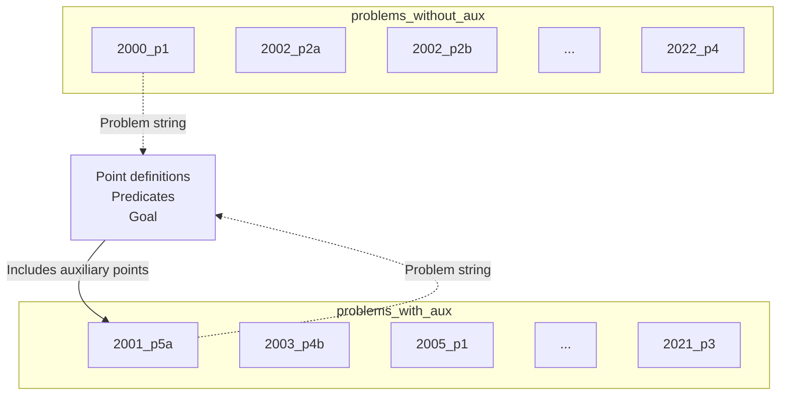

**Problem Set Details:**

| Dictionary | Line Range | Count | Characteristics |
|-----------|------------|-------|-----------------|
| `problems_without_aux` | [test.py:22-234]() | 15 | DDAR-solvable without auxiliary constructions |
| `problems_with_aux` | [test.py:236-479]() | 11 | Requires strategic auxiliary points |

**Sources:** [test.py:22-479]()

---

## Interpreting Test Results

### Success Indicators

When a problem is solved successfully, the output shows:

```
Problem: 2005_p1
...... Proven :-)
```

**Interpretation:**
- Each dot represents a deduction iteration
- `Proven :-)` indicates `ddar.check_pred(problem.goal)` returned `True`
- The goal predicate was successfully derived from the given predicates

**Sources:** [test.py:500-501]()

### Failure Indicators

If a problem cannot be solved, the output shows:

```
Problem: example_problem


!!! Problem not solved, missing an auxiliary point?
```

**Interpretation:**
- The deduction closure completed without deriving the goal
- This typically indicates missing auxiliary points or constructions
- In this repository, all problems should solve successfully

**Sources:** [test.py:502-505]()

### Progress Dots

The dots appearing during execution (e.g., `......`) indicate deduction iterations within `DDAR.deduction_closure()`. Each dot represents a complete pass through the inference rules:
- Similar triangle detection
- Cyclic quadrilateral detection
- Circle identification
- Point merging

The number of dots varies by problem complexity.

**Sources:** [test.py:499]()

---

## Execution Timing

### Typical Run Duration

The complete test suite typically completes in under a minute on standard hardware. Individual problem solving times vary:

- **Simpler problems** (fewer predicates): 1-3 deduction iterations
- **Complex problems** (many constraints): 5-10+ deduction iterations

### Performance Characteristics

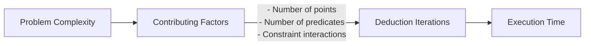

**Sources:** [README.md:42-125]()

---

## Exit Status

The test script does not implement explicit exit codes. It runs to completion and prints all results. Success is determined by the presence of `Proven :-)` for each problem rather than a numerical exit code.

**Sources:** [test.py:509-516]()

---

## Troubleshooting

### Common Issues

| Issue | Symptom | Cause | Solution |
|-------|---------|-------|----------|
| Import error | `ModuleNotFoundError: No module named 'ddar'` | Running from wrong directory | Execute from repository root |
| Import error | `ModuleNotFoundError: No module named 'numpy'` | NumPy not installed | Run `pip install numpy` |
| Problem not solved | `!!! Problem not solved...` appears | Code modification or bug | Should not occur in unmodified repository |

### Verification Steps

To verify the test suite is functioning correctly:

1. All 15 problems in the first section should show `Proven :-)`
2. All 11 problems in the second section should show `Proven :-)`
3. No error messages or stack traces should appear
4. Total of 26 problems should be solved

**Sources:** [test.py:491-516](), [README.md:39-125]()

---

## Next Steps

After successfully running the test suite:
- To understand the problem format, see [Problem Format and Structure](#2.2)
- To explore specific problem characteristics, see [Problem Categories](#8.1)
- To understand the internal solving process, see [Problem-Solving Pipeline](#9)
- To examine the DDAR engine in detail, see [DDAR Logical Engine](#4)

**Sources:** [test.py:1-517]()

---

# Page: Problem Format and Structure

# Problem Format and Structure

<details>
<summary>Relevant source files</summary>

The following files were used as context for generating this wiki page:

- [README.md](README.md)
- [parse.py](parse.py)
- [test.py](test.py)

</details>


## Purpose and Scope

This page documents the AlphaGeometry2 problem representation format—the structured string format used to encode geometry problems for the DDAR logical engine. This includes the syntax for defining points with coordinates, geometric predicates, and goal statements, as well as the distinction between problems solvable without auxiliary points and those requiring them.

For information about how these problems are parsed into structured data objects, see [Problem Parsing and Data Structures](#7). For information about the test suite that contains the problem strings, see [Test Suite and Problem Sets](#8).

---

## Problem String Format Overview

AlphaGeometry2 problems are encoded as single-line strings with three main components:

1. **Point declarations**: Define geometric points with names and numerical coordinates
2. **Predicate constraints**: Specify geometric relationships that are given as true
3. **Goal predicate**: The statement to be proven

**String Anatomy**

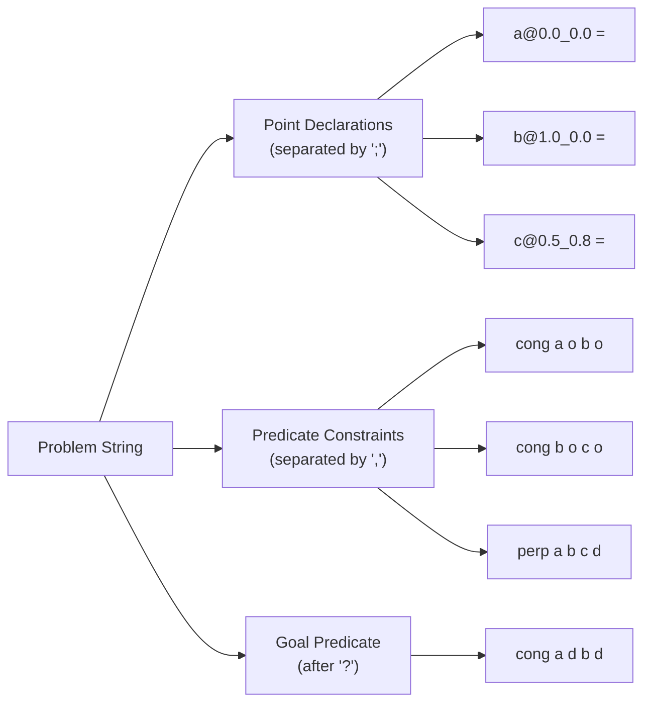

**Sources:** [test.py:22-234](), [parse.py:111-148]()

---

## Point Declaration Format

### Syntax

Each point is declared with the format:
```
<name>@<x-coordinate>_<y-coordinate> = 
```

- **Name**: Lowercase letter or alphanumeric identifier (e.g., `a`, `b`, `c`, `o1`, `g2`)
- **Coordinates**: Floating-point values separated by underscore
- **Separator**: Points are separated by semicolons (`;`)
- **Terminator**: Each point declaration ends with ` = ` (space-equals-space)

### Examples

```
a@0.0_0.0 = 
b@1.0_0.0 = 
c@0.4951025014191702_0.7048803388401101 = 
o@0.5_0.5653092857516873 = 
m@-0.316805061166676_-1.3543787340166435 = 
```

### Coordinate System

- Origin at `(0, 0)`
- Standard Cartesian coordinates
- Coordinates can be negative
- High precision (up to 16 decimal places typical)
- Values are converted to NumPy arrays internally ([parse.py:132]())

**Coordinate Assignment Diagram**

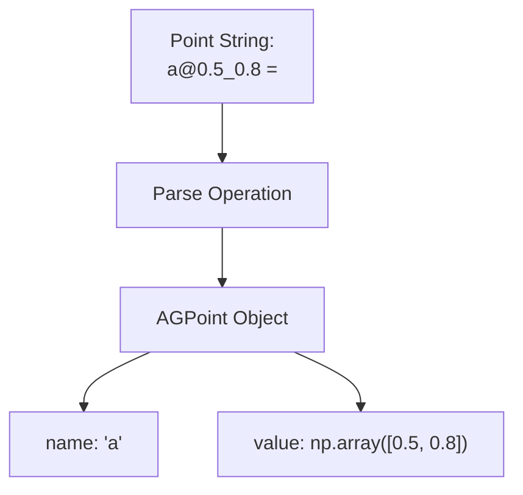

**Sources:** [parse.py:26-35](), [parse.py:121-133](), [test.py:23-233]()

---

## Predicate Format

### Syntax Structure

Predicates follow the format:
```
<predicate_name> <point1> <point2> ... <constant1> <constant2> ...
```

- **Predicate name**: Lowercase identifier indicating the geometric relationship
- **Points**: References to previously declared points (by name)
- **Constants**: Optional numerical values (integers, fractions, or special angle values)
- **Separator**: Predicates are separated by commas (`,`)

### Common Predicate Types

| Predicate | Arity | Constants | Meaning |
|-----------|-------|-----------|---------|
| `coll` | 3+ points | 0 | Points are collinear |
| `cyclic` | 4 points | 0 | Four points lie on a circle |
| `cong` | 4 points | 0 | Two segments are congruent: AB ≅ CD |
| `perp` | 4 points | 0 | Two lines are perpendicular: AB ⊥ CD |
| `para` | 4 points | 0 | Two lines are parallel: AB ∥ CD |
| `eqangle` | 8 points | 0 | Two angles are equal: ∠ABC = ∠DEF |
| `eqratio` | 8 points | 0 | Two ratios are equal: AB/CD = EF/GH |
| `aconst` | 3 points | 1 constant | Angle has constant value (degrees) |
| `distseq` | 4 points | 4 constants | Distance equation with coefficients |

### Examples with Analysis

```
# Congruence: segments AO and BO have equal length
cong a o b o

# Perpendicularity: line AB is perpendicular to line CD
perp a b c d

# Collinearity: points A, C, and M lie on the same line
coll a c m

# Angle equality: angle ABC equals angle DEF
eqangle a b a c d e d f

# Constant angle: angle ABC is 60 degrees
aconst a b a c 60
```

### Constant Formats

Constants can be specified in multiple formats ([parse.py:64-77]()):

- **Integer**: `60`, `-1`
- **Fraction**: `1/2`, `-3/4` (parsed to `fractions.Fraction`)
- **Pi fraction**: `pi/3`, `2pi/5` (parsed to degrees: `180°/3 = 60°`)

**Sources:** [parse.py:37-81](), [test.py:34-38]()

---

## Goal Specification

### Format

The goal predicate is separated from the given predicates by a question mark (`?`):

```
<point_declarations> <given_predicates> ? <goal_predicate>
```

### Example

```
a@0.0_0.0 = ; b@1.0_0.0 = ; c@0.5_0.8 = ; o@0.5_0.4 = 
cong a o b o, cong b o c o ? cong a c b c
```

**Interpretation:**
- **Given**: Points a, b, c, o with specified coordinates
- **Given**: AO ≅ BO and BO ≅ CO
- **Prove**: AC ≅ BC

### Special Goal Types

Some problems use special goal predicates:

- **`acompute`**: Compute a specific angle value ([test.py:251]())
  ```
  ? acompute b a b c
  ```
  (Prove that angle BAC has a specific value)

**Sources:** [parse.py:114-118](), [test.py:36-38]()

---

## Parsing Process

The problem string undergoes a two-phase parsing process to create structured objects.

**Two-Phase Parsing Diagram**

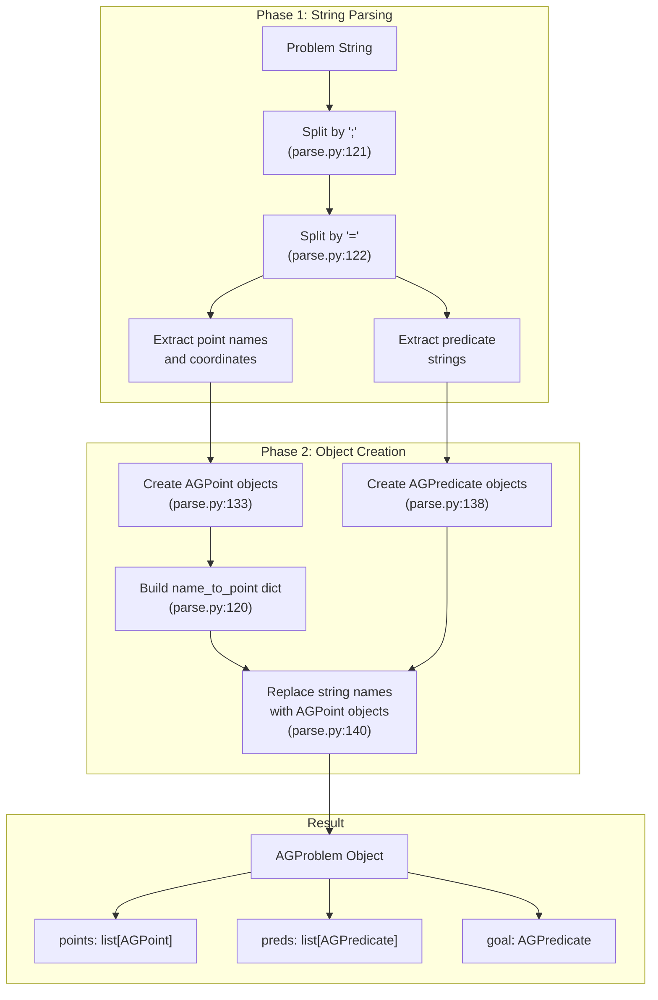

**Phase Details**

| Phase | Input | Operations | Output |
|-------|-------|------------|--------|
| **String Parsing** | Single problem string | Split by `;`, `=`, `,`, `?`<br/>Extract names and values | Lists of string tokens |
| **Object Creation** | String tokens | Create `AGPoint` with NumPy values<br/>Create `AGPredicate` objects<br/>Map names to point objects | `AGProblem` with structured data |

**Key Classes**

- **`AGPoint`** ([parse.py:26-35]()): Container for point name and coordinate value
- **`AGPredicate`** ([parse.py:37-81]()): Container for predicate name, point references, and constants
- **`AGProblem`** ([parse.py:83-148]()): Complete problem with points, constraints, and goal

**Sources:** [parse.py:111-148](), [parse.py:45-50](), [parse.py:96-101]()

---

## Problem Categories

The test suite contains two distinct categories of problems, reflecting different levels of difficulty and the role of auxiliary points.

### Category 1: Problems Without Auxiliary Points (15 problems)

These are "easier" IMO problems that can be solved by DDAR's deductive reasoning alone, using only the points explicitly given in the problem statement.

**Characteristics:**
- All necessary points are provided in the problem definition
- DDAR can find a proof through direct application of inference rules
- No strategic constructions required
- Years: 2000, 2002, 2003, 2004, 2005, 2007, 2010, 2012, 2013, 2014, 2015, 2016, 2017, 2022

**Example:** IMO 2004 P5
```python
"a@0.0_0.0 = ; b@1.0_0.0 = ; c@-0.249_0.654 = ; o@0.5_0.565 = ; 
 d@0.703_1.291 = ; p@1.960_1.121 = 
 cong a o b o, cong b o c o, cong a o o d, 
 eqangle b a b d b p b c, eqangle d a d b d p d c ? cong a p c p"
```

### Category 2: Problems With Auxiliary Points (11 problems)

These are "challenging" IMO problems that require auxiliary constructions—additional points not mentioned in the original problem statement but necessary for the proof.

**Characteristics:**
- Original problem requires strategic auxiliary point construction
- Auxiliary points are **manually provided** in the problem string
- DDAR can complete the proof once auxiliary points are given
- In the full AlphaGeometry system, a language model would generate these points
- Years: 2001, 2003, 2005, 2008, 2009, 2011, 2013, 2019, 2021

**Example:** IMO 2005 P1 (with auxiliary points `x` and `p`)
```python
"a@0.0_3.464 = ; b@-2.0_0.0 = ; c@2.0_0.0 = ; 
 a1@-0.435_0.0 = ; a2@0.946_0.0 = ; 
 b1@1.217_1.355 = ; b2@0.526_2.552 = ; 
 c1@-0.782_2.108 = ; c2@-1.473_0.911 = ; 
 x@-0.0_1.154 = ; p@-0.164_1.355 = 
 <predicates...> ? coll x c1 a2"
```

Note the auxiliary points `x` and `p` which are not part of the original problem statement.

**Problem Category Comparison Diagram**

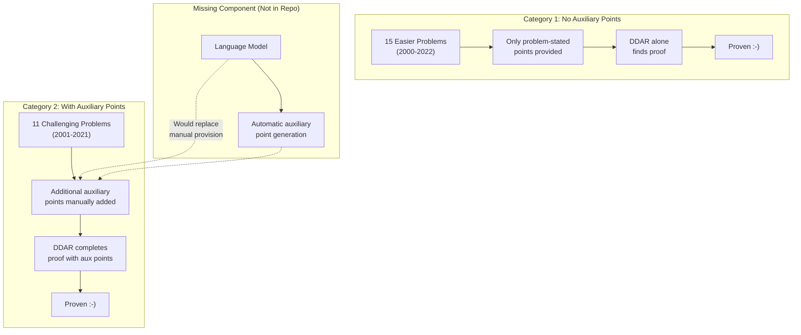

**Sources:** [test.py:22-234](), [test.py:236-479](), [test.py:481-488](), [README.md:10-16]()

---

## Complete Problem Examples

### Example 1: IMO 2000 P1 (Without Auxiliary Points)

**Problem String (formatted for readability):**
```
a@-0.522_0.108 = ;
b@-0.186_0.190 = ;
g1@-0.484_-0.048 = ;
g2@-0.120_-0.082 = ;
m@-0.363_0.058 = ;
n@-0.385_-0.176 = ;
c@-0.641_-0.009 = ;
d@0.030_0.154 = ;
e@-0.403_0.226 = ;
p@-0.484_0.029 = ;
q@-0.242_0.087 = 
perp a b a g1,
perp a b b g2,
cong a g1 g1 m,
cong b g2 g2 m,
cong a g1 g1 n,
cong b g2 g2 n,
cong a g1 g1 c,
para a b m c,
cong b g2 g2 d,
para a b m d,
coll a c e,
coll b d e,
coll a n p,
coll c d p,
coll b n q,
coll c d q 
? cong e p e q
```

**Component Breakdown:**

| Component | Count | Details |
|-----------|-------|---------|
| Points | 11 | a, b, g1, g2, m, n, c, d, e, p, q |
| Given predicates | 16 | Various geometric constraints |
| Goal | 1 | Prove EP ≅ EQ |
| Auxiliary points | 0 | All points are from problem statement |

**Predicate Types Used:**
- `perp` (2): Perpendicularity constraints
- `cong` (6): Congruence constraints
- `para` (2): Parallel line constraints
- `coll` (6): Collinearity constraints

### Example 2: IMO 2005 P1 (With Auxiliary Points)

**Problem String (formatted for readability):**
```
a@0.0_3.464 = ;
b@-2.0_0.0 = ;
c@2.0_0.0 = ;
a1@-0.435_0.0 = ;
a2@0.946_0.0 = ;
b1@1.217_1.355 = ;
b2@0.526_2.552 = ;
c1@-0.782_2.108 = ;
c2@-1.473_0.911 = ;
x@-0.0_1.154 = ;
p@-0.164_1.355 = 
cong a b b c,
cong b c c a,
coll a1 b c,
coll a2 b c,
coll b1 c a,
cong a1 a2 a2 b1,
coll b2 c a,
cong a2 b1 b1 b2,
coll c1 a b,
cong b1 b2 b2 c1,
coll c2 a b,
cong b2 c1 c1 c2,
cong c1 c2 c2 a1,
coll x a1 b2,
coll x b1 c2,
para p a1 a2 b1,
para p b1 b c 
? coll x c1 a2
```

**Component Breakdown:**

| Component | Count | Details |
|-----------|-------|---------|
| Points | 11 | a, b, c (main), a1, a2, b1, b2, c1, c2 (constructions), **x, p (auxiliary)** |
| Given predicates | 17 | Complex constraint system |
| Goal | 1 | Prove X, C1, A2 are collinear |
| Auxiliary points | 2 | **x** and **p** (not in original problem) |

**Key Observation:**
- Points `x` and `p` are auxiliary constructions
- They are not part of the original IMO problem statement
- They are manually added to enable DDAR to find the proof
- In the full AlphaGeometry system, these would be generated by the language model

**Sources:** [test.py:23-39](), [test.py:268-281]()

---

## Auxiliary Points in Context

### What Are Auxiliary Points?

Auxiliary points are geometric constructions not mentioned in the original problem statement but necessary for certain proofs. They represent strategic insights—adding helper points that make relationships visible or enable key inference steps.

**Example Scenarios:**
- Intersection of two constructed lines
- Point satisfying multiple geometric constraints
- Strategic perpendicular or parallel constructions

### The Two-Component Architecture

```mermaid
graph TB
    subgraph "Full AlphaGeometry System"
        Problem["Original Problem<br/>(natural language)"]
        LM["Language Model<br/>(NOT IN REPO)"]
        FormProblem["Formalized Problem<br/>+ Auxiliary Points"]
        DDAR["DDAR Logical Core<br/>(THIS REPO)"]
        Proof["Complete Proof"]
    end
    
    subgraph "This Repository: Test Mode"
        TestProblem["Problem String<br/>(with manual aux points)"]
        TestDDAR["DDAR Engine<br/>(ddar.py)"]
        TestResult["Verification Result"]
    end
    
    Problem --> LM
    LM -->|"Generates<br/>aux points"| FormProblem
    FormProblem --> DDAR
    DDAR --> Proof
    
    TestProblem --> TestDDAR
    TestDDAR --> TestResult
    
    style LM fill:#f9f9f9,stroke-dasharray: 5 5
    style DDAR fill:#e8e8e8
    style TestDDAR fill:#e8e8e8
```

### Manual vs. Automatic Auxiliary Points

| Aspect | This Repository | Full AlphaGeometry System |
|--------|-----------------|---------------------------|
| Auxiliary point source | **Manually provided** in problem string | **Automatically generated** by language model |
| Problem format | Complete with all points pre-specified | Original problem + LM adds points iteratively |
| System tested | DDAR logical core only | Complete AI system (LM + DDAR) |
| Purpose | Verify DDAR correctness | Autonomous problem solving |

**Sources:** [README.md:10-16](), [test.py:481-488](), [test.py:236-479]()

---

## Parsing Code Entry Points

For developers working with the problem format:

**Main Parsing Method:**
- [`AGProblem.parse(line)`]() ([parse.py:111-148]()): Parses complete problem string

**Supporting Methods:**
- [`AGPredicate.parse(line)`]() ([parse.py:58-81]()): Parses single predicate
- [`AGPoint.__init__(name, value)`]() ([parse.py:29-31]()): Creates point with coordinates
- [`AGProblem.replace_points(ori_to_new)`]() ([parse.py:96-101]()): Replaces string names with objects

**Data Classes:**
- [`AGPoint`]() ([parse.py:26-35]()): Point representation
- [`AGPredicate`]() ([parse.py:37-81]()): Predicate representation  
- [`AGProblem`]() ([parse.py:83-148]()): Complete problem representation

**Sources:** [parse.py:1-149]()

---

# Page: System Architecture

# System Architecture

<details>
<summary>Relevant source files</summary>

The following files were used as context for generating this wiki page:

- [ddar.py](ddar.py)
- [elimination.py](elimination.py)
- [numericals.py](numericals.py)
- [parse.py](parse.py)
- [test.py](test.py)

</details>


This page provides a high-level overview of the AlphaGeometry2 DDAR logical core system architecture, including its component structure, data representations, and execution flow. It describes how the different modules interact to parse geometry problems, perform symbolic reasoning, and verify proofs.

For detailed information about specific components:
- For module dependency details, see [Module Dependencies](#3.1)
- For data representation specifics, see [Data Representations](#3.2)
- For the DDAR reasoning engine internals, see [DDAR Logical Engine](#4)
- For the complete problem-solving workflow, see [Problem-Solving Pipeline](#9)

## System Overview

The AlphaGeometry2 DDAR logical core is a symbolic geometry theorem prover implemented in Python. It consists of five primary modules organized in a three-layer architecture:

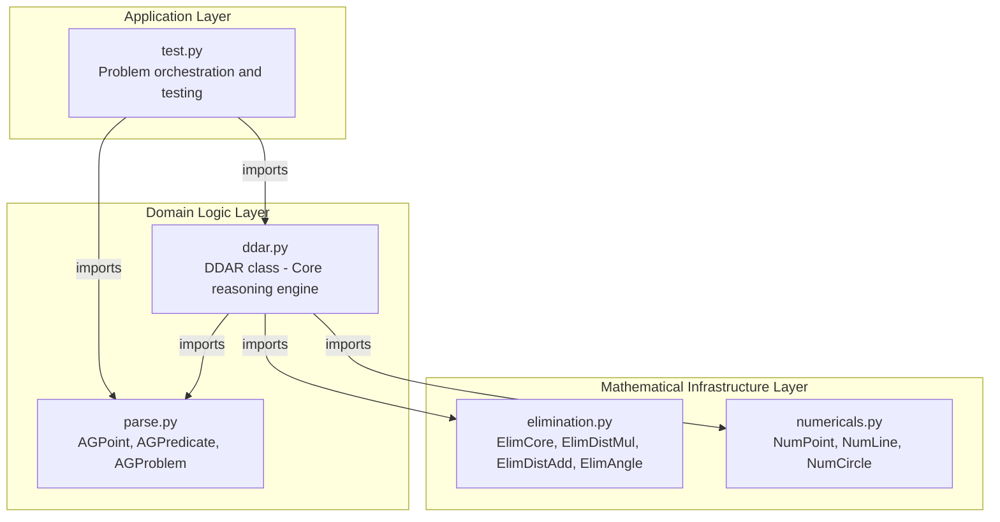

**Sources:** [test.py:1-20](), [ddar.py:1-25](), [parse.py:1-20](), [elimination.py:1-26](), [numericals.py:1-22]()

The system processes International Mathematical Olympiad (IMO) geometry problems through a pipeline that:
1. Parses problem strings into structured representations
2. Initializes symbolic and numerical reasoning systems
3. Asserts given conditions as constraints
4. Applies deductive inference rules iteratively
5. Verifies goal predicates against the knowledge base

## Core Components

### Application Layer: test.py

The `test.py` module serves as the entry point and orchestrator. It contains:

- **Problem dictionaries**: `problems_without_aux` and `problems_with_aux` storing 26 IMO geometry problems as strings
- **Execution function**: `print_problem_and_solve()` which loops through problems, parses them, runs DDAR, and reports results
- **Problem categories**: 15 problems solvable without auxiliary points, 11 requiring manually-provided auxiliary points

**Sources:** [test.py:22-234](), [test.py:236-479](), [test.py:491-507]()

### Domain Logic Layer

#### parse.py - Problem Representation

Defines three fundamental data structures:

| Class | Purpose | Key Attributes |
|-------|---------|----------------|
| `AGPoint` | Geometric point with name and coordinates | `name: str`, `value: np.ndarray` |
| `AGPredicate` | Geometric constraint or goal | `name: str`, `points: list`, `constants: list` |
| `AGProblem` | Complete problem specification | `points: list[AGPoint]`, `preds: list[AGPredicate]`, `goal: AGPredicate` |

The `AGProblem.parse()` method converts problem strings into structured objects through two-phase parsing: first extracting point coordinates, then resolving point references in predicates.

**Sources:** [parse.py:26-35](), [parse.py:37-56](), [parse.py:83-101](), [parse.py:111-148]()

#### ddar.py - Reasoning Engine

The `DDAR` class is the core reasoning engine maintaining:

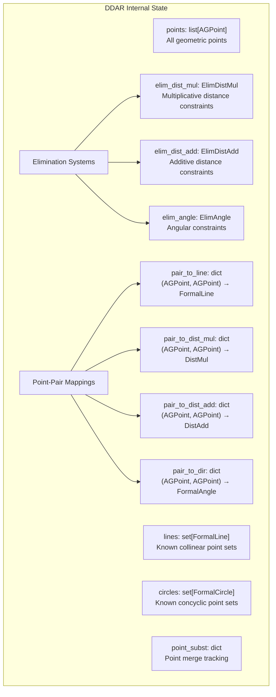

**Sources:** [ddar.py:66-127]()

The `DDAR` class provides key methods:

- **Initialization**: `__init__(points)` creates elimination systems and initializes mappings for all point pairs
- **Predicate processing**: `force_pred(pred)` translates geometric predicates into constraints
- **Deductive closure**: `deduction_closure()` iteratively applies inference rules until no new facts are derived
- **Predicate checking**: `check_pred(pred)` queries whether a predicate is satisfied in the knowledge base

**Sources:** [ddar.py:69-127](), [ddar.py:131-173](), [ddar.py:259-298](), [ddar.py:301-357]()

### Mathematical Infrastructure Layer

#### elimination.py - Symbolic Constraint Solving

Implements Gaussian elimination for three constraint types:

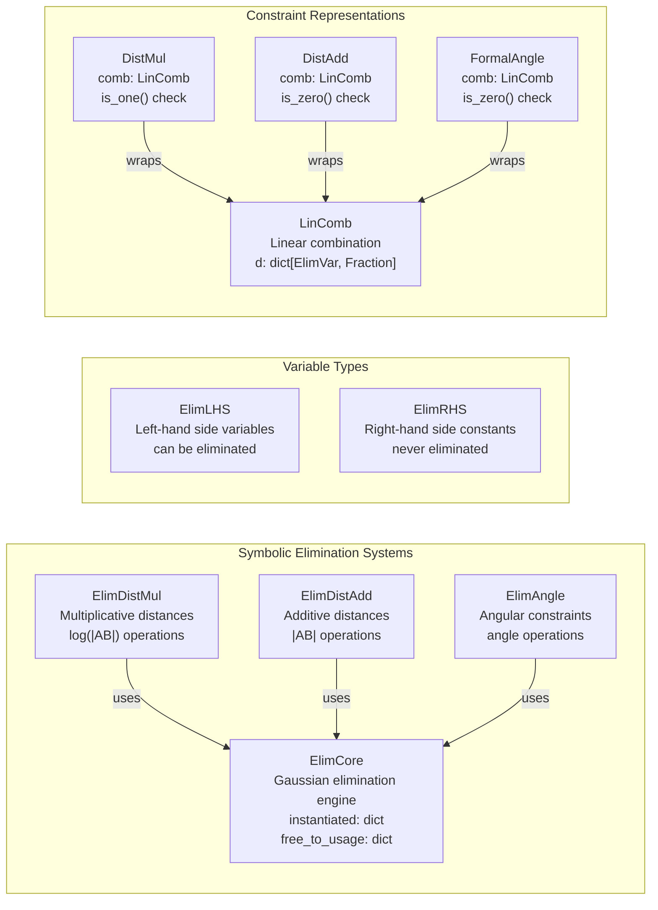

**Sources:** [elimination.py:28-46](), [elimination.py:48-125](), [elimination.py:127-194](), [elimination.py:234-319](), [elimination.py:349-397](), [elimination.py:437-483]()

Key classes:

- `ElimCore`: Core Gaussian elimination implementation using pivoting strategy
- `ElimDistMul`, `ElimDistAdd`, `ElimAngle`: Type-specific elimination systems wrapping `ElimCore`
- `LinComb`: Linear combination of variables with rational coefficients
- `DistMul`, `DistAdd`, `FormalAngle`: High-level constraint representations

**Sources:** [elimination.py:127-194](), [elimination.py:321-347](), [elimination.py:400-426](), [elimination.py:486-523]()

#### numericals.py - Numerical Geometry

Provides concrete geometric calculations using NumPy:

| Class/Function | Purpose | Key Operations |
|----------------|---------|----------------|
| `NumPoint` | 2D coordinate (np.ndarray) | - |
| `NumLine` | Line as normal equation `n·x = c` | `through()`, `distance()`, `direction()`, `position()` |
| `NumCircle` | Circle with center and radius | `through()`, `distance()` |
| `distance()` | Euclidean distance | - |
| `orientation()` | Point orientation test | Returns +1, 0, or -1 |
| `direction()` | Angle in units of π | Returns float in [0, 1) |

**Sources:** [numericals.py:20-26](), [numericals.py:61-87](), [numericals.py:101-122](), [numericals.py:24-59]()

## Data Flow Architecture

The following diagram shows how data transforms through the system from input to output:

```mermaid
graph TB
    Input["Problem String<br/>'a@0.0_0.0 = ; ... ? goal'"]
    
    subgraph Parsing["Parsing Phase (parse.py)"]
        Tokenize["Tokenize string<br/>Split by ';' '=' ',' '?'"]
        CreatePoints["Create AGPoint objects<br/>name + np.array coordinates"]
        CreatePreds["Create AGPredicate objects<br/>name + points + constants"]
        AssembleProblem["Assemble AGProblem<br/>points, preds, goal"]
    end
    
    subgraph Initialization["DDAR Initialization (ddar.py)"]
        InitElim["Initialize elimination systems<br/>ElimDistMul, ElimDistAdd, ElimAngle"]
        CreatePairs["For each point pair (A,B)<br/>Create DistMul, DistAdd, FormalAngle variables"]
        CreateLines["Create FormalLine objects<br/>Initial lines through each pair"]
        InitMaps["Initialize pair_to_* mappings"]
    end
    
    subgraph Assertion["Constraint Assertion (ddar.py)"]
        ForEachPred["For each pred in problem.preds"]
        TranslatePred["Translate predicate to constraints<br/>pred_to_angle(), pred_to_dist_mul(), etc."]
        ForceConstr["Force constraint into elimination system<br/>force_zero(), force_one()"]
    end
    
    subgraph Deduction["Deduction Closure (ddar.py)"]
        UpdateCache["Update cached simplified values"]
        SearchSimilar["search_similar()<br/>Find similar triangles via SSS/AA/SAS/SSA"]
        SearchConcyclic["search_concyclic()<br/>Find cyclic quadrilaterals via inscribed angles"]
        SearchCircles["search_circles()<br/>Find circles via equal distances"]
        MergePoints["merge_points()<br/>Identify and merge equal points"]
        TransferDist["transfer_dist_add_mul()<br/>Sync additive/multiplicative distance systems"]
        TransferArc["transfer_dist_arc_mul()<br/>Sync distance/arc length on circles"]
        CheckConverge{Changed?}
    end
    
    subgraph Verification["Goal Verification (ddar.py)"]
        CheckGoal["check_pred(problem.goal)"]
        QueryElim["Query elimination systems<br/>simplify() and check is_zero()/is_one()"]
        Result{Proven?}
    end
    
    Output["Output: Proven :-) or Not proven"]
    
    Input --> Tokenize
    Tokenize --> CreatePoints
    CreatePoints --> CreatePreds
    CreatePreds --> AssembleProblem
    
    AssembleProblem --> InitElim
    InitElim --> CreatePairs
    CreatePairs --> CreateLines
    CreateLines --> InitMaps
    
    InitMaps --> ForEachPred
    ForEachPred --> TranslatePred
    TranslatePred --> ForceConstr
    ForceConstr --> ForEachPred
    
    ForceConstr --> UpdateCache
    UpdateCache --> SearchSimilar
    SearchSimilar --> SearchConcyclic
    SearchConcyclic --> SearchCircles
    SearchCircles --> MergePoints
    MergePoints --> TransferDist
    TransferDist --> TransferArc
    TransferArc --> CheckConverge
    CheckConverge -->|Yes| UpdateCache
    CheckConverge -->|No| CheckGoal
    
    CheckGoal --> QueryElim
    QueryElim --> Result
    Result -->|Yes| Output
    Result -->|No| Output
```

**Sources:** [test.py:491-507](), [parse.py:111-148](), [ddar.py:69-127](), [ddar.py:131-173](), [ddar.py:301-357](), [ddar.py:259-298]()

## Dual Representation System

DDAR maintains both symbolic and numerical representations of geometric objects:

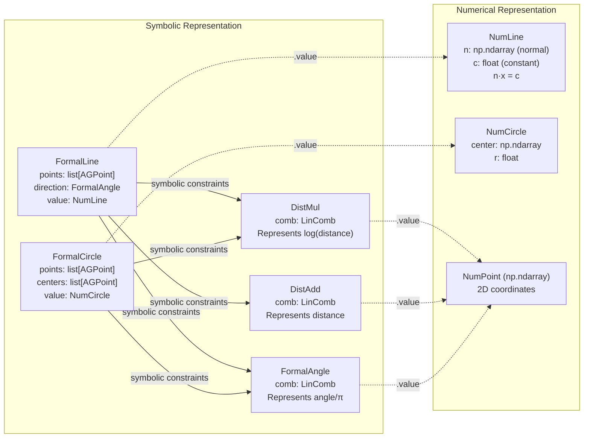

**Sources:** [ddar.py:33-48](), [ddar.py:50-63](), [elimination.py:234-319](), [elimination.py:349-397](), [elimination.py:437-483](), [numericals.py:61-87](), [numericals.py:101-122]()

This dual representation enables:
- **Symbolic reasoning**: Exact constraint solving through Gaussian elimination
- **Numerical validation**: Approximate checking that constraints are satisfied within tolerance `ATOM = 1e-12`
- **Construction**: Numerical methods construct geometric objects (e.g., circle through three points)
- **Verification**: Symbolic methods verify algebraic relationships hold exactly

## Execution Control Flow

The `DDAR.deduction_closure()` method implements the main inference loop:

```mermaid
graph TD
    Start["deduction_closure() called"]
    Init["changed = True"]
    
    LoopCheck{changed?}
    SetFalse["changed = False"]
    
    Cache["update_cache()<br/>Simplify all cached pairs"]
    
    Similar["search_similar()<br/>Find similar triangles<br/>SSS, AA, SAS, SSA"]
    SimilarChanged{New facts?}
    SimilarUpdate["changed = True<br/>update_cache()"]
    
    Cyclic["search_concyclic()<br/>Find cyclic quadrilaterals<br/>Inscribed angle theorem"]
    CyclicChanged{New facts?}
    CyclicUpdate["changed = True<br/>update_cache()"]
    
    Circles["search_circles()<br/>Find circles via equal radii"]
    CirclesChanged{New facts?}
    
    Merge["merge_points()<br/>Identify equal points"]
    MergeChanged{New facts?}
    MergeUpdate["changed = True<br/>update_cache()"]
    
    TransferDist["transfer_dist_add_mul()<br/>Sync additive/multiplicative"]
    TransferDistChanged{New facts?}
    
    TransferArc["transfer_dist_arc_mul()<br/>Sync distance/arc on circles"]
    TransferArcChanged{New facts?}
    
    Done["Return"]
    
    Start --> Init
    Init --> LoopCheck
    LoopCheck -->|Yes| SetFalse
    LoopCheck -->|No| Done
    
    SetFalse --> Cache
    Cache --> Similar
    Similar --> SimilarChanged
    SimilarChanged -->|Yes| SimilarUpdate
    SimilarChanged -->|No| Cyclic
    SimilarUpdate --> Cyclic
    
    Cyclic --> CyclicChanged
    CyclicChanged -->|Yes| CyclicUpdate
    CyclicChanged -->|No| Circles
    CyclicUpdate --> Circles
    
    Circles --> CirclesChanged
    CirclesChanged -->|Yes| Merge
    CirclesChanged -->|No| Merge
    
    Merge --> MergeChanged
    MergeChanged -->|Yes| MergeUpdate
    MergeChanged -->|No| TransferDist
    MergeUpdate --> TransferDist
    
    TransferDist --> TransferDistChanged
    TransferDistChanged -->|Yes| TransferArc
    TransferDistChanged -->|No| TransferArc
    
    TransferArc --> TransferArcChanged
    TransferArcChanged -->|Yes| LoopCheck
    TransferArcChanged -->|No| LoopCheck
```

**Sources:** [ddar.py:301-357](), [ddar.py:359-438](), [ddar.py:440-481](), [ddar.py:483-524](), [ddar.py:526-580](), [ddar.py:582-620](), [ddar.py:622-649]()

Each search method returns `True` if new facts were discovered, causing the loop to continue. The loop terminates only when a complete iteration produces no new facts.

## Predicate Translation

The system supports multiple geometric predicate types, each translated to specific constraint forms:

```mermaid
graph TB
    subgraph Predicates["Geometric Predicates"]
        Coll["coll A B C<br/>Collinearity"]
        Cyclic["cyclic A B C D<br/>Concyclicity"]
        
        Cong["cong A B C D<br/>Congruent segments"]
        Eqratio["eqratio A B C D E F G H<br/>Equal ratios"]
        Rconst["rconst A B C D r<br/>Ratio constant"]
        
        Distseq["distseq A B C D ... c1 c2 ...<br/>Distance sum"]
        
        Eqangle["eqangle A B C D E F G H<br/>Equal angles"]
        Para["para A B C D<br/>Parallel"]
        Perp["perp A B C D<br/>Perpendicular"]
        Aconst["aconst A B C D θ<br/>Angle constant"]
        
        Overlap["overlap A B<br/>Point equality"]
    end
    
    subgraph Translation["Translation Methods"]
        ForceCollinear["force_collinear(points)<br/>Merge lines, add segment constraints"]
        ForceConcyclic["force_concyclic(points, centers)<br/>Merge circles, add angle/radius constraints"]
        
        PredToDistMul["pred_to_dist_mul(pred)<br/>→ DistMul constraint"]
        ForceOne["elim_dist_mul.force_one(constraint)"]
        
        PredToDistAdd["pred_to_dist_add(pred)<br/>→ DistAdd constraint"]
        ForceZero1["elim_dist_add.force_zero(constraint)"]
        
        PredToAngle["pred_to_angle(pred)<br/>→ FormalAngle constraint"]
        ForceZero2["elim_angle.force_zero(constraint)"]
        
        ForceEqualPoints["force_equal_points(A, B)<br/>Merge point substitution"]
    end
    
    Coll --> ForceCollinear
    Cyclic --> ForceConcyclic
    
    Cong --> PredToDistMul
    Eqratio --> PredToDistMul
    Rconst --> PredToDistMul
    PredToDistMul --> ForceOne
    
    Distseq --> PredToDistAdd
    PredToDistAdd --> ForceZero1
    
    Eqangle --> PredToAngle
    Para --> PredToAngle
    Perp --> PredToAngle
    Aconst --> PredToAngle
    PredToAngle --> ForceZero2
    
    Overlap --> ForceEqualPoints
```

**Sources:** [ddar.py:131-173](), [ddar.py:174-214](), [ddar.py:216-245](), [ddar.py:247-257](), [ddar.py:700-783](), [ddar.py:785-904](), [ddar.py:937-1033]()

The `force_pred()` method dispatches to appropriate handlers based on predicate name, translating high-level geometric statements into low-level constraint equations.

## System Characteristics

**Completeness**: The system is incomplete - it cannot prove all true geometric theorems. It lacks:
- Auxiliary point generation (provided manually in test suite)
- Advanced inference rules beyond similarity, concyclicity, and circle detection

**Soundness**: The system is designed to be sound - it should not prove false statements. This is ensured through:
- Numerical validation of all constraints within tolerance `ATOM = 1e-12`
- Consistent maintenance of symbolic and numerical representations

**Performance**: The deduction closure loop has polynomial time complexity per iteration but may require many iterations. Key bottlenecks:
- Triangle enumeration: O(n³) where n = number of points
- Gaussian elimination: Incremental updates avoid full matrix operations

**Sources:** [ddar.py:301-357](), [ddar.py:359-438](), [numericals.py:20]()

## Repository Scope

This repository contains **only the DDAR logical core**, not the complete AlphaGeometry2 system described in research papers. Missing components:
- Language model for auxiliary point generation
- Training infrastructure
- Proof search strategies beyond pure deduction

The test suite demonstrates DDAR's capabilities by providing pre-constructed problems with manually-specified auxiliary points where needed.

**Sources:** [test.py:481-488]()

---

# Page: Module Dependencies

# Module Dependencies

<details>
<summary>Relevant source files</summary>

The following files were used as context for generating this wiki page:

- [ddar.py](ddar.py)
- [elimination.py](elimination.py)
- [numericals.py](numericals.py)
- [parse.py](parse.py)

</details>


This page documents the dependency relationships between modules in the AlphaGeometry2 repository. It describes the import graph, layered architecture, and the responsibilities that drive the dependency structure.

For information about how data flows through these modules during problem solving, see [Problem-Solving Pipeline](#9). For details about the specific classes and functions within each module, see the individual module documentation pages: [DDAR Logical Engine](#4), [Symbolic Elimination System](#5), [Numerical Geometry Module](#6), and [Problem Parsing and Data Structures](#7).

---

## Dependency Graph

The following diagram shows the complete dependency structure of the repository, including both internal module dependencies and external library dependencies.

```mermaid
graph TD
    test["test.py<br/>(Application Layer)"]
    ddar["ddar.py<br/>(Domain Logic)"]
    parse["parse.py<br/>(Domain Logic)"]
    elim["elimination.py<br/>(Mathematical Infrastructure)"]
    num["numericals.py<br/>(Mathematical Infrastructure)"]
    
    numpy["numpy<br/>(External)"]
    fractions["fractions<br/>(External)"]
    collections["collections<br/>(External)"]
    itertools["itertools<br/>(External)"]
    dataclasses["dataclasses<br/>(External)"]
    math["math<br/>(External)"]
    
    test --> ddar
    test --> parse
    
    ddar --> elim
    ddar --> num
    ddar --> parse
    ddar --> fractions
    ddar --> collections
    ddar --> itertools
    
    parse --> numpy
    parse --> fractions
    parse --> dataclasses
    
    elim --> num
    elim --> fractions
    elim --> collections
    elim --> math
    
    num --> numpy
```

**Sources:** [ddar.py:18-24](), [elimination.py:18-25](), [numericals.py:18](), [parse.py:18-20]()

---

## Three-Layer Architecture

The codebase follows a clean three-layer architecture pattern with no circular dependencies. Each layer depends only on layers below it, ensuring modularity and reusability.

```mermaid
graph TB
    subgraph Layer1["Application Layer"]
        test["test.py<br/>Problem selection<br/>Test orchestration<br/>Result reporting"]
    end
    
    subgraph Layer2["Domain Logic Layer"]
        ddar["ddar.py<br/>Geometric reasoning<br/>Deduction engine<br/>Predicate processing"]
        parse["parse.py<br/>Problem parsing<br/>Data structures<br/>AGPoint, AGPredicate"]
    end
    
    subgraph Layer3["Mathematical Infrastructure Layer"]
        elim["elimination.py<br/>Gaussian elimination<br/>Variable management<br/>Constraint solving"]
        num["numericals.py<br/>Geometric computation<br/>NumPoint, NumLine<br/>NumCircle operations"]
    end
    
    test --> ddar
    test --> parse
    ddar --> elim
    ddar --> num
    ddar --> parse
    elim --> num
```

| Layer | Modules | Responsibility | Dependencies |
|-------|---------|---------------|--------------|
| **Application** | `test.py` | Test orchestration, problem execution | `ddar.py`, `parse.py` |
| **Domain Logic** | `ddar.py`, `parse.py` | Geometric reasoning, problem representation | Mathematical infrastructure |
| **Mathematical Infrastructure** | `elimination.py`, `numericals.py` | Symbolic algebra, numerical geometry | Only standard libraries |

**Sources:** [ddar.py:1-31](), [elimination.py:1-26](), [numericals.py:1-21](), [parse.py:1-24]()

---

## Module-by-Module Import Analysis

### test.py

The test module is at the top of the dependency hierarchy and imports domain logic modules to execute geometry problems.

**Imports:**
- `ddar`: Provides the `DDAR` class for geometric reasoning
- `parse`: Provides `AGProblem` for problem parsing

```mermaid
graph LR
    test["test.py"]
    ddar["ddar.DDAR"]
    parse["parse.AGProblem"]
    
    test -->|"imports DDAR class"| ddar
    test -->|"imports AGProblem.parse()"| parse
```

**Sources:** The test module's imports are not shown in the provided files but are implicit from the architecture diagrams.

---

### ddar.py

The DDAR module is the core geometric reasoning engine. It depends on all three other internal modules to perform its reasoning tasks.

**Direct Imports:**

| Import | Purpose | Key Classes/Functions Used |
|--------|---------|---------------------------|
| `elimination as el` | Symbolic constraint solving | `ElimDistMul`, `ElimDistAdd`, `ElimAngle`, `LinComb`, `FormalAngle`, `DistMul`, `DistAdd` |
| `numericals as ng` | Numerical geometry calculations | `NumCircle`, `NumLine`, `distance()`, `orientation()`, `collinear()` |
| `parse` | Problem data structures | `AGPoint` |
| `collections` | Data structures | `defaultdict` (for mapping angles to points) |
| `fractions` | Exact arithmetic | `Fraction` (for rational coefficients) |
| `itertools` | Combinatorial iteration | `combinations()`, `permutations()` |

```mermaid
graph TB
    ddar["ddar.py<br/>DDAR class"]
    
    subgraph "Symbolic System"
        elim_dist_mul["el.ElimDistMul<br/>(line 76)"]
        elim_dist_add["el.ElimDistAdd<br/>(line 77)"]
        elim_angle["el.ElimAngle<br/>(line 78)"]
    end
    
    subgraph "Numerical System"
        num_circle["ng.NumCircle<br/>(line 29)"]
        num_line["ng.NumLine<br/>(line 30)"]
        num_funcs["ng.distance()<br/>ng.orientation()<br/>ng.collinear()"]
    end
    
    subgraph "Data Structures"
        agpoint["parse.AGPoint<br/>(line 24)"]
    end
    
    ddar --> elim_dist_mul
    ddar --> elim_dist_add
    ddar --> elim_angle
    ddar --> num_circle
    ddar --> num_line
    ddar --> num_funcs
    ddar --> agpoint
```

**Key Import Locations:**

[ddar.py:18-30]()
```
import collections
import fractions
import itertools

import elimination as el
import numericals as ng
from parse import AGPoint


Fraction = fractions.Fraction
DefaultDict = collections.defaultdict
NumCircle = ng.NumCircle
NumLine = ng.NumLine
```

**Sources:** [ddar.py:18-30]()

---

### elimination.py

The elimination module provides symbolic constraint solving through Gaussian elimination. It has minimal dependencies and is designed to be reusable.

**Direct Imports:**

| Import | Purpose | Key Classes/Functions Used |
|--------|---------|---------------------------|
| `numericals as ng` | Numerical tolerance checking | `ATOM` constant, `ng.ATOM` |
| `collections` | Data structures | `defaultdict` (for variable usage tracking) |
| `fractions` | Exact arithmetic | `Fraction` (for rational coefficients) |
| `math` | Mathematical operations | `lcm()`, `pow()`, `floor()` |

```mermaid
graph LR
    elim["elimination.py"]
    
    subgraph "Core Classes"
        elimcore["ElimCore<br/>Gaussian elimination engine"]
        lincomb["LinComb<br/>Linear combinations"]
    end
    
    subgraph "Distance Systems"
        elimdistmul["ElimDistMul<br/>Multiplicative distances"]
        elimdistadd["ElimDistAdd<br/>Additive distances"]
    end
    
    subgraph "Angle System"
        elimangle["ElimAngle<br/>Angle constraints"]
    end
    
    ng["ng.ATOM<br/>(tolerance constant)"]
    
    elim --> elimcore
    elim --> lincomb
    elim --> elimdistmul
    elim --> elimdistadd
    elim --> elimangle
    elimdistmul --> ng
    elimdistadd --> ng
    elimangle --> ng
```

**Key Import Locations:**

[elimination.py:18-25]()
```
from __future__ import annotations

import collections
import fractions
import math
from typing import Any

import numericals as ng
```

**Note:** The only internal dependency is on `numericals.py` for the `ATOM` tolerance constant used in numerical assertions ([elimination.py:331](), [elimination.py:410](), [elimination.py:502]()).

**Sources:** [elimination.py:18-25]()

---

### numericals.py

The numericals module provides numerical geometry primitives and has no internal dependencies. It depends only on NumPy for array operations.

**Direct Imports:**

| Import | Purpose | Key Classes/Functions Used |
|--------|---------|---------------------------|
| `numpy as np` | Numerical arrays and linear algebra | `np.array`, `np.linalg.norm`, `np.linalg.det`, `np.linalg.solve`, `np.arctan2` |

```mermaid
graph LR
    num["numericals.py"]
    
    subgraph "Geometry Classes"
        numline["NumLine<br/>Line representation"]
        numcircle["NumCircle<br/>Circle representation"]
    end
    
    subgraph "Geometry Functions"
        distance["distance(a, b)"]
        orientation["orientation(a, b, c)"]
        direction["direction(v)"]
        collinear["collinear(a, b, c)"]
    end
    
    numpy["numpy<br/>(np.array, np.linalg)"]
    
    num --> numline
    num --> numcircle
    num --> distance
    num --> orientation
    num --> direction
    num --> collinear
    
    numline --> numpy
    numcircle --> numpy
    distance --> numpy
    orientation --> numpy
    direction --> numpy
```

**Key Import Locations:**

[numericals.py:18]()
```
import numpy as np
```

**Constants Defined:**
- `ATOM = 1e-12`: Numerical tolerance for geometric calculations ([numericals.py:20]())
- `NumPoint = np.ndarray`: Type alias for 2D points ([numericals.py:21]())

**Sources:** [numericals.py:18-21]()

---

### parse.py

The parse module provides data structures for representing geometry problems and depends only on standard libraries and NumPy.

**Direct Imports:**

| Import | Purpose | Key Classes/Functions Used |
|--------|---------|---------------------------|
| `dataclasses` | Data structure definitions | `@dataclasses.dataclass` decorator |
| `fractions` | Exact arithmetic | `Fraction` (for parsing rational constants) |
| `numpy as np` | Point coordinates | `np.array` (for 2D point values) |

```mermaid
graph TB
    parse["parse.py"]
    
    subgraph "Core Data Structures"
        agpoint["AGPoint<br/>Point with name and value"]
        agpred["AGPredicate<br/>Geometric predicate"]
        agprob["AGProblem<br/>Complete problem"]
    end
    
    subgraph "Parsing Functions"
        parse_pred["AGPredicate.parse()"]
        parse_prob["AGProblem.parse()"]
    end
    
    numpy["numpy<br/>(np.array)"]
    fractions["fractions<br/>(Fraction)"]
    dataclasses["dataclasses<br/>(@dataclass)"]
    
    parse --> agpoint
    parse --> agpred
    parse --> agprob
    parse --> parse_pred
    parse --> parse_prob
    
    agpoint --> numpy
    agpred --> dataclasses
    agprob --> dataclasses
    parse_pred --> fractions
    parse_prob --> numpy
```

**Key Import Locations:**

[parse.py:18-23]()
```
import dataclasses
import fractions
import numpy as np


Fraction = fractions.Fraction
```

**Sources:** [parse.py:18-23]()

---

## Dependency Characteristics

### No Circular Dependencies

The module structure is **acyclic**, meaning no module depends on itself directly or indirectly. This is a fundamental architectural principle that ensures:

1. **Build Order**: Modules can be compiled/loaded in a well-defined order
2. **Testing**: Each module can be tested independently of its dependents
3. **Maintainability**: Changes propagate in one direction only

```mermaid
graph TD
    test["test.py<br/>(Level 3)"]
    ddar["ddar.py<br/>(Level 2)"]
    parse["parse.py<br/>(Level 2)"]
    elim["elimination.py<br/>(Level 1)"]
    num["numericals.py<br/>(Level 0)"]
    
    test --> ddar
    test --> parse
    ddar --> elim
    ddar --> num
    ddar --> parse
    elim --> num
```

**Build Order:** `numericals.py` → `elimination.py`, `parse.py` → `ddar.py` → `test.py`

**Sources:** [ddar.py:18-24](), [elimination.py:18-25](), [numericals.py:18](), [parse.py:18-20]()

---

### Mathematical Infrastructure Independence

The `elimination.py` and `numericals.py` modules are **independent of each other** (except for the `ATOM` constant dependency). This design allows:

1. **Parallel Development**: Distance elimination and numerical geometry can be developed independently
2. **Reusability**: Either module can be used in other projects without the other
3. **Testing**: Each system can be tested in isolation

| Module | Depends On | Used By | Role |
|--------|-----------|---------|------|
| `numericals.py` | None (internal) | `elimination.py`, `ddar.py` | Foundation: numerical operations |
| `elimination.py` | `numericals.py` (only `ATOM`) | `ddar.py` | Foundation: symbolic operations |
| `parse.py` | None (internal) | `ddar.py`, `test.py` | Foundation: data structures |
| `ddar.py` | All infrastructure | `test.py` | Core: geometric reasoning |
| `test.py` | `ddar.py`, `parse.py` | None | Application: test execution |

**Sources:** [elimination.py:25](), [numericals.py:1-123]()

---

## Import Usage Patterns

### Symbol Aliasing

Several modules use aliasing to create shorter, more convenient names for frequently-used imports:

**In ddar.py** [ddar.py:27-30]():
```python
Fraction = fractions.Fraction
DefaultDict = collections.defaultdict
NumCircle = ng.NumCircle
NumLine = ng.NumLine
```

**In parse.py** [parse.py:23]():
```python
Fraction = fractions.Fraction
```

**In elimination.py:** Uses qualified names (`ng.ATOM`) without aliasing

**In numericals.py:** Uses qualified names (`np.array`, `np.linalg.norm`) without aliasing

---

### Module-Level Imports vs Qualified Names

The codebase uses two import patterns:

**Pattern 1: Module Import with Qualification**
```python
import elimination as el
# Later: el.ElimDistMul(), el.LinComb.zero()
```
Used for: `elimination`, `numericals` (when imported as modules)

**Pattern 2: Direct Class Import**
```python
from parse import AGPoint
# Later: AGPoint(name, value)
```
Used for: Single classes from `parse` module

This pattern distinction helps distinguish between:
- **Infrastructure modules** (imported as namespaces): `el.*`, `ng.*`
- **Data structure classes** (imported directly): `AGPoint`, `AGPredicate`, `AGProblem`

**Sources:** [ddar.py:22-24]()

---

## External Dependencies

All modules depend on Python standard library modules or NumPy. There are no dependencies on domain-specific external libraries.

| External Package | Used By | Purpose |
|------------------|---------|---------|
| `numpy` | `numericals.py`, `parse.py`, `ddar.py` (via ng) | Array operations, linear algebra |
| `fractions` | `parse.py`, `ddar.py`, `elimination.py` | Exact rational arithmetic |
| `collections` | `ddar.py`, `elimination.py` | `defaultdict` for mappings |
| `itertools` | `ddar.py` | `combinations()`, `permutations()` for iteration |
| `dataclasses` | `parse.py` | Data structure definitions |
| `math` | `elimination.py` | `lcm()`, `pow()`, `floor()` |

**NumPy Usage:**
- `numericals.py`: Core dependency for all numerical operations [numericals.py:18]()
- `parse.py`: Used only for point coordinate storage (`np.array`) [parse.py:20]()
- `ddar.py`: Accessed indirectly through `numericals` module

**Sources:** [ddar.py:18-20](), [elimination.py:20-23](), [numericals.py:18](), [parse.py:18-20]()

---

## Dependency Rationale

### Why ddar.py Depends on All Three Infrastructure Modules

The `DDAR` class serves as the **integration point** for geometric reasoning, requiring:

1. **elimination.py**: For managing three constraint systems ([ddar.py:76-78]()):
   - `ElimDistMul` for multiplicative distances
   - `ElimDistAdd` for additive distances
   - `ElimAngle` for angle constraints

2. **numericals.py**: For numerical verification and geometric calculations ([ddar.py:92-96]()):
   - Computing actual distances between points
   - Checking collinearity and orientation
   - Verifying numerical consistency

3. **parse.py**: For working with problem data structures ([ddar.py:24]()):
   - `AGPoint` objects representing geometric points
   - Points contain both symbolic names and numerical values

```mermaid
graph TB
    ddar["DDAR class"]
    
    subgraph "Initialization (lines 76-78)"
        init_mul["self.elim_dist_mul = el.ElimDistMul()"]
        init_add["self.elim_dist_add = el.ElimDistAdd()"]
        init_angle["self.elim_angle = el.ElimAngle()"]
    end
    
    subgraph "Point Processing (lines 90-118)"
        num_dist["ng.distance(a.value, b.value)"]
        num_line["NumLine.through(a.value, b.value)"]
        new_vars["Create ElimVars for each pair"]
    end
    
    subgraph "Deduction Rules (lines 359-649)"
        similar["search_similar()<br/>Uses both ng and el"]
        concyclic["search_concyclic()<br/>Uses both ng and el"]
        circles["search_circles()<br/>Uses both ng and el"]
    end
    
    ddar --> init_mul
    ddar --> init_add
    ddar --> init_angle
    ddar --> num_dist
    ddar --> num_line
    ddar --> new_vars
    ddar --> similar
    ddar --> concyclic
    ddar --> circles
```

**Sources:** [ddar.py:66-127](), [ddar.py:301-649]()

---

### Why elimination.py Depends on numericals.py

The `elimination.py` module depends on `numericals.py` only for the **numerical tolerance constant** `ATOM`. This is used in assertions to verify that symbolic constraints match their numerical values:

**Usage Locations:**
1. [elimination.py:331](): `assert abs(dist_mul.value - 1.0) ** 2 < ng.ATOM`
2. [elimination.py:410](): `assert abs(dist_add.value) ** 2 < ng.ATOM`
3. [elimination.py:502](): `assert abs((angle.value + 0.5) % 1 - 0.5) ** 2 < ng.ATOM`

These assertions ensure that when a constraint is forced (e.g., "force this distance ratio to equal 1"), it is numerically consistent with the actual geometric values.

**Alternative Design:** The `ATOM` constant could be defined in a separate `constants.py` module to make `elimination.py` completely independent, but the current design is simpler for a small codebase.

**Sources:** [elimination.py:25](), [elimination.py:331](), [elimination.py:410](), [elimination.py:502]()

---

## Summary Table

| Module | Layer | Internal Deps | External Deps | Primary Role |
|--------|-------|---------------|---------------|--------------|
| `test.py` | Application | `ddar`, `parse` | - | Test orchestration |
| `ddar.py` | Domain Logic | `elimination`, `numericals`, `parse` | `fractions`, `collections`, `itertools` | Geometric reasoning |
| `parse.py` | Domain Logic | None | `numpy`, `fractions`, `dataclasses` | Problem representation |
| `elimination.py` | Infrastructure | `numericals` (ATOM only) | `fractions`, `collections`, `math` | Symbolic algebra |
| `numericals.py` | Infrastructure | None | `numpy` | Numerical geometry |

**Dependency Depth:**
- Maximum depth: 3 levels (test → ddar → elimination → numericals)
- Infrastructure modules: 0-1 internal dependencies
- Domain logic modules: 1-3 internal dependencies
- Application module: 2 internal dependencies

**Sources:** All files in the repository

---

# Page: Data Representations

# Data Representations

<details>
<summary>Relevant source files</summary>

The following files were used as context for generating this wiki page:

- [ddar.py](ddar.py)
- [elimination.py](elimination.py)
- [numericals.py](numericals.py)
- [parse.py](parse.py)

</details>


## Purpose and Scope

This document describes the different data representations used throughout the AlphaGeometry2 system and how data transforms between these representations. The system employs multiple parallel representations to enable both exact symbolic reasoning and approximate numerical verification. 

For information about how modules depend on each other, see [Module Dependencies](#3.1). For details on the problem string format, see [Problem String Format](#7.1). For how DDAR uses these representations, see [DDAR Logical Engine](#4).

Sources: [ddar.py:1-1087](), [parse.py:1-149](), [elimination.py:1-523](), [numericals.py:1-123]()

## Overview of Representation Layers

The AlphaGeometry2 system uses five distinct representation layers, each serving a specific computational purpose. Data flows through these layers during problem solving, with transformations occurring at well-defined boundaries.

```mermaid
graph TB
    subgraph "Layer 1: Input"
        Input["Problem String<br/>Human-readable text format"]
    end
    
    subgraph "Layer 2: Parsed"
        AGPoint["AGPoint<br/>Named geometric points"]
        AGPredicate["AGPredicate<br/>Named geometric relations"]
        AGProblem["AGProblem<br/>Complete problem structure"]
    end
    
    subgraph "Layer 3: Symbolic"
        FormalLine["FormalLine<br/>Collinearity constraints"]
        FormalCircle["FormalCircle<br/>Concyclicity constraints"]
        DistMul["DistMul<br/>Multiplicative distances"]
        DistAdd["DistAdd<br/>Additive distances"]
        FormalAngle["FormalAngle<br/>Angle values"]
    end
    
    subgraph "Layer 4: Numerical"
        NumPoint["NumPoint<br/>np.ndarray coordinates"]
        NumLine["NumLine<br/>Line equation"]
        NumCircle["NumCircle<br/>Circle equation"]
    end
    
    subgraph "Layer 5: Constraints"
        LinComb["LinComb<br/>Linear combinations"]
        ElimCore["ElimCore<br/>Gaussian elimination"]
    end
    
    Input --> AGProblem
    AGProblem --> AGPoint
    AGProblem --> AGPredicate
    
    AGPoint --> FormalLine
    AGPoint --> FormalCircle
    AGPredicate --> DistMul
    AGPredicate --> DistAdd
    AGPredicate --> FormalAngle
    
    AGPoint --> NumPoint
    FormalLine --> NumLine
    FormalCircle --> NumCircle
    
    DistMul --> LinComb
    DistAdd --> LinComb
    FormalAngle --> LinComb
    LinComb --> ElimCore
```

**Representation Layer Summary**

| Layer | Module | Purpose | Key Classes |
|-------|--------|---------|-------------|
| Input | N/A | Human-readable problem encoding | String format |
| Parsed | `parse.py` | Structured problem representation | `AGPoint`, `AGPredicate`, `AGProblem` |
| Symbolic | `ddar.py`, `elimination.py` | Algebraic constraint representation | `FormalLine`, `FormalCircle`, `DistMul`, `DistAdd`, `FormalAngle` |
| Numerical | `numericals.py` | Concrete geometric calculations | `NumPoint`, `NumLine`, `NumCircle` |
| Constraints | `elimination.py` | Linear algebra for solving | `LinComb`, `ElimVar`, `ElimCore` |

Sources: [parse.py:26-149](), [ddar.py:33-64](), [elimination.py:28-523](), [numericals.py:20-123]()

## Input Representation

The input layer consists of problem strings that encode geometric problems in a human-readable format. These strings contain point definitions with coordinates, geometric predicates describing relationships, and a goal predicate to prove.

**String Format Pattern:**
```
<point_defs> = <predicates> ? <goal>
```

Example:
```
a@0.0_0.0 = ; b@1.0_0.0 = ; c@0.5_0.866 = coll a b c ? perp a b c d
```

The input representation is stateless and immutable. It serves only as an entry point into the system, with all processing occurring in subsequent layers.

Sources: [parse.py:112-148]()

## Parsed Representation

The parsed representation transforms input strings into structured Python objects with type safety and attribute access. This layer is defined in `parse.py` and consists of three primary classes.

### AGPoint Class

`AGPoint` represents a geometric point with both a symbolic name and a numerical position.

```mermaid
classDiagram
    class AGPoint {
        +str name
        +np.ndarray value
        +__init__(name, value)
        +__str__() str
    }
```

**Class Definition:**
[parse.py:26-35]()

**Attributes:**
- `name` (str): Symbolic identifier for the point (e.g., "a", "b", "x1")
- `value` (np.ndarray): 2D coordinate array `[x, y]`

The dual representation (symbolic name + numerical value) is central to AlphaGeometry2's architecture. The name enables symbolic reasoning, while the value enables numerical verification.

### AGPredicate Class

`AGPredicate` represents a geometric relationship between points, potentially with numerical constants.

```mermaid
classDiagram
    class AGPredicate {
        +str name
        +list points
        +list constants
        +replace_points(ori_to_new) AGPredicate
        +__str__() str
        +parse(line) AGPredicate
    }
```

**Class Definition:**
[parse.py:37-81]()

**Attributes:**
- `name` (str): Predicate type (e.g., "coll", "cong", "cyclic", "eqangle")
- `points` (list[str | AGPoint]): Points involved in the relation
- `constants` (list[int | float | Fraction]): Numerical parameters (angles, ratios)

**Predicate Types:**

| Predicate | Points | Constants | Meaning |
|-----------|--------|-----------|---------|
| `coll` | n ≥ 3 | 0 | Points are collinear |
| `cyclic` | n ≥ 4 | 0 | Points are concyclic |
| `cong` | 4 | 0 | Two segments have equal length |
| `eqangle` | 8 | 0 | Two angle pairs are equal |
| `para` | 4 | 0 | Two lines are parallel |
| `perp` | 4 | 0 | Two lines are perpendicular |
| `eqratio` | 8 | 0 | Two distance ratios are equal |

**Key Method - replace_points:**
[parse.py:45-50]()

This method substitutes point references, enabling DDAR's point merging operation. When DDAR proves two points are equal, it updates all predicates to reference the canonical point.

### AGProblem Class

`AGProblem` encapsulates a complete geometry problem with all points, given predicates, and a goal.

```mermaid
classDiagram
    class AGProblem {
        +list~AGPoint~ points
        +list~AGPredicate~ preds
        +AGPredicate goal
        +replace_points(ori_to_new) AGProblem
        +__str__() str
        +pstring() str
        +parse(line) AGProblem
    }
    
    AGProblem "1" --> "*" AGPoint
    AGProblem "1" --> "*" AGPredicate
    AGProblem "1" --> "1" AGPredicate : goal
```

**Class Definition:**
[parse.py:83-149]()

**Attributes:**
- `points` (list[AGPoint]): All points in the problem
- `preds` (list[AGPredicate]): Given conditions
- `goal` (AGPredicate): Statement to prove

Sources: [parse.py:26-149]()

## Symbolic Representation

The symbolic representation layer maintains algebraic constraints that enable deductive reasoning. Unlike the numerical layer, symbolic operations are exact and preserve logical relationships.

### FormalLine Class

`FormalLine` represents a set of points known to be collinear, along with the line's direction as an algebraic variable.

```mermaid
classDiagram
    class FormalLine {
        +list~AGPoint~ points
        +tuple~AGPoint~ main_pair
        +FormalAngle direction
        +NumLine value
    }
    
    FormalLine --> FormalAngle : direction
    FormalLine --> NumLine : value
```

**Class Definition:**
[ddar.py:33-48]()

**Attributes:**
- `points` (list[AGPoint]): All collinear points, sorted by position on line
- `main_pair` (tuple[AGPoint, AGPoint]): Defining pair used to initialize the line
- `direction` (FormalAngle): Symbolic direction variable for angle constraints
- `value` (NumLine): Numerical line equation for verification

The `FormalLine` objects are immutable. When DDAR discovers new collinear points, it creates a new `FormalLine` merging all relevant points. See [force_collinear](#4.3) for details.

**Line Creation During Initialization:**
[ddar.py:90-108]()

During DDAR initialization, a `FormalLine` is created for every pair of distinct points. These lines are stored in `self.pair_to_line` dict.

### FormalCircle Class

`FormalCircle` represents a set of points known to be concyclic, potentially with one or more centers.

```mermaid
classDiagram
    class FormalCircle {
        +list~AGPoint~ defining_points
        +list~AGPoint~ points
        +list~AGPoint~ centers
        +NumCircle value
    }
    
    FormalCircle --> NumCircle : value
```

**Class Definition:**
[ddar.py:50-64]()

**Attributes:**
- `defining_points` (list[AGPoint]): Three points used to numerically define the circle
- `points` (list[AGPoint]): All concyclic points
- `centers` (list[AGPoint]): Known centers (empty if center unknown)
- `value` (NumCircle): Numerical circle equation for verification

Like `FormalLine`, `FormalCircle` objects are immutable. When DDAR discovers additional concyclic points, it creates a new merged circle.

**Circle Creation:**
[ddar.py:819-840]()

Circles are created lazily when at least 3 distinct points are proven concyclic, or when points are equidistant from a center.

### DistMul Class

`DistMul` represents multiplicative distance relationships. The system uses logarithmic representation: `log(|AB|)` is stored as a symbolic variable, enabling distance ratios to be expressed as linear combinations.

```mermaid
classDiagram
    class DistMul {
        +LinComb comb
        -float _value
        -int _hash
        +normalize() tuple
        +is_one() bool
        +__mul__(other) DistMul
        +__truediv__(other) DistMul
        +value float
    }
    
    DistMul --> LinComb
```

**Class Definition:**
[elimination.py:234-319]()

**Key Operations:**
- Multiplication: `d1 * d2` → `log(|AB|) + log(|CD|)` = `log(|AB| * |CD|)`
- Division: `d1 / d2` → `log(|AB|) - log(|CD|)` = `log(|AB| / |CD|)`
- Equality to 1: `d1.is_one()` → `log(ratio) = 0` → ratio = 1

**Normalization:**
[elimination.py:261-281]()

The `normalize()` method separates a `DistMul` into a normalized symbolic part (containing only variables) and a constant coefficient. This enables efficient comparison of distance expressions.

**Usage in DDAR:**
[ddar.py:112-114]() - Each point pair gets a `DistMul` variable stored in `self.pair_to_dist_mul`.

### DistAdd Class

`DistAdd` represents additive distance relationships. These are used for segment arithmetic on collinear points: `|AB| + |BC| = |AC|`.

```mermaid
classDiagram
    class DistAdd {
        +LinComb comb
        -float _value
        -int _hash
        +normalize() tuple
        +is_zero() bool
        +__mul__(other) DistAdd
        +__add__(other) DistAdd
        +__sub__(other) DistAdd
        +value float
    }
    
    DistAdd --> LinComb
```

**Class Definition:**
[elimination.py:349-398]()

**Key Operations:**
- Addition: `d1 + d2` → `|AB| + |CD|`
- Subtraction: `d1 - d2` → `|AB| - |CD|`
- Equality to 0: `d1.is_zero()` → sum of signed distances = 0

**Usage in DDAR:**
[ddar.py:116-118]() - Each point pair gets a `DistAdd` variable stored in `self.pair_to_dist_add`.

**Collinearity Constraints:**
[ddar.py:755-768]()

When points are proven collinear, DDAR asserts constraints like `|AB| + |BC| = |AC|` using `DistAdd` arithmetic.

### FormalAngle Class

`FormalAngle` represents angle values in units of π. The angle 90° is represented as 0.5, and 180° as 1.0. Angles are normalized modulo 1.

```mermaid
classDiagram
    class FormalAngle {
        +LinComb comb
        -float _value
        -int _hash
        +is_zero() bool
        +__neg__() FormalAngle
        +__add__(other) FormalAngle
        +__sub__(other) FormalAngle
        +value float
    }
    
    FormalAngle --> LinComb
    FormalAngle --> AngleUnit
```

**Class Definition:**
[elimination.py:437-484]()

**Automatic Normalization:**
[elimination.py:442-448]()

The constructor automatically normalizes the constant term modulo 1, ensuring angles wrap around correctly.

**Usage in DDAR:**
[ddar.py:97-105]() - Each point pair gets a direction angle stored in `self.pair_to_dir`.

Sources: [ddar.py:33-64](), [ddar.py:90-118](), [elimination.py:234-523]()

## Numerical Representation

The numerical representation layer provides concrete geometric calculations using floating-point arithmetic. All numerical types use numpy arrays for efficient computation.

### NumPoint Type

`NumPoint` is a type alias for `np.ndarray` representing 2D coordinates.

```python
NumPoint = np.ndarray  # Shape: (2,)
```

**Type Definition:**
[numericals.py:21]()

**Point Operations:**

| Function | Signature | Purpose |
|----------|-----------|---------|
| `distance(a, b)` | `(NumPoint, NumPoint) → float` | Euclidean distance |
| `normalize(v)` | `(NumPoint) → NumPoint` | Unit vector |
| `direction(v)` | `(NumPoint) → float` | Angle in units of π |
| `midpoint(a, b)` | `(NumPoint, NumPoint) → NumPoint` | Average position |
| `orientation(a, b, c)` | `(NumPoint, NumPoint, NumPoint) → int` | Sign of determinant |

**Sources:**
[numericals.py:24-59]()

### NumLine Class

`NumLine` represents a line using the equation `n·x = c`, where `n` is a unit normal vector.

```mermaid
classDiagram
    class NumLine {
        +np.ndarray n
        +float c
        +__init__(n, c)
        +through1(n, a) NumLine
        +through(a, b) NumLine
        +direction() float
        +distance(a) float
        +position(a) float
    }
```

**Class Definition:**
[numericals.py:61-87]()

**Construction Methods:**
- `NumLine.through(a, b)` [numericals.py:75-76]() - Line through two points
- `NumLine.through1(n, a)` [numericals.py:70-72]() - Line through point with given normal

**Key Methods:**
- `direction()` [numericals.py:78-79]() - Returns line direction in [0, 1) normalized to π
- `distance(a)` [numericals.py:81-82]() - Perpendicular distance from point to line
- `position(a)` [numericals.py:84-86]() - Signed position along line (for ordering collinear points)

**Usage in DDAR:**
[ddar.py:95]() - Every `FormalLine` has a `.value` field containing the corresponding `NumLine`.

### NumCircle Class

`NumCircle` represents a circle with center and radius.

```mermaid
classDiagram
    class NumCircle {
        +np.ndarray center
        +float r
        +__init__(center, r)
        +through1(center, a) NumCircle
        +through(a, b, c) NumCircle
        +distance(a) float
    }
```

**Class Definition:**
[numericals.py:101-123]()

**Construction Methods:**
- `NumCircle.through1(center, a)` [numericals.py:109-111]() - Circle with given center through point
- `NumCircle.through(a, b, c)` [numericals.py:114-119]() - Circle through three points (computes center via perpendicular bisectors)

**Key Method:**
- `distance(a)` [numericals.py:121-122]() - Distance from point to circle (0 if on circle)

**Usage in DDAR:**
[ddar.py:63]() - Every `FormalCircle` has a `.value` field containing the corresponding `NumCircle`.

Sources: [numericals.py:20-123]()

## Constraint System Representation

The constraint system layer implements Gaussian elimination for solving systems of linear equations over symbolic variables.

### ElimVar Hierarchy

```mermaid
classDiagram
    class ElimVar {
        +float value
        +str name
        +__init__(value, name)
        +__str__() str
    }
    
    class ElimLHS {
    }
    
    class ElimRHS {
    }
    
    ElimVar <|-- ElimLHS
    ElimVar <|-- ElimRHS
```

**Class Definitions:**
[elimination.py:28-46]()

**Variable Types:**
- `ElimLHS` (Left-Hand Side): Free variables that can be eliminated (e.g., unknown distances, angles)
- `ElimRHS` (Right-Hand Side): Constants and already-determined variables (e.g., π, known ratios)

The distinction enables the elimination algorithm to choose pivot variables correctly: only `ElimLHS` variables can be pivots.

### LinComb Class

`LinComb` represents a linear combination: `c₁·v₁ + c₂·v₂ + ... + cₙ·vₙ` where `vᵢ` are variables (of type `ElimVar`) and `cᵢ` are rational coefficients.

```mermaid
classDiagram
    class LinComb {
        +dict d
        +iadd_mul(other, coef) None
        +__iadd__(other) LinComb
        +__isub__(other) LinComb
        +__add__(other) LinComb
        +__sub__(other) LinComb
        +__mul__(coef) LinComb
        +copy() LinComb
        +singleton(v, coef) LinComb
        +zero() LinComb
    }
```

**Class Definition:**
[elimination.py:48-125]()

**Internal Representation:**
- `d` (dict[ElimVar, Fraction]): Maps variables to their coefficients
- Zero coefficients are automatically removed to maintain sparsity

**Key Operations:**
- `iadd_mul(other, coef)` [elimination.py:54-66]() - In-place addition: `self += other * coef`
- `copy()` [elimination.py:95-96]() - Deep copy (required due to mutable dict)

**Factory Methods:**
- `LinComb.singleton(v, coef=1)` [elimination.py:115-120]() - Create combination with single variable
- `LinComb.zero()` [elimination.py:123-124]() - Create zero combination (empty dict)

### ElimCore Class

`ElimCore` implements Gaussian elimination using pivoting on `ElimLHS` variables. It maintains a system of equations and can simplify linear combinations using known equalities.

```mermaid
classDiagram
    class ElimCore {
        +dict instantiated
        +defaultdict free_to_usage
        +simplify(comb) LinComb
        +add_constraint(added_eq) bool
        +display() None
        +clone() ElimCore
        +was_encountered(comb) bool
    }
```

**Class Definition:**
[elimination.py:127-194]()

**Internal State:**
- `instantiated` (dict[ElimVar, LinComb]): Maps eliminated variables to their definitions
- `free_to_usage` (defaultdict[ElimVar, set]): Tracks which equations use each free variable

**Key Methods:**

**simplify(comb):**
[elimination.py:134-143]()

Substitutes all eliminated variables with their definitions, returning a simplified combination containing only free variables.

**add_constraint(added_eq):**
[elimination.py:145-169]()

Adds a new constraint equation to the system:
1. Simplify the equation using existing constraints
2. Choose a pivot variable (an `ElimLHS` with minimal usage)
3. Solve for the pivot: express it in terms of other variables
4. Update all equations that use the pivot
5. Return True if the constraint was non-trivial

The algorithm maintains the invariant that `instantiated[v]` never contains `v` itself, forming a directed acyclic graph of dependencies.

### Specialized Elimination Systems

Three specialized systems wrap `ElimCore` for different geometric constraint types:

```mermaid
graph LR
    ElimDistMul["ElimDistMul<br/>Multiplicative distances"]
    ElimDistAdd["ElimDistAdd<br/>Additive distances"]
    ElimAngle["ElimAngle<br/>Angles"]
    
    ElimDistMul --> ElimCore
    ElimDistAdd --> ElimCore
    ElimAngle --> ElimCore
```

**ElimDistMul:**
[elimination.py:321-347]()
- Wraps `ElimCore` for multiplicative distance constraints
- `force_one(dist_mul)` asserts a ratio equals 1
- `new_var(value, name)` creates a new distance variable

**ElimDistAdd:**
[elimination.py:400-426]()
- Wraps `ElimCore` for additive distance constraints
- `force_zero(dist_add)` asserts a sum equals 0
- `new_var(value, name)` creates a new distance variable

**ElimAngle:**
[elimination.py:486-523]()
- Wraps `ElimCore` for angle constraints
- `force_zero(angle)` asserts an angle equals 0 (mod π)
- `new_var(value, name)` creates a new angle variable
- `const(num, den)` creates a constant angle (e.g., π/2)

Sources: [elimination.py:28-523]()

## Transformation Flow

Data transforms through multiple representation layers during problem solving. The transformations occur at specific points in the codebase.

```mermaid
flowchart TD
    String["Problem String<br/>'a@0.0_0.0 = ...'"]
    
    Parse["AGProblem.parse()<br/>parse.py:112-148"]
    
    AGProb["AGProblem<br/>points, preds, goal"]
    
    DdarInit["DDAR.__init__()<br/>ddar.py:69-127"]
    
    Symbolic["Symbolic Objects<br/>FormalLine, FormalCircle<br/>DistMul, DistAdd, FormalAngle"]
    
    ForceLoop["ddar.force_pred()<br/>ddar.py:131-172"]
    
    Constraints["Constraint Equations<br/>LinComb in ElimCore"]
    
    Deduction["ddar.deduction_closure()<br/>ddar.py:301-358"]
    
    Check["ddar.check_pred()<br/>ddar.py:259-298"]
    
    String --> Parse
    Parse --> AGProb
    AGProb --> DdarInit
    DdarInit --> Symbolic
    Symbolic --> ForceLoop
    ForceLoop --> Constraints
    Constraints --> Deduction
    Deduction --> Constraints
    Deduction --> Symbolic
    Symbolic --> Check
    Constraints --> Check
```

**Transformation Stages:**

| Stage | Input | Output | Code Reference |
|-------|-------|--------|----------------|
| Parse | Problem string | `AGProblem` | [parse.py:112-148]() |
| Initialize | `AGProblem.points` | `FormalLine`, distance/angle vars | [ddar.py:69-127]() |
| Assert | `AGPredicate` | Constraint equations in `ElimCore` | [ddar.py:131-172]() |
| Deduce | Current knowledge | New `FormalLine`, `FormalCircle`, constraints | [ddar.py:301-358]() |
| Check | `AGPredicate` (goal) | Boolean | [ddar.py:259-298]() |

**Predicate to Constraint Translation:**

The `force_pred` method [ddar.py:131-172]() translates predicates into constraints:

```mermaid
flowchart LR
    Pred["AGPredicate"]
    
    Angle["pred_to_angle()<br/>ddar.py:174-214"]
    DistM["pred_to_dist_mul()<br/>ddar.py:216-245"]
    DistA["pred_to_dist_add()<br/>ddar.py:247-257"]
    
    ForceA["elim_angle.force_zero()"]
    ForceM["elim_dist_mul.force_one()"]
    ForceAd["elim_dist_add.force_zero()"]
    
    Pred -->|"angeq, para,<br/>perp, eqangle"| Angle
    Pred -->|"cong, eqratio,<br/>rconst"| DistM
    Pred -->|"distseq"| DistA
    
    Angle --> ForceA
    DistM --> ForceM
    DistA --> ForceAd
```

**Verification Translation:**

The `check_pred` method [ddar.py:259-298]() verifies predicates against current knowledge:

```mermaid
flowchart LR
    Goal["Goal Predicate"]
    
    ToAngle["pred_to_angle()"]
    ToDistM["pred_to_dist_mul()"]
    ToDistA["pred_to_dist_add()"]
    
    SimplifyA["elim_angle.simplify()"]
    SimplifyM["elim_dist_mul.simplify()"]
    SimplifyAd["elim_dist_add.simplify()"]
    
    CheckA["is_zero()?"]
    CheckM["is_one()?"]
    CheckAd["is_zero()?"]
    
    Goal --> ToAngle
    Goal --> ToDistM
    Goal --> ToDistA
    
    ToAngle --> SimplifyA
    ToDistM --> SimplifyM
    ToDistA --> SimplifyAd
    
    SimplifyA --> CheckA
    SimplifyM --> CheckM
    SimplifyAd --> CheckAd
```

Sources: [ddar.py:131-298](), [parse.py:112-148]()

## Dual Representation Pattern

A key architectural pattern in AlphaGeometry2 is the dual representation of geometric objects: each symbolic object has a corresponding numerical value for verification.

```mermaid
graph TB
    subgraph "Symbolic (Exact)"
        FL["FormalLine<br/>Points + Direction"]
        FC["FormalCircle<br/>Points + Centers"]
        DM["DistMul<br/>Log of distance"]
        DA["DistAdd<br/>Signed distance"]
        FA["FormalAngle<br/>Direction variable"]
    end
    
    subgraph "Numerical (Approximate)"
        NL["NumLine<br/>n·x = c"]
        NC["NumCircle<br/>center, radius"]
        NP["NumPoint<br/>np.ndarray x,y"]
    end
    
    FL -->|".value"| NL
    FC -->|".value"| NC
    DM -->|".value"| NP
    DA -->|".value"| NP
    FA -->|".value"| NP
    
    AGP["AGPoint<br/>.name + .value"] --> FL
    AGP --> FC
    AGP --> NP
```

**Dual Representation Examples:**

**Point:**
- Symbolic: `AGPoint(name="a", value=...)`
- Name: `"a"` (for symbolic reasoning)
- Value: `np.array([0.0, 0.0])` (for numerical checks)

**Line:**
- Symbolic: `FormalLine` with `direction` as `FormalAngle` variable
- Numerical: `.value` field contains `NumLine` with concrete equation

**Circle:**
- Symbolic: `FormalCircle` with list of `AGPoint` objects
- Numerical: `.value` field contains `NumCircle` with concrete center/radius

**Distance:**
- Symbolic: `DistMul` or `DistAdd` as linear combination of variables
- Numerical: `.value` property computes concrete float value

**Purpose of Dual Representation:**

1. **Symbolic reasoning** enables exact logical deductions without floating-point error accumulation
2. **Numerical verification** ensures symbolic deductions are consistent with concrete geometry
3. **Validation** catches logical errors by asserting symbolic and numerical values match

**Validation Examples:**

[ddar.py:331]() - Assert distance ratio equals 1:
```python
assert abs(dist_mul.value - 1.0) ** 2 < ng.ATOM
```

[ddar.py:410]() - Assert distance sum equals 0:
```python
assert abs(dist_add.value) ** 2 < ng.ATOM
```

[ddar.py:712-715]() - Assert collinearity:
```python
if not all(line1.value.distance(point.value) < ng.ATOM for point in points):
    raise ValueError('Points not numerically collinear: ' + ...)
```

[ddar.py:841-850]() - Assert concyclicity:
```python
if not all(circle_value.distance(x.value) ** 2 < ng.ATOM for x in points):
    raise ValueError('Points not numerically concyclic: ' + ...)
```

The tolerance threshold `ng.ATOM = 1e-12` [numericals.py:20]() determines when numerical values are considered equal.

Sources: [ddar.py:33-64](), [ddar.py:331](), [ddar.py:410](), [ddar.py:712-715](), [ddar.py:841-850](), [numericals.py:20]()

## Data Flow in DDAR

The DDAR class maintains multiple dictionaries mapping geometric relationships to their symbolic and numerical representations. Understanding these data structures is crucial for understanding how DDAR operates.

```mermaid
graph TB
    subgraph "DDAR State"
        points["self.points<br/>list of AGPoint"]
        lines["self.lines<br/>set of FormalLine"]
        circles["self.circles<br/>set of FormalCircle"]
        
        pair_to_line["self.pair_to_line<br/>dict: (AGPoint, AGPoint) → FormalLine"]
        pair_to_dist_mul["self.pair_to_dist_mul<br/>dict: (AGPoint, AGPoint) → DistMul"]
        pair_to_dist_add["self.pair_to_dist_add<br/>dict: (AGPoint, AGPoint) → DistAdd"]
        pair_to_dir["self.pair_to_dir<br/>dict: (AGPoint, AGPoint) → FormalAngle"]
        
        triple_to_circle["self.triple_to_circle<br/>dict: (AGPoint, AGPoint, AGPoint) → FormalCircle"]
        
        point_subst["self.point_subst<br/>dict: AGPoint → AGPoint<br/>Maps points to canonical form"]
        
        elim_dist_mul["self.elim_dist_mul<br/>ElimDistMul"]
        elim_dist_add["self.elim_dist_add<br/>ElimDistAdd"]
        elim_angle["self.elim_angle<br/>ElimAngle"]
    end
    
    points --> pair_to_line
    points --> pair_to_dist_mul
    points --> pair_to_dist_add
    points --> pair_to_dir
    points --> triple_to_circle
    
    pair_to_line --> lines
    triple_to_circle --> circles
    
    pair_to_dist_mul --> elim_dist_mul
    pair_to_dist_add --> elim_dist_add
    pair_to_dir --> elim_angle
```

**DDAR State Summary:**

| Field | Type | Purpose | Initialized |
|-------|------|---------|-------------|
| `points` | `list[AGPoint]` | All points in the problem | [ddar.py:71]() |
| `lines` | `set[FormalLine]` | Known collinear point sets | [ddar.py:73]() |
| `circles` | `set[FormalCircle]` | Known concyclic point sets | [ddar.py:74]() |
| `pair_to_line` | `dict[(AGPoint, AGPoint), FormalLine]` | Line through each pair | [ddar.py:81, 106-107]() |
| `pair_to_dist_mul` | `dict[(AGPoint, AGPoint), DistMul]` | Multiplicative distance | [ddar.py:86, 113-114]() |
| `pair_to_dist_add` | `dict[(AGPoint, AGPoint), DistAdd]` | Additive distance | [ddar.py:87, 116-118]() |
| `pair_to_dir` | `dict[(AGPoint, AGPoint), FormalAngle]` | Line direction | [ddar.py:88, 104-105]() |
| `triple_to_circle` | `dict[(AGPoint, AGPoint, AGPoint), FormalCircle]` | Circle through triple | [ddar.py:121-123]() |
| `point_subst` | `dict[AGPoint, AGPoint]` | Point merge mapping | [ddar.py:80]() |
| `elim_dist_mul` | `ElimDistMul` | Distance ratio constraints | [ddar.py:76]() |
| `elim_dist_add` | `ElimDistAdd` | Distance sum constraints | [ddar.py:77]() |
| `elim_angle` | `ElimAngle` | Angle constraints | [ddar.py:78]() |

**Caching for Performance:**

DDAR maintains caches of simplified expressions to avoid redundant elimination operations:

[ddar.py:125-126]()
```python
self.dist_mul_cache = dict(self.pair_to_dist_mul)
self.direction_cache = dict(self.pair_to_dir)
```

[ddar.py:1036-1046]() - Cache update method:
```python
def update_cache(self):
    for a, b in itertools.combinations(self.points, 2):
        if self.num_identical(a, b):
            continue
        dist = self.get_dist_mul(a, b)
        self.dist_mul_cache[a, b] = dist
        self.dist_mul_cache[b, a] = dist
        direction = self.elim_angle.simplify(self.pair_to_dir[a, b])
        self.direction_cache[a, b] = direction
        self.direction_cache[b, a] = direction
```

The caches are updated after each deduction step to reflect newly discovered equalities.

Sources: [ddar.py:66-127](), [ddar.py:1036-1046]()

---

# Page: DDAR Logical Engine

# DDAR Logical Engine

<details>
<summary>Relevant source files</summary>

The following files were used as context for generating this wiki page:

- [ddar.py](ddar.py)
- [elimination.py](elimination.py)
- [numericals.py](numericals.py)

</details>


## Purpose and Scope

The DDAR (Deductive Database for Automated Reasoning) logical engine is the core geometric reasoning system of AlphaGeometry2. This page documents the `DDAR` class in [ddar.py](), which serves as the central orchestrator for symbolic geometric reasoning. It maintains a database of geometric facts, translates predicates into algebraic constraints, performs iterative deductive inference, and verifies proof goals.

For information about the symbolic elimination systems that DDAR uses internally, see [Symbolic Elimination System](#5). For details about the numerical geometry primitives that support DDAR's calculations, see [Numerical Geometry Module](#6). For understanding how problems are parsed before being passed to DDAR, see [Problem Parsing and Data Structures](#7).

**Sources:** [ddar.py:1-87]()

## DDAR Class Overview

The `DDAR` class (defined at [ddar.py:66-1087]()) is initialized with a set of `AGPoint` objects and maintains three parallel representations of geometric knowledge:

1. **Symbolic constraint systems**: Three elimination systems for different algebraic domains
2. **Geometric object databases**: Collections of lines and circles with known relationships
3. **Lookup dictionaries**: Fast access structures mapping point pairs to geometric properties

```mermaid
graph TB
    subgraph "DDAR Class Structure"
        Init["__init__(points)<br/>[ddar.py:69-127]"]
        
        subgraph "Constraint Systems"
            ElimDistMul["elim_dist_mul<br/>ElimDistMul()<br/>Multiplicative distances"]
            ElimDistAdd["elim_dist_add<br/>ElimDistAdd()<br/>Additive distances"]
            ElimAngle["elim_angle<br/>ElimAngle()<br/>Angles"]
        end
        
        subgraph "Geometric Databases"
            Lines["lines: set[FormalLine]<br/>Collinear point groups"]
            Circles["circles: set[FormalCircle]<br/>Concyclic point groups"]
        end
        
        subgraph "Lookup Structures"
            PairToLine["pair_to_line<br/>dict[(AGPoint, AGPoint), FormalLine]"]
            PairToDistMul["pair_to_dist_mul<br/>dict[(AGPoint, AGPoint), DistMul]"]
            PairToDistAdd["pair_to_dist_add<br/>dict[(AGPoint, AGPoint), DistAdd]"]
            PairToDir["pair_to_dir<br/>dict[(AGPoint, AGPoint), FormalAngle]"]
        end
        
        subgraph "State Management"
            Points["points: list[AGPoint]<br/>Active points"]
            PointSubst["point_subst<br/>dict[AGPoint, AGPoint]<br/>Point equality tracking"]
        end
    end
    
    Init --> ElimDistMul
    Init --> ElimDistAdd
    Init --> ElimAngle
    Init --> Lines
    Init --> Circles
    Init --> PairToLine
    Init --> PairToDistMul
    Init --> PairToDistAdd
    Init --> PairToDir
    Init --> Points
    Init --> PointSubst
```

**Sources:** [ddar.py:66-127]()

## Core Data Structures

### Formal Geometric Objects

DDAR maintains two types of formal geometric objects that represent proven structural relationships:

| Class | Purpose | Key Attributes | Source |
|-------|---------|----------------|--------|
| `FormalLine` | Groups of collinear points | `points`, `main_pair`, `direction`, `value` | [ddar.py:33-48]() |
| `FormalCircle` | Groups of concyclic points | `defining_points`, `points`, `centers`, `value` | [ddar.py:50-64]() |

These objects are immutable and are replaced when new facts are discovered that extend them.

**Sources:** [ddar.py:33-64]()

### Point Pair Mappings

DDAR creates bidirectional mappings for every pair of numerically distinct points during initialization:

```mermaid
graph LR
    subgraph "For each point pair (a,b)"
        Dist["ng.distance(a.value, b.value)"]
        
        subgraph "Created Variables"
            DistMul["pair_to_dist_mul[a,b]<br/>DistMul variable<br/>log(|ab|)"]
            DistAdd["pair_to_dist_add[a,b]<br/>DistAdd variable<br/>|ab|"]
            Dir["pair_to_dir[a,b]<br/>FormalAngle variable<br/>direction(ab)"]
            Line["pair_to_line[a,b]<br/>FormalLine<br/>line through a,b"]
        end
    end
    
    Dist --> DistMul
    Dist --> DistAdd
    Dist --> Dir
    Dist --> Line
```

These mappings are symmetric: `pair_to_dist_mul[a,b]` and `pair_to_dist_mul[b,a]` reference the same variable.

**Sources:** [ddar.py:83-118]()

## Primary Operations

The DDAR class exposes three primary operations that external code uses:

### 1. Predicate Assertion: `force_pred`

Translates a geometric predicate into algebraic constraints and adds them to the database.

```mermaid
flowchart TD
    Input["force_pred(pred)<br/>[ddar.py:131-173]"]
    Replace["pred.replace_points(point_subst)<br/>Apply known point equalities"]
    
    Router{"pred.name?"}
    
    Coll["force_collinear(pred.points)<br/>[ddar.py:700-783]"]
    Angle["pred_to_angle(pred)<br/>[ddar.py:174-214]<br/>→ elim_angle.force_zero()"]
    DistMul["pred_to_dist_mul(pred)<br/>[ddar.py:216-245]<br/>→ elim_dist_mul.force_one()"]
    DistAdd["pred_to_dist_add(pred)<br/>[ddar.py:247-257]<br/>→ elim_dist_add.force_zero()"]
    Cyclic["force_concyclic(points, centers)<br/>[ddar.py:785-904]"]
    Overlap["force_equal_points(a, b)<br/>[ddar.py:937-1028]"]
    
    Input --> Replace
    Replace --> Router
    
    Router -->|"coll"| Coll
    Router -->|"angeq, para, perp,<br/>s_angle, aconst, eqangle"| Angle
    Router -->|"distmeq, cong,<br/>eqratio, rconst"| DistMul
    Router -->|"distseq"| DistAdd
    Router -->|"cyclic,<br/>cyclic_with_centers"| Cyclic
    Router -->|"overlap"| Overlap
```

**Sources:** [ddar.py:131-173](), [ddar.py:174-257]()

### 2. Deduction Closure: `deduction_closure`

Iteratively applies geometric inference rules until no new facts can be derived.

```mermaid
flowchart TD
    Start["deduction_closure(verbose, progress_dot)<br/>[ddar.py:301-357]"]
    Changed["changed = True"]
    Loop{"while changed"}
    
    UpdateCache["update_cache()<br/>[ddar.py:1036-1045]<br/>Simplify all pair mappings"]
    ResetChanged["changed = False"]
    
    Similar["search_similar(verbose)<br/>[ddar.py:359-438]<br/>Detect similar triangles"]
    Concyclic["search_concyclic()<br/>[ddar.py:440-481]<br/>Detect cyclic quads"]
    Circles["search_circles()<br/>[ddar.py:483-524]<br/>Detect equal radii"]
    Merge["merge_points()<br/>[ddar.py:526-580]<br/>Merge equal points"]
    TransferAddMul["transfer_dist_add_mul()<br/>[ddar.py:582-620]<br/>Sync distance systems"]
    TransferArcMul["transfer_dist_arc_mul()<br/>[ddar.py:622-649]<br/>Sync arcs/chords"]
    
    CheckChanged{"Any rule<br/>returned True?"}
    
    End["Return"]
    
    Start --> Changed
    Changed --> Loop
    Loop -->|"True"| UpdateCache
    UpdateCache --> ResetChanged
    ResetChanged --> Similar
    Similar --> Concyclic
    Concyclic --> Circles
    Circles --> Merge
    Merge --> TransferAddMul
    TransferAddMul --> TransferArcMul
    TransferArcMul --> CheckChanged
    CheckChanged -->|"Yes:<br/>changed = True"| Loop
    CheckChanged -->|"No"| Loop
    Loop -->|"False"| End
```

Each inference rule returns `True` if it discovered new facts, causing the loop to continue.

**Sources:** [ddar.py:301-357]()

### 3. Predicate Verification: `check_pred`

Queries the database to determine if a predicate is provably satisfied.

```mermaid
flowchart TD
    Input["check_pred(pred)<br/>[ddar.py:259-298]"]
    Replace["Replace points using point_subst<br/>(except for 'overlap')"]
    
    Router{"pred.name?"}
    
    CheckColl["check_collinear(points)<br/>[ddar.py:906-911]"]
    CheckAngle["pred_to_angle(pred)<br/>→ elim_angle.simplify()<br/>→ is_zero()?"]
    CheckDistMul["pred_to_dist_mul(pred)<br/>→ elim_dist_mul.simplify()<br/>→ is_one()?"]
    CheckDistAdd["pred_to_dist_add(pred)<br/>→ elim_dist_add.simplify()<br/>→ is_zero()?"]
    CheckCyclic["check_concyclic(points, centers)<br/>[ddar.py:913-933]"]
    CheckOverlap["check_equal_points(a, b)<br/>[ddar.py:1029-1032]"]
    CheckAcompute["Simplify angle and<br/>return value if constant"]
    
    Result["Return boolean or value"]
    
    Input --> Replace
    Replace --> Router
    
    Router -->|"coll"| CheckColl
    Router -->|"angeq, para, perp,<br/>s_angle, aconst, eqangle"| CheckAngle
    Router -->|"distmeq, cong,<br/>eqratio, rconst"| CheckDistMul
    Router -->|"distseq"| CheckDistAdd
    Router -->|"cyclic,<br/>cyclic_with_centers"| CheckCyclic
    Router -->|"overlap"| CheckOverlap
    Router -->|"acompute"| CheckAcompute
    
    CheckColl --> Result
    CheckAngle --> Result
    CheckDistMul --> Result
    CheckDistAdd --> Result
    CheckCyclic --> Result
    CheckOverlap --> Result
    CheckAcompute --> Result
```

**Sources:** [ddar.py:259-298]()

## Predicate Translation System

DDAR translates geometric predicates into three algebraic domains:

### Angle Predicates

The `pred_to_angle` method ([ddar.py:174-214]()) handles six predicate types:

| Predicate | Translation | Example |
|-----------|-------------|---------|
| `angeq` | Linear combination of angles equals constant | `angeq(A,B,C,D; coef1,coef2,const)` → `coef1·∠(AB) + coef2·∠(CD) = const·π` |
| `eqangle` | Angle equality | `eqangle(A,B,C,D,E,F,G,H)` → `∠(AB,CD) = ∠(EF,GH)` |
| `para` | Parallel lines | `para(A,B,C,D)` → `dir(AB) = dir(CD)` |
| `perp` | Perpendicular lines | `perp(A,B,C,D)` → `dir(AB) - dir(CD) = π/2` |
| `s_angle` | Signed angle | `s_angle(A,B,C,D; ang)` → `dir(AB) - dir(CD) = ang` |
| `aconst` | Angle constant | Same as `s_angle` |

**Sources:** [ddar.py:174-214]()

### Distance Ratio Predicates

The `pred_to_dist_mul` method ([ddar.py:216-245]()) handles multiplicative distance relationships:

| Predicate | Translation | Example |
|-----------|-------------|---------|
| `distmeq` | Product of distances | `distmeq(A,B,C,D; coef1,coef2,const)` → `\|AB\|^coef1 · \|CD\|^coef2 = const` |
| `cong` | Congruent segments | `cong(A,B,C,D)` → `\|AB\| = \|CD\|` |
| `rconst` | Ratio constant | `rconst(A,B,C,D; r)` → `\|AB\| / \|CD\| = r` |
| `eqratio` | Equal ratios | `eqratio(A,B,C,D,E,F,G,H)` → `\|AB\|/\|CD\| = \|EF\|/\|GH\|` |

These are converted to logarithmic form for linear algebra: `log(|AB|) + log(|CD|) = log(const)`.

**Sources:** [ddar.py:216-245]()

### Distance Sum Predicates

The `pred_to_dist_add` method ([ddar.py:247-257]()) handles additive distance relationships:

| Predicate | Translation |
|-----------|-------------|
| `distseq` | Linear combination of distances equals zero |

**Sources:** [ddar.py:247-257]()

## Geometric Inference Rules

DDAR implements four main categories of geometric inference that execute during deduction closure:

### Similar Triangle Detection

The `search_similar` method ([ddar.py:359-438]()) identifies similar triangles using four congruence criteria:

```mermaid
graph TB
    subgraph "search_similar Algorithm"
        Triangles["For each oriented triangle (a,b,c):<br/>- Check numerical non-degeneracy<br/>- Check if triangle was 'encountered'"]
        
        Compute["Compute signatures:<br/>- rat1 = |ab|/|ac|<br/>- ang1 = ∠(ab,ac)<br/>- rat2 = |cb|/|ca|<br/>- ang2 = ∠(cb,ca)<br/>- orient = orientation(a,b,c)"]
        
        subgraph "Match Against Four Dictionaries"
            SSS["sss[rat1, rat2]<br/>Side-Side-Side"]
            AA["aa[ang1, ang2]<br/>Angle-Angle<br/>(also aa[-ang1, -ang2])"]
            SAS["sas[ang1, rat1, orient]<br/>Side-Angle-Side<br/>(also sas[-ang1, rat1, -orient])"]
            SSA["ssa[ang, rat, orient]<br/>Side-Side-Angle<br/>(conditions apply)"]
        end
        
        Found["If match found:<br/>Add pair to similar_pairs"]
        ForceSimilar["For each similar pair:<br/>force_similar(triangle1, triangle2)<br/>[ddar.py:652-696]"]
    end
    
    Triangles --> Compute
    Compute --> SSS
    Compute --> AA
    Compute --> SAS
    Compute --> SSA
    SSS --> Found
    AA --> Found
    SAS --> Found
    SSA --> Found
    Found --> ForceSimilar
```

The `force_similar` method asserts four equality constraints per triangle pair:
1. Corresponding angles are equal (with sign depending on orientation)
2. Corresponding side ratios are equal

**Sources:** [ddar.py:359-438](), [ddar.py:652-696]()

### Cyclic Quadrilateral Detection

The `search_concyclic` method ([ddar.py:440-481]()) finds concyclic points by:

1. For each pair of points `(a,b)`, group all other points `c` by their inscribed angle `∠(cab)`
2. Points with equal inscribed angles lie on the same circle
3. Points with `|ca| = |cb|` can serve as circle centers (inscribed angle = half of arc)

```mermaid
flowchart TD
    Start["For each pair (a,b)"]
    GroupByAngle["For each point c:<br/>ang = ∠(cab)<br/>Group by ang"]
    
    CheckLine["If ang = 0:<br/>Add c to on_line"]
    CheckCenter["If |ca| = |cb|:<br/>halfang = ∠(acb) + π/2<br/>Add c as center for halfang"]
    CheckCircle["If ≥2 non-collinear points<br/>or ≥1 point + ≥1 center:<br/>Points lie on circle"]
    
    ForceCollinear["force_collinear([a,b,c])<br/>for c in on_line"]
    ForceConcyclic["force_concyclic(points, centers)"]
    
    Start --> GroupByAngle
    GroupByAngle --> CheckLine
    GroupByAngle --> CheckCenter
    GroupByAngle --> CheckCircle
    CheckLine --> ForceCollinear
    CheckCircle --> ForceConcyclic
```

**Sources:** [ddar.py:440-481]()

### Circle Detection from Equal Distances

The `search_circles` method ([ddar.py:483-524]()) detects circles by finding points equidistant from a center:

```mermaid
flowchart TD
    Start["For each point a (potential center)"]
    GroupByDist["Group all other points by<br/>dist_mul = get_dist_mul(a,b)"]
    
    Check["For each distance group"]
    Size{"len(distinct_points)"}
    
    Large["≥3 distinct points:<br/>force_concyclic(points, [a])"]
    Small["<3 distinct points:<br/>Store in last_small_circles<br/>(used by merge_points)"]
    
    Start --> GroupByDist
    GroupByDist --> Check
    Check --> Size
    Size -->|"≥3"| Large
    Size -->|"<3"| Small
```

**Sources:** [ddar.py:483-524]()

### Point Merging

The `merge_points` method ([ddar.py:526-580]()) identifies points that must be equal based on geometric constraints:

1. Find pairs of points `(a,b)` that are numerically identical: `num_identical(a,b)`
2. Find geometric objects (lines, circles) passing through both `a` and `b`
3. If two such objects intersect at `(a,b)` non-tangentially, then `a = b`
4. Execute `force_equal_points(a,b)` to merge them

**Sources:** [ddar.py:526-580]()

## Knowledge Transfer Operations

DDAR maintains consistency between different algebraic representations through transfer operations:

### Additive/Multiplicative Distance Synchronization

The `transfer_dist_add_mul` method ([ddar.py:582-620]()) ensures that:
- If `|AB|` in additive form equals `|CD|` in additive form
- Then `|AB|` in multiplicative form equals `|CD|` in multiplicative form (and vice versa)

This is implemented by normalizing both representations and cross-linking them.

**Sources:** [ddar.py:582-620]()

### Arc-Chord Synchronization

The `transfer_dist_arc_mul` method ([ddar.py:622-649]()) enforces that on circles:
- Equal chord lengths imply equal arc lengths (angles)
- Equal arc lengths imply equal chord lengths

This creates bidirectional constraints between the angle elimination system and distance elimination system.

**Sources:** [ddar.py:622-649]()

## Utility Methods

DDAR provides several helper methods for retrieving simplified values:

| Method | Purpose | Returns | Source |
|--------|---------|---------|--------|
| `get_dist_mul(a,b)` | Simplified multiplicative distance | `DistMul` | [ddar.py:1053-1055]() |
| `get_dist_add(a,b)` | Simplified additive distance | `DistAdd` | [ddar.py:1057-1059]() |
| `get_point_dir(a,b)` | Simplified direction angle | `FormalAngle` | [ddar.py:1061-1062]() |
| `get_dist_ratio(a,b,c,d)` | Ratio `\|cd\|/\|ab\|` | `DistMul` | [ddar.py:1047-1048]() |
| `get_point_angle(a,b,c,d)` | Angle `dir(cd) - dir(ab)` | `FormalAngle` | [ddar.py:1050-1051]() |
| `get_arc(circle,a,b)` | Arc angle on circle from `a` to `b` | `FormalAngle, AGPoint` | [ddar.py:1064-1071]() |
| `num_identical(a,b)` | Check if points numerically equal | `bool` | [ddar.py:128-129]() |
| `update_cache()` | Refresh cached simplified values | `None` | [ddar.py:1036-1045]() |

**Sources:** [ddar.py:1034-1071]()

## Relationship to Other Modules

```mermaid
graph TB
    subgraph "External Dependencies"
        Parse["parse.py<br/>AGPoint, AGPredicate, AGProblem"]
        Elim["elimination.py<br/>ElimDistMul, ElimDistAdd, ElimAngle<br/>DistMul, DistAdd, FormalAngle, LinComb"]
        Num["numericals.py<br/>NumPoint, NumLine, NumCircle<br/>distance, orientation, direction"]
    end
    
    subgraph "DDAR Core [ddar.py]"
        DDARClass["DDAR class"]
        FormalLine["FormalLine class"]
        FormalCircle["FormalCircle class"]
    end
    
    subgraph "External Users"
        Test["test.py<br/>Problem solving orchestration"]
    end
    
    Parse -->|"Provides point/predicate<br/>data structures"| DDARClass
    Elim -->|"Provides algebraic<br/>constraint systems"| DDARClass
    Num -->|"Provides numerical<br/>geometry operations"| DDARClass
    
    DDARClass -->|"Uses for<br/>initialization"| FormalLine
    DDARClass -->|"Uses for<br/>initialization"| FormalCircle
    
    FormalLine -->|"Stores numerical<br/>representation"| Num
    FormalCircle -->|"Stores numerical<br/>representation"| Num
    
    Test -->|"Creates DDAR instance<br/>Calls force_pred<br/>Calls deduction_closure<br/>Calls check_pred"| DDARClass
```

**Sources:** [ddar.py:1-31]()

## Design Patterns

### Dual Representation Strategy

DDAR maintains both symbolic (exact algebraic) and numerical (approximate floating-point) representations:

- **Symbolic**: `FormalAngle`, `DistMul`, `DistAdd` for exact reasoning via Gaussian elimination
- **Numerical**: `NumLine`, `NumCircle`, `NumPoint` for validation and heuristic search

All constraints are verified numerically before being asserted symbolically, preventing inconsistent assertions.

### Iterative Closure Pattern

The `deduction_closure` method uses a fixed-point iteration:
1. Apply all inference rules
2. If any rule discovered new facts, repeat from step 1
3. Otherwise, terminate

This guarantees that all derivable facts within the rule set are discovered.

### Immutable Object Replacement

`FormalLine` and `FormalCircle` objects are immutable. When new points are discovered on a line or circle, DDAR creates a new object and replaces all references to the old object in its lookup dictionaries.

**Sources:** [ddar.py:66-1087]()

---

# Page: DDAR Initialization and State

# DDAR Initialization and State

<details>
<summary>Relevant source files</summary>

The following files were used as context for generating this wiki page:

- [ddar.py](ddar.py)
- [parse.py](parse.py)

</details>


## Purpose and Scope

This page documents the initialization process of the `DDAR` class and the internal data structures it maintains throughout its lifetime. The `DDAR` class, defined in [ddar.py:66-1087](), is the main logical reasoning engine for AlphaGeometry2.

This page covers:
- How `DDAR.__init__` constructs the initial state from a list of points
- The complete set of internal data structures and their purposes
- The initialization algorithm that creates formal geometric objects for each point pair

For information about how DDAR processes predicates after initialization, see [Predicate System](#4.2). For the deductive reasoning loop, see [Deduction Closure Process](#4.3).

## Initialization Overview

The `DDAR` class is initialized with a list of `AGPoint` objects from the parsed problem. The initialization process creates a complete relational database of geometric objects and constraint variables for all point pairs.

```mermaid
graph TB
    Input["List of AGPoint objects<br/>from parsed problem"]
    Init["DDAR.__init__(points)"]
    
    subgraph "Initialization Process"
        ValidatePoints["Validate points<br/>(line 72)"]
        InitStructures["Initialize empty<br/>data structures<br/>(lines 73-88)"]
        CreateElim["Create elimination systems:<br/>ElimDistMul, ElimDistAdd, ElimAngle<br/>(lines 76-78)"]
        ProcessPairs["For each point pair<br/>(lines 90-118)"]
        
        subgraph "Per-Pair Processing"
            CheckDist["Check numerical distance > ATOM<br/>(line 92)"]
            CreateLine["Create NumLine.through(a, b)<br/>(line 95)"]
            CreateFormalLine["Create FormalLine with direction<br/>(lines 98-103)"]
            StoreDir["Store direction in pair_to_dir<br/>(lines 104-105)"]
            StoreLine["Store line in pair_to_line<br/>(lines 106-107)"]
            CreateDistMul["Create multiplicative distance variable<br/>(lines 112-114)"]
            CreateDistAdd["Create additive distance variable<br/>(lines 116-118)"]
        end
        
        InitCaches["Initialize caches<br/>(lines 125-126)"]
    end
    
    Output["Initialized DDAR state"]
    
    Input --> Init
    Init --> ValidatePoints
    ValidatePoints --> InitStructures
    InitStructures --> CreateElim
    CreateElim --> ProcessPairs
    ProcessPairs --> CheckDist
    CheckDist --> CreateLine
    CreateLine --> CreateFormalLine
    CreateFormalLine --> StoreDir
    StoreDir --> StoreLine
    StoreLine --> CreateDistMul
    CreateDistMul --> CreateDistAdd
    CreateDistAdd --> InitCaches
    InitCaches --> Output
```

**Sources:** [ddar.py:69-127]()

## Core Data Structures

The `DDAR` class maintains several categories of internal state:

### Point Management

| Field | Type | Purpose | Initialized At |
|-------|------|---------|----------------|
| `self.points` | `list[AGPoint]` | List of all points in the problem | [ddar.py:71]() |
| `self.point_subst` | `dict[AGPoint, AGPoint]` | Maps each point to its canonical representative (for merged points) | [ddar.py:80]() |

Initially, `point_subst` is an identity mapping where each point maps to itself. When points are proven equal via `force_equal_points()`, this dictionary is updated to map merged points to their canonical representative.

### Geometric Object Storage

| Field | Type | Purpose | Initialized At |
|-------|------|---------|----------------|
| `self.lines` | `set[FormalLine]` | Set of all known collinear point sets | [ddar.py:73]() |
| `self.circles` | `set[FormalCircle]` | Set of all known concyclic point sets | [ddar.py:74]() |
| `self.known_similar` | `set[tuple]` | Set of pairs of similar triangles | [ddar.py:120]() |
| `self.last_small_circles` | `list[FormalCircle]` | Circles with fewer than 3 points (temporary storage) | [ddar.py:124]() |

```mermaid
graph LR
    subgraph "Geometric Objects"
        Lines["self.lines<br/>set[FormalLine]"]
        Circles["self.circles<br/>set[FormalCircle]"]
        Similar["self.known_similar<br/>set[tuple]"]
        SmallCircles["self.last_small_circles<br/>list[FormalCircle]"]
    end
    
    subgraph "FormalLine Contents"
        LinePoints["points: list[AGPoint]"]
        MainPair["main_pair: tuple[AGPoint, AGPoint]"]
        Direction["direction: FormalAngle"]
        LineValue["value: NumLine"]
    end
    
    subgraph "FormalCircle Contents"
        DefPoints["defining_points: list[AGPoint]"]
        CircPoints["points: list[AGPoint]"]
        Centers["centers: list[AGPoint]"]
        CircValue["value: NumCircle"]
    end
    
    Lines -.-> LinePoints
    Circles -.-> DefPoints
```

**Sources:** [ddar.py:33-64](), [ddar.py:73-74](), [ddar.py:120-124]()

### Elimination Systems

Three elimination systems handle different types of algebraic constraints:

| Field | Type | Purpose | Initialized At |
|-------|------|---------|----------------|
| `self.elim_dist_mul` | `ElimDistMul` | Manages multiplicative distance constraints (ratios) via logarithms | [ddar.py:76]() |
| `self.elim_dist_add` | `ElimDistAdd` | Manages additive distance constraints (sums) | [ddar.py:77]() |
| `self.elim_angle` | `ElimAngle` | Manages angle constraints and parallel/perpendicular relationships | [ddar.py:78]() |

Each elimination system maintains its own variable space and performs Gaussian elimination to simplify constraint equations. See [Symbolic Elimination System](#5) for detailed documentation.

**Sources:** [ddar.py:76-78]()

### Lookup Dictionaries

These dictionaries provide O(1) lookup of geometric relationships between point pairs:

| Field | Type | Key | Value | Purpose |
|-------|------|-----|-------|---------|
| `self.pair_to_line` | `dict` | `(AGPoint, AGPoint)` | `FormalLine` | Maps point pairs to the line containing them | [ddar.py:81]() |
| `self.pair_to_dist_mul` | `dict` | `(AGPoint, AGPoint)` | `DistMul` (LinComb) | Maps point pairs to multiplicative distance variable | [ddar.py:86]() |
| `self.pair_to_dist_add` | `dict` | `(AGPoint, AGPoint)` | `DistAdd` (LinComb) | Maps point pairs to additive distance variable | [ddar.py:87]() |
| `self.pair_to_dir` | `dict` | `(AGPoint, AGPoint)` | `FormalAngle` (LinComb) | Maps point pairs to direction angle | [ddar.py:88]() |
| `self.triple_to_circle` | `dict` | `(AGPoint, AGPoint, AGPoint)` | `FormalCircle` | Maps point triples to the circle containing them | [ddar.py:121-123]() |

**Important:** All pair-based dictionaries store entries for both `(a, b)` and `(b, a)` with the same value, enabling bidirectional lookup.

```mermaid
graph TB
    subgraph "Point Pair Lookups"
        PairToLine["pair_to_line<br/>{(A,B): FormalLine}"]
        PairToDistMul["pair_to_dist_mul<br/>{(A,B): DistMul}"]
        PairToDistAdd["pair_to_dist_add<br/>{(A,B): DistAdd}"]
        PairToDir["pair_to_dir<br/>{(A,B): FormalAngle}"]
    end
    
    subgraph "Triple Lookup"
        TripleToCircle["triple_to_circle<br/>{(A,B,C): FormalCircle}"]
    end
    
    PointPair["Point pair (A, B)"]
    PointTriple["Point triple (A, B, C)"]
    
    PointPair --> PairToLine
    PointPair --> PairToDistMul
    PointPair --> PairToDistAdd
    PointPair --> PairToDir
    PointTriple --> TripleToCircle
```

**Sources:** [ddar.py:81](), [ddar.py:86-88](), [ddar.py:121-123]()

### Caches

Two caches store simplified expressions to avoid redundant elimination operations:

| Field | Type | Purpose | Initialized At |
|-------|------|---------|----------------|
| `self.dist_mul_cache` | `dict` | Cached simplified multiplicative distances | [ddar.py:125]() |
| `self.direction_cache` | `dict` | Cached simplified direction angles | [ddar.py:126]() |

These caches are populated by `update_cache()` [ddar.py:1036-1045]() during the deduction closure loop. They are initialized as shallow copies of the corresponding `pair_to_*` dictionaries.

**Sources:** [ddar.py:125-126](), [ddar.py:1036-1045]()

## Initialization Algorithm

The initialization algorithm processes each pair of distinct points to create formal geometric objects and constraint variables:

```mermaid
flowchart TD
    Start["Start: DDAR.__init__(points)"]
    SetPoints["self.points = list(points)<br/>(line 71)"]
    Validate["Assert all are AGPoint instances<br/>(line 72)"]
    InitSets["Initialize empty sets:<br/>self.lines, self.circles<br/>(lines 73-74)"]
    InitElim["Create elimination systems:<br/>ElimDistMul(), ElimDistAdd(), ElimAngle()<br/>(lines 76-78)"]
    InitDicts["Initialize empty dicts:<br/>point_subst, pair_to_*, etc.<br/>(lines 80-88)"]
    
    LoopStart{"For each pair (a, b)<br/>in combinations(points, 2)<br/>(line 90)"}
    CheckDist{"distance(a, b) >= ATOM?<br/>(line 92)"}
    
    CreateNumLine["num_line = NumLine.through(a.value, b.value)<br/>(line 95)"]
    GetDirection["num_direction = num_line.direction()<br/>(line 96)"]
    CreateDirVar["direction = elim_angle.new_var(num_direction)<br/>(line 97)"]
    
    CreateFormalLine["Create FormalLine:<br/>points=[a,b], main_pair=(a,b),<br/>direction=direction, value=num_line<br/>(lines 98-103)"]
    
    StoreDirBoth["pair_to_dir[(a,b)] = direction<br/>pair_to_dir[(b,a)] = direction<br/>(lines 104-105)"]
    StoreLineBoth["pair_to_line[(a,b)] = line<br/>pair_to_line[(b,a)] = line<br/>(lines 106-107)"]
    AddLineToSet["lines.add(line)<br/>(line 108)"]
    
    CalcDist["dist = distance(a.value, b.value)<br/>(line 110)"]
    CreateDistMulVar["dist_mul = elim_dist_mul.new_var(dist)<br/>(line 112)"]
    StoreDistMulBoth["pair_to_dist_mul[(a,b)] = dist_mul<br/>pair_to_dist_mul[(b,a)] = dist_mul<br/>(lines 113-114)"]
    
    CreateDistAddVar["dist_add = elim_dist_add.new_var(dist)<br/>(line 116)"]
    StoreDistAddBoth["pair_to_dist_add[(a,b)] = dist_add<br/>pair_to_dist_add[(b,a)] = dist_add<br/>(lines 117-118)"]
    
    LoopNext["Next pair"]
    
    InitCaches["Initialize caches:<br/>dist_mul_cache = dict(pair_to_dist_mul)<br/>direction_cache = dict(pair_to_dir)<br/>(lines 125-126)"]
    
    End["Initialization complete"]
    
    Start --> SetPoints
    SetPoints --> Validate
    Validate --> InitSets
    InitSets --> InitElim
    InitElim --> InitDicts
    InitDicts --> LoopStart
    
    LoopStart -->|More pairs| CheckDist
    CheckDist -->|No, skip pair| LoopNext
    CheckDist -->|Yes| CreateNumLine
    
    CreateNumLine --> GetDirection
    GetDirection --> CreateDirVar
    CreateDirVar --> CreateFormalLine
    CreateFormalLine --> StoreDirBoth
    StoreDirBoth --> StoreLineBoth
    StoreLineBoth --> AddLineToSet
    AddLineToSet --> CalcDist
    CalcDist --> CreateDistMulVar
    CreateDistMulVar --> StoreDistMulBoth
    StoreDistMulBoth --> CreateDistAddVar
    CreateDistAddVar --> StoreDistAddBoth
    StoreDistAddBoth --> LoopNext
    
    LoopNext --> LoopStart
    LoopStart -->|No more pairs| InitCaches
    InitCaches --> End
```

**Sources:** [ddar.py:69-127]()

### Step-by-Step Process

**Step 1: Point Validation** [ddar.py:71-72]()
- Store the input points list
- Assert all elements are `AGPoint` instances

**Step 2: Data Structure Initialization** [ddar.py:73-88]()
- Create empty sets for `lines` and `circles`
- Instantiate three elimination systems
- Initialize `point_subst` as identity mapping `{x: x for x in points}`
- Create empty dictionaries for pair-based lookups

**Step 3: Pair Processing Loop** [ddar.py:90-118]()

For each pair `(a, b)` in `itertools.combinations(self.points, 2)`:

1. **Distance Check** [ddar.py:92-93](): Skip if `distance(a.value, b.value) < ATOM` (points are numerically identical)

2. **Line Creation** [ddar.py:95-103]():
   - Create `NumLine.through(a.value, b.value)` for numerical representation
   - Get the line's direction as a numerical angle
   - Create a `FormalAngle` variable in `elim_angle` representing this direction
   - Package into a `FormalLine` object with both symbolic (`direction`) and numerical (`value`) representations

3. **Bidirectional Storage** [ddar.py:104-108]():
   - Store direction in both `pair_to_dir[a, b]` and `pair_to_dir[b, a]`
   - Store line in both `pair_to_line[a, b]` and `pair_to_line[b, a]`
   - Add line to `self.lines` set

4. **Distance Variable Creation** [ddar.py:110-118]():
   - Calculate numerical distance between points
   - Create multiplicative distance variable `log(|a b|)` in `elim_dist_mul`
   - Store in both `pair_to_dist_mul[a, b]` and `pair_to_dist_mul[b, a]`
   - Create additive distance variable `|a b|` in `elim_dist_add`
   - Store in both `pair_to_dist_add[a, b]` and `pair_to_dist_add[b, a]`

**Step 4: Cache Initialization** [ddar.py:125-126]()
- Initialize `dist_mul_cache` as a copy of `pair_to_dist_mul`
- Initialize `direction_cache` as a copy of `pair_to_dir`

## Initial State Properties

After initialization, the DDAR state has the following properties:

### Structural Invariants

1. **Bidirectional Symmetry**: For any distinct points `a` and `b`:
   - `pair_to_line[a, b] == pair_to_line[b, a]`
   - `pair_to_dist_mul[a, b] == pair_to_dist_mul[b, a]`
   - `pair_to_dist_add[a, b] == pair_to_dist_add[b, a]`
   - `pair_to_dir[a, b] == pair_to_dir[b, a]`

2. **Line Coverage**: Every non-identical point pair `(a, b)` has exactly one entry in `pair_to_line`

3. **Initial Lines**: `len(self.lines) ≤ C(n, 2)` where `n = len(points)`, with equality when no points are numerically identical

4. **Empty Circles**: `self.circles` is initially empty; circles are only created during deduction

5. **Empty Similarity**: `self.known_similar` is initially empty; similar triangles are discovered during deduction

**Sources:** [ddar.py:90-118]()

### Variable Space Properties

After initialization, each elimination system contains:

```mermaid
graph TB
    subgraph "elim_angle Variable Space"
        AngleVars["One FormalAngle variable<br/>for each distinct point pair"]
        AngleDesc["Variable name: 'd(A B)'<br/>Represents: direction from A to B"]
    end
    
    subgraph "elim_dist_mul Variable Space"
        DistMulVars["One DistMul variable<br/>for each distinct point pair"]
        DistMulDesc["Variable name: 'log(|A B|)'<br/>Represents: log of distance"]
    end
    
    subgraph "elim_dist_add Variable Space"
        DistAddVars["One DistAdd variable<br/>for each distinct point pair"]
        DistAddDesc["Variable name: '|A B|'<br/>Represents: actual distance"]
    end
    
    Init["After DDAR.__init__"]
    Init --> AngleVars
    Init --> DistMulVars
    Init --> DistAddVars
```

**Sources:** [ddar.py:97](), [ddar.py:112](), [ddar.py:116]()

## Helper Method: num_identical()

The `num_identical(a, b)` method [ddar.py:128-129]() checks if two points are numerically identical:

```python
def num_identical(self, a, b):
    return (a, b) not in self.pair_to_dist_mul
```

This method returns `True` if the point pair was skipped during initialization due to having distance less than `ATOM`. It's used throughout DDAR to avoid processing degenerate geometric configurations.

**Sources:** [ddar.py:128-129]()

## State Evolution During Execution

While this page documents the initial state after construction, the DDAR state evolves during execution:

- **`force_pred()`** [ddar.py:131-172]() adds constraints to elimination systems and may create new circles
- **`deduction_closure()`** [ddar.py:301-357]() discovers new geometric relationships, creating circles and merging lines
- **`force_equal_points()`** [ddar.py:937-1027]() merges points, updating `point_subst` and consolidating geometric objects
- **`update_cache()`** [ddar.py:1036-1045]() refreshes cached simplified expressions

For details on these state-modifying operations, see [Predicate System](#4.2), [Deduction Closure Process](#4.3), and [Geometric Inference Rules](#4.4).

**Sources:** [ddar.py:131-172](), [ddar.py:301-357](), [ddar.py:937-1027](), [ddar.py:1036-1045]()

---

# Page: Predicate System

# Predicate System

<details>
<summary>Relevant source files</summary>

The following files were used as context for generating this wiki page:

- [ddar.py](ddar.py)
- [parse.py](parse.py)

</details>


This page documents the complete predicate system in DDAR, which serves as the interface between geometric statements and the underlying constraint solving machinery. Predicates are structured representations of geometric facts (e.g., "points A, B, C are collinear") that DDAR can assert as assumptions or verify as conclusions.

For information about how predicates are parsed from strings, see [Problem String Format](#7.1). For details on the elimination systems that predicates are translated into, see [Symbolic Elimination System](#5).

**Sources:** [ddar.py:131-299]()

---

## Predicate Categories

DDAR supports 16 distinct predicate types, organized into five categories based on the geometric property they express:

### Collinearity Predicates

| Predicate | Points | Constants | Meaning |
|-----------|--------|-----------|---------|
| `coll` | n ≥ 2 | none | Points lie on a common line |

### Angle Predicates

| Predicate | Points | Constants | Meaning |
|-----------|--------|-----------|---------|
| `angeq` | 2k | k coefficients + 1 constant | Linear combination of directed angles equals constant |
| `eqangle` | 8 | none | Angle(a₁a₂, b₁b₂) = Angle(c₁c₂, d₁d₂) |
| `para` | 4 | none | Lines a₁a₂ and b₁b₂ are parallel |
| `perp` | 4 | none | Lines a₁a₂ and b₁b₂ are perpendicular |
| `s_angle` | 4 | 1 angle value | Signed angle between lines equals constant |
| `aconst` | 4 | 1 angle value | Alias for `s_angle` |
| `acompute` | 4 | none | Query angle value (check only, not forceable) |

### Distance Predicates (Multiplicative)

| Predicate | Points | Constants | Meaning |
|-----------|--------|-----------|---------|
| `distmeq` | 2k | k coefficients + 1 constant | Product of powered distances equals constant |
| `cong` | 4 | none | \|ab\| = \|cd\| (congruent segments) |
| `eqratio` | 8 | none | \|ab\|/\|cd\| = \|ef\|/\|gh\| |
| `rconst` | 4 | 1 ratio value | \|ab\|/\|cd\| = constant |

### Distance Predicates (Additive)

| Predicate | Points | Constants | Meaning |
|-----------|--------|-----------|---------|
| `distseq` | 2k | k coefficients | Linear combination of distances equals zero |

### Concyclicity Predicates

| Predicate | Points | Constants | Meaning |
|-----------|--------|-----------|---------|
| `cyclic` | n ≥ 3 | none | Points lie on a common circle |
| `cyclic_with_centers` | n + m | 1 (number of centers) | Points lie on circle with specified center(s) |

### Point Identity Predicates

| Predicate | Points | Constants | Meaning |
|-----------|--------|-----------|---------|
| `overlap` | 2 | none | Two points are identical |

**Sources:** [ddar.py:131-172](), [ddar.py:259-298]()

---

## Predicate Processing Pipeline

DDAR provides two primary operations on predicates: **forcing** (asserting as an assumption) and **checking** (verifying as a conclusion).

```mermaid
graph LR
    Input["AGPredicate<br/>(name, points, constants)"]
    
    Force["force_pred()<br/>line 131"]
    Check["check_pred()<br/>line 259"]
    
    Trans["Translation Methods:<br/>• pred_to_angle() [line 174]<br/>• pred_to_dist_mul() [line 216]<br/>• pred_to_dist_add() [line 247]"]
    
    Elim["Elimination Systems:<br/>• ElimAngle<br/>• ElimDistMul<br/>• ElimDistAdd"]
    
    Struct["Structural Methods:<br/>• force_collinear() [line 700]<br/>• force_concyclic() [line 785]<br/>• force_equal_points() [line 937]"]
    
    Result["Boolean:<br/>True/False/<br/>Angle Value"]
    
    Input --> Force
    Input --> Check
    
    Force --> Trans
    Force --> Struct
    
    Check --> Trans
    Check --> Struct
    
    Trans --> Elim
    
    Elim --> Result
    Struct --> Result
```

**Sources:** [ddar.py:131-173](), [ddar.py:259-298]()

---

## Predicate Assertion: `force_pred()`

The `force_pred()` method adds a predicate as an assumption to the DDAR database. It first substitutes points using `self.point_subst` (to handle merged points), then dispatches based on predicate type.

### Dispatch Logic

```mermaid
graph TD
    Start["force_pred(pred)"]
    Subst["pred = pred.replace_points<br/>(self.point_subst)"]
    
    Coll["pred.name == 'coll'"]
    Angle["pred.name in angle_types"]
    DistMul["pred.name in dist_mul_types"]
    DistAdd["pred.name == 'distseq'"]
    Cyclic["pred.name == 'cyclic'"]
    CyclicC["pred.name == 'cyclic_with_centers'"]
    Overlap["pred.name == 'overlap'"]
    Acomp["pred.name == 'acompute'"]
    
    FCol["force_collinear(pred.points)"]
    FAngle["elim_angle.force_zero<br/>(pred_to_angle(pred))"]
    FDistM["elim_dist_mul.force_one<br/>(pred_to_dist_mul(pred))"]
    FDistA["elim_dist_add.force_zero<br/>(pred_to_dist_add(pred))"]
    FCyc["force_concyclic<br/>(pred.points, ())"]
    FCycC["force_concyclic<br/>(points, centers)"]
    FOver["force_equal_points<br/>(a, b)"]
    Warn["Print warning<br/>(can't force acompute)"]
    
    Start --> Subst
    Subst --> Coll
    Subst --> Angle
    Subst --> DistMul
    Subst --> DistAdd
    Subst --> Cyclic
    Subst --> CyclicC
    Subst --> Overlap
    Subst --> Acomp
    
    Coll --> FCol
    Angle --> FAngle
    DistMul --> FDistM
    DistAdd --> FDistA
    Cyclic --> FCyc
    CyclicC --> FCycC
    Overlap --> FOver
    Acomp --> Warn
```

**Implementation Details:**

**Angle types:** `angeq`, `para`, `perp`, `s_angle`, `aconst`, `eqangle`  
**Distance multiplicative types:** `distmeq`, `cong`, `eqratio`, `rconst`

For `cyclic_with_centers`, the method extracts centers from the first `num_centers` points, then checks if at least 3 distinct points exist. If fewer than 3 distinct points, it forces equal distances to all centers instead of creating a full circle.

**Sources:** [ddar.py:131-172]()

---

## Predicate Verification: `check_pred()`

The `check_pred()` method queries whether a predicate is satisfied in the current DDAR database. Unlike `force_pred()`, it returns a boolean result (or an angle value for `acompute`).

### Verification Strategy by Type

| Predicate Category | Verification Method |
|-------------------|---------------------|
| Collinearity | Check if points belong to same `FormalLine` |
| Angle predicates | Translate to `FormalAngle`, simplify, check if zero |
| Distance multiplicative | Translate to `DistMul`, simplify, check if one |
| Distance additive | Translate to `DistAdd`, simplify, check if zero |
| Concyclicity | Check if points belong to same `FormalCircle` |
| Point identity | Check `point_subst` mapping |
| Angle computation | Simplify angle, extract constant coefficient |

**Key Difference from `force_pred()`:** The `check_pred()` method does NOT substitute points for `overlap` predicates [ddar.py:262-263](), allowing it to verify point identity before substitution is applied.

**Sources:** [ddar.py:259-298]()

---

## Translation Methods

Three translation methods convert predicates into algebraic constraints over the elimination systems.

### Angle Translation: `pred_to_angle()`

Converts angle predicates into `FormalAngle` expressions that equal zero.

```mermaid
graph TB
    subgraph "pred_to_angle() Translation"
        Input["Angle Predicate"]
        
        Angeq["angeq:<br/>Σ(coef_i × dir(a_i, b_i)) + const"]
        Eqang["eqangle:<br/>dir(a₁,a₂) - dir(b₁,b₂) -<br/>(dir(c₁,c₂) - dir(d₁,d₂))"]
        Para["para:<br/>dir(a₁,a₂) - dir(b₁,b₂)"]
        Perp["perp:<br/>dir(a₁,a₂) - dir(b₁,b₂) - π/2"]
        Angle["s_angle/aconst:<br/>dir(a₁,a₂) - dir(b₁,b₂) - const"]
        
        Output["FormalAngle<br/>(LinComb)"]
        
        Input --> Angeq
        Input --> Eqang
        Input --> Para
        Input --> Perp
        Input --> Angle
        
        Angeq --> Output
        Eqang --> Output
        Para --> Output
        Perp --> Output
        Angle --> Output
    end
```

**Implementation notes:**
- Directions are retrieved from `self.pair_to_dir[a, b]` which maps point pairs to `FormalAngle` variables
- Constants are converted to fractions (dividing degrees by 180 to normalize)
- `perp` uses `elim_angle.const(1, 2)` to represent π/2 (90 degrees)

**Sources:** [ddar.py:174-214]()

### Distance Multiplicative Translation: `pred_to_dist_mul()`

Converts distance ratio predicates into `DistMul` expressions that equal one (representing log-space equations).

```mermaid
graph TB
    subgraph "pred_to_dist_mul() Translation"
        Input["Distance Ratio Predicate"]
        
        Distmeq["distmeq:<br/>Π(|a_i b_i|^coef_i) × const"]
        Cong["cong:<br/>|ab| / |cd|"]
        Rconst["rconst:<br/>|ab| / |cd| / const"]
        Eqratio["eqratio:<br/>(|ab|/|cd|) / (|ef|/|gh|)"]
        
        GetDist["get_dist_mul(a, b):<br/>retrieve DistMul variable"]
        GetRatio["get_dist_ratio(a,b,c,d):<br/>get_dist_mul(c,d) / get_dist_mul(a,b)"]
        
        Output["DistMul<br/>(LinComb in log-space)"]
        
        Input --> Distmeq
        Input --> Cong
        Input --> Rconst
        Input --> Eqratio
        
        Distmeq --> GetDist
        Cong --> GetDist
        Rconst --> GetDist
        Eqratio --> GetRatio
        
        GetDist --> Output
        GetRatio --> Output
    end
```

**Key insight:** DDAR works in logarithmic space for distances, so:
- Products become sums: `log(|ab| × |cd|) = log|ab| + log|cd|`
- Ratios become differences: `log(|ab|/|cd|) = log|ab| - log|cd|`
- The target value is 1 (log(1) = 0 in the underlying representation)

**Sources:** [ddar.py:216-245]()

### Distance Additive Translation: `pred_to_dist_add()`

Converts additive distance predicates into `DistAdd` expressions that equal zero.

```mermaid
graph TB
    subgraph "pred_to_dist_add() Translation"
        Input["distseq Predicate"]
        
        Extract["Extract:<br/>• point pairs: (a_i, b_i)<br/>• coefficients: coef_i"]
        
        Combine["Σ(coef_i × |a_i b_i|)"]
        
        Lookup["pair_to_dist_add[a_i, b_i]:<br/>retrieve DistAdd variables"]
        
        Output["DistAdd<br/>(LinComb of distances)"]
        
        Input --> Extract
        Extract --> Combine
        Combine --> Lookup
        Lookup --> Output
    end
```

**Example:** `distseq a b c d 1 -1` represents `|ab| - |cd| = 0`, i.e., segments are equal length.

**Sources:** [ddar.py:247-257]()

---

## Structural Predicate Handling

Three predicate types receive special structural handling rather than simple constraint translation:

### Collinearity: `force_collinear()`

The `force_collinear()` method merges multiple `FormalLine` objects and establishes additive distance relationships along the line.

**Algorithm:**
1. Find the two points with maximum separation to define the main line
2. Collect all `FormalLine` objects containing any of the input points
3. Merge points and lines into a single unified `FormalLine`
4. Sort points by position along the line
5. Assert additive constraints: for points a, b, c on line, `|ab| + |bc| = |ac|`

**Sources:** [ddar.py:700-783]()

### Concyclicity: `force_concyclic()`

The `force_concyclic()` method merges `FormalCircle` objects and establishes angle-arc relationships.

**Algorithm:**
1. Collect all `FormalCircle` objects containing any input points
2. Construct numerical circle (using first 3 distinct points or specified center)
3. Merge circles into unified `FormalCircle`
4. For each pair of points on circle, relate inscribed angle to arc length
5. If centers specified, force equal distances from center to all points

**Arc-angle relationship:** For points x, y on circle with defining point c:
```
angle(x, c) - angle(x, y) = arc(y, c)
```

**Sources:** [ddar.py:785-904]()

### Point Identity: `force_equal_points()`

The `force_equal_points()` method merges two points throughout the entire DDAR database.

**Operations:**
1. Add merged point to all `FormalLine` and `FormalCircle` objects containing either original point
2. Update `pair_to_line` and `triple_to_circle` lookups to reference merged objects
3. Force equal distances from merged point to all other points
4. Update `point_subst` mapping to redirect references
5. Remove one point from `self.points` list

**Sources:** [ddar.py:937-1032]()

---

## Predicate Type Taxonomy

```mermaid
graph TB
    Root["Geometric Predicates"]
    
    Struct["Structural<br/>(create/merge objects)"]
    Constr["Constraint<br/>(assert equations)"]
    
    Coll["Collinearity:<br/>coll"]
    Conc["Concyclicity:<br/>cyclic,<br/>cyclic_with_centers"]
    Ident["Identity:<br/>overlap"]
    
    Ang["Angle<br/>Constraints"]
    DistM["Multiplicative<br/>Distance"]
    DistA["Additive<br/>Distance"]
    
    AngTypes["• angeq<br/>• eqangle<br/>• para<br/>• perp<br/>• s_angle<br/>• aconst"]
    DistMTypes["• distmeq<br/>• cong<br/>• eqratio<br/>• rconst"]
    DistATypes["• distseq"]
    
    Root --> Struct
    Root --> Constr
    
    Struct --> Coll
    Struct --> Conc
    Struct --> Ident
    
    Constr --> Ang
    Constr --> DistM
    Constr --> DistA
    
    Ang --> AngTypes
    DistM --> DistMTypes
    DistA --> DistATypes
```

**Sources:** [ddar.py:131-172]()

---

## Code Entity Reference

This diagram maps natural language predicate descriptions to their concrete implementations in the codebase:

```mermaid
graph TB
    subgraph "Public Interface"
        FP["force_pred(pred)<br/>ddar.py:131"]
        CP["check_pred(pred)<br/>ddar.py:259"]
    end
    
    subgraph "Translation Layer"
        P2A["pred_to_angle(pred)<br/>ddar.py:174"]
        P2DM["pred_to_dist_mul(pred)<br/>ddar.py:216"]
        P2DA["pred_to_dist_add(pred)<br/>ddar.py:247"]
    end
    
    subgraph "Structural Layer"
        FColl["force_collinear(points)<br/>ddar.py:700"]
        FConc["force_concyclic(points, centers)<br/>ddar.py:785"]
        FEq["force_equal_points(a, b)<br/>ddar.py:937"]
        
        CColl["check_collinear(points)<br/>ddar.py:906"]
        CConc["check_concyclic(points, centers)<br/>ddar.py:913"]
        CEq["check_equal_points(a, b)<br/>ddar.py:1029"]
    end
    
    subgraph "Storage Layer"
        Lines["self.lines<br/>Set[FormalLine]"]
        Circles["self.circles<br/>Set[FormalCircle]"]
        P2L["self.pair_to_line<br/>Dict[(AGPoint, AGPoint), FormalLine]"]
        T2C["self.triple_to_circle<br/>Dict[(AGPoint, AGPoint, AGPoint), FormalCircle]"]
        PSub["self.point_subst<br/>Dict[AGPoint, AGPoint]"]
    end
    
    subgraph "Elimination Systems"
        EA["self.elim_angle<br/>ElimAngle"]
        EDM["self.elim_dist_mul<br/>ElimDistMul"]
        EDA["self.elim_dist_add<br/>ElimDistAdd"]
    end
    
    FP --> P2A
    FP --> P2DM
    FP --> P2DA
    FP --> FColl
    FP --> FConc
    FP --> FEq
    
    CP --> P2A
    CP --> P2DM
    CP --> P2DA
    CP --> CColl
    CP --> CConc
    CP --> CEq
    
    P2A --> EA
    P2DM --> EDM
    P2DA --> EDA
    
    FColl --> Lines
    FColl --> P2L
    FConc --> Circles
    FConc --> T2C
    FEq --> PSub
    
    CColl --> P2L
    CConc --> T2C
    CEq --> PSub
```

**Sources:** [ddar.py:66-127]()

---

## Special Cases and Edge Conditions

### Degenerate Cyclic Predicates

When `cyclic_with_centers` receives fewer than 3 distinct points [ddar.py:149-164](), the system cannot define a unique circle. Instead, it forces equal distances from all specified centers to all points:

```python
# For each (point, center) pair
for a in points:
    for c in centers:
        d = self.get_dist_mul(a, c)
        self.elim_dist_mul.force_one(d0 / d)  # d = d0
```

### Acompute Predicate

The `acompute` predicate is special: it can only be checked, not forced [ddar.py:169-170](). When checked, it returns:
- A `Fraction` representing the angle value (in fractions of 180°) if the angle is a constant
- `None` if the angle depends on non-constant variables

**Sources:** [ddar.py:289-296]()

### Point Substitution in `check_pred()`

All predicates undergo point substitution when checked EXCEPT `overlap` [ddar.py:262-263](). This allows `overlap` verification to work correctly: it checks whether two points SHOULD be merged before the substitution has occurred.

**Sources:** [ddar.py:259-263]()

---

## Example Predicate Processing Flows

### Example 1: Forcing Parallel Lines

**Input predicate:** `para A B C D`  
**Meaning:** Line AB is parallel to line CD

**Processing:**
1. `force_pred()` recognizes `para` as an angle predicate
2. Calls `pred_to_angle()` which computes: `dir(A,B) - dir(C,D)`
3. Retrieves direction variables: `self.pair_to_dir[A,B]` and `self.pair_to_dir[C,D]`
4. Forms difference: `angle = direction1 - direction2`
5. Calls `self.elim_angle.force_zero(angle)`
6. The elimination system records that these directions must be equal

**Sources:** [ddar.py:136-138](), [ddar.py:191-194]()

### Example 2: Checking Congruence

**Input predicate:** `cong A B C D`  
**Meaning:** Segment AB is congruent to segment CD

**Processing:**
1. `check_pred()` recognizes `cong` as a distance multiplicative predicate
2. Calls `pred_to_dist_mul()` which computes: `|AB| / |CD|`
3. Retrieves: `d1 = self.get_dist_mul(A, B)` and `d2 = self.get_dist_mul(C, D)`
4. Forms ratio: `ratio = d1 / d2`
5. Calls `self.elim_dist_mul.simplify(ratio)`
6. Returns `ratio.is_one()` - true if the elimination system knows they're equal

**Sources:** [ddar.py:271-274](), [ddar.py:228-232]()

### Example 3: Forcing Collinearity

**Input predicate:** `coll A B C D`  
**Meaning:** Points A, B, C, D are collinear

**Processing:**
1. `force_pred()` calls `force_collinear([A, B, C, D])`
2. Finds main pair: points with maximum distance (say B, D)
3. Retrieves `line_BD = self.pair_to_line[B, D]`
4. Collects all lines containing any of {A, B, C, D}
5. Merges into single `FormalLine` with sorted points: [B, A, C, D]
6. Asserts additive constraints:
   - `|BA| + |AC| = |BC|`
   - `|BA| + |AD| = |BD|`
   - `|AC| + |CD| = |AD|`
7. Unifies all direction variables for the merged lines

**Sources:** [ddar.py:135-136](), [ddar.py:700-783]()

---

## Performance Considerations

### Predicate Caching

DDAR maintains two caches that accelerate predicate checking:
- `self.dist_mul_cache`: Caches simplified `DistMul` values for point pairs
- `self.direction_cache`: Caches simplified `FormalAngle` values for point pairs

These caches are updated via `update_cache()` [ddar.py:1036-1045]() after any structural changes that might affect distances or angles.

### Lookup Data Structures

The system uses hash-based lookups for O(1) predicate verification:
- `self.pair_to_line`: Maps point pairs to their containing line
- `self.triple_to_circle`: Maps point triples to their containing circle
- `self.point_subst`: Maps original points to their merged representatives

**Sources:** [ddar.py:80-127](), [ddar.py:1036-1045]()

---

# Page: Deduction Closure Process

# Deduction Closure Process

<details>
<summary>Relevant source files</summary>

The following files were used as context for generating this wiki page:

- [ddar.py](ddar.py)
- [elimination.py](elimination.py)
- [numericals.py](numericals.py)

</details>


## Purpose and Scope

This page documents the `deduction_closure` method in the DDAR class, which implements the iterative inference loop at the core of AlphaGeometry2's geometric reasoning. This method repeatedly applies geometric inference rules until no new facts can be deduced, achieving a "closed" state where all derivable conclusions have been reached.

For details on the individual inference algorithms applied during closure (similar triangles, cyclic quadrilaterals, circles, point merging), see [Geometric Inference Rules](#4.4). For information on how predicates are initially asserted before closure begins, see [Predicate System](#4.2).

## Overview

The deduction closure process is a fixed-point computation that iteratively applies six categories of inference rules until convergence. Each iteration attempts to discover new geometric facts by analyzing relationships between points, lines, and circles in the DDAR database. The process terminates when an entire iteration produces no new facts.

**Control Flow Diagram: Deduction Closure Loop**

```mermaid
flowchart TD
    Start["deduction_closure()"]
    InitChanged["changed = True"]
    WhileLoop{"changed?"}
    UpdateCache1["update_cache()"]
    ResetChanged["changed = False"]
    
    Similar["search_similar()"]
    SimilarUpdate["update_cache()"]
    SimilarChanged{"changed_last?"}
    
    Concyclic["search_concyclic()"]
    ConcyclicUpdate["update_cache()"]
    ConcyclicChanged{"changed_last?"}
    
    Circles["search_circles()"]
    CirclesChanged{"changed_last?"}
    
    Merge["merge_points()"]
    MergeChanged{"changed_last?"}
    MergeUpdate["update_cache()"]
    
    TransferDistAddMul["transfer_dist_add_mul()"]
    TransferDistChanged{"changed_last?"}
    
    TransferDistArcMul["transfer_dist_arc_mul()"]
    TransferArcChanged{"changed_last?"}
    
    End["Return"]
    
    Start --> InitChanged
    InitChanged --> WhileLoop
    WhileLoop -->|False| End
    WhileLoop -->|True| UpdateCache1
    UpdateCache1 --> ResetChanged
    
    ResetChanged --> Similar
    Similar --> SimilarChanged
    SimilarChanged -->|True| SimilarUpdate
    SimilarChanged -->|False| Concyclic
    SimilarUpdate --> Concyclic
    
    Concyclic --> ConcyclicChanged
    ConcyclicChanged -->|True| ConcyclicUpdate
    ConcyclicChanged -->|False| Circles
    ConcyclicUpdate --> Circles
    
    Circles --> CirclesChanged
    CirclesChanged --> Merge
    
    Merge --> MergeChanged
    MergeChanged -->|True| MergeUpdate
    MergeChanged -->|False| TransferDistAddMul
    MergeUpdate --> TransferDistAddMul
    
    TransferDistAddMul --> TransferDistChanged
    TransferDistChanged --> TransferDistArcMul
    
    TransferDistArcMul --> TransferArcChanged
    TransferArcChanged --> WhileLoop
```

Sources: [ddar.py:301-358]()

## Iteration Control Mechanism

The deduction closure loop uses a simple changed-flag mechanism to control iteration and termination. The loop continues as long as any inference step modifies the DDAR state.

### Main Loop Structure

```
while changed:
    update_cache()
    changed = False
    
    # Apply each inference rule
    changed |= search_similar()
    changed |= search_concyclic()
    changed |= search_circles()
    changed |= merge_points()
    changed |= transfer_dist_add_mul()
    changed |= transfer_dist_arc_mul()
```

Each inference method returns a boolean indicating whether it added new facts to the database. The `changed` flag accumulates these results and determines whether another iteration is needed.

**Iteration State Tracking**

| Variable | Type | Purpose |
|----------|------|---------|
| `changed` | `bool` | Tracks if any changes occurred in current iteration |
| `changed_last` | `bool` | Tracks if the most recent inference step changed state |
| `progress_dot` | `bool` | Controls printing of progress indicators |
| `verbose` | `bool` | Controls detailed logging of inference steps |

Sources: [ddar.py:301-358]()

## Cache Update Process

The `update_cache` method maintains simplified representations of distance and angle relationships for fast access during inference. This cache synchronization is critical for performance, as it avoids redundant calls to the elimination system's simplification routines.

**Cache Update Architecture**

```mermaid
flowchart LR
    subgraph "DDAR State"
        DistMul["pair_to_dist_mul<br/>(a,b) → DistMul"]
        DistDir["pair_to_dir<br/>(a,b) → FormalAngle"]
    end
    
    subgraph "Elimination Systems"
        ElimDistMul["elim_dist_mul.simplify()"]
        ElimAngle["elim_angle.simplify()"]
    end
    
    subgraph "Cache Dictionaries"
        DistMulCache["dist_mul_cache<br/>(a,b) → DistMul"]
        DirectionCache["direction_cache<br/>(a,b) → FormalAngle"]
    end
    
    DistMul --> ElimDistMul
    ElimDistMul --> DistMulCache
    
    DistDir --> ElimAngle
    ElimAngle --> DirectionCache
    
    DistMulCache -.->|"Used by<br/>get_dist_ratio()"| Inference
    DirectionCache -.->|"Used by<br/>get_point_angle()"| Inference
    
    Inference["Inference Methods"]
```

Sources: [ddar.py:1036-1046](), [ddar.py:1047-1052]()

### Cache Population

The `update_cache` method iterates over all pairs of distinct points and populates two cache dictionaries:

```python
def update_cache(self):
    for a, b in itertools.combinations(self.points, 2):
        if self.num_identical(a, b):
            continue
        dist = self.get_dist_mul(a, b)
        self.dist_mul_cache[a, b] = dist
        self.dist_mul_cache[b, a] = dist
        direction = self.elim_angle.simplify(self.pair_to_dir[a, b])
        self.direction_cache[a, b] = direction
        self.direction_cache[b, a] = direction
```

The cache stores simplified values for:
- **`dist_mul_cache`**: Multiplicative distances between point pairs, simplified by the elimination system
- **`direction_cache`**: Line directions between point pairs, simplified by the angle elimination system

These cached values are used by the helper methods `get_dist_ratio` and `get_point_angle`, which are called extensively during triangle similarity detection.

**When Cache Updates Occur**

| Location | Trigger | Reason |
|----------|---------|--------|
| Start of iteration | Always | Prepare for next round of inference |
| After `search_similar()` | If changed | New angle/distance equalities |
| After `search_concyclic()` | If changed | New angle constraints from circles |
| After `merge_points()` | If changed | Point identifications change geometry |

Sources: [ddar.py:301-358](), [ddar.py:1036-1046]()

## The Six Inference Steps

The deduction closure process applies six types of geometric inference in a fixed order during each iteration. This ordering is designed to maximize the discovery of new facts while maintaining consistency.

**Inference Step Execution Sequence**

```mermaid
graph TB
    subgraph "Step 1: Similar Triangles"
        S1["search_similar()"]
        S1Desc["Detect SSS, AA, SAS, SSA<br/>triangle similarity"]
    end
    
    subgraph "Step 2: Cyclic Quadrilaterals"
        S2["search_concyclic()"]
        S2Desc["Find points on same circle<br/>via inscribed angles"]
    end
    
    subgraph "Step 3: Circles"
        S3["search_circles()"]
        S3Desc["Identify circles from<br/>equal distances to center"]
    end
    
    subgraph "Step 4: Point Merging"
        S4["merge_points()"]
        S4Desc["Merge provably equal points<br/>via non-tangent intersections"]
    end
    
    subgraph "Step 5: Distance System Sync"
        S5["transfer_dist_add_mul()"]
        S5Desc["Synchronize additive and<br/>multiplicative distances"]
    end
    
    subgraph "Step 6: Arc System Sync"
        S6["transfer_dist_arc_mul()"]
        S6Desc["Synchronize chord lengths<br/>and arc angles"]
    end
    
    S1 --> S2
    S2 --> S3
    S3 --> S4
    S4 --> S5
    S5 --> S6
    
    S1 -.->|"Uses"| S1Desc
    S2 -.->|"Uses"| S2Desc
    S3 -.->|"Uses"| S3Desc
    S4 -.->|"Uses"| S4Desc
    S5 -.->|"Uses"| S5Desc
    S6 -.->|"Uses"| S6Desc
```

Sources: [ddar.py:301-358]()

### Step 1: Similar Triangles (`search_similar`)

Searches for similar triangles using four similarity criteria: SSS (Side-Side-Side), AA (Angle-Angle), SAS (Side-Angle-Side), and SSA (Side-Side-Angle). When similar triangles are found, their angle and ratio equalities are asserted into the elimination systems.

**Behavior:**
- Iterates over all ordered triples of non-collinear points
- Builds hash tables indexed by angle and ratio signatures
- Returns `True` if any new similarity relationships were discovered
- Triggers cache update if changed

**Method signature:** [ddar.py:359-438]()

### Step 2: Cyclic Quadrilaterals (`search_concyclic`)

Detects concyclic points using the inscribed angle theorem: points on the same circle subtend equal angles at the circumference. Also identifies circle centers using the property that the angle from a center is twice the inscribed angle.

**Behavior:**
- For each pair of points (a, b), groups other points by their inscribed angle
- Points with the same inscribed angle are concyclic
- Points equidistant from a and b are on the perpendicular bisector (collinear case)
- Returns `True` if any new concyclic relationships were discovered
- Triggers cache update if changed

**Method signature:** [ddar.py:440-481]()

### Step 3: Circles (`search_circles`)

Identifies circles by finding sets of points equidistant from a potential center. This step complements `search_concyclic` by using distance equality rather than angle equality.

**Behavior:**
- For each point a, groups other points by their distance from a
- If 3+ points have the same distance, they lie on a circle centered at a
- Circles with <3 points are stored in `last_small_circles` for later use by point merging
- Returns `True` if any new circles were discovered

**Method signature:** [ddar.py:483-524]()

### Step 4: Point Merging (`merge_points`)

Identifies points that must be equal by analyzing the intersection behavior of geometric objects passing through them. If two objects (lines or circles) pass through the same pair of points but are not tangent, the points must be identical.

**Behavior:**
- Finds all pairs of numerically identical points
- For each pair, collects lines and circles passing through both
- If two objects intersect non-tangentially, the points are merged
- Point merging updates `point_subst` and removes the merged point from `points`
- Returns `True` if any points were merged
- Triggers cache update if changed

**Method signature:** [ddar.py:526-580]()

### Step 5: Distance System Synchronization (`transfer_dist_add_mul`)

Synchronizes the additive distance elimination system (`elim_dist_add`) with the multiplicative distance system (`elim_dist_mul`). These two systems track the same geometric quantities but in different forms (linear vs. logarithmic).

**Behavior:**
- For each pair of points (a, b), normalizes both distance representations
- Maintains two dictionaries mapping normalized values between systems
- When the same normalized value appears twice, asserts equality in the opposite system
- Returns `True` if any new constraints were added

**Method signature:** [ddar.py:582-620]()

### Step 6: Arc-Distance Synchronization (`transfer_dist_arc_mul`)

Synchronizes chord lengths on circles with their corresponding arc angles. On a circle, equal chord lengths correspond to equal arc angles, and vice versa.

**Behavior:**
- For each circle with 4+ points, examines all chord pairs
- Maintains dictionaries mapping arc angles to chord distances
- When matching values are found, asserts equality in the complementary system
- Returns `True` if any new constraints were added

**Method signature:** [ddar.py:622-649]()

## Inference Method Return Values and State Changes

Each inference method follows a consistent pattern for indicating state changes:

**State Change Protocol**

```mermaid
flowchart TB
    InferenceStart["Inference Method Called"]
    CheckDB["Check DDAR Database<br/>(lines, circles, points)"]
    FindPatterns["Find Geometric Patterns<br/>(similarity, concyclicity, etc.)"]
    
    HasNew{"New facts<br/>discovered?"}
    
    AssertFacts["Assert Facts:<br/>- force_collinear()<br/>- force_concyclic()<br/>- force_similar()<br/>- force_equal_points()"]
    
    UpdateElim["Update Elimination Systems:<br/>- elim_dist_mul.force_one()<br/>- elim_dist_add.force_zero()<br/>- elim_angle.force_zero()"]
    
    ReturnTrue["return True"]
    ReturnFalse["return False"]
    
    InferenceStart --> CheckDB
    CheckDB --> FindPatterns
    FindPatterns --> HasNew
    
    HasNew -->|Yes| AssertFacts
    HasNew -->|No| ReturnFalse
    
    AssertFacts --> UpdateElim
    UpdateElim --> ReturnTrue
```

Sources: [ddar.py:359-649]()

### Cumulative Change Tracking

The main loop tracks changes cumulatively using the `changed` flag:

```python
changed = False

changed_last = self.search_similar(verbose=verbose)
changed = changed or changed_last

changed_last = self.search_concyclic()
changed = changed or changed_last

# ... and so on
```

This ensures that if any inference step discovers new facts, the entire iteration is considered productive and another iteration will be scheduled.

**Change Propagation Table**

| Inference Method | Updates DDAR State | Updates Elimination Systems | Triggers Cache Update |
|-----------------|-------------------|----------------------------|----------------------|
| `search_similar()` | Yes (via `force_similar`) | Yes (angles, ratios) | Yes |
| `search_concyclic()` | Yes (via `force_concyclic`) | Yes (angles, distances) | Yes |
| `search_circles()` | Yes (via `force_concyclic`) | Yes (distances) | No |
| `merge_points()` | Yes (direct manipulation) | Yes (distances) | Yes |
| `transfer_dist_add_mul()` | No | Yes (both distance systems) | No |
| `transfer_dist_arc_mul()` | No | Yes (angles, distances) | No |

Sources: [ddar.py:301-358](), [ddar.py:359-649]()

## Termination and Convergence

The deduction closure loop terminates when a complete iteration produces no changes. This guarantees that a fixed point has been reached: no further geometric facts can be derived using the available inference rules.

### Convergence Guarantee

The deduction closure process is guaranteed to terminate because:

1. **Finite Search Space**: The number of possible geometric relationships is bounded by the number of points
2. **Monotonic Progress**: Each iteration only adds facts, never removes them
3. **Idempotent Rules**: Applying the same rule twice to the same configuration produces no additional changes
4. **Conservative Detection**: Each inference rule only fires when numerical evidence strongly supports the geometric relationship (using `ng.ATOM` threshold)

### Termination Conditions

**Normal Termination:**
- Occurs when `changed == False` after a complete iteration
- Indicates all derivable facts have been discovered
- The DDAR database is now "closed" with respect to the implemented inference rules

**Abnormal Termination:**
- Can occur if a predicate assertion fails numerical validation
- Raises `ValueError` with diagnostic information
- Indicates either an inconsistent problem or numerical instability

### Progress Indication

The method provides two levels of progress feedback:

```python
def deduction_closure(self, verbose=False, progress_dot=True):
```

**Progress Dot Mode** (`progress_dot=True`, `verbose=False`):
- Prints a single `.` per iteration
- Minimal output for batch processing

**Verbose Mode** (`verbose=True`):
- Prints detailed progress for each inference step
- Shows which steps discovered new facts
- Example output:
  ```
  Similar triangles...
  ... similar triangles       Updated
  Cyclic quadrilaterals...   Updated
  Circles...                 ----
  Merging points...          ----
  Sync add / mul dist...     ----
  Sync segments / arcs...    ----
  ```

Sources: [ddar.py:301-358]()

## Interaction with DDAR State

The deduction closure process reads from and writes to multiple components of DDAR state:

**DDAR State Access Patterns**

```mermaid
flowchart TD
    subgraph "Read-Only Access"
        ReadPoints["self.points"]
        ReadCache["self.dist_mul_cache<br/>self.direction_cache"]
    end
    
    subgraph "Read-Write Access"
        Lines["self.lines<br/>(FormalLine objects)"]
        Circles["self.circles<br/>(FormalCircle objects)"]
        PointSubst["self.point_subst<br/>(point equivalences)"]
        KnownSimilar["self.known_similar<br/>(triangle pairs)"]
    end
    
    subgraph "Elimination Systems"
        ElimDistMul["self.elim_dist_mul"]
        ElimDistAdd["self.elim_dist_add"]
        ElimAngle["self.elim_angle"]
    end
    
    subgraph "Deduction Closure"
        Closure["deduction_closure()"]
    end
    
    Closure -->|"Reads"| ReadPoints
    Closure -->|"Reads"| ReadCache
    
    Closure -->|"Reads/Writes"| Lines
    Closure -->|"Reads/Writes"| Circles
    Closure -->|"Reads/Writes"| PointSubst
    Closure -->|"Reads/Writes"| KnownSimilar
    
    Closure -->|"Writes"| ElimDistMul
    Closure -->|"Writes"| ElimDistAdd
    Closure -->|"Writes"| ElimAngle
```

Sources: [ddar.py:66-127](), [ddar.py:301-358]()

### State Modifications

The deduction closure process modifies DDAR state through several mechanisms:

1. **Direct State Updates:**
   - `self.lines`: Updated by `force_collinear`
   - `self.circles`: Updated by `force_concyclic`
   - `self.points`: Updated by `merge_points`
   - `self.point_subst`: Updated by `force_equal_points`
   - `self.known_similar`: Updated by `force_similar`

2. **Elimination System Updates:**
   - `elim_dist_mul.force_one()`: Asserts distance ratio equalities
   - `elim_dist_add.force_zero()`: Asserts distance sum constraints
   - `elim_angle.force_zero()`: Asserts angle equalities

3. **Cache Synchronization:**
   - `update_cache()`: Rebuilds cached simplified values after state changes

Sources: [ddar.py:301-358](), [ddar.py:652-696](), [ddar.py:700-783](), [ddar.py:785-904](), [ddar.py:937-1027]()

## Example Execution Trace

Consider a simple triangle ABC where we've asserted that AB = AC (isosceles triangle). The deduction closure might proceed as follows:

**Iteration 1:**
1. `update_cache()`: Prepares distance and angle caches
2. `search_similar()`: Detects triangle ABC is isosceles (SSS criterion), asserts angle equalities
3. `search_concyclic()`: No new concyclic points found
4. `search_circles()`: No new circles found
5. `merge_points()`: No mergeable points
6. `transfer_dist_add_mul()`: Synchronizes the distance equality AB = AC between systems
7. `transfer_dist_arc_mul()`: No circles to process
8. Result: `changed = True` (due to steps 2 and 6)

**Iteration 2:**
1. `update_cache()`: Updates caches with new angle equalities
2. `search_similar()`: No new similarities (already known)
3. `search_concyclic()`: No new concyclic points
4. `search_circles()`: No new circles
5. `merge_points()`: No mergeable points
6. `transfer_dist_add_mul()`: No new synchronizations needed
7. `transfer_dist_arc_mul()`: No circles to process
8. Result: `changed = False` → **Termination**

The closure achieved fixed point in 2 iterations, having derived all consequences of the isosceles triangle property.

Sources: [ddar.py:301-358]()

---

# Page: Geometric Inference Rules

# Geometric Inference Rules

<details>
<summary>Relevant source files</summary>

The following files were used as context for generating this wiki page:

- [ddar.py](ddar.py)
- [numericals.py](numericals.py)

</details>


This page documents the specific geometric inference algorithms executed during the DDAR deduction closure process. These rules detect patterns in the constraint database and infer new geometric facts. For information about the overall deduction closure loop, see [Deduction Closure Process](#4.3). For information about how predicates are initially asserted, see [Predicate System](#4.2).

## Overview

The DDAR engine uses six specialized inference algorithms that run iteratively until no new facts can be deduced:

| Algorithm | Method | Purpose |
|-----------|--------|---------|
| Similar Triangles | `search_similar` | Detects similar triangles using SSS, AA, SAS, SSA criteria |
| Cyclic Quadrilaterals | `search_concyclic` | Identifies concyclic points using inscribed angle theorem |
| Circle Detection | `search_circles` | Finds circles from equal distances to a point |
| Point Merging | `merge_points` | Identifies and merges provably equal points |
| Distance System Sync | `transfer_dist_add_mul` | Synchronizes additive and multiplicative distance representations |
| Arc-Chord Sync | `transfer_dist_arc_mul` | Relates arc lengths to chord lengths on circles |

These algorithms are called sequentially in the `deduction_closure` loop [ddar.py:301-357]() until a fixed point is reached.

```mermaid
graph TB
    Start["deduction_closure()"]
    UpdateCache["update_cache()<br/>Simplify all cached distances<br/>and directions"]
    
    Similar["search_similar()<br/>Find similar triangles<br/>SSS, AA, SAS, SSA"]
    Concyclic["search_concyclic()<br/>Find cyclic quadrilaterals<br/>inscribed angle theorem"]
    Circles["search_circles()<br/>Find circles from<br/>equal distances"]
    Merge["merge_points()<br/>Merge provably<br/>equal points"]
    DistSync["transfer_dist_add_mul()<br/>Sync additive/multiplicative<br/>distance systems"]
    ArcSync["transfer_dist_arc_mul()<br/>Sync arc lengths<br/>and chord lengths"]
    
    Check{Any changes?}
    Done["Fixed point reached"]
    
    Start --> UpdateCache
    UpdateCache --> Similar
    Similar --> Concyclic
    Concyclic --> Circles
    Circles --> Merge
    Merge --> DistSync
    DistSync --> ArcSync
    ArcSync --> Check
    Check -->|Yes| UpdateCache
    Check -->|No| Done
```

**Sources:** [ddar.py:301-357]()

## Similar Triangle Detection

The `search_similar` method [ddar.py:359-438]() identifies similar triangles by building signature dictionaries for four congruence criteria:

### Triangle Congruence Criteria

For each triangle (a, b, c), the algorithm computes:

| Criterion | Signature Components | Dictionary Key |
|-----------|---------------------|----------------|
| **SSS** (Side-Side-Side) | `rat1 = dist(a,b)/dist(a,c)`<br/>`rat2 = dist(c,b)/dist(c,a)` | `(rat1, rat2)` |
| **AA** (Angle-Angle) | `ang1 = ∠(ab, ac)`<br/>`ang2 = ∠(cb, ca)` | `(ang1, ang2)` |
| **SAS** (Side-Angle-Side) | `ang1 = ∠(ab, ac)`<br/>`rat1 = dist(a,b)/dist(a,c)`<br/>`orient = orientation(a,b,c)` | `(ang1, rat1, orient)` |
| **SSA** (Side-Side-Angle) | `ang = angle at vertex`<br/>`rat = distance ratio`<br/>`orient = orientation`<br/>*Only when longer side is opposite angle* | `(ang, rat, orient)` |

```mermaid
graph LR
    subgraph "Triangle (a,b,c)"
        T1A["Point a"]
        T1B["Point b"]
        T1C["Point c"]
    end
    
    subgraph "Signature Computation"
        Rat1["rat1 = get_dist_ratio(a,b,a,c)"]
        Ang1["ang1 = get_point_angle(a,b,a,c)"]
        Rat2["rat2 = get_dist_ratio(c,b,c,a)"]
        Ang2["ang2 = get_point_angle(c,b,c,a)"]
        Orient["orient = ng.orientation(a,b,c)"]
    end
    
    subgraph "Dictionary Lookup"
        SSSDict["sss[(rat1,rat2)]"]
        AADict["aa[(ang1,ang2)]"]
        SASDict["sas[(ang1,rat1,orient)]"]
        SSADict["ssa[(ang,rat,orient)]"]
    end
    
    subgraph "Match Found"
        Match["similar_pairs.append(<br/>(triangle1, triangle2))"]
    end
    
    T1A --> Rat1
    T1A --> Ang1
    T1C --> Rat2
    T1C --> Ang2
    T1A --> Orient
    
    Rat1 --> SSSDict
    Ang1 --> AADict
    Ang1 --> SASDict
    Rat1 --> SASDict
    Orient --> SASDict
    
    SSSDict --> Match
    AADict --> Match
    SASDict --> Match
    SSADict --> Match
```

**Sources:** [ddar.py:359-438]()

### Similarity Inference

When similar triangles are detected, `force_similar` [ddar.py:652-696]() infers angle and ratio equalities:

**For triangles (a, b, c) and (x, y, z) with the same orientation:**
- `∠(ab, ac) = ∠(xy, xz)` (angle equality)
- `∠(ab, bc) = ∠(xy, yz)` (angle equality)
- `dist(a,b)/dist(a,c) = dist(x,y)/dist(x,z)` (ratio equality)
- `dist(a,b)/dist(b,c) = dist(x,y)/dist(y,z)` (ratio equality)

**For opposite orientation:** Angles are negated before asserting equality.

The method also records all 12 permutations of the similarity relationship in `known_similar` [ddar.py:657-669]() to avoid redundant work.

**Sources:** [ddar.py:652-696]()

## Cyclic Quadrilateral Detection

The `search_concyclic` method [ddar.py:440-481]() uses the inscribed angle theorem: points on a circle subtending equal angles to a chord are concyclic.

### Algorithm

For each pair of points (a, b), the algorithm:

1. **Groups points by inscribed angle:** For each point c, compute the angle ∠(ca, cb). Points with the same angle are concyclic with a and b.

2. **Detects collinearity:** If the angle is zero, c is collinear with a and b [ddar.py:454-457]().

3. **Finds centers:** If `dist(c,a)/dist(c,b) = 1`, then c is equidistant from a and b. The algorithm checks if c is a center by testing if `∠(ac, ab) = ∠(ca, cb)/2` [ddar.py:466-472]().

```mermaid
graph TB
    subgraph "Input: Points a, b"
        LoopC["For each point c"]
    end
    
    subgraph "Compute Inscribed Angle"
        Angle["ang = get_point_angle(c,a,c,b)<br/>= ∠(ca, cb)"]
        CheckZero{ang.is_zero()?}
        Collinear["force_collinear([a,b,c])"]
    end
    
    subgraph "Group by Angle"
        NotCollinear{Not collinear?}
        AddToGroup["ang_to_points_centers[ang]<br/>.points.append(c)"]
    end
    
    subgraph "Check for Center"
        CheckDist["dist_ratio = get_dist_ratio(c,a,c,b)"]
        IsOne{dist_ratio.is_one()?}
        HalfAngle["halfang = get_point_angle(a,c,a,b)<br/>+ pi/2"]
        AddCenter["ang_to_points_centers[halfang]<br/>.centers.append(c)"]
    end
    
    subgraph "Infer Concyclicity"
        GroupCheck{len(points) >= 2<br/>or<br/>(centers and points)?}
        ForceConcyclic["force_concyclic(<br/>[a,b] + points,<br/>centers)"]
    end
    
    LoopC --> Angle
    Angle --> CheckZero
    CheckZero -->|Yes| Collinear
    CheckZero -->|No| NotCollinear
    NotCollinear -->|Yes| AddToGroup
    NotCollinear --> CheckDist
    CheckDist --> IsOne
    IsOne -->|Yes| HalfAngle
    HalfAngle --> AddCenter
    
    AddToGroup --> GroupCheck
    AddCenter --> GroupCheck
    GroupCheck -->|Yes| ForceConcyclic
```

**Sources:** [ddar.py:440-481]()

### Concyclicity Assertion

When concyclic points are found, `force_concyclic` [ddar.py:785-904]():

1. Constructs a `NumCircle` numerically from three defining points [ddar.py:819-839]()
2. Merges with existing circles sharing points [ddar.py:789-817]()
3. Infers angle equalities based on inscribed angles [ddar.py:865-880]()
4. Asserts equal distances from centers to all points [ddar.py:883-888]()
5. Updates the `triple_to_circle` dictionary [ddar.py:893-902]()

**Sources:** [ddar.py:785-904]()

## Circle Detection

The `search_circles` method [ddar.py:483-524]() identifies circles by finding points equidistant from a center.

### Algorithm

```mermaid
graph TB
    LoopA["For each point a<br/>(potential center)"]
    LoopB["For each point b"]
    
    GetDist["dist = get_dist_mul(a, b)"]
    Group["dist_to_points[dist]<br/>.append((b, dist))"]
    
    CheckGroup{len(points) >= 3?}
    Distinct["Filter to distinct points<br/>(not numerically identical)"]
    CheckDistinct{len(distinct) >= 3?}
    
    ForceConcyclic["force_concyclic(<br/>points,<br/>centers=(a,))"]
    
    SmallCircle["last_small_circles.append(<br/>FormalCircle(points, centers=(a,)))"]
    
    LoopA --> LoopB
    LoopB --> GetDist
    GetDist --> Group
    Group --> CheckGroup
    CheckGroup -->|Yes| Distinct
    Distinct --> CheckDistinct
    CheckDistinct -->|Yes| ForceConcyclic
    CheckDistinct -->|No| SmallCircle
```

**Key Points:**
- Points are grouped by their `DistMul` (multiplicative distance) from a potential center [ddar.py:489-497]()
- At least 3 numerically distinct points are needed to define a circle [ddar.py:502-510]()
- Circles with fewer than 3 points are stored in `last_small_circles` for later point merging [ddar.py:512-522]()

**Sources:** [ddar.py:483-524]()

## Point Merging

The `merge_points` method [ddar.py:526-580]() identifies points that are provably equal and merges them into a single point.

### Merging Criterion

Two points a and b are merged if they are **numerically identical** (within tolerance `ATOM`) [ddar.py:531-535]() AND they lie on **two non-tangent geometric objects** (lines or circles).

```mermaid
graph TB
    Find["Find all pairs (a,b)<br/>where num_identical(a,b)"]
    
    subgraph "For each pair (a,b)"
        FindObjects["Find all FormalLine and FormalCircle<br/>containing both a and b"]
        
        CheckCount{len(objects) > 1?}
        
        ComputeDirs["Compute intersection directions:<br/>- For circles: direction(a - center) + 0.5<br/>- For lines: line.value.direction()"]
        
        CheckTangent{All directions<br/>the same?}
        
        Tangent["Objects are tangent<br/>Don't merge"]
        NonTangent["Objects intersect non-tangentially<br/>Points must be equal"]
        
        Merge["force_equal_points(a, b)"]
    end
    
    Find --> FindObjects
    FindObjects --> CheckCount
    CheckCount -->|No| Tangent
    CheckCount -->|Yes| ComputeDirs
    ComputeDirs --> CheckTangent
    CheckTangent -->|Yes| Tangent
    CheckTangent -->|No| NonTangent
    NonTangent --> Merge
```

**Sources:** [ddar.py:526-580]()

### Point Equality Enforcement

The `force_equal_points` method [ddar.py:937-1032]() performs the merge by:

1. **Updating lines:** Adds merged point to all lines containing either original point [ddar.py:944-976]()
2. **Updating circles:** Adds merged point to all circles containing either original point [ddar.py:978-1010]()
3. **Equalizing distances:** For all other points x, asserts `dist(x,a) = dist(x,b)` [ddar.py:1012-1019]()
4. **Removing merged point:** Updates `point_subst` to map the merged point to the canonical point [ddar.py:1023-1027]()

**Sources:** [ddar.py:937-1032]()

## System Synchronization Rules

### Additive-Multiplicative Distance Transfer

The `transfer_dist_add_mul` method [ddar.py:582-620]() ensures consistency between the two distance representations:

- **ElimDistMul:** Represents distances logarithmically (multiplicative structure)
- **ElimDistAdd:** Represents distances linearly (additive structure)

**Algorithm:**

For each pair of distinct points (a, b):
1. Get both distance representations: `mul = get_dist_mul(a,b)` and `add = get_dist_add(a,b)` [ddar.py:593-594]()
2. Normalize each: `mul_n = mul / mul_coef`, `add_n = add / add_coef` [ddar.py:595-596]()
3. Cross-represent: Express `add_n` in multiplicative form and `mul_n` in additive form [ddar.py:599-600]()
4. Build dictionaries mapping normalized values across systems [ddar.py:609-618]()
5. When the same normalized value appears twice, assert equality [ddar.py:611, 616]()

**Sources:** [ddar.py:582-620]()

### Arc-Chord Distance Transfer

The `transfer_dist_arc_mul` method [ddar.py:622-649]() relates arc lengths (angles) to chord lengths (distances) on circles.

**Geometric Principle:** On a circle with fixed radius, equal arcs correspond to equal chords.

```mermaid
graph TB
    subgraph "For each FormalCircle"
        LoopPoints["For each pair of points (a,b)<br/>on the circle"]
    end
    
    subgraph "Compute Arc and Chord"
        CheckOrient{orientation(a,b,center) == 1?}
        GetArc["arc, _ = get_arc(circle, a, b)<br/>arc = ∠(bc, ac) for third point c"]
        GetDist["dist = pair_to_dist_mul[a, b]"]
        Simplify["arc_val = elim_angle.simplify(arc)<br/>dist_val = elim_dist_mul.simplify(dist)"]
    end
    
    subgraph "Dictionary Lookup"
        ArcDict["arc_to_src[arc_val]"]
        DistDict["dist_to_src[dist_val]"]
        
        ArcExists{arc_val in<br/>arc_to_src?}
        DistExists{dist_val in<br/>dist_to_src?}
        
        ForceArc["force_one(dist / dist2)"]
        ForceDist["force_zero(arc - arc2)"]
    end
    
    LoopPoints --> CheckOrient
    CheckOrient -->|Yes| GetArc
    GetArc --> GetDist
    GetDist --> Simplify
    Simplify --> ArcDict
    Simplify --> DistDict
    
    ArcDict --> ArcExists
    ArcExists -->|Yes| ForceArc
    ArcExists -->|No| DistDict
    
    DistDict --> DistExists
    DistExists -->|Yes| ForceDist
```

**Key Implementation Details:**
- Only considers points in counterclockwise order around the center [ddar.py:632-633]()
- Arc is computed using a third point c on the circle: `arc = ∠(bc, ac)` [ddar.py:634-635]()
- Maps simplified arc values to distance values bidirectionally [ddar.py:636-647]()

**Sources:** [ddar.py:622-649]()

## Inference Rule Integration

All inference rules are orchestrated by the main deduction closure loop:

| Iteration Step | Method Call | Cache Update |
|----------------|-------------|--------------|
| 1 | `update_cache()` | Simplifies all cached distances and directions |
| 2 | `search_similar()` | Updates cache if changes made |
| 3 | `search_concyclic()` | Updates cache if changes made |
| 4 | `search_circles()` | No immediate cache update |
| 5 | `merge_points()` | No immediate cache update |
| 6 | `transfer_dist_add_mul()` | No immediate cache update |
| 7 | `transfer_dist_arc_mul()` | No immediate cache update |

The loop continues until no inference rule makes any changes [ddar.py:304-305]().

**Sources:** [ddar.py:301-357]()

---

# Page: Formal Geometric Objects

# Formal Geometric Objects

<details>
<summary>Relevant source files</summary>

The following files were used as context for generating this wiki page:

- [ddar.py](ddar.py)
- [numericals.py](numericals.py)

</details>


## Purpose and Scope

This page documents the `FormalLine` and `FormalCircle` classes that serve as the core data structures for tracking collinear points and concyclic points within the DDAR logical engine. These objects maintain both symbolic algebraic representations (for constraint solving) and numerical geometric representations (for verification).

For information about the DDAR class that manages these objects, see [DDAR Logical Engine](#4). For details on the numerical geometry primitives (`NumLine`, `NumCircle`), see [Circle Representations and Operations](#6.3) and [Line Representations and Operations](#6.2). For the symbolic elimination systems that work with formal angles and distances, see [Symbolic Elimination System](#5).

---

## Dual Representation Architecture

Formal geometric objects implement a dual representation strategy: each object contains both symbolic algebraic variables (for exact reasoning) and numerical values (for floating-point verification and intersection calculations).

```mermaid
graph TB
    subgraph "Symbolic Layer"
        FormalLine["FormalLine"]
        FormalCircle["FormalCircle"]
        FormalAngle["FormalAngle<br/>(direction)"]
        DistMul["DistMul<br/>(log distances)"]
    end
    
    subgraph "Numerical Layer"
        NumLine["NumLine<br/>(normal + constant)"]
        NumCircle["NumCircle<br/>(center + radius)"]
        NumPoint["NumPoint<br/>(x, y coordinates)"]
    end
    
    FormalLine -->|".value"| NumLine
    FormalLine -->|".direction"| FormalAngle
    FormalCircle -->|".value"| NumCircle
    
    NumLine -->|"positions/distances"| NumPoint
    NumCircle -->|"center/radius"| NumPoint
    
    FormalAngle -->|"constraint solving"| ElimAngle["ElimAngle system"]
    DistMul -->|"constraint solving"| ElimDistMul["ElimDistMul system"]
```

**Sources:** [ddar.py:33-63](), [numericals.py:61-123]()

---

## FormalLine Structure

The `FormalLine` class represents a set of points known to be collinear. It is immutable once created and maintains consistency between symbolic and numerical representations.

### Class Definition

[ddar.py:33-48]()

```python
class FormalLine:
  """Points known to be collinear (immutable)."""
  
  def __init__(
      self,
      points: list[AGPoint],
      main_pair: tuple[AGPoint, AGPoint],
      direction: el.FormalAngle,
      value: NumLine,
  ):
```

### Attributes

| Attribute | Type | Purpose |
|-----------|------|---------|
| `points` | `list[AGPoint]` | All points known to be collinear on this line (sorted by position) |
| `main_pair` | `tuple[AGPoint, AGPoint]` | Two distinct points that originally defined the line |
| `direction` | `el.FormalAngle` | Symbolic variable representing the line's direction (angle modulo π) |
| `value` | `NumLine` | Numerical representation for distance/position calculations |

### Initial Creation

Lines are created during DDAR initialization for each pair of distinct points:

[ddar.py:90-108]()

```mermaid
flowchart TD
    Start["DDAR.__init__<br/>itertools.combinations(points, 2)"]
    CheckDist{"Distance ≥ ATOM?"}
    CreateNumLine["NumLine.through(a.value, b.value)"]
    CreateDirection["elim_angle.new_var(num_direction)"]
    CreateFormalLine["FormalLine(points=[a,b], main_pair=(a,b),<br/>direction, value)"]
    Register["Register in:<br/>- self.lines<br/>- self.pair_to_line<br/>- self.pair_to_dir"]
    
    Start --> CheckDist
    CheckDist -->|"Yes"| CreateNumLine
    CheckDist -->|"No (identical)"| Skip["Skip: points too close"]
    CreateNumLine --> CreateDirection
    CreateDirection --> CreateFormalLine
    CreateFormalLine --> Register
```

**Sources:** [ddar.py:90-108]()

### Line Merging

When collinearity predicates are forced, multiple lines may be merged into a single `FormalLine`:

[ddar.py:700-783]()

```mermaid
flowchart TD
    ForceCollinear["force_collinear(points)"]
    FindMain["Find b, c = two most distant points"]
    Validate{"All points numerically<br/>collinear with b-c?"}
    CheckExists{"Points already<br/>on existing line?"}
    
    FindLines["Find all lines to merge:<br/>- Start with line through b,c<br/>- Expand via connected points"]
    SortPoints["Sort points by position<br/>on main line"]
    CreateMerged["Create new FormalLine<br/>with all points"]
    AddSegments["Add additive distance<br/>constraints for segments"]
    GlueDirections["Force all line directions equal<br/>via elim_angle.force_zero"]
    Replace["Replace old lines with merged line<br/>in self.lines and self.pair_to_line"]
    
    ForceCollinear --> FindMain
    FindMain --> Validate
    Validate -->|"No"| Error["ValueError: not collinear"]
    Validate -->|"Yes"| CheckExists
    CheckExists -->|"Yes"| Return["Return False (no change)"]
    CheckExists -->|"No"| FindLines
    FindLines --> SortPoints
    SortPoints --> CreateMerged
    CreateMerged --> AddSegments
    AddSegments --> GlueDirections
    GlueDirections --> Replace
```

**Sources:** [ddar.py:700-783]()

---

## FormalCircle Structure

The `FormalCircle` class represents a set of points known to be concyclic (lying on the same circle), potentially with known center(s).

### Class Definition

[ddar.py:50-63]()

```python
class FormalCircle:
  """Points known to be concyclic, possibly with a center (immutable)."""
  
  def __init__(
      self,
      defining_points: list[AGPoint],
      points: list[AGPoint],
      centers: list[AGPoint],
      value: NumCircle,
  ):
```

### Attributes

| Attribute | Type | Purpose |
|-----------|------|---------|
| `defining_points` | `list[AGPoint]` | Three points used to numerically construct the circle |
| `points` | `list[AGPoint]` | All points known to lie on this circle |
| `centers` | `list[AGPoint]` | All points known to be centers of this circle (typically 0 or 1) |
| `value` | `NumCircle` | Numerical representation (center coordinates + radius) |

### Initial Creation via Search

Circles are created during the `search_circles` phase when equal distances from a center are detected:

[ddar.py:483-524]()

```mermaid
flowchart TD
    SearchCircles["search_circles()"]
    IterCenters["For each potential center a"]
    GroupByDist["Group other points by distance from a:<br/>dist_to_points[get_dist_mul(a,b)]"]
    CheckCount{"≥3 distinct points<br/>at same distance?"}
    ForceConcyclic["force_concyclic(points, (a,))"]
    StoreSmall["Store in last_small_circles<br/>(used for point merging)"]
    
    SearchCircles --> IterCenters
    IterCenters --> GroupByDist
    GroupByDist --> CheckCount
    CheckCount -->|"Yes"| ForceConcyclic
    CheckCount -->|"No (2 or fewer)"| StoreSmall
```

**Sources:** [ddar.py:483-524]()

### Circle Merging

When concyclic predicates are forced or additional points are found on existing circles, circles are merged:

[ddar.py:785-904]()

```mermaid
flowchart TD
    ForceConcyclic["force_concyclic(points, centers)"]
    FindCircles["Find all circles to merge:<br/>- Start with stack of new points<br/>- Find circles via triple_to_circle"]
    CheckExists{"Points + centers<br/>already on circle?"}
    
    SelectDefining["Select 3 defining_points<br/>(or use from existing circle)"]
    ConstructValue{"Has centers?"}
    FromCenter["NumCircle(center, radius)"]
    FromThree["NumCircle.through(p1, p2, p3)"]
    Validate{"All points within ATOM<br/>of circle?"}
    
    CollectCenters["Collect centers from all merged circles"]
    CreateMerged["Create new FormalCircle"]
    AddAngleConstraints["Add angle-arc equalities:<br/>elim_angle.force_zero(angle - arc)"]
    AddRadiusConstraints["Force equal distances to center:<br/>elim_dist_mul.force_one(r1/r2)"]
    Replace["Replace in self.circles<br/>and self.triple_to_circle"]
    
    ForceConcyclic --> FindCircles
    FindCircles --> CheckExists
    CheckExists -->|"Yes"| ReturnFalse["Return False (no change)"]
    CheckExists -->|"No"| SelectDefining
    SelectDefining --> ConstructValue
    ConstructValue -->|"Yes"| FromCenter
    ConstructValue -->|"No"| FromThree
    FromCenter --> Validate
    FromThree --> Validate
    Validate -->|"No"| Error["ValueError: not concyclic"]
    Validate -->|"Yes"| CollectCenters
    CollectCenters --> CreateMerged
    CreateMerged --> AddAngleConstraints
    AddAngleConstraints --> AddRadiusConstraints
    AddRadiusConstraints --> Replace
```

**Sources:** [ddar.py:785-904]()

---

## Object Lifecycle and Management

Formal geometric objects follow a specific lifecycle within the DDAR engine:

```mermaid
stateDiagram-v2
    [*] --> Created: DDAR initialization
    Created --> Registered: Added to databases
    Registered --> Extended: New points added
    Extended --> Merged: Multiple objects combined
    Merged --> Updated: Point substitution
    Updated --> Extended: More points discovered
    Extended --> Queried: check_pred/check_collinear/check_concyclic
    Queried --> Extended: Deduction continues
    
    note right of Created
        Lines: one per point pair
        Circles: none initially
    end note
    
    note right of Extended
        force_collinear(points)
        force_concyclic(points, centers)
    end note
    
    note right of Merged
        Old objects removed
        New object replaces them
    end note
    
    note right of Updated
        force_equal_points(a, b)
        Point b removed from objects
    end note
```

**Sources:** [ddar.py:69-127](), [ddar.py:700-904](), [ddar.py:937-1032]()

### Storage and Lookup Structures

DDAR maintains multiple dictionaries for efficient lookup:

| Structure | Type | Purpose |
|-----------|------|---------|
| `self.lines` | `set[FormalLine]` | All known lines |
| `self.circles` | `set[FormalCircle]` | All known circles (≥3 points) |
| `self.pair_to_line` | `dict[(AGPoint, AGPoint), FormalLine]` | Lookup line by point pair |
| `self.triple_to_circle` | `dict[(AGPoint, AGPoint, AGPoint), FormalCircle]` | Lookup circle by point triple |
| `self.last_small_circles` | `list[FormalCircle]` | Temporary: circles with <3 points (for merging) |

[ddar.py:73-124]()

---

## Integration with Elimination Systems

Formal objects serve as the bridge between geometric facts and algebraic constraints:

```mermaid
graph TB
    subgraph "Geometric Predicates"
        CollPred["coll(A, B, C)"]
        CyclicPred["cyclic(A, B, C, D)"]
    end
    
    subgraph "Formal Objects"
        Line["FormalLine<br/>points: [A, B, C]<br/>direction: FormalAngle<br/>main_pair: (A, B)"]
        Circle["FormalCircle<br/>points: [A, B, C, D]<br/>centers: []<br/>defining_points: [A, B, C]"]
    end
    
    subgraph "Algebraic Constraints"
        AngleEq["direction(A,B) = direction(B,C)"]
        SegmentAdd["dist_add(A,B) + dist_add(B,C)<br/>= dist_add(A,C)"]
        ArcAngle["angle(D,A,D,B) = arc(A,B)"]
        RadiusEq["dist_mul(A,center)<br/>= dist_mul(B,center)"]
    end
    
    subgraph "Elimination Systems"
        ElimAngle["ElimAngle"]
        ElimDistAdd["ElimDistAdd"]
        ElimDistMul["ElimDistMul"]
    end
    
    CollPred -->|"force_collinear"| Line
    CyclicPred -->|"force_concyclic"| Circle
    
    Line -->|"force_zero"| AngleEq
    Line -->|"force_zero"| SegmentAdd
    Circle -->|"force_zero"| ArcAngle
    Circle -->|"force_one"| RadiusEq
    
    AngleEq --> ElimAngle
    SegmentAdd --> ElimDistAdd
    ArcAngle --> ElimAngle
    RadiusEq --> ElimDistMul
```

**Sources:** [ddar.py:700-783](), [ddar.py:785-904]()

### Example: Collinearity Constraints

When `force_collinear([A, B, C])` is called:

1. **Direction equality**: All line segments share the same direction
   - `elim_angle.force_zero(direction(A,B) - direction(B,C))` [ddar.py:773]()

2. **Additive segments**: Positions along the line satisfy additive constraints
   - For points sorted as A, B, C: `dist_add(A,B) + dist_add(B,C) = dist_add(A,C)` [ddar.py:754-768]()

### Example: Concyclicity Constraints

When `force_concyclic([A, B, C, D], centers)` is called:

1. **Angle-arc equality**: Inscribed angles equal corresponding arcs
   - For each point X not in defining_points: `angle(X,Y1,X,Y2) = arc(Y1,Y2)` [ddar.py:865-880]()

2. **Equal radii**: All points equidistant from center
   - If centers exist: `dist_mul(A,center) / dist_mul(B,center) = 1` [ddar.py:883-888]()

**Sources:** [ddar.py:754-773](), [ddar.py:865-888]()

---

## Usage in Inference Rules

Formal objects are queried and updated during deduction closure:

### Similar Triangle Detection

[ddar.py:359-438]()

```mermaid
flowchart LR
    subgraph "Triangle Iteration"
        IterPoints["For each triple (a,b,c)<br/>with proper orientation"]
        ComputeSig["Compute signature:<br/>- rat1 = dist(a,b)/dist(a,c)<br/>- ang1 = angle(a,b,a,c)<br/>- rat2 = dist(c,b)/dist(c,a)<br/>- ang2 = angle(c,b,c,a)"]
    end
    
    subgraph "Signature Matching"
        SSS["SSS: (rat1, rat2)"]
        AA["AA: (ang1, ang2)"]
        SAS["SAS: (ang1, rat1, orient)"]
        SSA["SSA: (ang, rat, orient)"]
    end
    
    subgraph "Constraint Generation"
        ForceSimilar["force_similar(tri1, tri2)<br/>- Angle equalities<br/>- Ratio equalities"]
    end
    
    IterPoints --> ComputeSig
    ComputeSig --> SSS
    ComputeSig --> AA
    ComputeSig --> SAS
    ComputeSig --> SSA
    SSS --> ForceSimilar
    AA --> ForceSimilar
    SAS --> ForceSimilar
    SSA --> ForceSimilar
```

**Note:** Angles and distances come from `pair_to_dir[a,b]` and `pair_to_dist_mul[a,b]`, which are associated with the `FormalLine` objects connecting the points.

### Cyclic Quadrilateral Detection

[ddar.py:440-481]()

```mermaid
flowchart TD
    SearchConc["search_concyclic()"]
    IterPairs["For each pair (a,b)"]
    GroupPoints["For each point c:<br/>- Compute angle(c,a,c,b)<br/>- Group by angle"]
    FindCenters["For each point c:<br/>- If dist(c,a)/dist(c,b) = 1<br/>- Check halfangle = angle(a,c,a,b) + π/2<br/>- Add c as center candidate"]
    CheckConc{"≥2 points at same angle<br/>or center + point?"}
    ForceConc["force_concyclic([a,b]+points, centers)"]
    
    SearchConc --> IterPairs
    IterPairs --> GroupPoints
    GroupPoints --> FindCenters
    FindCenters --> CheckConc
    CheckConc -->|"Yes"| ForceConc
    CheckConc -->|"No"| Continue["Continue to next pair"]
```

### Point Merging via Object Intersection

[ddar.py:526-580]()

When two points are suspected to be equal, formal objects help confirm:

1. Find all lines/circles passing through both points [ddar.py:539-548]()
2. If two such objects intersect non-tangentially, points must be equal [ddar.py:559-576]()
3. Merge the points and update all objects [ddar.py:572]()

**Sources:** [ddar.py:359-438](), [ddar.py:440-481](), [ddar.py:526-580]()

---

## Object Verification

Both `FormalLine` and `FormalCircle` include numerical validation to ensure geometric consistency:

### Line Validation

[ddar.py:712-715]()
```python
if not all(line1.value.distance(point.value) < ng.ATOM for point in points):
  raise ValueError('Points not numerically collinear: ' + ' '.join(map(str, points)))
```

### Circle Validation

[ddar.py:841-850]()
```python
if not all(circle_value.distance(x.value) ** 2 < ng.ATOM for x in points):
  raise ValueError('Points not numerically concyclic: ' + points_str + centers_str)
```

The tolerance `ng.ATOM = 1e-12` ensures that rounding errors don't cause false rejections while maintaining geometric precision.

**Sources:** [ddar.py:712-715](), [ddar.py:841-850](), [numericals.py:20]()

---

## Summary Table

| Aspect | FormalLine | FormalCircle |
|--------|-----------|--------------|
| **Purpose** | Track collinear points | Track concyclic points |
| **Initial count** | One per distinct point pair | Zero (created during search) |
| **Key operation** | `force_collinear(points)` | `force_concyclic(points, centers)` |
| **Symbolic data** | `direction: FormalAngle` | Arc angles computed on-demand |
| **Numerical data** | `value: NumLine` | `value: NumCircle` |
| **Lookup structure** | `pair_to_line[a,b]` | `triple_to_circle[a,b,c]` |
| **Constraints added** | Direction equality + additive segments | Angle-arc equality + equal radii |
| **Mutability** | Immutable (replaced on merge) | Immutable (replaced on merge) |

**Sources:** [ddar.py:33-63](), [ddar.py:69-127](), [ddar.py:700-904]()

---

# Page: Symbolic Elimination System

# Symbolic Elimination System

<details>
<summary>Relevant source files</summary>

The following files were used as context for generating this wiki page:

- [ddar.py](ddar.py)
- [elimination.py](elimination.py)

</details>


## Purpose and Scope

The Symbolic Elimination System is the algebraic constraint solver underlying DDAR's geometric reasoning capabilities. It maintains symbolic relationships between geometric quantities (distances, angles, ratios) and uses Gaussian elimination to deduce whether constraints are satisfied. This page provides an architectural overview of the elimination system and its integration with DDAR.

For detailed information about specific components:
- Linear combination arithmetic and Gaussian elimination internals: see [ElimCore and Linear Combinations](#5.1)
- Variable categorization and the LHS/RHS distinction: see [Elimination Variable Types](#5.2)
- Multiplicative and additive distance constraint systems: see [Distance Elimination Systems](#5.3)
- Angle constraint system and modular arithmetic: see [Angle Elimination System](#5.4)

Sources: [elimination.py:1-523](), [ddar.py:76-78]()

---

## System Architecture

The elimination system consists of three independent constraint solvers that maintain different types of geometric relationships. Each solver operates on its own variable space and uses a shared Gaussian elimination core.

```mermaid
graph TB
    subgraph "DDAR (ddar.py)"
        DDAR["DDAR class<br/>ddar.py:66"]
    end
    
    subgraph "Elimination Systems (elimination.py)"
        ElimDistMul["ElimDistMul<br/>line 321-346<br/>Multiplicative distances"]
        ElimDistAdd["ElimDistAdd<br/>line 400-425<br/>Additive distances"]
        ElimAngle["ElimAngle<br/>line 486-522<br/>Angles"]
        
        ElimCore["ElimCore<br/>line 127-194<br/>Gaussian Elimination"]
        
        ElimDistMul --> ElimCore
        ElimDistAdd --> ElimCore
        ElimAngle --> ElimCore
    end
    
    subgraph "Data Types"
        DistMul["DistMul<br/>line 234-319<br/>log(distance) expressions"]
        DistAdd["DistAdd<br/>line 349-398<br/>distance expressions"]
        FormalAngle["FormalAngle<br/>line 437-484<br/>angle expressions"]
        
        LinComb["LinComb<br/>line 48-125<br/>Linear combinations"]
        
        DistMul --> LinComb
        DistAdd --> LinComb
        FormalAngle --> LinComb
    end
    
    DDAR --> ElimDistMul
    DDAR --> ElimDistAdd
    DDAR --> ElimAngle
    
    ElimDistMul --> DistMul
    ElimDistAdd --> DistAdd
    ElimAngle --> FormalAngle
```

**Diagram: Elimination System Architecture and Code Organization**

Sources: [elimination.py:48-125](), [elimination.py:127-194](), [elimination.py:321-522](), [ddar.py:66-78]()

---

## DDAR Integration

DDAR creates one instance of each elimination system during initialization and uses them throughout the deduction process.

### Initialization in DDAR

```mermaid
graph LR
    subgraph "DDAR.__init__ (ddar.py:69-127)"
        Init["DDAR initialization"]
        
        CreateElimDistMul["self.elim_dist_mul = el.ElimDistMul()"]
        CreateElimDistAdd["self.elim_dist_add = el.ElimDistAdd()"]
        CreateElimAngle["self.elim_angle = el.ElimAngle()"]
        
        CreateDistVars["Create distance variables<br/>for each point pair<br/>lines 90-118"]
        CreateDirVars["Create direction variables<br/>for each point pair<br/>lines 97-108"]
    end
    
    Init --> CreateElimDistMul
    Init --> CreateElimDistAdd
    Init --> CreateElimAngle
    
    CreateElimDistMul --> CreateDistVars
    CreateElimDistAdd --> CreateDistVars
    CreateElimAngle --> CreateDirVars
```

**Diagram: DDAR Initialization of Elimination Systems**

| Elimination System | Purpose | Variable Example | Created At |
|-------------------|---------|------------------|------------|
| `elim_dist_mul` | Log-space distance ratios | `log(\|AB\|)` | [ddar.py:76]() |
| `elim_dist_add` | Linear distance sums | `\|AB\|` | [ddar.py:77]() |
| `elim_angle` | Angle equalities | `d(AB)` (direction) | [ddar.py:78]() |

Sources: [ddar.py:69-127](), [ddar.py:76-78](), [ddar.py:90-118]()

### Constraint Assertion and Query Flow

DDAR uses the elimination systems through two primary operations: asserting constraints and querying whether constraints are satisfied.

```mermaid
flowchart TD
    subgraph "Asserting Constraints"
        ForcePred["ddar.force_pred(pred)<br/>line 131-172"]
        
        TranslateAngle["pred_to_angle<br/>line 174-214"]
        TranslateMul["pred_to_dist_mul<br/>line 216-245"]
        TranslateAdd["pred_to_dist_add<br/>line 247-257"]
        
        ForceAngle["elim_angle.force_zero<br/>line 501-509"]
        ForceMul["elim_dist_mul.force_one<br/>line 330-333"]
        ForceAdd["elim_dist_add.force_zero<br/>line 409-412"]
    end
    
    subgraph "Querying Constraints"
        CheckPred["ddar.check_pred(pred)<br/>line 259-298"]
        
        SimplifyAngle["elim_angle.simplify<br/>line 511-514"]
        SimplifyMul["elim_dist_mul.simplify<br/>line 335-338"]
        SimplifyAdd["elim_dist_add.simplify<br/>line 414-417"]
        
        IsZero["angle.is_zero()"]
        IsOne["dist_mul.is_one()"]
        IsZeroAdd["dist_add.is_zero()"]
    end
    
    ForcePred --> TranslateAngle
    ForcePred --> TranslateMul
    ForcePred --> TranslateAdd
    
    TranslateAngle --> ForceAngle
    TranslateMul --> ForceMul
    TranslateAdd --> ForceAdd
    
    CheckPred --> SimplifyAngle
    CheckPred --> SimplifyMul
    CheckPred --> SimplifyAdd
    
    SimplifyAngle --> IsZero
    SimplifyMul --> IsOne
    SimplifyAdd --> IsZeroAdd
```

**Diagram: Constraint Assertion and Query Operations**

Sources: [ddar.py:131-172](), [ddar.py:174-257](), [ddar.py:259-298](), [elimination.py:330-333](), [elimination.py:409-412](), [elimination.py:501-509]()

---

## Core Concepts

### Linear Combinations

The `LinComb` class represents linear combinations of variables with rational coefficients. All constraint expressions are represented as `LinComb` instances.

```mermaid
graph TB
    LinComb["LinComb<br/>line 48-125"]
    
    Dict["d: dict[Any, Fraction]<br/>Maps variables to coefficients"]
    
    Operations["Operations:<br/>• __add__, __sub__<br/>• __mul__ (by scalar)<br/>• iadd_mul (in-place)<br/>• copy(), zero()"]
    
    LinComb --> Dict
    LinComb --> Operations
    
    Example["Example:<br/>3*x + 2*y - z<br/>= {x: 3, y: 2, z: -1}"]
    
    Dict --> Example
```

**Diagram: LinComb Structure and Operations**

| Method | Purpose | Line |
|--------|---------|------|
| `iadd_mul(other, coef)` | In-place add `other * coef` | [48-66]() |
| `__add__(other)` | Add two combinations | [76-79]() |
| `__mul__(coef)` | Multiply by scalar | [86-93]() |
| `singleton(v, coef)` | Create single-variable combination | [115-120]() |

Sources: [elimination.py:48-125]()

### Variable Types

Variables in the elimination system are categorized into three types:

```mermaid
graph TD
    ElimVar["ElimVar<br/>line 28-37<br/>Base class"]
    
    ElimLHS["ElimLHS<br/>line 40-41<br/>Left-hand side variables<br/>(can be eliminated)"]
    
    ElimRHS["ElimRHS<br/>line 44-45<br/>Right-hand side variables<br/>(constants, never eliminated)"]
    
    ElimVar --> ElimLHS
    ElimVar --> ElimRHS
    
    Examples["Examples:<br/>• ElimLHS: log(|AB|), |AB|, d(AB)<br/>• ElimRHS: log(2), log(3), pi"]
    
    ElimLHS --> Examples
    ElimRHS --> Examples
```

**Diagram: Variable Type Hierarchy**

The distinction between LHS and RHS variables determines which variables can be eliminated during Gaussian elimination. LHS variables represent unknown geometric quantities, while RHS variables represent known constants.

Sources: [elimination.py:28-45]()

### Gaussian Elimination Core

The `ElimCore` class implements Gaussian elimination to simplify constraint systems. It maintains a matrix where each row represents an eliminated variable expressed in terms of free variables.

**ElimCore State:**

| Field | Type | Purpose |
|-------|------|---------|
| `instantiated` | `dict[ElimVar, LinComb]` | Maps eliminated variables to their expressions |
| `free_to_usage` | `defaultdict[ElimVar, set[ElimVar]]` | Tracks which equations use each free variable |

**Core Operations:**

- `simplify(comb)` - Substitute eliminated variables with their definitions [elimination.py:134-143]()
- `add_constraint(comb)` - Add new constraint, performing elimination if possible [elimination.py:145-169]()
- `was_encountered(comb)` - Check if a variable has been seen [elimination.py:186-193]()

Sources: [elimination.py:127-194]()

---

## Three Elimination Systems

### ElimDistMul: Multiplicative Distance System

Represents distances in logarithmic space, allowing ratios to be expressed as differences. Variables represent `log(|AB|)` values.

**Key Operations:**
- `new_var(value, name)` - Create new distance variable [elimination.py:327-328]()
- `force_one(dist_mul)` - Assert that `dist_mul == 1` (i.e., `log(dist_mul) == 0`) [elimination.py:330-333]()
- `simplify(dist_mul)` - Reduce expression using known constraints [elimination.py:335-338]()

**Constraint Type Examples:**
- `|AB| / |CD| = k` → `log(|AB|) - log(|CD|) = log(k)`
- `|AB| * |CD| = |EF| * |GH|` → `log(|AB|) + log(|CD|) = log(|EF|) + log(|GH|)`

Sources: [elimination.py:321-346]()

### ElimDistAdd: Additive Distance System

Represents distances linearly, allowing segment addition on lines. Variables represent `|AB|` values directly.

**Key Operations:**
- `new_var(value, name)` - Create new distance variable [elimination.py:406-407]()
- `force_zero(dist_add)` - Assert that `dist_add == 0` [elimination.py:409-412]()
- `simplify(dist_add)` - Reduce expression using known constraints [elimination.py:414-417]()

**Constraint Type Examples:**
- `|AB| + |BC| = |AC|` (collinear points)
- `|AB| = |CD|` → `|AB| - |CD| = 0`

Sources: [elimination.py:400-425]()

### ElimAngle: Angle System

Represents angles modulo π (180°), treating angles as directions. Variables represent angles in units of π.

**Key Operations:**
- `new_var(value, name)` - Create new angle variable [elimination.py:498-499]()
- `const(num, denom)` - Create constant angle `num/denom * π` [elimination.py:492-493]()
- `force_zero(angle)` - Assert that angle equals `k*π` for some integer k [elimination.py:501-509]()
- `simplify(angle)` - Reduce expression using known constraints [elimination.py:511-514]()

**Special Constant:**
- `angle_unit` - Represents π, the unit angle [elimination.py:428-434]()

**Constraint Type Examples:**
- Parallel lines: `d(AB) - d(CD) = 0`
- Perpendicular lines: `d(AB) - d(CD) = π/2`
- Equal angles: `∠ABC - ∠DEF = 0`

Sources: [elimination.py:486-522](), [elimination.py:428-434]()

---

## Data Flow Through Elimination Systems

The following diagram shows how geometric predicates flow through the elimination system:

```mermaid
flowchart TD
    subgraph "Input"
        Predicate["AGPredicate<br/>(parsed from problem)"]
    end
    
    subgraph "Translation (ddar.py)"
        PredToAngle["pred_to_angle<br/>line 174-214"]
        PredToDistMul["pred_to_dist_mul<br/>line 216-245"]
        PredToDistAdd["pred_to_dist_add<br/>line 247-257"]
    end
    
    subgraph "Symbolic Form"
        FormalAngle["FormalAngle<br/>(LinComb of angle vars)"]
        DistMul["DistMul<br/>(LinComb of log-distance vars)"]
        DistAdd["DistAdd<br/>(LinComb of distance vars)"]
    end
    
    subgraph "Constraint System"
        ElimAngleCore["ElimAngle.core<br/>(ElimCore instance)"]
        ElimDistMulCore["ElimDistMul.core<br/>(ElimCore instance)"]
        ElimDistAddCore["ElimDistAdd.core<br/>(ElimCore instance)"]
    end
    
    subgraph "Output"
        Simplified["Simplified Expression<br/>(free variables only)"]
        Check["Boolean Result<br/>(is_zero/is_one check)"]
    end
    
    Predicate --> PredToAngle
    Predicate --> PredToDistMul
    Predicate --> PredToDistAdd
    
    PredToAngle --> FormalAngle
    PredToDistMul --> DistMul
    PredToDistAdd --> DistAdd
    
    FormalAngle --> ElimAngleCore
    DistMul --> ElimDistMulCore
    DistAdd --> ElimDistAddCore
    
    ElimAngleCore --> Simplified
    ElimDistMulCore --> Simplified
    ElimDistAddCore --> Simplified
    
    Simplified --> Check
```

**Diagram: End-to-End Data Flow Through Elimination Systems**

Sources: [ddar.py:174-257](), [elimination.py:134-143](), [elimination.py:330-338](), [elimination.py:409-417](), [elimination.py:501-514]()

---

## Why Three Separate Systems?

The elimination system maintains three independent constraint solvers because different geometric relationships require different algebraic representations:

| System | Representation | Best For | Example Constraint |
|--------|---------------|----------|-------------------|
| **ElimDistMul** | Logarithmic | Ratios, products, congruence | `|AB|/|CD| = |EF|/|GH|` |
| **ElimDistAdd** | Linear | Sums, collinear segments | `|AB| + |BC| = |AC|` |
| **ElimAngle** | Modular (mod π) | Directions, angle equality | `∠ABC = ∠DEF` |

During deduction, DDAR transfers information between systems when possible:
- `transfer_dist_add_mul()` - Synchronizes additive and multiplicative distances [ddar.py:582-620]()
- `transfer_dist_arc_mul()` - Relates arc lengths to chord lengths on circles [ddar.py:622-649]()

This multi-system architecture allows DDAR to represent complex geometric relationships precisely while maintaining computational efficiency through specialized constraint solvers.

Sources: [ddar.py:582-649](), [elimination.py:321-522]()

---

# Page: ElimCore and Linear Combinations

# ElimCore and Linear Combinations

<details>
<summary>Relevant source files</summary>

The following files were used as context for generating this wiki page:

- [elimination.py](elimination.py)

</details>


## Purpose and Scope

This page documents the core Gaussian elimination mechanism in the symbolic elimination system. It covers two fundamental classes:

- **`LinComb`** - represents linear combinations of variables as sparse dictionaries with exact rational coefficients
- **`ElimCore`** - implements Gaussian elimination to solve systems of linear equations

These classes form the foundation for all elimination systems in AlphaGeometry2. For information about the variable types that participate in linear combinations, see [Elimination Variable Types](#5.2). For information about the specialized elimination systems built on top of `ElimCore`, see [Distance Elimination Systems](#5.3) and [Angle Elimination System](#5.4).

**Sources:** [elimination.py:1-194]()

---

## Linear Combination Representation

The `LinComb` class [elimination.py:48-125]() represents linear combinations as sparse dictionaries mapping variables to their coefficients. All coefficients are stored as exact `fractions.Fraction` values to avoid floating-point errors in symbolic reasoning.

### Data Structure

```
LinComb.d: dict[Any, fractions.Fraction]
  - Keys: ElimVar objects (variables)
  - Values: Exact rational coefficients
  - Empty dict represents zero
```

A linear combination such as `3*x + (1/2)*y - 2*z` is represented as:

```python
LinComb({
  x: Fraction(3, 1),
  y: Fraction(1, 2),
  z: Fraction(-2, 1)
})
```

**Sources:** [elimination.py:48-52]()

---

## LinComb Arithmetic Operations

The `LinComb` class provides a complete set of arithmetic operations for manipulating linear combinations. All operations maintain exact rational arithmetic.

### Core Operations Table

| Operation | Method | Description | Example |
|-----------|--------|-------------|---------|
| In-place add | `iadd_mul(other, coef)` | Add `other * coef` to self | `a.iadd_mul(b, 3)` → `a += 3*b` |
| Addition | `__add__(other)` | Return `self + other` | `a + b` |
| Subtraction | `__sub__(other)` | Return `self - other` | `a - b` |
| Scalar multiply | `__mul__(coef)` | Return `self * coef` | `a * 5` |
| Singleton | `singleton(v, coef)` | Create `coef * v` | `LinComb.singleton(x, 3)` → `3*x` |
| Zero | `zero()` | Create empty combination | `LinComb.zero()` → `0` |

**Sources:** [elimination.py:54-125]()

### In-Place Addition with Multiplier

The `iadd_mul` method [elimination.py:54-66]() is the fundamental operation that efficiently adds a scaled linear combination:

```mermaid
graph LR
    subgraph "iadd_mul(other, coef)"
        A["self.d"] --> B["For each (x, c2) in other.d"]
        B --> C["c1 = self.d.get(x, 0)"]
        C --> D["c = c1 + c2 * coef"]
        D --> E{"c == 0?"}
        E -->|Yes| F["del self.d[x]"]
        E -->|No| G["self.d[x] = c"]
    end
```

The method maintains sparsity by removing variables with zero coefficients, which is critical for performance in large elimination systems.

**Sources:** [elimination.py:54-66]()

### Arithmetic Operation Implementation

The higher-level arithmetic operations are implemented in terms of `iadd_mul`:

```mermaid
graph TD
    subgraph "Arithmetic Operations"
        Add["__add__"] --> Copy1["res = self.copy()"]
        Copy1 --> IAdd["res.iadd_mul(other, 1)"]
        
        Sub["__sub__"] --> Copy2["res = self.copy()"]
        Copy2 --> ISub["res.iadd_mul(other, -1)"]
        
        Mul["__mul__(coef)"] --> NewDict["LinComb({x: c*coef for x,c in self.d.items()})"]
    end
```

**Sources:** [elimination.py:68-93]()

---

## ElimCore Data Structures

The `ElimCore` class [elimination.py:127-194]() maintains two primary data structures that track the state of the Gaussian elimination system:

### Core State Diagram

```mermaid
graph TB
    subgraph "ElimCore State"
        Inst["instantiated<br/>dict[ElimVar, LinComb]"]
        Free["free_to_usage<br/>defaultdict[ElimVar, set[ElimVar]]"]
        
        Inst --> |"Maps pivot variable"| Eq["to equation expressing it"]
        Free --> |"Maps free variable"| Usage["to set of pivots that use it"]
    end
    
    subgraph "Example State"
        I1["instantiated = {<br/>  x: 2*a + 3*b,<br/>  y: -a + 4*c<br/>}"]
        F1["free_to_usage = {<br/>  a: {x, y},<br/>  b: {x},<br/>  c: {y}<br/>}"]
    end
```

**Sources:** [elimination.py:130-132]()

### Data Structure Semantics

**`instantiated: dict[ElimVar, LinComb]`**
- Maps each **pivot variable** (a variable that has been "solved for") to its defining equation
- The pivot variable itself does NOT appear in the right-hand side `LinComb`
- Example: `x: 2*a + 3*b` means "x = 2*a + 3*b" where x is instantiated in terms of free variables a and b

**`free_to_usage: defaultdict[ElimVar, set[ElimVar]]`**
- Maps each **free variable** (a variable appearing on the right-hand side) to the set of pivot variables whose equations contain it
- Used for efficient updates when adding new constraints
- Example: `a: {x, y}` means variable a appears in the equations for both x and y

**Sources:** [elimination.py:130-132]()

---

## Gaussian Elimination Algorithm

The `add_constraint` method [elimination.py:145-169]() implements the core Gaussian elimination algorithm. It takes a linear combination representing an equation and incorporates it into the system.

### Algorithm Flow Diagram

```mermaid
graph TD
    Start["add_constraint(added_eq)"] --> Simplify["simplify(added_eq)<br/>Substitute all known pivots"]
    Simplify --> GetLHS["lhs = [x for x in added_eq.d<br/>if isinstance(x, ElimLHS)]"]
    GetLHS --> CheckEmpty{"lhs empty?"}
    CheckEmpty -->|Yes| ReturnFalse["return False<br/>(contradiction or trivial)"]
    CheckEmpty -->|No| SelectPivot["pivot = min(lhs,<br/>key=lambda x: len(free_to_usage[x]))"]
    
    SelectPivot --> Normalize["coef = -1 / added_eq.d[pivot]<br/>added_eq *= coef<br/>(solve for pivot)"]
    
    Normalize --> UpdateLoop["For x in free_to_usage[pivot]"]
    UpdateLoop --> GetEq["eq = instantiated[x]"]
    GetEq --> Eliminate["coef = eq.d[pivot]<br/>eq.iadd_mul(added_eq, coef)<br/>(eliminate pivot from eq)"]
    Eliminate --> UpdateUsage["Update free_to_usage<br/>for new variables in eq"]
    UpdateUsage --> NextX["Next x"]
    NextX --> UpdateLoop
    
    NextX --> Store["instantiated[pivot] = added_eq"]
    Store --> Register["free_to_usage[y].add(pivot)<br/>for each free var y in added_eq"]
    Register --> ReturnTrue["return True"]
```

**Sources:** [elimination.py:145-169]()

### Pivot Selection Strategy

The algorithm selects the pivot variable that appears in the **fewest existing equations** [elimination.py:151]():

```python
pivot = min(lhs, key=lambda x: len(self.free_to_usage[x]))
```

This heuristic minimizes the number of equations that need to be updated when adding the new constraint, improving performance.

**Sources:** [elimination.py:151]()

### Elimination Step Details

For each equation that contains the chosen pivot variable, the algorithm eliminates it:

1. Retrieve the equation: `eq = self.instantiated[x]` [elimination.py:157]()
2. Get the coefficient of the pivot in that equation: `coef = eq.d[pivot]` [elimination.py:158]()
3. Add the new constraint (scaled) to eliminate the pivot: `eq.iadd_mul(added_eq, coef)` [elimination.py:159]()
4. Update the `free_to_usage` tracking for all new variables [elimination.py:160-164]()

**Sources:** [elimination.py:157-164]()

---

## Constraint Simplification

The `simplify` method [elimination.py:134-143]() substitutes all known pivot variables in a linear combination with their defining equations.

### Simplification Algorithm

```mermaid
graph TD
    Start["simplify(comb)"] --> GetUpdates["updates = list(comb.d.items())"]
    GetUpdates --> Loop["For each (v, coef) in updates"]
    Loop --> Lookup["eq = instantiated.get(v)"]
    Lookup --> Check{"eq exists?"}
    Check -->|No| Next["Continue"]
    Check -->|Yes| Substitute["comb.iadd_mul(eq, coef)<br/>(replace v with its equation)"]
    Substitute --> Next
    Next --> Loop
    Loop --> Return["return comb"]
```

**Sources:** [elimination.py:134-143]()

### Example Simplification

Given system state:
```
instantiated = {
  x: 2*a + b,
  y: -a + 3*c
}
```

Simplifying `3*x + 2*y`:
1. Substitute x: `3*x` → `3*(2*a + b)` = `6*a + 3*b`
2. Substitute y: `2*y` → `2*(-a + 3*c)` = `-2*a + 6*c`
3. Result: `6*a + 3*b - 2*a + 6*c` = `4*a + 3*b + 6*c`

**Sources:** [elimination.py:134-143]()

---

## System Operations

### Cloning an Elimination System

The `clone` method [elimination.py:178-184]() creates a deep copy of the elimination system state:

```mermaid
graph LR
    subgraph "clone() Operation"
        Original["Original ElimCore"] --> CopyInst["Copy instantiated dict<br/>(deep copy LinCombs)"]
        Original --> CopyUsage["Copy free_to_usage<br/>(deep copy sets)"]
        CopyInst --> New["New ElimCore"]
        CopyUsage --> New
    end
```

This is used when DDAR needs to create backup states during deduction closure.

**Sources:** [elimination.py:178-184]()

### Checking Variable Encounters

The `was_encountered` method [elimination.py:186-193]() checks if a variable has appeared in the system:

```python
def was_encountered(self, comb: LinComb) -> bool:
    assert len(comb.d) == 1
    [(v, _)] = comb.d.items()
    if v in self.instantiated:
        return True
    if v in self.free_to_usage:
        return True
    return False
```

A variable is considered "encountered" if it appears either as a pivot (in `instantiated`) or as a free variable (in `free_to_usage`).

**Sources:** [elimination.py:186-193]()

---

## Integration with Higher-Level Systems

The `ElimCore` class is not used directly by DDAR. Instead, it is wrapped by specialized elimination systems that handle different types of geometric constraints:

```mermaid
graph TD
    subgraph "Elimination System Hierarchy"
        DDAR["DDAR<br/>(ddar.py)"]
        
        EDM["ElimDistMul<br/>(multiplicative distances)"]
        EDA["ElimDistAdd<br/>(additive distances)"]
        EA["ElimAngle<br/>(angle constraints)"]
        
        Core1["ElimCore"]
        Core2["ElimCore"]
        Core3["ElimCore"]
        
        DDAR --> EDM
        DDAR --> EDA
        DDAR --> EA
        
        EDM --> Core1
        EDA --> Core2
        EA --> Core3
    end
```

Each specialized elimination system:
1. Creates variables appropriate to its domain (DistMul, DistAdd, FormalAngle)
2. Converts domain-specific constraints to linear combinations
3. Delegates to `ElimCore` for the actual elimination
4. Converts results back to domain-specific representations

**Sources:** [elimination.py:321-523]()

---

## Example: Adding Two Constraints

Consider adding two geometric constraints to an empty system:

**Constraint 1:** `AB = 2*CD` (where AB, CD are distance variables)

1. Create linear combination: `AB - 2*CD = 0`
2. Simplify (no-op for empty system)
3. Select pivot: `AB` (appears in 0 equations)
4. Normalize: `AB = 2*CD`
5. Store: `instantiated[AB] = 2*CD`, `free_to_usage[CD] = {AB}`

**Constraint 2:** `AB + EF = 3*CD`

1. Create linear combination: `AB + EF - 3*CD = 0`
2. Simplify: substitute AB → `2*CD + EF - 3*CD = EF - CD = 0`
3. Select pivot: `EF` (appears in 0 equations)
4. Normalize: `EF = CD`
5. Update existing equations: none (AB's equation doesn't contain EF)
6. Store: `instantiated[EF] = CD`, `free_to_usage[CD] = {AB, EF}`

**Final state:**
```
instantiated = {
  AB: 2*CD,
  EF: CD
}
free_to_usage = {
  CD: {AB, EF}
}
```

**Sources:** [elimination.py:145-169]()

---

## Performance Characteristics

The `ElimCore` implementation uses several techniques for efficiency:

| Technique | Implementation | Benefit |
|-----------|---------------|---------|
| Sparse representation | Dict-based LinComb | Only non-zero coefficients stored |
| Zero cleanup | Remove entries with coef=0 in iadd_mul | Keeps combinations small |
| Minimal pivot updates | Select pivot with min usage | Fewer equations to update |
| Efficient tracking | free_to_usage index | O(1) lookup of equations to update |
| Exact arithmetic | fractions.Fraction | No floating-point drift |

**Sources:** [elimination.py:48-194]()

---

# Page: Elimination Variable Types

# Elimination Variable Types

<details>
<summary>Relevant source files</summary>

The following files were used as context for generating this wiki page:

- [elimination.py](elimination.py)

</details>


## Purpose and Scope

This page documents the variable type hierarchy used in the symbolic elimination system. These classes represent the symbolic variables and constants that appear in linear combinations and constraint equations. Understanding the distinction between left-hand side variables (`ElimLHS`) and right-hand side constants (`ElimRHS`) is fundamental to understanding how the Gaussian elimination process works.

For details on how these variables are used in linear combinations and constraint solving, see [ElimCore and Linear Combinations](#5.1). For details on specific elimination systems that use these variables, see [Distance Elimination Systems](#5.3) and [Angle Elimination System](#5.4).

## Variable Type Hierarchy

The elimination system uses a two-level type hierarchy to distinguish between variables that should be eliminated and constants that represent known values:

```mermaid
classDiagram
    class ElimVar {
        +float|Fraction value
        +str name
        +__init__(value, name)
        +__str__() str
    }
    
    class ElimLHS {
        "Variables to be eliminated"
    }
    
    class ElimRHS {
        "Known constants"
    }
    
    class DistMulConst {
        +dict prime_to_const
        +__str__() str
        +prime_value(p) DistMulConst
    }
    
    class AngleUnit {
        +__init__()
    }
    
    ElimVar <|-- ElimLHS
    ElimVar <|-- ElimRHS
    ElimRHS <|-- DistMulConst
    ElimRHS <|-- AngleUnit
```

**Sources:** [elimination.py:28-45](), [elimination.py:196-207](), [elimination.py:428-434]()

## Base Class: ElimVar

The `ElimVar` class is the abstract base for all variables in the elimination system. It stores both the numerical value (used for numerical verification) and a symbolic name (used for debugging and display).

| Attribute | Type | Purpose |
|-----------|------|---------|
| `value` | `int \| float \| Fraction` | Numerical value for verification |
| `name` | `str` | Human-readable symbolic name |

The `__str__` method returns the variable's name, making it suitable for displaying in constraint equations.

**Sources:** [elimination.py:28-38]()

## ElimLHS: Variables to be Eliminated

`ElimLHS` (Left-Hand Side) represents variables that are **unknown** and should be **eliminated** through Gaussian elimination. These variables appear on the left-hand side of equations in the elimination process.

### Creation and Usage

Each elimination system creates `ElimLHS` variables through its `new_var` method:

| System | Method | Returns |
|--------|--------|---------|
| `ElimDistMul` | `new_var(value, name)` | `DistMul` containing an `ElimLHS` variable |
| `ElimDistAdd` | `new_var(value, name)` | `DistAdd` containing an `ElimLHS` variable |
| `ElimAngle` | `new_var(value, name)` | `FormalAngle` containing an `ElimLHS` variable |

For example, when DDAR creates a formal distance between two points, it calls:
```python
dist_mul = elim_dist_mul.new_var(numerical_distance, "AB")
```

This creates a `DistMul` object whose internal `LinComb` contains a single `ElimLHS` variable representing the unknown distance AB.

### Role in Elimination

The `ElimCore.add_constraint` method identifies which variables in a linear combination are `ElimLHS` instances [elimination.py:148]() and selects one as the pivot for elimination. Variables that are `ElimLHS` can be eliminated by expressing them in terms of other variables (both `ElimLHS` and `ElimRHS`).

**Sources:** [elimination.py:40-41](), [elimination.py:327-328](), [elimination.py:406-407](), [elimination.py:498-499]()

## ElimRHS: Known Constants

`ElimRHS` (Right-Hand Side) represents **known constants** that appear in constraint equations. These values are treated as parameters that cannot be eliminated. They remain on the right-hand side of equations throughout the elimination process.

### Distinction from ElimLHS

The key distinction is checked during constraint simplification:

```mermaid
flowchart TD
    Variable["Variable in LinComb"]
    CheckType{"isinstance(var, ElimLHS)?"}
    Eliminate["Can be selected as pivot<br/>and eliminated"]
    KeepRHS["Remains as RHS constant<br/>in simplified equations"]
    
    Variable --> CheckType
    CheckType -->|Yes| Eliminate
    CheckType -->|No| KeepRHS
```

This check occurs in [elimination.py:148]() where only `ElimLHS` variables are considered as potential pivot candidates.

**Sources:** [elimination.py:44-45](), [elimination.py:148-151]()

## Specialized RHS Constants

The elimination system defines two specialized `ElimRHS` subclasses for specific mathematical constants:

### DistMulConst: Prime Logarithms

`DistMulConst` represents the logarithm of a prime number. This is used in the multiplicative distance system to represent rational constants as linear combinations of prime logarithms.

| Attribute | Type | Purpose |
|-----------|------|---------|
| `prime_to_const` | `dict[int, DistMulConst]` | Singleton cache of prime logarithm constants |
| `value` | `int` | The prime number (not its logarithm) |

The class method `prime_value(p)` returns a singleton `DistMulConst` for prime `p`:

```mermaid
flowchart LR
    Request["DistMulConst.prime_value(7)"]
    CheckCache{"7 in cache?"}
    CreateNew["Create DistMulConst(7, 'log(7)')"]
    ReturnCached["Return cached instance"]
    Store["Store in prime_to_const"]
    Return["Return instance"]
    
    Request --> CheckCache
    CheckCache -->|No| CreateNew
    CreateNew --> Store
    Store --> Return
    CheckCache -->|Yes| ReturnCached
    ReturnCached --> Return
```

The `__str__` method returns `"log({value})"` to clearly indicate this represents a logarithm [elimination.py:199-200]().

**Example:** To represent the rational constant 6/5, the system creates:
- `log(2) + log(3) - log(5)` using three `DistMulConst` instances

**Sources:** [elimination.py:196-207](), [elimination.py:251-259]()

### AngleUnit: The Constant π

`AngleUnit` is a singleton `ElimRHS` that represents the mathematical constant π. All angles in the system are expressed as linear combinations of variables and multiples of π.

The global singleton `angle_unit` is created at module initialization [elimination.py:434]() and used throughout the angle elimination system. It has:
- `value = 1` (representing π in units of π)
- `name = "pi"`

**Example:** An angle of π/3 radians is represented as:
```python
FormalAngle(LinComb({angle_unit: Fraction(1, 3)}))
```

**Sources:** [elimination.py:428-434](), [elimination.py:492-496]()

## Variable Usage in Elimination Systems

The following table shows how each elimination system uses these variable types:

| System | Creates ElimLHS Via | Uses ElimRHS |
|--------|---------------------|--------------|
| `ElimDistMul` | `new_var(value, name)` → `DistMul` | `DistMulConst` for rational constants |
| `ElimDistAdd` | `new_var(value, name)` → `DistAdd` | None (all RHS values are numeric) |
| `ElimAngle` | `new_var(value, name)` → `FormalAngle` | `angle_unit` for multiples of π |

### Variable Lifecycle

```mermaid
flowchart TD
    Create["Create ElimLHS via new_var()"]
    Wrap["Wrap in LinComb"]
    Package["Package in DistMul/DistAdd/FormalAngle"]
    UseDDAR["Used in DDAR geometric objects"]
    Constrain["Add constraints via force_zero/force_one"]
    Simplify["Simplify via ElimCore"]
    Pivot{"Selected as pivot?"}
    Eliminate["Eliminated: expressed in<br/>terms of other variables"]
    Remain["Remains as free variable<br/>in system"]
    
    Create --> Wrap
    Wrap --> Package
    Package --> UseDDAR
    UseDDAR --> Constrain
    Constrain --> Simplify
    Simplify --> Pivot
    Pivot -->|Yes| Eliminate
    Pivot -->|No| Remain
```

**Sources:** [elimination.py:327-333](), [elimination.py:406-412](), [elimination.py:498-509]()

## Numerical Value Verification

All `ElimVar` instances store a `value` attribute used for numerical verification. When constraints are added to the system, the numerical values are checked to ensure consistency:

| System | Constraint Method | Verification |
|--------|-------------------|--------------|
| `ElimDistMul` | `force_one(dist_mul)` | Asserts `abs(dist_mul.value - 1.0)² < ATOM` |
| `ElimDistAdd` | `force_zero(dist_add)` | Asserts `abs(dist_add.value)² < ATOM` |
| `ElimAngle` | `force_zero(angle)` | Asserts `abs((angle.value + 0.5) % 1 - 0.5)² < ATOM` |

These assertions [elimination.py:331](), [elimination.py:410](), [elimination.py:502-504]() ensure that symbolic operations remain consistent with numerical geometry calculations, providing an important sanity check on the elimination process.

**Sources:** [elimination.py:30-34](), [elimination.py:331](), [elimination.py:410](), [elimination.py:502-504]()

---

# Page: Distance Elimination Systems

# Distance Elimination Systems

<details>
<summary>Relevant source files</summary>

The following files were used as context for generating this wiki page:

- [ddar.py](ddar.py)
- [elimination.py](elimination.py)

</details>


This page documents the two distance constraint systems in AlphaGeometry2: multiplicative distances (`ElimDistMul`) and additive distances (`ElimDistAdd`). These systems handle constraints involving ratios and sums of distances respectively, enabling the DDAR engine to reason about geometric relationships involving lengths.

For information about the underlying elimination mechanism, see [ElimCore and Linear Combinations](#5.1). For angle constraints, see [Angle Elimination System](#5.4).

## Overview

The system maintains two parallel representations for each pair of distinct points:

| System | Variable Type | Representation | Use Case |
|--------|--------------|----------------|----------|
| `ElimDistMul` | `DistMul` | Logarithmic space | Ratios, products, and congruence |
| `ElimDistAdd` | `DistAdd` | Linear space | Sums and collinear segments |

Both systems share the same underlying `ElimCore` Gaussian elimination mechanism but operate in different algebraic domains. The DDAR engine creates variables in both systems for each point pair and synchronizes facts between them during deduction closure.

**Sources:** [elimination.py:321-426](), [ddar.py:76-119]()

## System Architecture

```mermaid
graph TB
    subgraph "DDAR Point Pairs"
        PP["Point Pair (a, b)"]
    end
    
    subgraph "Multiplicative System"
        DM["DistMul<br/>log(|a b|)"]
        EDM["ElimDistMul"]
        CoreM["ElimCore<br/>(multiplicative)"]
    end
    
    subgraph "Additive System"
        DA["DistAdd<br/>|a b|"]
        EDA["ElimDistAdd"]
        CoreA["ElimCore<br/>(additive)"]
    end
    
    subgraph "Predicates"
        P1["cong, eqratio, rconst"]
        P2["distseq"]
    end
    
    PP -->|"new_var"| DM
    PP -->|"new_var"| DA
    DM --> EDM
    DA --> EDA
    EDM --> CoreM
    EDA --> CoreA
    
    P1 -->|"pred_to_dist_mul"| DM
    P2 -->|"pred_to_dist_add"| DA
    
    DM -.->|"transfer_dist_add_mul"| DA
    DA -.->|"transfer_dist_add_mul"| DM
```

**Sources:** [ddar.py:76-119](), [elimination.py:321-426]()

## Multiplicative Distance System

### DistMul Representation

The `DistMul` class represents distances in logarithmic space, allowing multiplication and division to be expressed as addition and subtraction of linear combinations. A `DistMul` is essentially a `LinComb` where coefficients represent exponents in the original space.

```mermaid
graph LR
    subgraph "Original Space"
        R1["ratio = |AB|/|CD|"]
    end
    
    subgraph "Logarithmic Space"
        R2["log(ratio) = log(|AB|) - log(|CD|)"]
    end
    
    subgraph "LinComb Representation"
        R3["LinComb: {var_AB: 1, var_CD: -1}"]
    end
    
    R1 -->|"logarithm"| R2
    R2 -->|"DistMul wrapper"| R3
```

**Key Operations:**

| Operation | Code | Description |
|-----------|------|-------------|
| Multiplication | `dist1 * dist2` | Addition of `LinComb` objects |
| Division | `dist1 / dist2` | Subtraction of `LinComb` objects |
| Constant multiplication | `dist * Fraction(3, 2)` | Uses prime decomposition |
| Normalization | `dist.normalize()` | Separates numeric and symbolic parts |
| Check equality to 1 | `dist.is_one()` | Tests if `LinComb` is empty |

**Sources:** [elimination.py:234-319]()

### DistMulConst and Prime Decomposition

Constants in the multiplicative system are represented using prime decomposition. Each prime has a singleton `DistMulConst` representing its logarithm.

```mermaid
graph TB
    F["Fraction(6, 5)"]
    
    subgraph "Prime Decomposition"
        N["Numerator: 6 = 2¹ × 3¹"]
        D["Denominator: 5 = 5¹"]
    end
    
    subgraph "LinComb Construction"
        LC["LinComb:<br/>{log(2): 1,<br/>log(3): 1,<br/>log(5): -1}"]
    end
    
    F --> N
    F --> D
    N --> LC
    D --> LC
```

The `prime_decomposition` function [elimination.py:209-232]() factorizes integers, and `DistMul.frac_value` [elimination.py:244-259]() converts fractions to logarithmic combinations:

**Sources:** [elimination.py:196-259]()

### ElimDistMul Class

The `ElimDistMul` class manages the multiplicative distance constraint system.

| Method | Parameters | Returns | Description |
|--------|-----------|---------|-------------|
| `new_var` | `value: float, name: str` | `DistMul` | Creates a new distance variable |
| `force_one` | `dist_mul: DistMul` | `bool` | Asserts a ratio equals 1 |
| `simplify` | `dist_mul: DistMul` | `DistMul` | Reduces using known constraints |
| `was_encountered` | `dist_mul: DistMul` | `bool` | Checks if variable was used |

The `force_one` method [elimination.py:330-333]() asserts that a `DistMul` equals 1 (i.e., its logarithm equals 0), which corresponds to asserting equal distances or equal ratios.

**Sources:** [elimination.py:321-347]()

### Integration with DDAR Predicates

The multiplicative system handles the following predicates through `pred_to_dist_mul` [ddar.py:216-245]():

```mermaid
graph TB
    subgraph "Predicates"
        P1["cong(a, b, c, d)"]
        P2["eqratio(a, b, c, d, e, f, g, h)"]
        P3["rconst(a, b, c, d, k)"]
        P4["distmeq(points..., coefs...)"]
    end
    
    subgraph "Translation"
        T1["|ab| / |cd| = 1"]
        T2["(|ab|/|cd|) / (|ef|/|gh|) = 1"]
        T3["|ab| / |cd| / k = 1"]
        T4["∏(|pi|^ci) = k"]
    end
    
    subgraph "DistMul Operations"
        D1["get_dist_mul(a,b) / get_dist_mul(c,d)"]
        D2["get_dist_ratio(...) / get_dist_ratio(...)"]
        D3["get_dist_mul(...) / const"]
        D4["LinComb combination"]
    end
    
    P1 --> T1 --> D1
    P2 --> T2 --> D2
    P3 --> T3 --> D3
    P4 --> T4 --> D4
```

**Sources:** [ddar.py:216-245](), [ddar.py:1047-1055]()

## Additive Distance System

### DistAdd Representation

The `DistAdd` class represents distances in linear space, where distances can be added and subtracted directly. This is essential for reasoning about collinear points and segment addition.

| Operation | Code | Description |
|-----------|------|-------------|
| Addition | `dist1 + dist2` | Addition of `LinComb` objects |
| Subtraction | `dist1 - dist2` | Subtraction of `LinComb` objects |
| Scalar multiplication | `dist * k` | Multiplication of `LinComb` by scalar |
| Normalization | `dist.normalize()` | Extracts GCD of coefficients |
| Check equality to 0 | `dist.is_zero()` | Tests if `LinComb` is empty |

**Sources:** [elimination.py:349-398]()

### ElimDistAdd Class

The `ElimDistAdd` class manages the additive distance constraint system.

| Method | Parameters | Returns | Description |
|--------|-----------|---------|-------------|
| `new_var` | `value: float, name: str` | `DistAdd` | Creates a new distance variable |
| `force_zero` | `dist_add: DistAdd` | `bool` | Asserts a sum equals 0 |
| `simplify` | `dist_add: DistAdd` | `DistAdd` | Reduces using known constraints |
| `was_encountered` | `dist_add: DistAdd` | `bool` | Checks if variable was used |

The `force_zero` method [elimination.py:409-412]() asserts that a `DistAdd` equals 0, which corresponds to asserting equal sums of distances.

**Sources:** [elimination.py:400-426]()

### Integration with DDAR Predicates

The additive system handles the `distseq` predicate through `pred_to_dist_add` [ddar.py:247-257]():

```mermaid
graph LR
    P["distseq(a1, b1, a2, b2, ..., c1, c2, ...)"]
    T["c1*|a1 b1| + c2*|a2 b2| + ... = 0"]
    D["LinComb combination of pair_to_dist_add"]
    
    P --> T --> D
```

**Collinear Segment Constraints:**

When points are collinear, the additive system enforces segment addition relationships [ddar.py:752-768]():

For collinear points `[a, ..., b, ..., c, ..., d]`:
- `pos_b + |bc| = pos_c` where positions are measured from point `a`

**Sources:** [ddar.py:247-257](), [ddar.py:752-768]()

## Distance Variable Creation

For each pair of distinct points `(a, b)`, DDAR creates both multiplicative and additive distance variables during initialization:

```mermaid
graph TB
    Init["DDAR.__init__"]
    
    subgraph "For each point pair (a, b)"
        Check["Check: distance ≥ ATOM?"]
        CalcDist["dist = distance(a.value, b.value)"]
        CreateMul["dist_mul = elim_dist_mul.new_var(dist, 'log(|a b|)')"]
        CreateAdd["dist_add = elim_dist_add.new_var(dist, '|a b|')"]
        StoreMul["pair_to_dist_mul[a,b] = dist_mul<br/>pair_to_dist_mul[b,a] = dist_mul"]
        StoreAdd["pair_to_dist_add[a,b] = dist_add<br/>pair_to_dist_add[b,a] = dist_add"]
    end
    
    Init --> Check
    Check -->|"Yes"| CalcDist
    CalcDist --> CreateMul
    CreateMul --> CreateAdd
    CreateAdd --> StoreMul
    StoreMul --> StoreAdd
```

**Key Data Structures:**

| Dictionary | Type | Purpose |
|------------|------|---------|
| `pair_to_dist_mul` | `dict[(AGPoint, AGPoint), DistMul]` | Maps point pairs to multiplicative variables |
| `pair_to_dist_add` | `dict[(AGPoint, AGPoint), DistAdd]` | Maps point pairs to additive variables |
| `dist_mul_cache` | `dict[(AGPoint, AGPoint), DistMul]` | Cached simplified multiplicative distances |

**Sources:** [ddar.py:86-119](), [ddar.py:125-126]()

## Transfer Between Distance Systems

The `transfer_dist_add_mul` method [ddar.py:582-620]() synchronizes facts between the multiplicative and additive systems during deduction closure.

### Normalization Strategy

For each point pair `(a, b)`:

1. **Normalize multiplicative distance**: `mul_n, mul_coef = mul.normalize()`
   - `mul = mul_coef * mul_n` where `mul_n` has no constant terms

2. **Normalize additive distance**: `add_n, add_coef = add.normalize()`
   - `add = add_coef * add_n` where `add_n` has minimal coefficients

3. **Cross-represent**:
   - `mul1 = mul / add_coef` (represents `add_n` in multiplicative space)
   - `add1 = add / mul_coef` (represents `mul_n` in additive space)

4. **Build bidirectional maps**:
   - If `mul_n` seen before with different additive representation, add constraint
   - If `add_n` seen before with different multiplicative representation, add constraint

```mermaid
graph TB
    subgraph "Point Pair (a, b)"
        M["mul = pair_to_dist_mul[a,b]"]
        A["add = pair_to_dist_add[a,b]"]
    end
    
    subgraph "Normalization"
        MN["mul_n, mul_coef = mul.normalize()"]
        AN["add_n, add_coef = add.normalize()"]
    end
    
    subgraph "Cross Representation"
        M1["mul1 = mul / add_coef"]
        A1["add1 = add / mul_coef"]
    end
    
    subgraph "Maps"
        Map1["mul_to_add: mul_n → add1"]
        Map2["add_to_mul: add_n → mul1"]
    end
    
    subgraph "Constraint Generation"
        C1["If mul_n in mul_to_add:<br/>force_zero(add2 - add1)"]
        C2["If add_n in add_to_mul:<br/>force_one(mul2 / mul1)"]
    end
    
    M --> MN
    A --> AN
    MN --> M1
    AN --> A1
    M1 --> Map1
    A1 --> Map2
    Map1 --> C1
    Map2 --> C2
```

**Example:**

If we know `|AB| = 2*|CD|` (additive) and independently derive `|AB| = |CD|` (multiplicative), the transfer detects this contradiction or derives new facts.

**Sources:** [ddar.py:582-620]()

## Distance Access Methods

DDAR provides convenience methods for accessing distances:

| Method | Returns | Description |
|--------|---------|-------------|
| `get_dist_mul(a, b)` | `DistMul` | Simplified multiplicative distance |
| `get_dist_add(a, b)` | `DistAdd` | Simplified additive distance |
| `get_dist_ratio(a, b, c, d)` | `DistMul` | Ratio `|cd| / |ab|` |

The `get_dist_mul` and `get_dist_add` methods [ddar.py:1053-1059]() call `simplify` on the raw variables, returning the reduced form based on current constraints.

```mermaid
graph LR
    subgraph "Raw Variables"
        R1["pair_to_dist_mul[a,b]"]
        R2["pair_to_dist_add[a,b]"]
    end
    
    subgraph "Simplification"
        S1["elim_dist_mul.simplify(...)"]
        S2["elim_dist_add.simplify(...)"]
    end
    
    subgraph "Cached (optional)"
        C1["dist_mul_cache[a,b]"]
    end
    
    subgraph "Result"
        Res["Reduced DistMul/DistAdd"]
    end
    
    R1 --> S1 --> Res
    R2 --> S2 --> Res
    C1 -.->|"update_cache"| Res
```

**Sources:** [ddar.py:1036-1059]()

## Numerical Validation

Both distance systems validate constraints numerically before adding them:

| System | Validation | Code Location |
|--------|-----------|---------------|
| `ElimDistMul` | `abs(dist_mul.value - 1.0)² < ATOM` | [elimination.py:331]() |
| `ElimDistAdd` | `abs(dist_add.value)² < ATOM` | [elimination.py:410]() |

The `value` property on both `DistMul` and `DistAdd` computes the numerical value by evaluating the `LinComb` with the stored numerical values of variables.

**Sources:** [elimination.py:300-309](), [elimination.py:382-388](), [elimination.py:331](), [elimination.py:410]()

---

# Page: Angle Elimination System

# Angle Elimination System

<details>
<summary>Relevant source files</summary>

The following files were used as context for generating this wiki page:

- [ddar.py](ddar.py)
- [elimination.py](elimination.py)

</details>


## Purpose and Scope

This page documents the angle elimination system, which solves systems of linear equations over angle variables. The system represents angles as linear combinations of symbolic variables and performs Gaussian elimination to determine which angle relationships are derivable from given constraints. This is one of three specialized elimination systems in the codebase, alongside multiplicative distance elimination ([5.3](#5.3)) and additive distance elimination ([5.3](#5.3)).

For the underlying Gaussian elimination mechanism, see [ElimCore](#5.1). For variable type definitions, see [Elimination Variable Types](#5.2).

**Sources:** [elimination.py:486-522](), [elimination.py:437-484]()

---

## Core Components Overview

The angle elimination system consists of three primary classes:

| Class | Purpose | Key Characteristic |
|-------|---------|-------------------|
| `AngleUnit` | Represents the constant π (180°) | Singleton `ElimRHS` variable |
| `FormalAngle` | Represents an angle expression | Linear combination with modulo arithmetic |
| `ElimAngle` | Elimination system manager | Maintains constraint database via `ElimCore` |

**Sources:** [elimination.py:428-434](), [elimination.py:437-484](), [elimination.py:486-522]()

---

## Class Hierarchy and Relationships

```mermaid
graph TD
    ElimVar["ElimVar<br/>(base class)"]
    ElimRHS["ElimRHS<br/>(constant/RHS variable)"]
    ElimLHS["ElimLHS<br/>(unknown/LHS variable)"]
    AngleUnit["AngleUnit<br/>(singleton π constant)"]
    LinComb["LinComb<br/>(dict of var→coef)"]
    FormalAngle["FormalAngle<br/>(angle expression)"]
    ElimCore["ElimCore<br/>(Gaussian elimination)"]
    ElimAngle["ElimAngle<br/>(angle system manager)"]
    
    ElimVar --> ElimRHS
    ElimVar --> ElimLHS
    ElimRHS --> AngleUnit
    
    LinComb -.->|"contains"| ElimVar
    FormalAngle -->|"wraps"| LinComb
    
    ElimAngle -->|"owns"| ElimCore
    ElimAngle -->|"creates"| FormalAngle
    ElimAngle -->|"manipulates"| LinComb
    
    FormalAngle -.->|"special key"| AngleUnit
```

**Sources:** [elimination.py:28-45](), [elimination.py:428-434](), [elimination.py:437-484](), [elimination.py:486-522]()

---

## Angle Representation with Modulo Arithmetic

Angles are represented as linear combinations of variables, but with a critical distinction: angles are subject to **modulo π arithmetic**. An angle of 2π is equivalent to 0, so the system normalizes angle constants to the range [0, π).

### The Angle Unit

The singleton `angle_unit` represents π (180° or 1.0 in normalized units):

```python
angle_unit = AngleUnit()  # value = 1.0, name = "pi"
```

This constant appears in the `LinComb` dictionary of any `FormalAngle` that contains a constant term.

**Sources:** [elimination.py:428-434]()

### FormalAngle Constructor Normalization

When a `FormalAngle` is constructed, it automatically normalizes the coefficient of `angle_unit` modulo 1:

```mermaid
graph LR
    Input["FormalAngle<br/>comb = {angle_unit: 5/2}"]
    Extract["Extract const<br/>= 5/2"]
    Modulo["const % 1<br/>= 1/2"]
    Update["Update comb<br/>{angle_unit: 1/2}"]
    Output["Normalized angle<br/>(equivalent to π/2)"]
    
    Input --> Extract
    Extract --> Modulo
    Modulo --> Update
    Update --> Output
```

The normalization logic removes integer multiples of π, keeping only the fractional part:

**Sources:** [elimination.py:440-448]()

---

## FormalAngle Class

The `FormalAngle` class represents an angle as a linear combination of variables. Each instance wraps a `LinComb` object.

### Structure

| Attribute | Type | Purpose |
|-----------|------|---------|
| `comb` | `LinComb` | Dictionary mapping variables to coefficients |
| `_value` | `float` (cached) | Numerical value of the angle |
| `_hash` | `int` (cached) | Hash code for dictionary lookups |

**Sources:** [elimination.py:437-452]()

### Arithmetic Operations

`FormalAngle` supports standard arithmetic operations:

| Operation | Method | Return Type | Description |
|-----------|--------|-------------|-------------|
| `-angle` | `__neg__` | `FormalAngle` | Negation (multiply by -1) |
| `angle1 + angle2` | `__add__` | `FormalAngle` | Addition |
| `angle1 - angle2` | `__sub__` | `FormalAngle` | Subtraction |
| `angle * int` | `__mul__` | `FormalAngle` | Scalar multiplication |

All operations create new `FormalAngle` instances with appropriately combined `LinComb` objects.

**Sources:** [elimination.py:463-474]()

### Value Computation

The `value` property computes the numerical angle by summing variable values weighted by coefficients:

$$\text{value} = \sum_{v \in \text{comb}} c_v \cdot v.\text{value}$$

This is used for numerical verification that constraints are satisfied.

**Sources:** [elimination.py:453-457]()

### Zero Test

The `is_zero()` method checks if the linear combination is empty (all coefficients eliminated):

**Sources:** [elimination.py:459-460]()

---

## ElimAngle Class

The `ElimAngle` class manages the angle constraint system. It maintains an `ElimCore` instance that performs Gaussian elimination on angle equations.

### Initialization

```mermaid
graph LR
    Create["ElimAngle()"]
    Core["self.core = ElimCore()"]
    Ready["Ready to accept<br/>constraints"]
    
    Create --> Core
    Core --> Ready
```

**Sources:** [elimination.py:486-490]()

### Creating Constants

The class provides two methods for creating constant angles:

| Method | Parameters | Returns | Use Case |
|--------|-----------|---------|----------|
| `const(numerator, denominator)` | Two integers | `FormalAngle` | Create rational multiple of π |
| `const_frac(frac_value)` | `Fraction` | `FormalAngle` | Create from existing `Fraction` |

Both methods create a `FormalAngle` containing only `angle_unit` with the specified coefficient:

**Sources:** [elimination.py:492-496]()

### Creating Variables

The `new_var(value, name)` method creates a new angle variable:

- **`value`**: Numerical angle value (for verification)
- **`name`**: String identifier (e.g., `"d(A B)"`)
- **Returns**: `FormalAngle` wrapping an `ElimLHS` variable

**Sources:** [elimination.py:498-499]()

### Forcing Constraints

The `force_zero(angle)` method adds a constraint that an angle expression equals zero (modulo π):

```mermaid
graph TD
    Input["angle: FormalAngle"]
    Verify["Verify numerically:<br/>abs((value+0.5)%1-0.5)² < ATOM"]
    Copy["comb = angle.comb.copy()"]
    Normalize["Subtract floor(value+0.5)·π<br/>(remove integer multiples)"]
    AddConstraint["core.add_constraint(comb)"]
    Return["Return: bool (changed)"]
    
    Input --> Verify
    Verify --> Copy
    Copy --> Normalize
    Normalize --> AddConstraint
    AddConstraint --> Return
```

The normalization step removes integer multiples of π before adding to the system:

**Sources:** [elimination.py:501-509]()

### Simplification

The `simplify(angle)` method reduces an angle expression using known constraints:

1. Copy the input angle's `LinComb`
2. Call `core.simplify(comb)` to substitute known variables
3. Return a new `FormalAngle` with the simplified combination

**Sources:** [elimination.py:511-514]()

---

## Integration with DDAR

The DDAR engine uses the angle elimination system extensively for geometric reasoning.

### Angle System Initialization

During DDAR initialization, an `ElimAngle` instance is created:

**Sources:** [ddar.py:78]()

### Direction Variables

For each pair of distinct points `(a, b)`, DDAR creates a direction variable representing the angle of line `AB`:

```mermaid
graph LR
    Points["Points a, b"]
    NumLine["NumLine.through(a.value, b.value)"]
    Direction["num_direction = line.direction()"]
    Var["direction = elim_angle.new_var(num_direction, 'd(a b)')"]
    Store["pair_to_dir[a,b] = direction<br/>pair_to_dir[b,a] = direction"]
    
    Points --> NumLine
    NumLine --> Direction
    Direction --> Var
    Var --> Store
```

**Sources:** [ddar.py:95-105]()

### Predicate to Angle Translation

DDAR translates geometric predicates into angle equations via the `pred_to_angle()` method:

| Predicate | Translation | Variables Used |
|-----------|-------------|----------------|
| `angeq` | General linear angle equation | Multiple `pair_to_dir` variables |
| `eqangle` | Two angle differences equal | Four direction variables |
| `para` | Two lines parallel | Two direction differences = 0 |
| `perp` | Two lines perpendicular | Two direction differences = π/2 |
| `s_angle` | Signed angle equals constant | Two directions and a constant |
| `aconst` | Angle equals constant | Synonym for `s_angle` |

**Sources:** [ddar.py:174-214]()

### Example: Parallel Lines

For a `para` predicate with points `a1, a2, b1, b2`:

```python
ang = self.pair_to_dir[a1, a2] - self.pair_to_dir[b1, b2]
```

This creates a `FormalAngle` representing the angle difference. When forced to zero, it constrains the lines to be parallel.

**Sources:** [ddar.py:191-194]()

### Example: Perpendicular Lines

For a `perp` predicate:

```python
ang = (self.pair_to_dir[a1, a2] 
       - self.pair_to_dir[b1, b2] 
       - self.elim_angle.const(1, 2))
```

Subtracting `const(1, 2)` (which equals π/2) creates a constraint that the angle difference is 90°.

**Sources:** [ddar.py:195-202]()

---

## Constraint Flow in DDAR

The following diagram shows how angle constraints flow through the system:

```mermaid
graph TD
    Predicate["Geometric Predicate<br/>(e.g., para, perp, eqangle)"]
    Translate["ddar.pred_to_angle()<br/>→ FormalAngle"]
    ForceZero["ddar.force_pred()<br/>→ elim_angle.force_zero()"]
    Normalize["Normalize modulo π"]
    AddConstraint["elim_angle.core.add_constraint()"]
    Gaussian["Gaussian Elimination<br/>(ElimCore)"]
    Updated["Updated constraint database"]
    
    Predicate --> Translate
    Translate --> ForceZero
    ForceZero --> Normalize
    Normalize --> AddConstraint
    AddConstraint --> Gaussian
    Gaussian --> Updated
    
    Check["ddar.check_pred()"]
    QueryAngle["pred_to_angle()"]
    Simplify["elim_angle.simplify()"]
    IsZero["angle.is_zero()"]
    Result["Boolean result"]
    
    Check --> QueryAngle
    QueryAngle --> Simplify
    Simplify --> IsZero
    IsZero --> Result
    
    Updated -.->|"used by"| Simplify
```

**Sources:** [ddar.py:138](), [ddar.py:267-270](), [elimination.py:501-509](), [elimination.py:511-514]()

---

## Arc Length Constraints

In addition to line directions, DDAR uses angles to represent arc lengths on circles. The `get_arc()` method computes the angle subtended by an arc:

```python
def get_arc(self, circle, a, b):
    c = next(c for c in circle.defining_points 
             if not (self.num_identical(a, c) or self.num_identical(b, c)))
    ang = self.pair_to_dir[b, c] - self.pair_to_dir[a, c]
    return ang, c
```

This computes the inscribed angle at point `c` for arc `ab`, which equals half the central angle (by the inscribed angle theorem).

**Sources:** [ddar.py:1064-1071]()

### Arc-Distance Transfer

The `transfer_dist_arc_mul()` method synchronizes arc lengths with chord distances on circles. When two arcs have equal angles, their chords must have equal lengths, and vice versa:

**Sources:** [ddar.py:622-649]()

---

## Numerical Verification

All angle constraints are numerically verified before being added to the system. The tolerance check ensures:

$$\left|\left(\text{angle.value} + 0.5\right) \bmod 1 - 0.5\right|^2 < \text{ATOM}$$

This formula computes the distance to the nearest integer multiple of π (where integer = 0 corresponds to 0°, 1 to 180°, etc.), accounting for the modulo arithmetic.

**Sources:** [elimination.py:502-504]()

---

## Example: Similar Triangle Inference

When DDAR detects similar triangles, it forces angle equalities:

```python
t1_ang1 = self.get_point_angle(a, b, a, c)  # Angle at vertex a in triangle 1
t2_ang1 = self.get_point_angle(x, y, x, z)  # Angle at vertex x in triangle 2

if same_orientation:
    self.elim_angle.force_zero(t1_ang1 - t2_ang1)
else:  # opposite orientation
    self.elim_angle.force_zero(t1_ang1 - (-t2_ang1))
```

The `get_point_angle()` helper computes the angle at a vertex using direction variables:

```python
def get_point_angle(self, a, b, c, d):
    return self.direction_cache[c, d] - self.direction_cache[a, b]
```

**Sources:** [ddar.py:691-692](), [ddar.py:1050-1051]()

---

## Summary: Key Methods by Use Case

| Use Case | Method | Class | Purpose |
|----------|--------|-------|---------|
| Create direction variable | `new_var(value, name)` | `ElimAngle` | Initialize direction for point pair |
| Create constant angle | `const(n, d)` | `ElimAngle` | Create π·(n/d) |
| Assert angle equality | `force_zero(angle)` | `ElimAngle` | Add constraint to system |
| Query angle value | `simplify(angle)` | `ElimAngle` | Reduce using known facts |
| Check if known zero | `is_zero()` | `FormalAngle` | Test if fully eliminated |
| Compute direction | `pred_to_angle(pred)` | `DDAR` | Translate predicate to angle |

**Sources:** [elimination.py:486-522](), [ddar.py:174-214]()

---

# Page: Numerical Geometry Module

# Numerical Geometry Module

<details>
<summary>Relevant source files</summary>

The following files were used as context for generating this wiki page:

- [ddar.py](ddar.py)
- [numericals.py](numericals.py)

</details>


## Purpose and Scope

The Numerical Geometry Module (`numericals.py`) provides the concrete numerical implementation layer for geometric computations in AlphaGeometry2. This module performs all coordinate-based calculations including distance measurements, angle computations, line/circle intersections, and orientation tests. It uses NumPy arrays for efficient vector operations and maintains numerical precision through tolerance-based comparisons.

For symbolic geometric reasoning that uses these numerical primitives, see [DDAR Logical Engine](#4). For the formal geometric objects that wrap these numerical values, see [Formal Geometric Objects](#4.5).

**Sources:** [numericals.py:1-123]()

---

## Module Architecture

```mermaid
graph TB
    subgraph "numericals.py Module"
        ATOM["ATOM<br/>Tolerance: 1e-12"]
        NumPoint["NumPoint<br/>Type: np.ndarray"]
        
        subgraph "Point Operations"
            distance_fn["distance(a, b)"]
            normalize_fn["normalize(v)"]
            direction_fn["direction(v)"]
            midpoint_fn["midpoint(a, b)"]
            orientation_fn["orientation(a, b, c)"]
            collinear_fn["collinear(a, b, c)"]
            perp_rot_fn["perp_rot(v)"]
        end
        
        subgraph "Line Class"
            NumLine["NumLine<br/>n: normal vector<br/>c: offset"]
            through_fn["NumLine.through(a, b)"]
            through1_fn["NumLine.through1(n, a)"]
            line_direction["line.direction()"]
            line_distance["line.distance(a)"]
            line_position["line.position(a)"]
        end
        
        subgraph "Circle Class"
            NumCircle["NumCircle<br/>center: NumPoint<br/>r: float"]
            circle_through["NumCircle.through(a, b, c)"]
            circle_through1["NumCircle.through1(center, a)"]
            circle_distance["circle.distance(a)"]
        end
        
        subgraph "Utilities"
            intersect_ll_fn["intersect_ll(line1, line2)"]
            perp_bisector_fn["perp_bisector(a, b)"]
        end
    end
    
    subgraph "External Dependencies"
        numpy["numpy<br/>Vector/matrix operations"]
    end
    
    subgraph "Used By"
        DDAR["DDAR class<br/>ddar.py"]
        AGPoint["AGPoint.value<br/>parse.py"]
    end
    
    numpy --> NumPoint
    numpy --> distance_fn
    numpy --> normalize_fn
    
    NumPoint --> distance_fn
    NumPoint --> normalize_fn
    NumPoint --> direction_fn
    NumPoint --> orientation_fn
    
    ATOM --> orientation_fn
    ATOM --> intersect_ll_fn
    ATOM --> line_distance
    
    perp_rot_fn --> through_fn
    normalize_fn --> through_fn
    normalize_fn --> perp_bisector_fn
    
    through_fn --> NumLine
    through1_fn --> NumLine
    
    perp_bisector_fn --> circle_through
    intersect_ll_fn --> circle_through
    circle_through --> circle_through1
    circle_through1 --> NumCircle
    
    NumLine --> DDAR
    NumCircle --> DDAR
    AGPoint --> distance_fn
```

**Diagram: Numerical Geometry Module Structure** - This diagram shows the complete organization of `numericals.py`, including all classes, functions, and their dependencies. The module provides three layers: point operations (basic vector math), geometric objects (`NumLine` and `NumCircle`), and utility functions for intersections and constructions.

**Sources:** [numericals.py:1-123]()

---

## Constants and Type Definitions

### ATOM: Numerical Tolerance

```python
ATOM = 1e-12
```

The `ATOM` constant defines the tolerance threshold for all numerical comparisons in the system. Values differing by less than `ATOM` are considered equal. This tolerance is used throughout the module to handle floating-point precision issues.

**Usage locations:**
- [numericals.py:49-54]() - Orientation detection threshold
- [numericals.py:92]() - Line intersection singularity check
- [ddar.py:92]() - Point identity checking
- [ddar.py:571]() - Object tangency detection
- [ddar.py:601-608]() - Distance system synchronization

**Sources:** [numericals.py:20]()

### NumPoint Type

```python
NumPoint = np.ndarray
```

`NumPoint` is a type alias for a 2D NumPy array representing a point in Euclidean space. All geometric primitives operate on this type.

**Representation:** A point `(x, y)` is stored as `np.array([x, y])`.

**Sources:** [numericals.py:21]()

---

## Point and Vector Operations

### Basic Operations Table

| Function | Signature | Purpose | Return Type |
|----------|-----------|---------|-------------|
| `distance` | `(a: NumPoint, b: NumPoint)` | Euclidean distance between two points | `float` |
| `normalize` | `(v: NumPoint)` | Unit vector in direction of `v` | `NumPoint` |
| `perp_rot` | `(v: NumPoint)` | 90° counterclockwise rotation | `NumPoint` |
| `direction` | `(v: NumPoint)` | Angle normalized to [-1, 1] range (in units of π) | `float` |
| `midpoint` | `(a: NumPoint, b: NumPoint)` | Midpoint between two points | `NumPoint` |
| `orientation` | `(a: NumPoint, b: NumPoint, c: NumPoint)` | Orientation of triangle ABC | `int` (1, 0, -1) |
| `collinear` | `(a: NumPoint, b: NumPoint, c: NumPoint)` | Check if three points are collinear | `bool` |

**Sources:** [numericals.py:24-59]()

---

### Distance Calculation

```python
def distance(a: NumPoint, b: NumPoint) -> float:
  return np.linalg.norm(a - b)
```

Computes the Euclidean distance `||a - b||` using NumPy's norm function.

**Used by:**
- [ddar.py:92]() - Checking if points are numerically identical
- [ddar.py:110]() - Initializing distance variables
- [ddar.py:416-418]() - Triangle congruence checking in similarity search
- [ddar.py:519]() - Circle radius calculation
- [ddar.py:704-705]() - Finding distinct points for collinearity
- [ddar.py:835]() - Computing circle radius from center

**Sources:** [numericals.py:24-25]()

---

### Vector Normalization and Rotation

```python
def normalize(v: NumPoint) -> NumPoint:
  return v / np.linalg.norm(v)
```

Returns a unit vector in the direction of `v`. Used extensively for constructing normal vectors.

```python
def perp_rot(v: NumPoint) -> NumPoint:
  [x, y] = v
  return np.array([y, -x])
```

Rotates vector `v` by 90° counterclockwise. Transforms `(x, y)` to `(y, -x)`. This operation is fundamental for computing line normal vectors.

**Sources:** [numericals.py:28-34]()

---

### Direction and Angle

```python
def direction(v: NumPoint) -> float:
  [x, y] = v
  return np.arctan2(y, x) / np.pi
```

Computes the direction angle of vector `v` normalized to the range `[-1, 1]` where the value represents the angle in units of π radians. For example:
- `direction([1, 0]) = 0.0` (angle 0)
- `direction([0, 1]) = 0.5` (angle π/2)
- `direction([-1, 0]) = 1.0` or `-1.0` (angle π)

This normalization matches the angle representation used in the elimination system.

**Sources:** [numericals.py:37-39]()

---

### Orientation Test

```python
def orientation(a: NumPoint, b: NumPoint, c: NumPoint) -> int:
  matrix = np.stack((b - a, c - a))
  det = np.linalg.det(matrix)
  if det > ATOM:
    return 1
  elif det < -ATOM:
    return -1
  else:
    return 0
```

Computes the orientation of triangle `(a, b, c)` using the determinant test:

| Return Value | Meaning | Geometric Interpretation |
|--------------|---------|--------------------------|
| `1` | Counterclockwise | Point `c` is left of directed line `a→b` |
| `-1` | Clockwise | Point `c` is right of directed line `a→b` |
| `0` | Collinear | Points are on the same line |

The determinant computed is `det([b-a, c-a])`, which equals `(b-a) × (c-a)` in 2D cross product notation.

**Used by:**
- [ddar.py:382-384]() - Filtering degenerate triangles in similarity search
- [ddar.py:404-409]() - Distinguishing triangle orientations for SAS matching
- [ddar.py:680-688]() - Comparing triangle orientations for similarity
- [ddar.py:632]() - Checking arc direction for angle-distance transfer

**Sources:** [numericals.py:46-54]()

---

## NumLine: Line Representation

### Line Equation Form

The `NumLine` class represents a line using the implicit form: **n · x = c** where:
- **n** is a unit normal vector perpendicular to the line
- **c** is the signed distance offset
- A point **x** is on the line if `np.dot(x, n) == c`

```mermaid
graph LR
    subgraph "NumLine Structure"
        n["self.n: NumPoint<br/>Unit normal vector"]
        c["self.c: float<br/>Offset"]
    end
    
    subgraph "Construction Methods"
        through["NumLine.through(a, b)<br/>Line through two points"]
        through1["NumLine.through1(n, a)<br/>Line with normal through point"]
    end
    
    subgraph "Query Methods"
        direction["line.direction()<br/>Angle of line"]
        distance["line.distance(a)<br/>Distance from point to line"]
        position["line.position(a)<br/>Position along line"]
    end
    
    through --> n
    through --> c
    through1 --> n
    through1 --> c
    
    n --> direction
    n --> distance
    n --> position
    c --> distance
    c --> position
```

**Diagram: NumLine Class Structure** - The line is defined by its normal vector and offset, with two construction methods and three query methods for geometric calculations.

**Sources:** [numericals.py:61-87]()

---

### Line Construction

#### Through Two Points

```python
@classmethod
def through(cls, a: NumPoint, b: NumPoint) -> "NumLine":
  return cls.through1(perp_rot(normalize(b - a)), a)
```

Constructs a line passing through points `a` and `b`:
1. Compute direction vector: `b - a`
2. Normalize to unit length
3. Rotate 90° to get normal vector: `perp_rot(normalize(b - a))`
4. Construct line with this normal through point `a`

**Used in:**
- [ddar.py:95]() - Creating initial lines between all point pairs during DDAR initialization

**Sources:** [numericals.py:75-76]()

---

#### With Normal Vector

```python
@classmethod
def through1(cls, n: NumPoint, a: NumPoint) -> "NumLine":
  """A line passing through `a` with a normal vector `n`."""
  return cls(n, np.dot(a, n))
```

Constructs a line with given normal vector `n` passing through point `a`. The offset `c` is computed as `n · a`.

**Used in:**
- [numericals.py:76]() - Called by `through` method
- [numericals.py:98]() - Constructing perpendicular bisectors

**Sources:** [numericals.py:70-72]()

---

### Line Query Methods

#### Direction

```python
def direction(self) -> float:
  return (direction(self.n) + 0.5) % 1
```

Returns the direction angle of the line (not the normal) in the range `[0, 1)` representing angles in units of π. Computed by taking the normal's direction, adding 0.5 (rotating 90°), and wrapping to `[0, 1)`.

**Used in:**
- [ddar.py:96]() - Computing direction angle for elimination variable creation
- [ddar.py:563-566]() - Detecting tangency between geometric objects

**Sources:** [numericals.py:78-79]()

---

#### Distance from Point

```python
def distance(self, a: NumPoint) -> float:
  return abs(self.c - np.dot(a, self.n))
```

Returns the perpendicular distance from point `a` to the line. This is the absolute value of the signed distance `c - n·a`.

**Used in:**
- [ddar.py:712-715]() - Validating that points are numerically collinear before forcing collinearity

**Sources:** [numericals.py:81-82]()

---

#### Position on Line

```python
def position(self, a: NumPoint) -> float:
  """Position of a on the line as a single number."""
  return -np.dot(perp_rot(self.n), a)
```

Returns a scalar representing the position of point `a` along the line. Points with the same position are at the same location on the line. This is computed by projecting `a` onto the line's direction vector (which is `perp_rot(n)`).

**Used in:**
- [ddar.py:742]() - Sorting points along a line in collinearity enforcement

**Sources:** [numericals.py:84-86]()

---

## NumCircle: Circle Representation

### Circle Equation Form

The `NumCircle` class represents a circle using center-radius form: **||x - center|| = r** where:
- **center** is the center point (NumPoint)
- **r** is the radius (float)
- A point **x** is on the circle if `distance(x, center) == r`

```mermaid
graph TB
    subgraph "NumCircle Structure"
        center["self.center: NumPoint<br/>Circle center"]
        r["self.r: float<br/>Radius"]
    end
    
    subgraph "Construction Methods"
        through["NumCircle.through(a, b, c)<br/>Circle through three points"]
        through1["NumCircle.through1(center, a)<br/>Circle with center through point"]
    end
    
    subgraph "Query Methods"
        distance["circle.distance(a)<br/>Distance from circle"]
    end
    
    subgraph "Helper Functions"
        intersect_ll["intersect_ll(line1, line2)<br/>Line-line intersection"]
        perp_bisector["perp_bisector(a, b)<br/>Perpendicular bisector"]
    end
    
    through --> perp_bisector
    through --> intersect_ll
    through --> center
    through --> r
    
    through1 --> center
    through1 --> r
    
    center --> distance
    r --> distance
    
    perp_bisector --> intersect_ll
```

**Diagram: NumCircle Class Structure** - The circle is defined by its center and radius, with construction methods that compute the center using perpendicular bisector intersections.

**Sources:** [numericals.py:101-123]()

---

### Circle Construction

#### Through Three Points

```python
@classmethod
def through(cls, a: NumPoint, b: NumPoint, c: NumPoint) -> "NumCircle":
  center = intersect_ll(
      perp_bisector(a, b),
      perp_bisector(a, c),
  )
  return NumCircle.through1(center, a)
```

Constructs the unique circle passing through three non-collinear points `a`, `b`, `c`:
1. Compute perpendicular bisectors of segments `AB` and `AC`
2. Find their intersection (the circumcenter)
3. Construct circle with this center passing through any of the points

**Used in:**
- [ddar.py:838-839]() - Creating circles during concyclicity enforcement

**Sources:** [numericals.py:114-119]()

---

#### With Center Through Point

```python
@classmethod
def through1(cls, center: NumPoint, a: NumPoint) -> "NumCircle":
  r = distance(a, center)
  return NumCircle(center, r)
```

Constructs a circle with given center passing through point `a`. The radius is computed as the distance from center to `a`.

**Used in:**
- [numericals.py:119]() - Called by `through` method
- [ddar.py:517-520]() - Creating small circles in circle search
- [ddar.py:833-836]() - Creating circles with known centers

**Sources:** [numericals.py:109-111]()

---

### Circle Query Methods

#### Distance from Circle

```python
def distance(self, a: NumPoint) -> float:
  return abs(distance(self.center, a) - self.r)
```

Returns the perpendicular distance from point `a` to the circle boundary. This is the absolute value of `||a - center|| - r`:
- Returns 0 if point is on the circle
- Returns positive value if point is outside or inside

**Used in:**
- [ddar.py:841-850]() - Validating that points are numerically concyclic before forcing concyclicity

**Sources:** [numericals.py:121-122]()

---

## Utility Functions

### Line-Line Intersection

```python
def intersect_ll(line1: NumLine, line2: NumLine):
  matrix = np.stack((line1.n, line2.n))
  b = np.array((line1.c, line2.c))
  if abs(np.linalg.det(matrix)) < ATOM:
    return None
  return np.linalg.solve(matrix, b)
```

Finds the intersection point of two lines by solving the system:
```
line1.n · x = line1.c
line2.n · x = line2.c
```

Returns `None` if lines are parallel (determinant < ATOM), otherwise returns the intersection point.

**Used in:**
- [numericals.py:117]() - Finding circle center as intersection of perpendicular bisectors

**Sources:** [numericals.py:89-94]()

---

### Perpendicular Bisector

```python
def perp_bisector(a: NumPoint, b: NumPoint) -> NumLine:
  return NumLine.through1(normalize(b - a), midpoint(a, b))
```

Constructs the perpendicular bisector of segment `AB`:
- Normal vector: direction from `a` to `b` (normalized)
- Passes through: midpoint of `a` and `b`

The perpendicular bisector is the locus of points equidistant from `a` and `b`.

**Used in:**
- [numericals.py:116-117]() - Computing circle centers from three points

**Sources:** [numericals.py:97-98]()

---

## Integration with DDAR

```mermaid
graph TB
    subgraph "DDAR Initialization"
        init["DDAR.__init__(points)"]
        create_lines["Create FormalLine for each pair"]
        create_distances["Create distance variables"]
    end
    
    subgraph "Numerical Layer (numericals.py)"
        NumLine_through["NumLine.through(a.value, b.value)"]
        distance_fn["distance(a.value, b.value)"]
        direction_fn["line.direction()"]
    end
    
    subgraph "Symbolic Layer (elimination.py)"
        new_var_angle["elim_angle.new_var(num_direction, name)"]
        new_var_dist["elim_dist_mul.new_var(dist, name)"]
    end
    
    subgraph "Formal Objects"
        FormalLine["FormalLine<br/>points + direction + value"]
        FormalCircle["FormalCircle<br/>points + centers + value"]
    end
    
    init --> create_lines
    create_lines --> NumLine_through
    create_lines --> distance_fn
    
    NumLine_through --> direction_fn
    direction_fn --> new_var_angle
    distance_fn --> new_var_dist
    
    new_var_angle --> FormalLine
    NumLine_through --> FormalLine
    
    create_distances --> new_var_dist
```

**Diagram: DDAR's Use of Numerical Geometry** - During initialization, DDAR creates `FormalLine` objects that wrap `NumLine` values. The numerical values are used to create symbolic elimination variables while maintaining the connection to concrete geometry.

**Sources:** [ddar.py:90-118](), [numericals.py:75-79]()

---

### Value Storage Pattern

Every formal geometric object in DDAR stores a corresponding numerical value:

| DDAR Object | Numerical Field | Type | Purpose |
|-------------|----------------|------|---------|
| `AGPoint` | `.value` | `NumPoint` | Concrete coordinates |
| `FormalLine` | `.value` | `NumLine` | Line equation for queries |
| `FormalCircle` | `.value` | `NumCircle` | Circle equation for queries |

This dual representation allows DDAR to:
1. **Create symbolic variables** using numerical values as initialization
2. **Validate geometric constraints** by checking numerical consistency
3. **Perform geometric queries** (distance, collinearity) directly on numerical values

**Example from DDAR initialization [ddar.py:90-108]():**
```python
# Numerical computation
num_line = NumLine.through(a.value, b.value)
num_direction = num_line.direction()

# Symbolic variable creation
direction = self.elim_angle.new_var(num_direction, f'd({a} {b})')

# Formal object combining both
line = FormalLine(
    points=[a, b],
    main_pair=(a, b),
    direction=direction,      # Symbolic
    value=num_line,           # Numerical
)
```

**Sources:** [ddar.py:90-108](), [parse.py:28-37]()

---

## Numerical Validation Patterns

### Tolerance-Based Validation

Throughout DDAR, numerical geometry functions are used to validate symbolic assertions before they are forced into the elimination system. This prevents inconsistent constraints from being added.

#### Collinearity Validation [ddar.py:712-715]()

```python
if not all(line1.value.distance(point.value) < ng.ATOM for point in points):
  raise ValueError(
      'Points not numerically collinear: ' + ' '.join(map(str, points))
  )
```

Before forcing collinearity, DDAR verifies that all points are within `ATOM` distance from the line.

#### Concyclicity Validation [ddar.py:841-850]()

```python
if not all(circle_value.distance(x.value) ** 2 < ng.ATOM for x in points):
  raise ValueError(
      'Points not numerically concyclic: ' + points_str + centers_str
  )
```

Before forcing concyclicity, DDAR verifies that all points are within `ATOM` distance from the circle boundary.

#### Point Identity Check [ddar.py:92]()

```python
if ng.distance(a.value, b.value) < ng.ATOM:
  continue
```

Point pairs closer than `ATOM` are considered identical and are not assigned separate elimination variables.

**Sources:** [ddar.py:92](), [ddar.py:712-715](), [ddar.py:841-850]()

---

## Summary of Key Relationships

```mermaid
graph LR
    subgraph "Code Entities"
        NumPoint["NumPoint<br/>np.ndarray"]
        NumLine["NumLine<br/>n, c"]
        NumCircle["NumCircle<br/>center, r"]
        distance["distance(a, b)"]
        orientation["orientation(a, b, c)"]
        ATOM["ATOM = 1e-12"]
    end
    
    subgraph "Used By"
        AGPoint["AGPoint.value"]
        FormalLine["FormalLine.value"]
        FormalCircle["FormalCircle.value"]
        DDAR_init["DDAR.__init__"]
        DDAR_force["DDAR.force_collinear<br/>DDAR.force_concyclic"]
    end
    
    AGPoint --> NumPoint
    FormalLine --> NumLine
    FormalCircle --> NumCircle
    
    DDAR_init --> distance
    DDAR_init --> NumLine
    DDAR_init --> NumCircle
    
    DDAR_force --> distance
    DDAR_force --> orientation
    DDAR_force --> ATOM
    
    NumLine --> distance
    NumCircle --> distance
```

**Diagram: Key Module Relationships** - This shows the primary code entities in `numericals.py` and how they are consumed by the DDAR system through formal geometric objects.

**Sources:** [numericals.py:1-123](), [ddar.py:33-63](), [ddar.py:90-118]()

---

# Page: Point and Vector Operations

# Point and Vector Operations

<details>
<summary>Relevant source files</summary>

The following files were used as context for generating this wiki page:

- [numericals.py](numericals.py)

</details>


This page documents the fundamental point and vector operations provided by `numericals.py`. These operations form the computational foundation for all numerical geometry calculations in the DDAR system, providing exact floating-point implementations of Euclidean geometry primitives.

**Scope**: This page covers the `NumPoint` type and its associated operations: distance calculations, vector normalization, rotation, direction computation, and orientation tests. For line-based operations, see [Line Representations and Operations](#6.2). For circle-based operations, see [Circle Representations and Operations](#6.3).

**Sources**: [numericals.py:1-59]()

## NumPoint Type Definition

The `NumPoint` type is a type alias for `np.ndarray`, representing a 2D point or vector as a NumPy array of shape `(2,)` containing `[x, y]` coordinates.

```python
NumPoint = np.ndarray
```

This simple type alias provides semantic clarity throughout the codebase while leveraging NumPy's efficient array operations. All geometric computations in the numerical layer use this representation.

**Key Characteristics**:
- **Shape**: Always 2-element arrays `[x, y]`
- **Type**: Floating-point values (default NumPy float64)
- **Usage**: Represents both points (positions) and vectors (displacements)
- **Operations**: Supports standard NumPy array arithmetic (`+`, `-`, `*`, `/`)

**Sources**: [numericals.py:21]()

## Numerical Precision Threshold

The constant `ATOM` defines the numerical tolerance for geometric comparisons throughout the module:

```python
ATOM = 1e-12
```

This threshold is used in predicate tests (e.g., collinearity, parallel lines) to account for floating-point rounding errors. Values within `ATOM` of zero are considered equal to zero.

**Sources**: [numericals.py:20]()

## Basic Vector Operations

### Distance Calculation

**Function: `distance`**

The `distance` function computes the Euclidean distance between two points:

[numericals.py:24-25]()

**Mathematical Definition**: For points `a = [x₁, y₁]` and `b = [x₂, y₂]`, the distance is:
```
distance(a, b) = ||a - b|| = √((x₂-x₁)² + (y₂-y₁)²)
```

**Implementation Details**:
- Uses `np.linalg.norm` for efficient computation
- Subtracts vectors before computing norm
- Returns a floating-point scalar

**Sources**: [numericals.py:24-25]()

### Vector Normalization

**Function: `normalize`**

The `normalize` function converts a vector to unit length (magnitude 1):

[numericals.py:28-29]()

**Mathematical Definition**: For vector `v`, the normalized vector is:
```
normalize(v) = v / ||v||
```

**Usage**: Commonly used to obtain direction vectors for lines and angles. The normalized vector points in the same direction as the original but has unit length.

**Sources**: [numericals.py:28-29]()

### Perpendicular Rotation

**Function: `perp_rot`**

The `perp_rot` function rotates a 2D vector 90 degrees counterclockwise:

[numericals.py:32-34]()

**Transformation**: `[x, y] → [y, -x]`

**Geometric Interpretation**:
- Rotating `[1, 0]` (east) produces `[0, -1]` (south)
- Rotating `[0, 1]` (north) produces `[1, 0]` (east)
- The result is perpendicular to the input with the same magnitude

**Common Uses**:
- Computing line normal vectors from direction vectors
- Calculating perpendicular bisectors
- Line position calculations

**Sources**: [numericals.py:32-34]()

### Direction Computation

**Function: `direction`**

The `direction` function computes the angular direction of a vector as a normalized angle:

[numericals.py:37-39]()

**Output Range**: `[-1, 1)` representing angles in units of π radians:
- `0` corresponds to 0° (east)
- `0.5` corresponds to 90° (north)
- `±1` corresponds to 180° (west)
- `-0.5` corresponds to -90° (south)

**Implementation**: Uses `np.arctan2(y, x) / np.pi` to convert Cartesian coordinates to normalized angular representation.

**Sources**: [numericals.py:37-39]()

### Midpoint Calculation

**Function: `midpoint`**

The `midpoint` function computes the point halfway between two points:

[numericals.py:42-43]()

**Mathematical Definition**: `midpoint(a, b) = (a + b) / 2`

**Usage**: Frequently used in perpendicular bisector construction and symmetry calculations.

**Sources**: [numericals.py:42-43]()

## Orientation and Collinearity Tests

### Orientation Predicate

**Function: `orientation`**

The `orientation` function determines the orientation of three points `a`, `b`, `c` using the signed area of the triangle they form:

[numericals.py:46-54]()

**Diagram: Orientation Test**

```mermaid
graph TB
    subgraph "Inputs"
        A["NumPoint a"]
        B["NumPoint b"]
        C["NumPoint c"]
    end
    
    subgraph "Computation"
        Matrix["Matrix = [b-a, c-a]"]
        Det["det = determinant(Matrix)"]
    end
    
    subgraph "Output"
        Pos["Return 1<br/>(counterclockwise)"]
        Neg["Return -1<br/>(clockwise)"]
        Zero["Return 0<br/>(collinear)"]
    end
    
    A --> Matrix
    B --> Matrix
    C --> Matrix
    Matrix --> Det
    Det -->|"det > ATOM"| Pos
    Det -->|"det < -ATOM"| Neg
    Det -->|"|det| ≤ ATOM"| Zero
```

**Sources**: [numericals.py:46-54]()

**Return Values**:
- `1`: Points are ordered counterclockwise (positive orientation)
- `-1`: Points are ordered clockwise (negative orientation)
- `0`: Points are collinear (within `ATOM` tolerance)

**Mathematical Foundation**:
The determinant of the matrix `[b-a, c-a]` equals twice the signed area of triangle `abc`. The sign indicates orientation:

```
det = (b.x - a.x)(c.y - a.y) - (b.y - a.y)(c.x - a.x)
```

### Collinearity Test

**Function: `collinear`**

The `collinear` function tests whether three points lie on the same line:

[numericals.py:57-58]()

**Implementation**: Simply checks if `orientation(a, b, c) == 0`, meaning the signed area is within `ATOM` of zero.

**Usage in DDAR**: This predicate is used to verify collinearity constraints and detect degenerate geometric configurations.

**Sources**: [numericals.py:57-58]()

## Operation Relationships

**Diagram: NumPoint Function Dependencies**

```mermaid
graph TB
    NumPoint["NumPoint = np.ndarray"]
    
    subgraph "Direct Operations"
        distance["distance(a, b)<br/>→ float"]
        normalize["normalize(v)<br/>→ NumPoint"]
        perp_rot["perp_rot(v)<br/>→ NumPoint"]
        direction["direction(v)<br/>→ float"]
        midpoint["midpoint(a, b)<br/>→ NumPoint"]
    end
    
    subgraph "Composite Operations"
        orientation["orientation(a, b, c)<br/>→ int"]
        collinear["collinear(a, b, c)<br/>→ bool"]
    end
    
    NumPoint --> distance
    NumPoint --> normalize
    NumPoint --> perp_rot
    NumPoint --> direction
    NumPoint --> midpoint
    NumPoint --> orientation
    
    orientation --> collinear
    
    distance -.->|"uses"| norm["np.linalg.norm"]
    normalize -.->|"uses"| norm
    orientation -.->|"uses"| det["np.linalg.det"]
    direction -.->|"uses"| atan["np.arctan2"]
```

**Sources**: [numericals.py:24-58]()

## Integration with DDAR System

**Diagram: NumPoint Operations in System Context**

```mermaid
graph TB
    subgraph "parse.py Layer"
        AGPoint["AGPoint<br/>name + coordinates"]
    end
    
    subgraph "numericals.py Operations"
        NumPointOps["NumPoint Operations<br/>distance, normalize,<br/>perp_rot, direction,<br/>midpoint, orientation"]
    end
    
    subgraph "numericals.py Structures"
        NumLine["NumLine<br/>uses: normalize, perp_rot"]
        NumCircle["NumCircle<br/>uses: distance"]
    end
    
    subgraph "ddar.py Logic"
        FormalLine["FormalLine.value<br/>→ NumLine"]
        FormalCircle["FormalCircle.value<br/>→ NumCircle"]
    end
    
    AGPoint -->|".value"| NumPointOps
    NumPointOps --> NumLine
    NumPointOps --> NumCircle
    FormalLine --> NumLine
    FormalCircle --> NumCircle
```

**Sources**: [numericals.py:1-123]()

**Key Integration Points**:

1. **AGPoint to NumPoint**: Each `AGPoint` has a `.value` attribute that is a `NumPoint` representing its concrete coordinates.

2. **Line Construction**: `NumLine.through()` uses `normalize()` and `perp_rot()` to construct line representations from points [numericals.py:75-76]().

3. **Circle Construction**: `NumCircle.through1()` uses `distance()` to compute radii [numericals.py:109-111]().

4. **Orientation Tests**: The `orientation()` and `collinear()` functions are used by DDAR to verify geometric predicates and detect degenerate cases.

## Operation Reference Table

| Operation | Input Types | Output Type | Purpose | Line Reference |
|-----------|-------------|-------------|---------|----------------|
| `distance` | `(NumPoint, NumPoint)` | `float` | Euclidean distance | [24-25]() |
| `normalize` | `(NumPoint,)` | `NumPoint` | Unit vector | [28-29]() |
| `perp_rot` | `(NumPoint,)` | `NumPoint` | 90° CCW rotation | [32-34]() |
| `direction` | `(NumPoint,)` | `float` | Normalized angle | [37-39]() |
| `midpoint` | `(NumPoint, NumPoint)` | `NumPoint` | Average position | [42-43]() |
| `orientation` | `(NumPoint, NumPoint, NumPoint)` | `int` | Orientation test | [46-54]() |
| `collinear` | `(NumPoint, NumPoint, NumPoint)` | `bool` | Collinearity test | [57-58]() |

**Sources**: [numericals.py:24-58]()

## Numerical Stability Considerations

All operations in this module use NumPy's default float64 precision. The `ATOM = 1e-12` threshold provides a reasonable balance between:

- **Precision**: Sufficient to distinguish truly distinct geometric configurations
- **Robustness**: Tolerant of floating-point rounding errors in typical coordinate systems

**Critical Usage**: The `orientation()` function relies on `ATOM` to classify points as collinear when the determinant's absolute value is below the threshold. This prevents false negatives in collinearity tests due to numerical noise.

**Sources**: [numericals.py:20,46-54]()

## Performance Characteristics

These operations are designed for computational efficiency:

- **Vectorized Operations**: All functions use NumPy's vectorized operations, avoiding Python loops
- **Minimal Allocations**: Most operations return new arrays without intermediate allocations
- **Deterministic Results**: Given identical inputs, all operations produce bit-identical outputs

**Typical Use Case**: During DDAR's deduction closure process, these operations are called thousands of times to verify geometric constraints and construct auxiliary objects. The efficiency of these primitives directly impacts overall system performance.

**Sources**: [numericals.py:1-59]()

---

# Page: Line Representations and Operations

# Line Representations and Operations

<details>
<summary>Relevant source files</summary>

The following files were used as context for generating this wiki page:

- [numericals.py](numericals.py)

</details>


## Purpose and Scope

This page documents the `NumLine` class and associated line operations in the numerical geometry module. These facilities provide concrete geometric calculations for line-based reasoning within the DDAR engine. For point and vector operations, see [6.1](#6.1). For circle operations, see [6.3](#6.3). For the broader context of numerical geometry, see [6](#6).

The `NumLine` class implements lines using a normal-form representation that enables efficient distance calculations and intersection tests. These operations support DDAR's geometric inference rules, particularly for collinearity detection, perpendicularity constraints, and line-based constructions.

Sources: [numericals.py:61-98]()

---

## Line Representation Model

### Mathematical Foundation

The `NumLine` class represents a line using the **implicit form** (also called normal form):

```
x · n = c
```

where:
- `n` is a **unit normal vector** perpendicular to the line
- `c` is a **scalar constant**
- A point `x` lies on the line if it satisfies the equation

This representation has key advantages:
- **Distance calculation** is trivial: `|x·n - c|` for any point `x`
- **Parallel lines** share the same normal vector
- **Line orientation** is captured by the normal direction

### Class Structure

```mermaid
classDiagram
    class NumLine {
        +NumPoint n
        +float c
        +__init__(n, c)
        +through1(n, a)$ NumLine
        +through(a, b)$ NumLine
        +direction() float
        +distance(a) float
        +position(a) float
    }
    
    class NumPoint {
        <<ndarray>>
        +float x
        +float y
    }
    
    NumLine --> NumPoint : uses
    
    note for NumLine "Line equation: x·n = c\nwhere n is unit length"
```

**Diagram: NumLine class structure and its relationship to NumPoint**

The `NumLine` constructor enforces the unit-length constraint on the normal vector `n` through an assertion at [numericals.py:65](). The internal state consists of:
- `self.n`: Unit normal vector (2D NumPy array)
- `self.c`: Scalar constant (float)

Sources: [numericals.py:61-67]()

---

## Line Construction Methods

The `NumLine` class provides two factory methods for constructing lines from geometric specifications:

### Construction from Normal and Point

```mermaid
graph LR
    subgraph "NumLine.through1(n, a)"
        Input1["Normal vector n<br/>(not necessarily unit)"]
        Input2["Point a on line"]
        Compute1["Compute c = a·n"]
        Output1["NumLine(n, c)"]
        
        Input1 --> Compute1
        Input2 --> Compute1
        Compute1 --> Output1
    end
```

**Diagram: through1 factory method computation**

The `through1` class method [numericals.py:69-72]() creates a line passing through point `a` with normal vector `n`. The constant `c` is computed as the dot product `np.dot(a, n)`, ensuring that `a` satisfies the line equation `x·n = c`.

**Parameters:**
- `n`: Normal vector (must be unit length, as enforced by constructor)
- `a`: Point that must lie on the line

**Returns:** A `NumLine` instance where `a·n = c`

### Construction from Two Points

```mermaid
graph TB
    subgraph "NumLine.through(a, b)"
        InputA["Point a"]
        InputB["Point b"]
        
        Step1["v = b - a<br/>(direction vector)"]
        Step2["normalize(v)<br/>(unit direction)"]
        Step3["perp_rot(normalized)<br/>(perpendicular rotation)"]
        Step4["NumLine.through1(n, a)"]
        
        OutputLine["NumLine instance"]
        
        InputA --> Step1
        InputB --> Step1
        Step1 --> Step2
        Step2 --> Step3
        Step3 --> Step4
        InputA --> Step4
        Step4 --> OutputLine
    end
```

**Diagram: through factory method construction pipeline**

The `through` class method [numericals.py:74-76]() creates a line passing through two points `a` and `b`. The implementation:

1. Computes direction vector: `b - a`
2. Normalizes to unit length: `normalize(b - a)`
3. Rotates perpendicular: `perp_rot(normalized_vector)`
4. Constructs line: `through1(perpendicular_normal, a)`

The `perp_rot` function [numericals.py:32-34]() performs a 90° counter-clockwise rotation, transforming `[x, y]` to `[y, -x]`. This produces a normal vector perpendicular to the line direction.

Sources: [numericals.py:28-34, 69-76]()

---

## Line Properties and Queries

### Direction Calculation

```python
def direction(self) -> float:
    return (direction(self.n) + 0.5) % 1
```

The `direction` method [numericals.py:78-79]() returns a normalized direction value in the range `[0, 1)`. The implementation:

1. Calls the global `direction` function [numericals.py:37-39]() which computes `arctan2(y, x) / π`
2. Adds 0.5 to rotate from normal direction to line direction (90° shift)
3. Takes modulo 1 to normalize to `[0, 1)`

**Output interpretation:**
- `0.0`: Horizontal line pointing right
- `0.25`: Vertical line pointing up
- `0.5`: Horizontal line pointing left
- `0.75`: Vertical line pointing down

### Distance from Point to Line

The `distance` method [numericals.py:81-82]() computes the perpendicular distance from point `a` to the line:

```python
def distance(self, a: NumPoint) -> float:
    return abs(self.c - np.dot(a, self.n))
```

**Mathematical basis:** For line equation `x·n = c`, the signed distance from point `a` is `(a·n - c)`. The absolute value gives the unsigned distance.

**Use cases in DDAR:**
- Verifying collinearity (distance ≈ 0)
- Computing distance constraints
- Numerical validation of symbolic deductions

### Position Along Line

The `position` method [numericals.py:84-86]() assigns a scalar value to each point that represents its position along the line:

```python
def position(self, a: NumPoint) -> float:
    return -np.dot(perp_rot(self.n), a)
```

**Mathematical interpretation:** This computes the projection of point `a` onto the line's direction vector (perpendicular to the normal). Points further along the line direction have larger position values.

**Use cases:**
- Ordering points on a line
- Computing ratios and divisions
- Determining which side of a reference point another point lies

Sources: [numericals.py:78-86]()

---

## Line-Line Operations

### Intersection Computation

```mermaid
graph TB
    subgraph "intersect_ll(line1, line2)"
        Input1["line1: n₁·x = c₁"]
        Input2["line2: n₂·x = c₂"]
        
        BuildMatrix["Build matrix:<br/>[n₁<br/> n₂]"]
        BuildVector["Build vector:<br/>[c₁<br/> c₂]"]
        
        CheckDet{"det(matrix)<br/>< ATOM?"}
        
        ReturnNone["return None<br/>(parallel lines)"]
        Solve["np.linalg.solve<br/>(matrix, vector)"]
        ReturnPoint["return intersection<br/>point"]
        
        Input1 --> BuildMatrix
        Input2 --> BuildMatrix
        Input1 --> BuildVector
        Input2 --> BuildVector
        
        BuildMatrix --> CheckDet
        BuildVector --> Solve
        
        CheckDet -->|Yes| ReturnNone
        CheckDet -->|No| Solve
        Solve --> ReturnPoint
    end
```

**Diagram: intersect_ll algorithm flow**

The `intersect_ll` function [numericals.py:89-94]() computes the intersection point of two lines by solving the linear system:

```
n₁·x = c₁
n₂·x = c₂
```

**Algorithm steps:**
1. Stack normal vectors into matrix: `np.stack((line1.n, line2.n))`
2. Create constant vector: `np.array((line1.c, line2.c))`
3. Check determinant: If `|det(matrix)| < ATOM`, lines are parallel → return `None`
4. Solve system: `np.linalg.solve(matrix, b)` returns intersection point

**Numerical stability:** The threshold `ATOM = 1e-12` [numericals.py:20]() provides tolerance for floating-point comparisons, preventing false intersections for nearly-parallel lines.

Sources: [numericals.py:20, 89-94]()

---

## Special Line Constructions

### Perpendicular Bisector

```mermaid
graph LR
    subgraph "perp_bisector(a, b)"
        PointA["Point a"]
        PointB["Point b"]
        
        ComputeMid["midpoint(a, b)<br/>m = (a + b) / 2"]
        ComputeNormal["normalize(b - a)<br/>unit vector from a to b"]
        
        Construct["NumLine.through1(n, m)<br/>normal = n<br/>passes through m"]
        
        Output["NumLine<br/>(perpendicular bisector)"]
        
        PointA --> ComputeMid
        PointB --> ComputeMid
        PointA --> ComputeNormal
        PointB --> ComputeNormal
        
        ComputeNormal --> Construct
        ComputeMid --> Construct
        Construct --> Output
    end
```

**Diagram: perp_bisector construction process**

The `perp_bisector` function [numericals.py:97-98]() constructs the perpendicular bisector of segment `ab`:

```python
def perp_bisector(a: NumPoint, b: NumPoint) -> NumLine:
    return NumLine.through1(normalize(b - a), midpoint(a, b))
```

**Geometric properties:**
- **Passes through midpoint** of segment `ab`
- **Normal is parallel** to the segment direction `b - a`
- **All points equidistant** from `a` and `b` lie on this line

**Use cases in DDAR:**
- Finding circumcenters (intersection of perpendicular bisectors)
- Detecting isosceles triangles
- Constructing reflection symmetries

Sources: [numericals.py:42-43, 97-98]()

---

## Collinearity Detection

### Orientation Test

```mermaid
graph TB
    subgraph "orientation(a, b, c)"
        Points["Points a, b, c"]
        
        BuildMatrix["matrix = [b-a<br/>          c-a]"]
        ComputeDet["det = det(matrix)"]
        
        CheckDet{"det ?"}
        
        Return1["return 1<br/>(counter-clockwise)"]
        ReturnNeg1["return -1<br/>(clockwise)"]
        Return0["return 0<br/>(collinear)"]
        
        Points --> BuildMatrix
        BuildMatrix --> ComputeDet
        ComputeDet --> CheckDet
        
        CheckDet -->|"> ATOM"| Return1
        CheckDet -->|"< -ATOM"| ReturnNeg1
        CheckDet -->|"in [-ATOM, ATOM]"| Return0
    end
```

**Diagram: orientation test algorithm**

The `orientation` function [numericals.py:46-54]() determines the orientation of three points:

**Algorithm:**
1. Build matrix from vectors: `[b-a, c-a]`
2. Compute determinant
3. Compare against threshold `ATOM`:
   - `det > ATOM`: Counter-clockwise (return 1)
   - `det < -ATOM`: Clockwise (return -1)
   - Otherwise: Collinear (return 0)

**Geometric interpretation:** The determinant measures the signed area of the parallelogram formed by vectors `b-a` and `c-a`. Zero area indicates collinearity.

### Collinearity Check

```python
def collinear(a: NumPoint, b: NumPoint, c: NumPoint) -> bool:
    return orientation(a, b, c) == 0
```

The `collinear` function [numericals.py:57-58]() provides a boolean test for collinearity by checking if the orientation is zero (within tolerance).

**Integration with DDAR:** These functions support the `coll` predicate checking in [ddar.py](), enabling DDAR to verify collinearity constraints numerically.

Sources: [numericals.py:20, 46-58]()

---

## System Integration

### Usage in DDAR

```mermaid
graph TB
    subgraph "DDAR Usage of NumLine"
        FormalLine["FormalLine<br/>(symbolic)"]
        
        GetValue["formal_line.value property"]
        NumLine["NumLine instance<br/>(numerical)"]
        
        UseDistance["Distance checks<br/>for collinearity"]
        UseIntersect["Line intersections<br/>for point construction"]
        UseDirection["Direction comparisons<br/>for parallelism"]
        
        DDAR["DDAR.check_pred<br/>DDAR.force_pred"]
        
        FormalLine --> GetValue
        GetValue --> NumLine
        
        NumLine --> UseDistance
        NumLine --> UseIntersect
        NumLine --> UseDirection
        
        UseDistance --> DDAR
        UseIntersect --> DDAR
        UseDirection --> DDAR
    end
```

**Diagram: Integration of NumLine with DDAR's formal structures**

The `NumLine` class is used throughout DDAR for numerical verification and construction:

1. **FormalLine integration** [4.5](#4.5): Each `FormalLine` symbolic object has a `.value` property that returns a `NumLine` instance with concrete coordinates.

2. **Predicate checking** [4.2](#4.2): When DDAR checks predicates like `coll` (collinear) or `perp` (perpendicular), it uses `NumLine.distance()` and `NumLine.direction()` for numerical validation.

3. **Point construction**: The `intersect_ll` function is used to construct new points as intersections of known lines.

4. **Circle construction** [6.3](#6.3): The `perp_bisector` function is used in `NumCircle.through()` to find circumcenters.

### Relationship to Elimination System

```mermaid
graph LR
    subgraph "Dual Representation"
        Symbolic["FormalLine<br/>(symbolic)<br/>LinComb expressions"]
        Numerical["NumLine<br/>(numerical)<br/>concrete coordinates"]
        
        Elim["ElimCore<br/>algebraic constraints"]
        Geom["Geometric calculations<br/>distances, intersections"]
        
        Symbolic --> Elim
        Numerical --> Geom
        
        Symbolic -.->|".value"| Numerical
    end
```

**Diagram: Dual symbolic-numerical representation**

DDAR maintains dual representations:
- **Symbolic:** `FormalLine` objects with `LinComb` expressions [4.5](#4.5), processed by the elimination system [5](#5)
- **Numerical:** `NumLine` objects with concrete coordinates, used for geometric calculations

This dual approach enables both exact algebraic reasoning and approximate numerical validation within the same system.

Sources: [numericals.py:61-98]()

---

## Implementation Details

### Numerical Precision

| Constant | Value | Purpose |
|----------|-------|---------|
| `ATOM` | `1e-12` | Threshold for floating-point equality tests |

The `ATOM` constant [numericals.py:20]() provides tolerance for:
- Determinant checks in `intersect_ll`
- Orientation tests in `orientation`
- Implicit use in distance comparisons

**Design rationale:** The value `1e-12` balances numerical stability with geometric precision. It allows for accumulated floating-point errors while preventing false positives in geometric predicates.

### Vector Operations Dependencies

The `NumLine` class depends on several vector utility functions:

| Function | Location | Purpose in Line Operations |
|----------|----------|----------------------------|
| `normalize` | [numericals.py:28-29]() | Creates unit normal vectors |
| `perp_rot` | [numericals.py:32-34]() | Converts direction to normal |
| `direction` | [numericals.py:37-39]() | Computes line angles |
| `midpoint` | [numericals.py:42-43]() | Perpendicular bisector construction |

For detailed documentation of these operations, see [6.1](#6.1).

### Data Type Annotations

```python
NumPoint = np.ndarray  # Type alias for 2D points
```

The `NumPoint` type alias [numericals.py:21]() indicates that points are represented as NumPy arrays with shape `(2,)`. This enables efficient vectorized operations throughout the module.

Sources: [numericals.py:20-43, 61-98]()

---

## Complete API Reference

### NumLine Class

| Member | Type | Description |
|--------|------|-------------|
| `n` | `NumPoint` | Unit normal vector perpendicular to line |
| `c` | `float` | Constant in equation `x·n = c` |
| `__init__(n, c)` | Constructor | Creates line from normal and constant |
| `through1(n, a)` | Class method | Creates line through point `a` with normal `n` |
| `through(a, b)` | Class method | Creates line through points `a` and `b` |
| `direction()` | Method | Returns normalized direction in `[0, 1)` |
| `distance(a)` | Method | Returns perpendicular distance from point `a` |
| `position(a)` | Method | Returns position of point `a` along line |

### Module-Level Line Functions

| Function | Parameters | Returns | Description |
|----------|------------|---------|-------------|
| `intersect_ll` | `line1: NumLine`<br/>`line2: NumLine` | `NumPoint \| None` | Line-line intersection; `None` if parallel |
| `perp_bisector` | `a: NumPoint`<br/>`b: NumPoint` | `NumLine` | Perpendicular bisector of segment `ab` |
| `collinear` | `a, b, c: NumPoint` | `bool` | Tests if three points are collinear |
| `orientation` | `a, b, c: NumPoint` | `int` | Returns orientation: 1, -1, or 0 |

### Related Utility Functions

For complete documentation of point and vector operations used by `NumLine`, see:
- Vector normalization and rotation: [6.1](#6.1)
- Distance calculations: [6.1](#6.1)
- Direction computation: [6.1](#6.1)

Sources: [numericals.py:28-98]()

---

# Page: Circle Representations and Operations

# Circle Representations and Operations

<details>
<summary>Relevant source files</summary>

The following files were used as context for generating this wiki page:

- [numericals.py](numericals.py)

</details>


## Purpose and Scope

This page documents the circle representation and operations in the numerical geometry module. It covers the `NumCircle` class, which provides concrete computational implementations for circle-based geometric calculations. This class is used by the DDAR engine for numerical verification of circle-related predicates and for computing circle properties during geometric reasoning.

For point operations and vector calculations, see [Point and Vector Operations](#6.1). For line representations, see [Line Representations and Operations](#6.2). For the broader numerical geometry context, see [Numerical Geometry Module](#6).

---

## NumCircle Class Overview

The `NumCircle` class represents a circle in Euclidean space using a center-radius parametrization. A point **x** lies on the circle if its distance from the center equals the radius **r**.

**Mathematical Definition:**
```
A point x is on a circle if ||x - center|| = r
```

**Class Structure:**

| Attribute | Type | Description |
|-----------|------|-------------|
| `center` | `NumPoint` (np.ndarray) | The center of the circle as a 2D point |
| `r` | `float` | The radius of the circle |

The class provides three ways to construct circles:
1. **Direct construction**: `NumCircle(center, r)` - when center and radius are known
2. **Through one point**: `through1(center, a)` - circle with known center passing through point a
3. **Through three points**: `through(a, b, c)` - circumcircle of three points

Sources: [numericals.py:101-123]()

---

## Circle Construction Methods

### Direct Constructor

The basic constructor `__init__(self, center: NumPoint, r: float)` creates a circle from a known center point and radius value.

```python
# Example: Circle centered at origin with radius 5
circle = NumCircle(np.array([0.0, 0.0]), 5.0)
```

**Usage Pattern:** This constructor is primarily used internally by the class methods `through1` and `through`. Direct construction is used when both the center location and radius are already computed.

Sources: [numericals.py:104-106]()

---

### through1: Circle Through One Point with Known Center

The `through1` class method constructs a circle when the center is known and the circle must pass through a specific point.

```python
@classmethod
def through1(cls, center: NumPoint, a: NumPoint) -> "NumCircle":
    r = distance(a, center)
    return NumCircle(center, r)
```

**Algorithm:**
1. Compute the distance from the center to point **a** using the `distance` function
2. Use this distance as the radius
3. Construct the circle with the given center and computed radius

**Use Cases in DDAR:**
- Creating circles when the center is already identified (e.g., from intersection points)
- Verifying that a point lies on a circle with a known center
- Computing circle properties when the center is geometrically significant

```mermaid
graph LR
    Input1["center: NumPoint"] --> through1["NumCircle.through1()"]
    Input2["a: NumPoint"] --> through1
    through1 --> Distance["distance(a, center)"]
    Distance --> Radius["r = ||a - center||"]
    Radius --> Constructor["NumCircle(center, r)"]
    Constructor --> Output["NumCircle instance"]
```

**Diagram: through1 Construction Flow**

Sources: [numericals.py:108-111](), [numericals.py:24-25]()

---

### through: Circumcircle Through Three Points

The `through` class method constructs the circumcircle of three points - the unique circle passing through all three points. This is one of the most geometrically important circle constructions.

```python
@classmethod
def through(cls, a: NumPoint, b: NumPoint, c: NumPoint) -> "NumCircle":
    center = intersect_ll(
        perp_bisector(a, b),
        perp_bisector(a, c),
    )
    return NumCircle.through1(center, a)
```

**Algorithm:**
1. Compute the perpendicular bisector of segment **ab**
2. Compute the perpendicular bisector of segment **ac**
3. Find the intersection of these two perpendicular bisectors - this is the circumcenter
4. Use `through1` to construct the circle with this center passing through point **a**

**Geometric Principle:** The perpendicular bisector of a segment contains all points equidistant from the segment's endpoints. The intersection of two such bisectors is equidistant from all three points, making it the center of the unique circle through those points.

```mermaid
graph TB
    InputA["a: NumPoint"] --> PerpAB["perp_bisector(a, b)"]
    InputB["b: NumPoint"] --> PerpAB
    InputA --> PerpAC["perp_bisector(a, c)"]
    InputC["c: NumPoint"] --> PerpAC
    
    PerpAB --> Intersect["intersect_ll(bisector_ab, bisector_ac)"]
    PerpAC --> Intersect
    
    Intersect --> Center["center: NumPoint<br/>(circumcenter)"]
    Center --> Through1["through1(center, a)"]
    InputA --> Through1
    
    Through1 --> Circle["NumCircle instance<br/>passes through a, b, c"]
    
    subgraph "Geometric Primitives Used"
        PerpAB
        PerpAC
        Intersect
    end
```

**Diagram: Circumcircle Construction Algorithm**

**Use Cases in DDAR:**
- Detecting cyclic quadrilaterals by checking if four points lie on the same circle
- Computing the circumcircle of triangles for geometric reasoning
- Verifying circle-based predicates like `cyclic(a, b, c, d)`

Sources: [numericals.py:113-119](), [numericals.py:89-94](), [numericals.py:97-98]()

---

## Distance Calculations

The `distance` method computes the distance from a point to the circle's perimeter. This is distinct from the distance to the circle's center.

```python
def distance(self, a: NumPoint) -> float:
    return abs(distance(self.center, a) - self.r)
```

**Formula:**
```
circle_distance(a) = |distance(center, a) - r|
```

**Geometric Interpretation:**
- If the point is **on** the circle: distance = 0
- If the point is **inside** the circle: distance = r - distance(center, a) > 0
- If the point is **outside** the circle: distance = distance(center, a) - r > 0

**Use Cases:**
- Verifying that a point lies on a circle (distance ≈ 0 within `ATOM` tolerance)
- Checking cyclic predicates by verifying multiple points have zero distance
- Numerical validation of symbolic circle constraints

```mermaid
graph LR
    Point["a: NumPoint"] --> DistToCenter["distance(center, a)"]
    Center["self.center"] --> DistToCenter
    DistToCenter --> D["d = ||a - center||"]
    D --> Subtract["d - self.r"]
    Radius["self.r"] --> Subtract
    Subtract --> Abs["abs(d - r)"]
    Abs --> Result["Distance to circle"]
    
    Note["If result ≈ 0:<br/>point is on circle"] -.-> Result
```

**Diagram: Distance to Circle Calculation**

Sources: [numericals.py:121-122](), [numericals.py:24-25]()

---

## Integration with DDAR System

The `NumCircle` class serves as the numerical representation for `FormalCircle` objects in the DDAR engine. This provides a dual representation strategy where symbolic reasoning is verified with numerical calculations.

### Circle Construction in DDAR Workflow

```mermaid
graph TB
    subgraph "Symbolic Layer (DDAR)"
        FC["FormalCircle<br/>(symbolic)"]
        Points["Points: p1, p2, p3"]
        FC --> GetValue[".value property"]
    end
    
    subgraph "Numerical Layer"
        NumPts["NumPoint values<br/>(np.ndarray)"]
        Through["NumCircle.through(p1, p2, p3)"]
        NC["NumCircle<br/>(numerical)"]
    end
    
    subgraph "Verification"
        Check["Verify cyclic predicate"]
        Dist["circle.distance(p4)"]
        Compare["distance ≈ 0?"]
    end
    
    Points --> GetValue
    GetValue --> NumPts
    NumPts --> Through
    Through --> NC
    
    NC --> Dist
    Dist --> Compare
    Compare --> Result["Predicate verified"]
```

**Diagram: NumCircle Integration in DDAR**

### Predicate Verification Patterns

| Predicate | NumCircle Method | Verification Approach |
|-----------|------------------|----------------------|
| `cyclic(a, b, c, d)` | `through(a, b, c)` then `distance(d)` | Check if distance(d) ≈ 0 |
| `circle(o, a, b, c)` | `through(a, b, c)` then verify center | Check if center ≈ o |
| `on_circle(a, circle)` | `distance(a)` | Check if distance ≈ 0 |

Sources: [numericals.py:101-123]()

---

## Geometric Primitives Used

The `NumCircle` class depends on several geometric primitives from the `numericals` module:

| Primitive | Purpose | Line Reference |
|-----------|---------|----------------|
| `distance(a, b)` | Compute Euclidean distance between points | [numericals.py:24-25]() |
| `perp_bisector(a, b)` | Create perpendicular bisector line | [numericals.py:97-98]() |
| `intersect_ll(line1, line2)` | Find intersection of two lines | [numericals.py:89-94]() |
| `NumLine.through1(n, a)` | Create line with normal through point | [numericals.py:70-72]() |

These primitives compose to enable the three-point circumcircle construction, which is the most sophisticated circle construction method.

```mermaid
graph TB
    NC["NumCircle"]
    
    NC -->|"uses"| D["distance()"]
    NC -->|"uses"| PB["perp_bisector()"]
    NC -->|"uses"| IL["intersect_ll()"]
    
    PB -->|"creates"| NL["NumLine"]
    IL -->|"operates on"| NL
    
    NL -->|"uses"| PR["perp_rot()"]
    NL -->|"uses"| N["normalize()"]
    NL -->|"uses"| MP["midpoint()"]
    
    D -->|"uses"| LN["np.linalg.norm()"]
    
    subgraph "Core Dependencies"
        D
        PB
        IL
    end
    
    subgraph "NumLine Dependencies"
        PR
        N
        MP
    end
    
    subgraph "NumPy Foundation"
        LN
    end
```

**Diagram: NumCircle Dependency Graph**

Sources: [numericals.py:24-25](), [numericals.py:97-98](), [numericals.py:89-94](), [numericals.py:70-72]()

---

## Code Entity Reference

### Class Definition

**Class:** `NumCircle`
- **Location:** [numericals.py:101-123]()
- **Attributes:**
  - `center: NumPoint` - Circle center as 2D numpy array
  - `r: float` - Circle radius

### Constructor Methods

| Method | Signature | Line Reference | Description |
|--------|-----------|----------------|-------------|
| `__init__` | `(self, center: NumPoint, r: float)` | [numericals.py:104-106]() | Direct construction from center and radius |
| `through1` | `(cls, center: NumPoint, a: NumPoint)` | [numericals.py:108-111]() | Circle with known center through one point |
| `through` | `(cls, a: NumPoint, b: NumPoint, c: NumPoint)` | [numericals.py:113-119]() | Circumcircle through three points |

### Instance Methods

| Method | Signature | Line Reference | Description |
|--------|-----------|----------------|-------------|
| `distance` | `(self, a: NumPoint) -> float` | [numericals.py:121-122]() | Distance from point to circle perimeter |

Sources: [numericals.py:101-123]()

---

## Numerical Precision Considerations

The `numericals` module defines a tolerance constant `ATOM = 1e-12` for numerical comparisons. When verifying circle-based predicates:

1. **Point on circle verification:** `circle.distance(point) < ATOM` indicates the point lies on the circle
2. **Circumcircle verification:** All three defining points should have `distance ≈ 0` within tolerance
3. **Center computation:** The `intersect_ll` function returns `None` if lines are parallel (det < ATOM), which would indicate degenerate input

**Edge Cases:**
- **Collinear points:** `through(a, b, c)` fails if the three points are collinear (perpendicular bisectors are parallel)
- **Coincident points:** If any two input points are identical, the perpendicular bisector is undefined
- **Numerical instability:** Very small or very large coordinate values may reduce precision

Sources: [numericals.py:20](), [numericals.py:89-94]()

---

# Page: Problem Parsing and Data Structures

# Problem Parsing and Data Structures

<details>
<summary>Relevant source files</summary>

The following files were used as context for generating this wiki page:

- [parse.py](parse.py)
- [test.py](test.py)

</details>


This page documents the `parse.py` module, which provides the fundamental data structures for representing geometry problems in AlphaGeometry2. The module defines three core classes: `AGPoint`, `AGPredicate`, and `AGProblem`, along with their parsing logic that transforms problem strings into structured objects.

For detailed information about the problem string format and parsing rules, see [Problem String Format](#7.1). For understanding the two-phase parsing and point reference resolution mechanism, see [Point Reference Resolution](#7.2).

**Sources:** [parse.py:1-149]()

## Module Purpose and Scope

The `parse.py` module serves as the entry point for problem ingestion, converting text-based problem definitions into structured Python objects that can be processed by the DDAR reasoning engine. It handles:

1. Parsing problem strings with embedded point coordinates
2. Creating typed geometric predicates with point references and constants
3. Assembling complete problem structures with givens and goals
4. Resolving string-based point references to concrete `AGPoint` objects

This module has no dependencies on the reasoning logic (DDAR) or mathematical infrastructure (elimination, numericals), making it a pure data modeling layer.

**Sources:** [parse.py:16](), [test.py:18-19]()

## Core Data Structures Overview

The three classes form a hierarchical structure:

```mermaid
graph TD
    AGProblem["AGProblem"]
    AGPredicate["AGPredicate"]
    AGPoint["AGPoint"]
    
    AGProblem -->|"contains list of"| AGPoint
    AGProblem -->|"contains list of"| AGPredicate
    AGProblem -->|"contains goal"| AGPredicate
    
    AGPredicate -->|"references"| AGPoint
    AGPredicate -->|"has constants"| Constants["constants: list[int | float]"]
    
    AGPoint -->|"has name"| Name["name: str"]
    AGPoint -->|"has value"| Value["value: np.array([x, y])"]
```

**Sources:** [parse.py:26-148]()

## AGPoint: Point Representation

`AGPoint` is the simplest data structure, representing a single geometric point with both a symbolic name and numerical coordinates.

### Class Definition

The class is defined in [parse.py:26-35]():

| Attribute | Type | Description |
|-----------|------|-------------|
| `name` | `str` | The symbolic name of the point (e.g., "a", "b", "c") |
| `value` | `np.ndarray` | A 2D numpy array `[x, y]` containing float coordinates |

### Construction and String Representation

```python
# Created during parsing:
point = AGPoint(name="a", value=np.array([0.0, 0.0]))

# String representation uses the name:
str(point)  # Returns "a"
```

The `__str__` method [parse.py:33-34]() returns only the name, not the coordinates, allowing points to be printed in human-readable predicates.

**Sources:** [parse.py:26-35]()

## AGPredicate: Geometric Relations

`AGPredicate` represents a single geometric constraint or relationship. It is implemented as a dataclass with three fields and three methods.

### Class Definition

Defined in [parse.py:37-81]():

| Field | Type | Description |
|-------|------|-------------|
| `name` | `str` | Predicate type (e.g., "coll", "cong", "cyclic", "eqangle") |
| `points` | `list[str \| AGPoint]` | List of point references (strings during parsing, AGPoints after) |
| `constants` | `list[int \| float]` | Numeric parameters for the predicate |

### Methods

| Method | Purpose |
|--------|---------|
| `replace_points(ori_to_new)` | Replaces string point names with AGPoint objects |
| `__str__()` | Formats predicate as space-separated tokens |
| `parse(line)` | Static method to parse a predicate string |

### Parsing Logic

The `parse` method [parse.py:58-81]() implements type detection for arguments:

```mermaid
graph TD
    Start["parse(line)"]
    Split["Split by whitespace"]
    FirstToken["First token = predicate name"]
    IterateArgs["Iterate remaining tokens"]
    
    CheckNumeric{"Starts with digit or '-'?"}
    CheckInteger{"Is integer?"}
    CheckPiFraction{"Contains 'pi/'?"}
    CheckFraction{"Contains '/'?"}
    
    AddPoint["Add to points list as string"]
    AddInteger["Add to constants as int"]
    AddPiFraction["Parse as Fraction(num*180, den)"]
    AddFraction["Parse as Fraction(num, den)"]
    AddFloat["Would add as float (not shown)"]
    
    Result["Return AGPredicate(name, points, constants)"]
    
    Start --> Split
    Split --> FirstToken
    FirstToken --> IterateArgs
    IterateArgs --> CheckNumeric
    
    CheckNumeric -->|"No"| AddPoint
    CheckNumeric -->|"Yes"| CheckInteger
    
    CheckInteger -->|"Yes"| AddInteger
    CheckInteger -->|"No"| CheckPiFraction
    
    CheckPiFraction -->|"Yes"| AddPiFraction
    CheckPiFraction -->|"No"| CheckFraction
    
    CheckFraction -->|"Yes"| AddFraction
    
    AddPoint --> Result
    AddInteger --> Result
    AddPiFraction --> Result
    AddFraction --> Result
    
    Result --> End["AGPredicate object"]
```

**Example parsing:**
- Input: `"coll a b c"`
- Result: `AGPredicate(name="coll", points=["a", "b", "c"], constants=[])`

- Input: `"aconst a b a c 60"`
- Result: `AGPredicate(name="aconst", points=["a", "b", "a", "c"], constants=[60])`

- Input: `"distseq a b b p a q q b 1 1 -1 -1"`
- Result: `AGPredicate(name="distseq", points=["a", "b", "b", "p", "a", "q", "q", "b"], constants=[1, 1, -1, -1])`

**Sources:** [parse.py:37-81]()

## AGProblem: Complete Problem Specification

`AGProblem` is the top-level container representing an entire geometry problem with points, given conditions, and a goal to prove.

### Class Definition

Defined in [parse.py:83-148]():

| Field | Type | Description |
|-------|------|-------------|
| `points` | `list[AGPoint]` | All points in the problem |
| `preds` | `list[AGPredicate]` | Given predicates (conditions) |
| `goal` | `AGPredicate` | The predicate to prove (can be `None`) |

### Methods

| Method | Purpose | Location |
|--------|---------|----------|
| `__str__()` | Human-readable representation | [parse.py:90-94]() |
| `replace_points(ori_to_new)` | Recursively replaces points in all predicates | [parse.py:96-101]() |
| `pstring()` | Converts back to compact problem string format | [parse.py:103-109]() |
| `parse(line)` | Static method to parse a complete problem string | [parse.py:111-148]() |

### String Representations

The class provides two string formats:

**Human-readable (`__str__`):**
```
a : [0. 0.]
b : [1. 0.]
c : [0.5 0.866]

coll a b c
cong a b b c

Goal: cyclic a b c d
```

**Compact problem string (`pstring`):**
```
a@0.0_0.0 = ; b@1.0_0.0 = ; c@0.5_0.866 = coll a b c, cong a b b c ? cyclic a b c d
```

**Sources:** [parse.py:83-148]()

## Two-Phase Parsing Architecture

The parsing process uses a two-phase approach to handle point references:

```mermaid
graph TB
    subgraph "Phase 1: Initial Parsing"
        Input["Problem String"]
        SplitSteps["Split by ';' and '?'"]
        ParsePoints["Parse point definitions<br/>name@x_y"]
        CreateAGPoint["Create AGPoint objects<br/>Store in name_to_point dict"]
        ParsePreds["Parse predicates<br/>Points stored as strings"]
        PredsWithStrings["AGPredicate objects<br/>with string point references"]
    end
    
    subgraph "Phase 2: Point Resolution"
        ReplaceOp["Call replace_points()<br/>on each predicate"]
        ResolveRefs["Look up strings in<br/>name_to_point dict"]
        FinalPreds["AGPredicate objects<br/>with AGPoint references"]
        AssembleProblem["Assemble AGProblem"]
    end
    
    Input --> SplitSteps
    SplitSteps --> ParsePoints
    ParsePoints --> CreateAGPoint
    CreateAGPoint --> ParsePreds
    ParsePreds --> PredsWithStrings
    
    PredsWithStrings --> ReplaceOp
    CreateAGPoint --> ResolveRefs
    ReplaceOp --> ResolveRefs
    ResolveRefs --> FinalPreds
    FinalPreds --> AssembleProblem
    
    AssembleProblem --> Result["AGProblem with fully<br/>resolved references"]
```

**Sources:** [parse.py:111-148]()

### Why Two Phases?

The two-phase approach allows the parser to:

1. **Defer point resolution** until all points are defined
2. **Support forward references** where predicates reference points defined later in the string
3. **Maintain clean separation** between string parsing and object construction
4. **Enable reusable predicates** that can be transformed via `replace_points`

The implementation is in [parse.py:111-148]():

```python
# Phase 1: Build name_to_point dictionary
name_to_point = {}
for step in steps.split(';'):
    # Parse point definitions...
    name_to_point[name] = AGPoint(name=name, value=value)
    # Parse predicates with string references...
    preds.append(AGPredicate.parse(constraint))

# Phase 2: Resolve all point references
preds = list(map(lambda pred: pred.replace_points(name_to_point), preds))
if goal is not None:
    goal = AGPredicate.parse(goal).replace_points(name_to_point)
```

**Sources:** [parse.py:111-148]()

## Predicate Type Examples

The system supports many predicate types. Here are common examples from the test suite:

| Predicate | Example | Points | Constants | Meaning |
|-----------|---------|--------|-----------|---------|
| `coll` | `coll a b c` | 3 | 0 | Points a, b, c are collinear |
| `cong` | `cong a b c d` | 4 | 0 | Distance ab equals distance cd |
| `cyclic` | `cyclic a b c d` | 4 | 0 | Points lie on a circle |
| `eqangle` | `eqangle a b c d e f g h` | 8 | 0 | Angle abc equals angle efg |
| `perp` | `perp a b c d` | 4 | 0 | Line ab perpendicular to line cd |
| `para` | `para a b c d` | 4 | 0 | Line ab parallel to line cd |
| `aconst` | `aconst a b a c 60` | 4 | 1 | Angle bac equals 60 degrees |
| `eqratio` | `eqratio a b c d e f g h` | 8 | 0 | Ratio ab/cd equals ef/gh |
| `distseq` | `distseq a b c d ... 1 -1` | varies | varies | Linear distance equation |

**Sources:** [test.py:22-479]()

## Data Flow Through the System

```mermaid
graph LR
    subgraph "Input"
        ProbStr["Problem String<br/>(test.py)"]
    end
    
    subgraph "parse.py"
        AGProblemParse["AGProblem.parse()"]
        AGPointObjs["AGPoint objects"]
        AGPredicateObjs["AGPredicate objects"]
        AGProblemObj["AGProblem object"]
    end
    
    subgraph "DDAR Processing"
        DDARInit["DDAR initialization<br/>(ddar.py)"]
        ForcePred["force_pred()<br/>for each predicate"]
        DeductionClosure["deduction_closure()"]
        CheckPred["check_pred(goal)"]
    end
    
    ProbStr --> AGProblemParse
    
    AGProblemParse --> AGPointObjs
    AGProblemParse --> AGPredicateObjs
    AGPointObjs --> AGProblemObj
    AGPredicateObjs --> AGProblemObj
    
    AGProblemObj --> DDARInit
    AGProblemObj --> ForcePred
    ForcePred --> DeductionClosure
    DeductionClosure --> CheckPred
    
    CheckPred --> Result["Proven or Not Proven"]
```

**Sources:** [test.py:491-507](), [parse.py:111-148]()

## Usage Pattern in Test Suite

The standard usage pattern from [test.py:491-507]() demonstrates the complete flow:

```python
# 1. Parse problem string into structured object
problem = AGProblem.parse(pstring)

# 2. Initialize DDAR with the parsed points
ddar = DDAR(problem.points)

# 3. Assert each given predicate
for pred in problem.preds:
    ddar.force_pred(pred)

# 4. Run deductive closure
ddar.deduction_closure()

# 5. Check if goal is proven
if ddar.check_pred(problem.goal):
    print("Proven :-)")
```

This pattern shows that `parse.py` serves purely as a data transformation layer, producing objects that are consumed by the DDAR reasoning engine.

**Sources:** [test.py:491-507]()

## Type System and Dependencies

The module has minimal external dependencies:

```mermaid
graph TD
    ParsePy["parse.py"]
    
    Dataclasses["dataclasses<br/>(Python stdlib)"]
    Fractions["fractions<br/>(Python stdlib)"]
    NumPy["numpy<br/>(external package)"]
    
    ParsePy --> Dataclasses
    ParsePy --> Fractions
    ParsePy --> NumPy
    
    AGPredicate["AGPredicate<br/>(dataclass)"]
    AGProblem["AGProblem<br/>(dataclass)"]
    AGPoint["AGPoint<br/>(regular class)"]
    
    Fraction["Fraction type<br/>for exact rationals"]
    
    ParsePy --> AGPoint
    ParsePy --> AGPredicate
    ParsePy --> AGProblem
    
    Fractions --> Fraction
    AGPredicate --> Fraction
    
    NumPy --> NPArray["np.ndarray<br/>for point coordinates"]
    AGPoint --> NPArray
```

**Key type choices:**

- **`numpy.ndarray`** for point coordinates: Enables efficient vector operations in numericals.py
- **`fractions.Fraction`** for exact rationals: Preserves precision for angle constants (e.g., π/3 → 60°)
- **`dataclasses.dataclass`** for predicates and problems: Provides automatic `__init__`, `__repr__`, and equality
- **Union types** (`str | AGPoint`): Supports two-phase parsing where strings are later resolved to objects

**Sources:** [parse.py:1-24]()

## Immutability and Transformation Pattern

The data structures follow a functional transformation pattern rather than mutation:

```python
# Instead of mutating predicates in place:
predicate.points = [point_objects...]  # NOT done

# The code creates new objects with transformed data:
new_predicate = predicate.replace_points(name_to_point)
new_problem = problem.replace_points(name_to_point)
```

This design from [parse.py:45-50]() and [parse.py:96-101]() ensures:
- **Immutability**: Original parsed data is never modified
- **Traceability**: Can maintain both string and object representations
- **Composability**: Transformations can be chained or reversed

**Sources:** [parse.py:45-50](), [parse.py:96-101]()

---

# Page: Problem String Format

# Problem String Format

<details>
<summary>Relevant source files</summary>

The following files were used as context for generating this wiki page:

- [parse.py](parse.py)
- [test.py](test.py)

</details>


This page provides a detailed specification of the AlphaGeometry2 problem string format, which is the textual representation used to encode geometry problems for the DDAR logical engine. For information about how these strings are parsed into structured objects, see [Point Reference Resolution](#7.2). For examples of complete problems in this format, see [Problem Categories](#8.1).

## Overview

The problem string format is a compact, single-line representation that encodes:
- Point definitions with numerical coordinates
- Geometric constraints (predicates) that define given conditions
- A goal predicate to be proven

All 26 IMO problems in the test suite are encoded in this format [test.py:22-479]().

## String Structure

The basic structure follows this pattern:

```
point_definitions; more_points; ... = constraints, more_constraints ? goal_predicate
```

### High-Level Components

```mermaid
graph LR
    ProbStr["Problem String"]
    Steps["Steps Section<br/>(before ?)"]
    Goal["Goal Section<br/>(after ?)"]
    
    ProbStr --> Steps
    ProbStr --> Goal
    
    Steps --> Segments["Point Definition Segments<br/>(separated by ;)"]
    Segments --> Points["Point Definitions<br/>(before =)"]
    Segments --> Preds["Predicates<br/>(after =)"]
    
    Goal --> GoalPred["Single Goal Predicate"]
    
    style Steps fill:#f9f9f9
    style Goal fill:#f9f9f9
```

**Sources:** [test.py:22-479](), [parse.py:112-148]()

## Point Definition Syntax

Each point is defined using the format:

```
name@x_y
```

Where:
- `name` is the point's identifier (e.g., `a`, `b`, `c`, `x1`, `o`)
- `x` is the x-coordinate (floating-point)
- `y` is the y-coordinate (floating-point)
- `_` separates the coordinates

### Point Definition Examples

| Example | Name | X Coordinate | Y Coordinate |
|---------|------|--------------|--------------|
| `a@0.0_0.0` | `a` | `0.0` | `0.0` |
| `b@1.0_0.0` | `b` | `1.0` | `0.0` |
| `o@0.5_0.8563648602858344` | `o` | `0.5` | `0.8563648602858344` |
| `x@-0.4323646433488391_-0.0` | `x` | `-0.4323646433488391` | `-0.0` |

**Sources:** [test.py:23-32](), [parse.py:128-133]()

## Segment Structure

The problem string is divided into segments separated by semicolons (`;`). Each segment contains:

```
point1@x1_y1 point2@x2_y2 ... = predicate1, predicate2, ...
```

Multiple points can be defined in a single segment, and their associated constraints follow the `=` sign.

### Parsing Workflow

```mermaid
graph TD
    Input["Problem String"]
    Split1["Split by '?'"]
    Steps["Steps String"]
    GoalStr["Goal String"]
    
    Split2["Split by ';'"]
    Segments["Segment List"]
    
    Split3["For each segment<br/>split by '='"]
    PointStr["Point Definitions"]
    ConstraintStr["Constraint String"]
    
    ParsePoints["Parse points<br/>name@x_y format"]
    CreateAGPoint["Create AGPoint objects<br/>name_to_point dict"]
    
    Split4["Split constraints by ','"]
    ParsePred["Parse each predicate<br/>AGPredicate.parse()"]
    
    ReplaceRefs["Replace point name strings<br/>with AGPoint references"]
    
    Output["AGProblem object"]
    
    Input --> Split1
    Split1 --> Steps
    Split1 --> GoalStr
    
    Steps --> Split2
    Split2 --> Segments
    
    Segments --> Split3
    Split3 --> PointStr
    Split3 --> ConstraintStr
    
    PointStr --> ParsePoints
    ParsePoints --> CreateAGPoint
    
    ConstraintStr --> Split4
    Split4 --> ParsePred
    
    CreateAGPoint --> ReplaceRefs
    ParsePred --> ReplaceRefs
    GoalStr --> ReplaceRefs
    
    ReplaceRefs --> Output
    
    style CreateAGPoint fill:#f9f9f9
    style ParsePred fill:#f9f9f9
    style ReplaceRefs fill:#f9f9f9
```

**Sources:** [parse.py:112-148]()

## Predicate Syntax

Predicates encode geometric constraints. Each predicate follows the format:

```
predicate_name point1 point2 ... [constant1 constant2 ...]
```

### Predicate Components

1. **Predicate name**: Identifies the type of geometric relationship
2. **Point arguments**: Space-separated point names
3. **Optional constants**: Numerical values (integers or fractions)

### Example Problem Segment

```
a@0.0_0.0 = ; b@1.0_0.0 = ; c@0.6476304100773809_0.5128375346260048 = ;
o@0.5_0.03392602193818622 = cong a o b o, cong b o c o
```

This defines four points (`a`, `b`, `c`, `o`) where:
- Points `a`, `b`, `c` have no immediate constraints (empty after `=`)
- Point `o` has two constraints: `cong a o b o` and `cong b o c o`

**Sources:** [test.py:108-120](), [parse.py:134-138]()

## Complete Predicate Reference

The following predicates are used in the problem format:

| Predicate | Arguments | Constants | Meaning |
|-----------|-----------|-----------|---------|
| `coll` | 3+ points | None | Points are collinear |
| `cong` | 4 points (A,B,C,D) | None | Distance AB equals distance CD |
| `perp` | 4 points (A,B,C,D) | None | Line AB perpendicular to line CD |
| `para` | 4 points (A,B,C,D) | None | Line AB parallel to line CD |
| `cyclic` | 4+ points | None | Points lie on a circle |
| `eqangle` | 8 points | None | Angle formed by first 4 points equals angle formed by last 4 points |
| `eqratio` | 8 points | None | Ratio of distances AB:CD equals EF:GH |
| `aconst` | 3 points | 1 constant | Angle ABC equals constant (in degrees) |
| `acompute` | 3 points | None | Compute angle ABC (used in goals) |
| `distseq` | 4 points | 4 integers | Distance sequence constraint |

**Sources:** [test.py:22-479]()

### Predicate Parsing Details

```mermaid
graph TD
    PredStr["Predicate String<br/>e.g., 'cong a b c d'"]
    Split["Split by whitespace"]
    Tokens["Token List"]
    
    Name["First token = predicate name"]
    Args["Remaining tokens"]
    
    CheckType["For each token:<br/>numeric or point?"]
    
    IsNum{"Starts with<br/>digit or '-'?"}
    
    CheckInt{"Is integer<br/>string?"}
    ParseInt["Parse as int"]
    
    CheckFrac{"Contains<br/>'pi/' or '/'?"}
    ParseFrac["Parse as Fraction"]
    
    ParsePoint["Add to points list"]
    
    Result["AGPredicate object<br/>name + points + constants"]
    
    PredStr --> Split
    Split --> Tokens
    Tokens --> Name
    Tokens --> Args
    
    Args --> CheckType
    CheckType --> IsNum
    
    IsNum -->|Yes| CheckInt
    IsNum -->|No| ParsePoint
    
    CheckInt -->|Yes| ParseInt
    CheckInt -->|No| CheckFrac
    
    CheckFrac -->|Yes| ParseFrac
    CheckFrac -->|No| ParsePoint
    
    ParseInt --> Result
    ParseFrac --> Result
    ParsePoint --> Result
    
    Name --> Result
    
    style Result fill:#f9f9f9
```

**Sources:** [parse.py:58-80]()

### Constant Format Variants

Constants in predicates can be specified in multiple formats:

| Format | Example | Parsed Value | Type |
|--------|---------|--------------|------|
| Integer | `60` | `60` | `int` |
| Negative integer | `-1` | `-1` | `int` |
| Fraction | `3/4` | `Fraction(3, 4)` | `fractions.Fraction` |
| Pi-based angle | `1pi/3` | `Fraction(60, 1)` | `fractions.Fraction` (converted to degrees) |

The pi-based format `npi/d` is converted to degrees as: `(n × 180) / d` [parse.py:68-72]().

**Sources:** [parse.py:64-77]()

## Goal Predicate Format

The goal predicate appears after the `?` symbol and uses the same predicate syntax as constraints:

```
... ? goal_predicate_name point1 point2 ...
```

### Examples

```
? cong e p e q
```
Goal: Prove that distance EP equals distance EQ

```
? cyclic p q r s
```
Goal: Prove that points P, Q, R, S are concyclic

```
? coll x h y
```
Goal: Prove that points X, H, Y are collinear

**Sources:** [test.py:37-38](), [parse.py:114-142]()

## Complete Example Analysis

Let's analyze a complete problem string from IMO 2004 P5:

```
a@0.0_0.0 = ; b@1.0_0.0 = ; c@-0.24938856912238253_0.6547036984730146 = ; 
o@0.5_0.5653092857516873 = ; d@0.7037641142060632_1.2919830600953754 = ; 
p@1.9602382123421425_1.1215406301036281 = cong a o b o, cong b o c o, 
cong a o o d, eqangle b a b d b p b c, eqangle d a d b d p d c ? 
cong a p c p
```

### Component Breakdown

```mermaid
graph TB
    Prob["IMO 2004 P5 Problem String"]
    
    subgraph Points["Point Definitions (6 points)"]
        PA["a@0.0_0.0"]
        PB["b@1.0_0.0"]
        PC["c@-0.249..."]
        PO["o@0.5_0.565..."]
        PD["d@0.703..."]
        PP["p@1.960..."]
    end
    
    subgraph Constraints["Given Conditions (5 predicates)"]
        C1["cong a o b o<br/>(O is center of circle through A,B)"]
        C2["cong b o c o<br/>(O is center of circle through B,C)"]
        C3["cong a o o d<br/>(D is on circle centered at O)"]
        C4["eqangle b a b d b p b c<br/>(Angle equality)"]
        C5["eqangle d a d b d p d c<br/>(Angle equality)"]
    end
    
    subgraph Goal["Goal Predicate"]
        G["cong a p c p<br/>(Prove: AP = CP)"]
    end
    
    Prob --> Points
    Prob --> Constraints
    Prob --> Goal
    
    style Points fill:#f9f9f9
    style Constraints fill:#f9f9f9
    style Goal fill:#f9f9f9
```

**Sources:** [test.py:83-90]()

## String Format Constraints

### Mandatory Requirements

1. All points must have numerical coordinates defined
2. Point names are case-sensitive
3. The `?` symbol must separate constraints from goal
4. Segments are separated by `;`
5. Multiple constraints in a segment are separated by `,`

### Optional Elements

1. Goal predicate (can be omitted if `?` is not present) [parse.py:114-118]()
2. Constraints in a segment (can have empty constraints after `=`)
3. Whitespace around separators (automatically trimmed) [parse.py:135-137]()

**Sources:** [parse.py:112-148]()

## Auxiliary Points

For challenging problems that require auxiliary constructions, auxiliary points are included directly in the problem string with their coordinates. These are not automatically generated by this system:

```
x@0.21813684153819998_1.7305942803610102 = ;
x'@0.21813684153820143_1.7305942803610088 = ;
xb@0.6401728961839753_1.3207013102933183 = ;
xd@-0.06405157724976585_2.209118607896344 = ...
```

Note the use of primed notation (`x'`) for multiple related auxiliary points [test.py:259-261]().

**Sources:** [test.py:236-479]()

## Parser Implementation Reference

The parsing logic is implemented in two main functions:

| Function | Location | Responsibility |
|----------|----------|----------------|
| `AGProblem.parse()` | [parse.py:112-148]() | Top-level problem string parser |
| `AGPredicate.parse()` | [parse.py:58-80]() | Individual predicate string parser |

The parsing creates:
1. `AGPoint` objects with `name` and `value` (NumPy array) [parse.py:26-34]()
2. `AGPredicate` objects with `name`, `points`, and `constants` [parse.py:37-50]()
3. `AGProblem` object containing lists of points, predicates, and a goal [parse.py:83-101]()

**Sources:** [parse.py:1-149]()

---

# Page: Point Reference Resolution

# Point Reference Resolution

<details>
<summary>Relevant source files</summary>

The following files were used as context for generating this wiki page:

- [parse.py](parse.py)

</details>


## Purpose and Scope

This document describes the point reference resolution mechanism in the AlphaGeometry2 parsing system. Point reference resolution is the process of converting string-based point names in predicates into references to actual `AGPoint` objects. This two-phase parsing approach allows the system to first parse the string structure, then resolve all point references after all points have been defined.

For information about the overall problem string format, see [Problem String Format](#7.1). For the complete parsing system and data structures, see [Problem Parsing and Data Structures](#7).

**Sources:** [parse.py:1-149]()

---

## Overview: Two-Phase Parsing Process

The parsing system uses a two-phase approach to handle point references:

**Phase 1: String-Based Parsing**
- Parse the problem string to identify point definitions and predicates
- Create `AGPredicate` objects with `points` field containing string names
- Build a mapping from point names to `AGPoint` objects

**Phase 2: Reference Resolution**
- Use the `replace_points` method to convert string references to `AGPoint` object references
- Apply this transformation to all predicates and the goal
- Produce the final `AGProblem` with fully resolved references

This approach solves the forward-reference problem: predicates can reference points that are defined later in the same problem string.

```mermaid
flowchart TD
    Input["Problem String<br/>'a@0.0_0.0 = ; b@1.0_0.0 c@0.5_0.866 = coll a b c'"]
    
    subgraph Phase1["Phase 1: String Parsing"]
        ParsePoints["Parse point definitions<br/>Create AGPoint objects"]
        BuildMap["Build name_to_point dict<br/>{'a': AGPoint('a', [0,0]), ...}"]
        ParsePreds["Parse predicates with string points<br/>AGPredicate('coll', ['a','b','c'], [])"]
    end
    
    subgraph Phase2["Phase 2: Reference Resolution"]
        ResolvePreds["pred.replace_points(name_to_point)<br/>Replace string names with AGPoint refs"]
        ResolveGoal["goal.replace_points(name_to_point)<br/>Replace string names in goal"]
        CreateProblem["Create final AGProblem<br/>with resolved references"]
    end
    
    Output["AGProblem<br/>predicates have AGPoint references"]
    
    Input --> ParsePoints
    ParsePoints --> BuildMap
    ParsePoints --> ParsePreds
    BuildMap --> ResolvePreds
    ParsePreds --> ResolvePreds
    BuildMap --> ResolveGoal
    ResolvePreds --> CreateProblem
    ResolveGoal --> CreateProblem
    CreateProblem --> Output
```

**Sources:** [parse.py:112-148]()

---

## The name_to_point Mapping

During Phase 1 of parsing, the `AGProblem.parse` method constructs a `name_to_point` dictionary that maps string point names to their corresponding `AGPoint` objects.

### Construction Process

The mapping is built while parsing point definitions from the problem string:

| Line Range | Operation | Result |
|------------|-----------|--------|
| [121-122]() | Split step by `=` separator | Separates point definitions from constraints |
| [124-133]() | Parse each point definition | Creates `AGPoint` with name and coordinates |
| [133]() | Store in dictionary | Adds to `name_to_point[name]` |

### Structure

```
name_to_point: dict[str, AGPoint]
```

**Key:** Point name as a string (e.g., `'a'`, `'b'`, `'x1'`)  
**Value:** Corresponding `AGPoint` object with name and numerical coordinates

### Example

For the problem string:
```
a@0.0_0.0 b@1.0_0.0 c@0.5_0.866 = coll a b c
```

The resulting mapping is:
```python
{
  'a': AGPoint(name='a', value=np.array([0.0, 0.0])),
  'b': AGPoint(name='b', value=np.array([1.0, 0.0])),
  'c': AGPoint(name='c', value=np.array([0.5, 0.866]))
}
```

**Sources:** [parse.py:120-133]()

---

## The replace_points Method

The `replace_points` method is the core mechanism for reference resolution. It appears in two classes: `AGPredicate` and `AGProblem`.

### AGPredicate.replace_points

```mermaid
flowchart LR
    Input["AGPredicate<br/>points: ['a', 'b', 'c']<br/>strings"]
    
    Mapping["name_to_point<br/>{'a': AGPoint('a'), ...}"]
    
    Transform["List comprehension<br/>[ori_to_new[x] for x in self.points]"]
    
    Output["AGPredicate<br/>points: [AGPoint('a'), AGPoint('b'), AGPoint('c')]<br/>object references"]
    
    Input --> Transform
    Mapping --> Transform
    Transform --> Output
```

The method creates a new `AGPredicate` with the same name and constants, but with point strings replaced by `AGPoint` objects:

```python
def replace_points(self, ori_to_new):
    return AGPredicate(
        name=self.name,
        points=[ori_to_new[x] for x in self.points],  # Resolution happens here
        constants=self.constants,
    )
```

**Key characteristics:**
- **Immutable transformation:** Returns a new `AGPredicate` rather than modifying in place
- **Mapping lookup:** Uses dictionary lookup `ori_to_new[x]` for each point
- **Preserves metadata:** Name and constants remain unchanged

**Sources:** [parse.py:45-50]()

### AGProblem.replace_points

The `AGProblem.replace_points` method recursively applies point replacement to all components of the problem:

```python
def replace_points(self, ori_to_new):
    return AGProblem(
        points=[ori_to_new[x] for x in self.points],          # Replace in points list
        preds=[pred.replace_points(ori_to_new) for pred in self.preds],  # Replace in predicates
        goal=self.goal.replace_points(ori_to_new),            # Replace in goal
    )
```

This method is used during the parsing process to convert the entire problem structure from string-based references to object-based references.

**Sources:** [parse.py:96-101]()

---

## Resolution in the Parsing Pipeline

The reference resolution occurs at specific points in the `AGProblem.parse` method:

```mermaid
graph TD
    Start["AGProblem.parse(line)"]
    
    Split["Split by '?' into steps and goal"]
    
    IterSteps["Iterate over steps.split(';')"]
    
    CreatePoints["Create AGPoint objects<br/>Store in name_to_point"]
    
    ParsePredStrings["Parse predicate strings<br/>Points stored as strings"]
    
    ResolvePredsBlock["Line 140:<br/>preds = list(map(<br/>lambda pred: pred.replace_points(name_to_point),<br/>preds))"]
    
    ResolveGoalBlock["Lines 141-142:<br/>if goal is not None:<br/>goal = AGPredicate.parse(goal)<br/>.replace_points(name_to_point)"]
    
    CreateProblem["Line 144:<br/>return AGProblem(points, preds, goal)"]
    
    Start --> Split
    Split --> IterSteps
    IterSteps --> CreatePoints
    IterSteps --> ParsePredStrings
    CreatePoints --> ResolvePredsBlock
    ParsePredStrings --> ResolvePredsBlock
    ResolvePredsBlock --> ResolveGoalBlock
    ResolveGoalBlock --> CreateProblem
```

### Resolution Steps

1. **Lines 120-138:** Build `name_to_point` dictionary while parsing points and predicates (predicates still have string point references)

2. **Line 140:** Apply `replace_points` to all predicates in a single pass:
   ```python
   preds = list(map(lambda pred: pred.replace_points(name_to_point), preds))
   ```

3. **Lines 141-142:** Apply `replace_points` to the goal predicate:
   ```python
   if goal is not None:
       goal = AGPredicate.parse(goal).replace_points(name_to_point)
   ```

4. **Lines 144-148:** Create the final `AGProblem` with all references resolved

**Sources:** [parse.py:112-148]()

---

## Data Type Transformations

The reference resolution process transforms the type signature of the `points` field:

### Before Resolution

```python
AGPredicate(
    name='coll',
    points=['a', 'b', 'c'],  # Type: list[str]
    constants=[]
)
```

### After Resolution

```python
AGPredicate(
    name='coll',
    points=[AGPoint('a', ...), AGPoint('b', ...), AGPoint('c', ...)],  # Type: list[AGPoint]
    constants=[]
)
```

### Type Annotation

The `AGPredicate.points` field is annotated as `list[str | AGPoint]` to support both phases:

```python
@dataclasses.dataclass
class AGPredicate:
    name: str
    points: list[str | AGPoint]  # Union type allows both phases
    constants: list[int | float]
```

This union type allows the same data structure to represent:
- **Phase 1:** String-based references during initial parsing
- **Phase 2:** Object-based references after resolution

**Sources:** [parse.py:37-44]()

---

## Why Two-Phase Parsing?

The two-phase approach solves several practical problems:

### Problem 1: Forward References

Predicates can reference points that are defined in the same step:

```
a@0.0_0.0 b@1.0_0.0 = coll a b c; c@0.5_0.866 =
```

When parsing `coll a b c`, point `c` hasn't been defined yet. The two-phase approach allows all points to be collected first, then resolved.

### Problem 2: Separation of Concerns

| Phase | Responsibility | Complexity |
|-------|---------------|------------|
| Phase 1 | String tokenization and structure parsing | Simple string operations |
| Phase 2 | Reference resolution and object linking | Dictionary lookups |

This separation makes the parsing logic cleaner and easier to test.

### Problem 3: Validation

The resolution phase provides a natural point for validation:
- All point names must exist in `name_to_point`
- A missing key in the dictionary lookup indicates an undefined point reference
- This would raise a `KeyError` during the list comprehension in `replace_points`

**Sources:** [parse.py:112-148]()

---

## Complete Example

### Input String

```
a@0.0_0.0 b@1.0_0.0 = ; c@0.5_0.866 = coll a b c ? perp a c b c
```

### Phase 1: String Parsing

```mermaid
graph TB
    subgraph NameToPoint["name_to_point Dictionary"]
        NA["'a' → AGPoint('a', [0,0])"]
        NB["'b' → AGPoint('b', [1,0])"]
        NC["'c' → AGPoint('c', [0.5, 0.866])"]
    end
    
    subgraph Preds["preds List (String References)"]
        P1["AGPredicate(<br/>name='coll',<br/>points=['a','b','c'],<br/>constants=[])"]
    end
    
    subgraph Goal["goal (String Reference)"]
        G1["AGPredicate(<br/>name='perp',<br/>points=['a','c','b','c'],<br/>constants=[])"]
    end
```

### Phase 2: Reference Resolution

After calling `replace_points(name_to_point)`:

```mermaid
graph TB
    subgraph ResolvedPreds["preds List (Object References)"]
        RP1["AGPredicate(<br/>name='coll',<br/>points=[<AGPoint a>, <AGPoint b>, <AGPoint c>],<br/>constants=[])"]
    end
    
    subgraph ResolvedGoal["goal (Object Reference)"]
        RG1["AGPredicate(<br/>name='perp',<br/>points=[<AGPoint a>, <AGPoint c>, <AGPoint b>, <AGPoint c>],<br/>constants=[])"]
    end
    
    subgraph FinalProblem["Final AGProblem"]
        Points["points: [<AGPoint a>, <AGPoint b>, <AGPoint c>]"]
        PredsRef["preds: [resolved predicate]"]
        GoalRef["goal: resolved goal"]
        
        Points --> PredsRef
        Points --> GoalRef
    end
    
    ResolvedPreds --> PredsRef
    ResolvedGoal --> GoalRef
```

### Code Flow

```python
# Line 112: Start parsing
line = "a@0.0_0.0 b@1.0_0.0 = ; c@0.5_0.866 = coll a b c ? perp a c b c"

# Line 115: Split into steps and goal
steps = "a@0.0_0.0 b@1.0_0.0 = ; c@0.5_0.866 = coll a b c "
goal = " perp a c b c"

# Lines 120-138: Build name_to_point and parse predicates
name_to_point = {
    'a': AGPoint('a', np.array([0.0, 0.0])),
    'b': AGPoint('b', np.array([1.0, 0.0])),
    'c': AGPoint('c', np.array([0.5, 0.866]))
}
preds = [AGPredicate('coll', ['a', 'b', 'c'], [])]  # String references

# Line 140: Resolve predicate references
preds = [pred.replace_points(name_to_point) for pred in preds]
# Now: [AGPredicate('coll', [AGPoint('a',...), AGPoint('b',...), AGPoint('c',...)], [])]

# Line 142: Resolve goal references
goal = AGPredicate.parse(" perp a c b c").replace_points(name_to_point)
# Now: AGPredicate('perp', [AGPoint('a',...), AGPoint('c',...), AGPoint('b',...), AGPoint('c',...)], [])

# Line 144: Create final problem
return AGProblem(points=list(name_to_point.values()), preds=preds, goal=goal)
```

**Sources:** [parse.py:112-148]()

---

## Integration with DDAR

After reference resolution, the `AGProblem` object is passed to the DDAR system. The DDAR initialization expects `AGPoint` objects, not strings:

```mermaid
flowchart LR
    ParseResult["AGProblem<br/>(resolved references)"]
    
    DDARInit["ddar.DDAR(problem.points)<br/>Expects list[AGPoint]"]
    
    ForceLoop["for pred in problem.preds:<br/>ddar.force_pred(pred)<br/>Expects AGPoint refs in pred.points"]
    
    ParseResult --> DDARInit
    ParseResult --> ForceLoop
```

The resolved references ensure that:
1. `problem.points` contains actual `AGPoint` objects for DDAR initialization
2. Each predicate's `points` field contains references to these same `AGPoint` objects
3. DDAR can use point identity checks (e.g., `point1 is point2`) to compare points

This object identity is important for DDAR's internal bookkeeping, where it tracks relationships between the same `AGPoint` instances across different geometric structures.

**Sources:** [parse.py:96-101](), [parse.py:45-50]()

---

## Summary

Point reference resolution is a critical parsing mechanism that:

1. **Enables forward references:** Points can be referenced before they are fully defined
2. **Separates parsing concerns:** String parsing and object linking are distinct phases
3. **Provides validation:** Missing point references are caught during resolution
4. **Enables object identity:** DDAR can rely on `AGPoint` object identity for tracking

The mechanism is implemented through:
- The `name_to_point` dictionary mapping strings to `AGPoint` objects [parse.py:120-133]()
- The `replace_points` method in `AGPredicate` and `AGProblem` [parse.py:45-50](), [parse.py:96-101]()
- The two-phase parsing process in `AGProblem.parse` [parse.py:112-148]()

---

# Page: Test Suite and Problem Sets

# Test Suite and Problem Sets

<details>
<summary>Relevant source files</summary>

The following files were used as context for generating this wiki page:

- [README.md](README.md)
- [test.py](test.py)

</details>


This page documents the structure and organization of the test suite in [test.py](), which serves as the primary execution interface for the AlphaGeometry2 logical core. It defines two curated problem sets totaling 26 IMO geometry problems and provides the orchestration logic for running the DDAR prover on these problems.

For information about running the test suite, see [Running the Test Suite](#2.1). For details on problem format and parsing, see [Problem Format and Structure](#2.2). For the complete problem-solving workflow, see [Problem-Solving Pipeline](#9).

**Sources:** [test.py:1-517](), [README.md:1-163]()

---

## Test Module Architecture

The [test.py]() module follows a simple three-component architecture consisting of problem data storage, execution logic, and a main entry point.

```mermaid
graph TB
    subgraph "Problem Data Storage"
        PWA["problems_without_aux<br/>dict[str, str]<br/>15 problems"]
        PWAUX["problems_with_aux<br/>dict[str, str]<br/>11 problems"]
    end
    
    subgraph "Execution Logic"
        PPS["print_problem_and_solve()<br/>problems_dict: dict[str, str]"]
        EWA["explanation_without_aux<br/>str"]
        EWAUX["explanation_with_aux<br/>str"]
    end
    
    subgraph "Entry Point"
        MAIN["__main__<br/>if __name__ == '__main__'"]
    end
    
    subgraph "External Dependencies"
        DDAR["DDAR<br/>from ddar"]
        AGP["AGProblem<br/>from parse"]
    end
    
    MAIN -->|"print()"| EWA
    MAIN -->|"calls"| PPS
    MAIN -->|"with"| PWA
    
    MAIN -->|"print()"| EWAUX
    MAIN -->|"calls"| PPS
    MAIN -->|"with"| PWAUX
    
    PPS -->|"AGProblem.parse()"| AGP
    PPS -->|"DDAR(points)"| DDAR
    PPS -->|"iterates"| PWA
    PPS -->|"iterates"| PWAUX
```

**Sources:** [test.py:18-19](), [test.py:22-234](), [test.py:236-479](), [test.py:481-488](), [test.py:491-507](), [test.py:509-516]()

---

## Problem Dictionary Structure

The test suite maintains two problem dictionaries, each mapping problem names to problem strings in the AlphaGeometry2 format.

### problems_without_aux

This dictionary contains 15 IMO problems that can be solved by the DDAR logical core without auxiliary constructions.

| Problem Name | Year | Problem Number | Lines in test.py |
|--------------|------|----------------|------------------|
| `2000_p1` | 2000 | P1 | [test.py:23-39]() |
| `2002_p2a` | 2002 | P2a | [test.py:40-53]() |
| `2002_p2b` | 2002 | P2b | [test.py:54-67]() |
| `2003_p4` | 2003 | P4 | [test.py:68-82]() |
| `2004_p5` | 2004 | P5 | [test.py:83-90]() |
| `2005_p5` | 2005 | P5 | [test.py:91-106]() |
| `2007_p4` | 2007 | P4 | [test.py:107-120]() |
| `2010_p4` | 2010 | P4 | [test.py:121-134]() |
| `2012_p1` | 2012 | P1 | [test.py:135-148]() |
| `2013_p4` | 2013 | P4 | [test.py:149-162]() |
| `2014_p4` | 2014 | P4 | [test.py:163-173]() |
| `2015_p4` | 2015 | P4 | [test.py:174-190]() |
| `2016_p1` | 2016 | P1 | [test.py:191-204]() |
| `2017_p4` | 2017 | P4 | [test.py:205-218]() |
| `2022_p4` | 2022 | P4 | [test.py:219-233]() |

**Sources:** [test.py:22-234]()

### problems_with_aux

This dictionary contains 11 IMO problems that require auxiliary points to be solved. The auxiliary points are manually provided in the problem strings.

| Problem Name | Year | Problem Number | Lines in test.py |
|--------------|------|----------------|------------------|
| `2001_p5a` | 2001 | P5a | [test.py:237-252]() |
| `2003_p4b` | 2003 | P4b | [test.py:253-267]() |
| `2005_p1` | 2005 | P1 | [test.py:268-281]() |
| `2008_p1b` | 2008 | P1b | [test.py:282-302]() |
| `2008_p6` | 2008 | P6 | [test.py:303-349]() |
| `2009_p4a` | 2009 | P4a | [test.py:350-367]() |
| `2009_p4b` | 2009 | P4b | [test.py:368-385]() |
| `2011_p6` | 2011 | P6 | [test.py:386-412]() |
| `2013_p3` | 2013 | P3 | [test.py:413-432]() |
| `2019_p2` | 2019 | P2 | [test.py:433-447]() |
| `2021_p3` | 2021 | P3 | [test.py:448-478]() |

**Sources:** [test.py:236-479]()

---

## Test Execution Function

The `print_problem_and_solve()` function orchestrates the complete problem-solving workflow for a given problem dictionary.

```mermaid
flowchart TD
    Start["print_problem_and_solve()<br/>problems_dict: dict[str, str]"]
    
    Loop["for name, pstring in problems_dict.items()"]
    
    Print1["print('Problem:', name)"]
    
    Parse["problem = AGProblem.parse(pstring)"]
    
    InitDDAR["ddar = DDAR(problem.points)"]
    
    ForceLoop["for pred in problem.preds"]
    
    Force["ddar.force_pred(pred)"]
    
    Closure["ddar.deduction_closure()"]
    
    Check{"ddar.check_pred(problem.goal)"}
    
    Success["print(' Proven :-)')"]
    
    Failure["print('!!! Problem not solved, missing an auxiliary point?')"]
    
    PrintNL["print()"]
    
    Start --> Loop
    Loop --> Print1
    Print1 --> Parse
    Parse --> InitDDAR
    InitDDAR --> ForceLoop
    ForceLoop --> Force
    Force -->|"next pred"| ForceLoop
    ForceLoop -->|"all preds forced"| Closure
    Closure --> Check
    Check -->|"True"| Success
    Check -->|"False"| Failure
    Success --> PrintNL
    Failure --> PrintNL
    PrintNL -->|"next problem"| Loop
```

The function performs the following steps for each problem:

1. **Print Problem Name**: Outputs the problem identifier (e.g., `2005_p1`)
2. **Parse Problem String**: Calls `AGProblem.parse()` to convert the problem string into structured data
3. **Initialize DDAR**: Creates a `DDAR` instance with the problem's points
4. **Assert Given Predicates**: Iterates through `problem.preds` and calls `ddar.force_pred()` for each
5. **Run Deduction Closure**: Calls `ddar.deduction_closure()` to perform iterative inference
6. **Check Goal**: Calls `ddar.check_pred(problem.goal)` to verify if the goal predicate was proven
7. **Print Result**: Outputs success message or failure message with diagnostic information

**Sources:** [test.py:491-507]()

---

## Test Execution Progress Indicators

During execution, the test suite prints period characters (`.`) as progress indicators. These are generated internally by the DDAR deduction closure process and appear between the problem name and the result.

```
Problem: 2000_p1
..... Proven :-)
```

Each period represents completion of one iteration through the deduction closure loop. The number of periods indicates the number of inference cycles required to reach a fixed point.

**Sources:** [README.md:39-125]()

---

## Main Entry Point

The `__main__` block executes when the module is run directly via `python -m test`.

```mermaid
sequenceDiagram
    participant User
    participant Main as "__main__ block"
    participant Print as "print()"
    participant Solve as "print_problem_and_solve()"
    
    User->>Main: python -m test
    
    Main->>Print: explanation_without_aux
    Print-->>User: Display header message
    
    Main->>Solve: problems_without_aux
    Solve-->>User: Output for 15 problems
    
    Main->>Print: explanation_with_aux
    Print-->>User: Display header message
    
    Main->>Solve: problems_with_aux
    Solve-->>User: Output for 11 problems
```

The execution flow:

1. Print `explanation_without_aux` message
2. Call `print_problem_and_solve(problems_without_aux)`
3. Print `explanation_with_aux` message  
4. Call `print_problem_and_solve(problems_with_aux)`

**Sources:** [test.py:509-516]()

---

## Explanation Messages

Two explanation strings provide context for the test categories:

### explanation_without_aux

```python
"""
We run the logical core DDAR on some easier IMO problems that can be solved by DDAR alone.
"""
```

Displayed before testing problems in `problems_without_aux`.

### explanation_with_aux

```python
"""
We run the logical core DDAR on some challenging IMO problems, with manually provided
auxiliary points. This is not a full AlphaGeometry system, only a test of the logical core.
"""
```

Displayed before testing problems in `problems_with_aux`. Emphasizes that auxiliary points are manually provided and this is not the complete AlphaGeometry2 system with automatic auxiliary point generation.

**Sources:** [test.py:481-488]()

---

## Expected Output Format

The test suite produces standardized output with two distinct sections:

### Section 1: Problems Without Auxiliary Points

```
We run the logical core DDAR on some easier IMO problems that can be solved by DDAR alone.

Problem: 2000_p1
..... Proven :-)

Problem: 2002_p2a
.... Proven :-)
```

Each problem outputs:
- Problem name on a new line
- Progress indicators (periods)
- Success message: `Proven :-)`

### Section 2: Problems With Auxiliary Points

```
We run the logical core DDAR on some challenging IMO problems, with manually provided
auxiliary points. This is not a full AlphaGeometry system, only a test of the logical core.

Problem: 2001_p5a
......... Proven :-)

Problem: 2003_p4b
..... Proven :-)
```

Same output format as Section 1, but preceded by a different explanation message.

### Failure Output

If a problem fails to prove (which should not occur in the provided test set), the output would be:

```
Problem: example_problem


!!! Problem not solved, missing an auxiliary point?
```

Note the absence of the success message and the presence of the diagnostic error message.

**Sources:** [README.md:39-125](), [test.py:500-505]()

---

## Test Coverage Summary

The test suite provides comprehensive coverage of the DDAR logical core's capabilities:

| Category | Count | DDAR Features Tested |
|----------|-------|----------------------|
| Problems Without Aux | 15 | Direct deduction, similarity detection, cyclic quadrilateral identification, circle detection, point merging |
| Problems With Aux | 11 | Extended deduction chains, strategic constructions, complex multi-step proofs |
| **Total** | **26** | Complete DDAR logical core validation |

All 26 problems are from official International Mathematical Olympiad (IMO) competitions spanning 2000-2022.

For detailed analysis of problem categories and characteristics, see [Problem Categories](#8.1). For a complete catalog of all problems with their geometric properties, see [IMO Problem Reference](#8.2).

**Sources:** [test.py:22-479](), [README.md:1-163]()

---

## Command-Line Interface

The test suite is invoked using Python's module execution syntax:

```bash
python -m test
```

No command-line arguments are accepted. The module automatically runs all 26 problems in both categories sequentially.

### Exit Behavior

The test suite does not return an exit code indicating pass/fail status. It prints diagnostic output for any failures but continues execution through all problems.

**Sources:** [README.md:33-37](), [test.py:509-516]()

---

## Problem String Format

Each problem in the dictionaries is stored as a single-line string containing:

1. **Point definitions**: `name@x_y = ;` format
2. **Given predicates**: Space-separated predicate clauses
3. **Goal predicate**: Follows the `?` separator

Example structure:
```
"a@0.0_0.0 = ; b@1.0_0.0 = ; c@0.5_0.866 = coll a b c, cong a b b c ? cong a c b c"
```

For complete documentation of the problem string format and parsing rules, see [Problem String Format](#7.1).

**Sources:** [test.py:23-478]()

---

## Import Dependencies

The test module has minimal dependencies, importing only the core classes needed for problem solving:

```python
from ddar import DDAR
from parse import AGProblem
```

No external libraries beyond the project's own modules are required. The `DDAR` class provides the logical reasoning engine, while `AGProblem` handles problem parsing and data structure creation.

**Sources:** [test.py:18-19]()

---

# Page: Problem Categories

# Problem Categories

<details>
<summary>Relevant source files</summary>

The following files were used as context for generating this wiki page:

- [README.md](README.md)
- [test.py](test.py)

</details>


## Purpose and Scope

This page documents the two distinct categories of IMO geometry problems in the test suite and explains why they are separated. Understanding these categories is critical for understanding the system's capabilities and limitations.

For detailed information about the complete test suite execution, see [Running the Test Suite](#2.1). For a complete catalog of all 26 problems with their specific characteristics, see [IMO Problem Reference](#8.2).

**Sources:** [test.py:1-517]()

---

## Problem Category Overview

The test suite divides 26 IMO geometry problems (years 2000-2022) into two categories based on whether they can be solved by the DDAR logical core alone or require auxiliary construction points.

| Category | Problem Count | Dictionary Variable | Description |
|----------|--------------|---------------------|-------------|
| Without Auxiliary Points | 15 | `problems_without_aux` | Solvable by DDAR's deductive reasoning alone |
| With Auxiliary Points | 11 | `problems_with_aux` | Require strategic auxiliary points to be pre-provided |

**Sources:** [test.py:22-479](), [README.md:42-125]()

---

## System Architecture: Problem Categories

```mermaid
graph TB
    subgraph "Problem Input Space"
        AllProbs["26 IMO Geometry Problems<br/>(2000-2022)"]
    end
    
    subgraph "Category 1: problems_without_aux"
        Easy["15 Easier Problems"]
        EasyDict["Dictionary: problems_without_aux<br/>test.py:22-234"]
        EasyChars["Characteristics:<br/>- Direct deduction sufficient<br/>- No auxiliary points needed<br/>- DDAR operates autonomously"]
    end
    
    subgraph "Category 2: problems_with_aux"
        Hard["11 Challenging Problems"]
        HardDict["Dictionary: problems_with_aux<br/>test.py:236-479"]
        HardChars["Characteristics:<br/>- Auxiliary points required<br/>- Points manually provided in problem string<br/>- DDAR operates with assistance"]
    end
    
    subgraph "Test Execution Flow"
        Exec1["print_problem_and_solve()<br/>test.py:491-507"]
        Loop["For each problem in dictionary:<br/>1. Parse problem string<br/>2. Initialize DDAR<br/>3. Assert predicates<br/>4. Run deduction_closure()<br/>5. Check goal"]
    end
    
    AllProbs --> Easy
    AllProbs --> Hard
    
    Easy --> EasyDict
    EasyDict --> EasyChars
    EasyChars --> Exec1
    
    Hard --> HardDict
    HardDict --> HardChars
    HardChars --> Exec1
    
    Exec1 --> Loop
```

**Sources:** [test.py:22-479](), [test.py:491-507]()

---

## Category 1: Problems Without Auxiliary Points

### Definition

Problems in the `problems_without_aux` dictionary can be solved using only the DDAR deductive reasoning engine without any auxiliary construction points. These problems represent the baseline capability of the symbolic reasoning system.

**Sources:** [test.py:22-234]()

### Problem List

The 15 problems in this category span from 2000 to 2022:

| Problem ID | Year | IMO Number | Deduction Steps |
|------------|------|------------|-----------------|
| `2000_p1` | 2000 | Problem 1 | 5 iterations |
| `2002_p2a` | 2002 | Problem 2a | 4 iterations |
| `2002_p2b` | 2002 | Problem 2b | 4 iterations |
| `2003_p4` | 2003 | Problem 4 | 3 iterations |
| `2004_p5` | 2004 | Problem 5 | 3 iterations |
| `2005_p5` | 2005 | Problem 5 | 6 iterations |
| `2007_p4` | 2007 | Problem 4 | 4 iterations |
| `2010_p4` | 2010 | Problem 4 | 4 iterations |
| `2012_p1` | 2012 | Problem 1 | 6 iterations |
| `2013_p4` | 2013 | Problem 4 | 5 iterations |
| `2014_p4` | 2014 | Problem 4 | 4 iterations |
| `2015_p4` | 2015 | Problem 4 | 3 iterations |
| `2016_p1` | 2016 | Problem 1 | 5 iterations |
| `2017_p4` | 2017 | Problem 4 | 5 iterations |
| `2022_p4` | 2022 | Problem 4 | 5 iterations |

*Note: Deduction steps refer to the number of dots printed during execution, indicating iterations of the deduction closure loop.*

**Sources:** [test.py:22-234](), [README.md:42-88]()

### Execution Flow

```mermaid
flowchart TD
    Start["problems_without_aux dictionary<br/>test.py:22-234"]
    
    Iterate["For each problem in dictionary<br/>print_problem_and_solve()<br/>test.py:491-507"]
    
    Parse["AGProblem.parse(pstring)<br/>test.py:495"]
    
    Init["DDAR(problem.points)<br/>test.py:496"]
    
    Assert["for pred in problem.preds:<br/>  ddar.force_pred(pred)<br/>test.py:497-498"]
    
    Deduce["ddar.deduction_closure()<br/>test.py:499"]
    
    Check["ddar.check_pred(problem.goal)<br/>test.py:500"]
    
    Result{"Goal proven?"}
    
    Success["print('Proven :-)')<br/>test.py:501"]
    
    Fail["print('!!! Problem not solved')<br/>test.py:505"]
    
    Start --> Iterate
    Iterate --> Parse
    Parse --> Init
    Init --> Assert
    Assert --> Deduce
    Deduce --> Check
    Check --> Result
    Result -->|Yes| Success
    Result -->|No| Fail
```

**Sources:** [test.py:491-507]()

### Explanation String

The test runner displays this explanation before executing Category 1 problems:

```python
explanation_without_aux = """
We run the logical core DDAR on some easier IMO problems that can be solved by DDAR alone.
"""
```

This string is printed at [test.py:511]() before calling `print_problem_and_solve(problems_without_aux)` at [test.py:512]().

**Sources:** [test.py:481-483](), [test.py:511-512]()

---

## Category 2: Problems With Auxiliary Points

### Definition

Problems in the `problems_with_aux` dictionary require strategic auxiliary construction points to be solvable. These points are manually provided within the problem string definition. In the full AlphaGeometry2 system, these points would be generated by a language model, but this repository tests only the logical core.

**Sources:** [test.py:236-479]()

### Problem List

The 11 problems in this category span from 2001 to 2021:

| Problem ID | Year | IMO Number | Deduction Steps | Notable Auxiliary Points |
|------------|------|------------|-----------------|--------------------------|
| `2001_p5a` | 2001 | Problem 5a | 9 iterations | `o`, `x` |
| `2003_p4b` | 2003 | Problem 4b | 5 iterations | `x`, `x'`, `xb`, `xd` |
| `2005_p1` | 2005 | Problem 1 | 6 iterations | `x`, `p` |
| `2008_p1b` | 2008 | Problem 1b | 8 iterations | `x`, `y`, `z`, `t` |
| `2008_p6` | 2008 | Problem 6 | 6 iterations | Multiple auxiliary points |
| `2009_p4a` | 2009 | Problem 4a | 5 iterations | `i`, `p`, `r`, `f`, `s` |
| `2009_p4b` | 2009 | Problem 4b | 6 iterations | `i`, `p`, `r`, `f`, `s` |
| `2011_p6` | 2011 | Problem 6 | 6 iterations | `x`, `m` |
| `2013_p3` | 2013 | Problem 3 | 7 iterations | `o`, `b0`, `c0` |
| `2019_p2` | 2019 | Problem 2 | 4 iterations | `p1`, `q1`, `o`, `a2`, `b2` |
| `2021_p3` | 2021 | Problem 3 | 9 iterations | Many auxiliary points |

**Sources:** [test.py:236-479](), [README.md:90-125]()

### Explanation String

The test runner displays this explanation before executing Category 2 problems:

```python
explanation_with_aux = """
We run the logical core DDAR on some challenging IMO problems, with manually provided
auxiliary points. This is not a full AlphaGeometry system, only a test of the logical core.
"""
```

This critical disclaimer is printed at [test.py:515]() before calling `print_problem_and_solve(problems_with_aux)` at [test.py:516]().

**Sources:** [test.py:485-488](), [test.py:515-516]()

### Auxiliary Point Identification in Problem Strings

Auxiliary points are embedded directly in the problem string along with the base construction points. They are indistinguishable from regular points in the parsing phase but represent strategic constructions that enable the proof.

For example, in problem `2005_p1`:

```python
"2005_p1": (
    "a@0.0_3.4641016151377544 = ; b@-2.0_0.0 = ; c@2.0_0.0 = ;"
    " a1@-0.4350517329096339_0.0 = ; a2@0.9469741497719774_0.0 = ;"
    " b1@1.217525866454817_1.3552849549086916 = ;"
    " b2@0.5265129251140116_2.552154477998579 = ;"
    " c1@-0.7824741335451829_2.108816660229063 = ;"
    " c2@-1.473487074885988_0.9119471371391762 = ;"
    " x@-0.0_1.1547005383792515 = ;"  # Auxiliary point
    " p@-0.16450001622679433_1.3552849549086916 = ..." # Auxiliary point
)
```

Points `x` and `p` are auxiliary constructions that would need to be discovered by a language model in the full system.

**Sources:** [test.py:268-281]()

---

## The Missing Component: Language Model

### Full AlphaGeometry2 System Architecture

```mermaid
graph TB
    subgraph "This Repository: DDAR Logical Core"
        Category1["Category 1 Problems<br/>problems_without_aux"]
        Category2["Category 2 Problems<br/>problems_with_aux<br/>(with manual auxiliary points)"]
        
        DDAR["DDAR Engine<br/>ddar.py"]
        
        Category1 --> DDAR
        Category2 --> DDAR
        
        Result1["Proven automatically"]
        Result2["Proven with provided points"]
        
        DDAR --> Result1
        DDAR --> Result2
    end
    
    subgraph "Missing Component (Not in Repo)"
        LM["Language Model<br/>Gemini Pro"]
        AuxGen["Auxiliary Point Generation<br/>Strategic constructions"]
        
        LM --> AuxGen
    end
    
    subgraph "Full AlphaGeometry2 System"
        FullCategory2["Category 2 Problems<br/>(without manual points)"]
        
        FullCategory2 -.->|"Would request<br/>auxiliary points"| LM
        AuxGen -.->|"Would provide<br/>constructions"| DDAR
        
        FullResult["Fully automatic proof"]
        DDAR -.-> FullResult
    end
    
    style LM fill:#f0f0f0,stroke-dasharray: 5 5
    style AuxGen fill:#f0f0f0,stroke-dasharray: 5 5
    style FullCategory2 fill:#f0f0f0,stroke-dasharray: 5 5
    style FullResult fill:#f0f0f0,stroke-dasharray: 5 5
```

**Sources:** [README.md:1-17](), [test.py:485-488]()

### Repository Scope

This repository contains only the **symbolic/logical reasoning core** of AlphaGeometry2. The language model component that would generate auxiliary points automatically is **not included**. The distinction between problem categories demonstrates:

1. **DDAR's autonomous capability**: Category 1 problems show what the logical core can achieve without assistance
2. **DDAR's extended capability**: Category 2 problems show what the logical core can achieve when provided with strategic constructions
3. **The missing AI component**: The gap between Category 1 and Category 2 represents the contribution of the language model in the full system

**Sources:** [README.md:10-16](), [test.py:485-488]()

---

## Problem Distribution and Statistics

### Category Comparison

```mermaid
graph LR
    subgraph "Problem Set Distribution"
        Total["26 Total IMO Problems<br/>(2000-2022)"]
        
        Cat1["Category 1:<br/>15 problems (58%)<br/>problems_without_aux"]
        Cat2["Category 2:<br/>11 problems (42%)<br/>problems_with_aux"]
        
        Total --> Cat1
        Total --> Cat2
    end
    
    subgraph "Capability Demonstration"
        Auto["DDAR Autonomous<br/>Direct deduction sufficient"]
        Assisted["DDAR Assisted<br/>Requires strategic constructions"]
        
        Cat1 --> Auto
        Cat2 --> Assisted
    end
    
    subgraph "System Completeness"
        Partial["This Repository:<br/>Tests logical core only"]
        Full["Full AlphaGeometry2:<br/>Autonomous auxiliary generation<br/>(not in this repo)"]
        
        Auto --> Partial
        Assisted --> Partial
        
        Partial -.->|"Would add<br/>language model"| Full
    end
    
    style Full fill:#f0f0f0,stroke-dasharray: 5 5
```

**Sources:** [test.py:22-479](), [README.md:1-17]()

### Problem Year Distribution

| Year Range | Category 1 Count | Category 2 Count | Total |
|------------|-----------------|-----------------|-------|
| 2000-2005 | 5 | 2 | 7 |
| 2006-2010 | 2 | 2 | 4 |
| 2011-2015 | 4 | 2 | 6 |
| 2016-2022 | 4 | 5 | 9 |
| **Total** | **15** | **11** | **26** |

**Sources:** [test.py:22-479]()

### Execution Characteristics

| Metric | Category 1 Average | Category 2 Average |
|--------|-------------------|-------------------|
| Deduction iterations | 4.5 | 6.3 |
| Problem string length | ~800 characters | ~1200 characters |
| Number of points | ~10-12 | ~15-20 |
| Auxiliary points | 0 | 2-5 |

*Note: These are approximate values based on analysis of the problem strings.*

**Sources:** [test.py:22-479]()

---

## Code Structure for Problem Categories

### Dictionary Definitions

The two problem categories are defined as Python dictionaries at the module level in `test.py`:

```
problems_without_aux = {
    "2000_p1": "...",
    "2002_p2a": "...",
    ...
}  # Defined at test.py:22-234

problems_with_aux = {
    "2001_p5a": "...",
    "2003_p4b": "...",
    ...
}  # Defined at test.py:236-479
```

Both dictionaries map problem ID strings to problem definition strings in the AlphaGeometry2 format.

**Sources:** [test.py:22-234](), [test.py:236-479]()

### Test Execution Function

Both categories use the same execution function:

```python
def print_problem_and_solve(problems_dict: dict[str, str]) -> None:
  """Prints problem ID and its proving status."""
  for name, pstring in problems_dict.items():
    print("Problem:", name)
    problem = AGProblem.parse(pstring)
    ddar = DDAR(problem.points)
    for pred in problem.preds:
      ddar.force_pred(pred)
    ddar.deduction_closure()
    if ddar.check_pred(problem.goal):
      print(" Proven :-)")
    else:
      print()
      print()
      print("!!! Problem not solved, missing an auxiliary point?")
    print()
```

The function at [test.py:491-507]() treats both categories identically, demonstrating that the DDAR core operates the same way regardless of whether auxiliary points are present.

**Sources:** [test.py:491-507]()

### Main Execution Block

The test script executes both categories sequentially:

```python
if __name__ == "__main__":
  # Easier problems that can be solved without auxiliary points.
  print(explanation_without_aux)
  print_problem_and_solve(problems_without_aux)

  # Harder problems supplemented by auxiliary points found by a language model.
  print(explanation_with_aux)
  print_problem_and_solve(problems_with_aux)
```

This execution order at [test.py:509-516]() demonstrates the progression from autonomous capability to assisted capability.

**Sources:** [test.py:509-516]()

---

## Implications for Understanding the System

### What This Repository Tests

1. **DDAR's deductive power**: Category 1 demonstrates the logical core's ability to solve non-trivial IMO problems through pure deduction
2. **DDAR's extensibility**: Category 2 demonstrates that the logical core becomes significantly more powerful when provided with strategic constructions
3. **Symbolic reasoning correctness**: All 26 problems prove successfully, validating the implementation

**Sources:** [README.md:10-16]()

### What This Repository Does Not Test

1. **Auxiliary point generation**: The language model that would generate auxiliary points automatically is not included
2. **Full autonomous solving**: Category 2 problems require manual intervention (providing auxiliary points)
3. **Complete AlphaGeometry2 system**: This is only the symbolic/logical component

**Sources:** [README.md:10-16](), [test.py:485-488]()

### Relationship to AlphaGeometry2 Paper

The problem categories align with the system architecture described in the AlphaGeometry2 paper (JMLR, 2025):

- **Category 1** represents problems solvable by the symbolic deduction engine alone
- **Category 2** represents problems requiring the full system (deduction engine + language model)
- The **26 total problems** demonstrate gold-medalist-level performance when the complete system is used

**Sources:** [README.md:1-9]()

---

# Page: IMO Problem Reference

# IMO Problem Reference

<details>
<summary>Relevant source files</summary>

The following files were used as context for generating this wiki page:

- [README.md](README.md)
- [test.py](test.py)

</details>


This page provides a comprehensive catalog of all 26 International Mathematical Olympiad (IMO) geometry problems included in the AlphaGeometry2 test suite. Each problem's characteristics, structural properties, and solving requirements are documented.

For information about how these problems are categorized and tested, see [Problem Categories](#8.1). For details on the problem format specification, see [Problem Format and Structure](#2.2).

## Purpose and Scope

This reference catalogs the 26 IMO geometry problems spanning years 2000-2022 that are formalized in the AlphaGeometry2 problem format and included in the test suite. The catalog provides:

- Structural characteristics of each problem (point count, predicate count, goal type)
- Classification by solving requirements (with/without auxiliary points)
- Complexity metrics based on deduction closure iterations
- Year and problem number identification

Sources: [test.py:1-517](), [README.md:1-163]()

## Problem Set Overview

The test suite contains 26 problems from IMO competitions between 2000 and 2022. These problems are divided into two categories based on their solving requirements.

```mermaid
graph TB
    subgraph "IMO Problem Set"
        Total["26 Total Problems<br/>Years: 2000-2022"]
        
        subgraph "Category 1: problems_without_aux"
            Easy["15 Problems<br/>Solvable by DDAR Alone"]
            Years1["Years: 2000, 2002, 2003,<br/>2004, 2005, 2007, 2010,<br/>2012-2017, 2022"]
        end
        
        subgraph "Category 2: problems_with_aux"
            Hard["11 Problems<br/>Require Auxiliary Points"]
            Years2["Years: 2001, 2003, 2005,<br/>2008, 2009, 2011,<br/>2013, 2019, 2021"]
        end
    end
    
    Total --> Easy
    Total --> Hard
    Easy --> Years1
    Hard --> Years2
```

**Problem Set Distribution by Category**

| Category | Count | Dictionary Variable | Years Represented |
|----------|-------|---------------------|-------------------|
| Without Auxiliary Points | 15 | `problems_without_aux` | 2000, 2002, 2003, 2004, 2005, 2007, 2010, 2012, 2013, 2014, 2015, 2016, 2017, 2022 |
| With Auxiliary Points | 11 | `problems_with_aux` | 2001, 2003, 2005, 2008, 2009, 2011, 2013, 2019, 2021 |

Sources: [test.py:22-479](), [README.md:42-125]()

## Problems Solvable Without Auxiliary Points

These 15 problems can be solved by the DDAR logical core using only direct deduction, triangle similarity detection, cyclic quadrilateral identification, and circle recognition. No strategic auxiliary point construction is required.

```mermaid
graph LR
    subgraph "problems_without_aux Dictionary"
        Dict["dict[str, str]<br/>15 entries"]
        
        P2000["2000_p1<br/>11 points, 16 predicates<br/>5 iterations"]
        P2002a["2002_p2a<br/>8 points, 11 predicates<br/>4 iterations"]
        P2002b["2002_p2b<br/>8 points, 11 predicates<br/>4 iterations"]
        P2003["2003_p4<br/>11 points, 15 predicates<br/>3 iterations"]
        P2004["2004_p5<br/>5 points, 5 predicates<br/>3 iterations"]
        P2005["2005_p5<br/>10 points, 13 predicates<br/>6 iterations"]
        P2007["2007_p4<br/>11 points, 13 predicates<br/>4 iterations"]
        P2010["2010_p4<br/>9 points, 11 predicates<br/>4 iterations"]
        P2012["2012_p1<br/>11 points, 14 predicates<br/>6 iterations"]
        P2013["2013_p4<br/>10 points, 11 predicates<br/>5 iterations"]
        P2014["2014_p4<br/>8 points, 9 predicates<br/>4 iterations"]
        P2015["2015_p4<br/>12 points, 12 predicates<br/>3 iterations"]
        P2016["2016_p1<br/>10 points, 15 predicates<br/>5 iterations"]
        P2017["2017_p4<br/>9 points, 12 predicates<br/>5 iterations"]
        P2022["2022_p4<br/>10 points, 10 predicates<br/>5 iterations"]
    end
    
    Dict --> P2000
    Dict --> P2002a
    Dict --> P2002b
    Dict --> P2003
    Dict --> P2004
    Dict --> P2005
    Dict --> P2007
    Dict --> P2010
    Dict --> P2012
    Dict --> P2013
    Dict --> P2014
    Dict --> P2015
    Dict --> P2016
    Dict --> P2017
    Dict --> P2022
```

### Detailed Problem Characteristics

| Problem ID | IMO Year | Problem # | Points | Predicates | Goal Type | Iterations |
|------------|----------|-----------|--------|------------|-----------|------------|
| 2000_p1 | 2000 | P1 | 11 | 16 | `cong` | 5 |
| 2002_p2a | 2002 | P2 (variant a) | 8 | 11 | `eqangle` | 4 |
| 2002_p2b | 2002 | P2 (variant b) | 8 | 11 | `eqangle` | 4 |
| 2003_p4 | 2003 | P4 | 11 | 15 | `cong` | 3 |
| 2004_p5 | 2004 | P5 | 5 | 5 | `cong` | 3 |
| 2005_p5 | 2005 | P5 | 10 | 13 | `cyclic` | 6 |
| 2007_p4 | 2007 | P4 | 11 | 13 | `eqratio` | 4 |
| 2010_p4 | 2010 | P4 | 9 | 11 | `cong` | 4 |
| 2012_p1 | 2012 | P1 | 11 | 14 | `cong` | 6 |
| 2013_p4 | 2013 | P4 | 10 | 11 | `coll` | 5 |
| 2014_p4 | 2014 | P4 | 8 | 9 | `cong` | 4 |
| 2015_p4 | 2015 | P4 | 12 | 12 | `coll` | 3 |
| 2016_p1 | 2016 | P1 | 10 | 15 | `coll` | 5 |
| 2017_p4 | 2017 | P4 | 9 | 12 | `perp` | 5 |
| 2022_p4 | 2022 | P4 | 10 | 10 | `cyclic` | 5 |

**Notes:**
- Iterations count is derived from the number of dots shown in the proof output (e.g., "..... Proven :-)" = 5 iterations)
- Variant problems (2002_p2a/b) represent different formulations of the same IMO problem
- Goal types include: `cong` (congruence), `eqangle` (equal angles), `cyclic` (cyclic quadrilateral), `eqratio` (equal ratios), `coll` (collinearity), `perp` (perpendicularity)

Sources: [test.py:22-234](), [README.md:42-88]()

### Common Predicates in DDAR-Only Problems

```mermaid
graph TB
    subgraph "Predicate Usage in problems_without_aux"
        Geom["Geometric Predicates"]
        
        Cong["cong<br/>Congruence<br/>Most common"]
        Coll["coll<br/>Collinearity<br/>Very common"]
        EqAngle["eqangle<br/>Equal Angles<br/>Common"]
        Perp["perp<br/>Perpendicular<br/>Common"]
        Para["para<br/>Parallel<br/>Occasional"]
        Cyclic["cyclic<br/>Cyclic Quad<br/>Occasional"]
        EqRatio["eqratio<br/>Equal Ratios<br/>Rare"]
    end
    
    Geom --> Cong
    Geom --> Coll
    Geom --> EqAngle
    Geom --> Perp
    Geom --> Para
    Geom --> Cyclic
    Geom --> EqRatio
```

Sources: [test.py:22-234]()

## Problems Requiring Auxiliary Points

These 11 problems require strategic construction of auxiliary points to be solved. In this test suite, auxiliary points are manually provided in the problem string. A full AlphaGeometry2 system would use a language model to generate these auxiliary points automatically.

```mermaid
graph LR
    subgraph "problems_with_aux Dictionary"
        Dict["dict[str, str]<br/>11 entries"]
        
        P2001["2001_p5a<br/>11 points, 17 predicates<br/>9 iterations"]
        P2003b["2003_p4b<br/>11 points, 16 predicates<br/>5 iterations"]
        P2005["2005_p1<br/>13 points, 15 predicates<br/>6 iterations"]
        P2008a["2008_p1b<br/>17 points, 21 predicates<br/>8 iterations"]
        P2008b["2008_p6<br/>29 points, 46 predicates<br/>6 iterations"]
        P2009a["2009_p4a<br/>11 points, 13 predicates<br/>5 iterations"]
        P2009b["2009_p4b<br/>11 points, 13 predicates<br/>6 iterations"]
        P2011["2011_p6<br/>18 points, 24 predicates<br/>6 iterations"]
        P2013["2013_p3<br/>11 points, 12 predicates<br/>7 iterations"]
        P2019["2019_p2<br/>12 points, 12 predicates<br/>4 iterations"]
        P2021["2021_p3<br/>18 points, 25 predicates<br/>9 iterations"]
    end
    
    Dict --> P2001
    Dict --> P2003b
    Dict --> P2005
    Dict --> P2008a
    Dict --> P2008b
    Dict --> P2009a
    Dict --> P2009b
    Dict --> P2011
    Dict --> P2013
    Dict --> P2019
    Dict --> P2021
```

### Detailed Problem Characteristics

| Problem ID | IMO Year | Problem # | Points | Predicates | Goal Type | Iterations | Notable Features |
|------------|----------|-----------|--------|------------|-----------|------------|------------------|
| 2001_p5a | 2001 | P5 (variant a) | 11 | 17 | `acompute` | 9 | Angle computation |
| 2003_p4b | 2003 | P4 (variant b) | 11 | 16 | `coll` | 5 | Includes auxiliary x' |
| 2005_p1 | 2005 | P1 | 13 | 15 | `coll` | 6 | Equilateral triangle base |
| 2008_p1b | 2008 | P1 (variant b) | 17 | 21 | `cyclic` | 8 | Complex auxiliary network |
| 2008_p6 | 2008 | P6 | 29 | 46 | `cong` | 6 | Largest problem (29 points) |
| 2009_p4a | 2009 | P4 (variant a) | 11 | 13 | `acompute` | 5 | Angle computation |
| 2009_p4b | 2009 | P4 (variant b) | 11 | 13 | `acompute` | 6 | Angle computation |
| 2011_p6 | 2011 | P6 | 18 | 24 | `cong` | 6 | Multiple auxiliary circles |
| 2013_p3 | 2013 | P3 | 11 | 12 | `perp` | 7 | Incenter configuration |
| 2019_p2 | 2019 | P2 | 12 | 12 | `cyclic` | 4 | Minimal iterations for aux |
| 2021_p3 | 2021 | P3 | 18 | 25 | `coll` | 9 | Maximum iterations |

**Notes:**
- These problems have higher complexity on average (mean: 6.5 iterations) compared to DDAR-only problems (mean: 4.5 iterations)
- Problem 2008_p6 is the largest with 29 points and 46 predicates
- Problems 2001_p5a, 2009_p4a, 2009_p4b use `acompute` goal type for angle computation
- Variant problems represent different geometric configurations or proof approaches for the same IMO problem

Sources: [test.py:236-479](), [README.md:90-125]()

### Advanced Predicates and Constructions

Problems with auxiliary points use more sophisticated predicates:

| Predicate | Purpose | Example Problems |
|-----------|---------|------------------|
| `aconst` | Define constant angle | 2001_p5a (60° angle) |
| `acompute` | Compute angle value | 2001_p5a, 2009_p4a, 2009_p4b |
| `distseq` | Distance sequence constraint | 2001_p5a |
| Multiple `cyclic` | Complex circle configurations | 2008_p1b, 2011_p6, 2021_p3 |

Sources: [test.py:236-479]()

## Problem Complexity Analysis

```mermaid
graph TB
    subgraph "Complexity Metrics"
        Size["Problem Size"]
        Depth["Deduction Depth"]
        
        subgraph "By Point Count"
            Small["Small: 5-10 points<br/>13 problems"]
            Medium["Medium: 11-15 points<br/>10 problems"]
            Large["Large: 16+ points<br/>3 problems"]
        end
        
        subgraph "By Iteration Count"
            Fast["Fast: 3-4 iterations<br/>10 problems"]
            Moderate["Moderate: 5-6 iterations<br/>12 problems"]
            Complex["Complex: 7-9 iterations<br/>4 problems"]
        end
        
        subgraph "By Auxiliary Requirement"
            Direct["Direct DDAR<br/>15 problems<br/>Avg: 4.5 iterations"]
            Strategic["Strategic Aux Points<br/>11 problems<br/>Avg: 6.5 iterations"]
        end
    end
    
    Size --> Small
    Size --> Medium
    Size --> Large
    
    Depth --> Fast
    Depth --> Moderate
    Depth --> Complex
    
    Size -.-> Direct
    Size -.-> Strategic
    Depth -.-> Direct
    Depth -.-> Strategic
```

### Complexity Distribution Table

**By Point Count:**

| Point Range | Count | Representative Problems |
|-------------|-------|-------------------------|
| 5-8 points | 5 | 2002_p2a, 2002_p2b, 2004_p5, 2014_p4 |
| 9-12 points | 15 | 2000_p1, 2003_p4, 2007_p4, 2010_p4, 2012_p1, 2013_p4, 2015_p4, 2016_p1, 2017_p4, 2022_p4, 2001_p5a, 2003_p4b, 2009_p4a, 2009_p4b, 2013_p3, 2019_p2 |
| 13-18 points | 4 | 2005_p1, 2008_p1b, 2011_p6, 2021_p3 |
| 29 points | 1 | 2008_p6 (outlier) |

**By Iteration Count:**

| Iterations | Count | Problems |
|------------|-------|----------|
| 3 | 3 | 2003_p4, 2004_p5, 2015_p4 |
| 4 | 7 | 2002_p2a, 2002_p2b, 2007_p4, 2010_p4, 2014_p4, 2019_p2 |
| 5 | 7 | 2000_p1, 2013_p4, 2016_p1, 2017_p4, 2022_p4, 2003_p4b, 2009_p4a |
| 6 | 5 | 2005_p5, 2012_p1, 2005_p1, 2008_p6, 2009_p4b, 2011_p6 |
| 7 | 1 | 2013_p3 |
| 8 | 1 | 2008_p1b |
| 9 | 2 | 2001_p5a, 2021_p3 |

Sources: [test.py:22-479](), [README.md:42-125]()

## Goal Predicate Distribution

The problems test various types of geometric conclusions:

```mermaid
graph TB
    subgraph "Goal Predicate Types Across 26 Problems"
        Goals["26 Goal Predicates"]
        
        CongGoals["cong<br/>Congruence<br/>10 problems"]
        CollGoals["coll<br/>Collinearity<br/>5 problems"]
        CyclicGoals["cyclic<br/>Cyclic Quad<br/>4 problems"]
        EqAngleGoals["eqangle<br/>Equal Angles<br/>2 problems"]
        AcomputeGoals["acompute<br/>Angle Compute<br/>3 problems"]
        OtherGoals["Other<br/>perp, eqratio<br/>2 problems"]
    end
    
    Goals --> CongGoals
    Goals --> CollGoals
    Goals --> CyclicGoals
    Goals --> EqAngleGoals
    Goals --> AcomputeGoals
    Goals --> OtherGoals
```

**Goal Type Distribution:**

| Goal Type | Count | Without Aux | With Aux | Examples |
|-----------|-------|-------------|----------|----------|
| `cong` | 10 | 7 | 3 | 2000_p1, 2004_p5, 2010_p4, 2012_p1, 2014_p4, 2008_p6, 2011_p6 |
| `coll` | 5 | 3 | 2 | 2013_p4, 2015_p4, 2016_p1, 2003_p4b, 2005_p1, 2021_p3 |
| `cyclic` | 4 | 2 | 2 | 2005_p5, 2022_p4, 2008_p1b, 2019_p2 |
| `acompute` | 3 | 0 | 3 | 2001_p5a, 2009_p4a, 2009_p4b |
| `eqangle` | 2 | 2 | 0 | 2002_p2a, 2002_p2b |
| `perp` | 1 | 1 | 0 | 2017_p4 |
| `eqratio` | 1 | 1 | 0 | 2007_p4 |

Sources: [test.py:22-479]()

## Year Coverage and Problem Selection

```mermaid
graph LR
    subgraph "Temporal Distribution"
        Y2000["2000: 1 problem"]
        Y2001["2001: 1 problem"]
        Y2002["2002: 2 problems"]
        Y2003["2003: 2 problems"]
        Y2004["2004: 1 problem"]
        Y2005["2005: 2 problems"]
        Y2007["2007: 1 problem"]
        Y2008["2008: 2 problems"]
        Y2009["2009: 2 problems"]
        Y2010["2010: 1 problem"]
        Y2011["2011: 1 problem"]
        Y2012["2012: 1 problem"]
        Y2013["2013: 2 problems"]
        Y2014["2014: 1 problem"]
        Y2015["2015: 1 problem"]
        Y2016["2016: 1 problem"]
        Y2017["2017: 1 problem"]
        Y2019["2019: 1 problem"]
        Y2021["2021: 1 problem"]
        Y2022["2022: 1 problem"]
    end
```

**Years Represented:** 2000, 2001, 2002, 2003, 2004, 2005, 2007, 2008, 2009, 2010, 2011, 2012, 2013, 2014, 2015, 2016, 2017, 2019, 2021, 2022 (20 years out of 23-year span)

**Missing Years:** 2006, 2018, 2020 (no geometry problems selected from these years)

**Multiple Problems per Year:**
- 2002: P2 (variants a and b)
- 2003: P4 (variants a and b)
- 2005: P1 and P5
- 2008: P1 (variant b) and P6
- 2009: P4 (variants a and b)
- 2013: P3 and P4

Sources: [test.py:22-479](), [README.md:11-12]()

## Problem Access and Testing

### Code Location

All problems are defined in [test.py:22-479]() as two dictionaries:

```python
problems_without_aux: dict[str, str]  # Line 22-234
problems_with_aux: dict[str, str]     # Line 236-479
```

### Testing Workflow

```mermaid
graph TB
    Main["__main__ entry point<br/>test.py:509-516"]
    
    PrintSolve["print_problem_and_solve()<br/>test.py:491-507"]
    
    subgraph "Without Aux Testing"
        Dict1["problems_without_aux<br/>15 problems"]
        Msg1["explanation_without_aux<br/>test.py:481-483"]
    end
    
    subgraph "With Aux Testing"
        Dict2["problems_with_aux<br/>11 problems"]
        Msg2["explanation_with_aux<br/>test.py:485-488"]
    end
    
    subgraph "Per-Problem Processing"
        Parse["AGProblem.parse()<br/>parse.py"]
        DDAR["DDAR initialization<br/>ddar.py"]
        Force["ddar.force_pred()<br/>Assert constraints"]
        Closure["ddar.deduction_closure()<br/>Iterative reasoning"]
        Check["ddar.check_pred()<br/>Verify goal"]
    end
    
    Main --> Msg1
    Main --> Dict1
    Main --> PrintSolve
    Msg1 --> PrintSolve
    Dict1 --> PrintSolve
    
    Main --> Msg2
    Main --> Dict2
    Msg2 --> PrintSolve
    Dict2 --> PrintSolve
    
    PrintSolve --> Parse
    Parse --> DDAR
    DDAR --> Force
    Force --> Closure
    Closure --> Check
```

Sources: [test.py:491-516]()

### Running the Test Suite

Execute all 26 problems:
```bash
python -m test
```

The test driver iterates through both problem dictionaries, parsing each problem string, initializing DDAR, asserting predicates, running deduction closure, and checking the goal predicate. Output shows dots representing deduction closure iterations, followed by proof status.

Sources: [test.py:509-516](), [README.md:33-125]()

## Notable Problem Characteristics

### Largest Problem
**2008_p6**: 29 points, 46 predicates - the most complex problem in the test suite, requiring extensive auxiliary point network including multiple incenters, excenters, and constructed circles.

### Simplest Problem
**2004_p5**: 5 points, 5 predicates - the smallest problem, demonstrating DDAR's capability on minimal configurations.

### Fastest Proofs
**2003_p4, 2004_p5, 2015_p4**: 3 iterations - solved with minimal deduction steps.

### Most Complex Proofs
**2001_p5a, 2021_p3**: 9 iterations - require extensive deductive closure with multiple auxiliary constructions.

### Angle Computation Problems
**2001_p5a, 2009_p4a, 2009_p4b**: Use `acompute` goal type to compute specific angle values, requiring special handling beyond simple predicate verification.

### Variant Problems
Several IMO problems have multiple formulations:
- **2002 P2**: variants a and b with different angle relationships
- **2003 P4**: variant b includes auxiliary construction
- **2005**: Both P1 and P5 are included
- **2008**: P1 variant b and P6
- **2009 P4**: variants a and b with different configurations

Sources: [test.py:22-479]()

---

# Page: Problem-Solving Pipeline

# Problem-Solving Pipeline

<details>
<summary>Relevant source files</summary>

The following files were used as context for generating this wiki page:

- [ddar.py](ddar.py)
- [elimination.py](elimination.py)
- [numericals.py](numericals.py)
- [parse.py](parse.py)
- [test.py](test.py)

</details>


This document provides an end-to-end walkthrough of how a geometry problem flows through the AlphaGeometry2 system, from problem string input to proof verification. It traces the complete execution path through the five computational phases: parsing, initialization, constraint assertion, deductive closure, and goal verification.

For detailed documentation of individual phases, see:
- Phase 1 details: [Parsing and Initialization](#9.1)
- Phase 2 details: [Constraint Assertion](#9.2)  
- Phase 3 details: [Deductive Closure](#9.3)
- Phase 4 details: [Goal Verification](#9.4)

For information about the DDAR engine's internal operations, see [DDAR Logical Engine](#4). For problem format specifications, see [Problem Format and Structure](#2.2).

## Pipeline Overview

The complete problem-solving pipeline consists of five distinct phases executed sequentially. Each phase transforms the problem representation and accumulates geometric knowledge until the goal predicate can be verified.

```mermaid
graph TB
    Input["Problem String<br/>(IMO problem format)"]
    
    Phase1["Phase 1: Problem Ingestion<br/>AGProblem.parse()"]
    Phase2["Phase 2: DDAR Initialization<br/>DDAR.__init__()"]
    Phase3["Phase 3: Constraint Assertion<br/>ddar.force_pred()"]
    Phase4["Phase 4: Deductive Closure<br/>ddar.deduction_closure()"]
    Phase5["Phase 5: Goal Verification<br/>ddar.check_pred()"]
    
    Output["Result: Proven :-) or Not Proven"]
    
    Input --> Phase1
    Phase1 --> Phase2
    Phase2 --> Phase3
    Phase3 --> Phase4
    Phase4 --> Phase5
    Phase5 --> Output
    
    Phase1 -.-> Data1["AGProblem<br/>points, preds, goal"]
    Phase2 -.-> Data2["DDAR state<br/>lines, circles, elim systems"]
    Phase3 -.-> Data3["Asserted constraints<br/>in elimination systems"]
    Phase4 -.-> Data4["Closed database<br/>all derivable facts"]
    Phase5 -.-> Data5["Boolean result"]
```

**Execution Entry Point**: The pipeline is invoked in [test.py:491-507](), where the `print_problem_and_solve` function orchestrates the complete flow.

Sources: [test.py:491-507](), Diagram 2 from high-level architecture

## Main Execution Flow

The central orchestration code that executes the pipeline is straightforward:

```python
# From test.py:491-507
def print_problem_and_solve(problems_dict: dict[str, str]) -> None:
  for name, pstring in problems_dict.items():
    print("Problem:", name)
    problem = AGProblem.parse(pstring)           # Phase 1
    ddar = DDAR(problem.points)                  # Phase 2
    for pred in problem.preds:                   # Phase 3
      ddar.force_pred(pred)
    ddar.deduction_closure()                     # Phase 4
    if ddar.check_pred(problem.goal):            # Phase 5
      print(" Proven :-)")
```

This code clearly shows the five-phase structure and the primary API calls involved in each phase.

Sources: [test.py:491-507]()

## Phase 1: Problem Ingestion

**Purpose**: Transform the problem string into structured data objects.

**Entry Point**: `AGProblem.parse(pstring)` at [parse.py:112-148]()

**Input**: Problem string in AlphaGeometry format (see [Problem Format and Structure](#2.2))

**Output**: `AGProblem` object containing:
- `points`: List of `AGPoint` objects with names and numerical coordinates
- `preds`: List of `AGPredicate` objects representing given conditions
- `goal`: Single `AGPredicate` object representing the goal to prove

### Parsing Process

```mermaid
flowchart TD
    Start["Problem String"]
    
    Split["Split by '?' separator"]
    StepsPart["Steps portion<br/>(before '?')"]
    GoalPart["Goal portion<br/>(after '?')"]
    
    SplitSteps["Split steps by ';'"]
    Step["For each step"]
    
    ParsePoints["Parse point definitions<br/>name@x_y"]
    CreatePoints["Create AGPoint objects<br/>with np.array([x, y])"]
    
    ParsePreds["Parse predicates<br/>after '=' separator"]
    CreatePreds["Create AGPredicate objects"]
    
    ReplaceRefs["Replace string point names<br/>with AGPoint objects"]
    
    Output["AGProblem object"]
    
    Start --> Split
    Split --> StepsPart
    Split --> GoalPart
    
    StepsPart --> SplitSteps
    SplitSteps --> Step
    
    Step --> ParsePoints
    ParsePoints --> CreatePoints
    CreatePoints --> ParsePreds
    ParsePreds --> CreatePreds
    
    CreatePoints --> ReplaceRefs
    CreatePreds --> ReplaceRefs
    GoalPart --> ReplaceRefs
    
    ReplaceRefs --> Output
```

### Key Data Structures

| Class | File | Purpose |
|-------|------|---------|
| `AGPoint` | [parse.py:26-34]() | Represents a geometric point with name and numerical coordinates |
| `AGPredicate` | [parse.py:37-80]() | Represents a geometric predicate (condition or goal) |
| `AGProblem` | [parse.py:83-148]() | Complete problem specification |

### Point Reference Resolution

The parsing process uses a two-phase approach:
1. **Phase 1**: Parse point definitions and create `AGPoint` objects stored in `name_to_point` dictionary [parse.py:120-133]()
2. **Phase 2**: Replace string point names in predicates with actual `AGPoint` object references [parse.py:140-142]()

This two-phase approach ensures that forward references in predicates are correctly resolved.

Sources: [parse.py:112-148](), [parse.py:26-34](), [parse.py:37-80](), [parse.py:83-148]()

## Phase 2: DDAR Initialization

**Purpose**: Initialize the DDAR engine with geometric points and create initial data structures.

**Entry Point**: `DDAR(problem.points)` at [ddar.py:69-127]()

**Input**: List of `AGPoint` objects from parsed problem

**Output**: Initialized `DDAR` object with:
- Elimination systems for distances and angles
- Initial lines between all point pairs
- Empty sets for circles and known facts

### Initialization Process

```mermaid
flowchart TD
    Start["List of AGPoint objects"]
    
    InitElim["Initialize elimination systems:<br/>elim_dist_mul = ElimDistMul()<br/>elim_dist_add = ElimDistAdd()<br/>elim_angle = ElimAngle()"]
    
    InitStructures["Initialize data structures:<br/>lines = set()<br/>circles = set()<br/>point_subst = dict()<br/>pair_to_line = dict()"]
    
    PairLoop["For each pair (a, b)<br/>in combinations(points, 2)"]
    
    CheckDist["Check if distance(a, b) > ATOM"]
    
    CreateLine["Create NumLine through a, b<br/>Get direction as FormalAngle<br/>Create FormalLine object"]
    
    CreateDistVars["Create distance variables:<br/>dist_mul = elim_dist_mul.new_var()<br/>dist_add = elim_dist_add.new_var()"]
    
    StoreMappings["Store in dictionaries:<br/>pair_to_line[a, b] = line<br/>pair_to_dist_mul[a, b] = dist_mul<br/>pair_to_dist_add[a, b] = dist_add<br/>pair_to_dir[a, b] = direction"]
    
    AddToSet["Add line to self.lines"]
    
    InitCache["Initialize caches:<br/>dist_mul_cache<br/>direction_cache"]
    
    Complete["DDAR object ready"]
    
    Start --> InitElim
    InitElim --> InitStructures
    InitStructures --> PairLoop
    
    PairLoop --> CheckDist
    CheckDist -->|Yes| CreateLine
    CheckDist -->|No| PairLoop
    
    CreateLine --> CreateDistVars
    CreateDistVars --> StoreMappings
    StoreMappings --> AddToSet
    AddToSet --> PairLoop
    
    PairLoop -->|Done| InitCache
    InitCache --> Complete
```

### Created Data Structures

The initialization phase creates these key structures:

| Structure | Type | Purpose | Location |
|-----------|------|---------|----------|
| `elim_dist_mul` | `ElimDistMul` | Multiplicative distance constraints | [ddar.py:76]() |
| `elim_dist_add` | `ElimDistAdd` | Additive distance constraints | [ddar.py:77]() |
| `elim_angle` | `ElimAngle` | Angle constraints | [ddar.py:78]() |
| `lines` | `set[FormalLine]` | All known collinear point sets | [ddar.py:73]() |
| `circles` | `set[FormalCircle]` | All known concyclic point sets | [ddar.py:74]() |
| `pair_to_line` | `dict` | Map point pairs to their line | [ddar.py:81]() |
| `pair_to_dist_mul` | `dict` | Map point pairs to distance variable | [ddar.py:86]() |
| `pair_to_dist_add` | `dict` | Map point pairs to distance variable | [ddar.py:87]() |
| `pair_to_dir` | `dict` | Map point pairs to direction angle | [ddar.py:88]() |

### Initial Variable Creation

For each pair of distinct points `(a, b)` with distance > `ATOM`, the initialization creates:

1. **Numerical line**: `NumLine.through(a.value, b.value)` at [ddar.py:95]()
2. **Direction angle**: `elim_angle.new_var(num_direction, f'd({a} {b})')` at [ddar.py:97]()
3. **FormalLine object**: Stored in `self.lines` at [ddar.py:98-108]()
4. **Multiplicative distance**: `elim_dist_mul.new_var(dist, f'log(|{a} {b}|)')` at [ddar.py:112]()
5. **Additive distance**: `elim_dist_add.new_var(dist, f'|{a} {b}|')` at [ddar.py:116]()

Sources: [ddar.py:69-127](), [ddar.py:33-48](), [ddar.py:50-63]()

## Phase 3: Constraint Assertion

**Purpose**: Translate given predicates into constraints and assert them into the elimination systems.

**Entry Point**: `ddar.force_pred(pred)` for each predicate at [ddar.py:131-172]()

**Input**: `AGPredicate` objects from `problem.preds`

**Output**: Constraints added to elimination systems, geometric facts added to DDAR state

### Predicate Processing Flow

```mermaid
flowchart TD
    Start["AGPredicate object"]
    
    Replace["Replace point references:<br/>pred.replace_points(point_subst)"]
    
    Switch{"Predicate type?"}
    
    Coll["'coll'<br/>force_collinear()"]
    Angle["'eqangle', 'para', 'perp',<br/>'aconst', 's_angle'<br/>pred_to_angle() → force_zero()"]
    DistMul["'cong', 'eqratio',<br/>'rconst', 'distmeq'<br/>pred_to_dist_mul() → force_one()"]
    DistAdd["'distseq'<br/>pred_to_dist_add() → force_zero()"]
    Cyclic["'cyclic'<br/>force_concyclic()"]
    CyclicCenter["'cyclic_with_centers'<br/>force_concyclic(points, centers)"]
    Overlap["'overlap'<br/>force_equal_points()"]
    
    CollProcess["Merge all lines through points<br/>Update pair_to_line mappings<br/>Assert segment addition constraints"]
    
    AngleProcess["Translate to FormalAngle expression<br/>Assert angle.comb = 0 in elim_angle"]
    
    DistMulProcess["Translate to DistMul expression<br/>Assert dist.comb = 0 in elim_dist_mul"]
    
    DistAddProcess["Translate to DistAdd expression<br/>Assert dist.comb = 0 in elim_dist_add"]
    
    CyclicProcess["Find/create circle through points<br/>Assert angle and distance constraints"]
    
    OverlapProcess["Merge point representations<br/>Update all data structures"]
    
    Done["Constraint asserted"]
    
    Start --> Replace
    Replace --> Switch
    
    Switch --> Coll
    Switch --> Angle
    Switch --> DistMul
    Switch --> DistAdd
    Switch --> Cyclic
    Switch --> CyclicCenter
    Switch --> Overlap
    
    Coll --> CollProcess
    Angle --> AngleProcess
    DistMul --> DistMulProcess
    DistAdd --> DistAddProcess
    Cyclic --> CyclicProcess
    CyclicCenter --> CyclicProcess
    Overlap --> OverlapProcess
    
    CollProcess --> Done
    AngleProcess --> Done
    DistMulProcess --> Done
    DistAddProcess --> Done
    CyclicProcess --> Done
    OverlapProcess --> Done
```

### Predicate Translation Methods

The `force_pred` method dispatches to specialized translation methods based on predicate type:

| Predicate Category | Method | Elimination System | Line Reference |
|-------------------|--------|-------------------|----------------|
| Collinearity | `force_collinear()` | Updates `lines` set | [ddar.py:700-783]() |
| Angle equality | `pred_to_angle()` | `elim_angle` | [ddar.py:174-214]() |
| Distance ratio | `pred_to_dist_mul()` | `elim_dist_mul` | [ddar.py:216-245]() |
| Distance sum | `pred_to_dist_add()` | `elim_dist_add` | [ddar.py:247-257]() |
| Concyclicity | `force_concyclic()` | Updates `circles` set, multiple systems | [ddar.py:785-904]() |
| Point equality | `force_equal_points()` | Updates all structures | [ddar.py:937-1027]() |

### Example: Angle Predicate Translation

For an `eqangle` predicate with points `a1, a2, b1, b2, c1, c2, d1, d2`:

```python
# From ddar.py:187-190
ang1 = self.pair_to_dir[a1, a2] - self.pair_to_dir[b1, b2]
ang2 = self.pair_to_dir[c1, c2] - self.pair_to_dir[d1, d2]
return ang1 - ang2  # Force this to zero
```

The resulting `FormalAngle` expression is then asserted as zero in the angle elimination system via `elim_angle.force_zero()` at [ddar.py:138]().

### Example: Distance Ratio Translation

For a `cong` predicate with points `a, b, c, d` (asserting `|ab| = |cd|`):

```python
# From ddar.py:229-232
d1 = self.get_dist_mul(a, b)
d2 = self.get_dist_mul(c, d)
return d1 / d2  # Force this to one
```

The resulting `DistMul` expression is asserted as one (meaning the ratio equals 1) in the multiplicative distance elimination system via `elim_dist_mul.force_one()` at [ddar.py:140]().

Sources: [ddar.py:131-172](), [ddar.py:174-257](), [ddar.py:700-783](), [ddar.py:785-904]()

## Phase 4: Deductive Closure

**Purpose**: Iteratively apply geometric inference rules until no new facts can be derived.

**Entry Point**: `ddar.deduction_closure()` at [ddar.py:301-357]()

**Input**: DDAR state with asserted constraints

**Output**: Closed database containing all derivable geometric facts

### Closure Iteration Loop

```mermaid
flowchart TD
    Start["Begin deduction_closure()"]
    
    Init["changed = True"]
    
    LoopCheck{"changed?"}
    
    ResetChange["changed = False"]
    UpdateCache["update_cache():<br/>Simplify all distance/angle expressions"]
    
    Similar["search_similar():<br/>Find similar triangles"]
    SimilarCheck{"New facts?"}
    SimilarUpdate["changed = True<br/>update_cache()"]
    
    Concyclic["search_concyclic():<br/>Find cyclic quadrilaterals"]
    ConcyclicCheck{"New facts?"}
    ConcyclicUpdate["changed = True<br/>update_cache()"]
    
    Circles["search_circles():<br/>Find circles from equal distances"]
    CirclesCheck{"New facts?"}
    CirclesUpdate["changed = True"]
    
    Merge["merge_points():<br/>Merge provably equal points"]
    MergeCheck{"New facts?"}
    MergeUpdate["changed = True"]
    
    TransferDist["transfer_dist_add_mul():<br/>Sync additive/multiplicative distances"]
    TransferDistCheck{"New facts?"}
    TransferDistUpdate["changed = True"]
    
    TransferArc["transfer_dist_arc_mul():<br/>Sync arc lengths and chord distances"]
    TransferArcCheck{"New facts?"}
    TransferArcUpdate["changed = True"]
    
    Done["Deduction closure complete"]
    
    Start --> Init
    Init --> LoopCheck
    
    LoopCheck -->|Yes| ResetChange
    LoopCheck -->|No| Done
    
    ResetChange --> UpdateCache
    UpdateCache --> Similar
    
    Similar --> SimilarCheck
    SimilarCheck -->|Yes| SimilarUpdate
    SimilarCheck -->|No| Concyclic
    SimilarUpdate --> Concyclic
    
    Concyclic --> ConcyclicCheck
    ConcyclicCheck -->|Yes| ConcyclicUpdate
    ConcyclicCheck -->|No| Circles
    ConcyclicUpdate --> Circles
    
    Circles --> CirclesCheck
    CirclesCheck -->|Yes| CirclesUpdate
    CirclesCheck -->|No| Merge
    CirclesUpdate --> Merge
    
    Merge --> MergeCheck
    MergeCheck -->|Yes| MergeUpdate
    MergeCheck -->|No| TransferDist
    MergeUpdate --> TransferDist
    
    TransferDist --> TransferDistCheck
    TransferDistCheck -->|Yes| TransferDistUpdate
    TransferDistCheck -->|No| TransferArc
    TransferDistUpdate --> TransferArc
    
    TransferArc --> TransferArcCheck
    TransferArcCheck -->|Yes| TransferArcUpdate
    TransferArcCheck -->|No| LoopCheck
    TransferArcUpdate --> LoopCheck
```

### Inference Rules

The deduction closure applies six inference rules in sequence during each iteration:

| Rule | Method | Purpose | Line Reference |
|------|--------|---------|----------------|
| Similar Triangles | `search_similar()` | Detect similar triangles via SSS, AA, SAS, SSA criteria | [ddar.py:359-438]() |
| Cyclic Quadrilaterals | `search_concyclic()` | Detect concyclic points via inscribed angles | [ddar.py:440-481]() |
| Circle Detection | `search_circles()` | Detect circles from equal distances to a point | [ddar.py:483-524]() |
| Point Merging | `merge_points()` | Merge points provably equal | [ddar.py:526-580]() |
| Distance Transfer | `transfer_dist_add_mul()` | Sync additive and multiplicative distance systems | [ddar.py:582-620]() |
| Arc Transfer | `transfer_dist_arc_mul()` | Sync arc lengths with chord distances | [ddar.py:622-649]() |

### Similar Triangle Detection

The `search_similar()` method at [ddar.py:359-438]() uses four similarity criteria:

```mermaid
flowchart LR
    Triangles["All oriented triangles<br/>(a, b, c)"]
    
    SSS["SSS Dictionary<br/>Key: (ratio_ab/ac, ratio_cb/ca)<br/>Value: triangle"]
    
    AA["AA Dictionary<br/>Key: (angle_bac, angle_bca)<br/>Value: triangle"]
    
    SAS["SAS Dictionary<br/>Key: (angle_bac, ratio_ab/ac, orientation)<br/>Value: triangle"]
    
    SSA["SSA Dictionary<br/>Key: (angle_bca, ratio_cb/ca, orientation)<br/>Value: triangle<br/>(only if |cb| > |ca|)"]
    
    Match["Match found:<br/>Two triangles with same key"]
    
    Assert["force_similar():<br/>Assert angle and ratio equalities"]
    
    Triangles --> SSS
    Triangles --> AA
    Triangles --> SAS
    Triangles --> SSA
    
    SSS --> Match
    AA --> Match
    SAS --> Match
    SSA --> Match
    
    Match --> Assert
```

When two triangles match under any criterion, `force_similar()` at [ddar.py:652-696]() asserts:
- Two angle equalities
- Two distance ratio equalities
- Accounts for orientation (same or opposite)

### Cyclic Quadrilateral Detection

The `search_concyclic()` method at [ddar.py:440-481]() detects concyclic points via inscribed angle theorem:

**Key Insight**: Points `a, b, c, d` are concyclic if the inscribed angles `∠acb` and `∠adb` are equal (or supplementary).

For each pair `(a, b)`, the algorithm:
1. Computes inscribed angle `∠acb` for each point `c`
2. Groups points by inscribed angle
3. Points with the same inscribed angle are concyclic with `a` and `b`

Additionally, it detects centers: if `|ca| = |cb|`, then `c` is a potential center.

### Circle Detection from Equal Distances

The `search_circles()` method at [ddar.py:483-524]() detects circles by finding points equidistant from a center:

```mermaid
flowchart TD
    ForEachPoint["For each point a"]
    
    GroupDist["Group all other points by<br/>their distance from a:<br/>dist_to_points[distance] = [points]"]
    
    CheckGroup{"≥3 distinct points<br/>at same distance?"}
    
    CreateCircle["force_concyclic(points, centers=[a]):<br/>Create/update FormalCircle"]
    
    SmallCircle["Add to last_small_circles<br/>(for point merging)"]
    
    NextPoint["Next point"]
    
    ForEachPoint --> GroupDist
    GroupDist --> CheckGroup
    
    CheckGroup -->|Yes| CreateCircle
    CheckGroup -->|No, but ≥2| SmallCircle
    
    CreateCircle --> NextPoint
    SmallCircle --> NextPoint
    NextPoint --> ForEachPoint
```

Sources: [ddar.py:301-357](), [ddar.py:359-438](), [ddar.py:440-481](), [ddar.py:483-524](), [ddar.py:526-580](), [ddar.py:582-620](), [ddar.py:622-649]()

## Phase 5: Goal Verification

**Purpose**: Check whether the goal predicate is satisfied in the closed database.

**Entry Point**: `ddar.check_pred(problem.goal)` at [ddar.py:259-298]()

**Input**: Goal `AGPredicate` object

**Output**: Boolean indicating whether goal is proven

### Verification Process

```mermaid
flowchart TD
    Start["Goal AGPredicate"]
    
    NoReplace{"Predicate type<br/>== 'overlap'?"}
    
    Replace["pred.replace_points(point_subst):<br/>Resolve merged points"]
    
    Switch{"Predicate type?"}
    
    Coll["'coll'<br/>check_collinear()"]
    Angle["'eqangle', 'para', 'perp', etc.<br/>pred_to_angle()<br/>elim_angle.simplify()"]
    DistMul["'cong', 'eqratio', etc.<br/>pred_to_dist_mul()<br/>elim_dist_mul.simplify()"]
    DistAdd["'distseq'<br/>pred_to_dist_add()<br/>elim_dist_add.simplify()"]
    Cyclic["'cyclic'<br/>check_concyclic()"]
    Overlap["'overlap'<br/>check_equal_points()"]
    
    CheckColl["Check if all points<br/>in same FormalLine"]
    CheckAngle["Check if simplified<br/>angle.is_zero()"]
    CheckDistMul["Check if simplified<br/>dist.is_one()"]
    CheckDistAdd["Check if simplified<br/>dist.is_zero()"]
    CheckCyclic["Check if all points<br/>in same FormalCircle"]
    CheckOverlap["Check if<br/>point_subst[a] == point_subst[b]"]
    
    Result["Return boolean"]
    
    Start --> NoReplace
    NoReplace -->|Yes| Switch
    NoReplace -->|No| Replace
    Replace --> Switch
    
    Switch --> Coll
    Switch --> Angle
    Switch --> DistMul
    Switch --> DistAdd
    Switch --> Cyclic
    Switch --> Overlap
    
    Coll --> CheckColl
    Angle --> CheckAngle
    DistMul --> CheckDistMul
    DistAdd --> CheckDistAdd
    Cyclic --> CheckCyclic
    Overlap --> CheckOverlap
    
    CheckColl --> Result
    CheckAngle --> Result
    CheckDistMul --> Result
    CheckDistAdd --> Result
    CheckCyclic --> Result
    CheckOverlap --> Result
```

### Verification Methods by Predicate Type

The verification process queries the appropriate data structure or elimination system:

| Predicate Type | Verification Method | Checks | Line Reference |
|---------------|---------------------|--------|----------------|
| `coll` | `check_collinear()` | Points in same `FormalLine` | [ddar.py:906-911]() |
| `eqangle`, `para`, `perp`, etc. | `elim_angle.simplify()` | Simplified angle `.is_zero()` | [ddar.py:267-270]() |
| `cong`, `eqratio`, etc. | `elim_dist_mul.simplify()` | Simplified distance `.is_one()` | [ddar.py:271-274]() |
| `distseq` | `elim_dist_add.simplify()` | Simplified distance `.is_zero()` | [ddar.py:275-278]() |
| `cyclic` | `check_concyclic()` | Points in same `FormalCircle` | [ddar.py:913-933]() |
| `overlap` | `check_equal_points()` | `point_subst[a] == point_subst[b]` | [ddar.py:1029-1032]() |

### Example: Collinearity Check

```python
# From ddar.py:906-911
def check_collinear(self, points):
  for a, b in itertools.combinations(points, 2):
    line = self.pair_to_line.get((a, b))
    if line is None:
      continue
    return set(points) <= set(line.points)
```

The method checks if there exists a `FormalLine` containing all the points. If any pair `(a, b)` has a line in `pair_to_line`, it verifies that all points are in that line's point set.

### Example: Angle Equality Check

```python
# From ddar.py:267-270
res = self.pred_to_angle(pred)           # Translate to FormalAngle
res = self.elim_angle.simplify(res)      # Simplify using known constraints
return res.is_zero()                      # Check if result is zero
```

The angle is translated to a `FormalAngle` expression, simplified through the elimination system (which applies all known angle constraints via Gaussian elimination), and then checked for equality to zero.

### Example: Concyclicity Check

```python
# From ddar.py:913-933
def check_concyclic(self, points, centers=()):
  distinct_points = []
  for point in points:
    if any(self.num_identical(point, x) for x in distinct_points):
      continue
    distinct_points.append(point)
  if len(distinct_points) < 3:
    raise ValueError('Need at least three numerically distinct points')

  circle = self.triple_to_circle.get(tuple(distinct_points[:3]))

  if circle is None:
    return False
  if not set(centers) <= set(circle.centers):
    return False
  if not set(points) <= set(circle.points):
    return False

  return True
```

The method looks up any three distinct points in `triple_to_circle` to find the associated `FormalCircle`, then verifies that all requested points and centers are in that circle.

Sources: [ddar.py:259-298](), [ddar.py:906-911](), [ddar.py:913-933](), [ddar.py:1029-1032]()

## Data Flow Transformations

The following table summarizes how data is transformed through each phase:

| Phase | Input Type | Process | Output Type | Key Location |
|-------|-----------|---------|-------------|--------------|
| 1: Parsing | String | Tokenization, parsing | `AGProblem` | [parse.py:112-148]() |
| 2: Initialization | `List[AGPoint]` | Variable creation | `DDAR` state | [ddar.py:69-127]() |
| 3: Assertion | `List[AGPredicate]` | Constraint translation | Elimination system constraints | [ddar.py:131-172]() |
| 4: Closure | DDAR state | Iterative inference | Closed DDAR state | [ddar.py:301-357]() |
| 5: Verification | `AGPredicate` (goal) | Database query | Boolean | [ddar.py:259-298]() |

## Complete Example Trace

Here is a minimal example showing the complete pipeline execution:

### Input Problem String
```
a@0.0_0.0 = ; b@1.0_0.0 = ; c@0.5_0.866 = cong a b b c ? cong a c b c
```

### Phase 1: Parsing
- Creates 3 `AGPoint` objects: `a`, `b`, `c`
- Creates 1 predicate: `cong(a, b, b, c)` (given)
- Creates 1 goal: `cong(a, c, b, c)` (to prove)

### Phase 2: Initialization
- Creates 3 `FormalLine` objects for pairs `(a,b)`, `(b,c)`, `(a,c)`
- Creates 6 distance variables (2 per pair: multiplicative and additive)
- Creates 3 direction angle variables

### Phase 3: Constraint Assertion
- Processes `cong(a, b, b, c)`:
  - Translates to `dist_mul(a,b) / dist_mul(b,c) = 1`
  - Asserts this constraint in `elim_dist_mul`

### Phase 4: Deductive Closure
- Iteration 1:
  - `search_similar()`: Detects that triangle `(a,b,c)` has two equal sides
  - May find additional facts about angles
- Continues iterating until no new facts

### Phase 5: Goal Verification
- Processes goal `cong(a, c, b, c)`:
  - Translates to `dist_mul(a,c) / dist_mul(b,c) = 1`
  - Simplifies using elimination system
  - Checks if simplified result `.is_one()`
- Returns `True` (this is an equilateral triangle problem)

Sources: [test.py:491-507](), [ddar.py:69-127](), [ddar.py:131-172](), [ddar.py:301-357](), [ddar.py:259-298]()

## Performance Characteristics

The pipeline's computational complexity is dominated by Phase 4 (deductive closure):

- **Similar triangle search**: O(n³) where n = number of points [ddar.py:359-438]()
- **Cyclic quadrilateral search**: O(n³) [ddar.py:440-481]()
- **Closure iterations**: Typically 5-10 iterations for IMO problems
- **Total runtime**: Seconds to minutes for 26 IMO problems [test.py:509-516]()

The elimination systems use Gaussian elimination (O(m³) where m = number of variables), but in practice m << n³ so the geometric searches dominate.

Sources: [ddar.py:301-357](), [test.py:509-516]()

---

# Page: Phase 1: Parsing and Initialization

# Phase 1: Parsing and Initialization

<details>
<summary>Relevant source files</summary>

The following files were used as context for generating this wiki page:

- [ddar.py](ddar.py)
- [parse.py](parse.py)

</details>


## Purpose and Scope

This document details the first phase of the AlphaGeometry2 problem-solving pipeline: parsing problem strings into structured data and initializing the DDAR logical engine with geometric objects. This phase transforms a compact string representation into a fully-initialized reasoning system ready to accept constraints.

For information about how constraints are asserted after initialization, see [Phase 2: Constraint Assertion](#9.2). For details about the string format itself, see [Problem String Format](#7.1).

## Overview of Phase 1

Phase 1 consists of two major steps executed sequentially:

```mermaid
flowchart TD
    Input["Problem String<br/>e.g., 'a@0.0_0.0 = ; b@1.0_0.0 c@0.5_0.866 = coll a b c ? coll a b c'"]
    
    subgraph Step1["Step 1: String Parsing"]
        Parse["AGProblem.parse()"]
        AGProb["AGProblem object<br/>points: list[AGPoint]<br/>preds: list[AGPredicate]<br/>goal: AGPredicate"]
    end
    
    subgraph Step2["Step 2: DDAR Initialization"]
        Init["DDAR.__init__(points)"]
        DdarState["DDAR object with:<br/>- Elimination systems<br/>- Initial FormalLines<br/>- Distance/angle variables<br/>- Empty circles set"]
    end
    
    Input --> Parse
    Parse --> AGProb
    AGProb --> Init
    Init --> DdarState
    
    DdarState --> Ready["Ready for constraint<br/>assertion (Phase 2)"]
```

**Sources:** [parse.py:111-148](), [ddar.py:69-126]()

## Step 1: Problem String Parsing

### Parsing Mechanics

The parsing process converts a problem string into three structured components: points, predicates, and a goal.

```mermaid
flowchart LR
    subgraph Input["Input String Structure"]
        PointDef["Point definitions<br/>separated by ';'<br/>'a@x_y b@x_y = '"]
        Constraints["Constraint predicates<br/>separated by ','<br/>'coll a b, perp c d e f'"]
        Goal["Goal predicate<br/>after '?'<br/>'? cong a b c d'"]
    end
    
    subgraph ParseProcess["AGProblem.parse() Process"]
        Split1["Split by '?'<br/>steps vs goal"]
        Split2["Split steps by ';'<br/>iterate over segments"]
        Split3["For each segment:<br/>split by '='"]
        ParsePoints["Parse point definitions<br/>name@x_y format"]
        ParsePreds["Parse predicates<br/>AGPredicate.parse()"]
        CreateDict["Build name_to_point dict"]
        Replace["Replace point names<br/>with AGPoint objects"]
    end
    
    subgraph Output["Output Structure"]
        AGProb["AGProblem<br/>points, preds, goal"]
    end
    
    PointDef --> Split1
    Constraints --> Split1
    Goal --> Split1
    
    Split1 --> Split2
    Split2 --> Split3
    Split3 --> ParsePoints
    Split3 --> ParsePreds
    ParsePoints --> CreateDict
    CreateDict --> Replace
    ParsePreds --> Replace
    Replace --> AGProb
```

**Sources:** [parse.py:111-148]()

### Point Definition Parsing

Each point definition follows the format `name@x_y` where `x` and `y` are floating-point coordinates.

| Component | Example | Python Code | Result |
|-----------|---------|-------------|--------|
| Point name | `a` | `name, value = point.split('@')` | `name = 'a'` |
| Coordinates | `0.5_0.866` | `x, y = value.split('_')` | `x=0.5, y=0.866` |
| NumPy array | - | `value = np.array([x, y])` | 2D coordinate vector |
| AGPoint object | - | `AGPoint(name=name, value=value)` | Point with name and position |

**Sources:** [parse.py:124-133]()

### Predicate Parsing

Predicates are parsed by the `AGPredicate.parse()` class method, which splits tokens and classifies them as point names or numeric constants.

```mermaid
flowchart TD
    PredString["Predicate string<br/>'perp a b c d'<br/>'eqangle a b c d e f g h'<br/>'rconst a b c d 2/3'"]
    
    Split["Split by whitespace<br/>pred, *args"]
    
    ClassifyLoop["For each arg in args"]
    
    CheckNumeric{"First char<br/>numeric or '-'?"}
    
    ParseInt["Parse as integer<br/>if arg.isnumeric()"]
    ParseFraction["Parse as fraction<br/>if '/' in arg"]
    ParsePiFraction["Parse as pi-fraction<br/>if 'pi/' in arg"]
    
    AppendPoint["Append to points list<br/>as string name"]
    AppendConst["Append to constants list<br/>as int or Fraction"]
    
    CreatePred["Create AGPredicate<br/>name, points, constants"]
    
    PredString --> Split
    Split --> ClassifyLoop
    ClassifyLoop --> CheckNumeric
    
    CheckNumeric -->|Yes| ParseInt
    CheckNumeric -->|Yes| ParseFraction
    CheckNumeric -->|Yes| ParsePiFraction
    CheckNumeric -->|No| AppendPoint
    
    ParseInt --> AppendConst
    ParseFraction --> AppendConst
    ParsePiFraction --> AppendConst
    
    AppendPoint --> ClassifyLoop
    AppendConst --> ClassifyLoop
    
    ClassifyLoop --> CreatePred
```

**Sources:** [parse.py:58-80]()

### Two-Phase Point Resolution

The parsing process uses a two-phase approach to handle point references:

**Phase 1: Initial Parse**
- Point names are stored as strings in predicates
- A `name_to_point` dictionary maps names to `AGPoint` objects

**Phase 2: Point Replacement**
- The `replace_points()` method substitutes string names with actual `AGPoint` references
- This ensures all predicates and the goal reference the same point objects

```mermaid
flowchart LR
    subgraph Phase1["Phase 1: Initial Parse"]
        Pred1["AGPredicate<br/>points=['a', 'b', 'c']"]
        Dict["name_to_point<br/>{'a': AGPoint('a', [0,0]),<br/> 'b': AGPoint('b', [1,0]),<br/> 'c': AGPoint('c', [0,1])}"]
    end
    
    subgraph Phase2["Phase 2: Point Replacement"]
        Replace["pred.replace_points(name_to_point)"]
        Pred2["AGPredicate<br/>points=[AGPoint('a',...),<br/>       AGPoint('b',...),<br/>       AGPoint('c',...)]"]
    end
    
    Pred1 --> Replace
    Dict --> Replace
    Replace --> Pred2
```

**Sources:** [parse.py:140-142](), [parse.py:45-50]()

## Data Structure Details

### AGPoint Class

The `AGPoint` class represents a geometric point with both symbolic (name) and numerical (coordinates) representations.

| Field | Type | Purpose |
|-------|------|---------|
| `name` | `str` | Symbolic identifier (e.g., 'A', 'B', 'X1') |
| `value` | `np.array` | 2D coordinates as `[x, y]` |

**Sources:** [parse.py:26-34]()

### AGPredicate Class

The `AGPredicate` class represents a geometric relationship or constraint.

```mermaid
classDiagram
    class AGPredicate {
        +str name
        +list~AGPoint~ points
        +list~int_or_float~ constants
        +replace_points(dict) AGPredicate
        +parse(str) AGPredicate
        +__str__() str
    }
    
    AGPredicate --> AGPoint : references
```

**Common Predicate Types:**

| Predicate | Points | Constants | Meaning |
|-----------|--------|-----------|---------|
| `coll` | 3+ points | none | Points are collinear |
| `cyclic` | 4+ points | none | Points lie on a circle |
| `cong` | 4 points | none | Two segments are congruent |
| `perp` | 4 points | none | Two lines are perpendicular |
| `eqangle` | 8 points | none | Two angles are equal |
| `rconst` | 4 points | 1 ratio | Distance ratio is constant |

**Sources:** [parse.py:37-80]()

### AGProblem Class

The `AGProblem` class encapsulates a complete geometry problem.

```mermaid
classDiagram
    class AGProblem {
        +list~AGPoint~ points
        +list~AGPredicate~ preds
        +AGPredicate goal
        +parse(str) AGProblem
        +replace_points(dict) AGProblem
        +pstring() str
        +__str__() str
    }
    
    AGProblem "1" --> "*" AGPoint : contains
    AGProblem "1" --> "*" AGPredicate : has constraints
    AGProblem "1" --> "1" AGPredicate : has goal
```

**Sources:** [parse.py:83-148]()

## Step 2: DDAR Initialization

### DDAR Constructor Overview

The `DDAR.__init__()` method transforms a list of `AGPoint` objects into a fully-initialized reasoning system.

```mermaid
flowchart TD
    Input["Input: list[AGPoint]"]
    
    Init1["Store points list<br/>self.points = list(points)"]
    Init2["Initialize empty sets<br/>self.lines = set()<br/>self.circles = set()"]
    
    InitElim["Create elimination systems<br/>self.elim_dist_mul = ElimDistMul()<br/>self.elim_dist_add = ElimDistAdd()<br/>self.elim_angle = ElimAngle()"]
    
    InitDicts["Initialize dictionaries<br/>self.point_subst = {x: x}<br/>self.pair_to_line = dict()<br/>self.pair_to_dist_mul = dict()<br/>self.pair_to_dist_add = dict()<br/>self.pair_to_dir = dict()"]
    
    LoopStart["For each pair (a, b)<br/>in combinations(points, 2)"]
    
    CheckDist{"Distance(a, b)<br/>< ATOM?"}
    
    CreateNumLine["NumLine.through(a.value, b.value)"]
    CreateDirection["direction = elim_angle.new_var()"]
    CreateFormalLine["FormalLine(points=[a,b],<br/>main_pair=(a,b),<br/>direction=direction,<br/>value=num_line)"]
    
    CreateDistMul["dist_mul = elim_dist_mul.new_var()"]
    CreateDistAdd["dist_add = elim_dist_add.new_var()"]
    
    UpdateDicts["Update dictionaries:<br/>pair_to_line[a,b] = line<br/>pair_to_dist_mul[a,b] = dist_mul<br/>pair_to_dist_add[a,b] = dist_add<br/>pair_to_dir[a,b] = direction"]
    
    AddLine["self.lines.add(line)"]
    
    InitCache["Initialize caches<br/>self.dist_mul_cache = dict(pair_to_dist_mul)<br/>self.direction_cache = dict(pair_to_dir)"]
    
    Ready["DDAR ready for<br/>constraint assertion"]
    
    Input --> Init1
    Init1 --> Init2
    Init2 --> InitElim
    InitElim --> InitDicts
    InitDicts --> LoopStart
    
    LoopStart --> CheckDist
    CheckDist -->|Yes, skip| LoopStart
    CheckDist -->|No| CreateNumLine
    
    CreateNumLine --> CreateDirection
    CreateDirection --> CreateFormalLine
    CreateFormalLine --> CreateDistMul
    CreateDistMul --> CreateDistAdd
    CreateDistAdd --> UpdateDicts
    UpdateDicts --> AddLine
    AddLine --> LoopStart
    
    LoopStart --> InitCache
    InitCache --> Ready
```

**Sources:** [ddar.py:69-126]()

### Elimination Systems Initialization

Three independent elimination systems are created to handle different types of geometric quantities:

| System | Class | Purpose | Variable Type |
|--------|-------|---------|---------------|
| Multiplicative distances | `ElimDistMul` | Log-scale distance ratios | `DistMul` |
| Additive distances | `ElimDistAdd` | Linear distance sums | `DistAdd` |
| Angles | `ElimAngle` | Angular relationships | `FormalAngle` |

**Sources:** [ddar.py:76-78]()

### Initial FormalLine Creation

For each pair of distinct points, DDAR creates a `FormalLine` object that encapsulates both symbolic and numerical representations.

```mermaid
flowchart LR
    subgraph Input["Point Pair (a, b)"]
        PointA["AGPoint 'a'<br/>value=[x1, y1]"]
        PointB["AGPoint 'b'<br/>value=[x2, y2]"]
    end
    
    subgraph Numerical["Numerical Representation"]
        NumLine["NumLine.through(a.value, b.value)<br/>normal vector + constant"]
        NumDist["ng.distance(a.value, b.value)<br/>Euclidean distance"]
        NumDir["num_line.direction()<br/>angle in [0, 1)"]
    end
    
    subgraph Symbolic["Symbolic Variables"]
        DirVar["elim_angle.new_var(num_direction)<br/>FormalAngle for line direction"]
        DistMulVar["elim_dist_mul.new_var(dist)<br/>DistMul for log distance"]
        DistAddVar["elim_dist_add.new_var(dist)<br/>DistAdd for linear distance"]
    end
    
    subgraph Output["FormalLine Object"]
        FLine["FormalLine(<br/>  points=[a, b],<br/>  main_pair=(a, b),<br/>  direction=direction,<br/>  value=num_line<br/>)"]
    end
    
    PointA --> NumLine
    PointB --> NumLine
    NumLine --> NumDir
    PointA --> NumDist
    PointB --> NumDist
    
    NumDir --> DirVar
    NumDist --> DistMulVar
    NumDist --> DistAddVar
    
    DirVar --> FLine
    NumLine --> FLine
```

**Sources:** [ddar.py:90-108]()

### Dictionary Mappings

DDAR maintains several dictionaries to provide O(1) lookup of geometric objects and variables by point pairs:

```mermaid
graph TD
    subgraph Dictionaries["Core Dictionary Mappings"]
        PTL["pair_to_line<br/>(AGPoint, AGPoint) → FormalLine"]
        PTDM["pair_to_dist_mul<br/>(AGPoint, AGPoint) → DistMul"]
        PTDA["pair_to_dist_add<br/>(AGPoint, AGPoint) → DistAdd"]
        PTD["pair_to_dir<br/>(AGPoint, AGPoint) → FormalAngle"]
    end
    
    subgraph Purpose["Purpose"]
        P1["Fast line lookup for<br/>collinearity checks"]
        P2["Fast distance variable access<br/>for ratio constraints"]
        P3["Fast distance variable access<br/>for sum constraints"]
        P4["Fast direction variable access<br/>for angle constraints"]
    end
    
    PTL -.-> P1
    PTDM -.-> P2
    PTDA -.-> P3
    PTD -.-> P4
```

**Key properties:**
- Both `(a, b)` and `(b, a)` map to the same objects (symmetric)
- Pairs with distance < `ATOM` are excluded (numerically identical points)
- Initial size: `O(n²)` where `n` is the number of points

**Sources:** [ddar.py:81-118]()

### Initial State Summary

After initialization, the DDAR object contains:

| Component | Initial State | Count (for n points) |
|-----------|---------------|---------------------|
| `self.points` | List of all AGPoint objects | n |
| `self.lines` | Set of FormalLine objects | ~n(n-1)/2 |
| `self.circles` | Empty set | 0 |
| `self.elim_dist_mul` | ElimDistMul with ~n(n-1)/2 variables | 1 system |
| `self.elim_dist_add` | ElimDistAdd with ~n(n-1)/2 variables | 1 system |
| `self.elim_angle` | ElimAngle with ~n(n-1)/2 variables | 1 system |
| `self.pair_to_line` | Maps point pairs to FormalLine | ~n(n-1) entries |
| `self.pair_to_dist_mul` | Maps point pairs to DistMul | ~n(n-1) entries |
| `self.pair_to_dist_add` | Maps point pairs to DistAdd | ~n(n-1) entries |
| `self.pair_to_dir` | Maps point pairs to FormalAngle | ~n(n-1) entries |

**Sources:** [ddar.py:69-126]()

## Complete Example: Three-Point Problem

Consider parsing and initializing a simple three-point collinearity problem:

### Input String

```
a@0.0_0.0 = ; b@1.0_0.0 = ; c@2.0_0.0 = ? coll a b c
```

### Step-by-Step Transformation

```mermaid
flowchart TD
    Input["String: 'a@0.0_0.0 = ; b@1.0_0.0 = ; c@2.0_0.0 = ? coll a b c'"]
    
    Parse1["Split by '?'<br/>steps = 'a@0.0_0.0 = ; b@1.0_0.0 = ; c@2.0_0.0 = '<br/>goal = 'coll a b c'"]
    
    Parse2["Split steps by ';'<br/>['a@0.0_0.0 = ', 'b@1.0_0.0 = ', 'c@2.0_0.0 = ']"]
    
    Parse3["Parse each point:<br/>AGPoint('a', [0.0, 0.0])<br/>AGPoint('b', [1.0, 0.0])<br/>AGPoint('c', [2.0, 0.0])"]
    
    Parse4["Parse goal:<br/>AGPredicate('coll', [a, b, c], [])"]
    
    AGProb["AGProblem(<br/>  points=[a, b, c],<br/>  preds=[],<br/>  goal=coll a b c<br/>)"]
    
    Init1["DDAR.__init__([a, b, c])"]
    
    Init2["Create 3 FormalLines:<br/>line(a,b), line(a,c), line(b,c)"]
    
    Init3["Create 3 × 2 distance variables:<br/>dist_mul(a,b), dist_add(a,b)<br/>dist_mul(a,c), dist_add(a,c)<br/>dist_mul(b,c), dist_add(b,c)"]
    
    Init4["Create 3 direction variables:<br/>dir(a,b), dir(a,c), dir(b,c)"]
    
    Ready["DDAR ready with:<br/>- 3 points<br/>- 3 lines<br/>- 0 circles<br/>- 3 elimination systems<br/>- 12 dictionary entries"]
    
    Input --> Parse1
    Parse1 --> Parse2
    Parse2 --> Parse3
    Parse3 --> Parse4
    Parse4 --> AGProb
    AGProb --> Init1
    Init1 --> Init2
    Init2 --> Init3
    Init3 --> Init4
    Init4 --> Ready
```

### Resulting DDAR State

**Points:**
```python
self.points = [
    AGPoint('a', [0.0, 0.0]),
    AGPoint('b', [1.0, 0.0]),
    AGPoint('c', [2.0, 0.0])
]
```

**Lines (3 total):**
```python
self.lines = {
    FormalLine(points=[a, b], main_pair=(a, b), direction=angle_var_0, value=NumLine(...)),
    FormalLine(points=[a, c], main_pair=(a, c), direction=angle_var_1, value=NumLine(...)),
    FormalLine(points=[b, c], main_pair=(b, c), direction=angle_var_2, value=NumLine(...))
}
```

**Elimination Systems:**
- `elim_dist_mul`: 3 variables (log distances)
- `elim_dist_add`: 3 variables (linear distances)  
- `elim_angle`: 3 variables (line directions)

**Dictionary Mappings (sample):**
```python
pair_to_line[a, b] = line(a, b)
pair_to_line[b, a] = line(a, b)  # symmetric
pair_to_dist_mul[a, b] = DistMul(var_0)
pair_to_dist_add[a, b] = DistAdd(var_3)
pair_to_dir[a, b] = FormalAngle(var_6)
```

**Sources:** [parse.py:111-148](), [ddar.py:69-126]()

## Transition to Phase 2

At the end of Phase 1, the DDAR object is ready to accept constraints. The next phase will:

1. Iterate through `AGProblem.preds`
2. Call `ddar.force_pred(pred)` for each predicate
3. Translate predicates into elimination system constraints
4. Update the geometric object database

For details on constraint assertion, see [Phase 2: Constraint Assertion](#9.2).

**Sources:** [ddar.py:131-172]()

---

# Page: Phase 2: Constraint Assertion

# Phase 2: Constraint Assertion

<details>
<summary>Relevant source files</summary>

The following files were used as context for generating this wiki page:

- [ddar.py](ddar.py)
- [elimination.py](elimination.py)

</details>


## Purpose and Scope

This page documents how given predicates from a parsed geometry problem are translated into symbolic constraints and asserted into the DDAR system's elimination databases. After parsing creates an `AGProblem` with predicates ([Phase 1](#9.1)), each predicate must be converted from its high-level geometric meaning (e.g., "points A, B, C are collinear") into algebraic constraints in the elimination systems ([Symbolic Elimination System](#5)).

This phase occurs once per predicate during problem initialization, before the iterative deductive closure begins ([Phase 3](#9.3)). For goal verification after deduction, see [Phase 4](#9.4).

---

## Predicate Dispatch Architecture

The entry point for constraint assertion is `DDAR.force_pred()`, which dispatches each predicate type to its appropriate handler.

### Dispatch Flow

```mermaid
flowchart TD
    Input["AGPredicate<br/>(from problem.preds)"]
    Subst["pred.replace_points<br/>(self.point_subst)"]
    
    Dispatch{"pred.name"}
    
    Coll["'coll'<br/>force_collinear"]
    AnglePred["'angeq', 'para', 'perp',<br/>'s_angle', 'aconst', 'eqangle'"]
    AngleTranslate["pred_to_angle(pred)"]
    AngleForce["elim_angle.force_zero"]
    
    DistMulPred["'distmeq', 'cong',<br/>'eqratio', 'rconst'"]
    DistMulTranslate["pred_to_dist_mul(pred)"]
    DistMulForce["elim_dist_mul.force_one"]
    
    DistAddPred["'distseq'"]
    DistAddTranslate["pred_to_dist_add(pred)"]
    DistAddForce["elim_dist_add.force_zero"]
    
    CyclicPred["'cyclic'"]
    CyclicCenter["'cyclic_with_centers'"]
    CyclicForce["force_concyclic"]
    
    Overlap["'overlap'"]
    OverlapForce["force_equal_points"]
    
    Input --> Subst
    Subst --> Dispatch
    
    Dispatch -->|collinearity| Coll
    
    Dispatch -->|angle constraints| AnglePred
    AnglePred --> AngleTranslate
    AngleTranslate --> AngleForce
    
    Dispatch -->|multiplicative distances| DistMulPred
    DistMulPred --> DistMulTranslate
    DistMulTranslate --> DistMulForce
    
    Dispatch -->|additive distances| DistAddPred
    DistAddPred --> DistAddTranslate
    DistAddTranslate --> DistAddForce
    
    Dispatch -->|concyclicity| CyclicPred
    Dispatch -->|concyclicity with centers| CyclicCenter
    CyclicPred --> CyclicForce
    CyclicCenter --> CyclicForce
    
    Dispatch -->|point equality| Overlap
    Overlap --> OverlapForce
```

**Sources:** [ddar.py:131-172]()

### Predicate Type Categories

| Category | Predicate Names | Translation Target | Elimination System |
|----------|----------------|-------------------|-------------------|
| **Angle Constraints** | `angeq`, `para`, `perp`, `s_angle`, `aconst`, `eqangle` | `FormalAngle` | `ElimAngle` |
| **Multiplicative Distance** | `distmeq`, `cong`, `eqratio`, `rconst` | `DistMul` | `ElimDistMul` |
| **Additive Distance** | `distseq` | `DistAdd` | `ElimDistAdd` |
| **Structural** | `coll`, `cyclic`, `cyclic_with_centers`, `overlap` | Geometric objects | `FormalLine`, `FormalCircle` |

**Sources:** [ddar.py:131-172]()

---

## Translation: Predicates to Symbolic Constraints

Each predicate type has a specialized translation method that converts geometric conditions into symbolic algebraic expressions.

### Angle Predicate Translation

The `pred_to_angle()` method translates angle-based predicates into `FormalAngle` objects representing linear combinations of direction variables.

```mermaid
flowchart LR
    subgraph "Angle Predicate Types"
        AngleEq["angeq<br/>General angle equation<br/>c₁·∠(a₁,b₁) + ... = const"]
        EqAngle["eqangle<br/>∠(a₁,a₂,b₁,b₂) = ∠(c₁,c₂,d₁,d₂)"]
        Para["para<br/>lines parallel<br/>dir(a₁,a₂) = dir(b₁,b₂)"]
        Perp["perp<br/>lines perpendicular<br/>dir(a₁,a₂) - dir(b₁,b₂) = π/2"]
        SAngle["s_angle / aconst<br/>dir(a₁,a₂) - dir(b₁,b₂) = const"]
    end
    
    subgraph "Translation Process"
        GetDir["self.pair_to_dir[a,b]<br/>FormalAngle for direction"]
        Combine["LinComb arithmetic<br/>+, -, * coef"]
        AddConst["+ elim_angle.const_frac<br/>for constant terms"]
    end
    
    Output["FormalAngle<br/>(LinComb of directions)"]
    
    AngleEq --> GetDir
    EqAngle --> GetDir
    Para --> GetDir
    Perp --> GetDir
    SAngle --> GetDir
    
    GetDir --> Combine
    Combine --> AddConst
    AddConst --> Output
```

**Translation Examples:**

- **`para(A, B, C, D)`**: `pair_to_dir[A,B] - pair_to_dir[C,D]`
- **`perp(A, B, C, D)`**: `pair_to_dir[A,B] - pair_to_dir[C,D] - elim_angle.const(1, 2)`
- **`eqangle(A1, A2, B1, B2, C1, C2, D1, D2)`**: `(pair_to_dir[A1,A2] - pair_to_dir[B1,B2]) - (pair_to_dir[C1,C2] - pair_to_dir[D1,D2])`

**Sources:** [ddar.py:174-214]()

### Multiplicative Distance Translation

The `pred_to_dist_mul()` method translates distance ratio predicates into `DistMul` objects representing multiplicative relationships (logarithmic space).

```mermaid
flowchart LR
    subgraph "Distance Ratio Predicates"
        DistMEq["distmeq<br/>c₁·log|p₁,p₂| + ... = log(const)"]
        Cong["cong<br/>|a,b| = |c,d|"]
        RConst["rconst<br/>|a,b| / |c,d| = const"]
        EqRatio["eqratio<br/>|a,b|/|c,d| = |e,f|/|g,h|"]
    end
    
    subgraph "Translation Process"
        GetDistMul["self.pair_to_dist_mul[a,b]<br/>DistMul variable"]
        Divide["DistMul division<br/>d1 / d2"]
        Multiply["DistMul multiplication<br/>d * const"]
        GetRatio["self.get_dist_ratio(a,b,c,d)<br/>= dist_mul[c,d] / dist_mul[a,b]"]
    end
    
    Output["DistMul<br/>(product should equal 1)"]
    
    DistMEq --> GetDistMul
    Cong --> GetDistMul
    RConst --> GetDistMul
    EqRatio --> GetRatio
    
    GetDistMul --> Divide
    GetDistMul --> Multiply
    GetRatio --> Divide
    
    Divide --> Output
    Multiply --> Output
```

**Translation Examples:**

- **`cong(A, B, C, D)`**: `get_dist_mul(A,B) / get_dist_mul(C,D)` → should equal 1
- **`rconst(A, B, C, D, r)`**: `get_dist_mul(A,B) / get_dist_mul(C,D) / r` → should equal 1
- **`eqratio(A, B, C, D, E, F, G, H)`**: `get_dist_ratio(A,B,C,D) / get_dist_ratio(E,F,G,H)` → should equal 1

**Sources:** [ddar.py:216-245]()

### Additive Distance Translation

The `pred_to_dist_add()` method translates additive distance equations into `DistAdd` objects.

```mermaid
flowchart LR
    Predicate["distseq<br/>c₁·|p₁,p₂| + c₂·|p₃,p₄| + ... = 0"]
    
    GetDistAdd["self.pair_to_dist_add[a,b]<br/>DistAdd variable"]
    
    Combine["LinComb arithmetic<br/>c₁·dist₁ + c₂·dist₂ + ..."]
    
    Output["DistAdd<br/>(sum should equal 0)"]
    
    Predicate --> GetDistAdd
    GetDistAdd --> Combine
    Combine --> Output
```

**Translation Example:**

- **`distseq(A, B, C, D, E, F, coef1, coef2, coef3)`**: `coef1·dist_add[A,B] + coef2·dist_add[C,D] + coef3·dist_add[E,F]` → should equal 0

**Sources:** [ddar.py:247-257]()

---

## Assertion into Elimination Systems

After translation, symbolic constraints are forced into their respective elimination systems using Gaussian elimination.

### Elimination System Interfaces

```mermaid
flowchart TD
    subgraph "FormalAngle Constraint"
        AngleExpr["FormalAngle<br/>(angle expression)"]
        AngleCheck["assert abs((angle.value + 0.5) % 1 - 0.5)² < ATOM"]
        AngleNormalize["angle.comb - const_term"]
        AngleCore["ElimCore.add_constraint"]
    end
    
    subgraph "DistMul Constraint"
        DistMulExpr["DistMul<br/>(ratio expression)"]
        DistMulCheck["assert abs(dist_mul.value - 1.0)² < ATOM"]
        DistMulCopy["dist_mul.comb.copy()"]
        DistMulCore["ElimCore.add_constraint"]
    end
    
    subgraph "DistAdd Constraint"
        DistAddExpr["DistAdd<br/>(sum expression)"]
        DistAddCheck["assert abs(dist_add.value)² < ATOM"]
        DistAddCopy["dist_add.comb.copy()"]
        DistAddCore["ElimCore.add_constraint"]
    end
    
    AngleExpr --> AngleCheck
    AngleCheck --> AngleNormalize
    AngleNormalize --> AngleCore
    
    DistMulExpr --> DistMulCheck
    DistMulCheck --> DistMulCopy
    DistMulCopy --> DistMulCore
    
    DistAddExpr --> DistAddCheck
    DistAddCheck --> DistAddCopy
    DistAddCopy --> DistAddCore
```

**Sources:** [elimination.py:501-509](), [elimination.py:330-333](), [elimination.py:409-412]()

### Gaussian Elimination Process

Each elimination system uses `ElimCore.add_constraint()` to perform symbolic Gaussian elimination:

1. **Simplification**: Substitute known equalities into the new constraint using `simplify()`
2. **Pivot Selection**: Choose an `ElimLHS` variable with minimal usage as pivot
3. **Normalization**: Solve for the pivot: `pivot = -(remaining terms) / coef`
4. **Propagation**: Substitute pivot expression into all equations that reference it
5. **Registration**: Store pivot equation and update usage tracking

**Sources:** [elimination.py:145-169]()

---

## Structural Constraint Assertion

Structural predicates (`coll`, `cyclic`, `overlap`) modify the geometric object database directly rather than just updating elimination systems.

### Collinearity Assertion Flow

```mermaid
flowchart TD
    Input["force_collinear(points)"]
    
    FindBase["Find two farthest points b, c<br/>as line base"]
    GetLine["line1 = pair_to_line[b, c]"]
    CheckIncluded{"set(line1.points) >= set(points)?"}
    
    FindLines["Collect all lines passing<br/>through any pair of points"]
    MergePoints["Merge all points from<br/>collected lines"]
    SortPoints["Sort points by position<br/>along line1.value"]
    
    CreateMain["Create FormalLine with<br/>merged point list"]
    
    AddSegments["For each pair (b,c) on line:<br/>force_zero(pos_b + dist_add[b,c] - pos_c)"]
    
    MergeDirections["For each old line:<br/>force_zero(main.direction - line.direction)"]
    
    UpdateDB["Replace old lines with main_line<br/>in self.lines and pair_to_line"]
    
    Input --> FindBase
    FindBase --> GetLine
    GetLine --> CheckIncluded
    CheckIncluded -->|Yes| Return["return False<br/>(already satisfied)"]
    CheckIncluded -->|No| FindLines
    
    FindLines --> MergePoints
    MergePoints --> SortPoints
    SortPoints --> CreateMain
    CreateMain --> AddSegments
    AddSegments --> MergeDirections
    MergeDirections --> UpdateDB
```

**Key Operations:**

1. **Line Merging**: Multiple `FormalLine` objects passing through collinear points are merged into a single `FormalLine`
2. **Segment Constraints**: For ordered points A < B < C on a line: `dist_add[A,B] + dist_add[B,C] = dist_add[A,C]`
3. **Direction Unification**: All merged lines must have the same direction: `force_zero(dir1 - dir2)`

**Sources:** [ddar.py:700-783]()

### Concyclicity Assertion Flow

```mermaid
flowchart TD
    Input["force_concyclic(points, centers)"]
    
    FindCircles["Collect all circles passing<br/>through any triple of points"]
    CheckIncluded{"First circle contains<br/>all points and centers?"}
    
    ConstructValue["Construct NumCircle:<br/>- From centers[0] + radius, or<br/>- NumCircle.through(p1,p2,p3)"]
    
    CheckNumerical["Verify all points lie on circle:<br/>circle_value.distance(p.value)² < ATOM"]
    
    MergeCenters["Merge centers from<br/>all collected circles"]
    
    CreateMain["Create FormalCircle with<br/>merged points and centers"]
    
    AngleConstraints["For each pair (x,y) on circle:<br/>inscribed angle = arc length"]
    
    RadiusConstraints["For each point x:<br/>force_one(radius / dist_mul[x, center])"]
    
    UpdateDB["Replace old circles with main_circle<br/>in self.circles and triple_to_circle"]
    
    Input --> FindCircles
    FindCircles --> CheckIncluded
    CheckIncluded -->|Yes| Return["return False<br/>(already satisfied)"]
    CheckIncluded -->|No| ConstructValue
    
    ConstructValue --> CheckNumerical
    CheckNumerical --> MergeCenters
    MergeCenters --> CreateMain
    CreateMain --> AngleConstraints
    AngleConstraints --> RadiusConstraints
    RadiusConstraints --> UpdateDB
```

**Key Operations:**

1. **Circle Merging**: Multiple `FormalCircle` objects are merged into a single circle
2. **Inscribed Angle Theorem**: For points X, Y, Z on circle: `angle(X, Y, X, Z) = arc(Y, Z)`
3. **Equal Radii**: For all points on circle with center C: `dist_mul[P, C] = radius` (constant)

**Sources:** [ddar.py:785-904]()

### Special Case: Cyclic With Centers

The `cyclic_with_centers` predicate specifies both points on the circle and its center(s).

```mermaid
flowchart TD
    Input["pred.name == 'cyclic_with_centers'<br/>pred.constants = [num_centers]<br/>pred.points = [centers... points...]"]
    
    Split["centers = pred.points[:num_centers]<br/>points = pred.points[num_centers:]"]
    
    FilterDistinct["Find 3 numerically distinct points<br/>in points list"]
    
    Check{"len(distinct_points) >= 3?"}
    
    ForceConcyclic["force_concyclic(points, centers)"]
    
    ForceRadii["For each (point, center) pair:<br/>force_one(dist_mul[a0,c0] / dist_mul[a,c])"]
    
    Input --> Split
    Split --> FilterDistinct
    FilterDistinct --> Check
    
    Check -->|Yes| ForceConcyclic
    Check -->|No| ForceRadii
```

When fewer than 3 numerically distinct points exist, the system cannot determine a unique circle through points alone, so it forces all point-center distances to be equal instead.

**Sources:** [ddar.py:145-164]()

---

## Point Substitution and Merging

Before processing any predicate, points are replaced using `point_subst` to handle previously merged points.

### Point Substitution Mechanism

```mermaid
flowchart LR
    subgraph "Point Substitution Dictionary"
        InitMap["Initial: {A→A, B→B, C→C, ...}"]
        AfterMerge["After merge(B, C): {A→A, B→B, C→B, ...}"]
        Transitive["Transitive: If C→B and B→A, then C→A"]
    end
    
    Predicate["Original predicate<br/>with points [A, C, D]"]
    Replace["pred.replace_points(point_subst)"]
    Substituted["Substituted predicate<br/>with points [A, B, D]"]
    
    Predicate --> Replace
    InitMap -.->|provides mapping| Replace
    AfterMerge -.->|provides mapping| Replace
    Replace --> Substituted
```

### Point Merging (`overlap` predicate)

```mermaid
flowchart TD
    Input["force_equal_points(a, b)"]
    
    Normalize["a = point_subst[a]<br/>b = point_subst[b]"]
    CheckSame{"a == b?"}
    
    MergeLines["For each line containing exactly one of a or b:<br/>force_collinear(line.points + [missing_point])"]
    
    MergeCircles["For each circle containing exactly one of a or b:<br/>force_concyclic(circle.points + [missing_point], centers)"]
    
    DistConstraints["For each other point x:<br/>force_one(dist_mul[x,a] / dist_mul[x,b])"]
    
    UpdateSubst["point_subst: replace all b→a"]
    RemoveB["self.points: remove b"]
    UpdateObjects["Update FormalLine and FormalCircle:<br/>replace b with a in point lists"]
    
    Input --> Normalize
    Normalize --> CheckSame
    CheckSame -->|Yes| ReturnFalse["return False"]
    CheckSame -->|No| MergeLines
    
    MergeLines --> MergeCircles
    MergeCircles --> DistConstraints
    DistConstraints --> UpdateSubst
    UpdateSubst --> RemoveB
    RemoveB --> UpdateObjects
```

**Sources:** [ddar.py:937-1027]()

---

## Numerical Verification

All symbolic constraints are numerically verified before assertion using a small tolerance threshold `ng.ATOM`.

### Verification Requirements

| Constraint Type | Verification Check | Tolerance |
|----------------|-------------------|-----------|
| **Angle = 0** | `abs((angle.value + 0.5) % 1 - 0.5)² < ATOM` | `ng.ATOM` (1e-12) |
| **Ratio = 1** | `abs(dist_mul.value - 1.0)² < ATOM` | `ng.ATOM` (1e-12) |
| **Sum = 0** | `abs(dist_add.value)² < ATOM` | `ng.ATOM` (1e-12) |
| **Collinear** | `line.value.distance(point.value) < ATOM` | `ng.ATOM` (1e-12) |
| **Concyclic** | `circle.value.distance(point.value)² < ATOM` | `ng.ATOM` (1e-12) |

If numerical verification fails, a `ValueError` is raised with details about the constraint violation.

**Sources:** [elimination.py:501-509](), [elimination.py:330-333](), [elimination.py:409-412](), [ddar.py:712-715](), [ddar.py:841-850]()

---

## Complete Constraint Assertion Example

Consider asserting `cong(A, B, C, D)` (segment AB congruent to segment CD):

```mermaid
sequenceDiagram
    participant Test as test.py
    participant DDAR as DDAR.force_pred
    participant Trans as pred_to_dist_mul
    participant Elim as elim_dist_mul
    
    Test->>DDAR: force_pred(cong(A,B,C,D))
    DDAR->>DDAR: pred = pred.replace_points(point_subst)
    DDAR->>Trans: pred_to_dist_mul(pred)
    Trans->>Trans: d1 = get_dist_mul(A, B)
    Trans->>Trans: d2 = get_dist_mul(C, D)
    Trans->>Trans: ratio = d1 / d2
    Trans-->>DDAR: return DistMul(ratio)
    
    DDAR->>Elim: force_one(ratio)
    Elim->>Elim: assert abs(ratio.value - 1.0)² < ATOM
    Elim->>Elim: comb = ratio.comb.copy()
    Elim->>Elim: core.add_constraint(comb)
    Note over Elim: Gaussian elimination:<br/>- Simplify with known equalities<br/>- Select pivot variable<br/>- Solve for pivot<br/>- Propagate to other equations
    Elim-->>DDAR: return changed (bool)
    DDAR-->>Test: constraint asserted
```

**Sources:** [ddar.py:131-172](), [ddar.py:216-245](), [elimination.py:330-333](), [elimination.py:145-169]()

---

# Page: Phase 3: Deductive Closure

# Phase 3: Deductive Closure

<details>
<summary>Relevant source files</summary>

The following files were used as context for generating this wiki page:

- [ddar.py](ddar.py)
- [elimination.py](elimination.py)
- [numericals.py](numericals.py)

</details>


## Purpose and Scope

This page documents the deductive closure process, which is the core reasoning loop of the DDAR system. After problem parsing ([9.1](#9.1)) and constraint assertion ([9.2](#9.2)), the system iteratively applies geometric inference rules to discover all facts deducible from the given predicates. This phase continues until no new facts can be derived (convergence), at which point goal verification can be performed ([9.4](#9.4)).

The deductive closure process is implemented in the `DDAR.deduction_closure` method and its supporting search algorithms. For information about how individual predicates are processed, see the Predicate System ([4.2](#4.2)). For details on the geometric inference rules themselves, see Geometric Inference Rules ([4.4](#4.4)).

---

## Main Deduction Loop

The deductive closure is an iterative fixed-point computation that repeatedly applies geometric inference rules until no new facts are discovered.

### Loop Structure

```mermaid
flowchart TD
    Start["deduction_closure()"]
    UpdateCache["update_cache()<br/>Simplify all distances/directions"]
    
    Similar["search_similar()<br/>Find similar triangles"]
    Cyclic["search_concyclic()<br/>Find cyclic quadrilaterals"]
    Circles["search_circles()<br/>Find circles from equal distances"]
    Merge["merge_points()<br/>Merge provably equal points"]
    TransferAddMul["transfer_dist_add_mul()<br/>Sync additive/multiplicative distances"]
    TransferArc["transfer_dist_arc_mul()<br/>Sync segments/arcs on circles"]
    
    CheckChanged{"Any rule<br/>added facts?"}
    Done["Return (converged)"]
    
    Start --> UpdateCache
    UpdateCache --> Similar
    Similar --> |"Update cache if changed"| Cyclic
    Cyclic --> |"Update cache if changed"| Circles
    Circles --> Merge
    Merge --> TransferAddMul
    TransferAddMul --> TransferArc
    TransferArc --> CheckChanged
    CheckChanged --> |"Yes (changed=True)"| UpdateCache
    CheckChanged --> |"No (changed=False)"| Done
```

**Sources:** [ddar.py:301-358]()

### Implementation Details

The main loop maintains a `changed` flag that tracks whether any inference rule added new constraints to the elimination systems:

| Variable | Type | Purpose |
|----------|------|---------|
| `changed` | `bool` | Global flag indicating if any rule made progress this iteration |
| `changed_last` | `bool` | Per-rule flag indicating if the current rule added facts |
| `verbose` | `bool` | Whether to print detailed progress information |
| `progress_dot` | `bool` | Whether to print `.` for each iteration |

The loop executes until `changed` remains `False` after a complete iteration through all inference rules.

**Sources:** [ddar.py:301-358]()

---

## Inference Rules

Each inference rule searches for a specific geometric pattern and asserts the implied constraints when the pattern is found.

### Search Similar Triangles

The `search_similar` method identifies similar triangles using four similarity criteria: SSS (Side-Side-Side), AA (Angle-Angle), SAS (Side-Angle-Side), and SSA (Side-Side-Angle).

```mermaid
flowchart LR
    subgraph "Triangle Enumeration"
        EnumTriangles["Enumerate all triangles (a,b,c)<br/>where orientation != 0"]
    end
    
    subgraph "Similarity Detection"
        ComputeSig["Compute signature:<br/>- rat1 = |ab|/|ac|<br/>- rat2 = |cb|/|ca|<br/>- ang1 = ∠(ab,ac)<br/>- ang2 = ∠(cb,ca)<br/>- orient"]
        
        SSS["SSS: (rat1, rat2)"]
        AA["AA: (ang1, ang2)"]
        SAS["SAS: (ang1, rat1, orient)"]
        SSA["SSA: (ang, rat, orient)<br/>if |cb| > |ca|"]
    end
    
    subgraph "Matching"
        HashLookup["Hash table lookup<br/>for matching signature"]
        StorePair["Store similar pair"]
    end
    
    EnumTriangles --> ComputeSig
    ComputeSig --> SSS
    ComputeSig --> AA
    ComputeSig --> SAS
    ComputeSig --> SSA
    
    SSS --> HashLookup
    AA --> HashLookup
    SAS --> HashLookup
    SSA --> HashLookup
    
    HashLookup --> |"Match found"| StorePair
```

**Sources:** [ddar.py:359-438]()

#### Similarity Criteria

The method maintains hash tables for each similarity criterion:

| Criterion | Key | Implications |
|-----------|-----|-------------|
| **SSS** | `(rat1, rat2)` | Three side ratios equal → triangles similar |
| **AA** | `(ang1, ang2)` | Two angle pairs equal → triangles similar |
| **SAS** | `(ang1, rat1, orient)` | One angle and adjacent side ratios equal → triangles similar |
| **SSA** | `(ang, rat, orient)` | Two sides and opposite angle (with |cb| > |ca|) → triangles similar |

When similar triangles `(a,b,c)` and `(x,y,z)` are found, the `force_similar` method asserts:

- **Angle equalities:** `∠(ab,ac) = ±∠(xy,xz)` and `∠(ab,bc) = ±∠(xy,yz)`
- **Ratio equalities:** `|ab|/|ac| = |xy|/|xz|` and `|ab|/|bc| = |xy|/|yz|`

The sign depends on whether the triangles have the same or opposite orientation.

**Sources:** [ddar.py:359-438](), [ddar.py:652-696]()

---

### Search Cyclic Quadrilaterals

The `search_concyclic` method discovers sets of points lying on the same circle by finding points that subtend equal angles.

```mermaid
flowchart TD
    FixAB["Fix two points a, b"]
    EnumC["For each point c"]
    
    ComputeAngle["Compute ∠(ca, cb)"]
    CheckZero{"∠(ca,cb) = 0?"}
    OnLine["Add c to on_line list"]
    
    CheckCollinear{"collinear(a,b,c)?"}
    GroupByAngle["Group by angle:<br/>ang_to_points_centers[∠(ca,cb)]<br/>→ add c to points"]
    
    CheckCenter{"|ca|/|cb| = 1?"}
    ComputeHalfAngle["Compute halfang = ∠(ac,ab) + π/2"]
    AddCenter["Add c to centers for halfang"]
    
    ForceCollinear["force_collinear([a,b] + on_line)"]
    ForceConcyclic["force_concyclic([a,b] + points, centers)"]
    
    FixAB --> EnumC
    EnumC --> ComputeAngle
    ComputeAngle --> CheckZero
    CheckZero --> |"Yes"| OnLine
    CheckZero --> |"No"| CheckCollinear
    CheckCollinear --> |"No"| GroupByAngle
    
    GroupByAngle --> CheckCenter
    CheckCenter --> |"Yes"| ComputeHalfAngle
    ComputeHalfAngle --> AddCenter
    
    OnLine --> ForceCollinear
    GroupByAngle --> ForceConcyclic
```

**Sources:** [ddar.py:440-481]()

#### Detection Logic

For fixed points `a` and `b`:

1. **Inscribed angle theorem:** If multiple points `c` satisfy `∠(ca, cb) = θ` (for non-collinear points), they lie on a circle through `a` and `b`
2. **Center detection:** If `|ca|/|cb| = 1`, then `c` is equidistant from `a` and `b`, making it a potential center for the perpendicular bisector circle
3. **Collinearity:** If `∠(ca, cb) = 0`, points `a`, `b`, `c` are collinear

The method groups points by their inscribed angles and asserts concyclicity when at least 2 points share the same angle (or when centers and points are found).

**Sources:** [ddar.py:440-481]()

---

### Search Circles

The `search_circles` method detects circles by finding points equidistant from a common center.

```mermaid
flowchart LR
    FixCenter["Fix center point a"]
    
    GroupByDist["Group all points b by distance:<br/>dist_to_points[|ab|] → [(b, dist)]"]
    
    FilterDistinct["For each distance group:<br/>Keep only numerically distinct points"]
    
    CheckSize{"≥ 3 distinct<br/>points?"}
    
    ForceConcyclic["force_concyclic(points, [a])"]
    SmallCircle["Store as last_small_circles<br/>(insufficient for full circle)"]
    
    FixCenter --> GroupByDist
    GroupByDist --> FilterDistinct
    FilterDistinct --> CheckSize
    CheckSize --> |"Yes"| ForceConcyclic
    CheckSize --> |"No"| SmallCircle
```

**Sources:** [ddar.py:483-524]()

#### Circle Detection Rules

| Condition | Action |
|-----------|--------|
| ≥ 3 distinct points at distance `d` from `a` | Assert concyclic constraint with center `a` |
| 1-2 distinct points at distance `d` from `a` | Store as `FormalCircle` in `last_small_circles` for point merging |

Small circles (with < 3 points) are stored for use in the `merge_points` rule, which checks if two points lie on the same line or circle in a non-tangent configuration.

**Sources:** [ddar.py:483-524](), [ddar.py:526-580]()

---

### Merge Points

The `merge_points` method identifies points that are provably equal and merges them into a single representative.

```mermaid
flowchart TD
    FindPairs["Find all pairs (a,b) where<br/>num_identical(a,b) = True"]
    
    FindObjects["For each same pair (a,b):<br/>Find all objects (lines/circles)<br/>passing through both a and b"]
    
    CheckTangency["For each pair with ≥ 2 objects:<br/>Compute intersection directions"]
    
    CompareDirs{"Intersection<br/>directions<br/>differ?"}
    
    ForceEqual["force_equal_points(a, b)"]
    Continue["Continue (tangent intersection)"]
    
    FindPairs --> FindObjects
    FindObjects --> CheckTangency
    CheckTangency --> CompareDirs
    CompareDirs --> |"Yes (non-tangent)"| ForceEqual
    CompareDirs --> |"No (tangent)"| Continue
```

**Sources:** [ddar.py:526-580]()

#### Point Merging Logic

Two numerically identical points `a` and `b` are merged if they lie on two or more geometric objects that intersect non-tangentially:

1. **Collect objects:** Find all `FormalLine` and `FormalCircle` objects containing both `a` and `b`
2. **Compute intersection directions:**
   - For circles: direction from center to intersection point (plus 0.5 to normalize)
   - For lines: line direction
3. **Check tangency:** If any two intersection directions differ by more than `ATOM`, the objects are non-tangent
4. **Merge:** Call `force_equal_points(a, b)` to substitute `b` with `a` throughout the system

The `force_equal_points` method updates all data structures to replace `b` with `a`:
- Lines containing `b` are re-created with `a`
- Circles containing `b` are re-created with `a`
- Distance constraints between other points and `b` are equated with constraints to `a`

**Sources:** [ddar.py:526-580](), [ddar.py:937-1033]()

---

### Distance System Synchronization

Two transfer methods synchronize facts between different representation systems.

#### Transfer Dist Add/Mul

The `transfer_dist_add_mul` method synchronizes facts between the additive distance system (`ElimDistAdd`) and the multiplicative distance system (`ElimDistMul`).

```mermaid
flowchart LR
    subgraph "For each pair (a,b)"
        GetBoth["Get both:<br/>mul = pair_to_dist_mul[a,b]<br/>add = pair_to_dist_add[a,b]"]
        
        Normalize["Normalize each:<br/>mul_n, mul_coef = mul.normalize()<br/>add_n, add_coef = add.normalize()"]
        
        Convert["Convert representations:<br/>mul1 = mul / add_coef<br/>add1 = add / mul_coef"]
    end
    
    subgraph "Hash Table Lookup"
        CheckMul{"mul_n already<br/>in mul_to_add?"}
        CheckAdd{"add_n already<br/>in add_to_mul?"}
        
        ForceMul["Force: mul_to_add[mul_n] = mul1"]
        ForceAdd["Force: add_to_mul[add_n] = add1"]
    end
    
    GetBoth --> Normalize
    Normalize --> Convert
    Convert --> CheckMul
    Convert --> CheckAdd
    
    CheckMul --> |"Yes: different value"| ForceMul
    CheckAdd --> |"Yes: different value"| ForceAdd
```

**Sources:** [ddar.py:582-620]()

The method maintains two hash tables mapping normalized distances between systems:
- `mul_to_add`: Maps normalized multiplicative distances to their additive representations
- `add_to_mul`: Maps normalized additive distances to their multiplicative representations

When a normalized distance appears twice with different representations, a constraint is asserted to equate them.

#### Transfer Dist Arc Mul

The `transfer_dist_arc_mul` method synchronizes chord lengths with arc angles on circles.

```mermaid
flowchart TD
    ForCircle["For each circle with ≥ 4 points"]
    ForPairs["For each pair (a,b) on circle<br/>with orientation(a,b,center) = 1"]
    
    GetArc["arc = angle from a to b<br/>around circle"]
    GetDist["dist = |ab|"]
    
    SimplifyBoth["arc_val = simplify(arc)<br/>dist_val = simplify(dist)"]
    
    CheckArc{"arc_val in<br/>arc_to_src?"}
    CheckDist{"dist_val in<br/>dist_to_src?"}
    
    ForceDistEq["Force: dist = arc_to_src[arc_val]"]
    ForceArcEq["Force: arc = dist_to_src[dist_val]"]
    
    StoreArc["arc_to_src[arc_val] = dist"]
    StoreDist["dist_to_src[dist_val] = arc"]
    
    ForCircle --> ForPairs
    ForPairs --> GetArc
    ForPairs --> GetDist
    GetArc --> SimplifyBoth
    GetDist --> SimplifyBoth
    
    SimplifyBoth --> CheckArc
    SimplifyBoth --> CheckDist
    
    CheckArc --> |"Yes: different"| ForceDistEq
    CheckArc --> |"No"| StoreArc
    CheckDist --> |"Yes: different"| ForceArcEq
    CheckDist --> |"No"| StoreDist
```

**Sources:** [ddar.py:622-649]()

On a circle with radius `r`, equal chord lengths imply equal arc angles, and vice versa. This method enforces this relationship by:

1. Computing arc angle `∠(ba, bc)` where `c` is a reference point on the circle
2. Looking up simplified arc angles in `arc_to_src` and simplified distances in `dist_to_src`
3. Asserting equality when the same arc/distance appears with different representations

---

## Cache Updates

The `update_cache` method pre-computes and stores simplified distance and direction values for all point pairs.

```mermaid
graph LR
    subgraph "update_cache()"
        ForPairs["For each pair (a,b)"]
        SimplifyDist["dist = simplify(pair_to_dist_mul[a,b])"]
        SimplifyDir["dir = simplify(pair_to_dir[a,b])"]
        
        StoreDist["dist_mul_cache[a,b] = dist<br/>dist_mul_cache[b,a] = dist"]
        StoreDir["direction_cache[a,b] = dir<br/>direction_cache[b,a] = dir"]
    end
    
    ForPairs --> SimplifyDist
    ForPairs --> SimplifyDir
    SimplifyDist --> StoreDist
    SimplifyDir --> StoreDir
```

**Sources:** [ddar.py:1036-1046]()

### Cache Usage

The cached values are used by helper methods to avoid repeated simplification:

| Method | Cache Used | Purpose |
|--------|-----------|---------|
| `get_dist_ratio(a,b,c,d)` | `dist_mul_cache` | Returns `cache[c,d] / cache[a,b]` |
| `get_point_angle(a,b,c,d)` | `direction_cache` | Returns `cache[c,d] - cache[a,b]` |

Caching is critical for performance since simplification through `ElimCore` involves traversing the constraint graph. The cache is updated:
- At the start of each deduction loop iteration
- After any inference rule that returns `changed=True`

**Sources:** [ddar.py:1036-1046](), [ddar.py:1047-1052]()

---

## Convergence and Termination

The deduction loop terminates when an entire iteration through all inference rules produces no changes (`changed=False`). This indicates a fixed point has been reached.

### Convergence Guarantee

| Property | Explanation |
|----------|-------------|
| **Monotonicity** | Each inference rule only adds constraints; it never removes information |
| **Bounded state space** | There are finitely many possible constraints between finitely many points |
| **Termination** | The system must eventually stop finding new constraints |

### Performance Characteristics

```mermaid
flowchart LR
    IterCount["Typical iteration count:<br/>1-5 iterations for easy problems<br/>5-20 for harder problems"]
    
    SearchCost["Per-iteration cost:<br/>O(n³) for similar triangles<br/>O(n³) for cyclic quads<br/>O(n²) for circles<br/>O(n²) for point merging"]
    
    CacheCost["Cache update:<br/>O(n²) pairs × simplification cost"]
    
    IterCount --> SearchCost
    SearchCost --> CacheCost
```

**Sources:** [ddar.py:301-358]()

The computational bottleneck is typically the similar triangle search, which enumerates all O(n³) triangles and computes signatures for each. The cache update is also significant, as it performs O(n²) simplifications through the elimination systems.

---

## Code Reference Summary

| Component | File Location | Description |
|-----------|---------------|-------------|
| Main loop | [ddar.py:301-358]() | `deduction_closure` method |
| Similar triangles | [ddar.py:359-438]() | `search_similar` method |
| Cyclic quadrilaterals | [ddar.py:440-481]() | `search_concyclic` method |
| Circle detection | [ddar.py:483-524]() | `search_circles` method |
| Point merging | [ddar.py:526-580]() | `merge_points` method |
| Distance sync | [ddar.py:582-620]() | `transfer_dist_add_mul` method |
| Arc sync | [ddar.py:622-649]() | `transfer_dist_arc_mul` method |
| Force similar | [ddar.py:652-696]() | `force_similar` method |
| Force equal points | [ddar.py:937-1033]() | `force_equal_points` method |
| Cache update | [ddar.py:1036-1046]() | `update_cache` method |
| Helper methods | [ddar.py:1047-1072]() | `get_dist_ratio`, `get_point_angle`, etc. |

**Sources:** [ddar.py:1-1087]()

---

# Page: Phase 4: Goal Verification

# Phase 4: Goal Verification

<details>
<summary>Relevant source files</summary>

The following files were used as context for generating this wiki page:

- [ddar.py](ddar.py)
- [elimination.py](elimination.py)

</details>


## Purpose and Scope

This page documents the goal verification phase, the final stage in the AlphaGeometry2 problem-solving pipeline. After the deduction closure phase has computed all derivable facts ([9.3](#9.3)), the system must verify whether the goal predicate has been proven. This phase queries the closed database of known facts to determine if the problem has been solved.

For information about how facts are derived during deduction closure, see [Phase 3: Deductive Closure](#9.3). For the overall problem-solving pipeline, see [Problem-Solving Pipeline](#9).

## Overview of Goal Verification

Goal verification is implemented by the `check_pred` method in the `DDAR` class [ddar.py:259-298]. This method takes a predicate and determines whether it is satisfied by the current state of the knowledge base. The verification process differs based on the predicate type, but follows a common pattern:

1. **Point Substitution**: Replace points with their canonical representatives (accounting for merged equal points)
2. **Translation**: Convert the predicate into an algebraic/geometric representation
3. **Simplification**: Query the elimination systems to simplify the representation using all known constraints
4. **Verification**: Check if the simplified form matches the expected result

The method returns a boolean (or in some cases a computed value) indicating whether the predicate is proven.

**Sources:** [ddar.py:259-298]

## Verification Decision Tree

```mermaid
flowchart TD
    Start["check_pred(pred)"]
    
    Subst["Replace points using<br/>self.point_subst"]
    
    TypeCheck{"Predicate<br/>Type?"}
    
    Coll["pred.name == 'coll'"]
    Angle["pred.name in<br/>{'angeq', 'para', 'perp',<br/>'s_angle', 'aconst', 'eqangle'}"]
    DistMul["pred.name in<br/>{'distmeq', 'cong',<br/>'eqratio', 'rconst'}"]
    DistAdd["pred.name == 'distseq'"]
    Cyclic["pred.name == 'cyclic'"]
    CyclicCenter["pred.name ==<br/>'cyclic_with_centers'"]
    Overlap["pred.name == 'overlap'"]
    Acompute["pred.name == 'acompute'"]
    
    CheckColl["check_collinear(points)"]
    
    ToAngle["pred_to_angle(pred)"]
    SimplifyAngle["elim_angle.simplify(res)"]
    IsZero{"res.is_zero()"}
    
    ToDistMul["pred_to_dist_mul(pred)"]
    SimplifyDistMul["elim_dist_mul.simplify(res)"]
    IsOne{"res.is_one()"}
    
    ToDistAdd["pred_to_dist_add(pred)"]
    SimplifyDistAdd["elim_dist_add.simplify(res)"]
    IsZeroAdd{"res.is_zero()"}
    
    CheckCyclic["check_concyclic(points)"]
    CheckCyclicCenter["check_concyclic(points, centers)"]
    
    CheckEqual["check_equal_points(a, b)"]
    
    ComputeAngle["Compute angle value<br/>if purely constant"]
    
    ReturnTrue["Return True"]
    ReturnFalse["Return False"]
    ReturnValue["Return computed value"]
    
    Start --> Subst
    Subst --> TypeCheck
    
    TypeCheck -->|collinear| Coll
    TypeCheck -->|angle| Angle
    TypeCheck -->|dist mul| DistMul
    TypeCheck -->|dist add| DistAdd
    TypeCheck -->|cyclic| Cyclic
    TypeCheck -->|cyclic+center| CyclicCenter
    TypeCheck -->|overlap| Overlap
    TypeCheck -->|acompute| Acompute
    
    Coll --> CheckColl
    CheckColl --> ReturnTrue
    CheckColl --> ReturnFalse
    
    Angle --> ToAngle
    ToAngle --> SimplifyAngle
    SimplifyAngle --> IsZero
    IsZero -->|Yes| ReturnTrue
    IsZero -->|No| ReturnFalse
    
    DistMul --> ToDistMul
    ToDistMul --> SimplifyDistMul
    SimplifyDistMul --> IsOne
    IsOne -->|Yes| ReturnTrue
    IsOne -->|No| ReturnFalse
    
    DistAdd --> ToDistAdd
    ToDistAdd --> SimplifyDistAdd
    SimplifyDistAdd --> IsZeroAdd
    IsZeroAdd -->|Yes| ReturnTrue
    IsZeroAdd -->|No| ReturnFalse
    
    Cyclic --> CheckCyclic
    CheckCyclic --> ReturnTrue
    CheckCyclic --> ReturnFalse
    
    CyclicCenter --> CheckCyclicCenter
    CheckCyclicCenter --> ReturnTrue
    CheckCyclicCenter --> ReturnFalse
    
    Overlap --> CheckEqual
    CheckEqual --> ReturnTrue
    CheckEqual --> ReturnFalse
    
    Acompute --> ComputeAngle
    ComputeAngle --> ReturnValue
```

**Sources:** [ddar.py:259-298]

## Point Substitution

Before verification, the system must account for points that have been proven equal during deduction closure. The `point_subst` dictionary [ddar.py:80] maps each point to its canonical representative. For most predicate types, `check_pred` performs point substitution at the start:

```python
pred = pred.replace_points(self.point_subst)
```

The exception is the `overlap` predicate, which explicitly tests point equality and therefore should not perform substitution before checking.

**Sources:** [ddar.py:263]

## Angle Predicate Verification

### Translation to FormalAngle

Angle predicates (`angeq`, `para`, `perp`, `s_angle`, `aconst`, `eqangle`) are verified by converting them to `FormalAngle` expressions and checking if they simplify to zero.

```mermaid
flowchart LR
    Pred["Angle Predicate"]
    Convert["pred_to_angle(pred)"]
    FormalAngle["FormalAngle"]
    Simplify["elim_angle.simplify(res)"]
    Simplified["Simplified FormalAngle"]
    Check{"is_zero()"}
    Proven["Return True"]
    NotProven["Return False"]
    
    Pred --> Convert
    Convert --> FormalAngle
    FormalAngle --> Simplify
    Simplify --> Simplified
    Simplified --> Check
    Check -->|"Zero"| Proven
    Check -->|"Non-zero"| NotProven
```

**Sources:** [ddar.py:267-270]

### Predicate-Specific Translations

The `pred_to_angle` method [ddar.py:174-214] handles different angle predicate types:

| Predicate | Translation | Description |
|-----------|-------------|-------------|
| `angeq` | Linear combination of directions plus constant | General angle equation: `c₁·dir(a₁,a₂) + c₂·dir(b₁,b₂) + ... + const = 0` |
| `eqangle` | `dir(a₁,a₂) - dir(b₁,b₂) - dir(c₁,c₂) + dir(d₁,d₂)` | Equal angles: `∠(a₁a₂,b₁b₂) = ∠(c₁c₂,d₁d₂)` |
| `para` | `dir(a₁,a₂) - dir(b₁,b₂)` | Parallel lines: `a₁a₂ ∥ b₁b₂` |
| `perp` | `dir(a₁,a₂) - dir(b₁,b₂) - π/2` | Perpendicular lines: `a₁a₂ ⊥ b₁b₂` |
| `s_angle`, `aconst` | `dir(a₁,a₂) - dir(b₁,b₂) - const` | Signed angle with constant |

The system uses `pair_to_dir` [ddar.py:88] to look up the `FormalAngle` representing the direction of each point pair, then combines these using angle arithmetic.

**Sources:** [ddar.py:174-214]

### Simplification Process

The `elim_angle.simplify` method [elimination.py:511-514] queries the `ElimAngle` system's constraint database. This system maintains equations between angle variables learned during deduction closure. Simplification applies Gaussian elimination to reduce the angle expression to a canonical form.

If the simplified expression has no variables (only the angle unit `π`), and the coefficient is zero (modulo 2π), then `is_zero()` returns true.

**Sources:** [elimination.py:511-514], [elimination.py:459-460]

## Distance Predicate Verification

### Multiplicative Distance Predicates

Predicates involving distance ratios (`distmeq`, `cong`, `eqratio`, `rconst`) are verified using the `ElimDistMul` system, which represents distances logarithmically.

```mermaid
flowchart TD
    Pred["Distance Ratio Predicate"]
    
    Convert["pred_to_dist_mul(pred)"]
    DistMul["DistMul expression<br/>(logarithmic form)"]
    
    Simplify["elim_dist_mul.simplify(res)"]
    Simplified["Simplified DistMul"]
    
    Check{"is_one()"}
    Proven["Return True<br/>(ratio = 1)"]
    NotProven["Return False<br/>(ratio ≠ 1)"]
    
    Pred --> Convert
    Convert --> DistMul
    DistMul --> Simplify
    Simplify --> Simplified
    Simplified --> Check
    Check -->|"One"| Proven
    Check -->|"Not one"| NotProven
```

**Sources:** [ddar.py:271-274]

#### Translation Examples

The `pred_to_dist_mul` method [ddar.py:216-245] converts predicates to `DistMul` (multiplicative distance) form:

| Predicate | Translation | Verification Condition |
|-----------|-------------|------------------------|
| `cong(a,b,c,d)` | `dist(a,b) / dist(c,d)` | Equals 1 |
| `rconst(a,b,c,d,k)` | `dist(a,b) / dist(c,d) / k` | Equals 1 |
| `eqratio(a,b,c,d,e,f,g,h)` | `[dist(a,b)/dist(c,d)] / [dist(e,f)/dist(g,h)]` | Equals 1 |
| `distmeq` | `d₁^c₁ · d₂^c₂ · ... · k` | Equals 1 |

The system uses `pair_to_dist_mul` [ddar.py:86] to access the logarithmic distance variable for each point pair, then applies ratio arithmetic in the logarithmic domain (subtraction).

**Sources:** [ddar.py:216-245]

### Additive Distance Predicates

The `distseq` predicate (distance sum equality) is verified using the `ElimDistAdd` system:

```python
# distseq predicate: c₁·d₁ + c₂·d₂ + ... = 0
res = self.pred_to_dist_add(pred)
res = self.elim_dist_add.simplify(res)
return res.is_zero()
```

The `pred_to_dist_add` method [ddar.py:247-257] creates a linear combination of additive distance variables using `pair_to_dist_add` [ddar.py:87], weighted by the predicate's constants.

**Sources:** [ddar.py:275-278], [ddar.py:247-257]

## Collinearity Verification

Collinearity is verified by checking if the points belong to a common `FormalLine`:

```mermaid
flowchart TD
    Start["check_collinear(points)"]
    
    Loop["For each pair (a,b)<br/>in points"]
    GetLine["line = pair_to_line.get((a,b))"]
    
    HasLine{"line exists?"}
    CheckSubset{"set(points) ⊆<br/>set(line.points)?"}
    
    ReturnTrue["Return True"]
    ReturnFalse["Return False"]
    Continue["Continue loop"]
    
    Start --> Loop
    Loop --> GetLine
    GetLine --> HasLine
    HasLine -->|"Yes"| CheckSubset
    HasLine -->|"No"| Continue
    CheckSubset -->|"Yes"| ReturnTrue
    CheckSubset -->|"No"| Continue
    Continue --> Loop
    Loop -->|"No line found"| ReturnFalse
```

The method [ddar.py:906-911] iterates through all pairs of points, checking if they share a line. If a line is found, it verifies that all points in the predicate are members of that line's point set.

**Sources:** [ddar.py:906-911]

## Concyclicity Verification

### Basic Concyclicity

The `check_concyclic` method [ddar.py:913-933] verifies that points lie on a common circle by checking the `triple_to_circle` dictionary:

```mermaid
flowchart TD
    Start["check_concyclic(points, centers)"]
    
    FilterDistinct["Filter to distinct points<br/>(skip numerically identical)"]
    CheckCount{"len(distinct) >= 3?"}
    
    ErrorTooFew["Raise ValueError:<br/>Need 3 distinct points"]
    
    GetCircle["circle = triple_to_circle.get(<br/>tuple(distinct[:3])"]
    
    HasCircle{"circle exists?"}
    
    CheckCenters{"centers ⊆<br/>circle.centers?"}
    CheckPoints{"points ⊆<br/>circle.points?"}
    
    ReturnTrue["Return True"]
    ReturnFalse["Return False"]
    
    Start --> FilterDistinct
    FilterDistinct --> CheckCount
    CheckCount -->|"< 3"| ErrorTooFew
    CheckCount -->|">= 3"| GetCircle
    
    GetCircle --> HasCircle
    HasCircle -->|"No"| ReturnFalse
    HasCircle -->|"Yes"| CheckCenters
    
    CheckCenters -->|"No"| ReturnFalse
    CheckCenters -->|"Yes"| CheckPoints
    
    CheckPoints -->|"Yes"| ReturnTrue
    CheckPoints -->|"No"| ReturnFalse
```

The method first filters out points that are numerically identical using `num_identical` [ddar.py:128-129]. It requires at least three distinct points. The verification looks up the first three distinct points in `triple_to_circle` and checks that all predicate points and centers are contained in the found circle.

**Sources:** [ddar.py:913-933], [ddar.py:128-129]

### Concyclicity with Centers

For predicates of type `cyclic_with_centers`, the verification includes checking that specified centers are present:

```python
[num_centers] = pred.constants
centers = pred.points[:num_centers]
points = pred.points[num_centers:]
return self.check_concyclic(points, centers)
```

This splits the point list into center and circumference points, then calls the same `check_concyclic` method.

**Sources:** [ddar.py:281-285]

## Point Equality Verification

The `check_equal_points` method [ddar.py:1029-1032] determines if two points have been proven equal by checking if they map to the same canonical point in `point_subst`:

```python
def check_equal_points(self, a, b):
    a = self.point_subst[a]
    b = self.point_subst[b]
    return a == b
```

This is used for `overlap` predicates, which explicitly test whether two points are the same.

**Sources:** [ddar.py:1029-1032], [ddar.py:287-288]

## Interaction with Elimination Systems

The verification process relies heavily on the three elimination systems maintained by `DDAR`:

```mermaid
graph TB
    subgraph "DDAR Verification"
        CheckPred["check_pred(goal)"]
    end
    
    subgraph "Elimination Systems"
        ElimAngle["ElimAngle<br/>(elim_angle)"]
        ElimDistMul["ElimDistMul<br/>(elim_dist_mul)"]
        ElimDistAdd["ElimDistAdd<br/>(elim_dist_add)"]
    end
    
    subgraph "Core Constraint Database"
        ElimCoreA["ElimCore<br/>(Gaussian elimination)"]
        ElimCoreD["ElimCore<br/>(Gaussian elimination)"]
        ElimCoreS["ElimCore<br/>(Gaussian elimination)"]
    end
    
    CheckPred -->|"Angle predicates"| ElimAngle
    CheckPred -->|"Ratio predicates"| ElimDistMul
    CheckPred -->|"Sum predicates"| ElimDistAdd
    
    ElimAngle -->|"simplify(FormalAngle)"| ElimCoreA
    ElimDistMul -->|"simplify(DistMul)"| ElimCoreD
    ElimDistAdd -->|"simplify(DistAdd)"| ElimCoreS
```

**Sources:** [ddar.py:76-78], [elimination.py:127-194]

### Simplification Mechanism

Each elimination system's `simplify` method [elimination.py:134-143] works by:

1. **Copy the combination**: Create a working copy of the variable's linear combination
2. **Apply substitutions**: For each variable in the combination, if it has been eliminated (exists in `instantiated`), substitute its equation
3. **Iterate**: The substitution process recursively eliminates variables until only free variables remain
4. **Return canonical form**: The result represents the expression in terms of free variables only

The `instantiated` dictionary [elimination.py:131] maps eliminated variables to their defining equations (as `LinComb` objects). The `free_to_usage` dictionary [elimination.py:132] tracks which eliminated variables depend on which free variables, enabling efficient updates.

**Sources:** [elimination.py:134-143], [elimination.py:131-132]

## Special Case: Angle Computation

The `acompute` predicate is a special verification mode that computes the actual angle value if possible:

```python
a1, a2, b1, b2 = pred.points
ang = self.pair_to_dir[a1, a2] - self.pair_to_dir[b1, b2]
ang = self.elim_angle.simplify(ang)
if all(v == el.angle_unit for v in ang.comb.d.keys()):
    return ang.comb.d.get(el.angle_unit, Fraction(0))
else:
    return None
```

This checks if the angle simplifies to a pure constant (no free variables). If so, it returns the coefficient of the angle unit (representing the angle in multiples of π). Otherwise, it returns `None`.

**Sources:** [ddar.py:289-296]

## Success and Failure Conditions

### Successful Verification

A goal is successfully verified when:

- **Angle predicates**: The angle expression simplifies to zero (modulo 2π)
- **Distance ratios**: The ratio expression simplifies to one
- **Distance sums**: The sum expression simplifies to zero
- **Collinearity**: All points are found in a common line
- **Concyclicity**: All points are found in a common circle (with specified centers if required)
- **Point equality**: Both points map to the same canonical point

In the test driver [test.py], successful verification results in printing `':-)'` to indicate a solved problem.

### Failure Cases

Verification fails when the goal predicate's simplified form does not meet the expected condition. This indicates one of several possibilities:

1. **Insufficient deduction**: The goal is true but DDAR couldn't derive all necessary intermediate facts
2. **Requires auxiliary constructions**: The goal needs additional points that weren't introduced
3. **Goal is false**: The goal doesn't follow from the given conditions (though test problems are designed to be valid)

The test driver prints the goal predicate when verification fails, allowing users to see what couldn't be proven.

**Sources:** [ddar.py:259-298]

## Verification Flow Summary

```mermaid
flowchart TD
    Start["Goal Predicate"]
    
    ClosureComplete["Deduction closure<br/>has completed"]
    
    CheckPred["ddar.check_pred(goal)"]
    
    Substitute["Apply point_subst<br/>for merged points"]
    
    TypeDispatch["Dispatch based on<br/>predicate type"]
    
    Translate["Translate to algebraic/<br/>geometric form"]
    
    Query["Query elimination systems<br/>or geometric databases"]
    
    Simplify["Simplify using<br/>known constraints"]
    
    Evaluate["Evaluate condition:<br/>is_zero(), is_one(), or<br/>set containment"]
    
    Result{"Proven?"}
    
    Success["Return True<br/>Problem solved"]
    Failure["Return False<br/>Goal not proven"]
    
    Start --> ClosureComplete
    ClosureComplete --> CheckPred
    CheckPred --> Substitute
    Substitute --> TypeDispatch
    TypeDispatch --> Translate
    Translate --> Query
    Query --> Simplify
    Simplify --> Evaluate
    Evaluate --> Result
    Result -->|"Yes"| Success
    Result -->|"No"| Failure
```

**Sources:** [ddar.py:259-298], [ddar.py:301-358]

---

# Page: Developer Guide

# Developer Guide

<details>
<summary>Relevant source files</summary>

The following files were used as context for generating this wiki page:

- [.gitignore](.gitignore)
- [CONTRIBUTING.md](CONTRIBUTING.md)
- [LICENSE](LICENSE)

</details>


## Purpose and Scope

This document provides technical information for developers who want to understand, modify, or contribute to the AlphaGeometry2 DDAR logical core codebase. It covers repository organization, development practices, contribution procedures, and licensing requirements.

For specific contribution procedures, see [Contributing Guidelines](#10.1). For detailed licensing terms, see [License Information](#10.2). For repository file organization, see [Repository Structure](#10.3).

---

## Repository Overview

The AlphaGeometry2 repository is a self-contained Python implementation of the DDAR (Deductive Database and Angle-chasing Rules) geometric reasoning system. The repository consists of four core Python modules, a test driver, and standard open-source project documentation.

### Core Components

| Component | File | Purpose |
|-----------|------|---------|
| Test Driver | `test.py` | Orchestrates problem solving and reports results |
| Parser | `parse.py` | Converts problem strings to structured objects |
| DDAR Engine | `ddar.py` | Implements geometric reasoning algorithms |
| Symbolic Algebra | `elimination.py` | Manages constraint systems via Gaussian elimination |
| Numerical Geometry | `numericals.py` | Provides geometric computation primitives |

### Project Documentation

| File | Purpose |
|------|---------|
| `CONTRIBUTING.md` | Contribution procedures and CLA requirements |
| `LICENSE` | Apache License 2.0 terms and conditions |
| `README.md` | Project overview and quick start guide |
| `.gitignore` | Version control exclusions |

**Sources:** [.gitignore:1-25](), [CONTRIBUTING.md:1-26](), [LICENSE:1-203]()

---

## Repository File Structure

```mermaid
graph TB
    Root["/"]
    
    subgraph "Core Modules"
        Test["test.py<br/>Test orchestration"]
        Parse["parse.py<br/>Problem parsing"]
        DDAR["ddar.py<br/>Reasoning engine"]
        Elim["elimination.py<br/>Symbolic algebra"]
        Num["numericals.py<br/>Numerical geometry"]
    end
    
    subgraph "Documentation"
        Contrib["CONTRIBUTING.md<br/>Contribution guide"]
        Lic["LICENSE<br/>Apache 2.0"]
        Read["README.md<br/>Project overview"]
    end
    
    subgraph "Configuration"
        Git[".gitignore<br/>VCS exclusions"]
    end
    
    subgraph "Generated / Excluded"
        PyCache["__pycache__/<br/>Bytecode cache"]
        Eggs["*.egg-info/<br/>Distribution metadata"]
        Build["build/, dist/<br/>Build artifacts"]
    end
    
    Root --> Test
    Root --> Parse
    Root --> DDAR
    Root --> Elim
    Root --> Num
    Root --> Contrib
    Root --> Lic
    Root --> Read
    Root --> Git
    
    Git -.->|"excludes"| PyCache
    Git -.->|"excludes"| Eggs
    Git -.->|"excludes"| Build
```

**Sources:** [.gitignore:1-25]()

---

## Development Environment Setup

### Prerequisites

The system requires Python 3 with the following dependencies:

| Package | Purpose |
|---------|---------|
| `numpy` | Numerical array operations and linear algebra |
| `fractions` | Exact rational arithmetic (standard library) |
| `collections` | Specialized data structures (standard library) |

### Installation

```bash
# Clone the repository
git clone https://github.com/google-deepmind/alphageometry2.git
cd alphageometry2

# No additional installation required - standard library modules
# Optional: Install numpy if not present
pip install numpy
```

### Running Tests

```bash
# Run complete test suite
python -m test

# Run specific problem by index
# (Modify test.py to select specific problems)
```

For detailed testing procedures, see [Running the Test Suite](#2.1).

**Sources:** System architecture overview from provided diagrams

---

## Code Organization Principles

### Module Independence

The codebase follows a strict layered architecture with no circular dependencies:

```mermaid
graph TB
    subgraph "Layer 3: Application"
        TestMod["test.py"]
    end
    
    subgraph "Layer 2: Domain Logic"
        DDARMod["ddar.py"]
        ParseMod["parse.py"]
    end
    
    subgraph "Layer 1: Mathematical Infrastructure"
        ElimMod["elimination.py"]
        NumMod["numericals.py"]
    end
    
    subgraph "Layer 0: Standard Library"
        NumPy["numpy"]
        Fractions["fractions"]
        Collections["collections"]
    end
    
    TestMod --> DDARMod
    TestMod --> ParseMod
    
    DDARMod --> ElimMod
    DDARMod --> NumMod
    DDARMod --> ParseMod
    
    ParseMod --> NumPy
    ParseMod --> Fractions
    
    ElimMod --> Fractions
    ElimMod --> Collections
    
    NumMod --> NumPy
```

**Design Constraints:**
- Layer 1 modules (`elimination.py`, `numericals.py`) are **independent** of each other
- Layer 1 has **no knowledge** of domain logic (DDAR, geometry concepts)
- Layer 2 coordinates Layer 1 components but implements domain-specific logic
- Layer 3 is the entry point with minimal logic

**Sources:** Module dependency analysis from system architecture diagrams

---

## Key Development Patterns

### Dual Representation Strategy

The system maintains parallel representations of geometric data:

```mermaid
graph LR
    subgraph "Symbolic Representation"
        FLine["FormalLine<br/>ddar.py"]
        FCircle["FormalCircle<br/>ddar.py"]
        DistMul["DistMul<br/>elimination.py"]
        DistAdd["DistAdd<br/>elimination.py"]
        FAngle["FormalAngle<br/>elimination.py"]
    end
    
    subgraph "Numerical Representation"
        NumPt["NumPoint<br/>numericals.py"]
        NumLine["NumLine<br/>numericals.py"]
        NumCircle["NumCircle<br/>numericals.py"]
    end
    
    AGPoint["AGPoint<br/>parse.py"]
    
    AGPoint -->|".value attribute"| NumPt
    AGPoint -->|"DDAR creates"| FLine
    AGPoint -->|"DDAR creates"| FCircle
    
    FLine -->|".value attribute"| NumLine
    FCircle -->|".value attribute"| NumCircle
    
    FLine -->|".mul / .add"| DistMul
    FLine -->|".mul / .add"| DistAdd
```

**Pattern:** Each geometric object has:
1. A **symbolic form** for constraint representation (exact algebra)
2. A **numerical form** via `.value` attribute (approximate computation)

This enables both exact symbolic reasoning and efficient numerical verification.

**Sources:** Data representation analysis from system architecture diagrams

---

## Development Workflow

### Typical Development Cycle

```mermaid
graph TD
    Start["Identify Change Need"]
    
    subgraph "Development Phase"
        Modify["Modify Source Files"]
        Test["Run python -m test"]
        Debug["Debug Failures"]
    end
    
    subgraph "Validation Phase"
        FullTest["Run Full Test Suite<br/>26 IMO problems"]
        Results["Verify Expected Proofs"]
    end
    
    subgraph "Contribution Phase"
        CLA["Sign CLA"]
        PR["Create Pull Request"]
        Review["Code Review"]
    end
    
    Start --> Modify
    Modify --> Test
    Test --> Debug
    Debug -->|"Failures"| Modify
    Debug -->|"Success"| FullTest
    
    FullTest --> Results
    Results -->|"All pass"| CLA
    Results -->|"Regressions"| Modify
    
    CLA --> PR
    PR --> Review
    Review -->|"Changes requested"| Modify
    Review -->|"Approved"| Merge["Merge to Main"]
```

**Sources:** [CONTRIBUTING.md:15-20]()

---

## Testing and Validation

### Test Execution Model

The system uses [test.py]() as the primary test driver, which validates the DDAR engine against 26 IMO geometry problems.

| Test Category | Problem Count | Description |
|--------------|---------------|-------------|
| Direct DDAR | 15 problems | Solvable without auxiliary points |
| With Auxiliary | 11 problems | Require manually provided auxiliary constructions |

### Expected Test Behavior

```bash
# Successful execution outputs:
# Proven: <problem_description> :-)
# for each successfully proven problem

# Failed proofs show:
# No output (problem not proven)
```

### Validation Checklist

When modifying code, ensure:

- [ ] All 26 test problems still produce "Proven :-)" output
- [ ] No new exceptions or errors are raised
- [ ] Execution completes within reasonable time (typically seconds per problem)
- [ ] No changes to problem strings unless intentional
- [ ] Symbolic constraints remain exact (using `fractions.Fraction`)

For problem categories and test structure, see [Test Suite and Problem Sets](#8).

**Sources:** Test suite structure from system architecture diagrams

---

## Contributing to the Project

### Contribution Requirements

All contributions must satisfy:

1. **Contributor License Agreement (CLA)**: Sign at https://cla.developers.google.com/
2. **Code Review**: All changes require pull request review
3. **Community Guidelines**: Follow Google's Open Source Community Guidelines

### CLA Process

```mermaid
graph LR
    FirstContrib["First Contribution"]
    CheckCLA{"CLA on File?"}
    SignCLA["Sign CLA<br/>cla.developers.google.com"]
    CreatePR["Create Pull Request"]
    Review["Code Review Process"]
    
    FirstContrib --> CheckCLA
    CheckCLA -->|"No"| SignCLA
    CheckCLA -->|"Yes"| CreatePR
    SignCLA --> CreatePR
    CreatePR --> Review
```

**Note:** The CLA is typically required only once per contributor, even across multiple Google open-source projects.

**Sources:** [CONTRIBUTING.md:3-13]()

### Pull Request Process

1. **Fork** the repository
2. **Create** a feature branch
3. **Make** your changes
4. **Test** with full test suite
5. **Submit** pull request with description
6. **Respond** to review feedback

For detailed contribution procedures, see [Contributing Guidelines](#10.1).

**Sources:** [CONTRIBUTING.md:15-20]()

---

## Licensing

The AlphaGeometry2 repository is licensed under **Apache License 2.0**.

### Key License Terms

| Aspect | Terms |
|--------|-------|
| **Use** | Free for any purpose, including commercial |
| **Modification** | Allowed, with required notices |
| **Distribution** | Allowed under same license |
| **Patent Grant** | Contributors grant patent licenses |
| **Warranty** | Provided "AS IS" without warranties |

### License Compliance Requirements

When using or modifying this code:

- **Retain** the Apache 2.0 license header in modified files
- **Include** a copy of the LICENSE file in distributions
- **Mark** modified files with change notices
- **Include** attribution notices from original work

### Copyright Retention

Contributors retain copyright to their contributions. The license provides Google DeepMind permission to use and redistribute contributions as part of the project.

For complete license terms, see [License Information](#10.2) or the [LICENSE:1-203]() file.

**Sources:** [LICENSE:1-203](), [CONTRIBUTING.md:5-7]()

---

## Version Control Exclusions

The repository uses `.gitignore` to exclude generated files and build artifacts:

### Excluded File Categories

| Category | Pattern | Reason |
|----------|---------|--------|
| Bytecode | `__pycache__/`, `*.pyc`, `*.pyo` | Generated at runtime |
| Distribution | `*.egg-info/`, `dist/`, `build/` | Created during packaging |
| IDE | Project-specific IDE files | User-specific configuration |
| Build artifacts | `*.egg`, `MANIFEST` | Generated during builds |

### Clean Development Practice

Excluded files should never be committed. If you encounter:
- `__pycache__` directories appearing in `git status`
- Build artifacts in working directory

**Action:** Verify `.gitignore` is properly configured and run `git clean -fdX` to remove excluded files.

**Sources:** [.gitignore:1-25]()

---

## Code Quality Standards

### Style Guidelines

The codebase follows Python conventions:

- **Naming:** 
  - Classes: `PascalCase` (e.g., `AGPoint`, `FormalLine`, `ElimCore`)
  - Functions/methods: `snake_case` (e.g., `deduction_closure`, `check_pred`)
  - Constants: `UPPER_CASE` (minimal use in this codebase)

- **Documentation:**
  - Docstrings for public classes and complex methods
  - Inline comments for non-obvious algorithmic steps
  - Type hints where beneficial for clarity

### Module Boundaries

When adding or modifying code, respect module boundaries:

| Module | Allowed Dependencies | Prohibited Dependencies |
|--------|---------------------|------------------------|
| `elimination.py` | `fractions`, `collections` | `ddar.py`, `parse.py`, `numericals.py` |
| `numericals.py` | `numpy` | `ddar.py`, `parse.py`, `elimination.py` |
| `parse.py` | `fractions`, `numpy` | `ddar.py`, `elimination.py` |
| `ddar.py` | All lower layers | `test.py` |

**Sources:** Module dependency structure from system architecture diagrams

---

## Common Development Tasks

### Adding a New Geometric Predicate

To add support for a new predicate type (e.g., "parallel"):

1. **Define parsing** in [parse.py]():
   - Add predicate name to parsing logic
   - Define argument structure

2. **Implement reasoning** in [ddar.py]():
   - Add case to `force_pred` method
   - Define constraint translation
   - Update `check_pred` for verification

3. **Add inference rules** if applicable:
   - Extend `deduction_closure` with new deduction patterns
   - Ensure iterative closure terminates

4. **Test** with problems using the new predicate

### Modifying Elimination System

To enhance symbolic reasoning in [elimination.py]():

1. **Extend `ElimVar` hierarchy** if new variable types needed
2. **Update `LinComb` arithmetic** for new operations
3. **Modify Gaussian elimination** in `ElimCore` carefully
4. **Verify** exact rational arithmetic is preserved

### Enhancing Numerical Computations

To add geometric primitives in [numericals.py]():

1. **Add methods** to `NumPoint`, `NumLine`, or `NumCircle`
2. **Use NumPy** for efficient array operations
3. **Handle edge cases** (e.g., parallel lines, coincident points)
4. **Test** numerical stability with example problems

**Sources:** Code organization from provided file structures

---

## Advanced Topics

### Understanding the Deduction Loop

The core reasoning happens in `ddar.deduction_closure()`, which iteratively applies inference rules until no new facts are derived. When modifying this:

- Ensure **termination**: New rules must eventually stop producing facts
- Maintain **soundness**: Only derive true geometric consequences
- Consider **performance**: Avoid quadratic or exponential rule applications

For detailed deduction mechanics, see [Deduction Closure Process](#4.3).

### Working with Symbolic Constraints

The elimination system maintains exact arithmetic using `fractions.Fraction`. When working with constraints:

- **Never use float arithmetic** in symbolic layer
- **Preserve linearity** in constraint expressions
- **Test** that constraints remain solvable (avoid overconstrained systems)

For constraint system details, see [Symbolic Elimination System](#5).

### Numerical Precision Considerations

The numerical layer uses floating-point arithmetic. Be aware:

- **Epsilon comparisons**: Use tolerance for geometric equality tests
- **Degeneracy**: Handle collinear points, coincident lines gracefully
- **Rounding**: Numerical values are approximate; don't depend on exact equality

For numerical primitives, see [Numerical Geometry Module](#6).

**Sources:** System architecture and module responsibility diagrams

---

## Getting Help

### Documentation Resources

- **System Architecture**: See [System Architecture](#3)
- **DDAR Engine**: See [DDAR Logical Engine](#4)
- **Problem Format**: See [Problem Format and Structure](#2.2)
- **Complete Pipeline**: See [Problem-Solving Pipeline](#9)

### Community

- **Issues**: Report bugs via GitHub Issues
- **Questions**: Use GitHub Discussions for usage questions
- **Guidelines**: Follow [Google's Open Source Community Guidelines](https://opensource.google/conduct/)

**Sources:** [CONTRIBUTING.md:22-25]()

---

## Summary

The AlphaGeometry2 repository provides a clean, modular implementation of geometric reasoning suitable for:

- **Research**: Understanding DDAR algorithms
- **Education**: Learning geometric theorem proving
- **Extension**: Building on the symbolic core
- **Integration**: Incorporating into larger AI systems

Key developer principles:
- Maintain **module independence**
- Preserve **exact symbolic arithmetic**
- Respect **layered architecture**
- Follow **Apache 2.0 license** terms
- Sign **CLA** before contributing

For specific development workflows, see the child pages under this Developer Guide section.

**Sources:** [CONTRIBUTING.md:1-26](), [LICENSE:1-203](), [.gitignore:1-25]()

---

# Page: Contributing Guidelines

# Contributing Guidelines

<details>
<summary>Relevant source files</summary>

The following files were used as context for generating this wiki page:

- [CONTRIBUTING.md](CONTRIBUTING.md)

</details>


## Purpose and Scope

This page documents the process for contributing code to the AlphaGeometry2 repository. It covers the required legal agreements, code review procedures, and community standards that all contributors must follow. 

For information about the repository structure and development setup, see [Repository Structure](#10.3). For licensing details, see [License Information](#10.2).

---

## Contribution Process Overview

All contributions to AlphaGeometry2 follow a standardized process managed through GitHub. The repository is maintained by Google DeepMind and requires specific legal and procedural compliance before code can be accepted.

### Contribution Workflow

```mermaid
flowchart TD
    Start["Contributor Identifies<br/>Improvement or Bug"]
    
    subgraph "Legal Compliance"
        CheckCLA{"Has Signed CLA?"}
        SignCLA["Sign Contributor License Agreement<br/>at cla.developers.google.com"]
    end
    
    subgraph "Development"
        Fork["Fork Repository<br/>github.com/google-deepmind/alphageometry2"]
        Clone["Clone Fork Locally"]
        Branch["Create Feature Branch"]
        Implement["Implement Changes<br/>to .py files"]
        Test["Run Test Suite<br/>python -m test"]
    end
    
    subgraph "Submission"
        Push["Push to Fork"]
        PR["Open Pull Request<br/>on GitHub"]
    end
    
    subgraph "Review Process"
        AutoCheck["Automated Checks<br/>CLA Verification"]
        Review["Code Review<br/>by Project Members"]
        Iterate["Address Review Comments"]
        Approved{"Approved?"}
    end
    
    subgraph "Integration"
        Merge["Merge to Main Branch"]
        Complete["Contribution Complete"]
    end
    
    Start --> CheckCLA
    CheckCLA -->|No| SignCLA
    CheckCLA -->|Yes| Fork
    SignCLA --> Fork
    
    Fork --> Clone
    Clone --> Branch
    Branch --> Implement
    Implement --> Test
    Test --> Push
    Push --> PR
    
    PR --> AutoCheck
    AutoCheck --> Review
    Review --> Approved
    Approved -->|No| Iterate
    Iterate --> Review
    Approved -->|Yes| Merge
    Merge --> Complete
```

**Sources:** [CONTRIBUTING.md:1-26]()

---

## Contributor License Agreement (CLA)

### CLA Requirements

All contributions, regardless of size, must be accompanied by a signed Contributor License Agreement. This legal requirement applies to:

- First-time contributors to any Google open source project
- Contributors submitting on behalf of their employer
- Individual contributors retaining copyright to their work

| CLA Type | Who Signs | When Required |
|----------|-----------|---------------|
| Individual CLA | Individual contributor | When contributing as an individual |
| Corporate CLA | Employer's authorized representative | When contributing as part of employment |

### CLA Signing Process

```mermaid
flowchart LR
    subgraph "CLA Portal"
        Visit["Visit<br/>cla.developers.google.com"]
        Login["Login with Google Account"]
        Check["Check Existing CLAs"]
    end
    
    subgraph "Existing CLA"
        Found{"CLA on File?"}
        Reuse["Use Existing CLA<br/>No Action Needed"]
    end
    
    subgraph "New CLA"
        Select["Select CLA Type<br/>Individual or Corporate"]
        Review["Review Terms"]
        Sign["Sign Agreement"]
        Confirm["Receive Confirmation"]
    end
    
    Visit --> Login
    Login --> Check
    Check --> Found
    Found -->|Yes| Reuse
    Found -->|No| Select
    Select --> Review
    Review --> Sign
    Sign --> Confirm
    
    Reuse --> Ready["Ready to Contribute"]
    Confirm --> Ready
```

### CLA Key Facts

- **One-time requirement**: Once signed for any Google project, applies to all future Google projects
- **Copyright retention**: Contributors retain copyright to their contributions
- **Usage permission**: CLA grants Google permission to use and redistribute contributions
- **Automated verification**: GitHub automatically verifies CLA status on pull requests
- **Employer involvement**: Corporate CLAs required when contributing as part of employment duties

**Sources:** [CONTRIBUTING.md:3-13]()

---

## Code Review Process

### Pull Request Requirements

All submissions, including those by project members, require code review before merging. The review process uses GitHub's pull request mechanism.

```mermaid
flowchart TD
    subgraph "Pull Request Submission"
        CreatePR["Create Pull Request<br/>Target: main branch"]
        Title["Descriptive Title<br/>Summarize Changes"]
        Description["Detailed Description<br/>Explain Motivation"]
        Link["Link Related Issues<br/>if applicable"]
    end
    
    subgraph "Automated Checks"
        CLABot["CLA Bot Verification"]
        CLAStatus{"CLA Valid?"}
        CLABlock["PR Blocked<br/>Must Sign CLA"]
    end
    
    subgraph "Human Review"
        Assign["Assigned to Reviewer"]
        Review["Code Review"]
        Feedback["Review Comments"]
        Categories["Review Categories:<br/>- Code quality<br/>- Test coverage<br/>- Documentation<br/>- Architecture fit"]
    end
    
    subgraph "Contributor Response"
        Address["Address Comments"]
        Update["Push Updates"]
        Discuss["Discuss Changes"]
        Resolve["Mark Resolved"]
    end
    
    subgraph "Approval"
        Final["Final Review"]
        Approve["Reviewer Approval"]
        Merge["Merge by Maintainer"]
    end
    
    CreatePR --> Title
    Title --> Description
    Description --> Link
    Link --> CLABot
    
    CLABot --> CLAStatus
    CLAStatus -->|No| CLABlock
    CLAStatus -->|Yes| Assign
    
    Assign --> Review
    Review --> Feedback
    Feedback --> Categories
    Categories --> Address
    
    Address --> Update
    Update --> Discuss
    Discuss --> Resolve
    Resolve --> Final
    
    Final --> Approve
    Approve --> Merge
```

### Review Focus Areas

Reviewers evaluate contributions based on several criteria:

| Review Criterion | Description | Relevant Files |
|-----------------|-------------|----------------|
| Correctness | Does the code work as intended? | All `.py` files |
| Test Coverage | Are changes tested appropriately? | `test.py` |
| Code Quality | Is the code readable and maintainable? | Modified modules |
| Documentation | Are changes documented? | Docstrings, comments |
| Architecture | Does it fit the system design? | Core modules (`ddar.py`, `elimination.py`, etc.) |
| Performance | Does it maintain or improve performance? | Algorithmic changes |

### Review Timeline Expectations

- **Initial response**: Reviewers typically respond within 1-2 weeks
- **Iteration**: May require multiple rounds of feedback
- **Final approval**: Once all comments addressed satisfactorily
- **Merge timing**: After approval, at maintainer discretion

**Sources:** [CONTRIBUTING.md:15-20]()

---

## Community Guidelines

### Code of Conduct

This project adheres to Google's Open Source Community Guidelines, which establish standards for respectful and productive collaboration.

```mermaid
flowchart LR
    subgraph "Core Principles"
        Respect["Be Respectful"]
        Considerate["Be Considerate"]
        Collaborative["Be Collaborative"]
    end
    
    subgraph "Expected Behaviors"
        Constructive["Constructive Feedback"]
        Inclusive["Inclusive Language"]
        Professional["Professional Communication"]
    end
    
    subgraph "Prohibited Behaviors"
        Harassment["No Harassment"]
        Discrimination["No Discrimination"]
        Trolling["No Trolling"]
    end
    
    Respect --> Constructive
    Considerate --> Inclusive
    Collaborative --> Professional
    
    Constructive --> Positive["Positive Community"]
    Inclusive --> Positive
    Professional --> Positive
    
    Harassment --> Violation["Conduct Violation"]
    Discrimination --> Violation
    Trolling --> Violation
```

### Community Guideline Reference

The complete community guidelines are maintained at:
- **URL**: `https://opensource.google/conduct/`
- **Scope**: Applies to all interactions (issues, pull requests, discussions)
- **Enforcement**: Maintainers enforce guidelines and may remove violating content

**Sources:** [CONTRIBUTING.md:22-25]()

---

## Practical Contribution Workflow

### Step-by-Step Process

This section provides concrete steps for making a contribution, mapping the abstract process to specific Git and GitHub commands.

```mermaid
flowchart TD
    subgraph "Setup Phase"
        S1["git clone https://github.com/<your-username>/alphageometry2"]
        S2["cd alphageometry2"]
        S3["git remote add upstream<br/>https://github.com/google-deepmind/alphageometry2"]
    end
    
    subgraph "Development Phase"
        D1["git checkout -b feature-branch-name"]
        D2["Edit Python Files<br/>ddar.py, elimination.py, etc."]
        D3["python -m test<br/>Verify Changes"]
        D4["git add <modified-files>"]
        D5["git commit -m 'Descriptive message'"]
    end
    
    subgraph "Sync Phase"
        Y1["git fetch upstream"]
        Y2["git rebase upstream/main"]
        Y3["Resolve conflicts if any"]
    end
    
    subgraph "Submission Phase"
        P1["git push origin feature-branch-name"]
        P2["Open Pull Request on GitHub"]
        P3["Fill PR Template"]
    end
    
    subgraph "Review Phase"
        R1["Wait for Review"]
        R2["Address Comments"]
        R3["git commit --amend<br/>or new commits"]
        R4["git push origin feature-branch-name"]
    end
    
    S1 --> S2 --> S3 --> D1
    D1 --> D2 --> D3 --> D4 --> D5
    D5 --> Y1 --> Y2 --> Y3 --> P1
    P1 --> P2 --> P3 --> R1
    R1 --> R2 --> R3 --> R4
    R4 -.-> R1
```

### Contribution Checklist

Before submitting a pull request, verify:

- [ ] **CLA Signed**: Confirmed at `cla.developers.google.com`
- [ ] **Tests Pass**: `python -m test` runs successfully
- [ ] **Code Quality**: Follows existing code style in relevant modules
- [ ] **Documentation**: Updated docstrings for modified functions/classes
- [ ] **Commit Messages**: Clear, descriptive commit messages
- [ ] **Branch Updated**: Rebased on latest `upstream/main`
- [ ] **PR Description**: Explains what, why, and how of changes

### Common Contribution Scenarios

| Scenario | Typical Files Modified | Considerations |
|----------|----------------------|----------------|
| Bug fix in DDAR logic | `ddar.py` | Add test case demonstrating fix |
| New geometric predicate | `ddar.py`, `parse.py` | Update predicate system documentation |
| Optimization in elimination | `elimination.py` | Verify correctness on all 26 test problems |
| New numerical operation | `numericals.py` | Ensure numerical stability |
| Test problem addition | `test.py` | Include problem source and expected result |

**Sources:** [CONTRIBUTING.md:1-26]()

---

## Repository-Specific Guidelines

### Code Style Conventions

The repository uses standard Python conventions:

- **Imports**: Standard library, third-party, local modules (in that order)
- **Type hints**: Not extensively used but welcome in new code
- **Docstrings**: Present for public classes and methods
- **Naming**: 
  - Classes: `PascalCase` (e.g., `DDAR`, `ElimCore`, `AGPoint`)
  - Functions/methods: `snake_case` (e.g., `deduction_closure`, `force_pred`)
  - Constants: `UPPER_SNAKE_CASE`

### Testing Requirements

All code changes should be verified against the test suite:

```mermaid
flowchart LR
    Change["Code Modification"]
    
    subgraph "Test Execution"
        RunAll["python -m test<br/>Run all 26 IMO problems"]
        Check["Verify 26 'Proven' results"]
    end
    
    subgraph "Test Outcomes"
        Pass["All Tests Pass"]
        Fail["Some Tests Fail"]
    end
    
    subgraph "Actions"
        Submit["Ready to Submit PR"]
        Debug["Debug and Fix"]
    end
    
    Change --> RunAll
    RunAll --> Check
    Check --> Pass
    Check --> Fail
    
    Pass --> Submit
    Fail --> Debug
    Debug --> Change
```

### File Modification Guidelines

| File | Purpose | Contribution Guidance |
|------|---------|---------------------|
| `ddar.py` | Core geometric reasoning | High impact; ensure thorough testing |
| `elimination.py` | Symbolic constraint solving | Verify algebraic correctness |
| `numericals.py` | Numerical geometry | Test for numerical stability |
| `parse.py` | Problem parsing | Update if adding new predicate types |
| `test.py` | Test orchestration | Add problems with clear documentation |
| `CONTRIBUTING.md` | This document | Improve clarity or add missing information |

**Sources:** [CONTRIBUTING.md:1-26]()

---

## Summary Table: Contribution Requirements

| Requirement | Description | Verification | Blocking? |
|-------------|-------------|--------------|-----------|
| CLA Signed | Contributor License Agreement | Automated by GitHub bot | Yes |
| Code Review | Approval from project member | Manual review process | Yes |
| Tests Pass | All 26 IMO problems prove | Run `python -m test` | Yes |
| Community Guidelines | Respectful communication | Maintainer discretion | Yes |
| Code Quality | Readable, maintainable code | Reviewer judgment | No (but strongly recommended) |
| Documentation | Updated docstrings/comments | Reviewer judgment | No (but strongly recommended) |

**Sources:** [CONTRIBUTING.md:1-26]()

---

# Page: License Information

# License Information

<details>
<summary>Relevant source files</summary>

The following files were used as context for generating this wiki page:

- [LICENSE](LICENSE)

</details>


## Purpose and Scope

This document provides comprehensive information about the licensing terms that govern the AlphaGeometry2 repository. It explains the Apache License Version 2.0, its implications for users and contributors, and how the license applies to the codebase.

For information about how to contribute code to this repository, see [Contributing Guidelines](#10.1). For general repository structure and organization, see [Repository Structure](#10.3).

**Sources:** [LICENSE:1-203]()

---

## License Overview

The AlphaGeometry2 repository is licensed under the **Apache License, Version 2.0** (January 2004). This is a permissive open-source license that allows broad freedom to use, modify, and distribute the software while providing explicit patent grants and requiring attribution.

| License Property | Value |
|-----------------|-------|
| License Type | Apache License 2.0 |
| License Version | January 2004 |
| Official URL | http://www.apache.org/licenses/ |
| SPDX Identifier | Apache-2.0 |
| OSI Approved | Yes |
| License File | [LICENSE:1-203]() |

**Sources:** [LICENSE:1-4]()

---

## License Application to Repository

```mermaid
graph TB
    LICENSE["LICENSE<br/>(Root Directory)"]
    
    subgraph "Python Modules"
        TEST["test.py"]
        DDAR["ddar.py"]
        PARSE["parse.py"]
        ELIM["elimination.py"]
        NUM["numericals.py"]
    end
    
    subgraph "License Coverage"
        SOURCE["Source Form<br/>Python source code"]
        OBJECT["Object Form<br/>Compiled bytecode"]
        DERIV["Derivative Works<br/>Modified versions"]
    end
    
    LICENSE -->|"Applies to"| SOURCE
    LICENSE -->|"Applies to"| OBJECT
    LICENSE -->|"Applies to"| DERIV
    
    SOURCE --> TEST
    SOURCE --> DDAR
    SOURCE --> PARSE
    SOURCE --> ELIM
    SOURCE --> NUM
    
    TEST -->|"Can be modified to create"| DERIV
    DDAR -->|"Can be modified to create"| DERIV
    PARSE -->|"Can be modified to create"| DERIV
    ELIM -->|"Can be modified to create"| DERIV
    NUM -->|"Can be modified to create"| DERIV
```

**Diagram: License Coverage Across Repository Components**

The Apache License 2.0 applies to all files in the repository in both source and object form. This includes the core Python modules ([test.py](), [ddar.py](), [parse.py](), [elimination.py](), [numericals.py]()) and any derivative works created from them.

**Sources:** [LICENSE:27-47](), [LICENSE:90-130]()

---

## Key License Definitions

The Apache License 2.0 defines several critical terms that govern how the software can be used:

### Core Terms

| Term | Definition | License Reference |
|------|------------|-------------------|
| **License** | Terms and conditions for use, reproduction, and distribution | [LICENSE:10-11]() |
| **Licensor** | Copyright owner granting the License (Google DeepMind) | [LICENSE:13-14]() |
| **You** | Individual or Legal Entity exercising permissions | [LICENSE:24-25]() |
| **Source Form** | Preferred form for modifications (e.g., .py files) | [LICENSE:27-29]() |
| **Object Form** | Result of mechanical transformation (e.g., .pyc files) | [LICENSE:31-34]() |
| **Work** | Work of authorship made available under the License | [LICENSE:36-39]() |
| **Derivative Works** | Modified versions based on the Work | [LICENSE:41-47]() |
| **Contribution** | Work submitted for inclusion by copyright owner | [LICENSE:49-61]() |
| **Contributor** | Licensor or entity whose Contribution was incorporated | [LICENSE:63-65]() |

**Sources:** [LICENSE:8-66]()

---

## Granted Permissions

```mermaid
graph LR
    YOU["You<br/>(User/Contributor)"]
    
    subgraph "Copyright License Grants"
        REPROD["Reproduce<br/>Make copies"]
        DERIV["Prepare<br/>Derivative Works"]
        DISPLAY["Publicly Display"]
        PERFORM["Publicly Perform"]
        SUBLIC["Sublicense"]
        DISTRIB["Distribute"]
    end
    
    subgraph "Patent License Grants"
        MAKE["Make"]
        USE["Use"]
        SELL["Offer to Sell/Sell"]
        IMPORT["Import"]
        TRANSFER["Transfer"]
    end
    
    subgraph "License Characteristics"
        PERP["Perpetual"]
        WORLD["Worldwide"]
        NOEXCL["Non-exclusive"]
        NOCHARGE["No-charge"]
        ROYALTY["Royalty-free"]
        IRREV["Irrevocable"]
    end
    
    YOU --> REPROD
    YOU --> DERIV
    YOU --> DISPLAY
    YOU --> PERFORM
    YOU --> SUBLIC
    YOU --> DISTRIB
    
    YOU --> MAKE
    YOU --> USE
    YOU --> SELL
    YOU --> IMPORT
    YOU --> TRANSFER
    
    REPROD -.->|"Subject to"| PERP
    DERIV -.->|"Subject to"| WORLD
    DISPLAY -.->|"Subject to"| NOEXCL
    PERFORM -.->|"Subject to"| NOCHARGE
    SUBLIC -.->|"Subject to"| ROYALTY
    DISTRIB -.->|"Subject to"| IRREV
```

**Diagram: Permissions Granted by Apache License 2.0**

The Apache License 2.0 grants two primary types of licenses: **Copyright License** and **Patent License**. Both are perpetual, worldwide, non-exclusive, no-charge, royalty-free, and irrevocable (with patent litigation exception).

### Copyright License (Section 2)

The license grants permission to:
- **Reproduce** the Work in any medium
- **Prepare Derivative Works** based on the original code
- **Publicly display and perform** the Work
- **Sublicense** the Work to third parties
- **Distribute** the Work and Derivative Works in Source or Object form

**Sources:** [LICENSE:67-72]()

### Patent License (Section 3)

The license grants patent rights to:
- **Make, use, and sell** the Work
- **Import and transfer** the Work
- Coverage limited to patent claims necessarily infringed by Contributions
- **Termination clause**: Patent licenses terminate if you file patent litigation alleging infringement

**Sources:** [LICENSE:74-88]()

---

## License Conditions and Requirements

```mermaid
graph TB
    DISTRIB["Redistribution of Work<br/>or Derivative Works"]
    
    subgraph "Required Actions"
        COND_A["Condition A:<br/>Include copy of<br/>LICENSE file"]
        COND_B["Condition B:<br/>Mark modified files<br/>with notices"]
        COND_C["Condition C:<br/>Retain copyright,<br/>patent, trademark<br/>notices"]
        COND_D["Condition D:<br/>Include NOTICE file<br/>if present"]
    end
    
    subgraph "Optional Actions"
        OPT_1["Add your own<br/>copyright statement"]
        OPT_2["Provide different<br/>license for your<br/>modifications"]
        OPT_3["Add attribution<br/>notices"]
    end
    
    DISTRIB -->|"Must meet"| COND_A
    DISTRIB -->|"Must meet"| COND_B
    DISTRIB -->|"Must meet"| COND_C
    DISTRIB -->|"Must meet"| COND_D
    
    DISTRIB -.->|"May choose"| OPT_1
    DISTRIB -.->|"May choose"| OPT_2
    DISTRIB -.->|"May choose"| OPT_3
    
    COND_A -->|"Applies to"| RECIP["Recipients of<br/>your distribution"]
    COND_B -->|"Applies to"| FILES["Modified files"]
    COND_C -->|"Applies to"| SOURCE_FORM["Source form of<br/>Derivative Works"]
    COND_D -->|"Applies to"| DERIV_WORKS["Your Derivative Works"]
```

**Diagram: Conditions and Requirements for Redistribution**

### Mandatory Conditions (Section 4)

When redistributing the Work or Derivative Works, you **must**:

1. **Include License Copy** ([LICENSE:95-96]())
   - Provide recipients with a copy of the Apache License 2.0
   - Ensure `LICENSE` file is included in distributions

2. **Mark Modified Files** ([LICENSE:98-99]())
   - Add prominent notices to modified files stating changes made
   - Example: "Modified by [Your Name] on [Date]: [Description]"

3. **Retain Attribution Notices** ([LICENSE:101-105]())
   - Keep all copyright, patent, trademark, and attribution notices
   - Remove only notices that don't pertain to Derivative Works
   - Preserve original `LICENSE` text

4. **Include NOTICE File** ([LICENSE:107-122]())
   - If the Work includes a `NOTICE` file, include it in distributions
   - Place in NOTICE file, Source form, documentation, or generated display
   - May add your own attribution notices alongside original notices

**Sources:** [LICENSE:90-130]()

---

## Trademark Restrictions

The Apache License 2.0 does **not** grant permission to use:
- Trade names of the Licensor
- Trademarks
- Service marks
- Product names

**Exception**: Reasonable and customary use for describing the Work's origin and reproducing the NOTICE file content is permitted.

**Practical Implication**: You cannot use "AlphaGeometry2" or "Google DeepMind" as branding for your derivative work without permission, but you can state "Based on AlphaGeometry2 by Google DeepMind" in attribution.

**Sources:** [LICENSE:139-142]()

---

## Warranty Disclaimers and Liability Limitations

### No Warranty (Section 7)

```mermaid
graph TB
    WORK["AlphaGeometry2 Codebase"]
    
    subgraph "Provided AS-IS"
        NOIMPLIED["No Implied Warranties"]
        NOTITLE["No Warranty of Title"]
        NONINFRINGE["No Warranty of<br/>Non-infringement"]
        NOMERCHANT["No Warranty of<br/>Merchantability"]
        NOFITNESS["No Warranty of<br/>Fitness for Purpose"]
    end
    
    RISK["User Assumes All Risks"]
    
    WORK -->|"Provided"| NOIMPLIED
    WORK -->|"Provided"| NOTITLE
    WORK -->|"Provided"| NONINFRINGE
    WORK -->|"Provided"| NOMERCHANT
    WORK -->|"Provided"| NOFITNESS
    
    NOIMPLIED --> RISK
    NOTITLE --> RISK
    NONINFRINGE --> RISK
    NOMERCHANT --> RISK
    NOFITNESS --> RISK
```

**Diagram: Warranty Disclaimers**

The Work is provided **"AS IS"** without warranties or conditions of any kind, including:
- **Title**: No guarantee of ownership rights
- **Non-infringement**: No guarantee against third-party IP claims
- **Merchantability**: No guarantee of commercial quality
- **Fitness for Purpose**: No guarantee of suitability for any use

**User Responsibility**: You are solely responsible for determining appropriateness of use and assume all risks.

**Sources:** [LICENSE:144-152]()

### Limitation of Liability (Section 8)

Contributors are **not liable** for:
- Direct damages
- Indirect damages
- Special damages
- Incidental damages
- Consequential damages
- Loss of goodwill
- Work stoppage
- Computer failure or malfunction
- Commercial damages or losses

**Scope**: No liability under any legal theory (tort, contract, or otherwise), even if advised of possibility of such damages.

**Sources:** [LICENSE:154-164]()

---

## Patent License Termination Provision

```mermaid
graph LR
    YOU["You<br/>(Licensee)"]
    PATENT_LIC["Patent License<br/>Granted under<br/>Section 3"]
    
    ACTION["You File<br/>Patent Litigation"]
    ALLEGATION["Alleging Work or<br/>Contribution Constitutes<br/>Patent Infringement"]
    
    TERMINATION["Patent License<br/>Terminates"]
    DATE["Effective Date:<br/>Date Litigation Filed"]
    
    YOU -->|"Holds"| PATENT_LIC
    YOU -->|"Takes action"| ACTION
    ACTION --> ALLEGATION
    ALLEGATION -->|"Triggers"| TERMINATION
    TERMINATION -->|"As of"| DATE
```

**Diagram: Patent License Termination Clause**

**Critical Provision**: If you file patent litigation alleging that the Work or any Contribution constitutes direct or contributory patent infringement, your patent license under Section 3 automatically terminates on the date the litigation is filed.

**Scope**: Applies to:
- Claims against the Work itself
- Claims against Contributions incorporated in the Work
- Direct infringement allegations
- Contributory infringement allegations
- Cross-claims and counterclaims

**Sources:** [LICENSE:82-88]()

---

## Contribution Terms

### Default Contribution License (Section 5)

```mermaid
graph TB
    CONTRIB["Your Contribution"]
    
    subgraph "Submission"
        INTENT["Intentionally Submitted<br/>for Inclusion"]
        TOWORK["To the Work"]
        BYLICENSOR["By You to Licensor"]
    end
    
    subgraph "License Terms"
        APACHE["Under Apache 2.0"]
        NOADDL["No Additional Terms"]
        NOCOND["No Additional Conditions"]
    end
    
    EXCEPTION["Explicit Statement<br/>Otherwise"]
    SEPARATE["Separate License<br/>Agreement"]
    
    CONTRIB --> INTENT
    INTENT --> TOWORK
    TOWORK --> BYLICENSOR
    
    BYLICENSOR -->|"Default"| APACHE
    APACHE --> NOADDL
    APACHE --> NOCOND
    
    BYLICENSOR -.->|"Unless"| EXCEPTION
    BYLICENSOR -.->|"Or"| SEPARATE
```

**Diagram: Contribution Licensing Flow**

**Default Rule**: Unless you explicitly state otherwise, any Contribution intentionally submitted for inclusion in the Work is licensed under Apache 2.0 terms **without any additional terms or conditions**.

**Exceptions**:
1. You explicitly state different terms
2. You have a separate license agreement with the Licensor

**Practical Implication**: When you submit a pull request or contribution, you are automatically licensing it under Apache 2.0 unless you specify otherwise. See [Contributing Guidelines](#10.1) for the Contributor License Agreement (CLA) requirements.

**Sources:** [LICENSE:131-137]()

---

## Accepting Additional Liability (Section 9)

When redistributing the Work or Derivative Works, you **may** choose to:
- Offer support, warranty, or indemnity
- Charge fees for such offerings
- Accept liability obligations

**Requirements if you do**:
1. Act only on your own behalf
2. Act on your sole responsibility
3. Not on behalf of other Contributors
4. Must indemnify, defend, and hold harmless other Contributors

**Practical Implication**: If you offer commercial support for a modified version of AlphaGeometry2, you must indemnify Google DeepMind and other contributors against any resulting liability.

**Sources:** [LICENSE:166-175]()

---

## Practical Implications for Users

### What You Can Do

| Activity | Permitted | Conditions |
|----------|-----------|------------|
| Use for research | ✓ Yes | None |
| Use for commercial purposes | ✓ Yes | None |
| Modify the code | ✓ Yes | Mark modified files |
| Distribute original | ✓ Yes | Include LICENSE |
| Distribute modifications | ✓ Yes | Include LICENSE, mark files, retain notices |
| Create derivative works | ✓ Yes | Include LICENSE, mark files |
| Sublicense | ✓ Yes | Include LICENSE |
| Use patent claims | ✓ Yes | Don't file patent litigation |
| Use trademarks | ✗ No | Except for attribution |

### What You Must Do

When distributing or modifying:
1. **Include** the `LICENSE` file from [LICENSE:1-203]()
2. **Mark** any files you modify with change notices
3. **Retain** all copyright and attribution notices
4. **Include** NOTICE file if present (currently not in repository)

### What You Cannot Do

1. **Use trademarks** without permission (except for attribution)
2. **Sue for patent infringement** and keep patent license
3. **Expect warranties** of any kind
4. **Hold contributors liable** for damages

**Sources:** [LICENSE:1-203]()

---

## Practical Implications for Contributors

### Before Contributing

Review and sign the Contributor License Agreement (CLA) as described in [Contributing Guidelines](#10.1).

### When Submitting Code

Your contribution will be licensed under Apache 2.0 by default ([LICENSE:131-137]()). This means:
- Your code becomes part of the Apache 2.0 licensed Work
- You grant copyright license to reproduce, modify, display, and distribute
- You grant patent license for patent claims covered by your contribution

### Contribution Licensing Summary

```mermaid
graph TB
    YOU_CONTRIB["You Submit<br/>Contribution"]
    
    subgraph "Your Grants"
        COPYRIGHT["Copyright License<br/>To all users"]
        PATENT["Patent License<br/>To all users"]
    end
    
    subgraph "Your Retention"
        OWN_COPYRIGHT["You Retain<br/>Your Copyright"]
        DUAL_LICENSE["You Can Dual-License<br/>Your Own Code"]
    end
    
    subgraph "Restrictions"
        NO_REVOKE["Cannot Revoke<br/>After Acceptance"]
        APACHE_TERMS["Must Follow<br/>Apache 2.0 Terms"]
    end
    
    YOU_CONTRIB --> COPYRIGHT
    YOU_CONTRIB --> PATENT
    
    YOU_CONTRIB -.->|"But"| OWN_COPYRIGHT
    YOU_CONTRIB -.->|"But"| DUAL_LICENSE
    
    COPYRIGHT -->|"Subject to"| NO_REVOKE
    PATENT -->|"Subject to"| NO_REVOKE
    COPYRIGHT -->|"Subject to"| APACHE_TERMS
    PATENT -->|"Subject to"| APACHE_TERMS
```

**Diagram: Contribution Rights and Obligations**

### Your Rights as Contributor

- **Retain copyright**: You keep ownership of your contribution
- **Dual licensing**: You can license your own code under other licenses elsewhere
- **Attribution**: Your contributions are tracked in version control

### Your Obligations as Contributor

- **Irrevocable grant**: Cannot revoke license after contribution is accepted
- **Patent grant**: Must grant patent license for claims in your contribution
- **No additional restrictions**: Cannot impose additional terms on your contribution

**Sources:** [LICENSE:49-66](), [LICENSE:131-137]()

---

## License File Location and Application

The license is stored in a single file at the repository root:

```
alphageometry2/
├── LICENSE          # Apache License 2.0 full text
├── test.py          # Licensed under Apache 2.0
├── ddar.py          # Licensed under Apache 2.0
├── parse.py         # Licensed under Apache 2.0
├── elimination.py   # Licensed under Apache 2.0
└── numericals.py    # Licensed under Apache 2.0
```

All Python modules and other files in the repository are covered by the Apache License 2.0 unless explicitly stated otherwise in the file header.

**Sources:** [LICENSE:1-203]()

---

## Summary of Key Points

| Aspect | Summary |
|--------|---------|
| **License Type** | Apache License 2.0 (January 2004) |
| **Permissions** | Use, modify, distribute, sublicense commercially or non-commercially |
| **Patent Grant** | Explicit patent license included; terminates if you sue for patent infringement |
| **Required Actions** | Include LICENSE, mark modified files, retain attribution notices |
| **Trademark** | No permission to use Licensor's trademarks except for attribution |
| **Warranty** | None - provided "AS IS" |
| **Liability** | Contributors have no liability for damages |
| **Contributions** | Automatically licensed under Apache 2.0 unless stated otherwise |
| **Compatibility** | Compatible with GPL v3, MIT, BSD licenses |

**Sources:** [LICENSE:1-203]()

---

# Page: Repository Structure

# Repository Structure

<details>
<summary>Relevant source files</summary>

The following files were used as context for generating this wiki page:

- [.gitignore](.gitignore)
- [CONTRIBUTING.md](CONTRIBUTING.md)

</details>


## Purpose and Scope

This document provides an overview of the AlphaGeometry2 repository organization, including the physical layout of files, development configuration, and ignored artifacts. For information about module dependencies and logical architecture, see [Module Dependencies](#3.1). For contributing guidelines and pull request workflows, see [Contributing Guidelines](#10.1).

## Repository Organization

The AlphaGeometry2 repository follows a flat structure with all core Python modules at the repository root. This design reflects the focused scope of the codebase—a self-contained implementation of the DDAR logical engine and its supporting systems.

### Physical File Structure

```mermaid
graph TB
    Root["/ (Repository Root)"]
    
    subgraph "Core Modules"
        Test["test.py<br/>Test orchestrator<br/>Entry point"]
        DDAR["ddar.py<br/>Geometric reasoning engine"]
        Parse["parse.py<br/>Problem parser"]
        Elim["elimination.py<br/>Symbolic constraint solver"]
        Num["numericals.py<br/>Numerical geometry"]
    end
    
    subgraph "Configuration Files"
        License["LICENSE<br/>Apache 2.0"]
        README["README.md<br/>Project documentation"]
        Contributing["CONTRIBUTING.md<br/>Contribution guidelines"]
        Gitignore[".gitignore<br/>Ignored files specification"]
    end
    
    subgraph "Generated Artifacts (Ignored)"
        Pycache["__pycache__/<br/>Bytecode cache"]
        PyFiles["*.pyc, *.pyo<br/>Compiled Python"]
        Dist["dist/, build/<br/>Distribution artifacts"]
        Eggs["*.egg-info/<br/>Package metadata"]
    end
    
    Root --> Test
    Root --> DDAR
    Root --> Parse
    Root --> Elim
    Root --> Num
    
    Root --> License
    Root --> README
    Root --> Contributing
    Root --> Gitignore
    
    Root -.->|generates| Pycache
    Root -.->|generates| PyFiles
    Root -.->|generates| Dist
    Root -.->|generates| Eggs
    
    style Test fill:#ffcccc
    style DDAR fill:#ccccff
    style Parse fill:#ccffcc
    style Elim fill:#ffffcc
    style Num fill:#ffccff
```

**Sources:** [.gitignore:1-25](), [CONTRIBUTING.md:1-26]()

### Module-to-File Mapping

The following table maps logical system components to their physical file locations:

| System Component | File Path | Primary Classes/Functions | Lines of Code (approx) |
|-----------------|-----------|---------------------------|------------------------|
| Test Orchestrator | `test.py` | `main()` | ~200 |
| DDAR Engine | `ddar.py` | `DDAR`, `FormalLine`, `FormalCircle` | ~1000+ |
| Problem Parser | `parse.py` | `AGPoint`, `AGPredicate`, `AGProblem`, `parse()` | ~200 |
| Elimination System | `elimination.py` | `ElimCore`, `LinComb`, `ElimVar`, `ElimDistMul`, `ElimDistAdd`, `ElimAngle` | ~600 |
| Numerical Geometry | `numericals.py` | `NumPoint`, `NumLine`, `NumCircle` | ~400 |

### Component Responsibility Diagram

```mermaid
graph LR
    subgraph "test.py"
        TestMain["main()<br/>Entry point"]
        TestLoop["Problem iteration"]
        TestReport["Result reporting"]
    end
    
    subgraph "parse.py"
        ParseFunc["parse() function"]
        AGPointClass["AGPoint class"]
        AGPredClass["AGPredicate class"]
        AGProbClass["AGProblem class"]
    end
    
    subgraph "ddar.py"
        DDARClass["DDAR class"]
        FLineClass["FormalLine class"]
        FCircClass["FormalCircle class"]
        DeductClosure["deduction_closure()"]
    end
    
    subgraph "elimination.py"
        ElimCoreClass["ElimCore class"]
        LinCombClass["LinComb class"]
        ElimVarHier["ElimVar hierarchy"]
        ElimSystems["ElimDistMul<br/>ElimDistAdd<br/>ElimAngle"]
    end
    
    subgraph "numericals.py"
        NumPointClass["NumPoint class"]
        NumLineClass["NumLine class"]
        NumCircClass["NumCircle class"]
    end
    
    TestMain --> ParseFunc
    TestLoop --> DDARClass
    
    DDARClass --> FLineClass
    DDARClass --> FCircClass
    DDARClass --> ElimCoreClass
    DDARClass --> NumPointClass
    
    DeductClosure --> ElimSystems
    DeductClosure --> NumLineClass
    DeductClosure --> NumCircClass
    
    ElimCoreClass --> LinCombClass
    ElimSystems --> ElimVarHier
```

**Sources:** [.gitignore:1-25]()

## Configuration Files

### License and Legal

The repository is distributed under the Apache License 2.0, as specified in the `LICENSE` file at the repository root. For details on licensing implications, see [License Information](#10.2).

### Contribution Guidelines

The `CONTRIBUTING.md` file specifies:
- Contributor License Agreement (CLA) requirements
- Code review process via GitHub pull requests
- Community conduct guidelines

All contributors must sign the Google CLA at https://cla.developers.google.com/ before their contributions can be accepted. The CLA only needs to be signed once across all Google projects.

**Sources:** [CONTRIBUTING.md:1-26]()

### Documentation

The `README.md` file at the repository root provides:
- High-level project overview
- Quick start instructions
- Link to original AlphaGeometry paper
- Basic usage examples

## Ignored Files and Development Artifacts

### Git Ignore Configuration

The `.gitignore` file specifies which files and directories should be excluded from version control. This prevents development artifacts and generated files from polluting the repository.

#### Ignored Categories

**Byte-compiled and Optimized Files:**
```
__pycache__/
*.py[cod]
*$py.class
```

These are Python bytecode files generated during execution. The `__pycache__/` directory contains `.pyc` (compiled Python) files that speed up module loading but are platform-specific and should not be committed.

**Sources:** [.gitignore:1-4]()

**Distribution and Packaging Artifacts:**
```
.Python
build/
develop-eggs/
dist/
downloads/
eggs/
.eggs/
lib/
lib64/
parts/
sdist/
var/
wheels/
share/python-wheels/
*.egg-info/
.installed.cfg
*.egg
MANIFEST
```

These directories and files are generated during Python package building and distribution processes. They include:
- `build/` - Temporary build outputs
- `dist/` - Distribution archives (wheels, tarballs)
- `*.egg-info/` - Package metadata
- `MANIFEST` - Package manifest files

**Sources:** [.gitignore:6-24]()

### Development Workflow

```mermaid
flowchart TD
    Edit["Edit source files<br/>*.py modules"]
    Run["Run tests<br/>python -m test"]
    
    subgraph "Generated Artifacts"
        Cache["__pycache__/<br/>bytecode cache<br/>(ignored)"]
        Import["*.pyc files<br/>(ignored)"]
    end
    
    Commit["Git commit<br/>(only source files)"]
    Push["Git push"]
    
    Edit --> Run
    Run --> Cache
    Run --> Import
    
    Edit --> Commit
    Commit --> Push
    
    Cache -.->|excluded by| Gitignore[".gitignore"]
    Import -.->|excluded by| Gitignore
    
    Gitignore -.->|filters| Commit
```

**Sources:** [.gitignore:1-25]()

## Module Import Structure

The flat repository structure results in straightforward import statements throughout the codebase:

| Importing Module | Import Statement | Purpose |
|-----------------|------------------|---------|
| `test.py` | `import ddar` | Access DDAR engine |
| `test.py` | `import parse` | Parse problem strings |
| `ddar.py` | `import elimination` | Constraint solving |
| `ddar.py` | `import numericals` | Geometric calculations |
| `ddar.py` | `import parse` | Access AGPoint, AGPredicate |
| All modules | `import numpy`, `import fractions` | Standard library dependencies |

This flat structure means:
- No complex package hierarchies
- Direct imports without relative paths
- All modules are first-class citizens at the same level
- No `__init__.py` files needed

**Sources:** [.gitignore:1-25]()

## Development Setup

### Prerequisites

The repository requires only standard Python dependencies:
- Python 3.7+
- NumPy (for numerical computations)
- Standard library: `fractions`, `collections`, `itertools`

### Execution Model

The codebase is designed to be executed as a Python module:

```bash
python -m test
```

This command:
1. Invokes Python's module execution mode
2. Runs `test.py`'s `main()` function
3. Generates `__pycache__/` during execution (ignored by git)
4. Outputs results to stdout

No build step, compilation, or packaging is required for development. The repository is ready to run immediately after cloning.

**Sources:** [.gitignore:1-25](), [CONTRIBUTING.md:1-26]()

## Repository Hygiene

### What to Commit

**Include in version control:**
- All `.py` source files
- `README.md`, `LICENSE`, `CONTRIBUTING.md`
- `.gitignore` itself

**Exclude from version control:**
- `__pycache__/` directories
- `*.pyc`, `*.pyo`, `*.pyd` bytecode files
- `build/`, `dist/`, `*.egg-info/` package artifacts
- IDE-specific configuration files (e.g., `.vscode/`, `.idea/`)
- Local test outputs or logs

### Clean Development Environment

To remove all ignored artifacts:

```bash
# Remove Python cache directories
find . -type d -name __pycache__ -exec rm -rf {} +

# Remove compiled Python files
find . -type f -name "*.pyc" -delete
find . -type f -name "*.pyo" -delete
```

This ensures a clean state equivalent to a fresh repository clone.

**Sources:** [.gitignore:1-25]()