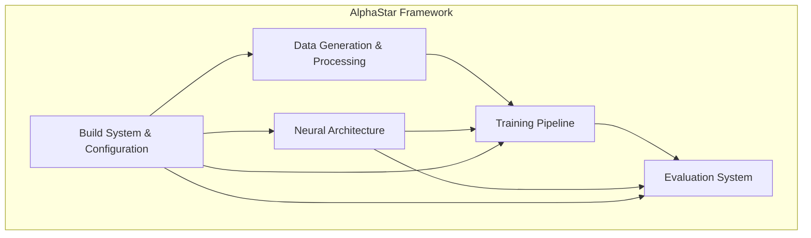
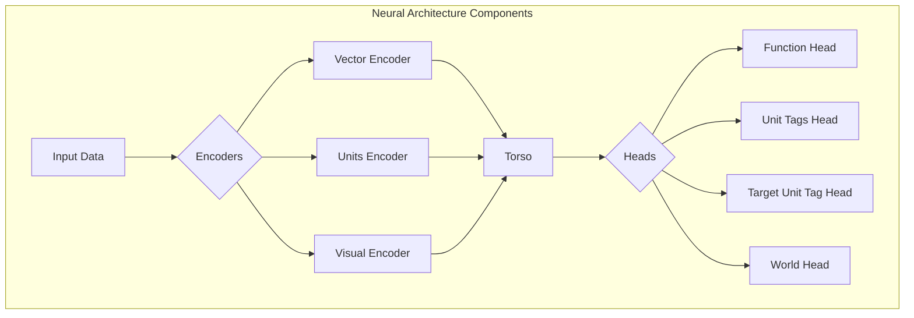
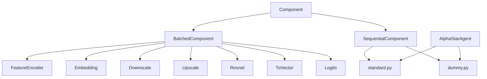

<!-- source: DeepWiki mcp.deepwiki.com · repo google-deepmind/alphastar · page 1 Overview · fetched 2026-10-26 -->

# Overview

Relevant source files

The following files were used as context for generating this wiki page:

- [README.md](README.md)
- [WORKSPACE](WORKSPACE)

This document provides an introduction to the AlphaStar repository, its primary components, and the high-level architecture of the system. AlphaStar is a machine learning package from DeepMind that provides tools to train agents to master StarCraft II.

## Repository Purpose and Scope

The AlphaStar repository aims to drive research interest around StarCraft II by providing:

1. General purpose architectures to train StarCraft II agents that can be used with different learning algorithms in both online and offline settings
2. Data processing tools for handling StarCraft II replays
3. Offline training and evaluation scripts with Behavior Cloning as a representative example

For installation and environment setup instructions, see [Installation & Setup](#2).

Sources: [README.md:3-16]()

## System Architecture Overview

AlphaStar consists of several interconnected systems that together form a comprehensive framework for training StarCraft II agents.

The core systems of AlphaStar include:

| System | Description | Related Wiki Pages |
|--------|-------------|-------------------|
| Data Generation & Processing | Handles StarCraft II replays, transforming them into training data | [Data Pipeline](#4) |
| Neural Architecture | Defines model structure through modular components | [Architecture](#3) |
| Training Pipeline | Implements supervised and reinforcement learning | [Training System](#5) |
| Evaluation System | Assesses trained agent performance | [Evaluation System](#6) |
| Build System | Manages dependencies and configuration | [Module Structure](#7) |

Sources: [README.md:10-16](), [WORKSPACE:1-60]()

## Key Components and Data Flow

The AlphaStar system processes data through a pipeline that begins with StarCraft II replays and ends with trained agents.

```mermaid
flowchart LR
    A["StarCraft II Replays"] --> B["get_replays.sh"]
    B --> C["Replay Packs"]
    C --> D["generate_partitions.py"]
    D --> E["Partitioned Replays"]
    E --> F["generate_dataset.py"]
    F --> G["TFRecord Dataset"]
    G --> H["OfflineTFRecordDataSource"]
    H --> I["SupervisedLearner"]
    I --> J["Checkpoints"]
    J --> K["Evaluator"]
    K --> L["EvalActor"]
    L --> M["Performance Metrics"]
```

This diagram shows the complete flow from raw replay data to trained model evaluation, highlighting the key components in the AlphaStar pipeline.

Sources: [README.md:14-16]()

## Neural Network Architecture

The AlphaStar agent uses a neural network architecture composed of modular components designed to process different aspects of the StarCraft II game state.

The network architecture consists of:
1. **Encoders** that process different types of input data
2. A **Torso** that integrates information from the encoders
3. **Heads** that predict specific action parameters

These components are built on a modular system that allows for flexible composition and experimentation.

Sources: [README.md:10-12]()

## Modular Component System

AlphaStar's architecture is based on a highly modular component system that forms the foundation for building neural networks.

This modular design facilitates:
- Reuse of components across different parts of the system
- Experimentation with different network architectures
- Flexibility in adapting to new learning algorithms

For more details on the modular component system, see [Modular Component System](#3.1).

Sources: [README.md:10-12]()

## AlphaStar Unplugged

AlphaStar Unplugged is a subset of the AlphaStar system focused on fully offline reinforcement learning. It demonstrates how to train agents from StarCraft II replay data without requiring online interaction with the game.

Key features include:
- Data readers for processing StarCraft II replays
- Offline training scripts using Behavior Cloning
- Evaluation scripts for assessing agent performance

For detailed information on AlphaStar Unplugged, see [AlphaStar Unplugged](#8).

Sources: [README.md:14-16](), [README.md:97-101]()

## Build System and Dependencies

AlphaStar can be built and used in two primary ways:

1. **Installing with pip**: Simplest setup, but requires manual rebuilding of PySC2 for any changes
2. **Building with Bazel**: Builds AlphaStar and PySC2 together from source, providing greater flexibility

The repository uses Bazel as its primary build system, with configuration defined in the WORKSPACE file.

Sources: [README.md:18-94](), [WORKSPACE:1-60]()

## Repository Structure

The repository is organized into several key directories:

| Directory | Description |
|-----------|-------------|
| `architectures/` | Contains modular components for building neural networks |
| `unplugged/` | Implementation of offline reinforcement learning |
| `bazel/` | Build system configuration |

For more details on the module structure, see [Module Structure](#7).

Sources: [README.md:10-16](), [README.md:97-101]()

## Conclusion

AlphaStar provides a comprehensive framework for training and evaluating StarCraft II agents. Its modular architecture allows for experimentation with different network designs and learning algorithms. The current implementation focuses on offline reinforcement learning, with tools for data processing, training, and evaluation.

This overview has introduced the key components and systems of AlphaStar. For more detailed information on specific aspects, refer to the other sections of this wiki.

Sources: [README.md:3-16](), [README.md:97-109]()

---

