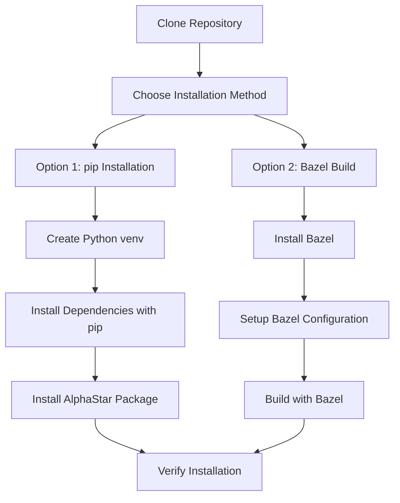
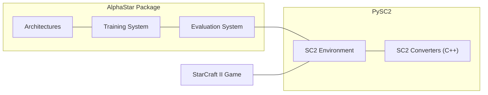
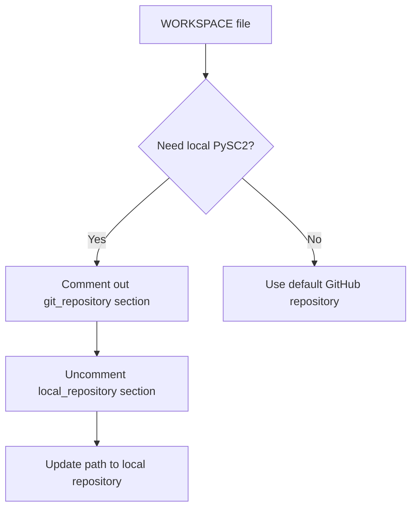
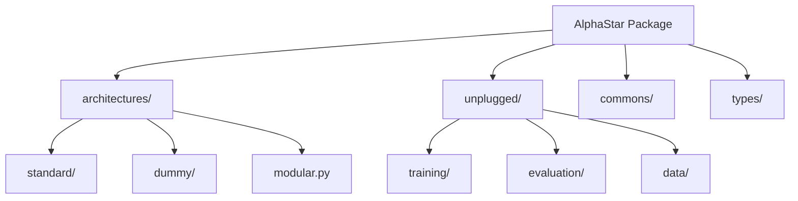

<!-- source: DeepWiki mcp.deepwiki.com · repo google-deepmind/alphastar · page 2 Installation & Setup · fetched 2026-10-26 -->

# Installation & Setup

<details>
<summary>Relevant source files</summary>

The following files were used as context for generating this wiki page:

- [README.md](README.md)
- [WORKSPACE](WORKSPACE)
- [alphastar/architectures/BUILD](alphastar/architectures/BUILD)
- [bazel/requirements.txt](bazel/requirements.txt)
- [requirements.txt](requirements.txt)
- [setup.py](setup.py)

</details>


This page provides a comprehensive guide to setting up the AlphaStar repository, installing its dependencies, and configuring your environment. For information about running training and evaluation scripts, see [AlphaStar Unplugged](#8).

## System Requirements

AlphaStar has specific system requirements that must be met for a successful installation:

- **Operating System**: Linux only (other operating systems are not officially supported)
- **Python Version**: Python 3.9 is recommended and tested
- **Disk Space**: Sufficient space for the codebase, dependencies, and potentially StarCraft II replays

Sources: [README.md:20-21]()

## Installation Workflow

The installation process for AlphaStar can follow two different paths depending on your needs.



Sources: [README.md:18-90]()

## Prerequisites

Before installing AlphaStar, it's recommended to set up a Python virtual environment:

```bash
python3 -m venv alphastar
source alphastar/bin/activate
pip install --upgrade pip setuptools wheel
```

This helps isolate dependencies and prevents conflicts with other Python packages on your system.

Sources: [README.md:25-33]()

## Installation Options

AlphaStar offers two installation methods, each with its own advantages:

### Option 1: Installing with `pip`

This is the simplest approach and suitable for most users:

1. Clone the repository:
   ```bash
   git clone https://github.com/google-deepmind/alphastar.git
   cd alphastar
   ```

2. Install the package:
   ```bash
   # For an editable installation (recommended for development)
   pip install -e .
   
   # OR for a standard installation
   pip install .
   ```

This method automatically installs all dependencies listed in the requirements file.

Sources: [README.md:50-59](), [setup.py:38-53]()

### Option 2: Building with Bazel

This approach is more complex but offers better integration with PySC2, especially if you need to modify PySC2 code:

1. Install Bazel following the [official instructions](https://docs.bazel.build/versions/main/install-ubuntu.html)

2. Build AlphaStar using Bazel:
   ```bash
   # Build all AlphaStar targets
   bazel build --cxxopt='-std=c++17' ...
   
   # Run tests
   bazel test --cxxopt='-std=c++17' architectures/...
   ```

**Note**: PySC2 requires C++17, hence the `--cxxopt='-std=c++17'` flag is necessary.

Sources: [README.md:63-93](), [WORKSPACE:1-60]()

## PySC2 Integration

AlphaStar depends on PySC2 for data generation and evaluation. The relationship between these components is critical to understand:



By default, PySC2 is installed from PyPI with pip installation, or built from source with Bazel installation. For Bazel builds, you can also use a local PySC2 repository by modifying the `WORKSPACE` file.

Sources: [README.md:35-48](), [WORKSPACE:28-44]()

## Dependencies

AlphaStar relies on several key dependencies, which are automatically installed when using pip:

| Category | Dependencies |
|----------|--------------|
| ML Frameworks | JAX, TensorFlow |
| DeepMind Libraries | dm-acme, dm-haiku, dm-pix, dm-reverb |
| Data Processing | apache-beam, pandas, tensorflow-datasets |
| StarCraft II | pysc2, s2clientprotocol |
| Utilities | ml-collections, numpy, optax |

The complete list of dependencies can be found in the requirements files:

Sources: [requirements.txt:1-11](), [bazel/requirements.txt:1-19]()

## Environment Configuration

After installation, you might need to configure certain aspects of the environment:

### PySC2 Configuration

If you need to use a local repository for PySC2 (e.g., because you have made local modifications), you can modify the `WORKSPACE` file:

1. Comment out the `git_repository` section for `pysc2_archive`
2. Uncomment the `local_repository` section
3. Update the path to point to your local PySC2 repository



Sources: [WORKSPACE:28-44]()

## Verifying Installation

To verify that AlphaStar has been installed correctly, you can run the following simple test:

```bash
# For pip installation
python -c "import alphastar; print(alphastar.__version__)"

# For Bazel installation
bazel run --cxxopt='-std=c++17' //alphastar/unplugged:verify_install
```

If the command executes without errors, the installation is successful.

## Package Structure

The AlphaStar package has the following main components:



Each component serves a specific purpose:
- `architectures/`: Contains the neural network architectures for StarCraft II agents
- `unplugged/`: Contains scripts for offline reinforcement learning
- `commons/`: Contains common utilities shared across the package
- `types/`: Contains type definitions used throughout the codebase

Sources: [README.md:10-16](), [alphastar/architectures/BUILD:1-41]()

## Troubleshooting Common Issues

### PySC2 Build Issues

If you encounter issues with PySC2 when building with Bazel:
- Ensure you're using the `--cxxopt='-std=c++17'` flag
- Try clearing the Bazel cache with `bazel clean --expunge`

### Dependency Conflicts

If you encounter dependency conflicts:
- Make sure you're using a clean virtual environment
- Check that your Python version is compatible (Python 3.9 is recommended)
- Ensure all dependencies match the versions specified in requirements.txt

### Bazel Configuration

For repeated Bazel builds, consider creating a `.bazelrc` file to avoid specifying command-line options repeatedly.

Sources: [README.md:90-93]()

## Next Steps

After successful installation, you can proceed to:
- Explore the architecture of AlphaStar (see [Architecture](#3))
- Learn about the data pipeline (see [Data Pipeline](#4))
- Try the quickstart instructions for training and evaluation (see [AlphaStar Unplugged](#8))

Sources: [README.md:95-101]()

---

