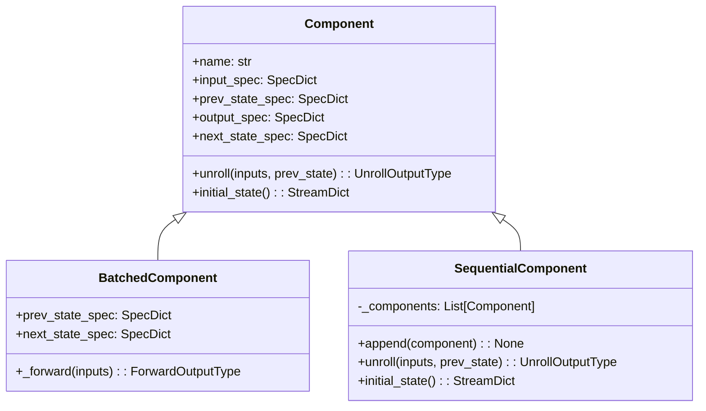
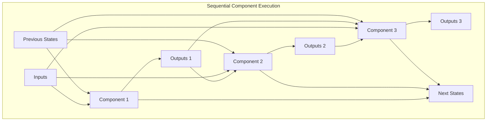
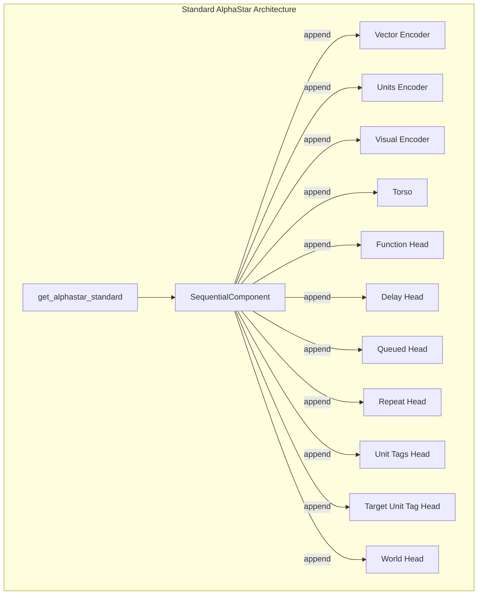
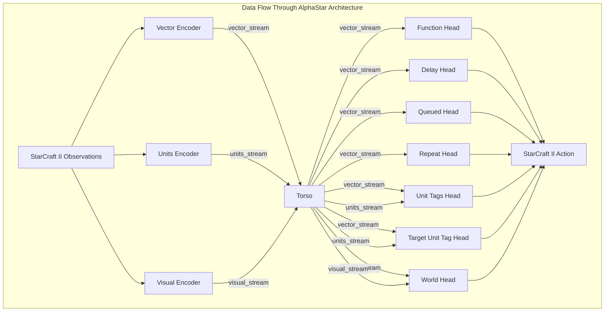

<!-- source: DeepWiki mcp.deepwiki.com · repo google-deepmind/alphastar · page 3 Architecture · fetched 2026-10-26 -->

# Architecture

Relevant source files

The following files were used as context for generating this wiki page:

- [alphastar/architectures/modular.py](alphastar/architectures/modular.py)
- [alphastar/architectures/standard/standard.py](alphastar/architectures/standard/standard.py)

This document provides a comprehensive overview of the AlphaStar agent architecture and its component systems. It explains the modular design approach, the standard architecture implementation, and how data flows through the system.

For information on the data processing pipeline that feeds this architecture, see [Data Pipeline](#4). For details about the training system that uses this architecture, see [Training System](#5).

## Modular Component System

The AlphaStar architecture is built on a flexible, composable component system. Components are the fundamental building blocks that can be connected together to form the complete architecture.

**Component Class Hierarchy**

Sources: [alphastar/architectures/modular.py:98-226](), [alphastar/architectures/modular.py:231-266](), [alphastar/architectures/modular.py:269-482]()

### Base Component

The `Component` class ([alphastar/architectures/modular.py:98-226]()) defines the core interface for all components. Each component implements:

- An `unroll` function that processes inputs from the current rollout and returns outputs
- A state management system that passes information between timesteps
- Type specifications for inputs, outputs, and states

Components have four key specifications:
1. `input_spec`: Defines the expected input tensors
2. `prev_state_spec`: Defines state tensors from previous timesteps
3. `output_spec`: Defines the produced output tensors
4. `next_state_spec`: Defines state tensors passed to future timesteps

### Batched Component

The `BatchedComponent` ([alphastar/architectures/modular.py:231-266]()) is a specialized component that operates on individual timesteps rather than sequences. Instead of implementing `_unroll`, subclasses implement a `_forward` function that processes a single timestep's data without maintaining state between timesteps.

### Sequential Component

The `SequentialComponent` ([alphastar/architectures/modular.py:269-482]()) contains a sequence of connected components. Components are added via the `append` method, creating a pipeline where:

- Outputs from earlier components become inputs to later components
- Each component can see all inputs of the `SequentialComponent` plus outputs of previous components
- States from all components are collected and passed between rollouts

**Sequential Component Data Flow**

Sources: [alphastar/architectures/modular.py:270-322](), [alphastar/architectures/modular.py:469-482]()

## Standard Architecture

The standard AlphaStar architecture is implemented in the `get_alphastar_standard` function ([alphastar/architectures/standard/standard.py:26-102]()). It creates a `SequentialComponent` and appends specific component implementations to create the complete agent architecture.

**Standard Architecture Component Assembly**

Sources: [alphastar/architectures/standard/standard.py:26-102]()

### Encoders

The architecture begins with three encoders that process different aspects of the game state:

1. **Vector Encoder** ([alphastar/architectures/standard/standard.py:41-46]()): Processes scalar and vector-valued observations (player resources, game statistics, etc.)
2. **Units Encoder** ([alphastar/architectures/standard/standard.py:47-51]()): Processes information about all units in the game
3. **Visual Encoder** ([alphastar/architectures/standard/standard.py:52-56]()): Processes 2D spatial data from the game map

Each encoder transforms raw observations into feature representations that can be integrated by the torso.

### Torso

The **Torso** component ([alphastar/architectures/standard/standard.py:59-65]()) integrates information from all three encoders. It processes:

- Vector stream (from Vector Encoder)
- Units stream (from Units Encoder)
- Visual streams (from Visual Encoder)

The torso typically contains recurrent components (e.g., LSTM) to maintain state information across timesteps, capturing temporal dynamics of the game.

### Heads

The architecture ends with multiple heads that predict different aspects of the action:

1. **Vector Heads** ([alphastar/architectures/standard/standard.py:68-78]()):
   - **Function Head**: Predicts which action function to execute
   - **Delay Head**: Predicts timing delay for the action
   - **Queued Head**: Predicts whether to queue the action
   - **Repeat Head**: Predicts repetition count for the action

2. **Unit Tags Head** ([alphastar/architectures/standard/standard.py:80-86]()): Predicts which units to select

3. **Target Unit Tag Head** ([alphastar/architectures/standard/standard.py:87-93]()): Predicts which unit to target

4. **World Head** ([alphastar/architectures/standard/standard.py:94-100]()): Predicts spatial targets (map locations)

**Complete Architecture Data Flow**

Sources: [alphastar/architectures/standard/standard.py:26-102]()

## Data Processing and Unroll Mechanics

The AlphaStar architecture processes data through "unrolls" - sequences of timesteps that are processed together. This approach enables efficient training and inference.

### State Management

Components can maintain state between timesteps through the `prev_state` and `next_state` mechanism:

1. Each unroll receives `prev_state` from the previous unroll
2. The component processes the current inputs and previous state
3. The component outputs results and a `next_state` for the subsequent unroll

This mechanism is particularly important for recurrent components like LSTMs in the torso, which maintain memory of game state over time.

### Configuration

The standard architecture is highly configurable through a `ConfigDict` passed to the `get_alphastar_standard` function. This configuration specifies:

- Stream sizes for vector, units, and visual data
- Encoder-specific parameters
- Torso configuration
- Head-specific parameters

This allows for experimentation with different architectural variants without changing the code structure.

## Architecture Integration

The architecture integrates with the broader AlphaStar system:

1. **Input**: Receives observations from the StarCraft II environment
2. **Processing**: Transforms observations into action predictions
3. **Output**: Produces action parameters that are executed in the environment
4. **Training**: Supervised by human replay data or reinforcement learning signals

The modular design allows components to be individually trained, replaced, or modified while maintaining the overall structure.

Sources: [alphastar/architectures/modular.py:15-81](), [alphastar/architectures/standard/standard.py:15-25]()

---

