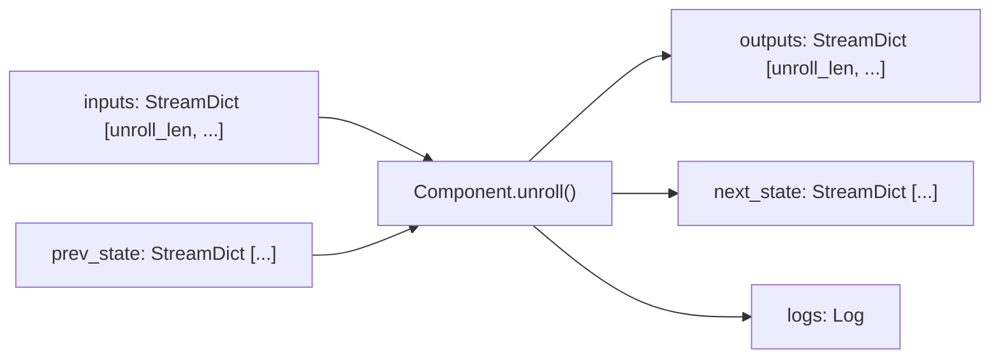
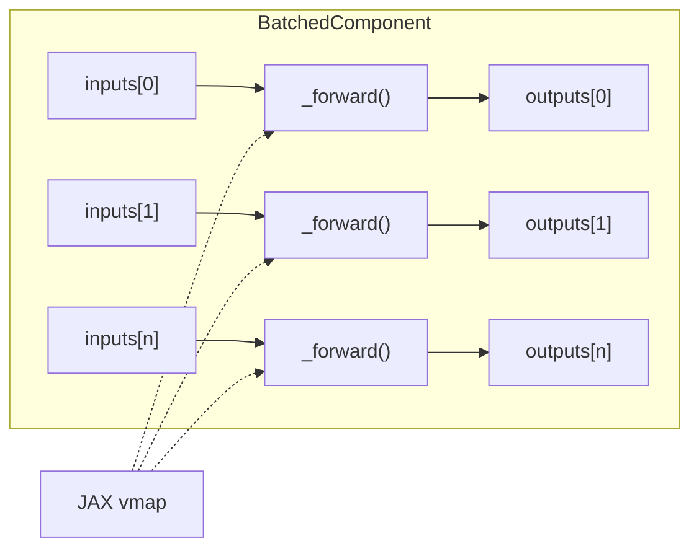
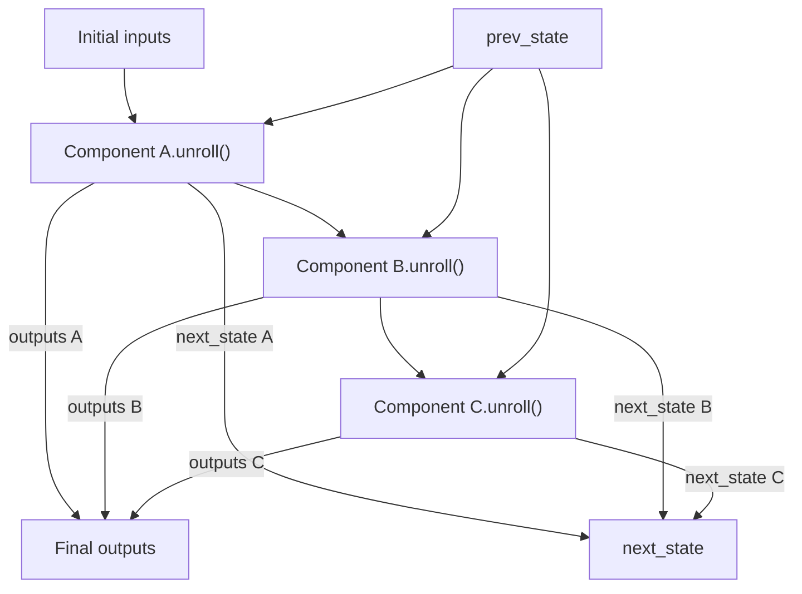
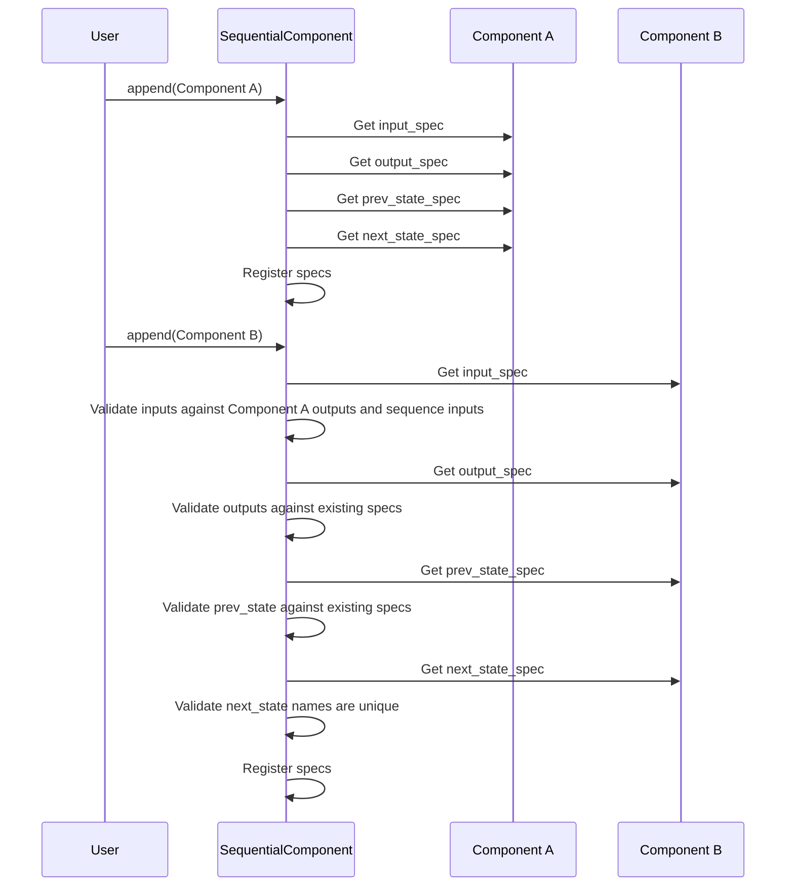
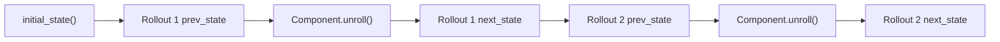
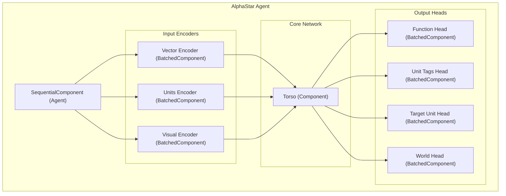

<!-- source: DeepWiki mcp.deepwiki.com · repo google-deepmind/alphastar · page 3.1 Modular Component System · fetched 2026-10-26 -->

# Modular Component System

<details>
<summary>Relevant source files</summary>

The following files were used as context for generating this wiki page:

- [alphastar/architectures/components/BUILD](alphastar/architectures/components/BUILD)
- [alphastar/architectures/modular.py](alphastar/architectures/modular.py)

</details>


This document describes the modular component system that forms the foundation of the AlphaStar agent architecture. It explains the abstract component classes, component composition patterns, and the type system used for validation between components.

For information about specific component implementations, such as visual processing components, see [Visual Processing Components](#3.2).

## Component System Overview

The modular component system provides a framework for building neural network architectures in a composable way. It consists of abstract base classes that define the interfaces and behaviors of components, allowing them to be combined and nested to create complex architectures.

```mermaid
classDiagram
    class "Component"  {
        +name: str
        +input_spec: SpecDict
        +prev_state_spec: SpecDict
        +output_spec: SpecDict
        +next_state_spec: SpecDict
        +initial_state()
        +unroll(inputs, prev_state)
        #_unroll(inputs, prev_state)*
        #_initial_state()
    }
    
    class "BatchedComponent" {
        +prev_state_spec: SpecDict
        +next_state_spec: SpecDict
        +_unroll(inputs, prev_state)
        #_forward(inputs)*
    }
    
    class "SequentialComponent" {
        +_components: List[Component]
        +append(component)
        +_unroll(inputs, prev_state)
    }
    
    "Component" <|-- "BatchedComponent"
    "Component" <|-- "SequentialComponent"
```

Sources: [alphastar/architectures/modular.py:98-226](), [alphastar/architectures/modular.py:231-266](), [alphastar/architectures/modular.py:269-482]()

## Component Base Class

The `Component` class is the abstract base class that all components in the AlphaStar architecture inherit from. It defines the core interface for components, which revolve around the `unroll` function that processes data for the current rollout.

### Component Interface

Components implement an `unroll` function that takes inputs from the current rollout and previous state, and returns outputs, next state, and logs:



Sources: [alphastar/architectures/modular.py:15-48](), [alphastar/architectures/modular.py:185-225]()

### Component Specification System

Each component defines four specification properties that enforce static typing between components:

1. `input_spec`: Defines what inputs the component expects
2. `prev_state_spec`: Defines what state inputs the component expects from previous rollouts
3. `output_spec`: Defines what outputs the component produces
4. `next_state_spec`: Defines what state the component passes to the next rollout

These specifications use the `types.SpecDict` class, which is a nested dictionary structure with `specs.Array` objects as leaves. The `unroll` method enforces these specifications at runtime by validating inputs and outputs against their specs.

Sources: [alphastar/architectures/modular.py:54-72](), [alphastar/architectures/modular.py:185-225]()

## BatchedComponent

`BatchedComponent` is a specialized component that operates on a single timestep instead of an entire rollout. This simplifies component implementation for stateless operations.

The key differences from the base `Component` class are:

1. `BatchedComponent` is stateless (has empty `prev_state_spec` and `next_state_spec`)
2. Instead of implementing `_unroll`, subclasses implement `_forward` which operates on a single timestep
3. The `_unroll` method is implemented to use JAX's `vmap` to apply `_forward` across the rollout dimension



Sources: [alphastar/architectures/modular.py:231-266]()

## SequentialComponent

`SequentialComponent` allows creating a composite component by chaining multiple sub-components together. 

Key features:
- Components are added using the `append` method
- Each component's outputs become available to all subsequent components as inputs
- State is managed across all components in the sequence



When appending components, `SequentialComponent` performs validation checks on the input, output, and state specifications to ensure compatibility.

Sources: [alphastar/architectures/modular.py:269-482]()

### Component Sequencing and Validation

When components are added to a `SequentialComponent`, the system performs several validation checks:

1. Input validation - Ensures inputs required by components are provided either by system inputs or outputs of previous components
2. Output validation - Ensures outputs don't conflict with existing outputs
3. State validation - Ensures state names are unique across components



Sources: [alphastar/architectures/modular.py:334-432]()

## State Management

Components can maintain state between rollouts using the `prev_state` and `next_state` mechanism. The `initial_state` method provides the starting state before the first rollout.



For `SequentialComponent`, the initial state is the combined initial states of all its subcomponents. State management is handled transparently, aggregating states from all components.

Sources: [alphastar/architectures/modular.py:128-158](), [alphastar/architectures/modular.py:450-467]()

## Integration with AlphaStar Architecture

The modular component system is used throughout the AlphaStar architecture to implement various neural network components, such as:

- Vector encoders for processing 1D data
- Unit encoders for processing lists of units
- Visual encoders for processing spatial features
- Core network modules ("torso")
- Action heads for different output types



The standard AlphaStar architecture is implemented as a `SequentialComponent` that composes various specialized components together. For more details about the standard architecture, see [Standard Architecture](#3.3).

Sources: [alphastar/architectures/components/BUILD:97-244]()

## Component Implementations

AlphaStar provides various component implementations for different tasks:

| Component Type | Purpose | Implementation |
|----------------|---------|----------------|
| Vector components | Process 1D feature vectors | `alphastar/architectures/components/vector.py` |
| Units components | Process lists of unit features | `alphastar/architectures/components/units.py` |
| Visual components | Process 2D spatial features | `alphastar/architectures/components/visual.py` |
| Merge components | Combine outputs from multiple sources | `alphastar/architectures/components/merge.py` |
| Common components | General-purpose components | `alphastar/architectures/components/common.py` |

Each component type follows the `Component` or `BatchedComponent` interface pattern, allowing them to be used interchangeably in `SequentialComponent` compositions.

Sources: [alphastar/architectures/components/BUILD:97-244]()

## Summary

The modular component system provides a flexible foundation for building and composing neural network architectures in AlphaStar. Key features include:

1. A consistent interface for components through the `unroll` method
2. Strong typing through the specification system
3. Simplified component creation through `BatchedComponent` for stateless operations
4. Component composition through `SequentialComponent`
5. Transparent state management between rollouts

This system enables the construction of complex, modular neural network architectures while maintaining strong typing and clear interfaces between components.

---

