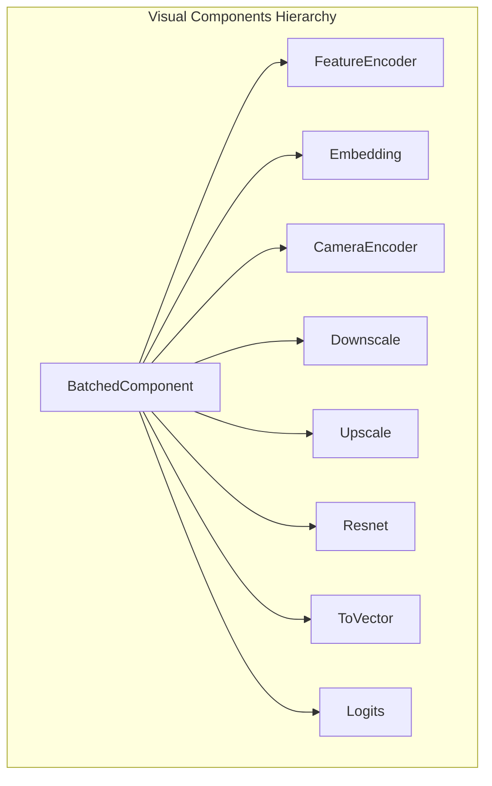
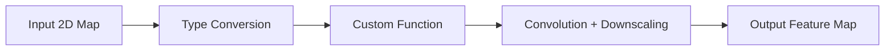
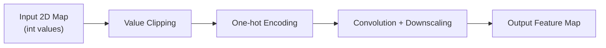
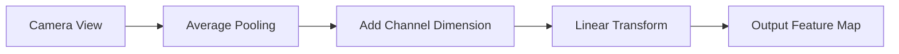
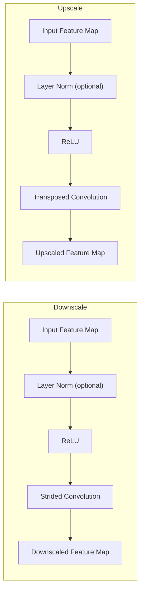
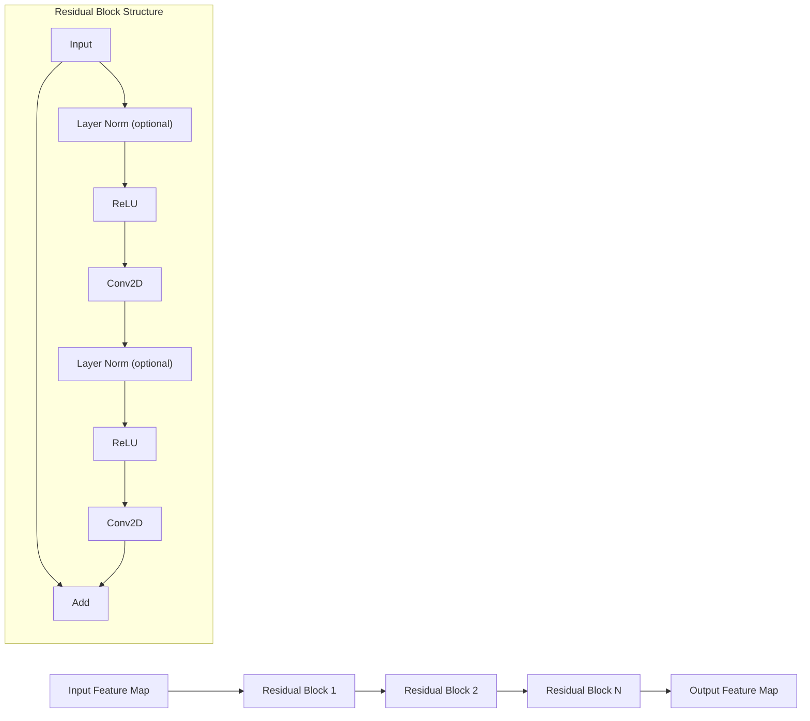
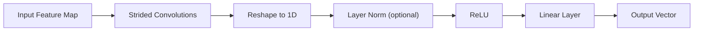
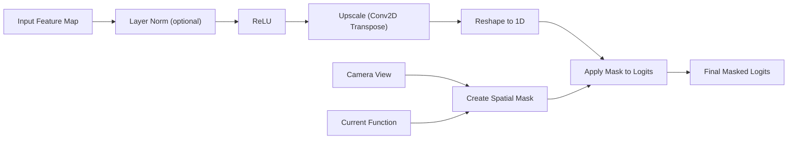
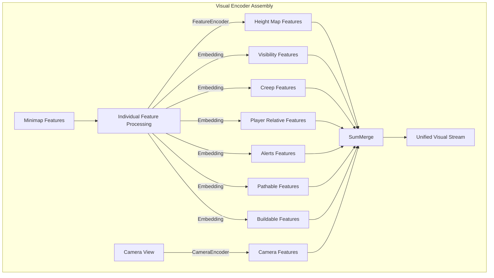
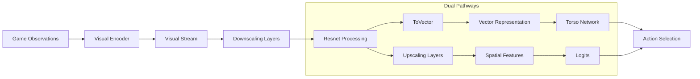

<!-- source: DeepWiki mcp.deepwiki.com · repo google-deepmind/alphastar · page 3.2 Visual Processing Components · fetched 2026-10-26 -->

# Visual Processing Components

Relevant source files

The following files were used as context for generating this wiki page:

- [alphastar/architectures/components/visual.py](alphastar/architectures/components/visual.py)
- [alphastar/architectures/components/visual_test.py](alphastar/architectures/components/visual_test.py)
- [alphastar/architectures/standard/encoders.py](alphastar/architectures/standard/encoders.py)

## Purpose and Scope

This document details the visual processing components of the AlphaStar architecture, which are responsible for handling 2D spatial data from StarCraft II. These components transform raw 2D game features (like minimap data, height maps, and visibility information) into feature representations that can be used by the neural network. For information about the broader component-based architecture, see [Modular Component System](#3.1).

## Visual Component Architecture Overview

The visual processing components in AlphaStar form a modular pipeline for processing spatial game information. Each component inherits from the `BatchedComponent` base class and is designed to transform 2D spatial data in specific ways while maintaining a consistent interface.

Sources: [alphastar/architectures/components/visual.py:15-660]()

The components handle various transformations including:
- Feature encoding and embedding
- Spatial resolution changes (downscaling and upscaling)
- Residual block processing
- Conversion from spatial to vector representations
- Generation of spatial action logits

## Core Visual Components

### FeatureEncoder

The `FeatureEncoder` component processes 2D feature maps by applying a transformation function followed by a convolution operation. It's typically used for continuous-valued features like height maps.

**Key Parameters**:
- `input_spatial_size`: Spatial dimensions of input 
- `downscale_factor`: Factor by which to reduce spatial dimensions
- `output_features_size`: Number of output feature channels
- `kernel_size`: Size of convolution kernel
- `fun`: Optional function to apply to input (default: identity)

Sources: [alphastar/architectures/components/visual.py:33-118]()

### Embedding

The `Embedding` component processes categorical 2D inputs (like unit types or terrain types) by converting each pixel value to a one-hot vector, followed by a convolution.

**Key Parameters**:
- `input_spatial_size`: Spatial dimensions of input
- `downscale_factor`: Factor by which to reduce spatial dimensions
- `num_classes`: Number of possible discrete values in the input
- `output_features_size`: Number of output feature channels
- `kernel_size`: Size of convolution kernel

Sources: [alphastar/architectures/components/visual.py:121-187]()

### CameraEncoder

The `CameraEncoder` component specifically handles the camera view, which represents the visible portion of the game screen. It applies average pooling followed by a linear transformation.

**Key Parameters**:
- `input_spatial_size`: Spatial dimensions of input
- `downscale_factor`: Factor by which to reduce spatial dimensions
- `output_features_size`: Number of output feature channels

Sources: [alphastar/architectures/components/visual.py:190-240]()

### Downscale and Upscale

The `Downscale` and `Upscale` components change the spatial resolution of feature maps while potentially changing the number of feature channels.

**Key Parameters**:
- `input_spatial_size`: Spatial dimensions of input
- `input_features_size`: Number of input feature channels
- `output_features_size`: Number of output feature channels
- `downscale_factor`/`upscale_factor`: Factor by which to change spatial dimensions
- `kernel_size`: Size of convolution kernel
- `use_layer_norm`: Whether to apply layer normalization

Sources: 
- Downscale: [alphastar/architectures/components/visual.py:243-315]()
- Upscale: [alphastar/architectures/components/visual.py:318-387]()

### Resnet

The `Resnet` component applies a series of residual blocks to process feature maps while maintaining spatial dimensions. This allows the network to capture complex spatial patterns without increasing spatial size.

**Key Parameters**:
- `input_spatial_size`: Spatial dimensions of input
- `input_features_size`: Number of input feature channels
- `num_resblocks`: Number of residual blocks to apply
- `kernel_size`: Size of convolution kernel
- `use_layer_norm`: Whether to apply layer normalization
- `num_hidden_feature_planes`: Number of feature channels in hidden layers

Sources: [alphastar/architectures/components/visual.py:390-449]()

### ToVector

The `ToVector` component converts spatial feature maps to fixed-size vector representations through a series of strided convolutions followed by reshaping and a linear layer.

**Key Parameters**:
- `input_spatial_size`: Spatial dimensions of input
- `input_features_size`: Number of input feature channels
- `vector_stream_size`: Size of output vector
- `hidden_feature_sizes`: Feature channels for each hidden layer
- `downscale_factor`: Factor by which to reduce spatial dimensions in each layer
- `kernel_size`: Size of convolution kernel
- `use_layer_norm`: Whether to apply layer normalization

Sources: [alphastar/architectures/components/visual.py:452-539]()

### Logits

The `Logits` component generates 2D spatial logits for action selection, particularly for actions that require clicking on the game screen. It handles upscaling feature maps and masking valid action locations.

**Key Parameters**:
- `input_spatial_size`: Spatial dimensions of input
- `input_features_size`: Number of input feature channels
- `upscale_factor`: Factor by which to increase spatial dimensions
- `kernel_size`: Size of convolution kernel
- `use_layer_norm`: Whether to apply layer normalization
- `use_depth_to_space`: Alternative upscaling method that can improve performance

Sources: [alphastar/architectures/components/visual.py:542-659]()

## Visual Encoder Assembly

The standard AlphaStar architecture assembles these components into a complete visual encoder using the `get_visual_encoder` function. This encoder processes various minimap features and the camera view to create a unified visual stream.

**Key Implementation Details**:
- The visual encoder processes 7 different minimap features plus the camera view
- `FeatureEncoder` is used for continuous features (height map)
- `Embedding` is used for categorical features (visibility, creep, etc.)
- All features are processed to the same spatial dimensions and feature size
- Features are merged by summation to create a unified visual stream

Sources: [alphastar/architectures/standard/encoders.py:165-223]()

## Data Flow Through Visual Processing

The complete flow of visual data through the AlphaStar system follows a progression from raw 2D game features to action outputs:

This pipeline enables AlphaStar to:
1. Process raw spatial game information
2. Extract meaningful features at multiple spatial resolutions
3. Integrate spatial information with other input types (vector and unit data)
4. Generate both spatial actions (screen clicks) and non-spatial actions (ability selections)

Sources: 
- [alphastar/architectures/components/visual.py:15-660]()
- [alphastar/architectures/standard/encoders.py:165-223]()

## Performance Considerations

The visual processing components include several optimizations:
- Downscaling early in the pipeline to reduce computational requirements
- Optional layer normalization for training stability
- Alternative implementations for upscaling (`use_depth_to_space`) that can improve performance on certain hardware
- Residual connections in the Resnet component to improve gradient flow

When downscaling or upscaling, the `kernel_size` should typically be a multiple of the scaling factor to avoid checkerboard artifacts in the output.

Sources: [alphastar/architectures/components/visual.py:573-580]()

---

