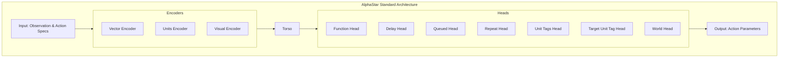
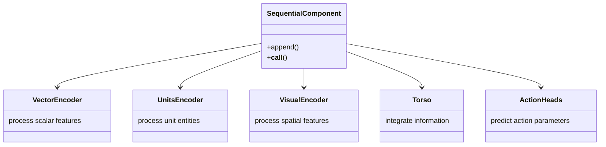
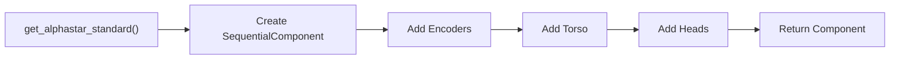
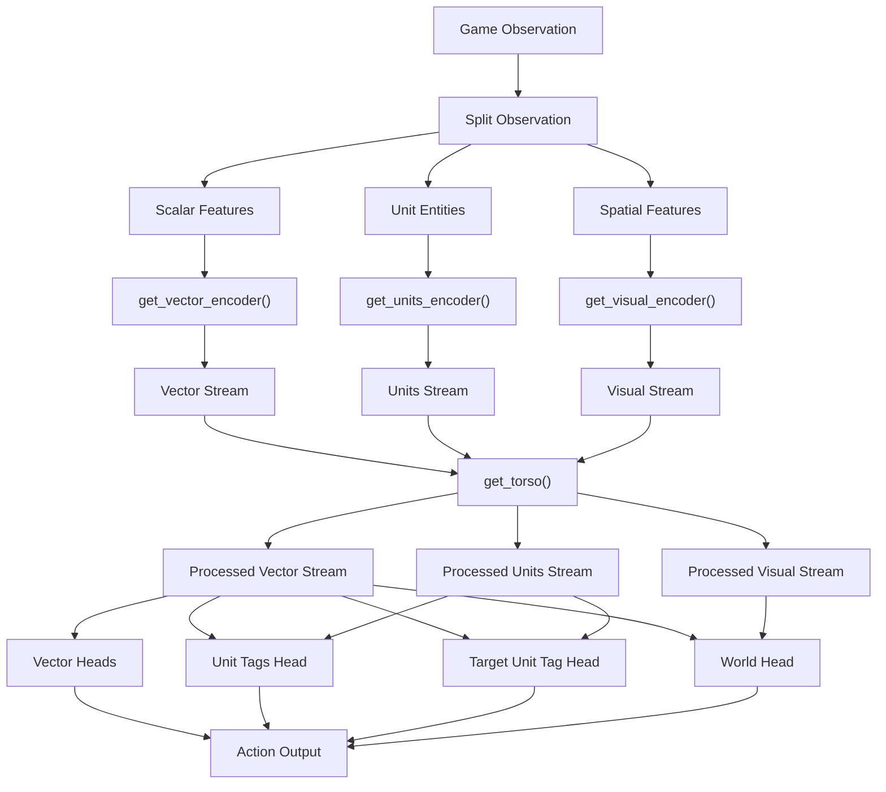
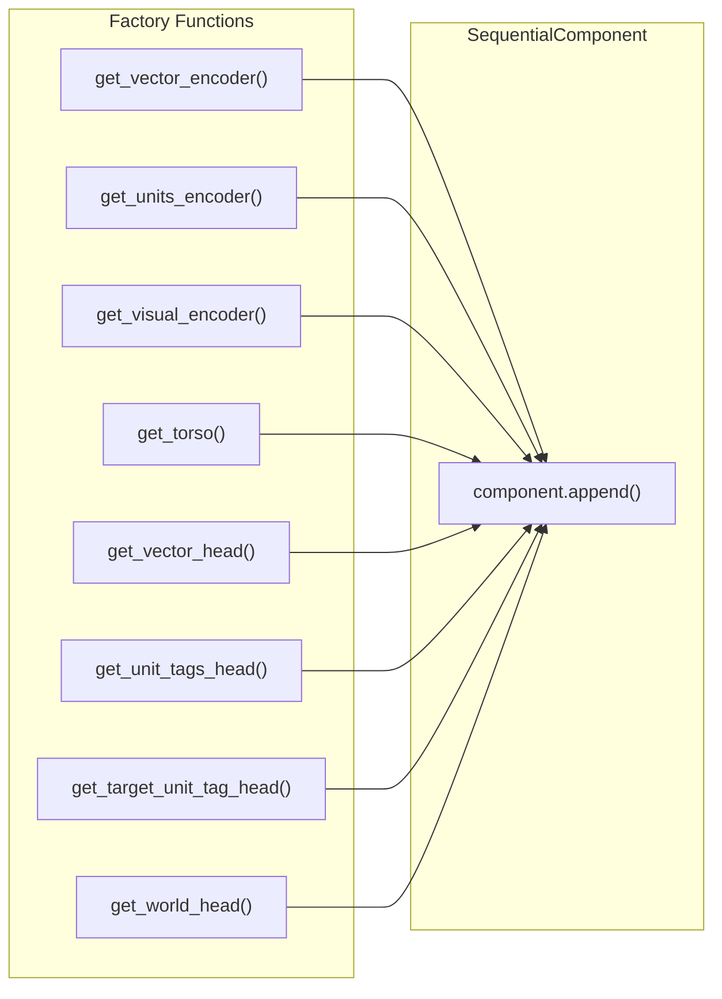

<!-- source: DeepWiki mcp.deepwiki.com · repo google-deepmind/alphastar · page 3.3 Standard Architecture · fetched 2026-10-26 -->

# Standard Architecture

Relevant source files

The following files were used as context for generating this wiki page:

- [alphastar/architectures/standard/BUILD](alphastar/architectures/standard/BUILD)
- [alphastar/architectures/standard/standard.py](alphastar/architectures/standard/standard.py)

This document describes the Standard Architecture implementation of AlphaStar, which represents the primary neural network architecture used by AlphaStar agents. For information about the modular component system that underlies this architecture, see [Modular Component System](#3.1). For details on visual processing components, see [Visual Processing Components](#3.2).

## Overview

The Standard Architecture implements a complex neural network designed specifically for StarCraft II gameplay. It processes game state information through a sequence of specialized components organized in three main sections: encoders, a central torso, and action heads. This implementation is found in the `get_alphastar_standard` function, which constructs the complete architecture as a modular, sequential component.

Sources: [alphastar/architectures/standard/standard.py:15-102]()

## Architecture Components

The Standard Architecture is composed as a sequential component, with data flowing through encoders, torso, and heads in a defined order.

Sources: [alphastar/architectures/standard/standard.py:38-101]()

### Initialization

The architecture is initialized through the `get_alphastar_standard` function, which sets up the component pipeline based on provided specifications and configuration:

Sources: [alphastar/architectures/standard/standard.py:26-102]()

## Encoders

The Standard Architecture uses three distinct encoders to process different aspects of the observation space:

### Vector Encoder

Processes scalar features from the game state, including global game information and statistics.

Key parameters:
- `vector_stream_size`: Output dimension of the vector stream
- Configuration settings from `config.encoders.vector`

Sources: [alphastar/architectures/standard/standard.py:41-46]()

### Units Encoder

Processes information about game units (entities) present in the observation.

Key parameters:
- `units_stream_size`: Output dimension of the units stream
- Configuration settings from `config.encoders.units` 

Sources: [alphastar/architectures/standard/standard.py:47-51]()

### Visual Encoder

Processes spatial (2D) features from the game state, including maps and terrain information.

Key parameters:
- `visual_features_size`: First dimension in `visual_stream_sizes`
- Configuration settings from `config.encoders.visual`

Sources: [alphastar/architectures/standard/standard.py:52-56]()

## Torso

The torso is the central component that integrates information from all encoders and processes it into a unified representation that can be used by the action heads.

Key parameters:
- `vector_stream_size`: Dimension of the vector stream
- `units_stream_size`: Dimension of the units stream
- `visual_stream_sizes`: Dimensions of the visual stream
- Configuration settings from `config.torso`

Sources: [alphastar/architectures/standard/standard.py:59-65]()

## Heads

The Standard Architecture includes multiple action heads, each responsible for predicting different aspects of the agent's actions:

### Vector Heads

Four separate vector heads handle different action arguments:
- Function head: Selects the function to execute
- Delay head: Determines action delay
- Queued head: Decides if the action should be queued
- Repeat head: Specifies if the action should be repeated

Each head takes the following parameters:
- `argument_name`: The specific argument (FUNCTION, DELAY, QUEUED, REPEAT)
- `action_spec`: Specification of the action space
- `vector_stream_size`: Dimension of the vector stream
- `is_training`: Whether the model is in training mode
- `overlap_len`: Overlap length for sequence processing
- Configuration settings from `config.heads[arg]`

Sources: [alphastar/architectures/standard/standard.py:68-78]()

### Unit Tags Head

Predicts which units should be selected for an action.

Key parameters:
- `vector_stream_size`: Dimension of the vector stream
- `units_stream_size`: Dimension of the units stream
- Configuration settings from `config.heads.unit_tags`

Sources: [alphastar/architectures/standard/standard.py:80-86]()

### Target Unit Tag Head

Predicts the target unit for an action (if applicable).

Key parameters:
- `vector_stream_size`: Dimension of the vector stream
- `units_stream_size`: Dimension of the units stream
- Configuration settings from `config.heads.target_unit_tag`

Sources: [alphastar/architectures/standard/standard.py:87-93]()

### World Head

Predicts spatial (x,y) coordinates for actions that require position selection.

Key parameters:
- `vector_stream_size`: Dimension of the vector stream
- `visual_stream_sizes`: Dimensions of the visual stream
- Configuration settings from `config.heads.world`

Sources: [alphastar/architectures/standard/standard.py:94-100]()

## Data Flow

The following diagram illustrates how data flows through the Standard Architecture:

Sources: [alphastar/architectures/standard/standard.py:38-101]()

## Configuration

The Standard Architecture's behavior is controlled through a hierarchical configuration object with the following structure:

| Configuration Section | Purpose |
|----------------------|---------|
| `vector_stream_size` | Dimension of the vector stream |
| `units_stream_size` | Dimension of the units stream |
| `visual_stream_sizes` | Dimensions of the visual stream (list) |
| `encoders.vector` | Configuration for the vector encoder |
| `encoders.units` | Configuration for the units encoder |
| `encoders.visual` | Configuration for the visual encoder |
| `torso` | Configuration for the torso network |
| `heads.FUNCTION` | Configuration for the function head |
| `heads.DELAY` | Configuration for the delay head |
| `heads.QUEUED` | Configuration for the queued head |
| `heads.REPEAT` | Configuration for the repeat head |
| `heads.unit_tags` | Configuration for the unit tags head |
| `heads.target_unit_tag` | Configuration for the target unit tag head |
| `heads.world` | Configuration for the world (spatial) head |

Sources: [alphastar/architectures/standard/standard.py:28-32](), [alphastar/architectures/standard/BUILD:13-23]()

## Component Creation and Integration

The Standard Architecture is created through a functional approach, with each component created by a corresponding factory function:

Sources: [alphastar/architectures/standard/standard.py:41-100]()

## Usage

The Standard Architecture is used by creating an instance through the `get_alphastar_standard` function and then using it as part of an AlphaStar agent. The function returns a modular component that can be used for both training and inference.

Key parameters for using the architecture:
- `input_spec`: Specification of the input observation space
- `action_spec`: Specification of the action space
- `is_training`: Whether the model is in training mode
- `overlap_len`: Overlap length for sequence processing
- `burnin_len`: Burn-in length for sequence processing (not used)
- `config`: Configuration object defining architecture parameters
- `name`: Optional name for the component

Sources: [alphastar/architectures/standard/standard.py:26-34]()

---

