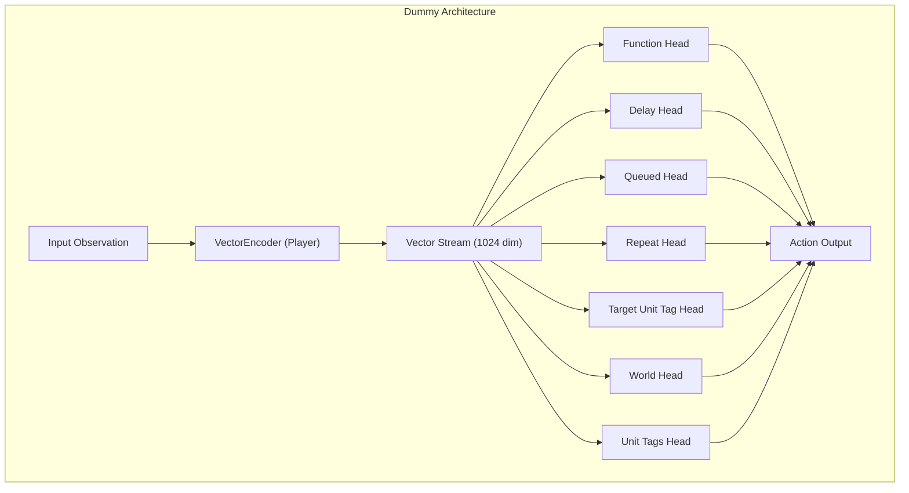
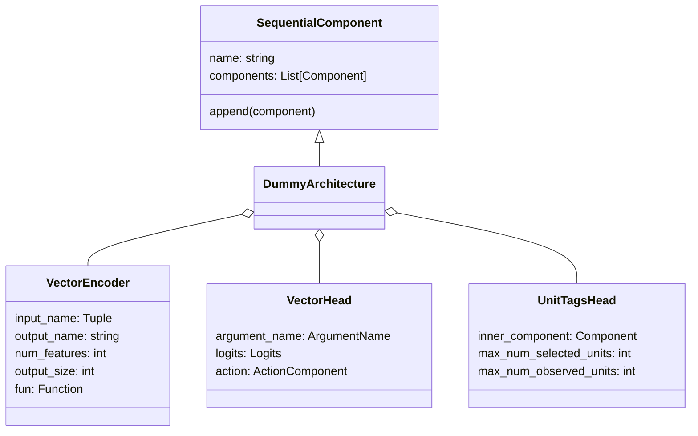
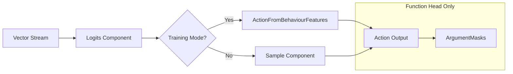

<!-- source: DeepWiki mcp.deepwiki.com · repo google-deepmind/alphastar · page 3.4 Dummy Architecture · fetched 2026-10-26 -->

# Dummy Architecture

<details>
<summary>Relevant source files</summary>

The following files were used as context for generating this wiki page:

- [alphastar/architectures/dummy/dummy.py](alphastar/architectures/dummy/dummy.py)

</details>


## Purpose and Scope

The Dummy Architecture is a minimal implementation of the AlphaStar agent architecture used primarily for testing, debugging, and verification of the agent interface. Unlike the [Standard Architecture](#3.3), the Dummy Architecture is intentionally simplified and not designed to achieve good training performance. Instead, it provides a correct implementation of the expected interfaces while minimizing computational complexity.

This document covers the design, components, and implementation details of the Dummy Architecture, explaining how it serves as a lightweight testing alternative to the full AlphaStar architecture.

Sources: [alphastar/architectures/dummy/dummy.py:15-19]()

## Architecture Overview

The Dummy Architecture follows the same modular component pattern used throughout AlphaStar but implements only the essential components needed to maintain interface compatibility. It consists of a minimal encoder section, a simplified vector stream, and the required action heads.

### High-Level Structure



Sources: [alphastar/architectures/dummy/dummy.py:114-162]()

## Components and Implementation

### Component Hierarchy



Sources: [alphastar/architectures/dummy/dummy.py:131-161]()

### Encoder Layer

The Dummy Architecture implements only a single encoder for player information, rather than the multiple encoders (units, visual, etc.) found in the standard architecture:

- **Player Encoder**: A simple `VectorEncoder` that processes player-related observation features
  - Applies `log1p` transformation to the input features
  - Projects to the common vector stream size (1024)

Sources: [alphastar/architectures/dummy/dummy.py:133-140]()

### Vector Stream

The vector stream in the Dummy Architecture is a simple fixed-size (1024-dimensional) feature vector. Unlike the more complex stream processing in the standard architecture, the Dummy Architecture does not include:

- No LSTM or other recurrent components
- No advanced residual connections
- No transformer or attention mechanisms
- No embedding or entity processing

Sources: [alphastar/architectures/dummy/dummy.py:128]()

### Action Heads

The Dummy Architecture implements all the required action heads to maintain interface compatibility:

| Head Type | Purpose | Implementation |
|-----------|---------|----------------|
| Function | Selects the action function | Vector-based logits |
| Delay | Controls action timing | Vector-based logits |
| Queued | Controls action queuing | Vector-based logits |
| Repeat | Controls action repetition | Vector-based logits |
| Target Unit Tag | Selects target unit | Vector-based logits |
| World | Selects world coordinates | Vector-based logits |
| Unit Tags | Selects source units | Specialized unit tags component |

Each head consists of:
1. A logits component that produces action probabilities
2. Either a behavior cloning component (during training) or a sampling component (during inference)

Sources: [alphastar/architectures/dummy/dummy.py:143-160]()

## Implementation Details

### Vector Head Implementation

The vector heads are created through the `_get_vector_head` helper function, which:

1. Determines the number of possible actions based on the action specification
2. Creates a sequential component with a name based on the argument
3. Adds a `Logits` component to produce action probabilities
4. Adds either:
   - An `ActionFromBehaviourFeatures` component (during training)
   - A `Sample` component (during inference)
5. For the function head specifically, adds an `ArgumentMasks` component to generate valid argument masks



Sources: [alphastar/architectures/dummy/dummy.py:33-64]()

### Unit Tags Head Implementation

The unit tags head is more complex due to the need to handle multiple selected units:

1. Creates an inner sequential component similar to vector heads
2. Wraps this in a `UnitTagsHead` component that:
   - Tracks maximum number of selected units
   - Tracks maximum number of observable units
   - Handles selection of multiple units in sequence

Sources: [alphastar/architectures/dummy/dummy.py:67-111]()

## Usage and Configuration

The Dummy Architecture is instantiated through the `get_alphastar_dummy` function:

```python
architecture = get_alphastar_dummy(
    input_spec=input_spec,
    action_spec=action_spec,
    is_training=True,
    overlap_len=0,  # Not used in dummy architecture
    burnin_len=0,   # Not used in dummy architecture
    sample_fns=None,  # Default sampling functions will be used
    name="alpha_star_dummy"
)
```

### Key Parameters

| Parameter | Type | Description |
|-----------|------|-------------|
| input_spec | SpecDict | Specification of input observations |
| action_spec | ActionSpec | Specification of possible actions |
| is_training | bool | Whether the architecture is being used for training |
| overlap_len | int | Sequence overlap length (unused in dummy) |
| burnin_len | int | Burnin length for recurrent models (unused in dummy) |
| sample_fns | Optional[Mapping] | Custom sampling functions for each action argument |
| name | str | Name for the component |

Sources: [alphastar/architectures/dummy/dummy.py:114-123]()

## When to Use the Dummy Architecture

The Dummy Architecture is appropriate for:

1. **Testing the AlphaStar interface**: Verifying that inputs and outputs are correctly formatted
2. **Debugging the training pipeline**: Isolating issues in the training system from architecture issues
3. **Benchmarking**: Providing a performance baseline for more complex architectures
4. **Integration testing**: Ensuring new components integrate correctly with the existing system

Note that the Dummy Architecture is explicitly designed not to train well. As stated in the code comment: "Minimal architecture, should not train (or terribly) but the interface is correct."

Sources: [alphastar/architectures/dummy/dummy.py:15-19]()

---

