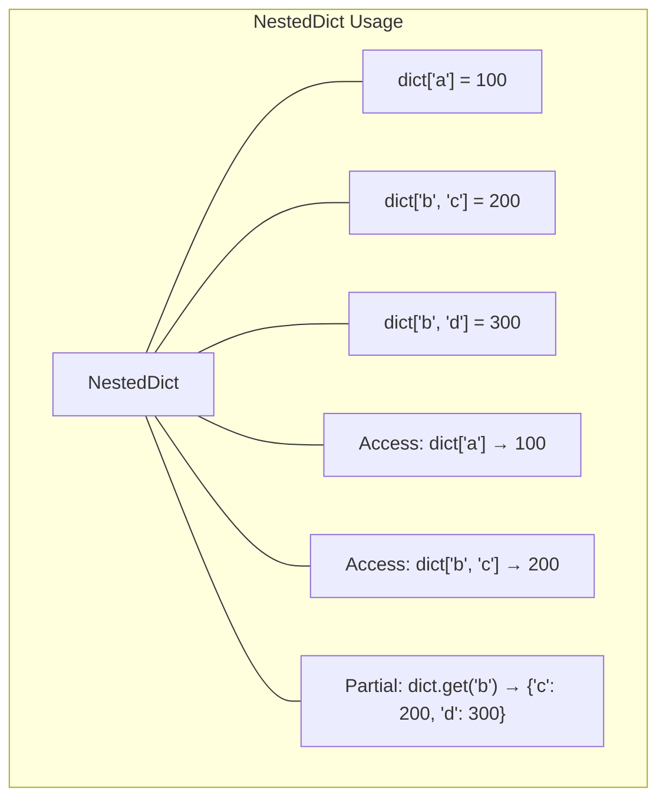
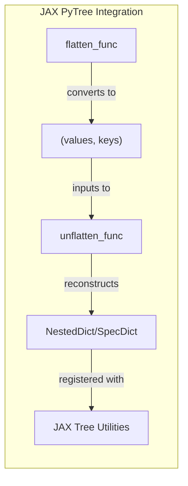
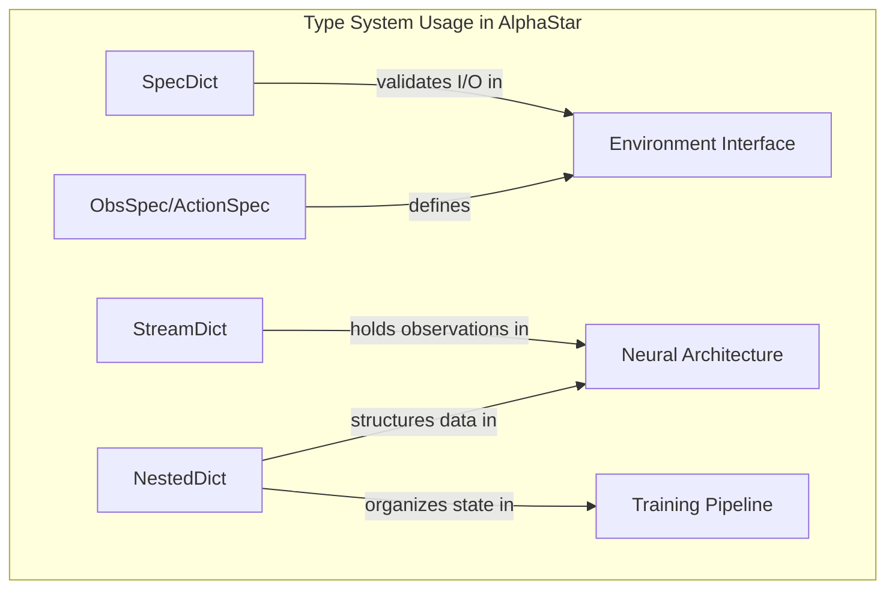

<!-- source: DeepWiki mcp.deepwiki.com · repo google-deepmind/alphastar · page 3.5 Type System · fetched 2026-10-26 -->

# Type System

<details>
<summary>Relevant source files</summary>

The following files were used as context for generating this wiki page:

- [alphastar/types/__init__.py](alphastar/types/__init__.py)
- [alphastar/types/types.py](alphastar/types/types.py)

</details>


## Purpose and Scope

This document explains the custom type system used throughout the AlphaStar project. The type system provides specialized data structures for handling nested data, managing specifications, and ensuring compatibility with JAX's functional transformations. The type system enables consistent handling of observations, actions, and model state across the different components of AlphaStar.

This page focuses on the core types and data structures defined in the types module. For information about the architecture components that use these types, see [Modular Component System](#3.1).

## Overview of the Type System

AlphaStar implements a custom type system built on Python's typing module with specialized containers designed to handle StarCraft II observation and action data. At its core, the system provides robust nested dictionary structures that support complex indexing patterns and validation against specifications.

```mermaid
classDiagram
    class "Basic Type Aliases" {
        ArgumentName
        ObsSpec
        ActionSpec
        StreamType
    }
    
    class "Container Types" {
        NestedDict
        StrDict
        StreamDict
        SpecDict
    }
    
    class "Integration" {
        JAX PyTree Registration
    }
    
    "Basic Type Aliases" --> "Container Types" : used by
    "Container Types" --> "Integration" : enables
```

Sources: [alphastar/types/types.py:15-45](), [alphastar/types/types.py:259-263]()

## Basic Type Aliases

The type system defines several foundational type aliases to improve code readability and type safety:

| Type Alias | Definition | Purpose |
|------------|------------|---------|
| `ArgumentName` | `str` | Represents action argument names |
| `ObsSpec` | `Mapping[str, specs.BoundedArray]` | Specification for observation spaces |
| `ActionSpec` | `Mapping[ArgumentName, specs.BoundedArray]` | Specification for action spaces |
| `StreamType` | `Union[str, Sequence[str]]` | Identifier for data streams or nested paths |

These aliases provide a common vocabulary for handling StarCraft II game interfaces and agent interactions.

Sources: [alphastar/types/types.py:37-42](), [alphastar/types/__init__.py:17-24]()

## NestedDict: Core Data Structure

The `NestedDict` class is the cornerstone of AlphaStar's type system, providing a specialized dictionary that supports nested indexing with tuples of strings. This simplifies access to deeply nested structures commonly found in the StarCraft II observation and action spaces.



### Key Features of NestedDict

1. **Hierarchical Indexing**: Allows indexing with tuples of strings to access nested values directly.
2. **Type Safety**: Implements generic typing for value types.
3. **Filtering**: Can filter entries based on another NestedDict or sequence of keys.
4. **Dictionary Conversion**: Can be converted to standard Python dictionaries.
5. **JAX Compatibility**: Registered as a PyTree node for JAX transformations.

### Specialized NestedDict Types

The system defines specialized NestedDict subtypes for common use cases:

- `StrDict`: A NestedDict containing string values
- `StreamDict`: A NestedDict containing array values (observations, actions, etc.)

Sources: [alphastar/types/types.py:77-256](), [alphastar/types/types.py:259-261]()

### Usage Examples

NestedDict supports several patterns for initializing and accessing data:

```
# Creating a NestedDict
nested = NestedDict()
nested['a'] = 100
nested['b', 'c'] = 200
nested['b', 'd'] = 300

# Accessing elements
value = nested['b', 'c']  # 200
partial = nested.get('b')  # {'c': 200, 'd': 300}

# Filtering against another structure
filter_template = NestedDict([('foo', NestedDict(dict(a=0)))])
filtered = some_data.filter(filter_template)  # Only keeps the 'foo/a' entry
```

Sources: [alphastar/types/types.py:90-123]()

## SpecDict: Validating Data Structures

The `SpecDict` class extends `NestedDict` with additional validation capabilities. It's specifically designed to hold specifications (from `dm_env.specs`) and validate data against these specifications.

```mermaid
classDiagram
    NestedDict <|-- SpecDict
    
    class NestedDict {
        +__getitem__(key)
        +__setitem__(key, value)
        +get(key, default)
        +filter(other)
        +asdict()
    }
    
    class SpecDict {
        +validate(data, exact_match, num_leading_dims_to_ignore)
        +copy()
    }
    
    class "StreamDict" {
        Contains Array Data
    }
    
    SpecDict --> "StreamDict" : validates
```

### Validation Process

The `validate` method in `SpecDict` performs several checks:

1. Ensures all keys in the spec exist in the data
2. Optionally checks for exact key matching (no extra keys in data)
3. Validates shape consistency of leading dimensions
4. For each entry, validates the shape and dtype against the specification

This validation is critical for ensuring that observations and actions conform to their expected specifications before processing by the agent.

Sources: [alphastar/types/types.py:263-333]()

## JAX Integration

The AlphaStar type system integrates with JAX's functional transformations by registering `NestedDict` and `SpecDict` as PyTree nodes. This enables these containers to work with JAX functions like `jit`, `grad`, and `vmap`.



The registration process defines:

1. A `_flatten_func` that converts a NestedDict into a tuple of (values, keys)
2. An `_unflatten_func` that reconstructs a NestedDict from (keys, values)

This integration allows the custom data structures to be used seamlessly within JAX's functional programming paradigm, enabling efficient gradient computation and compilation.

Sources: [alphastar/types/types.py:336-351]()

## Type System in the Broader Architecture

The type system provides the foundation for data handling throughout the AlphaStar architecture. It enables consistent representation of:

- Observation and action specifications
- Game state data
- Model inputs and outputs
- Configuration settings



By providing a consistent interface for nested data structures with validation capabilities, the type system ensures that data flows correctly between the various components of AlphaStar, from the environment interface to the neural architecture and training pipeline.

Sources: [alphastar/types/types.py:15-45](), [alphastar/types/__init__.py:15-24]()

## Summary

The AlphaStar Type System provides specialized data structures for handling the complex, nested data encountered in StarCraft II agents. The `NestedDict` class forms the foundation, offering flexible nested indexing, while `SpecDict` adds validation capabilities. Integration with JAX ensures these structures work efficiently within the functional programming paradigm used throughout the AlphaStar codebase.

---

