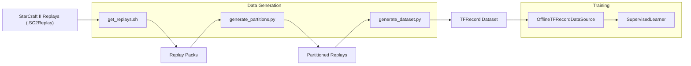
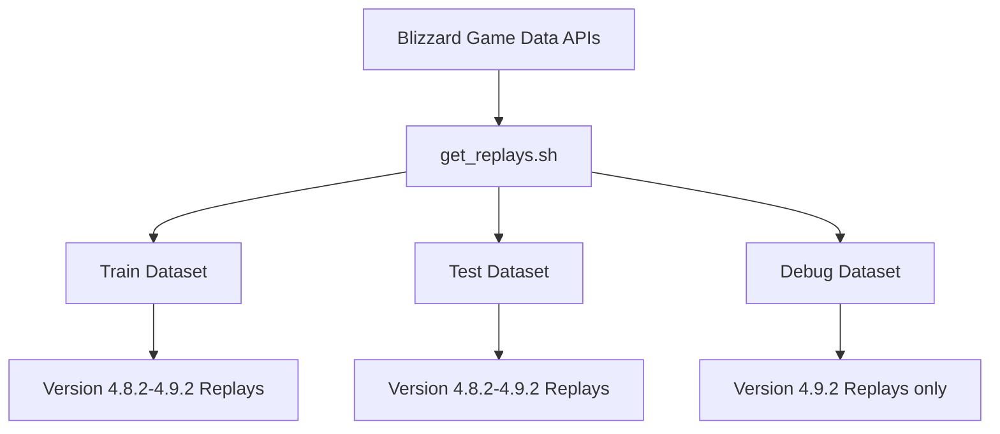
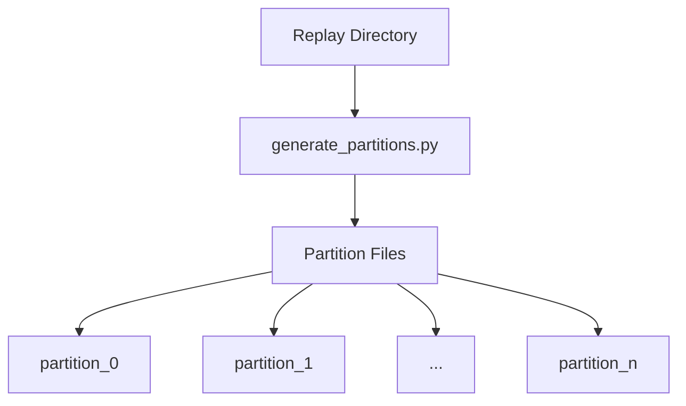
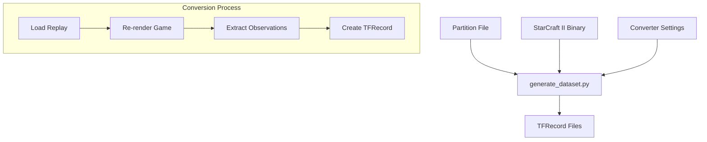
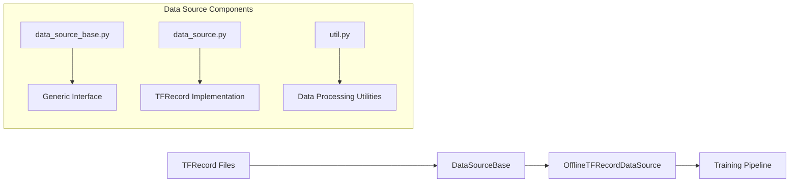
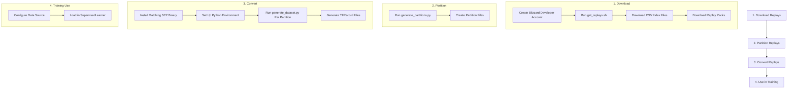
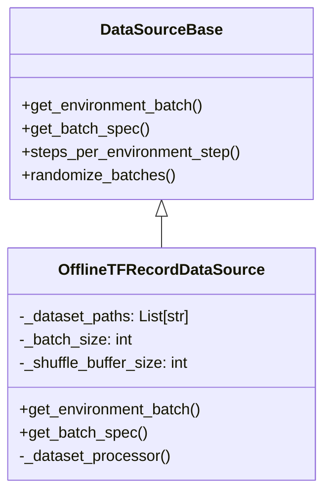

<!-- source: DeepWiki mcp.deepwiki.com · repo google-deepmind/alphastar · page 4 Data Pipeline · fetched 2026-10-26 -->

# Data Pipeline

<details>
<summary>Relevant source files</summary>

The following files were used as context for generating this wiki page:

- [alphastar/unplugged/data/BUILD](alphastar/unplugged/data/BUILD)
- [alphastar/unplugged/data/README.md](alphastar/unplugged/data/README.md)
- [alphastar/unplugged/data/get_replays.sh](alphastar/unplugged/data/get_replays.sh)

</details>


## Purpose and Scope

This document describes the AlphaStar data pipeline, which is responsible for processing StarCraft II replay data to create datasets for training and evaluating AlphaStar agents. The pipeline handles downloading replay packs, partitioning them for parallel processing, and converting them to the TFRecord format required for training. This document also covers the data source implementation used to feed this data to the training system. For information about using this data in training, see [Training System](#5).

## Overview

The AlphaStar data pipeline transforms raw StarCraft II replay files into structured TensorFlow datasets suitable for training an AlphaStar agent. This process is computationally intensive and can generate hundreds of terabytes of data depending on the size of the replay collection.



Sources: [alphastar/unplugged/data/README.md:1-126](), [alphastar/unplugged/data/get_replays.sh:1-201]()

## Data Pipeline Components

### 1. Replay Collection

The first step in the pipeline is collecting StarCraft II replay files. These replays contain the complete game state and player actions from human matches.



The `get_replays.sh` script handles downloading replay packs from Blizzard's servers. It requires:
- A Blizzard Developer account with client ID and secret
- A directory for saving replays
- Selection of which datasets to download (train, test, or debug)
- Specification of which StarCraft II version to download replays for

Key characteristics of the datasets:
- **Train**: Contains all replay packs used for training the AlphaStar baseline (~15GB for version 4.9.2)
- **Test**: A small subset for validation and testing (~200MB for version 4.9.2)
- **Debug**: Minimal set for testing the pipeline (supported only for version 4.9.2)

The total size across all supported game versions is approximately 1TB.

Sources: [alphastar/unplugged/data/get_replays.sh:16-201](), [alphastar/unplugged/data/README.md:1-55]()

### 2. Data Partitioning

Due to the computational intensity of the conversion process, the replay data is partitioned into manageable chunks for parallel processing.



The `generate_partitions.py` script:
- Takes input replay directory and output directory paths
- Divides replays into roughly equal-sized partitions
- Creates partition files that list which replay files belong to each partition

For the test dataset, 16 partitions might be sufficient, but for the full dataset, many more partitions would be required to make processing feasible.

Sources: [alphastar/unplugged/data/README.md:57-77](), [alphastar/unplugged/data/BUILD:82-93]()

### 3. Data Conversion

The most computationally intensive step is converting the replay files to TFRecord format, which contains tensor observations for every frame on which the player acted.



The `generate_dataset.py` script:
- Takes a partition file listing replay files to process
- Uses the StarCraft II game binary to re-render each replay
- Extracts tensor observations at each action frame
- Converts these observations to TFRecord format
- Processes each partition serially (though different partitions can be processed in parallel on different machines)

Important considerations:
- The StarCraft II binary version must match the replay version
- The conversion generates files approximately 100x larger than the original replays
- Processing the full dataset on a single machine would take months

Sources: [alphastar/unplugged/data/README.md:79-126](), [alphastar/unplugged/data/BUILD:55-80]()

### 4. Data Source Implementation

Once the TFRecord files are generated, they need to be fed into the training pipeline through a data source implementation.



The data source implementation consists of:
- A base class (`DataSourceBase`) that defines the interface for data sources
- The `OfflineTFRecordDataSource` implementation that reads from the converted TFRecord files
- Utility functions for processing and manipulating the data

Sources: [alphastar/unplugged/data/BUILD:9-53]()

## Data Pipeline Workflow

The complete workflow for generating and using the dataset involves:



Sources: [alphastar/unplugged/data/README.md:1-126]()

## Implementation Details

### Command-line Tools

The data pipeline provides three main command-line tools:

1. **get_replays.sh**:
   ```bash
   alphastar/unplugged/data/get_replays.sh
   ```
   This interactive script guides you through downloading replay packs.

2. **generate_partitions.py**:
   ```bash
   python3 alphastar/unplugged/data/generate_partitions.py \
     --sc2_replay_path=${REPLAYS_DIR}/4.9.2/test \
     --converted_path=${REPLAYS_DIR}/converted/4.9.2/test \
     --num_partitions=16 \
     --partition_path=${REPLAYS_DIR}/partitions/4.9.2/test
   ```

3. **generate_dataset.py**:
   ```bash
   python3 alphastar/unplugged/data/generate_dataset.py \
     --sc2_replay_path=${REPLAYS_DIR}/4.9.2/test \
     --converted_path=${REPLAYS_DIR}/converted/4.9.2/test \
     --partition_file=${REPLAYS_DIR}/partitions/4.9.2/test/partition_0 \
     --converter_settings=alphastar/unplugged/configs/alphastar_supervised_converter_settings.pbtxt \
     --logtostderr
   ```

Sources: [alphastar/unplugged/data/README.md:63-101](), [alphastar/unplugged/data/get_replays.sh:1-201](), [alphastar/unplugged/data/BUILD:55-93]()

### Data Source Implementation Classes



The data source components are defined in:
- `data_source_base.py`: Base class defining the interface
- `data_source.py`: Implementation for TFRecord datasets
- `util.py`: Utility functions for data processing

These components work together to load the converted TFRecord data and feed it into the training pipeline.

Sources: [alphastar/unplugged/data/BUILD:9-53]()

## Considerations and Limitations

1. **Resource Requirements**:
   - Converting replays requires substantial computational resources
   - The final TFRecord dataset may be hundreds of terabytes in size
   - Processing the full dataset on a single machine is impractical

2. **Version Compatibility**:
   - StarCraft II binary version must match the replay version
   - Each replay version requires a separate Python environment

3. **Distributed Processing**:
   - The repository does not provide a distributed pipeline implementation
   - Users need to develop their own parallelization strategy for processing large datasets

4. **Data Size Reference**:
   - Train dataset: ~15GB of replay packs for version 4.9.2
   - Test dataset: ~200MB of replay packs for version 4.9.2
   - Final converted TFRecord files: 100x larger than original replays

Sources: [alphastar/unplugged/data/README.md:16-25](), [alphastar/unplugged/data/README.md:85-93]()

## Conclusion

The AlphaStar data pipeline provides a framework for generating training data from StarCraft II replays. While it requires significant computational resources and careful management of game versions and environments, it enables the creation of datasets suitable for training AlphaStar agents using supervised learning and reinforcement learning techniques. For large-scale applications, users should consider implementing a distributed processing system to handle the conversion workload efficiently.

Sources: [alphastar/unplugged/data/README.md:1-126]()

---

