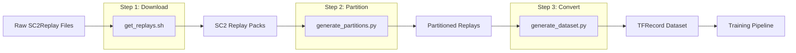
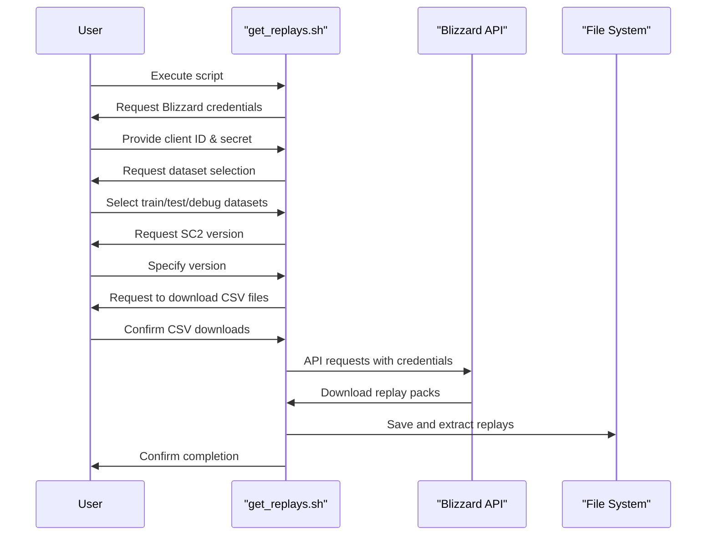
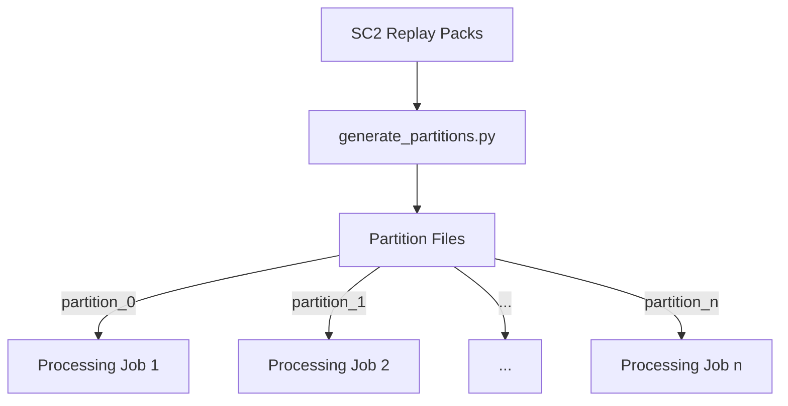
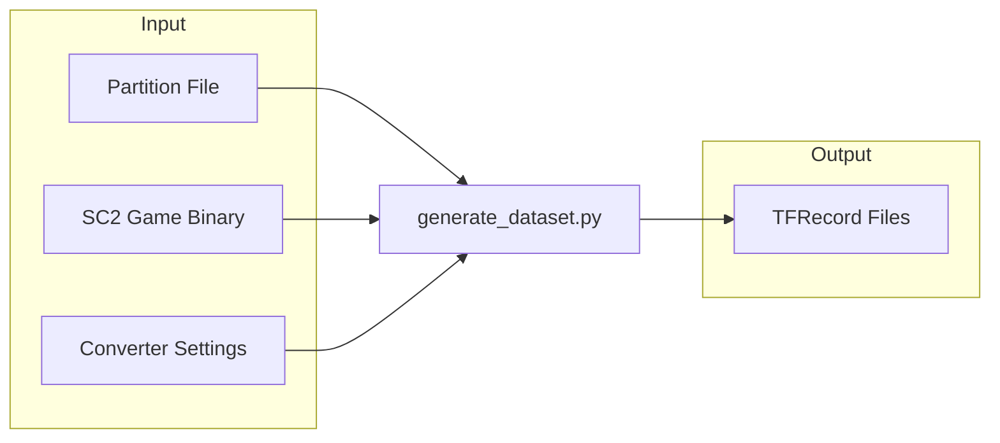
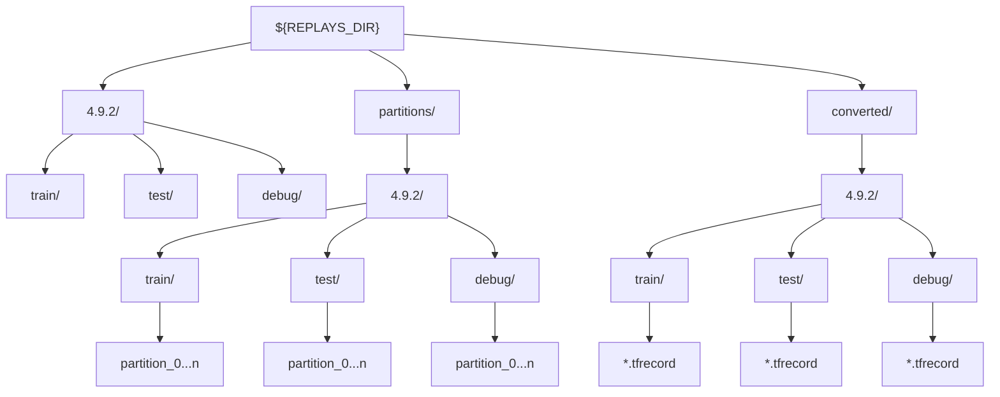

<!-- source: DeepWiki mcp.deepwiki.com · repo google-deepmind/alphastar · page 4.1 Replay Data Processing · fetched 2026-10-26 -->

# Replay Data Processing

<details>
<summary>Relevant source files</summary>

The following files were used as context for generating this wiki page:

- [alphastar/unplugged/data/README.md](alphastar/unplugged/data/README.md)
- [alphastar/unplugged/data/get_replays.sh](alphastar/unplugged/data/get_replays.sh)

</details>


This document details the process of acquiring and converting StarCraft II replay data for training and evaluating AlphaStar agents. It covers the complete pipeline from downloading raw replay files through conversion to the final TFRecord format used by the training system. For information about how these datasets are consumed during training, see [Data Sources](#4.2).

## Overview of the Data Pipeline

The replay data processing pipeline involves three main steps:

1. **Download Replay Packs**: Acquiring replay files from Blizzard's Game Data APIs
2. **Partition Replays**: Dividing replays into manageable chunks for parallel processing
3. **Convert to TFRecord**: Transforming replays into observation tensors for model training

This process is computationally intensive and can generate hundreds of terabytes of data for a full-sized dataset.



**Data Pipeline Flow**

Sources: [alphastar/unplugged/data/README.md:8-13]()

## Step 1: Downloading Replay Packs

The first step is to acquire StarCraft II replay packs from Blizzard. The project provides a shell script to automate this process.

### Available Datasets

Three types of datasets are supported:

| Dataset Type | Description | Approximate Size (v4.9.2) |
|--------------|-------------|---------------------------|
| `train` | Full dataset used for training the AlphaStar baseline | 15 GB |
| `test` | Small subset for validation and testing | 200 MB |
| `debug` | Minimal set for testing the pipeline (v4.9.2 only) | <100 MB |

The complete set of replay packs across all supported game versions (4.8.2 through 4.9.2) totals approximately 1 TB.

Sources: [alphastar/unplugged/data/README.md:26-54]()

### Using the Download Script

The provided script (`get_replays.sh`) guides users through the process of:

1. Creating a Blizzard Developer Portal account
2. Setting up API access credentials
3. Downloading selected datasets for specific game versions



**Replay Download Process**

Sources: [alphastar/unplugged/data/get_replays.sh:16-38](), [alphastar/unplugged/data/get_replays.sh:166-179]()

### Authentication Requirements

The script requires:
- A Blizzard Developer Portal account (https://dev.battle.net)
- Client ID and secret from a registered API client
- Selection of which datasets to download (train/test/debug)
- Target StarCraft II version

The script will download replays to a specified directory structure organized by version and dataset type.

Sources: [alphastar/unplugged/data/get_replays.sh:28-83]()

## Step 2: Partitioning Replay Data

Since processing the replay files is computationally intensive, the second step involves partitioning the downloaded replays into chunks that can be processed in parallel.

### Partitioning Process

The partitioning is performed using the `generate_partitions.py` script:



**Replay Partitioning Process**

Sources: [alphastar/unplugged/data/README.md:57-77]()

### Running the Partitioning Script

The script takes the following parameters:

| Parameter | Description |
|-----------|-------------|
| `--sc2_replay_path` | Directory containing downloaded replay files |
| `--converted_path` | Target directory for converted files |
| `--num_partitions` | Number of partitions to create |
| `--partition_path` | Output directory for partition files |

Example usage:

```
python3 alphastar/unplugged/data/generate_partitions.py \
  --sc2_replay_path=${REPLAYS_DIR}/4.9.2/test \
  --converted_path=${REPLAYS_DIR}/converted/4.9.2/test \
  --num_partitions=16 \
  --partition_path=${REPLAYS_DIR}/partitions/4.9.2/test
```

The number of partitions should be chosen based on available computational resources. For the full training dataset, significantly more than 16 partitions would likely be needed.

Sources: [alphastar/unplugged/data/README.md:64-77]()

## Step 3: Converting to TFRecord Format

The final step converts the partitioned replay data into TFRecord format, which contains tensor observations for each frame where a player action occurred during the game.

### Conversion Process

This step requires the StarCraft II game binary to re-render each replay and extract the observations. The process generates files that are collectively 100+ times larger than the original replay files.



**Replay Conversion Process**

Sources: [alphastar/unplugged/data/README.md:79-88]()

### Running the Conversion Script

The conversion script requires:

| Requirement | Description |
|-------------|-------------|
| StarCraft II Binary | Must match the exact version of the replays being processed |
| Converter Settings | PySC2 converter configuration in protobuf format |
| Python Environment | Separate environment required for each SC2 version |

Example usage:

```
python3 alphastar/unplugged/data/generate_dataset.py \
  --sc2_replay_path=${REPLAYS_DIR}/4.9.2/test \
  --converted_path=${REPLAYS_DIR}/converted/4.9.2/test \
  --partition_file=${REPLAYS_DIR}/partitions/4.9.2/test/partition_0 \
  --converter_settings=alphastar/unplugged/configs/alphastar_supervised_converter_settings.pbtxt \
  --logtostderr
```

This process must be repeated for each partition file, potentially across multiple machines for larger datasets.

Sources: [alphastar/unplugged/data/README.md:94-101]()

## Directory Structure

Throughout the processing pipeline, the following directory structure is typically used:



**Directory Structure for Replay Processing**

Sources: [alphastar/unplugged/data/README.md:94-125]()

## Technical Considerations and Best Practices

### Version Compatibility

A critical requirement is that the StarCraft II binary version must exactly match the version of the replays being processed. Since PySC2 can only use one StarCraft II binary at a time, a separate Python environment is needed for each replay version being processed.

### Handling Large Datasets

Some key considerations when working with the full replay dataset:

1. **Storage Requirements**: The final converted dataset can be hundreds of terabytes in size
2. **Computation Time**: Converting the full dataset on a single machine would take months
3. **Parallel Processing**: It's strongly recommended to process partitions in parallel across multiple machines

### Processing Multiple Versions

When processing replays from multiple StarCraft II versions:

1. Process one version completely before moving to the next
2. Create separate Python environments for each version
3. Ensure the correct StarCraft II binary is installed for each version

Sources: [alphastar/unplugged/data/README.md:103-125]()

## Summary

The replay data processing pipeline transforms raw StarCraft II replay files into the TFRecord format required for training AlphaStar agents. The process involves downloading replay packs, partitioning them for parallel processing, and converting them to observation tensors. While computationally intensive, this pipeline is essential for creating the high-quality datasets needed for supervised learning and offline reinforcement learning with AlphaStar.

Sources: [alphastar/unplugged/data/README.md:1-125](), [alphastar/unplugged/data/get_replays.sh:1-201]()

---

