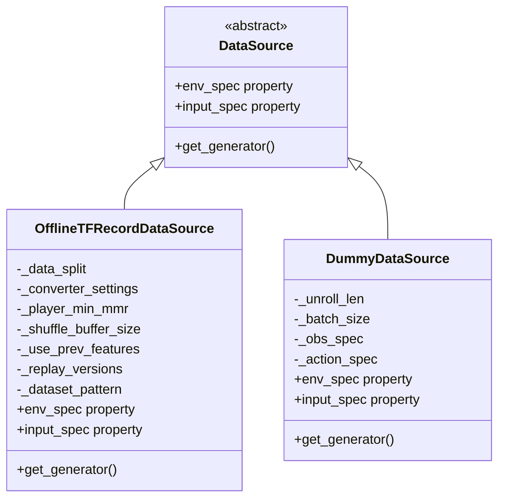
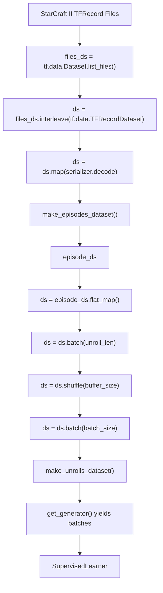
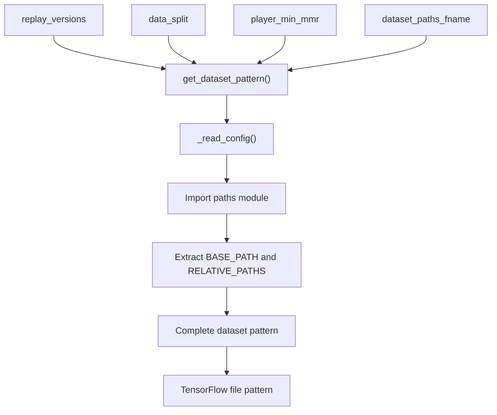
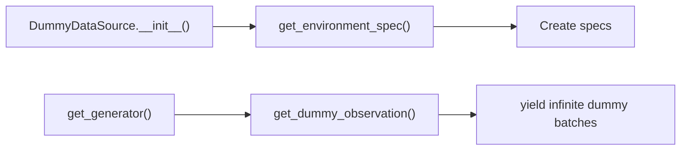
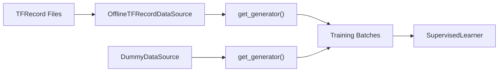

<!-- source: DeepWiki mcp.deepwiki.com · repo google-deepmind/alphastar · page 4.2 Data Sources · fetched 2026-10-26 -->

# Data Sources

<details>
<summary>Relevant source files</summary>

The following files were used as context for generating this wiki page:

- [alphastar/unplugged/data/data_source.py](alphastar/unplugged/data/data_source.py)
- [alphastar/unplugged/data/path_utils.py](alphastar/unplugged/data/path_utils.py)

</details>


This document explains the data sources used for training AlphaStar agents. Data sources are responsible for providing training data to the AlphaStar learning system by abstracting away the details of dataset access, parsing, and preprocessing.

For information about how replay data is initially processed before becoming available to data sources, see [Replay Data Processing](#4.1). For utilities used by data sources, see [Data Utilities](#4.3).

## Data Source Architecture

In the AlphaStar architecture, data sources implement a common interface based on the abstract `DataSource` class. The main implementations are:

1. **OfflineTFRecordDataSource** - The primary data source used for training, which reads TFRecord datasets containing StarCraft II game episodes
2. **DummyDataSource** - A simplified data source that generates synthetic data for testing purposes



**Diagram: Data Source Class Hierarchy**

Sources: [alphastar/unplugged/data/data_source.py:80-194](), [alphastar/unplugged/data/data_source.py:195-237]()

## OfflineTFRecordDataSource

The `OfflineTFRecordDataSource` is the main data source implementation for AlphaStar training, providing StarCraft II gameplay data from pre-processed TFRecord files.

### Data Flow



**Diagram: Data Flow Through OfflineTFRecordDataSource**

Sources: [alphastar/unplugged/data/data_source.py:29-54](), [alphastar/unplugged/data/data_source.py:57-77](), [alphastar/unplugged/data/data_source.py:157-171]()

### Configuration Parameters

The `OfflineTFRecordDataSource` requires several parameters to correctly configure data access and preprocessing:

| Parameter | Description |
|-----------|-------------|
| `unroll_len` | Length of sequence unrolls for RNN processing |
| `overlap_len` | Overlap between successive unrolled sequences |
| `batch_size` | Number of sequences per batch |
| `data_split` | Data split identifier (train/test) |
| `converter_settings` | Settings for the SC2 observation/action converter |
| `replay_versions` | Sequence of replay file versions to include |
| `player_min_mmr` | Minimum player MMR (skill rating) threshold |
| `dataset_paths_fname` | Python file containing dataset path information |
| `home_race` | Race of the player (optional filter) |
| `away_race` | Race of the opponent (optional filter) |
| `use_prev_features` | Whether to include previous actions as context |
| `shuffle_buffer_size` | Size of buffer for shuffling training data |

Sources: [alphastar/unplugged/data/data_source.py:83-121]()

### Dataset Pattern Resolution

The `OfflineTFRecordDataSource` resolves dataset file patterns using utilities from `path_utils.py`:



**Diagram: Dataset Pattern Resolution Process**

The dataset pattern is resolved by:
1. Reading a configuration file specified by `dataset_paths_fname`
2. Extracting the base path and relative paths mapping
3. Looking up the pattern using replay versions, data split, and MMR
4. Joining paths to form a complete glob pattern for TensorFlow

Sources: [alphastar/unplugged/data/path_utils.py:14-56]()

## DummyDataSource

The `DummyDataSource` provides synthetic data for testing and development. It generates dummy observations matching the expected specifications but doesn't require actual dataset files.



**Diagram: DummyDataSource Operation**

This data source is primarily used for:
- Testing the training pipeline without real data
- Verifying input shapes and types
- Development and debugging

Sources: [alphastar/unplugged/data/data_source.py:195-237]()

## Helper Functions

The data source implementation uses several key helper functions:

### make_episodes_dataset

Creates a TensorFlow dataset from episode files:
- Takes a dataset pattern and feature specification
- Returns a dataset that yields individual episodes

```python
def make_episodes_dataset(dataset_pattern, features, training=True):
  files_ds = tf.data.Dataset.list_files(dataset_pattern, shuffle=training)
  ds = files_ds.interleave(tf.data.TFRecordDataset, num_parallel_calls=tf.data.AUTOTUNE)
  serializer = data_utils.TFExampleCoder(features=features, compress=True)
  ds = ds.map(serializer.decode, num_parallel_calls=tf.data.AUTOTUNE)
  ds = ds.repeat()
  return ds
```

Sources: [alphastar/unplugged/data/data_source.py:29-54]()

### make_unrolls_dataset

Creates batched unrolled sequences from an episodes dataset:
- Takes episodes dataset, batch size, unroll length, and shuffle buffer size
- Returns a dataset that yields batches of unrolled sequences

```python
def make_unrolls_dataset(episode_ds, batch_size, unroll_len, shuffle_buffer_size):
  ds = episode_ds.flat_map(tf.data.Dataset.from_tensor_slices)
  ds = ds.batch(unroll_len)
  ds = ds.shuffle(buffer_size=shuffle_buffer_size, reshuffle_each_iteration=True)
  ds = ds.batch(batch_size)
  ds = ds.prefetch(buffer_size=tf.data.AUTOTUNE)
  return ds
```

Sources: [alphastar/unplugged/data/data_source.py:57-77]()

## Integration with Training System

Data sources integrate with the AlphaStar training system by providing a standardized interface for accessing training data:



**Diagram: Data Source Integration with Training**

The training system accesses data through the following interfaces:

1. `get_generator()` - Returns a generator that yields training batches
2. `env_spec` property - Provides environment specification (observation and action specs)
3. `input_spec` property - Provides input specification for the neural network

Sources: [alphastar/unplugged/data/data_source.py:157-171](), [alphastar/unplugged/data/data_source.py:174-192](), [alphastar/unplugged/data/data_source.py:226-237]()

## Summary

Data sources in AlphaStar provide a unified interface for accessing training data, whether from real TFRecord datasets or synthetic sources. The primary implementation, `OfflineTFRecordDataSource`, handles reading datasets generated from StarCraft II replays, processing them into appropriate batches, and feeding them to the learning system. The simpler `DummyDataSource` is provided for testing and development purposes.

Sources: [alphastar/unplugged/data/data_source.py:14-237](), [alphastar/unplugged/data/path_utils.py:14-56]()

---

