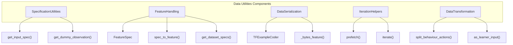
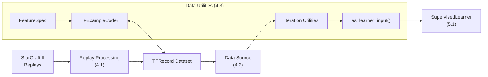
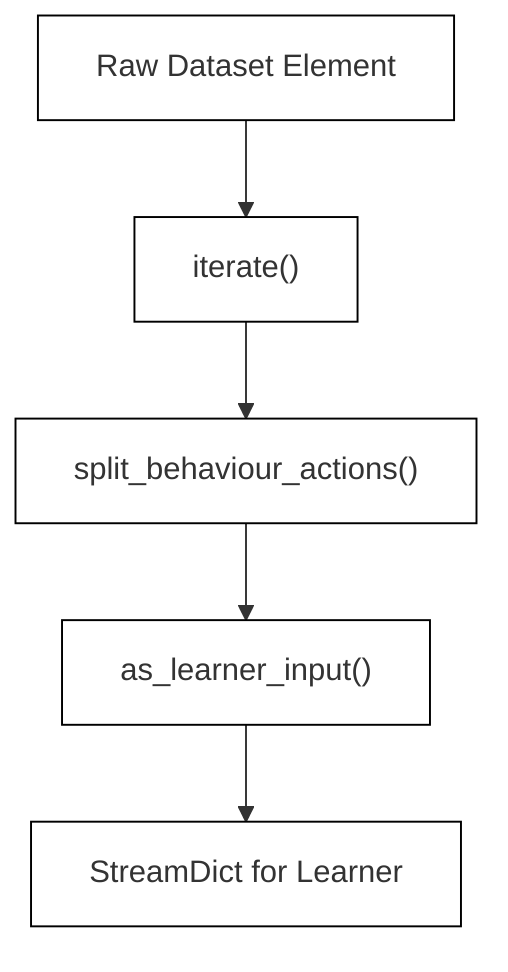

<!-- source: DeepWiki mcp.deepwiki.com · repo google-deepmind/alphastar · page 4.3 Data Utilities · fetched 2026-10-26 -->

# Data Utilities

<details>
<summary>Relevant source files</summary>

The following files were used as context for generating this wiki page:

- [alphastar/unplugged/data/util.py](alphastar/unplugged/data/util.py)

</details>


## Purpose and Scope

The Data Utilities module provides essential functions and classes for data processing, transformation, and manipulation within the AlphaStar system. These utilities serve as the foundation for the data pipeline, enabling efficient handling of StarCraft II observation data, feature specifications, and serialization/deserialization of dataset elements. 

This document covers the key utility functions and classes in the `alphastar/unplugged/data/util.py` file that facilitate data processing. For information about replay data processing, see [Replay Data Processing](#4.1), and for data sources information, see [Data Sources](#4.2).

## Key Components



Sources: [alphastar/unplugged/data/util.py:15-35]()

## Specification Utilities

These utilities help define and manipulate input specifications for the AlphaStar system.

### get_input_spec

This function constructs a complete input specification by combining observation specs with optional behavior features and previous features specs.

**Signature:**
```python
def get_input_spec(
    obs_spec: types.ObsSpec,
    behaviour_features_spec: Optional[types.SpecDict] = None,
    prev_features_spec: Optional[types.SpecDict] = None
) -> types.SpecDict
```

The function creates a `SpecDict` containing:
- `step_type`: A bounded array specifying the step type (first, mid, or last step in an episode)
- `observation`: The provided observation specification
- `behaviour_features` (optional): Specification for behavior features
- `prev_features` (optional): Specification for previous features

Sources: [alphastar/unplugged/data/util.py:37-51]()

### get_dummy_observation

Creates zero-initialized dummy observations matching a given input specification. This is useful for testing or initialization purposes.

**Signature:**
```python
def get_dummy_observation(input_spec: types.SpecDict,
                          batch_size: int,
                          unroll_len: Optional[int]) -> types.StreamDict
```

The function generates zero arrays with shapes determined by the provided spec, batch size, and optional unroll length.

Sources: [alphastar/unplugged/data/util.py:54-64]()

## Feature Handling

The feature handling components provide tools for defining, creating, and manipulating feature specifications.

### FeatureSpec

`FeatureSpec` is a class that describes the features used in the dataset, including their data type and shape. It provides methods for serializing and deserializing feature values.

```mermaid
classDiagram
    class "FeatureSpec" {
        -dtype
        -numpy_scalar_type
        -numpy_dtype
        -shape
        -reshape_arg
        +__init__(dtype, shape)
        +dtype(property)
        +shape(property)
        +_check_shape(array)
        +value_to_string(value) -> str
        +string_to_value(byte_string) -> Tensor
    }
```

Key methods include:
- `value_to_string()`: Serializes a numpy array to a byte string
- `string_to_value()`: Deserializes a byte string back to a tensor

Sources: [alphastar/unplugged/data/util.py:67-134]()

### spec_to_feature

Converts an array specification to a `FeatureSpec` object, ensuring proper handling of scalar values.

**Signature:**
```python
def spec_to_feature(x: Union[np.ndarray, chex.Array]) -> FeatureSpec
```

Sources: [alphastar/unplugged/data/util.py:233-240]()

### get_dataset_specs

Generates dataset feature specifications from StarCraft II observation specifications.

**Signature:**
```python
def get_dataset_specs(
    obs_spec,
    make_spec: Callable[..., FeatureSpec] = FeatureSpec
) -> Mapping[str, FeatureSpec]
```

Sources: [alphastar/unplugged/data/util.py:243-253]()

## Data Serialization

These components handle the serialization and deserialization of data for storage and transmission.

### TFExampleCoder

`TFExampleCoder` is a class that helps encode and decode rows of the dataset to/from TensorFlow protocol buffers (`tf.train.Example`).

```mermaid
classDiagram
    class "TFExampleCoder" {
        -features
        -compress
        -flat_features_with_paths
        -flat_features
        -string_flat_features
        -success_counter
        -failure_counter
        +__init__(features, compress)
        +convert_to_proto(row) -> tf.train.Example
        +serialize(proto) -> Optional[str]
        +encode(row) -> Optional[str]
        +decode(example_string) -> Mapping
    }
```

The class provides these key methods:
- `convert_to_proto()`: Converts a row of data to a `tf.train.Example` proto
- `serialize()`: Serializes a proto to a string
- `encode()`: Combines conversion and serialization in one step
- `decode()`: Deserializes a string back to a row of data

The coder also supports optional compression of feature values.

Sources: [alphastar/unplugged/data/util.py:144-219](), [alphastar/unplugged/data/util.py:137-141]()

## Iteration Utilities

These utilities facilitate efficient iteration over datasets.

### prefetch

Performs prefetching of elements from an iterable in a separate thread, improving performance by preparing data in advance.

**Signature:**
```python
def prefetch(iterable: Iterable[T],
             buffer_size: int) -> Generator[T, None, None]
```

This function creates a producer thread that fills a queue with items from the iterable, while the consumer (main) thread pulls items from this queue.

Sources: [alphastar/unplugged/data/util.py:258-303]()

### iterate

A helper function to iterate over a TensorFlow dataset, converting elements to numpy arrays and applying prefetching.

**Signature:**
```python
def iterate(ds: tf.data.Dataset)
```

Sources: [alphastar/unplugged/data/util.py:306-307]()

## Data Transformation

These utilities transform data between different formats required by the system.

### split_behaviour_actions

Extracts behavior actions from an observation dictionary, separating them from other observation data.

**Signature:**
```python
def split_behaviour_actions(observation: Mapping[str, Any])
```

The function returns a tuple of `(behaviour_actions, observation)` where behavior actions are extracted from keys starting with `'action/'`.

Sources: [alphastar/unplugged/data/util.py:310-322]()

### as_learner_input

Transforms raw input data into a `StreamDict` format that can be used by the learner component.

**Signature:**
```python
def as_learner_input(raw_input: Mapping[str, Any],
                     use_prev_features: bool = False) -> types.StreamDict
```

If `use_prev_features` is enabled, the function uses the first timestep to generate previous features and discards it from the main data.

Sources: [alphastar/unplugged/data/util.py:325-352]()

## Data Flow and Integration

The Data Utilities integrate with the broader data pipeline as illustrated in the following diagram:



Sources: [alphastar/unplugged/data/util.py:15-352]()

## Usage Examples

### Creating Feature Specifications

Feature specifications are created from observation specifications to define the structure of the dataset:

1. First, observation specifications are mapped to feature specifications using `spec_to_feature()`
2. These are combined with step type specifications using `get_dataset_specs()`
3. The resulting specs are used by `TFExampleCoder` for serialization/deserialization

### Data Transformation Flow



A typical data transformation flow includes:
1. Iterating over a dataset with `iterate()`
2. Extracting behavior actions with `split_behaviour_actions()`
3. Transforming to learner input format with `as_learner_input()`
4. Using the resulting `StreamDict` in the learner component

Sources: [alphastar/unplugged/data/util.py:306-352]()

## Error Handling

The Data Utilities include several error handling mechanisms:

- `FeatureSpec` validates shape and data type compatibility
- `TFExampleCoder` tracks successful and failed serializations using Beam metrics
- The `prefetch()` function propagates errors from the producer thread to the main thread
- The `encode()` method validates that serialized data can be correctly reconstructed

Sources: [alphastar/unplugged/data/util.py:100-104](), [alphastar/unplugged/data/util.py:157-191](), [alphastar/unplugged/data/util.py:275-303]()

---

