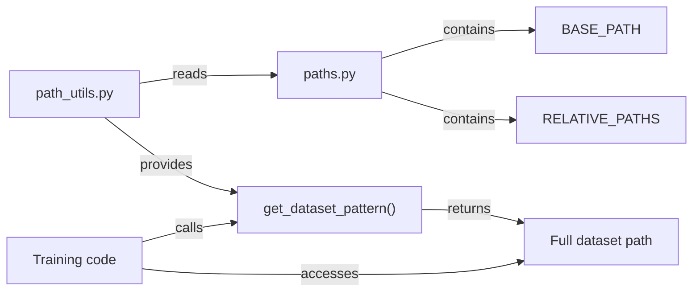
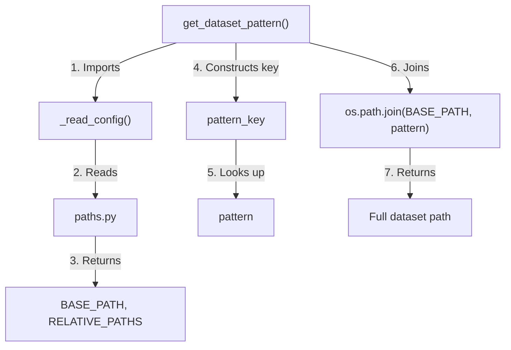
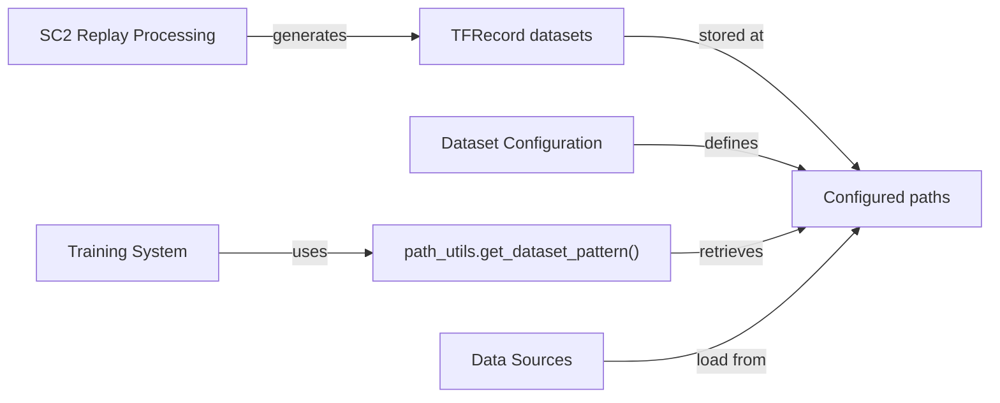

<!-- source: DeepWiki mcp.deepwiki.com · repo google-deepmind/alphastar · page 4.4 Dataset Configuration · fetched 2026-10-26 -->

# Dataset Configuration

<details>
<summary>Relevant source files</summary>

The following files were used as context for generating this wiki page:

- [alphastar/unplugged/data/path_utils.py](alphastar/unplugged/data/path_utils.py)
- [alphastar/unplugged/data/paths.py.template](alphastar/unplugged/data/paths.py.template)

</details>


This document describes the dataset configuration system used in AlphaStar, covering how to set up and manage paths to StarCraft II replay datasets. The system provides a flexible way to organize and access datasets based on replay versions, data splits, and player skill ratings.

For information about processing StarCraft II replay data, see [Replay Data Processing](#4.1). For details on data sources used in training, see [Data Sources](#4.2).

## Dataset Path Configuration System

The AlphaStar dataset configuration system provides a standardized way to reference and access TFRecord datasets generated from StarCraft II replays. It uses a configuration file approach to decouple dataset location information from the code that uses the datasets.



### Key Components

1. **paths.py**: A user-created configuration file defining dataset locations
   - `BASE_PATH`: The root directory for all datasets
   - `RELATIVE_PATHS`: A mapping of dataset parameters to relative path patterns

2. **path_utils.py**: Utility module that reads the configuration and provides lookup functions
   - `_read_config()`: Internal function to import and process the configuration file
   - `get_dataset_pattern()`: Public function to retrieve full dataset paths

Sources: [alphastar/unplugged/data/path_utils.py:15-56](), [alphastar/unplugged/data/paths.py.template:1-11]()

## Creating a Dataset Configuration File

To configure dataset paths, you need to create a `paths.py` file based on the provided template. This file defines where your datasets are stored and how they are organized.

### Basic Structure

The configuration file requires two main components:

1. `BASE_PATH`: A string defining the root directory for all datasets
2. `RELATIVE_PATHS`: A dictionary mapping dataset parameters to relative path patterns

```mermaid
classDiagram
    class "paths.py" {
        BASE_PATH: string
        RELATIVE_PATHS: dict
    }
    
    class "RELATIVE_PATHS" {
        key: (replay_versions, data_split, player_min_mmr)
        value: path_pattern
    }

    "paths.py" --> "RELATIVE_PATHS"
```

### Example Configuration

Here's an example of a `paths.py` file:

```python
BASE_PATH = '/data/alphastar/datasets'

RELATIVE_PATHS = {
    # Training data for StarCraft II version 4.9.2 with min MMR of 3500
    (('4.9.2',), 'train', 3500): 'tfrecords_train_4_9_2/*/*.tfrecord',
    
    # Validation data for StarCraft II version 4.9.2 with min MMR of 3500
    (('4.9.2',), 'valid', 3500): 'tfrecords_valid_4_9_2/*/*.tfrecord',
    
    # Training data for multiple StarCraft II versions with min MMR of 4000
    (('4.9.2', '4.9.3'), 'train', 4000): 'tfrecords_train_multi_version/*/*.tfrecord',
}
```

Sources: [alphastar/unplugged/data/paths.py.template:1-11]()

## Path Configuration Format

The `RELATIVE_PATHS` dictionary uses a tuple-based key system to map dataset parameters to file paths:

| Parameter | Description | Example |
|-----------|-------------|---------|
| `replay_versions` | Tuple of StarCraft II game versions | `('4.9.2',)` or `('4.9.2', '4.9.3')` |
| `data_split` | Dataset split identifier | `'train'`, `'valid'`, `'test'` |
| `player_min_mmr` | Minimum player MMR (skill rating) | `3500`, `4000` |

The values in this dictionary are glob patterns relative to the `BASE_PATH` that point to TFRecord files containing the processed replay data.

Sources: [alphastar/unplugged/data/paths.py.template:5-11]()

## Using the Dataset Path Utilities

Once you have created a `paths.py` file, you can use the path utilities to retrieve dataset paths in your code.

### Using `get_dataset_pattern()`

The main function for accessing dataset paths is `get_dataset_pattern()`:



The function takes four parameters:
- `replay_versions`: A tuple of StarCraft II replay versions
- `data_split`: The dataset split ('train', 'valid', 'test')
- `player_min_mmr`: Minimum player MMR (skill rating)
- `dataset_paths_fname`: Path to the dataset paths configuration file

It returns the full path pattern to the dataset files, or `None` if no matching dataset is found.

### Example Usage

Here's how you might use `get_dataset_pattern()` in your code:

```python
from alphastar.unplugged.data.path_utils import get_dataset_pattern

# Get path to training data for version 4.9.2 with minimum MMR of 3500
dataset_path = get_dataset_pattern(
    replay_versions=('4.9.2',),
    data_split='train',
    player_min_mmr=3500,
    dataset_paths_fname='/path/to/paths.py'
)

# Use the dataset path with TensorFlow data loading
if dataset_path:
    dataset = tf.data.TFRecordDataset(tf.data.Dataset.list_files(dataset_path))
else:
    raise ValueError("Dataset not found")
```

Sources: [alphastar/unplugged/data/path_utils.py:40-56]()

## Best Practices

### Organizing Dataset Paths

1. **Hierarchical Structure**: Organize datasets in a hierarchical directory structure by version, split, and MMR
2. **Descriptive Names**: Use descriptive directory names that include key parameters
3. **Glob Patterns**: Utilize glob patterns to handle sharded datasets (multiple files per dataset)

### Multiple Path Configurations

For different environments (development, testing, production), consider:

- Maintaining separate path configuration files
- Using environment variables to select the appropriate configuration
- Creating a central configuration directory with multiple path configurations

### Error Handling

When a dataset is not found, `get_dataset_pattern()` returns `None`. Always check for this condition and provide meaningful error messages to users.

```python
dataset_path = get_dataset_pattern(replay_versions, data_split, player_min_mmr, paths_fname)
if dataset_path is None:
    available_datasets = "..." # Get list of available datasets
    raise ValueError(f"Dataset not found for {replay_versions}, {data_split}, {player_min_mmr}. "
                     f"Available datasets: {available_datasets}")
```

Sources: [alphastar/unplugged/data/path_utils.py:40-56]()

## Integration with Data Pipeline

The dataset configuration system integrates with the broader data pipeline in AlphaStar as follows:



The dataset configuration provides the connection point between the data generation process and the training system, ensuring that training code can locate the correct datasets regardless of their physical location on disk.

Sources: [alphastar/unplugged/data/path_utils.py:15-56](), [alphastar/unplugged/data/paths.py.template:1-11]()

---

