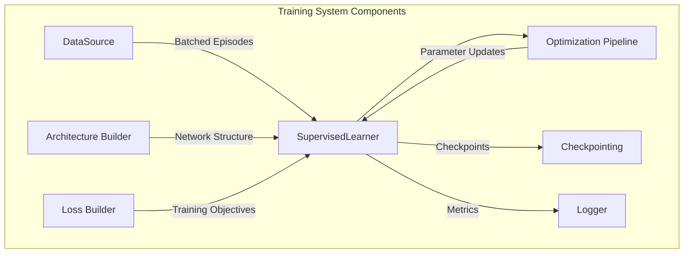
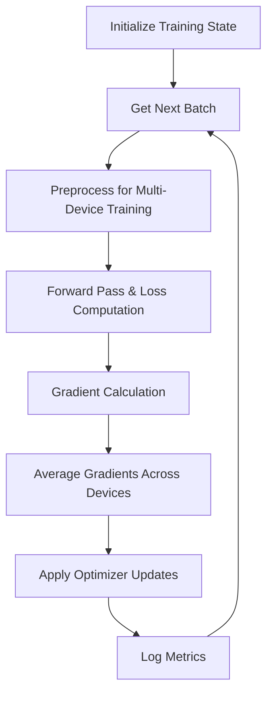
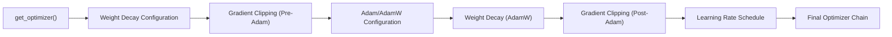
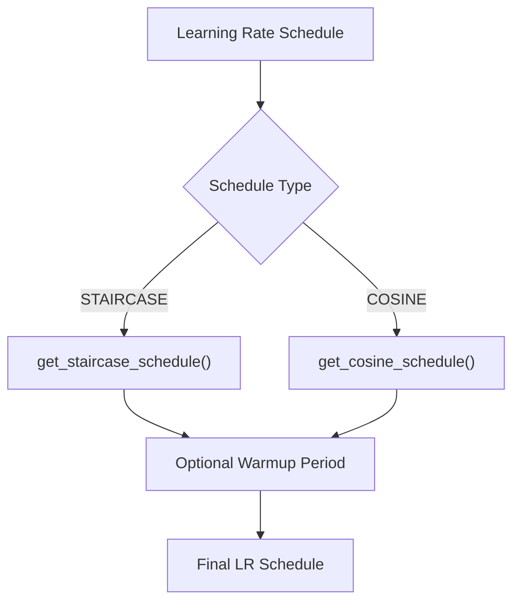
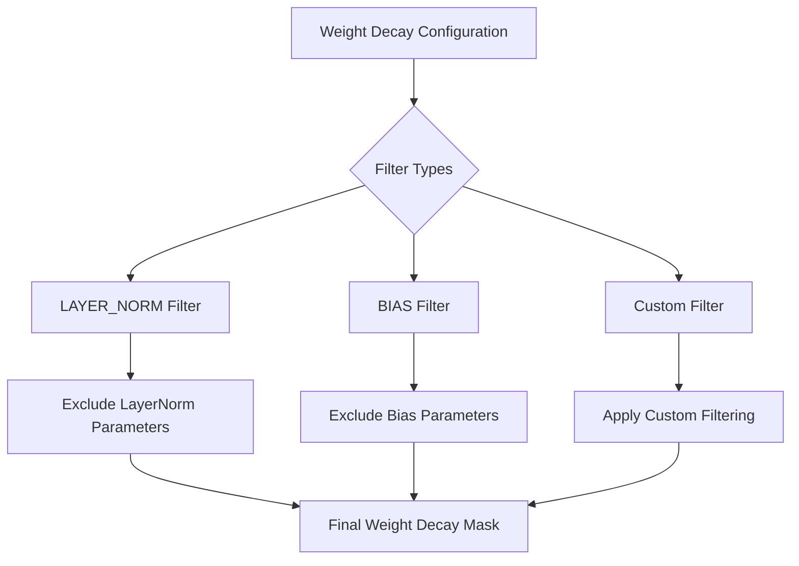
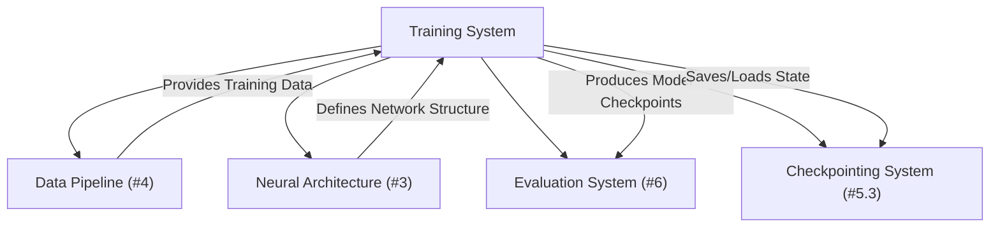

<!-- source: DeepWiki mcp.deepwiki.com · repo google-deepmind/alphastar · page 5 Training System · fetched 2026-10-26 -->

# Training System

<details>
<summary>Relevant source files</summary>

The following files were used as context for generating this wiki page:

- [alphastar/modules/optimizers.py](alphastar/modules/optimizers.py)
- [alphastar/unplugged/modules/learner.py](alphastar/unplugged/modules/learner.py)
- [alphastar/unplugged/modules/learner_test.py](alphastar/unplugged/modules/learner_test.py)

</details>


This document provides a technical overview of the AlphaStar training system, which handles the supervised learning training procedures for AlphaStar agents. The training system is responsible for managing the model weights, optimization process, data flow, and training metrics. For information about dataset preparation, see [Data Pipeline](#4), and for model architecture details, see [Architecture](#3).

## Overview

The AlphaStar training system is built on JAX and utilizes the ACME reinforcement learning library for its core components. It implements a supervised learning approach with distributed, multi-device training capabilities for processing StarCraft II gameplay data efficiently.



Sources: [alphastar/unplugged/modules/learner.py:15-17](), [alphastar/unplugged/modules/learner.py:57-282]()

## Core Components

### SupervisedLearner

The primary class in the training system is `SupervisedLearner`, which implements the ACME `Learner` interface to manage the entire training process.

```mermaid
classDiagram
    class "SupervisedLearner" {
        +data_source: DataSource
        +architecture_builder: ArchitectureBuilder
        +loss_builder: LossBuilder 
        +optimizer: optax.GradientTransformation
        +batch_size: int
        +unroll_len: int
        +overlap_len: int
        +frames_per_step: int
        +step()
        +get_variables(names)
        +save()
        +restore(state)
    }
    class "acme.Learner" {
        +step()
        +get_variables(names)
        +save()
        +restore(state)
    }
    "SupervisedLearner" --|> "acme.Learner"
```

The `SupervisedLearner` is responsible for:
1. Initializing network parameters and optimizer state
2. Processing data batches from the data source
3. Computing loss and applying optimization updates
4. Logging metrics and saving checkpoints

Sources: [alphastar/unplugged/modules/learner.py:57-102]()

### Training State

The training state is maintained in a dataclass that contains all stateful elements required during training:

```mermaid
classDiagram
    class "TrainingState" {
        +params: hk.Params
        +opt_state: optax.OptState
        +net_state: Any
        +step: int
        +rng: chex.PRNGKey
    }
```

This encapsulated state contains:
- Network parameters (`params`)
- Optimizer state (`opt_state`)
- Network recurrent state (`net_state`) 
- Current training step counter (`step`)
- Random number generator key (`rng`)

Sources: [alphastar/unplugged/modules/learner.py:47-54]()

## Training Process

The training process follows a standard supervised learning approach, but with optimizations for distributed training and sequence processing.



### Initialization

During the initialization, `SupervisedLearner`:
1. Sets up the necessary components including architecture, loss function, and optimizer
2. Creates a dummy batch to initialize the network parameters
3. Initializes the network and optimizer state
4. Replicates the state across all available devices using JAX's pmap

Sources: [alphastar/unplugged/modules/learner.py:184-220]()

### Training Step

Each call to the `step()` method:
1. Fetches the next batch from the data source
2. Reshapes it for distributed processing across multiple devices
3. Executes the forward pass, computes the loss, and calculates gradients
4. Synchronizes and averages gradients across devices
5. Updates model parameters using the optimizer
6. Logs training metrics and updates counters

Sources: [alphastar/unplugged/modules/learner.py:242-272]()

## Optimization

The training system uses the `optax` library to configure a flexible optimization pipeline. The optimizer is created using the `get_optimizer` function.



Sources: [alphastar/modules/optimizers.py:120-230]()

### Learning Rate Schedules

Two primary learning rate schedules are supported:



1. **Staircase Schedule**: Reduces learning rate by a fixed factor at predefined intervals
2. **Cosine Schedule**: Smoothly decreases learning rate following a cosine curve
3. **Warmup**: Optional addition to either schedule that gradually increases the learning rate during initial training

Sources: [alphastar/modules/optimizers.py:29-67]()

### Weight Decay

Weight decay can be selectively applied to parameters with options to filter out specific parameter types:



Sources: [alphastar/modules/optimizers.py:80-97](), [alphastar/modules/optimizers.py:171-187]()

## Integration with Other Systems

The training system connects with several other AlphaStar components:



### Integration with Data Pipeline

The training system receives data through a `DataSource` implementation, which provides batches of StarCraft II gameplay data preprocessed into the required format.

### Integration with Architecture

The architecture is provided through an `architecture_builder` function that constructs the neural network. This modular approach allows different architectures to be trained with the same system.

### Integration with Evaluation

The training system saves checkpoints that can be loaded by the evaluation system to assess agent performance during training.

Sources: [alphastar/unplugged/modules/learner_test.py:41-94]()

## Configuration Options

The training system exposes numerous configuration parameters:

| Parameter | Description |
|-----------|-------------|
| `batch_size` | Number of samples per training batch |
| `unroll_len` | Sequence length for temporal inputs |
| `overlap_len` | Overlap between consecutive sequences |
| `frames_per_step` | Frames processed per training step |
| `log_every_n_seconds` | Interval between logging updates |
| `log_to_csv` | Whether to log metrics to CSV files |
| `increment_counts` | Whether to increment internal counters |
| `reduce_metrics_all_devices` | Whether to aggregate metrics across devices |

Optimizer configuration includes:

| Parameter | Description |
|-----------|-------------|
| `learning_rate` | Base learning rate |
| `learning_rate_schedule_type` | Schedule type (STAIRCASE or COSINE) |
| `lr_frames_before_decay` | When to begin learning rate decay |
| `lr_num_warmup_frames` | Length of warmup period |
| `adam_b1`, `adam_b2`, `adam_eps` | Adam optimizer parameters |
| `use_adamw` | Whether to use AdamW variant |
| `weight_decay` | Weight decay coefficient |
| `weight_decay_filter_out` | Parameter types to exclude from weight decay |

Sources: [alphastar/unplugged/modules/learner.py:60-102](), [alphastar/modules/optimizers.py:120-166]()

---

