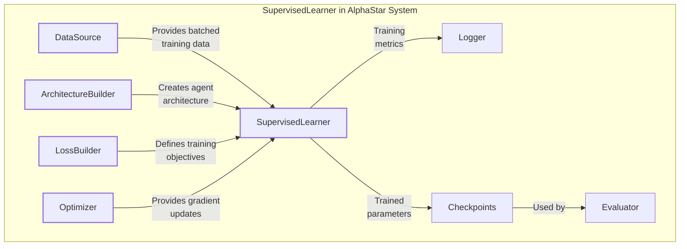
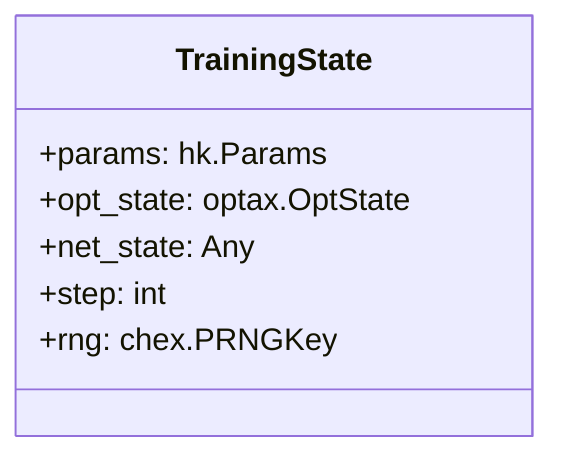
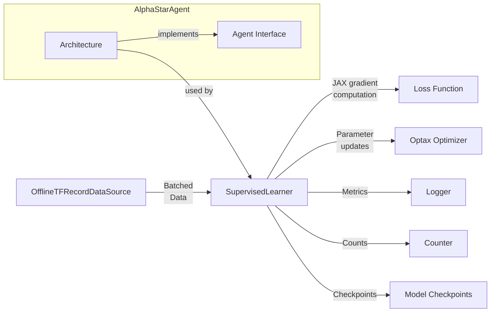
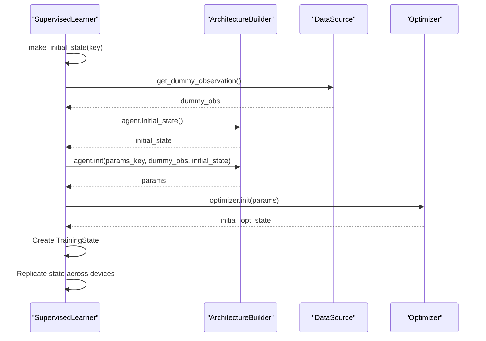
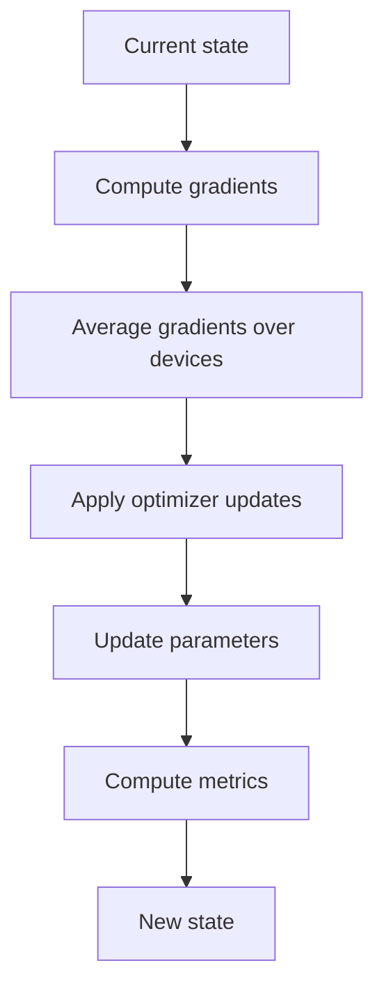
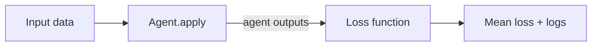
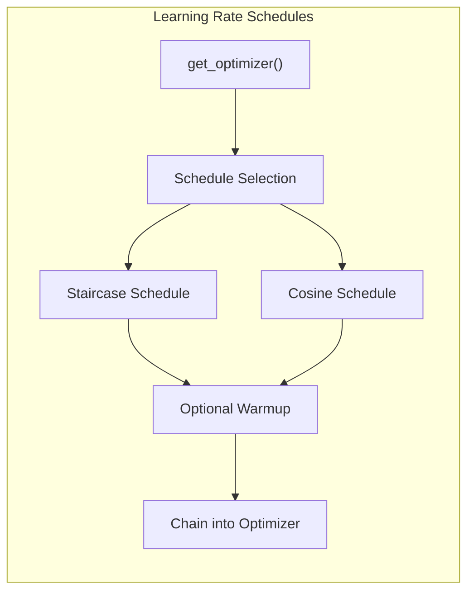
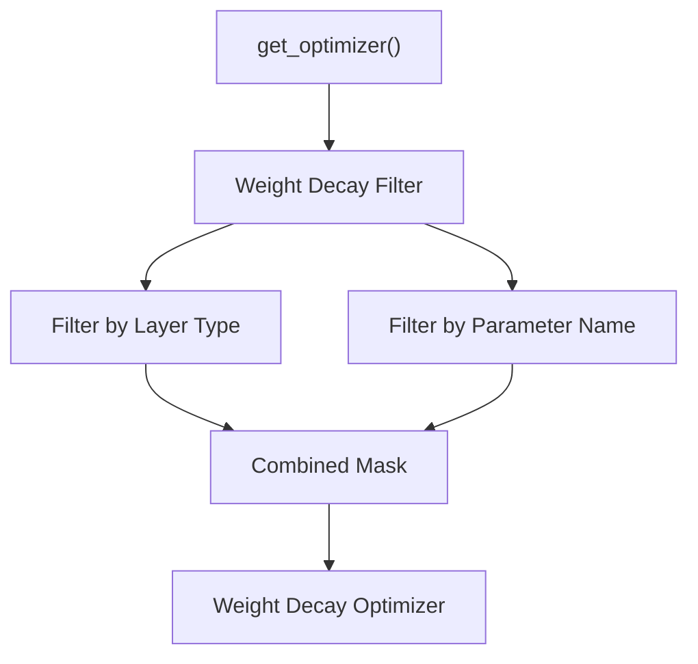
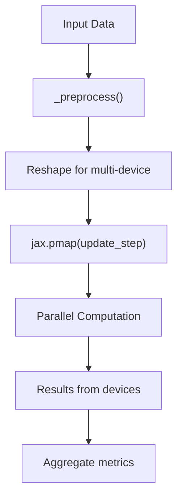

<!-- source: DeepWiki mcp.deepwiki.com · repo google-deepmind/alphastar · page 5.1 SupervisedLearner · fetched 2026-10-26 -->

# SupervisedLearner

<details>
<summary>Relevant source files</summary>

The following files were used as context for generating this wiki page:

- [alphastar/modules/optimizers.py](alphastar/modules/optimizers.py)
- [alphastar/unplugged/modules/learner.py](alphastar/unplugged/modules/learner.py)
- [alphastar/unplugged/modules/learner_test.py](alphastar/unplugged/modules/learner_test.py)

</details>


The `SupervisedLearner` is a core component in the AlphaStar training pipeline responsible for implementing supervised learning on StarCraft II gameplay data. It handles model initialization, training optimization, data processing, and checkpoint management. This document details the implementation, functionality, and usage of the `SupervisedLearner` class within the AlphaStar system.

For information about evaluation of trained models, see the [Evaluation System](#6) documentation.

## 1. Overview

The `SupervisedLearner` class is implemented within AlphaStar Unplugged to enable supervised learning from demonstration data. It integrates with the ACME reinforcement learning framework and leverages JAX for efficient, parallelized training across multiple devices.



Sources: [alphastar/unplugged/modules/learner.py:57-283]()

## 2. Core Components

The `SupervisedLearner` integrates several key components:

### 2.1 Training State

The training state encapsulates all mutable state required for training:



Sources: [alphastar/unplugged/modules/learner.py:47-54]()

### 2.2 Component Integration

The `SupervisedLearner` connects various components of the AlphaStar system:



Sources: [alphastar/unplugged/modules/learner.py:57-76](), [alphastar/unplugged/modules/learner_test.py:80-91]()

## 3. Initialization and Configuration

The `SupervisedLearner` initialization takes several important parameters:

| Parameter | Description |
|-----------|-------------|
| `architecture_builder` | Function that constructs the agent architecture |
| `loss_builder` | Function that constructs the training loss |
| `batch_size` | Training batch size used per host |
| `unroll_len` | Sequence length for the inputs |
| `overlap_len` | Overlap length between successive sequences |
| `frames_per_step` | Number of frames used per training step |
| `data_source` | Data source used as data iterator for training |
| `optimizer` | Optax optimizer module for gradient updates |
| `optimizer_logs_fn` | Helper function that logs optimizer statistics |
| `rng_key` | JAX random number generator key |
| `counter` | ACME counter object for statistics tracking |
| `logger` | ACME logger object for logging training metrics |
| `devices` | XLA devices for the learner model |

Sources: [alphastar/unplugged/modules/learner.py:60-102]()

### 3.1 Model Initialization Process

The `SupervisedLearner` initializes the neural network model, optimizer state, and other training components in a structured process:



Sources: [alphastar/unplugged/modules/learner.py:184-219]()

## 4. Training Process

The training process in `SupervisedLearner` follows a well-defined workflow:

### 4.1 Update Step

The core update step performs the following operations:



Sources: [alphastar/unplugged/modules/learner.py:138-182]()

### 4.2 Loss Computation

The loss computation process integrates the agent's architecture with the training objective:



Sources: [alphastar/unplugged/modules/learner.py:125-136]()

### 4.3 Step Method

The `step()` method orchestrates a single training step:

1. Fetch data batch from the data source
2. Preprocess data for multi-device distribution
3. Execute the update step function using JAX's pmap
4. Collect and log metrics
5. Update counters with frames processed and time metrics

Sources: [alphastar/unplugged/modules/learner.py:242-271]()

## 5. Integration with Optimizers

The `SupervisedLearner` uses the optimizer system defined in `optimizers.py` to manage learning rates and gradient updates:

### 5.1 Learning Rate Schedules

The learner supports different learning rate schedules:



Sources: [alphastar/modules/optimizers.py:120-230]()

### 5.2 Weight Decay Configuration

Weight decay can be selectively applied to different parameter types:



Sources: [alphastar/modules/optimizers.py:173-187]()

## 6. Device Management and Distribution

The `SupervisedLearner` efficiently distributes computation across multiple devices:

### 6.1 Data Parallelism

Training uses JAX's pmap for data parallelism:



Sources: [alphastar/unplugged/modules/learner.py:227-240](), [alphastar/unplugged/modules/learner.py:215-219]()

### 6.2 Device Validation

The learner performs validation to ensure batch sizes are compatible with device counts:

```
if batch_size % len(local_devices) != 0:
  raise ValueError(
      f'Batch size ({batch_size}) must always be a multiple of number of '
      f'training devices on each host ({local_devices}).')
```

Sources: [alphastar/unplugged/modules/learner.py:113-116]()

## 7. Usage Example

Below is a simplified example of how the `SupervisedLearner` is instantiated and used, based on the test case:

```mermaid
sequenceDiagram
    participant Main as "Training Script"
    participant Config as "Configuration"
    participant DataSrc as "DataSource"
    participant Arch as "Architecture"
    participant Loss as "Loss Function"
    participant Opt as "Optimizer"
    participant SL as "SupervisedLearner"
    
    Main->>Config: expt_config = get_config(architecture)
    Main->>Arch: architecture = architectures.get_architecture(expt_config.architecture.name)
    Main->>Loss: loss = losses.get_loss(expt_config.train.loss.name)
    Main->>Opt: optimizer, optimizer_logs_fn = optimizers.get_optimizer(...)
    Main->>DataSrc: train_data_source = data_source.get_data_source(...)
    Main->>SL: learner_node = SupervisedLearner(data_source, architecture, loss, optimizer, ...)
    
    loop Training Loop
        Main->>SL: learner_node.step()
    end
```

Sources: [alphastar/unplugged/modules/learner_test.py:46-94]()

## 8. Checkpoint Management

The `SupervisedLearner` provides methods for saving and restoring model state:

### 8.1 Save Method

The `save()` method serializes the training state from the first device:

```python
def save(self) -> TrainingState:
  # Serialize only the first replica of parameters and optimizer state.
  return jax.tree_map(utils.get_from_first_device, self._state)
```

Sources: [alphastar/unplugged/modules/learner.py:277-279]()

### 8.2 Restore Method

The `restore()` method loads a saved state and replicates it across all devices:

```python
def restore(self, state: TrainingState):
  self._state = utils.replicate_in_all_devices(state, self._local_devices)
```

Sources: [alphastar/unplugged/modules/learner.py:281-282]()

## Summary

The `SupervisedLearner` class is a central component in the AlphaStar training pipeline, responsible for supervised learning from demonstration data. It leverages JAX for efficient parallel computation across multiple devices, integrates with various components of the AlphaStar system, and provides mechanisms for checkpoint management. Understanding this class is essential for working with the AlphaStar codebase and extending its functionality.

Sources: [alphastar/unplugged/modules/learner.py:57-283]()

---

