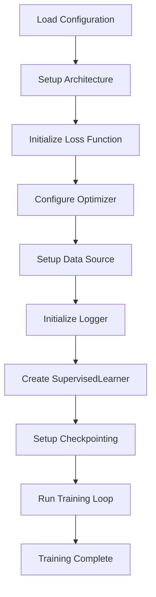
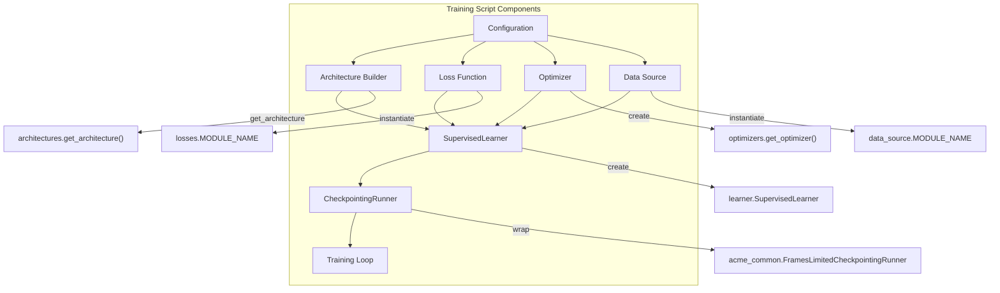
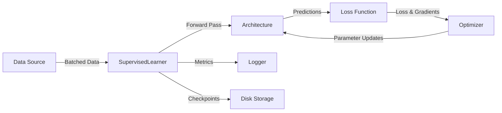

<!-- source: DeepWiki mcp.deepwiki.com · repo google-deepmind/alphastar · page 5.2 Training Script · fetched 2026-10-26 -->

# Training Script

<details>
<summary>Relevant source files</summary>

The following files were used as context for generating this wiki page:

- [alphastar/unplugged/scripts/train.py](alphastar/unplugged/scripts/train.py)

</details>


## Purpose and Scope

This document details the training script used to train AlphaStar agents. The script handles the initialization of training components, configuration loading, checkpoint management, and the execution of the training loop. For information about the SupervisedLearner implementation, see [SupervisedLearner](#5.1). For details on checkpoint management, refer to [Checkpointing System](#5.3). For training configuration options, see [Training Configuration](#5.4).

Sources: [alphastar/unplugged/scripts/train.py:15-49]()

## Script Overview

The training script (`train.py`) is the primary entry point for training AlphaStar agents. It loads the provided configuration, sets up the training environment, initializes the necessary components, and manages the training process. The script supports various training scenarios from full-scale training with real data to small debugging sessions with dummy data.



Sources: [alphastar/unplugged/scripts/train.py:72-127]()

## Command-Line Usage

The script is designed to be run from the command line with a configuration file specified via the `--config` flag. Additional configuration overrides can be provided directly on the command line.

```
python alphastar/scripts/train.py --config=/path/to/config.py[:config_name]
```

For debugging purposes, the script can be run with minimal resources:

```
python alphastar/scripts/train.py \
  --config=${PWD}/configs/alphastar_supervised.py:alphastar.dummy \
  --config.train.max_number_of_frames=16 \
  --config.train.learner_kwargs.batch_size=4 \
  --config.train.datasource.kwargs.shuffle_buffer_size=16 \
  --config.train.optimizer_kwargs.lr_frames_before_decay=4 \
  --config.train.learner_kwargs.unroll_len=3 \
  --config.train.datasource.name=DummyDataSource
```

Sources: [alphastar/unplugged/scripts/train.py:15-49]()

## Key Components and Interactions

The training script initializes and orchestrates several key components that work together to train the AlphaStar agent.



Sources: [alphastar/unplugged/scripts/train.py:72-126]()

### 1. Configuration Loading

The script loads a configuration file specified via the `--config` flag. This configuration contains all the parameters needed for training, including architecture details, optimizer settings, data source configuration, and more.

### 2. Architecture Setup

The script retrieves the architecture builder function using `architectures.get_architecture()` and partially applies the architecture-specific configuration parameters.

```python
architecture = architectures.get_architecture(config.architecture.name)
architecture = functools.partial(architecture, **config.architecture.kwargs)
```

Sources: [alphastar/unplugged/scripts/train.py:77-79]()

### 3. Loss Function Configuration

The loss function is configured by retrieving the appropriate function from the `losses` module and partially applying the loss-specific configuration parameters.

```python
loss = functools.partial(
    getattr(losses, config.train.loss.name), **config.train.loss.kwargs)
```

Sources: [alphastar/unplugged/scripts/train.py:80-82]()

### 4. Optimizer Setup

The script configures the optimizer using `optimizers.get_optimizer()` with parameters for learning rate, decay, and total training frames.

```python
optimizer, optimizer_logs_fn = optimizers.get_optimizer(
    num_frames_per_learner_update=frames_per_step,
    total_num_training_frames=config.train.max_number_of_frames,
    **config.train.optimizer_kwargs)
```

Sources: [alphastar/unplugged/scripts/train.py:84-87]()

### 5. Data Source Initialization

A data source is initialized to provide training data to the learner. The data source type and parameters are specified in the configuration.

```python
train_data_source = getattr(data_source, config.train.datasource.name)(
    **data_source_kwargs)
```

Sources: [alphastar/unplugged/scripts/train.py:89-98]()

### 6. SupervisedLearner Creation

The `SupervisedLearner` is created with the architecture, loss function, optimizer, and data source.

```python
learner_node = learner.SupervisedLearner(
    data_source=train_data_source,
    architecture_builder=architecture,
    loss_builder=loss,
    optimizer=optimizer,
    optimizer_logs_fn=optimizer_logs_fn,
    logger=logger,
    rng_key=jax.random.PRNGKey(22),
    frames_per_step=frames_per_step,
    increment_counts=False,
    **config.train.learner_kwargs)
```

Sources: [alphastar/unplugged/scripts/train.py:107-117]()

### 7. Checkpointing Setup

The learner is wrapped with `FramesLimitedCheckpointingRunner` to manage training duration and checkpoint saving.

```python
checkpointed_learner_node = acme_common.FramesLimitedCheckpointingRunner(
    max_number_of_frames=config.train.max_number_of_frames,
    num_frames_per_step=frames_per_step,
    wrapped=learner_node,
    **config.train.checkpoint_kwargs
)
```

Sources: [alphastar/unplugged/scripts/train.py:119-124]()

### 8. Training Execution

Finally, the training is executed by calling `run()` on the checkpointed learner.

```python
checkpointed_learner_node.run()
```

Sources: [alphastar/unplugged/scripts/train.py:126]()

## Training Configuration Parameters

The training script is highly configurable through the provided configuration file. The key configuration sections and parameters are:

| Configuration Section | Purpose | Key Parameters |
|:----------------------|:--------|:---------------|
| `architecture` | Neural network architecture | `name`, `kwargs` |
| `train.loss` | Loss function | `name`, `kwargs` |
| `train.optimizer_kwargs` | Optimizer settings | `lr_init`, `lr_final`, `lr_frames_before_decay` |
| `train.datasource` | Data source configuration | `name`, `kwargs` |
| `train.learner_kwargs` | Learner parameters | `batch_size`, `unroll_len`, `overlap_len`, `log_to_csv` |
| `train.checkpoint_kwargs` | Checkpoint settings | `directory`, `add_uid`, `checkpoint_every_n_steps` |

Sources: [alphastar/unplugged/scripts/train.py:72-125]()

## Data Flow During Training

The training script orchestrates the flow of data from the data source through the neural network, loss computation, and optimization steps.



Sources: [alphastar/unplugged/scripts/train.py:107-126]()

## Example Use Cases

### Full-Scale Training

For full-scale training with real data, use the default configuration:

```
python alphastar/scripts/train.py --config=${PWD}/configs/alphastar_supervised.py:alphastar.standard
```

### Debugging Session

For a quick debugging session with minimal resources:

```
python alphastar/scripts/train.py \
  --config=${PWD}/configs/alphastar_supervised.py:alphastar.dummy \
  --config.train.max_number_of_frames=16 \
  --config.train.learner_kwargs.batch_size=4 \
  --config.train.datasource.kwargs.shuffle_buffer_size=16 \
  --config.train.optimizer_kwargs.lr_frames_before_decay=4 \
  --config.train.learner_kwargs.unroll_len=3 \
  --config.train.datasource.name=DummyDataSource
```

### Warmstarting from a Checkpoint

To continue training from a previously saved checkpoint:

```
python alphastar/scripts/train.py \
  --config=${PWD}/configs/alphastar_supervised.py:alphastar.standard \
  --config.train.init_checkpoint_path=/path/to/checkpoint
```

Sources: [alphastar/unplugged/scripts/train.py:15-49]()

## Integration with Other Components

The training script integrates with several other components of the AlphaStar system:

1. **Architecture System**: The script uses `architectures.get_architecture()` to obtain the neural network architecture.
2. **Data Pipeline**: The script initializes a data source from the data module to feed training examples.
3. **Checkpointing System**: The script wraps the learner with `FramesLimitedCheckpointingRunner` to manage checkpoints.
4. **Evaluation System**: While the script itself doesn't perform evaluation, it produces checkpoints that can be evaluated using the evaluation script.

Note that the training script does not perform any evaluation during training. To evaluate the trained models, you need to run the evaluation script (`scripts/evaluate.py`) in parallel, which will load the checkpoints saved by the training script.

Sources: [alphastar/unplugged/scripts/train.py:15-21](), [alphastar/unplugged/scripts/train.py:119-124]()

---

