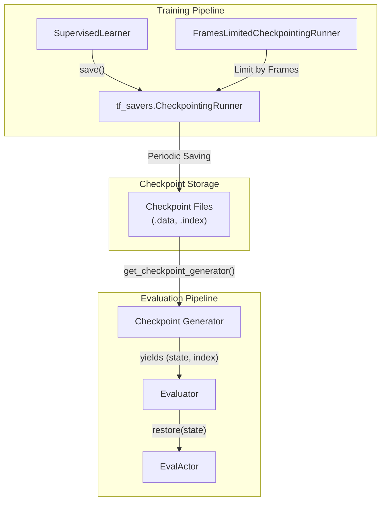
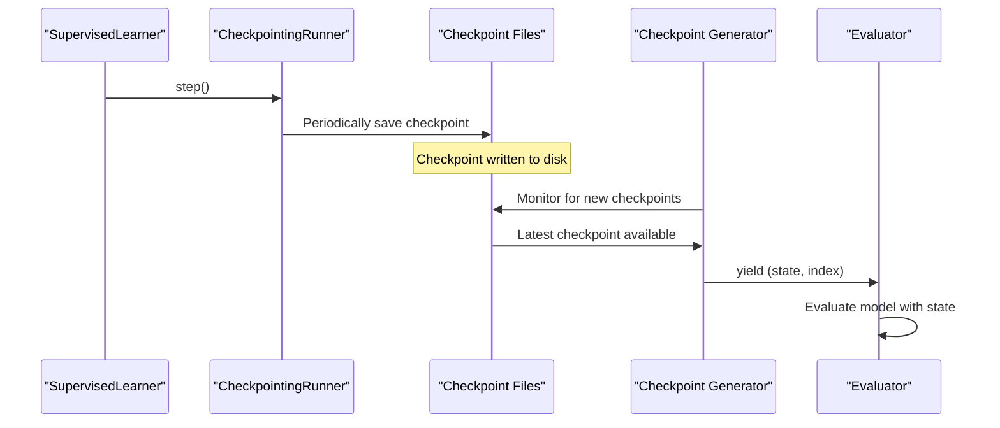
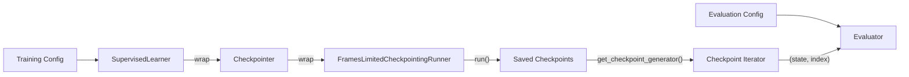

<!-- source: DeepWiki mcp.deepwiki.com · repo google-deepmind/alphastar · page 5.3 Checkpointing System · fetched 2026-10-26 -->

# Checkpointing System

<details>
<summary>Relevant source files</summary>

The following files were used as context for generating this wiki page:

- [alphastar/modules/common.py](alphastar/modules/common.py)
- [alphastar/modules/common_test.py](alphastar/modules/common_test.py)

</details>


The Checkpointing System in AlphaStar provides functionality for saving and restoring model states during training and evaluation processes. This system is critical for enabling long-running training jobs with recovery capabilities and for evaluating models at various stages of training.

For information about the Training Script, see [Training Script](#5.2). For information about the Evaluation System that uses these checkpoints, see [Evaluation System](#6).

## 1. Overview

The AlphaStar Checkpointing System builds on TensorFlow's checkpoint infrastructure to provide capabilities for saving model state, restoring entire or partial states, and generating iterators over checkpoint sequences for evaluation.



**Checkpoint System Overview**

Sources: [alphastar/modules/common.py:174-274](), [alphastar/modules/common_test.py:43-118]()

## 2. Key Components

The Checkpointing System consists of several key functions and classes that handle different aspects of the checkpointing process:

```mermaid
classDiagram
    class "core.Saveable" {
        <<interface>>
        +save()
        +restore(state)
    }
    
    class "tf_savers.CheckpointingRunner" {
        +run()
        +step()
        +save()
    }
    
    class "FramesLimitedCheckpointingRunner" {
        +run()
        -num_frames_per_step
        -max_number_of_frames
    }
    
    class "MockSaveableLearner" {
        +save()
        +restore(state)
        -state
    }
    
    class "Functions" {
        <<static>>
        +restore_from_checkpoint()
        +get_checkpoint_generator()
        +get_checkpoint_generator_for_path()
        -_get_ckpt_index()
    }
    
    "tf_savers.CheckpointingRunner" <|-- "FramesLimitedCheckpointingRunner"
    "core.Saveable" <|-- "MockSaveableLearner"
    "core.Saveable" <-- "Functions" : operates on
```

**Checkpoint System Components**

Sources: [alphastar/modules/common.py:38-78](), [alphastar/modules/common.py:202-274]()

### 2.1. Frame-Limited Checkpointing Runner

`FramesLimitedCheckpointingRunner` extends TensorFlow's `CheckpointingRunner` to terminate training based on the number of frames processed rather than steps taken. This is important for AlphaStar as it allows for consistent training durations regardless of batch size or unroll length.

```python
def __init__(self, num_frames_per_step: int, max_number_of_frames: int, **kwargs):
  # Initialization with frame limits
  
def run(self):
  # Run until reaching max_number_of_frames
```

Sources: [alphastar/modules/common.py:38-52]()

### 2.2. Checkpoint Restoration

The `restore_from_checkpoint` function provides the ability to restore a model's state either completely or partially from a checkpoint file. This is particularly useful for fine-tuning or transferring knowledge from one model to another.

```python
def restore_from_checkpoint(wrapped: core.Saveable,
                            checkpoint_to_restore: Optional[str] = None,
                            fields_to_restore: Optional[Sequence[str]] = None):
  # Restore model state from checkpoint
```

Sources: [alphastar/modules/common.py:174-199]()

### 2.3. Checkpoint Generators

Two key functions provide iterators over checkpoints:

1. `get_checkpoint_generator`: Continuously yields the latest checkpoint from a directory, blocking if none are available
2. `get_checkpoint_generator_for_path`: Yields a specific checkpoint repeatedly, used for evaluation at a specific training point

Sources: [alphastar/modules/common.py:210-274]()

## 3. Checkpoint Workflow

The checkpointing process typically follows these steps:



**Checkpoint Workflow**

Sources: [alphastar/modules/common.py:210-256](), [alphastar/modules/common_test.py:89-92]()

## 4. Implementation Details

### 4.1. Checkpoint Structure

AlphaStar checkpoints are stored using TensorFlow's checkpoint system and consist of:
- `.index` files containing a table of contents
- `.data` files containing the actual model weights and state

The checkpoints follow a naming convention of `{directory}/ckpt-{index}`, where `index` is an incrementing number.

Sources: [alphastar/modules/common.py:202-207]()

### 4.2. Checkpoint Generation

The checkpoint generator provides continuous access to the latest model states:

```python
def get_checkpoint_generator(checkpoint_dir: str,) -> Iterator[Tuple[Any, int]]:
    # Continuously yield the latest checkpoint, block if none are available
```

This function is particularly useful for evaluation, as it:
1. Monitors a checkpoint directory for new checkpoints
2. Loads new checkpoints when they appear
3. Yields the loaded state along with its index
4. Handles errors during checkpoint loading with retries

Sources: [alphastar/modules/common.py:210-256]()

### 4.3. Testing Checkpoint Functionality

The checkpoint system includes testing to verify its functionality:

1. Create a learner with a configured architecture, optimizer, and data source
2. Save a checkpoint using `tf_savers.Checkpointer`
3. Create a new learner with different initialization
4. Restore the checkpoint to the new learner
5. Verify that the states match using `chex.assert_trees_all_close`

Sources: [alphastar/modules/common_test.py:46-117]()

## 5. Integration with Training System

The checkpointing system is tightly integrated with the SupervisedLearner class to save training progress. The standard workflow is:

1. Configure a `SupervisedLearner` instance with architecture, loss, optimizer, etc.
2. Wrap it with `tf_savers.Checkpointer` for saving functionality
3. Optionally wrap with `FramesLimitedCheckpointingRunner` to limit by frames
4. Run training, which periodically saves checkpoints
5. Use checkpoint generators during evaluation to load models



**Checkpoint Integration**

Sources: [alphastar/modules/common_test.py:76-92](), [alphastar/modules/common.py:38-52]()

## 6. Troubleshooting and Recovery

The checkpointing system includes error handling mechanisms for robustness:

1. Waits for checkpoint availability with timeouts
2. Retries checkpoint loading up to 10 times before failing
3. Provides informative error messages about checkpoint state
4. Supports partial state restoration for flexible recovery

Sources: [alphastar/modules/common.py:231-255]()

## Summary

The AlphaStar Checkpointing System provides robust mechanisms for saving and restoring model states throughout the training and evaluation process. Built on TensorFlow's checkpoint infrastructure, it extends the functionality with frame-based training limits, checkpoint generation facilities, and error handling for production robustness.

---

