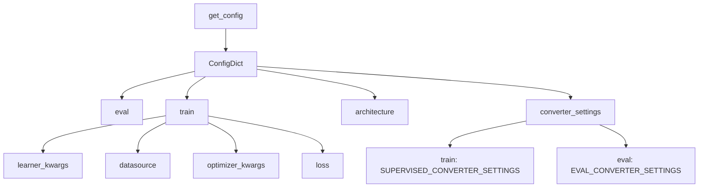
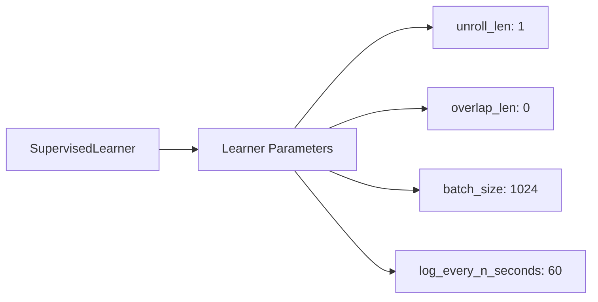
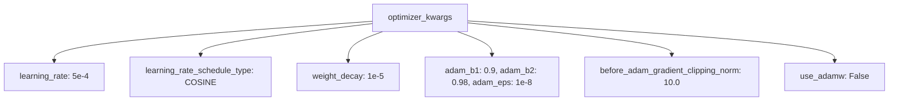
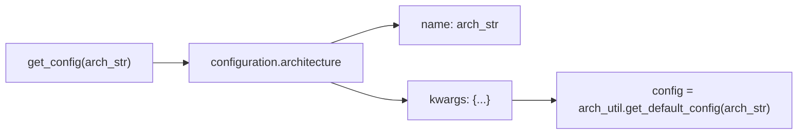
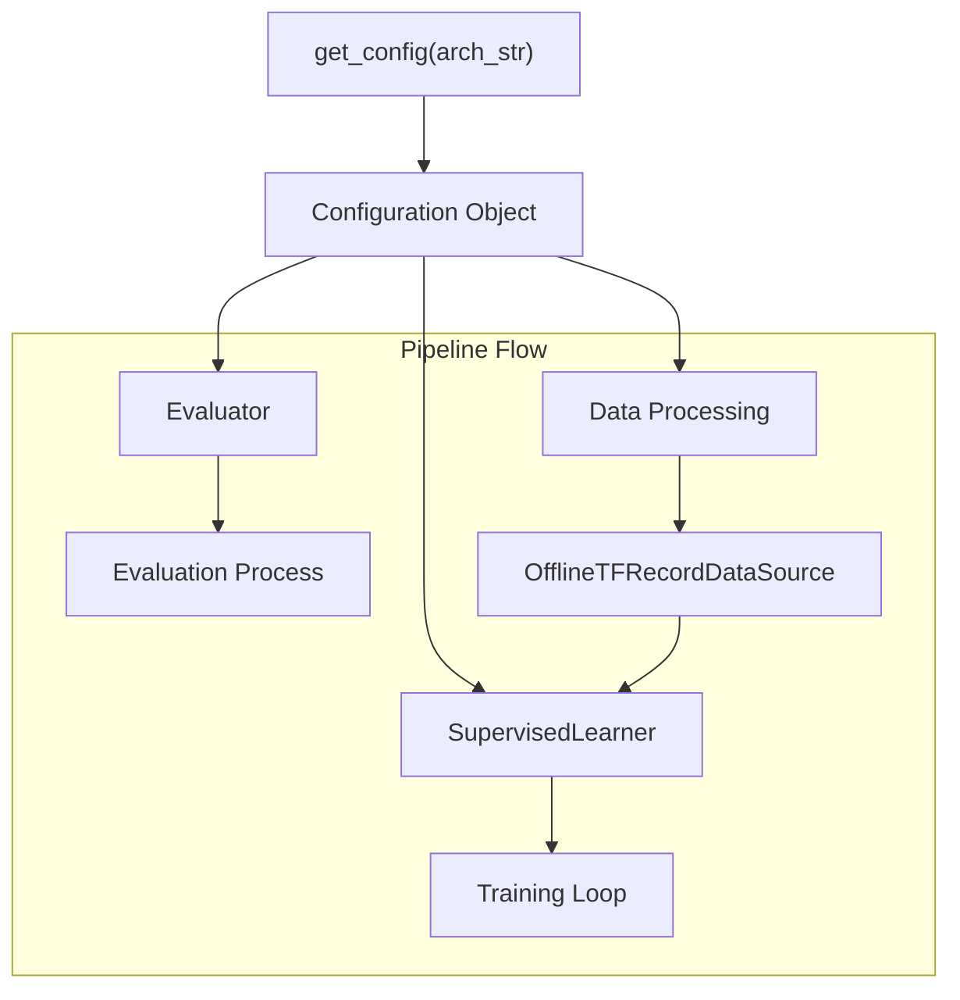

<!-- source: DeepWiki mcp.deepwiki.com · repo google-deepmind/alphastar · page 5.4 Training Configuration · fetched 2026-10-26 -->

# Training Configuration

<details>
<summary>Relevant source files</summary>

The following files were used as context for generating this wiki page:

- [alphastar/unplugged/configs/alphastar_supervised.py](alphastar/unplugged/configs/alphastar_supervised.py)

</details>


## Purpose and Scope

This document details the configuration options available for training AlphaStar agents. It covers the structure of configuration files, the various parameters that can be adjusted, and how these settings affect the training process. This page focuses specifically on supervised learning configuration rather than reinforcement learning. For information about the training process itself, see [SupervisedLearner](#5.1).

## Configuration Overview

The AlphaStar training configuration is defined using the `ml_collections.ConfigDict` structure, which provides a hierarchical organization of parameters. The main configuration is created through the `get_config` function, which returns a configuration object with distinct sections for evaluation, training, architecture, and converter settings.



**Diagram: Configuration Structure**

Sources: [alphastar/unplugged/configs/alphastar_supervised.py:92-208]()

## Main Configuration Sections

### Evaluation Settings

The evaluation section defines parameters for evaluating trained models against various opponents and on different maps.

| Parameter | Description | Default Value |
|-----------|-------------|---------------|
| `home_races` | List of player races to use | Protoss, Terran, Zerg |
| `away_races` | List of opponent races to use | Protoss, Terran, Zerg |
| `map_names` | Maps used for evaluation | KairosJunction, KingsCove, CyberForest, NewRepugnancy |
| `competitor_names` | AI opponents to evaluate against | very_easy, very_hard |
| `eval_checkpoint_dir` | Directory containing checkpoints to evaluate | "" |
| `evaluator_type` | Type of evaluator to use | "checkpoint" |
| `max_num_steps` | Maximum steps per evaluation episode | 1,000,000 |

Sources: [alphastar/unplugged/configs/alphastar_supervised.py:97-121]()

### Training Settings

The training section configures the learning process parameters, including batch size, data sources, and checkpointing.

#### Learner Parameters



**Diagram: Learner Parameters Flow**

Sources: [alphastar/unplugged/configs/alphastar_supervised.py:125-132]()

#### Data Source Configuration

The data source configuration specifies how training data is loaded and processed:

```
config.train.datasource = {
    "name": "OfflineTFRecordDataSource",
    "kwargs": {
        "replay_versions": ["4.8.2", "4.8.3", "4.8.4", "4.8.6", "4.9.0", "4.9.1", "4.9.2"],
        "player_min_mmr": 3500,
        "dataset_paths_fname": "",
        "home_race": None,
        "away_race": None,
        "use_prev_features": True,
        "shuffle_buffer_size": 1024,
        "extra_replay_filters": {}
    }
}
```

The data source uses TFRecord files containing StarCraft II replay data. Key parameters include:
- `replay_versions`: Supported StarCraft II game versions
- `player_min_mmr`: Minimum player skill rating (MMR) for replay selection
- `shuffle_buffer_size`: Size of the buffer for shuffling training examples

Sources: [alphastar/unplugged/configs/alphastar_supervised.py:147-161]()

#### Checkpointing

Checkpointing parameters control how and when model states are saved:

| Parameter | Description | Default Value |
|-----------|-------------|---------------|
| `subdirectory` | Subdirectory for checkpoint storage | "learner" |
| `checkpoint_ttl_seconds` | Time to live for checkpoints | 90 days |
| `time_delta_minutes` | Time between checkpoints | 5 minutes |
| `max_to_keep` | Maximum checkpoints to retain | 5 |

Sources: [alphastar/unplugged/configs/alphastar_supervised.py:138-145]()

### Optimizer Configuration

The optimizer settings control the learning rate, weight decay, and gradient clipping parameters:



**Diagram: Optimizer Configuration**

Sources: [alphastar/unplugged/configs/alphastar_supervised.py:163-179]()

Key optimizer parameters include:
- Learning rate and schedule type (COSINE)
- Adam optimizer parameters (beta1, beta2, epsilon)
- Weight decay settings
- Gradient clipping norms

### Loss Configuration

The loss configuration defines weights for different components of the supervised loss function:

```
config.train.loss = {
    "name": "Supervised",
    "kwargs": {
        "weights": {
            "function": 40.0,
            "delay": 9.0,
            "queued": 1.0,
            "repeat": 0.1,
            "target_unit_tag": 30.0,
            "unit_tags": 320.0,
            "world": 11.0
        },
        "burnin_len": 0,
        "overlap_len": 0,
        "name": "supervised_loss"
    }
}
```

These weights balance the importance of correctly predicting different aspects of player actions:
- `function`: Weight for predicting the correct action function
- `unit_tags`: Weight for selecting the correct units
- `target_unit_tag`: Weight for targeting the correct unit
- `world`: Weight for predicting the correct screen coordinate

Sources: [alphastar/unplugged/configs/alphastar_supervised.py:181-195]()

## Architecture Configuration

The architecture configuration is set based on the architecture string passed to the `get_config` function. It uses the default configuration from `arch_util.get_default_config(arch_str)`.



**Diagram: Architecture Configuration Flow**

Sources: [alphastar/unplugged/configs/alphastar_supervised.py:198-204]()

## Converter Settings

Converter settings control how StarCraft II replay data is processed for both training and evaluation. Two different configurations are used:

1. `SUPERVISED_CONVERTER_SETTINGS`: Used during training
2. `EVAL_CONVERTER_SETTINGS`: Used during evaluation

These settings are created using the `get_converter_settings` function with different parameters.

Key converter settings include:
- `resolution`: The world dimensions (256x256)
- `max_unit_count`: Maximum number of units (512)
- `max_unit_selection_size`: Maximum selectable units (64)
- `use_camera_position`: Whether to use camera positioning
- Game feature selection (minimap features, unit features, etc.)

Sources: [alphastar/unplugged/configs/alphastar_supervised.py:55-89]()

## Configuration Usage Flow



**Diagram: Configuration Usage in Training Pipeline**

Sources: [alphastar/unplugged/configs/alphastar_supervised.py:92-208]()

## Customizing Configuration

To customize the training configuration:

1. Start with the default configuration returned by `get_config`
2. Modify specific parameters based on your requirements
3. Pass the modified configuration to the training system

Common customization areas include:
- Learning rate and optimizer parameters
- Batch size and unroll length
- Loss function weights
- Data source filters (replay versions, MMR thresholds)

Example of configuration customization:

```python
config = get_config("standard")
# Modify batch size
config.train.learner_kwargs.batch_size = 512
# Change learning rate
config.train.optimizer_kwargs.learning_rate = 1e-4
# Filter replays by race
config.train.datasource.kwargs.home_race = common_pb2.Protoss
```

Sources: [alphastar/unplugged/configs/alphastar_supervised.py:92-208]()

---

