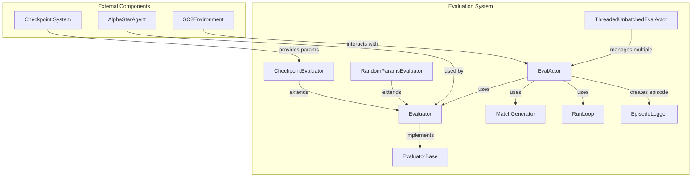
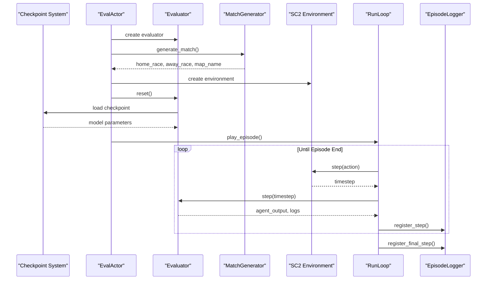
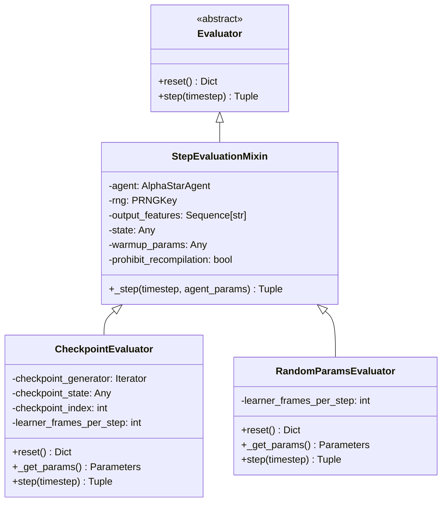
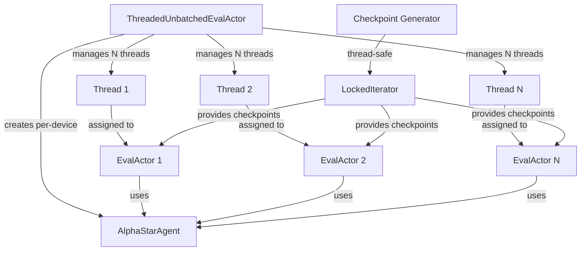

<!-- source: DeepWiki mcp.deepwiki.com · repo google-deepmind/alphastar · page 6 Evaluation System · fetched 2026-10-26 -->

# Evaluation System

Relevant source files

The following files were used as context for generating this wiki page:

- [alphastar/commons/jax_utils.py](alphastar/commons/jax_utils.py)
- [alphastar/modules/agent_test.py](alphastar/modules/agent_test.py)
- [alphastar/modules/evaluator.py](alphastar/modules/evaluator.py)
- [alphastar/modules/evaluator_base.py](alphastar/modules/evaluator_base.py)
- [alphastar/modules/run_loop.py](alphastar/modules/run_loop.py)
- [alphastar/unplugged/modules/BUILD](alphastar/unplugged/modules/BUILD)

The Evaluation System is a dedicated framework for assessing trained AlphaStar agents against StarCraft II built-in bots. This system handles the loading of model checkpoints, environment setup, episode execution, and performance metric collection. For information about the training system that produces the models being evaluated, see [Training System](#5).

## System Architecture

The Evaluation System follows a modular design with clear separation of concerns. It consists of several key components:

1. **Evaluators** - Classes that implement the evaluation logic
2. **EvalActor** - Worker that runs evaluation episodes
3. **Match Generator** - Creates matches between the agent and opponents
4. **Run Loop** - Controls the episode execution flow

Sources: [alphastar/modules/evaluator.py:16-152](alphastar/modules/evaluator.py:16-152), [alphastar/modules/evaluator_base.py:15-54](alphastar/modules/evaluator_base.py:15-54)

### Key Components

#### Evaluator Base Class

The `Evaluator` abstract base class defines the interface that all evaluators must implement:

- **reset()** - Prepares the evaluator for a new episode
- **step(timestep)** - Processes environment timesteps and returns agent actions

The `StepEvaluationMixin` provides common functionality for stepping an agent with model parameters, including handling JAX computation, processing observations, and extracting actions.

#### Evaluator Types

The system supports two types of evaluators, defined in the `EvaluatorType` enum:

| Type | Description | Use Case |
|------|-------------|----------|
| CHECKPOINT | Loads parameters from saved model checkpoints | Evaluating trained models |
| RANDOM_PARAMS | Uses randomly initialized parameters | Baseline comparison, debugging |

Sources: [alphastar/modules/evaluator_base.py:26-30](alphastar/modules/evaluator_base.py:26-30), [alphastar/modules/evaluator.py:152-255](alphastar/modules/evaluator.py:152-255)

#### EvalActor

The `EvalActor` is the main worker that orchestrates evaluation. It:

1. Creates the appropriate evaluator
2. Sets up a match with a specific map, races, and opponent
3. Creates the StarCraft II environment
4. Runs the episode
5. Logs results through the EpisodeLogger

Sources: [alphastar/modules/evaluator.py:284-467](alphastar/modules/evaluator.py:284-467)

## Evaluation Process

The evaluation process follows a well-defined flow from model checkpoint to episode execution to metrics collection.

Sources: [alphastar/modules/evaluator.py:439-466](alphastar/modules/evaluator.py:439-466), [alphastar/modules/run_loop.py:27-84](alphastar/modules/run_loop.py:27-84)

### Environment Setup

The evaluation system includes a factory function `_make_environment_factory` that creates StarCraft II environments with specific settings:

- Map selection (from a predefined list)
- Player races (for both agent and opponent)
- Opponent difficulty
- Interface and converter settings

The function returns a ConvertedEnvironment that implements the dm_env interface, ensuring compatibility with the evaluator.

Sources: [alphastar/modules/evaluator.py:258-281](alphastar/modules/evaluator.py:258-281)

### Running Episodes

Episodes are executed through the `play_episode` function in the run_loop module, which:

1. Initializes the episode
2. Enters a loop until the episode ends
3. For each step:
   - Gets the agent's action from the evaluator
   - Applies the action to the environment
   - Logs step information
4. Logs the final step information upon episode completion

Sources: [alphastar/modules/run_loop.py:27-84](alphastar/modules/run_loop.py:27-84)

## Checkpoint Evaluation

The `CheckpointEvaluator` is the primary evaluator type used for assessing trained models. It loads parameters from saved checkpoints and uses them for agent inference.

Key responsibilities of the CheckpointEvaluator:

1. Tracks a checkpoint generator that provides model parameters
2. Resets to a new checkpoint for each episode
3. Processes observations into a format compatible with the agent
4. Applies the agent to generate actions
5. Handles JIT compilation and optimization

Sources: [alphastar/modules/evaluator.py:152-209](alphastar/modules/evaluator.py:152-209)

## Multi-threaded Evaluation

For efficient evaluation, the system provides `ThreadedUnbatchedEvalActor`, which runs multiple evaluation threads in parallel.

### Architecture

The `ThreadedUnbatchedEvalActor`:

1. Creates one agent per device core for optimal hardware utilization
2. Distributes evaluation tasks across multiple threads
3. Ensures thread safety with locked iterators for shared resources
4. Manages warmup to avoid recompilation during evaluation

This approach allows multiple episodes to be evaluated simultaneously, significantly improving throughput.

Sources: [alphastar/modules/evaluator.py:473-602](alphastar/modules/evaluator.py:473-602)

## Common Functions and Utilities

The evaluation system includes several utility functions to support its operations:

1. **JAX Compilation Control**:
   - `no_jax_compilation_allowed()` - Context manager that prevents JAX recompilation, improving performance and stability
   - `disable_jax_optimizations()` - Function to disable JAX optimizations for faster compilation during development

2. **Actor Creation Utilities**:
   - `setup_agent()` - Sets up the agent architecture and creates an evaluator
   - `build_checkpoint_generator()` - Creates a generator that yields model checkpoints

3. **Error Handling**:
   - `_traceback_exception()` - Utility for proper error reporting in threaded contexts

Sources: [alphastar/commons/jax_utils.py:15-63](alphastar/commons/jax_utils.py:15-63), [alphastar/modules/evaluator.py:469-470](alphastar/modules/evaluator.py:469-470)

## Integration with the AlphaStar System

The Evaluation System is a critical component in the AlphaStar training and evaluation pipeline, providing feedback on agent performance. It integrates with:

1. The **Checkpoint System** for loading trained models
2. The **Agent Architecture** for model inference
3. The **Logging System** for performance metrics collection

This enables continuous assessment of agent capabilities as training progresses, helping to track improvements and identify potential issues.

---

