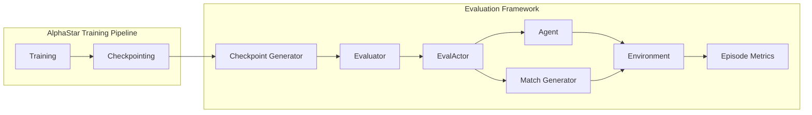
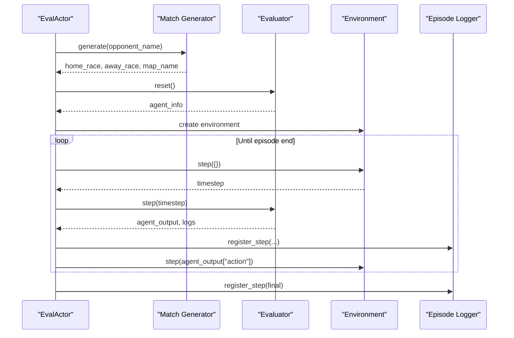
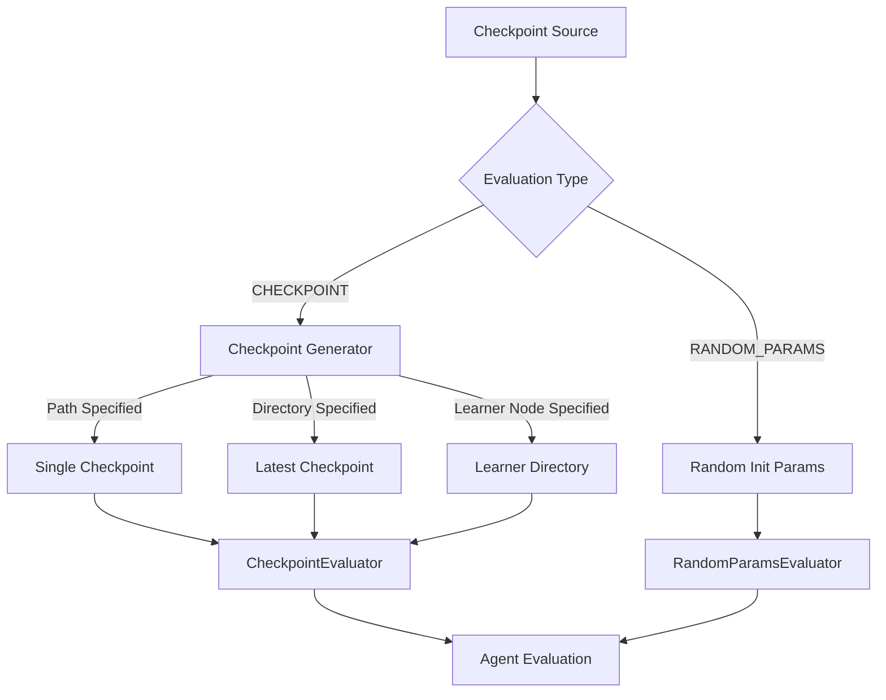
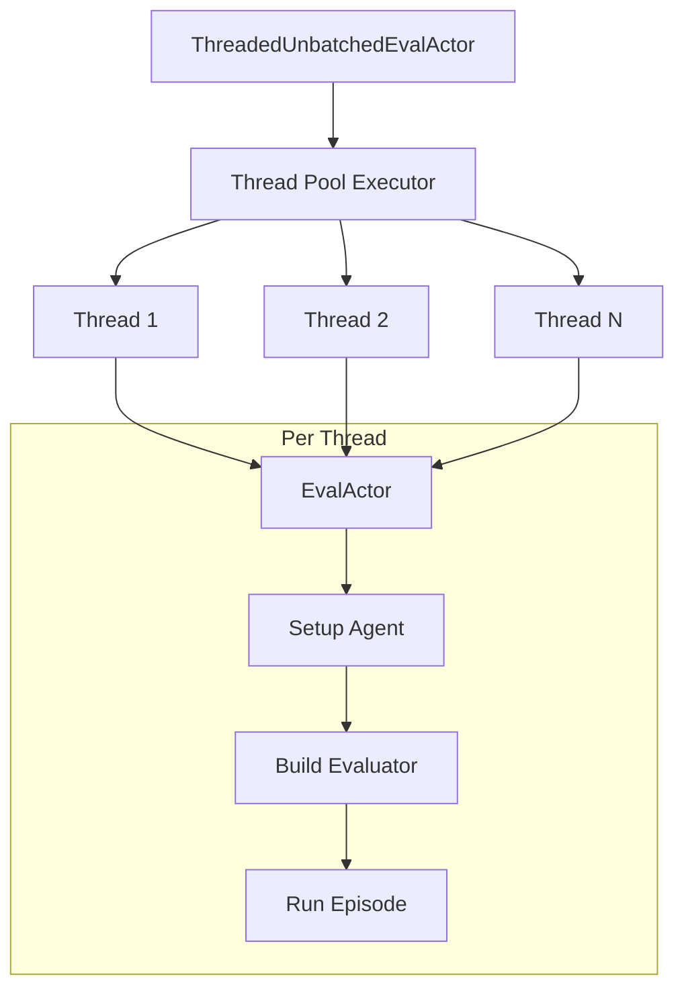

<!-- source: DeepWiki mcp.deepwiki.com · repo google-deepmind/alphastar · page 6.1 Evaluation Framework · fetched 2026-10-26 -->

# Evaluation Framework

<details>
<summary>Relevant source files</summary>

The following files were used as context for generating this wiki page:

- [alphastar/modules/evaluator.py](alphastar/modules/evaluator.py)
- [alphastar/modules/evaluator_base.py](alphastar/modules/evaluator_base.py)
- [alphastar/modules/run_loop.py](alphastar/modules/run_loop.py)

</details>


The Evaluation Framework is a core subsystem of AlphaStar that enables systematic testing of trained agent models against built-in StarCraft II bots. It provides the infrastructure for running evaluation episodes, managing the interaction between agents and the game environment, and collecting performance metrics. This document focuses on the components and processes involved in evaluating AlphaStar agents. For information about agent implementation specifics, see [Agent Implementation](#6.2).

Sources: [alphastar/modules/evaluator.py:16-17](), [alphastar/modules/evaluator_base.py:15-16]()

## Overview of the Evaluation Framework

The Evaluation Framework is designed to be flexible, supporting different evaluation methods and configurations. It sits at the end of the AlphaStar training pipeline, providing a way to measure agent performance after training.



The framework allows for evaluating models loaded from checkpoints or using random parameters, orchestrating matches against built-in StarCraft II bots, and collecting detailed metrics on agent performance.

Sources: [alphastar/modules/evaluator.py:152-154](), [alphastar/modules/evaluator.py:284-286]()

## Key Components

The Evaluation Framework consists of several key components that work together to enable agent evaluation:

```mermaid
classDiagram
    class "Evaluator" {
        <<abstract>>
        +reset()
        +step(timestep)
    }
    
    class "StepEvaluationMixin" {
        -agent
        -rng
        -state
        -_step(timestep, params)
    }
    
    class "CheckpointEvaluator" {
        -checkpoint_generator
        -checkpoint_state
        -checkpoint_index
        +reset()
        +step(timestep)
    }
    
    class "RandomParamsEvaluator" {
        +reset()
        +step(timestep)
    }
    
    class "EvalActor" {
        -match_generator
        -episode_logger
        -environment_factory
        +setup_agent()
        +run()
        +run_episode()
    }
    
    class "ThreadedUnbatchedEvalActor" {
        -num_agents
        -eval_actors
        -agents
        +run()
    }
    
    "Evaluator" <|-- "CheckpointEvaluator"
    "Evaluator" <|-- "RandomParamsEvaluator"
    "StepEvaluationMixin" <|-- "CheckpointEvaluator"
    "StepEvaluationMixin" <|-- "RandomParamsEvaluator"
    "EvalActor" --> "Evaluator" : creates
    "ThreadedUnbatchedEvalActor" --> "EvalActor" : manages
```

### Evaluator Base

The `Evaluator` abstract class defines the interface for all evaluators:

- `reset()`: Prepares the evaluator for a new episode and returns metadata
- `step(timestep)`: Processes an environment timestep and returns agent actions

Sources: [alphastar/modules/evaluator_base.py:32-54]()

### Evaluator Types

AlphaStar supports two main types of evaluators:

1. **Checkpoint Evaluator**: Evaluates agents using parameters loaded from training checkpoints
2. **Random Parameters Evaluator**: Evaluates agents with randomly initialized parameters (useful for baseline comparisons)

These types are defined in the `EvaluatorType` enum:

```
EvaluatorType.CHECKPOINT = 0
EvaluatorType.RANDOM_PARAMS = 1
```

Sources: [alphastar/modules/evaluator_base.py:26-29](), [alphastar/modules/evaluator.py:152-254]()

### EvalActor

The `EvalActor` is the main worker class that:

1. Sets up the evaluation environment
2. Creates and configures the appropriate evaluator
3. Runs evaluation episodes
4. Collects and logs performance metrics

It handles the configuration of match details, including races, maps, and opponent difficulty.

Sources: [alphastar/modules/evaluator.py:284-467]()

### ThreadedUnbatchedEvalActor

For parallel evaluation, the `ThreadedUnbatchedEvalActor` manages multiple `EvalActor` instances running on separate threads. This allows for efficient utilization of available CPU cores and faster evaluation.

Sources: [alphastar/modules/evaluator.py:473-602]()

## Evaluation Process

The evaluation process follows a defined flow, from setting up the environment to collecting metrics:



The evaluation process is implemented in the `run_episode` method of `EvalActor` and the `play_episode` function in `run_loop.py`.

Sources: [alphastar/modules/evaluator.py:439-466](), [alphastar/modules/run_loop.py:27-84]()

### Match Generation

The `MatchGenerator` creates matches by randomly selecting:
- A race for the AlphaStar agent (home race)
- A race for the opponent (away race)
- A StarCraft II map

This allows for evaluating agent performance across different matchup scenarios.

Sources: [alphastar/modules/evaluator.py:350-352](), [alphastar/modules/evaluator.py:439-452]()

### Environment Setup

The evaluation framework creates a StarCraft II environment using PySC2, setting up:
- Players (AlphaStar agent vs. built-in bot)
- Game settings (maps, steps per episode)
- Interface options

Sources: [alphastar/modules/evaluator.py:258-281](), [alphastar/modules/evaluator.py:454-459]()

### Episode Execution

Episodes are executed through the `play_episode` function, which:
1. Steps through the environment until termination
2. Processes agent actions through the evaluator
3. Logs observations, actions, and rewards
4. Handles episode termination conditions

Sources: [alphastar/modules/run_loop.py:27-84]()

## Checkpoint Handling

A key aspect of evaluation is loading trained models from checkpoints:



The evaluation framework provides several options for checkpoint handling:
- Evaluating a specific checkpoint file
- Evaluating the latest checkpoint in a directory
- Evaluating checkpoints from the learner node's directory

Sources: [alphastar/modules/evaluator.py:384-426]()

## Parallel Evaluation

For efficiency, the evaluation framework supports parallel evaluation using the `ThreadedUnbatchedEvalActor`:



Key features of parallel evaluation:
- Each thread evaluates a different agent-opponent matchup
- Shared checkpoint generator with thread safety (using `LockedIterator`)
- One agent per device core for efficient computation

Sources: [alphastar/modules/evaluator.py:473-602]()

## Evaluation Configuration

The evaluation framework offers extensive configuration options:

| Parameter | Description |
|-----------|-------------|
| `home_races` | SC2 races that can be used for the agent |
| `away_races` | SC2 races that can be used for the opponent |
| `map_names` | SC2 maps used for evaluation games |
| `competitor_name` | Name of the built-in bot competitor (e.g., "very_easy") |
| `evaluator_type` | Type of evaluator to use (CHECKPOINT or RANDOM_PARAMS) |
| `eval_checkpoint_dir` | Directory to evaluate checkpoints from |
| `eval_checkpoint_path` | Specific checkpoint path to evaluate |
| `game_steps_per_episode` | Number of game steps per evaluation episode |
| `max_num_steps` | Maximum number of steps per episode |
| `num_threads_per_inference_device` | Number of evaluation threads per device |

Sources: [alphastar/modules/evaluator.py:308-345](), [alphastar/modules/evaluator.py:482-496]()

## Usage Example

The typical workflow for using the Evaluation Framework involves:

1. Creating an appropriate evaluator (checkpoint or random parameters)
2. Setting up the evaluation actor with desired configuration
3. Running evaluation episodes
4. Analyzing the collected metrics

The framework is designed to be used both during training (to evaluate checkpoints as they are created) and for post-training evaluation.

Sources: [alphastar/modules/evaluator.py:434-466]()

---

