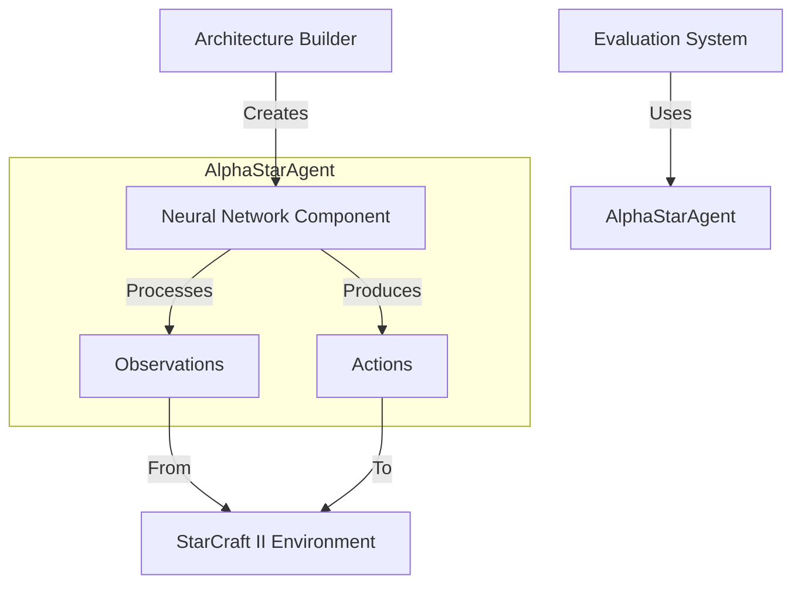
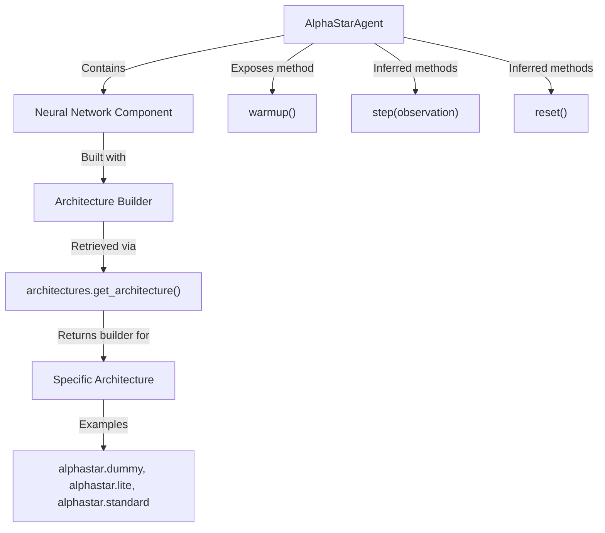
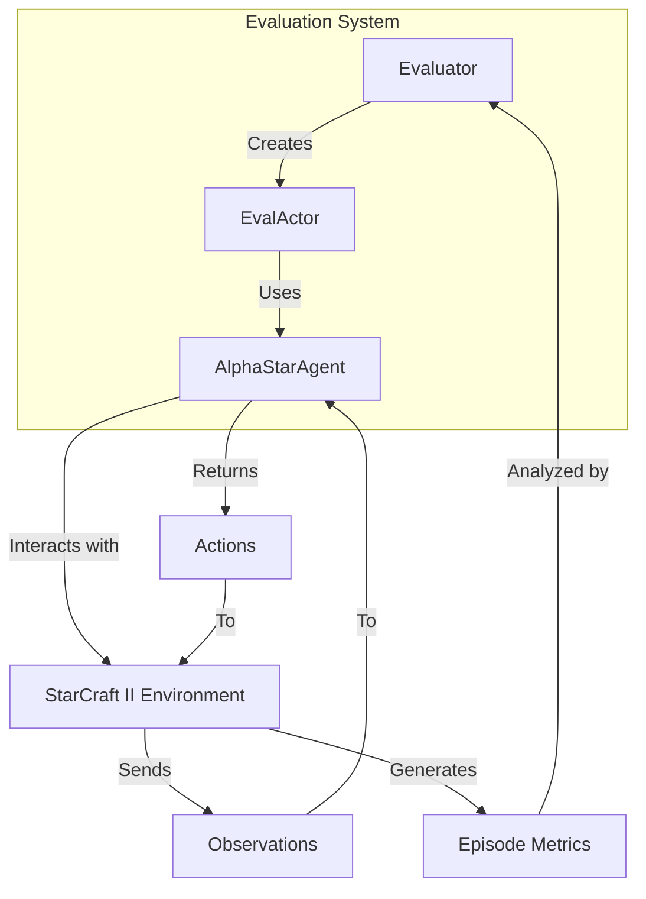

<!-- source: DeepWiki mcp.deepwiki.com · repo google-deepmind/alphastar · page 6.2 Agent Implementation · fetched 2026-10-26 -->

# Agent Implementation

<details>
<summary>Relevant source files</summary>

The following files were used as context for generating this wiki page:

- [alphastar/commons/jax_utils.py](alphastar/commons/jax_utils.py)
- [alphastar/modules/agent_test.py](alphastar/modules/agent_test.py)
- [alphastar/unplugged/modules/BUILD](alphastar/unplugged/modules/BUILD)

</details>


## Purpose and Scope

This document describes the implementation of the `AlphaStarAgent` class, which serves as the runtime interface between the neural network model and the StarCraft II environment. It explains how the agent encapsulates model architecture, processes observations, and produces actions during both evaluation and training. For information about the evaluation framework that uses this agent, see [Evaluation Framework](#6.1).

## Agent Overview

The `AlphaStarAgent` is a lightweight wrapper around a neural network component that handles the actual computation. This class provides a consistent interface for interaction with the environment, regardless of the underlying neural architecture being used.



Sources: [alphastar/modules/agent_test.py:92-95]()

## Initialization and Basic Usage

The agent is initialized with a pre-built neural network component and must be warmed up before use:

```python
# Construction
builder = architectures.get_architecture(architecture_name)
component = builder(input_spec, action_spec, is_training, seed, version)
alphastar_agent = agent.AlphaStarAgent(component)

# Preparation
alphastar_agent.warmup()
```

The `warmup()` method prepares the agent's internal state for operation, ensuring that any necessary JAX compilations are performed before the agent is used in the environment.

Sources: [alphastar/modules/agent_test.py:86-95]()

## Component Structure

The `AlphaStarAgent` wraps a neural network component built using one of the available architecture builders. The following diagram illustrates this relationship:



Sources: [alphastar/modules/agent_test.py:86-92]()

## JAX Optimization Considerations

The agent uses JAX for efficient computation and is designed to avoid unnecessary recompilation. The test suite verifies this behavior:

```python
# First warmup may trigger compilation
alphastar_agent.warmup()  

# Second warmup should not trigger recompilation
with jax_utils.no_jax_compilation_allowed():
    alphastar_agent.warmup()
```

This optimization is important since JAX compilation can be time-consuming, especially for complex models. The agent ensures that once compiled, the computation graph can be reused efficiently.

Sources: [alphastar/modules/agent_test.py:94-95](), [alphastar/commons/jax_utils.py:45-62]()

## Input and Output Specifications

The agent interfaces with structured observation and action specifications that define the data format for interaction with the StarCraft II environment:

### Observation Specification

| Field | Type | Description |
|-------|------|-------------|
| away_race_observed | int32 | Race of opponent as observed |
| away_race_requested | int32 | Race of opponent as requested |
| camera | int32 (256×256) | Camera view state |
| camera_position | int32 (2,) | Position of camera |
| camera_size | int32 (2,) | Size of camera view |
| game_loop | int32 | Current game loop count |
| minimap_* | int32 (128×128) | Various minimap features (alerts, buildable, creep, etc.) |
| raw_units | int32 (10, 47) | Unit data |
| player | int32 (7,) | Player information |
| upgrades_fixed_length | int32 (8,) | Available upgrades |

### Action Specification

| Field | Type | Range | Description |
|-------|------|-------|-------------|
| function | int32 | 0-10 | Function ID to execute |
| delay | int32 | 0-6 | Action delay |
| queued | int32 | 0-2 | Whether action is queued |
| repeat | int32 | 0-4 | Action repeat count |
| unit_tags | int32 (max_num_selected_units,) | 0-10 | Selected unit tags |
| target_unit_tag | int32 | 0-9 | Target unit tag |
| world | int32 | 0-65535 | World coordinates |

Sources: [alphastar/modules/agent_test.py:35-76]()

## Supported Architectures

The `AlphaStarAgent` can work with different neural network architectures, including:

1. **alphastar.dummy**: A minimal architecture used for testing
2. **alphastar.lite**: A lightweight architecture for faster experimentation
3. **alphastar.standard**: The full AlphaStar architecture

Each architecture implements the same interface but may vary in complexity, capacity, and computational requirements.

Sources: [alphastar/modules/agent_test.py:81-84]()

## Training and Inference Modes

The agent supports both training and inference modes, controlled by the `is_training` parameter during component construction:

```python
# Inference mode
component = builder(input_spec, action_spec, is_training=False, seed=0, version=0)

# Training mode
component = builder(input_spec, action_spec, is_training=True, seed=0, version=0)
```

In training mode, the input specification may include additional behavioral features that are used for learning but not needed during inference:

```python
# Training mode includes behavioral features
behaviour_features_spec = {'action': action_spec} if is_training else None
input_spec = data_util.get_input_spec(
    obs_spec=obs_spec, behaviour_features_spec=behaviour_features_spec)
```

Sources: [alphastar/modules/agent_test.py:87-90]()

## Integration with Evaluation System

The `AlphaStarAgent` is a key component in the evaluation system, where it is used by `EvalActor` instances to interact with the StarCraft II environment:



The evaluation system creates match scenarios, instantiates agents with appropriate model parameters, and measures performance metrics such as win rates and game statistics.

Sources: System Architecture Diagrams

## Dependencies

The `AlphaStarAgent` has the following key dependencies:

1. **alphastar.architectures**: Provides architecture builders for creating neural network components
2. **alphastar.commons.jax_utils**: Utilities for JAX optimization and compilation control
3. **alphastar.unplugged.data.util**: Data utility functions for preparing input specifications

These dependencies enable the agent to efficiently process game observations and produce appropriate actions for the StarCraft II environment.

Sources: [alphastar/modules/agent_test.py:18-23](), [alphastar/unplugged/modules/BUILD:38-41]()

---

