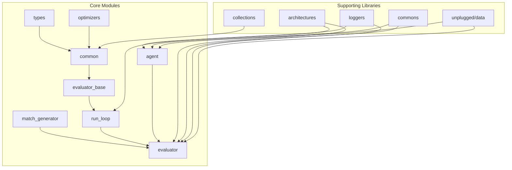
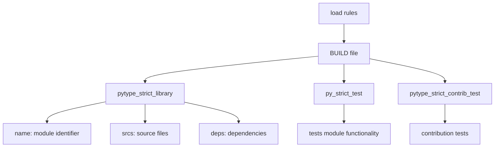
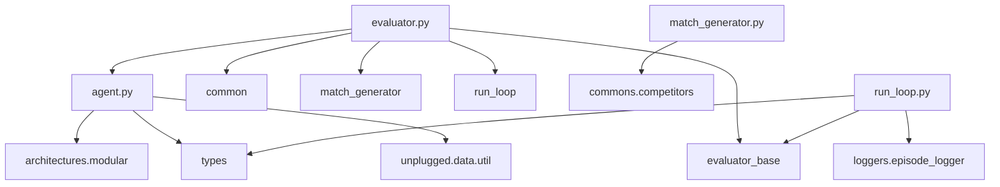
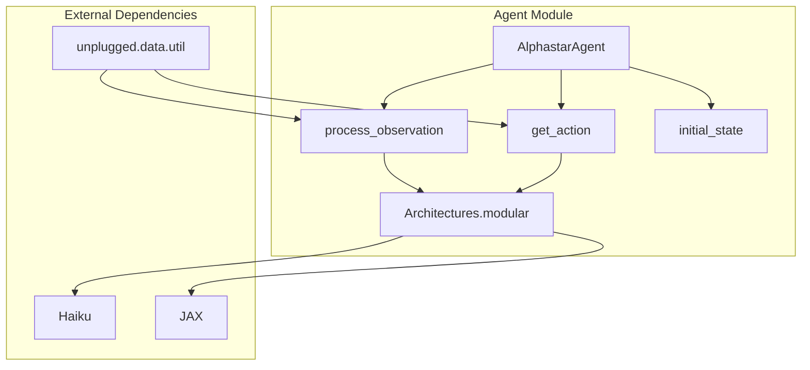
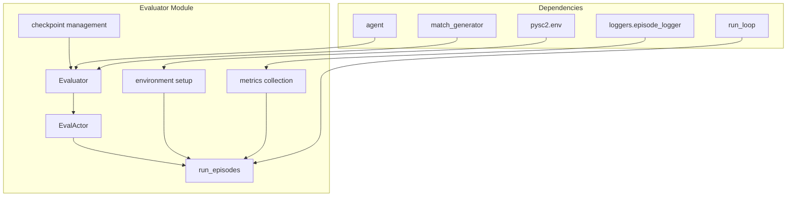
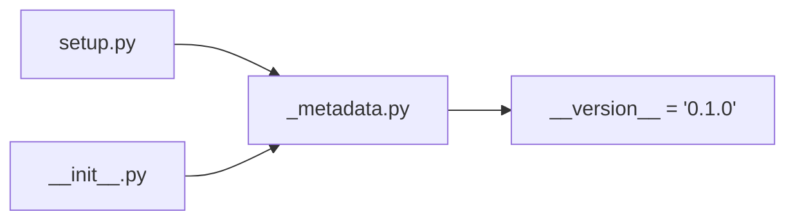
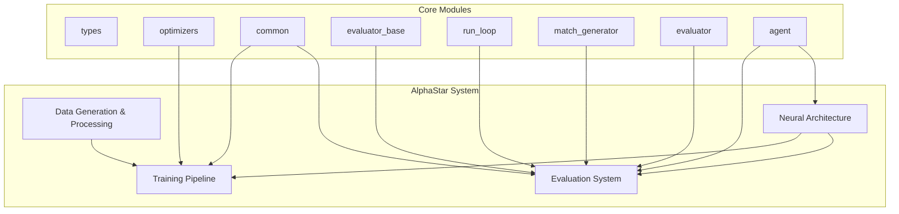

<!-- source: DeepWiki mcp.deepwiki.com · repo google-deepmind/alphastar · page 7 Module Structure · fetched 2026-10-26 -->

# Module Structure

Relevant source files

The following files were used as context for generating this wiki page:

- [alphastar/__init__.py](alphastar/__init__.py)
- [alphastar/_metadata.py](alphastar/_metadata.py)
- [alphastar/modules/BUILD](alphastar/modules/BUILD)

This document provides a detailed overview of the module structure in the AlphaStar codebase, focusing on how modules are organized, their dependencies, and their roles within the system. For information about the high-level architecture, see [Architecture](#3), and for details about specific components, refer to their respective wiki pages.

## Overview

The AlphaStar codebase follows a modular design pattern, organizing functionality into logical units with clear dependencies. This approach enhances maintainability, enables code reuse, and facilitates independent testing of components.

*Module dependency diagram showing relationships between core AlphaStar modules*

Sources: [alphastar/modules/BUILD:8-243]()

## Build System

AlphaStar uses Bazel as its build system, which defines modules and their dependencies through BUILD files. Each module is defined as a `pytype_strict_library` with explicit dependencies specified in the `deps` field.

*Bazel build system structure for AlphaStar modules*

Sources: [alphastar/modules/BUILD:1-7]()

The build system enforces strict typing through `pytype_strict_library` targets and comprehensive testing through `py_strict_test` and `pytype_strict_contrib_test` targets.

## Core Modules

The following table summarizes the core modules in the AlphaStar codebase:

| Module | Purpose | Key Dependencies |
|--------|---------|------------------|
| `types` | Defines type system used throughout AlphaStar | acme |
| `optimizers` | Implements optimization algorithms | haiku, jax, optax |
| `common` | Provides common utilities and functions | acme, collections, chex, ml_collections |
| `evaluator_base` | Base classes for evaluation | commons.log_utils, chex, dm_env |
| `run_loop` | Implements environment interaction loops | evaluator_base, loggers, types |
| `match_generator` | Creates StarCraft II matches for evaluation | commons.competitors, pysc2 |
| `evaluator` | Evaluates trained agents | agent, common, match_generator, run_loop |
| `agent` | Implements the AlphaStar agent | architectures.modular, types, unplugged.data |

Sources: [alphastar/modules/BUILD:9-243]()

## Module Dependencies

### Key Module Relationships

*Detailed dependencies between key AlphaStar modules*

Sources: [alphastar/modules/BUILD:187-243]()

### External Dependencies

The modules rely on several external libraries for core functionality:

| External Library | Used By | Purpose |
|------------------|---------|---------|
| JAX/JAXlib | Most modules | Machine learning framework |
| Haiku | agent, evaluator, optimizers | Neural network library |
| Acme | types, common | Reinforcement learning framework |
| PySC2 | match_generator, evaluator | StarCraft II environment |
| Chex | evaluator_base, common, evaluator | Testing and debugging utilities |
| NumPy | optimizers, run_loop, evaluator | Numerical computing |

Sources: [alphastar/modules/BUILD:13-225]()

## Module Implementation Details

### Types Module

The `types` module defines the custom type system used throughout AlphaStar. It provides type definitions for StarCraft II observations, actions, and internal model representations.

Sources: [alphastar/modules/BUILD:9-14]()

### Optimizers Module

The `optimizers` module implements optimization algorithms used for training. It relies on JAX, Haiku, and Optax for efficient neural network optimization.

Sources: [alphastar/modules/BUILD:16-28]()

### Common Module

The `common` module provides utility functions and common operations used across other modules. It has dependencies on multiple libraries including Acme, collections, Chex, and TensorFlow.

Sources: [alphastar/modules/BUILD:46-59]()

### Agent Module

The `agent` module implements the AlphaStar agent, which uses the modular architecture system to process observations and generate actions.

*Structure of the agent module and its interactions*

Sources: [alphastar/modules/BUILD:231-243]()

### Evaluator Module

The `evaluator` module contains the most complex dependencies, integrating multiple components for agent evaluation:

*Structure of the evaluator module showing key components*

Sources: [alphastar/modules/BUILD:197-229]()

## Package Structure

The AlphaStar package also contains metadata and version information, which is centralized in `_metadata.py` and imported by `__init__.py`.

*Package structure showing version management*

Sources: [alphastar/__init__.py:1-16](), [alphastar/_metadata.py:1-21]()

## Testing Structure

AlphaStar modules have corresponding test files that verify their functionality:

| Module | Test File | Test Type |
|--------|-----------|-----------|
| optimizers | optimizers_test.py | py_strict_test |
| common | common_test.py | py_strict_test |
| match_generator | match_generator_test.py | py_strict_test |
| evaluator | evaluator_test.py | pytype_strict_contrib_test |
| agent | agent_test.py | py_strict_test |

Sources: [alphastar/modules/BUILD:30-185]()

## Integration with Larger System

The modules described here integrate with the larger AlphaStar system components as follows:

*Integration of modules with broader AlphaStar system components*

Sources: [alphastar/modules/BUILD:9-243]()

## Summary

The AlphaStar codebase is structured around a set of well-defined modules with clear dependencies. The Bazel build system enforces these dependencies and ensures type safety through strict typing. Core modules like `agent`, `evaluator`, and `common` provide the fundamental functionality, while specialized modules handle specific aspects of the system. This modular design facilitates independent development and testing of components, as well as reuse across different parts of the system.

---

