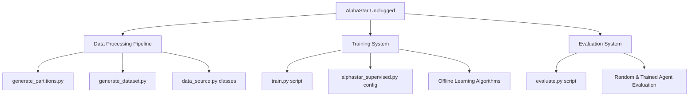
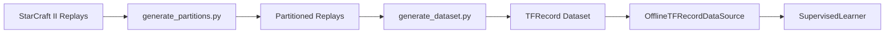
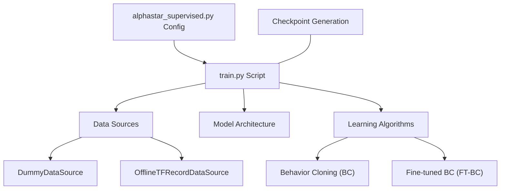

<!-- source: DeepWiki mcp.deepwiki.com · repo google-deepmind/alphastar · page 8 AlphaStar Unplugged · fetched 2026-10-26 -->

# AlphaStar Unplugged

<details>
<summary>Relevant source files</summary>

The following files were used as context for generating this wiki page:

- [alphastar/unplugged/README.md](alphastar/unplugged/README.md)
- [alphastar/unplugged/data/BUILD](alphastar/unplugged/data/BUILD)

</details>


## Purpose and Scope

AlphaStar Unplugged is a specialized framework for offline reinforcement learning in StarCraft II, built upon the core AlphaStar architecture. Unlike traditional reinforcement learning approaches that require active interaction with an environment, offline RL focuses on learning policies from pre-recorded datasets without additional environment interaction. This document details the AlphaStar Unplugged system architecture, supported algorithms, data processing pipeline, and usage instructions for training and evaluating agents.

## System Overview

AlphaStar Unplugged consists of three primary components working together to enable offline reinforcement learning from StarCraft II gameplay data.

### System Architecture



Sources:
- [alphastar/unplugged/README.md:1-11]()
- [alphastar/unplugged/data/BUILD:9-53]()

## Offline Learning Algorithms

AlphaStar Unplugged currently implements the following offline reinforcement learning approaches:

1. **Behavior Cloning (BC)**: A supervised learning approach that directly learns a policy from expert demonstrations, treating the problem as a classification task of predicting actions from states.

2. **Fine-tuned Behavior Cloning (FT-BC)**: An extension of BC that starts with a pre-trained checkpoint and continues training with specific hyperparameters to refine the policy.

These algorithms represent different approaches to learning from the static dataset of StarCraft II replays without requiring additional environment interaction.

Sources:
- [alphastar/unplugged/README.md:3-10]()

## Data Pipeline

The data pipeline is a critical component of AlphaStar Unplugged, responsible for converting raw StarCraft II replay files into a format suitable for training offline RL agents.

### Data Processing Flow



The pipeline consists of the following key stages:

1. **Raw StarCraft II Replays**: The initial dataset containing recorded gameplay from human players or other agents.

2. **Partition Generation**: The `generate_partitions.py` script processes the raw replays and divides them into training, validation, and test partitions based on criteria such as player MMR (matchmaking rating) and game version.

3. **Dataset Generation**: The `generate_dataset.py` script converts partitioned replays into TFRecord format, extracting the relevant features and actions.

4. **Data Source**: The `OfflineTFRecordDataSource` class in `data_source.py` loads the TFRecord datasets and provides batched data to the training system.

The data pipeline supports configurable filtering based on replay versions, player MMR thresholds, and other criteria to control the quality and characteristics of the training data.

Sources:
- [alphastar/unplugged/README.md:52-78]()
- [alphastar/unplugged/data/BUILD:55-93]()

## Training System

AlphaStar Unplugged employs a configuration-driven training system that enables flexible experimentation with various model architectures, learning algorithms, and hyperparameters.

### Training Components



The training system consists of:

1. **Configuration System**: The primary configuration file at `alphastar/unplugged/configs/alphastar_supervised.py` defines training parameters and can be overridden through command-line arguments.

2. **Training Script**: The main entry point for training is `alphastar/unplugged/scripts/train.py`, which sets up the training environment based on the provided configuration.

3. **Data Sources**: The system supports both `DummyDataSource` for debugging and `OfflineTFRecordDataSource` for training with real StarCraft II replay data.

4. **Model Architecture**: Various neural network architectures can be specified through the configuration.

5. **Learning Algorithms**: Currently supports Behavior Cloning (BC) and Fine-tuned BC (FT-BC).

The training process can run with either dummy data (for debugging purposes) or real StarCraft II replay data. When using real data, the system requires a paths file that specifies the locations of the dataset files.

Sources:
- [alphastar/unplugged/README.md:12-107]()

## Evaluation System

The evaluation system allows assessment of trained agent performance. It can evaluate both random agents (for baseline comparisons) and trained agents loaded from checkpoints.

The evaluation script at `alphastar/unplugged/scripts/evaluate.py` supports various configuration options to control the evaluation process, including the ability to log results to CSV files for analysis.

Sources:
- [alphastar/unplugged/README.md:109-123]()

## Data Configuration

The data configuration is managed through a paths Python file that needs to be created with specific constants:

| Parameter | Description | Example |
|-----------|-------------|---------|
| BASE_PATH | Root directory for the converted datasets | '/data/sc2_replays/' |
| RELATIVE_PATHS | Dictionary mapping of parameters to file paths | {('4.9.2', 'train', 3500): 'glob/pattern/*.tfrecord'} |

The keys in RELATIVE_PATHS consist of:
- replay_versions: Tuple of StarCraft II versions (e.g., "4.9.2")
- data_split: Dataset split ('train', 'valid', 'test')
- player_min_mmr: Minimum player MMR threshold

Sources:
- [alphastar/unplugged/README.md:59-77]()

## Usage Examples

### Training with Dummy Data (Debugging)

For debugging or testing the system, you can run training with dummy data:

```shell
python alphastar/unplugged/scripts/train.py \
  --config=alphastar/unplugged/configs/alphastar_supervised.py:alphastar.dummy \
  --config.train.max_number_of_frames=16 \
  --config.train.learner_kwargs.batch_size=4 \
  --config.train.datasource.kwargs.shuffle_buffer_size=16 \
  --config.train.optimizer_kwargs.lr_frames_before_decay=4 \
  --config.train.learner_kwargs.unroll_len=3 \
  --config.train.datasource.name=DummyDataSource
```

### Training with Real Data

To train with real StarCraft II replay data:

1. Generate the dataset following instructions in [alphastar/unplugged/data/README.md]()
2. Create a paths Python file with BASE_PATH and RELATIVE_PATHS constants
3. Run training with appropriate configuration:

```shell
python alphastar/unplugged/scripts/train.py \
  --config=alphastar/unplugged/configs/alphastar_supervised.py:alphastar.full \
  --config.train.datasource.kwargs.dataset_paths_fname='/tmp/paths.py' \
  --config.train.datasource.kwargs.replay_versions='("4.9.2",)'
```

### Evaluating a Random Agent

To evaluate a random agent for benchmarking:

```shell
python alphastar/unplugged/scripts/evaluate.py \
  --config=alphastar/unplugged/configs/alphastar_supervised.py:alphastar.dummy \
  --config.eval.log_to_csv=False \
  --config.eval.evaluator_type=random_params
```

Sources:
- [alphastar/unplugged/README.md:18-123]()

## Relation to AlphaStar Project

AlphaStar Unplugged serves as a specialized subsystem within the larger AlphaStar project, focusing specifically on offline reinforcement learning from replay data. While it leverages many components from the core AlphaStar architecture, it introduces specialized modules for processing replay data and implementing offline learning algorithms rather than requiring active gameplay interaction during training.

For information about the standard AlphaStar architecture, see [Standard Architecture](#3.3).

Sources:
- [alphastar/unplugged/README.md:1-5]()

---

